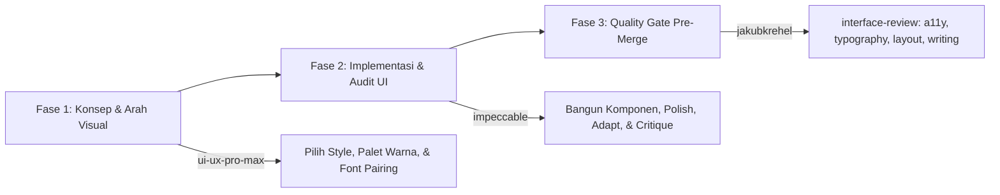

# Aturan Perutean Skill Desain UI/UX (design-skills-routing.md)

Aturan ini mengatur pembagian peran dan alur eksekusi antar skill desain agar tidak terjadi tumpang tindih (*overlap*) maupun konflik token desain dalam pengembangan antarmuka web.

---

## 1. Pembagian Peran Berdasarkan Fase Pengembangan

1. **Fase Awal — Memilih Arah Visual & Konsep**:
   - Gunakan skill **`ui-ux-pro-max`**.
   - Bertanggung jawab untuk: Menentukan gaya visual (modern corporate, clean SaaS, minimalis), pencarian palet warna yang harmonis, dan rekomendasi kombinasi font (*font pairing*).
2. **Fase Konstruksi & Polish Antarmuka**:
   - Gunakan skill **`impeccable`**.
   - Bertanggung jawab untuk: Membangun komponen UI secara presisi, audit hierarki visual, memperhalus micro-interactions, mempertegas kontras (*bolder*/*quieter*), serta memastikan pengalaman pengguna tidak hambar.
3. **Fase Tinjauan Detail Sebelum Penggabungan Kode (Pre-Merge Quality Gate)**:
   - Gunakan skill keluarga **`jakubkrehel`** (pemicu utama: **`interface-review`**).
   - Melakukan evaluasi mendalam pada komponen terdampak:
     - Masalah aksesibilitas & screen-reader -> delegasikan ke `better-accessibility`.
     - Masalah tipografi, kerning, & truncation -> delegasikan ke `better-typography`.
     - Masalah responsivitas, overflow, & alignment -> delegasikan ke `better-layout`.
     - Masalah token warna & rasio kontras WCAG -> delegasikan ke `better-colors`.
     - Masalah microcopy form, error state, & label -> delegasikan ke `better-writing`.

---

## 2. Sumber Kebenaran Tunggal (*Single Source of Truth*)

1. **Lokasi Dokumen**:
   - Seluruh keputusan desain, token warna, typography, dan spacing disimpan pada berkas **`docs/architecture/STYLING.md`** (dan/atau `DESIGN.md` bila disepakati).
2. **Kepatuhan Desain**:
   - Semua skill (`impeccable`, `ui-ux-pro-max`, `interface-review`) **WAJIB membaca** berkas dokumentasi desain tersebut sebelum menyarankan atau mengedit UI.
   - **DILARANG KERAS** mengganti jenis huruf (typeface), palet warna brand dasar (`--blue-600`), atau struktur breakpoint yang telah disepakati tanpa persetujuan eksplisit dari pengguna.
