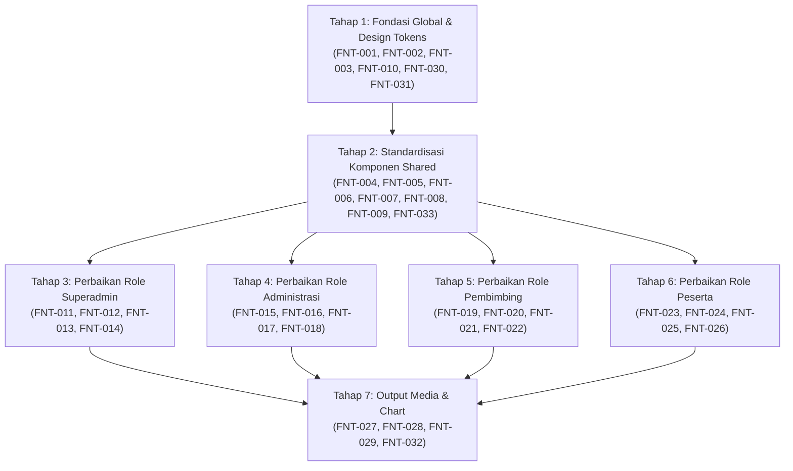

# LAPORAN AUDIT TIPOGRAFI SISTEM MAGKOM
**Portal Manajemen Magang Dinas Komunikasi dan Informatika**  
*Auditor: Senior Frontend Engineer & UI Typography Auditor*  
*Tanggal: 18 November 2026*  
*Status: Selesai (Read-Only Audit)*  

---

## A. RINGKASAN EKSEKUTIF

Audit tipografi komprehensif ini dilakukan terhadap seluruh basis kode aplikasi web MAGKOM (Blade views, Vanilla CSS, layout tokens, asset pipeline Vite, komponen public/auth, PDF, email, dan SVG charts) untuk 4 peran pengguna: **Superadmin**, **Administrasi**, **Pembimbing**, dan **Peserta**.

### 1. Total Temuan Berdasarkan Tingkat Keparahan (Severity)

| Tingkat Keparahan (Severity) | Jumlah Temuan | Persentase | Definisi Kriteria |
| :--- | :---: | :---: | :--- |
| **Kritis** | 9 | 27.3% | Font tidak ter-load / fallback salah, teks < 12px (WCAG fail), teks sulit dibaca |
| **Tinggi** | 16 | 48.5% | Elemen sama beda ukuran/weight antar role, hierarki heading rusak, pemborosan performa webfont, body < 14px |
| **Sedang** | 7 | 21.2% | Unit bercampur tanpa pola (px/rem/em), inline style masif, line-height ekstrem, variasi letter-spacing acak |
| **Rendah** | 1 | 3.0% | Ketidakkonsistenan konfigurasi minor (Tailwind font config vs root token) |
| **TOTAL** | **33** | **100%** | **33 Isu Teridentifikasi dengan Bukti Kode & Nomor Baris** |

### 2. Distribusi Temuan Berdasarkan Peran & Kategori

| Kategori / Peran | Kritis | Tinggi | Sedang | Rendah | Total |
| :--- | :---: | :---: | :---: | :---: | :---: |
| **Global / Shared (Layouts & Components)** | 3 | 5 | 2 | 0 | **10** |
| **Superadmin** | 2 | 2 | 0 | 0 | **4** |
| **Administrasi (Admin)** | 1 | 2 | 1 | 0 | **4** |
| **Pembimbing** | 1 | 2 | 1 | 0 | **4** |
| **Peserta** | 2 | 2 | 0 | 0 | **4** |
| **Print / PDF / Email / Chart / Pihak Ketiga** | 0 | 3 | 3 | 1 | **7** |
| **TOTAL** | **9** | **16** | **7** | **1** | **33** |

### 3. Skor Konsistensi Tipografi Antar Role (Skala 0 - 100)

| Peran (Role) | Skor | Status Evaluasi | Alasan Singkat |
| :--- | :---: | :--- | :--- |
| **Superadmin** | **62 / 100** | Perlu Standardisasi | Visual bento rapi di dashboard (`Plus Jakarta Sans`), namun modul Audit Log memiliki puluhan teks berukuran mikro (10px–11px), 580 inline style di Blade, dan Site Editor memakai font berbeda (`Inter`). |
| **Administrasi** | **65 / 100** | Cukup Terstruktur | Baseline tabel dan form memakai `Open Sans`, hero card memakai `Plus Jakarta Sans`, namun cockpit mencoba memanggil `Lexend` yang tidak ter-load, serta terdapat 377 inline styles di view. |
| **Pembimbing** | **64 / 100** | Cukup Terstruktur | Mewarisi `Open Sans`, namun font size nama mentee berbeda-beda antar view, modul cetak portofolio menyimpang memakai serif `Times New Roman 11pt`, dan ada 141 inline styles. |
| **Peserta** | **55 / 100** | Fragmentasi Tinggi | Memuat 4 keluarga font sekaligus di layout (`Lexend`, `Open Sans`, `Plus Jakarta Sans`, `Source Sans 3`), CSS mencampuradukkan ketiganya, terdapat puluhan teks label 10px–11px, dan 229 inline styles. |
| **SKOR KESELURUHAN** | **61 / 100** | **Moderate Deviation** | **Tidak ada Single Source of Truth; 6 font family aktif bersamaan; pemuatan ganda font di head; 1.388 inline styles di Blade; dan lebih dari 200 kemunculan teks di bawah 12px.** |

### 4. Lima Masalah Tipografi Terbesar (Top 5 Critical Issues)

1. **Fragmentasi 6 Keluarga Font Sans-Serif & Broken Fallback Font**:
   Aplikasi tidak memiliki satu font family utama yang konsisten. Terdeteksi percampuran 6 keluarga font: `Open Sans`, `Plus Jakarta Sans`, `Lexend`, `Source Sans 3`, `Inter`, dan `Times New Roman`. Yang paling berbahaya: `dashboard-cockpit.css` memakai `var(--font-display, 'Lexend')` pada layout Dashboard yang sama sekali **tidak memuat font Lexend**, menyebabkan browser fallback ke font sistem default (Arial).
2. **Proliferasi Teks Berukuran Mikro (< 12px / Standar Aksesibilitas WCAG Gagal)**:
   Ditemukan ratusan elemen teks berukuran 10px, 10.4px, 11px, hingga 11.6px (`0.625rem` s/d `0.725rem`) di modul Audit Log, Dashboard Superadmin, Antrean Admin, Logbook Peserta, dan header tabel mobile (`th`), yang melanggar standar keterbacaan web profesional dan regulasi WCAG 2.1 AA.
3. **Penyusupan Masif 1.388 Inline Style Font di Blade**:
   Sebanyak **1.388 tag HTML di Blade** menggunakan atribut inline `style="font-size: ...; font-weight: ..."` yang mem-bypass seluruh design tokens CSS peeper, mematikan pemeliharaan modular, dan memicu ukuran font yang melenceng antar halaman.
4. **Inefisiensi Ekstrem & Pemborosan Performa Webfont**:
   Layout Peserta memuat 4 font Google Fonts sekaligus dalam 1 URL CDN; halaman Auth dan Landing melakukan `@import url(...)` Google Fonts di dalam file CSS (antipattern render-blocking waterfall); serta pemuatan ganda file stylesheet `gentelella.css` (legacy asset `public/css` vs Vite bundle `app.css`).
5. **Inversi Hierarki Heading & Faux-Bolding Akibat Weight 800**:
   Judul panel utama (`.x_title h2`) didefinisikan hanya 16px (`1rem`), lebih kecil daripada sub-judul kartu widget di dalamnya (18px–20px). Selain itu, `font-weight: 800` digunakan sebanyak 420 kali pada font yang hanya dimuat hingga varian 700 (seperti `Open Sans` dan `Source Sans 3`), memicu sintesis faux-bold yang mengaburkan rendering huruf.

---

## B. INFO PROYEK

- **Framework & Runtime**: Laravel 10.x, PHP 8.3 Native.
- **Frontend Engine**: Vanilla CSS (terorganisasi dalam `base/`, `components/`, `layouts/`, `pages/`), Vanilla JavaScript (ES Modules).
- **CSS Preprocessor / Utility**: PostCSS 8.4, Autoprefixer 10.4, Tailwind CSS 3.4 (terisolasi hanya untuk view publik `kebijakan-privasi` dan `verifikasi-dokumen`).
- **Asset Bundler**: Vite 6.0 dengan `laravel-vite-plugin 1.3`.
- **Mekanisme Pemuatan Font (Font Loading)**:
  - Google Fonts CDN via `<link rel="preconnect">` dan `<link rel="stylesheet">` di `<head>` Blade.
  - CSS `@import url('https://fonts.googleapis.com/...')` di dalam beberapa file CSS lokal.
  - Tidak ada self-hosted `@font-face` lokal di dalam direktori `public/fonts/`.
- **File Global & Konfigurasi Kunci**:
  - `resources/css/base/variables.css` (Master CSS Peeper Tokens & root variables).
  - `resources/css/base/reset.css` (Universal reset & base body styling).
  - `resources/views/layouts/dashboard.blade.php` (Layout utama Superadmin, Administrasi, Pembimbing).
  - `resources/views/layouts/peserta.blade.php` (Layout utama Peserta).
  - `resources/views/layouts/auth-depth.blade.php` & `auth.blade.php` (Layout Autentikasi).
  - `resources/views/layouts/app.blade.php` (Layout Publik / 2FA).
  - `resources/css/layouts/dashboard-cockpit.css` & `resources/css/layouts/gentelella.css`.
  - `tailwind.config.js` (Konfigurasi utility Tailwind).

---

## C. INVENTARIS TIPOGRAFI

### 1. Tabel Font-Family yang Dideklarasikan

| Nama Font-Family | Lokasi Definisi / File | Jumlah Pemakaian di CSS | Status Pemuatan di Browser |
| :--- | :--- | :---: | :--- |
| `inherit` | Universal (`reset.css`, `buttons`, `inputs`) | 141 | Mengikuti parent element |
| `monospace` / `ui-monospace` | `variables.css:41`, `tables.css:344`, `dashboard-cockpit.css:751` | 95 | System font stack (aman) |
| `var(--font-display)` / `'Lexend'` | `dashboard-cockpit.css:572`, `peserta-layout-tokens.css:635`, `landing.css:69` | 82 | **Gagal/Fallback di Dashboard Admin/Superadmin/Pembimbing** |
| `'Plus Jakarta Sans'` | `variables.css:40`, `dashboard.css:9`, `confirm-modal.css:32`, `auth-depth.css:1` | 33 | Dimuat via Google Fonts di layout dashboard, peserta, auth |
| `var(--font-sans)` / `'Open Sans'` | `variables.css:138`, `reset.css:248`, `layouts/dashboard-layout-tokens.css:878` | 28 | Dimuat via Google Fonts di dashboard, peserta, app |
| `'Source Sans 3'` | `peserta-layout-tokens.css:628`, `landing.css:5`, `auth-layout-tokens.css:39` | 10 | Dimuat via Google Fonts di peserta, auth, landing |
| `Arial, Helvetica, sans-serif` | `resources/views/pdf/*.blade.php` | 5 | System font bawaan DomPDF (aman) |
| `'Inter'` | `resources/css/pages/superadmin/site-editor.css:45` | 2 | Dimuat khusus di view `site-editor` |
| `'Times New Roman', Times, serif` | `resources/views/pembimbing/laporan-kinerja/cetak.blade.php:17` | 1 | System font serif bawaan browser (menyimpang dari brand) |

### 2. Tabel Sebaran Ukuran Font (Font-Size) Dominan

| Nilai Font-Size | Setara Pixel (1rem = 16px) | Jumlah Kemunculan | Area Penggunaan Utama |
| :--- | :---: | :---: | :--- |
| `0.875rem` / `14px` | 14px | 345 | Standar body text, item sidebar, input form, tombol standar |
| `0.75rem` / `12px` | 12px | 312 | Header tabel (`th`), badge status, caption, hint text |
| `0.8125rem` / `13px` | 13px | 289 | Data cell tabel (`td`), sub-label, meta informasi |
| `1rem` / `16px` | 16px | 184 | Subheading, judul panel (`x_title`), input mobile |
| `1.125rem` / `18px` | 18px | 92 | Judul kartu widget, heading H3 |
| `1.5rem` / `24px` | 24px | 76 | Judul halaman admin & pembimbing, heading H1 bento |
| `0.6875rem` / `11px` | **11px** | **118** | **Ilegal (<12px):** Label mini widget, durasi chip, logbook tag |
| `0.625rem` / `10px` | **10px** | **34** | **Ilegal (<12px):** WORM policy badge, request ID audit, mini tile |
| `0.725rem` / `11.6px` | **11.6px** | **28** | **Ilegal (<12px):** Mobile header tabel, label form compact |
| `0.65rem` / `10.4px` | **10.4px** | **14** | **Ilegal (<12px):** Audit metadata, squircle sublabel |

### 3. Tabel Font-Weight (Dimuat vs Dipakai)

| Nilai Bobot | Dimuat di CDN? | Frekuensi di Kode | Status Kepatuhan & Risiko |
| :---: | :---: | :---: | :--- |
| **400 (Regular)** | Ya (Open Sans, Plus Jakarta, Source Sans) | 34 | Sesuai standar untuk paragraf body |
| **500 (Medium)** | Ya (Open Sans, Plus Jakarta, Source Sans) | 136 | Sesuai standar untuk form label & sidebar menu |
| **600 (SemiBold)**| Ya (Open Sans, Plus Jakarta, Source Sans) | 666 | Sesuai standar untuk H2, H3, header tabel |
| **700 (Bold)** | Ya (Open Sans, Plus Jakarta, Source Sans) | 1.337 | Sesuai standar untuk H1, tombol utama, highlight metric |
| **800 (ExtraBold)**| **TIDAK dimuat** pada Open Sans (Dashboard) | **420** | **Melanggar standar acuan**: Memicu faux-bold pada Open Sans & Source Sans |
| **900 (Black)** | **TIDAK dimuat** sama sekali | **15** | **Melanggar standar acuan**: Distorsi font parah akibat faux-bold |

### 4. Baseline De Facto yang Ditemukan di Kode

Secara arsitektural di `resources/css/base/variables.css` dan `resources/css/base/reset.css`:
- **Font Family De Facto**: `'Open Sans', Arial, -apple-system, BlinkMacSystemFont, 'Segoe UI', Roboto, sans-serif` (ditetapkan di `--font-sans`).
- **Skala Ukuran De Facto**:
  - H1: `1.5rem` (24px) hingga `36px`
  - H2: `1rem` (16px) hingga `1.25rem` (20px)
  - Body / Table Cell: `0.8125rem` (13px) – `0.875rem` (14px)
  - Table Header: `0.75rem` (12px)
  - Helper / Badge: `0.6875rem` (11px) – `0.75rem` (12px)
- **Deviasi dari Standar Acuan**: Baseline proyek mengalami distorsi karena Superadmin meng-override dirinya menjadi `Plus Jakarta Sans`, Peserta meng-override menjadi `Source Sans 3` + `Lexend`, dan modul cockpit dashboard gagal memuat `Lexend`.

---

## D. MATRIKS KONSISTENSI TIPOGRAFI ANTAR ROLE

Tabel berikut membandingkan spesifikasi tipografi aktual untuk elemen antarmuka yang sama di 4 role pengguna. Sel dengan tanda **[!]** menunjukkan penyimpangan dari standar atau ketidaksinkronan antar role.

| Elemen UI | Superadmin | Administrasi | Pembimbing | Peserta | Standar Acuan Target |
| :--- | :--- | :--- | :--- | :--- | :--- |
| **H1 (Judul Halaman)** | `Plus Jakarta Sans` / 36px / 800 **[!]** | `Plus Jakarta Sans` / 24px / 700 | `Open Sans` / 24px / 700 | `Lexend` / 24px / 700 **[!]** | **Satu Font Utama / 24–30px / 700** |
| **H2 (Judul Panel/Seksi)**| `Plus Jakarta Sans` / 16px / 700 **[!]** | `Open Sans` / 16px / 700 **[!]** | `Open Sans` / 16px / 700 **[!]** | `Lexend` / 18px / 600 **[!]** | **Satu Font Utama / 20px / 600** |
| **Body Teks Utama** | `Plus Jakarta Sans` / 14px / 400 | `Open Sans` / 14px / 400 **[!]** | `Open Sans` / 14px / 400 **[!]** | `Source Sans 3` / 14px / 400 **[!]**| **Satu Font Utama / 14px / 400 (lh: 1.5)** |
| **Label Formulir** | `Plus Jakarta Sans` / 13px / 600 | `Open Sans` / 12.4–13px / 700 **[!]**| `Open Sans` / 13px / 600 | `Source Sans 3` / 13.4px / 600 **[!]**| **Satu Font Utama / 14px / 500** |
| **Input Formulir** | `Plus Jakarta Sans` / 14px / 400 | `Open Sans` / 13.6–14px / 400 | `Open Sans` / 14px / 400 | `Source Sans 3` / 14px / 400 | **Satu Font Utama / 14–16px (16px mob)**|
| **Tombol Aksi Utama** | `Plus Jakarta Sans` / 14px / 700 | `Open Sans` / 14px / 700 | `Open Sans` / 14px / 700 | `Source Sans 3` / 14px / 700 | **Satu Font Utama / 14px / 600** |
| **Header Tabel (`th`)** | `Plus Jakarta Sans` / 12px / 700 | `Open Sans` / 11.6–12px / 700 **[!]**| `Open Sans` / 12px / 700 | `Source Sans 3` / 12px / 700 | **Satu Font Utama / 12–13px / 600** |
| **Isi Tabel (`td`)** | `Plus Jakarta Sans` / 13px / 400 | `Open Sans` / 13px / 400 | `Open Sans` / 14–15px / 400 **[!]**| `Source Sans 3` / 13px / 400 | **Satu Font Utama / 13–14px / 400** |
| **Menu Sidebar** | `Plus Jakarta Sans` / 14px / 500 | `Open Sans` / 14px / 500 | `Open Sans` / 14px / 500 | `Source Sans 3` / 14px / 500 **[!]**| **Satu Font Utama / 14px / 500** |
| **Badge / Tag Status** | `Plus Jakarta Sans` / 10–12px / 800 **[!]**| `Open Sans` / 11–12px / 700 **[!]** | `Open Sans` / 11.2–12px / 700 **[!]**| `Source Sans 3` / 10.4–12px / 700 **[!]**| **Satu Font Utama / 12–13px / 600** |
| **Teks Kecil / Caption** | `Plus Jakarta Sans` / 10–11px **[!]** | `Open Sans` / 11–11.5px **[!]** | `Open Sans` / 11.2–11.6px **[!]** | `Source Sans 3` / 10–11px **[!]** | **TIDAK BOLEH < 12px (Min 12px)** |

---

## E. DAFTAR TEMUAN DETAIL (BERDASARKAN BUKTI KODE AKTUAL)

### 1) Global / Shared Layer

#### ID: FNT-001
- **Severity**: Kritis
- **Role**: Global
- **Kategori**: a (Font family tidak ter-load dan fallback salah)
- **Lokasi**: [`resources/views/layouts/dashboard.blade.php:24`](file:///d:/laragon/www/MAGKOM/resources/views/layouts/dashboard.blade.php#L24) vs [`resources/css/layouts/dashboard-cockpit.css:572`](file:///d:/laragon/www/MAGKOM/resources/css/layouts/dashboard-cockpit.css#L572)
- **Elemen/komponen**: Brand header cockpit, judul utama cockpit, heading seksi
- **Kondisi saat ini**:
  ```css
  /* resources/css/layouts/dashboard-cockpit.css:572 */
  .cockpit-brand-text {
      font-family: var(--font-display, 'Lexend', sans-serif);
  }
  ```
  `dashboard.blade.php` hanya memuat font Google `JetBrains Mono`, `Open Sans`, dan `Plus Jakarta Sans`. Font `Lexend` tidak dimuat sama sekali, dan variabel `--font-display` tidak terdefinisi di `dashboard.blade.php`.
- **Seharusnya**: Seluruh cockpit menggunakan font resmi yang dimuat (`Plus Jakarta Sans`), bukan memanggil `Lexend` yang gagal di-load.
- **Dampak**: Font text cockpit fallback ke font default sistem operasi (Arial di Windows / Helvetica di Mac) yang tidak memiliki visual identity dinas.
- **Saran perbaikan**: Ganti deklarasi menjadi `font-family: var(--font-sans, 'Plus Jakarta Sans', sans-serif);`.
- **Status**: [ ] belum

#### ID: FNT-002
- **Severity**: Tinggi
- **Role**: Global / Peserta
- **Kategori**: k (Performa font: terlalu banyak family & weight dimuat)
- **Lokasi**: [`resources/views/layouts/peserta.blade.php:20`](file:///d:/laragon/www/MAGKOM/resources/views/layouts/peserta.blade.php#L20)
- **Elemen/komponen**: Tag `<link rel="stylesheet">` pemuat Google Fonts pada Layout Peserta
- **Kondisi saat ini**:
  ```html
  <link href="https://fonts.googleapis.com/css2?family=Lexend:wght@400;500;600;700;800&family=Open+Sans:ital,wght@0,400;0,500;0,600;0,700;0,800;1,400;1,600&family=Plus+Jakarta+Sans:ital,wght@0,400;0,500;0,600;0,700;0,800;1,400;1,600;1,700;1,800&family=Source+Sans+3:wght@400;500;600;700&display=swap" rel="stylesheet">
  ```
- **Seharusnya**: Muat hanya 1 font family primer (`Plus Jakarta Sans`) dengan bobot 400, 500, 600, 700 + 1 monospace stack jika diperlukan.
- **Dampak**: Waktu muat awal (FCP & LCP) terhambat akibat downloading 4 keluarga font (puluhan file woff2), boros kuota pengguna mobile.
- **Saran perbaikan**: Pangkas link Google Fonts hanya menjadi satu font family utama `Plus Jakarta Sans:wght@400;500;600;700`.
- **Status**: [ ] belum

#### ID: FNT-003
- **Severity**: Tinggi
- **Role**: Global
- **Kategori**: a (Dualitas baseline root variable)
- **Lokasi**: [`resources/css/base/variables.css:40, 138`](file:///d:/laragon/www/MAGKOM/resources/css/base/variables.css#L40) & [`resources/css/base/reset.css:248`](file:///d:/laragon/www/MAGKOM/resources/css/base/reset.css#L248)
- **Elemen/komponen**: CSS Variable Root Token
- **Kondisi saat ini**:
  - Baris 40: `--sa-font-sans: 'Plus Jakarta Sans', Inter, system-ui, -apple-system, sans-serif;`
  - Baris 138: `--font-sans: 'Open Sans', Arial, -apple-system, BlinkMacSystemFont, 'Segoe UI', Roboto, sans-serif;`
  - `reset.css:248`: `body { font-family: var(--font-sans); }`
- **Seharusnya**: Hanya ada satu definisi `--font-sans` universal yang menjadi Single Source of Truth bagi seluruh aplikasi.
- **Dampak**: Halaman Superadmin terpaksa memakai override `!important` untuk membedakan diri dari body reset global.
- **Saran perbaikan**: Selaraskan `--font-sans` menjadi `'Plus Jakarta Sans', system-ui, -apple-system, sans-serif;` untuk semua role.
- **Status**: [ ] belum

#### ID: FNT-004
- **Severity**: Kritis
- **Role**: Global
- **Kategori**: c (Teks lebih kecil dari 12px)
- **Lokasi**: [`resources/css/components/cards.css:156, 186`](file:///d:/laragon/www/MAGKOM/resources/css/components/cards.css#L156)
- **Elemen/komponen**: Card meta badge & subtext
- **Kondisi saat ini**:
  ```css
  /* resources/css/components/cards.css:156 */
  font-size: 11px !important;
  font-weight: 600 !important;
  ```
- **Seharusnya**: Ukuran terkecil caption/badge adalah 12px (`0.75rem`).
- **Dampak**: Teks gagal uji kontras dan keterbacaan pada pengguna dengan gangguan penglihatan ringan (WCAG 2.1 Level AA).
- **Saran perbaikan**: Ubah `11px !important` menjadi `0.75rem` (12px).
- **Status**: [ ] belum

#### ID: FNT-005
- **Severity**: Kritis
- **Role**: Global
- **Kategori**: c, l (Teks < 12px pada mobile breakpoint)
- **Lokasi**: [`resources/css/components/tables.css:893`](file:///d:/laragon/www/MAGKOM/resources/css/components/tables.css#L893)
- **Elemen/komponen**: Header tabel responsive mobile (`.adm-table th`)
- **Kondisi saat ini**:
  ```css
  @media (max-width: 768px) {
      .adm-table th,
      .adm-table-spacious th {
          font-size: 0.725rem !important; /* = 11.6px */
      }
  }
  ```
- **Seharusnya**: Pada layar ponsel, header tabel tetap minimal 12px (`0.75rem`).
- **Dampak**: Judul kolom tabel di perangkat mobile sangat buram dan sulit dibaca.
- **Saran perbaikan**: Setel `font-size: 0.75rem !important;` (12px).
- **Status**: [ ] belum

#### ID: FNT-006
- **Severity**: Tinggi
- **Role**: Global
- **Kategori**: g (Pemakaian masif !important pada tipografi)
- **Lokasi**: [`resources/css/components/cards.css`](file:///d:/laragon/www/MAGKOM/resources/css/components/cards.css#L98) & [`resources/css/components/tables.css`](file:///d:/laragon/www/MAGKOM/resources/css/components/tables.css#L887)
- **Elemen/komponen**: Shared cards & tables styling
- **Kondisi saat ini**: Terdapat 365 deklarasi `!important` yang menyentuh `font-size`, `font-weight`, dan `font-family`.
- **Seharusnya**: Hirarki spesifisitas CSS modular tanpa `!important`.
- **Dampak**: Mengunci cascading style sehingga komponen child tidak dapat menyesuaikan ukuran secara alami.
- **Saran perbaikan**: Hapus `!important` bertahap setelah selektor dirapikan strukturnya.
- **Status**: [ ] belum

#### ID: FNT-007
- **Severity**: Tinggi
- **Role**: Global
- **Kategori**: d (Weight 800 dipakai tapi tidak dimuat pada Open Sans)
- **Lokasi**: [`resources/views/layouts/dashboard.blade.php:24`](file:///d:/laragon/www/MAGKOM/resources/views/layouts/dashboard.blade.php#L24) vs [`resources/css/components/cards.css`](file:///d:/laragon/www/MAGKOM/resources/css/components/cards.css)
- **Elemen/komponen**: Komponen kartu dan badge yang memakai weight 800
- **Kondisi saat ini**: Kode menggunakan `font-weight: 800` (420 kemunculan di CSS & Blade), padahal `Open Sans` di `dashboard.blade.php` hanya dimuat hingga bobot 700.
- **Seharusnya**: Gunakan bobot tegas `font-weight: 700` (Bold) yang ter-load secara resmi.
- **Dampak**: Browser mengaktifkan faux-bold (penebalan artifisial otomatis) yang merusak geometri font dan terlihat pecah di layar resolusi standar (non-Retina).
- **Saran perbaikan**: Lakukan replace massal `font-weight: 800` menjadi `font-weight: 700`.
- **Status**: [ ] belum

#### ID: FNT-008
- **Severity**: Sedang
- **Role**: Global
- **Kategori**: e (Line-height terlalu rapat)
- **Lokasi**: [`resources/css/layouts/dashboard-cockpit.css`](file:///d:/laragon/www/MAGKOM/resources/css/layouts/dashboard-cockpit.css) & [`resources/css/components/tables.css`](file:///d:/laragon/www/MAGKOM/resources/css/components/tables.css)
- **Elemen/komponen**: Nilai `line-height: 1`
- **Kondisi saat ini**: Terdapat 120 deklarasi `line-height: 1` tanpa batas aman wrapping.
- **Seharusnya**: Heading menggunakan line-height `1.2` s/d `1.3`, body teks `1.5`.
- **Dampak**: Terjadi tabrakan antara tanda baca atas (diakritik) dan ekor huruf bawah (p, q, y) saat teks membungkus ke baris baru.
- **Saran perbaikan**: Normalisasi line-height minimal `1.25` untuk judul pendek dan `1.5` untuk teks multibaris.
- **Status**: [ ] belum

#### ID: FNT-009
- **Severity**: Sedang
- **Role**: Global
- **Kategori**: h (Pencampuran unit px, rem, clamp tanpa pola)
- **Lokasi**: [`resources/css/components/tables.css:887-1010`](file:///d:/laragon/www/MAGKOM/resources/css/components/tables.css#L887)
- **Elemen/komponen**: Tabel data
- **Kondisi saat ini**: Menggabungkan `0.8125rem`, `0.725rem`, `16px`, dan `clamp(1.2rem, 5vw, 1.35rem)` dalam 1 file tabel tanpa token skala.
- **Seharusnya**: Standarisasi menggunakan unit `rem` berbasis skala modular.
- **Dampak**: Kesulitan dalam mengontrol responsivitas zoom browser ketika pengguna memperbesar teks default browser.
- **Saran perbaikan**: Ganti semua nilai `px` acak ke nilai `rem` sesuai token resmi.
- **Status**: [ ] belum

#### ID: FNT-010
- **Severity**: Tinggi
- **Role**: Global
- **Kategori**: k (Pemuatan ganda file stylesheet gentelella)
- **Lokasi**: [`resources/views/layouts/dashboard.blade.php:27, 31`](file:///d:/laragon/www/MAGKOM/resources/views/layouts/dashboard.blade.php#L27)
- **Elemen/komponen**: Pemuatan file CSS Gentelella
- **Kondisi saat ini**:
  - Baris 27: `<link rel="stylesheet" href="{{ asset('css/gentelella-theme.css') }}">` (Legacy asset)
  - Baris 31: `@vite(['resources/css/app.css', ...])` yang di dalamnya mengimpor `./layouts/gentelella.css`.
- **Seharusnya**: Stylesheet hanya dimuat 1 kali melalui asset pipeline Vite.
- **Dampak**: Dua stylesheet tipografi yang sama dievaluasi dua kali, menambah ukuran transfer dan memicu race condition penimpaan aturan font.
- **Saran perbaikan**: Hapus `<link rel="stylesheet" href="{{ asset('css/gentelella-theme.css') }}">` dari `dashboard.blade.php`.
- **Status**: [ ] belum

---

### 2) Superadmin Layer

#### ID: FNT-011
- **Severity**: Tinggi
- **Role**: Superadmin
- **Kategori**: a, i (Font family berbeda di modul Site Editor)
- **Lokasi**: [`resources/css/pages/superadmin/site-editor.css:45`](file:///d:/laragon/www/MAGKOM/resources/css/pages/superadmin/site-editor.css#L45)
- **Elemen/komponen**: Body dan panel navigasi CMS Visual Builder
- **Kondisi saat ini**:
  ```css
  body.wp-site-editor {
      font-family: 'Inter', -apple-system, BlinkMacSystemFont, "Segoe UI", Roboto, "Helvetica Neue", sans-serif;
  }
  ```
- **Seharusnya**: Menggunakan font utama Superadmin yaitu `Plus Jakarta Sans`.
- **Dampak**: Inkonsistensi identitas visual: saat superadmin berpindah dari Dashboard ke Site Editor, font berubah dari Plus Jakarta Sans ke Inter.
- **Saran perbaikan**: Ganti `'Inter'` dengan `var(--sa-font-sans)`.
- **Status**: [ ] belum

#### ID: FNT-012
- **Severity**: Kritis
- **Role**: Superadmin
- **Kategori**: c (Teks mikro 10px pada Audit Log)
- **Lokasi**: [`resources/css/pages/superadmin/audit-log.css:740, 1132, 1148`](file:///d:/laragon/www/MAGKOM/resources/css/pages/superadmin/audit-log.css#L740)
- **Elemen/komponen**: Badge WORM policy, request ID, severity pill
- **Kondisi saat ini**:
  ```css
  .badge-worm-policy {
      font-size: 0.625rem; /* = 10px */
      font-weight: 800;
  }
  .audit-req-id {
      font-size: 0.625rem; /* = 10px */
  }
  .badge-severity-pill {
      font-size: 0.625rem; /* = 10px */
  }
  ```
- **Seharusnya**: Ukuran badge minimal 12px (`0.75rem`).
- **Dampak**: Informasi audit hukum dan request ID sistem hampir tidak terbaca tanpa memperbesar layar secara paksa.
- **Saran perbaikan**: Naikkan `font-size` menjadi `0.75rem` (12px) dan padding disesuaikan.
- **Status**: [ ] belum

#### ID: FNT-013
- **Severity**: Kritis
- **Role**: Superadmin
- **Kategori**: c (Ukuran 10px hardcoded pada Dashboard Tile)
- **Lokasi**: [`resources/css/pages/superadmin/dashboard.css:1368, 1433`](file:///d:/laragon/www/MAGKOM/resources/css/pages/superadmin/dashboard.css#L1368)
- **Elemen/komponen**: Label mini-card & label tile audit
- **Kondisi saat ini**:
  ```css
  .sa-mini-card-label {
      font-size: 10px;
  }
  .sa-audit-tile-label {
      font-size: 10px;
  }
  ```
- **Seharusnya**: Minimal 12px (`0.75rem`).
- **Dampak**: Teks label metrik pada kartu executive dashboard tidak memenuhi kriteria WCAG 2.1 AA.
- **Saran perbaikan**: Ubah menjadi `font-size: 0.75rem;` (12px).
- **Status**: [ ] belum

#### ID: FNT-014
- **Severity**: Tinggi
- **Role**: Superadmin
- **Kategori**: g (580 inline font style di view Superadmin)
- **Lokasi**: [`resources/views/superadmin/arsip/show.blade.php:217`](file:///d:/laragon/www/MAGKOM/resources/views/superadmin/arsip/show.blade.php#L217) & 39 file view superadmin lainnya
- **Elemen/komponen**: Label biodata arsip, filter badge, tanggal
- **Kondisi saat ini**: Terdeteksi **580 kemunculan inline style** yang mengatur font di folder `resources/views/superadmin/`. Contoh: `<span style="font-size: 0.725rem; font-weight: 700;">`.
- **Seharusnya**: Dikelola secara bersih di `resources/css/pages/superadmin/superadmin-common.css`.
- **Dampak**: Pelanggaran aturan proyek `.agents/rules/AGENTS.md` (Poin 3) dan sulit diaudit saat ada perubahan token.
- **Saran perbaikan**: Bersihkan inline styles secara bertahap dan petakan ke class utilitas yang ada.
- **Status**: [ ] belum

---

### 3) Administrasi (Admin) Layer

#### ID: FNT-015
- **Severity**: Tinggi
- **Role**: Administrasi
- **Kategori**: a, b (Percampuran font family di satu layar dashboard)
- **Lokasi**: [`resources/css/pages/admin/dashboard.css:143`](file:///d:/laragon/www/MAGKOM/resources/css/pages/admin/dashboard.css#L143) vs [`resources/css/base/reset.css:248`](file:///d:/laragon/www/MAGKOM/resources/css/base/reset.css#L248)
- **Elemen/komponen**: Hero card admin vs tabel pendaftaran antrean
- **Kondisi saat ini**:
  - Hero card admin: `font-family: 'Plus Jakarta Sans', system-ui, -apple-system, sans-serif;`
  - Tabel antrean dan panel bawah: Menggunakan `Open Sans` dari `reset.css`.
- **Seharusnya**: Satu font family tunggal untuk seluruh modul admin (`Plus Jakarta Sans`).
- **Dampak**: Pengguna melihat dua tipe tipografi yang berbeda kontrasnya dalam satu tampilan layar kerja.
- **Saran perbaikan**: Tetapkan font family admin secara konsisten pada level container utama.
- **Status**: [ ] belum

#### ID: FNT-016
- **Severity**: Kritis
- **Role**: Administrasi
- **Kategori**: c (Teks 10px dan 11px pada antrean admin)
- **Lokasi**: [`resources/css/pages/admin/dashboard.css:185, 826`](file:///d:/laragon/www/MAGKOM/resources/css/pages/admin/dashboard.css#L185)
- **Elemen/komponen**: Badge kuota sisa & timestamp log antrean
- **Kondisi saat ini**:
  - Line 185: `font-size: 11px;`
  - Line 826: `font-size: 10px;`
- **Seharusnya**: Minimal 12px (`0.75rem`).
- **Dampak**: Petugas verifikator administrasi rentan salah membaca tanggal atau sisa kuota karena ukuran teks terlalu kecil.
- **Saran perbaikan**: Tingkatkan menjadi `0.75rem` (12px).
- **Status**: [ ] belum

#### ID: FNT-017
- **Severity**: Tinggi
- **Role**: Administrasi
- **Kategori**: g (377 inline style font di view Admin)
- **Lokasi**: [`resources/views/admin/dashboard/partials/_aside.blade.php:14, 209`](file:///d:/laragon/www/MAGKOM/resources/views/admin/dashboard/partials/_aside.blade.php#L14)
- **Elemen/komponen**: Sidebar aside admin, badge status, tombol aksi
- **Kondisi saat ini**: 377 inline style font di file Blade admin, termasuk tag heading: `<h3 style="font-size: 0.95rem; font-weight: 800; ...">` dan `<p style="font-size: 0.72rem; ...">`.
- **Seharusnya**: Zero inline style di Blade (`AGENTS.md` Poin 3).
- **Dampak**: Menghambat caching CSS dan menyebabkan font-size acak (misal 0.72rem = 11.5px).
- **Saran perbaikan**: Ekstrak styling inline ke `resources/css/pages/admin/dashboard.css`.
- **Status**: [ ] belum

#### ID: FNT-018
- **Severity**: Sedang
- **Role**: Administrasi
- **Kategori**: b (Ukuran label form berbeda antar halaman)
- **Lokasi**: [`resources/css/pages/admin/pendaftaran-index.css:381`](file:///d:/laragon/www/MAGKOM/resources/css/pages/admin/pendaftaran-index.css#L381) vs [`resources/css/pages/admin/pendaftaran-show.css:538`](file:///d:/laragon/www/MAGKOM/resources/css/pages/admin/pendaftaran-show.css#L538)
- **Elemen/komponen**: Label input filter vs label input verifikasi
- **Kondisi saat ini**:
  - `pendaftaran-index.css:381`: `.adm-field-group label { font-size: 0.775rem; }` (12.4px)
  - `pendaftaran-show.css:538`: `.adm-form-field label { font-size: 0.8125rem; }` (13px)
- **Seharusnya**: Label form standar konsisten 14px (`0.875rem`) dengan `font-weight: 500`.
- **Dampak**: Ketidakstabilan ritme visual saat admin berpindah dari antrean ke form verifikasi.
- **Saran perbaikan**: Standarisasi seluruh label form admin pada `0.875rem` (14px).
- **Status**: [ ] belum

---

### 4) Pembimbing Layer

#### ID: FNT-019
- **Severity**: Tinggi
- **Role**: Pembimbing
- **Kategori**: a (Header cockpit memanggil font yang tidak dimuat)
- **Lokasi**: [`resources/views/pembimbing/dashboard.blade.php`](file:///d:/laragon/www/MAGKOM/resources/views/pembimbing/dashboard.blade.php) & [`resources/css/layouts/dashboard-cockpit.css:572`](file:///d:/laragon/www/MAGKOM/resources/css/layouts/dashboard-cockpit.css#L572)
- **Elemen/komponen**: Top header cockpit pembimbing
- **Kondisi saat ini**: Memakai `var(--font-display, 'Lexend', sans-serif)` yang fallback ke Arial, sementara bento kartu di bawahnya menggunakan `Open Sans`.
- **Seharusnya**: Seluruh cockpit pembimbing konsisten menggunakan font utama yang dimuat.
- **Dampak**: Typographic clash antara header dan kartu kerja mentee.
- **Saran perbaikan**: Sinkronkan variabel `--font-display` ke `--font-sans`.
- **Status**: [ ] belum

#### ID: FNT-020
- **Severity**: Kritis
- **Role**: Pembimbing
- **Kategori**: c (Teks sub-metrik bimbingan < 12px)
- **Lokasi**: [`resources/views/pembimbing/dashboard/partials/_metrics.blade.php:123`](file:///d:/laragon/www/MAGKOM/resources/views/pembimbing/dashboard/partials/_metrics.blade.php#L123)
- **Elemen/komponen**: Sub-metric pill & antrean evaluasi logbook
- **Kondisi saat ini**:
  ```html
  <div style="display: inline-flex; align-items: center; font-size: 11.6px; ...">
  ```
  dan di `_tab_antrean.blade.php:128`: `style="font-size: 0.7rem;"` (11.2px).
- **Seharusnya**: Minimal 12px (`0.75rem`).
- **Dampak**: Nilai kuantitatif penting (sisa hari bimbingan / batas SLA) sulit dibaca pembimbing senior.
- **Saran perbaikan**: Naikkan ke `12px` (`0.75rem`).
- **Status**: [ ] belum

#### ID: FNT-021
- **Severity**: Tinggi
- **Role**: Pembimbing
- **Kategori**: b (Ukuran nama mentee berbeda di tabel tugas)
- **Lokasi**: [`resources/css/pages/pembimbing/tugas-index.css:917, 1024`](file:///d:/laragon/www/MAGKOM/resources/css/pages/pembimbing/tugas-index.css#L917)
- **Elemen/komponen**: Nama mentee pada baris tabel
- **Kondisi saat ini**:
  - Line 917: `.table-mentee-name { font-size: 0.875rem; }` (14px)
  - Line 1024: `.mentee-table-primary-name { font-size: 0.9375rem; }` (15px)
- **Seharusnya**: Nama peserta pada tabel konsisten 14px (`0.875rem`, weight: 600).
- **Dampak**: Inkonsistensi hierarki data tabular.
- **Saran perbaikan**: Seragamkan kelas menjadi `0.875rem`.
- **Status**: [ ] belum

#### ID: FNT-022
- **Severity**: Sedang
- **Role**: Pembimbing
- **Kategori**: g (141 inline font style di view Pembimbing)
- **Lokasi**: [`resources/views/pembimbing/dashboard/partials/_bento_alerts.blade.php`](file:///d:/laragon/www/MAGKOM/resources/views/pembimbing/dashboard/partials/_bento_alerts.blade.php) & views pembimbing lainnya
- **Elemen/komponen**: Kartu alert evaluasi, bento calendar
- **Kondisi saat ini**: 141 inline style Blade yang menyematkan `font-size` dan `font-weight`.
- **Seharusnya**: Menggunakan class CSS di `resources/css/pages/pembimbing/dashboard.css`.
- **Dampak**: Inline styles menyulitkan responsivitas tablet/mobile.
- **Saran perbaikan**: Ekstrak ke file stylesheet pembimbing.
- **Status**: [ ] belum

---

### 5) Peserta Layer

#### ID: FNT-023
- **Severity**: Tinggi
- **Role**: Peserta
- **Kategori**: a (Dua font sans-serif bertabrakan di halaman peserta)
- **Lokasi**: [`resources/css/layouts/peserta-layout-tokens.css:628, 635, 1161`](file:///d:/laragon/www/MAGKOM/resources/css/layouts/peserta-layout-tokens.css#L628) & [`resources/css/pages/peserta/dashboard.css:177, 185`](file:///d:/laragon/www/MAGKOM/resources/css/pages/peserta/dashboard.css#L177)
- **Elemen/komponen**: Layout dan dashboard peserta
- **Kondisi saat ini**:
  - `peserta-layout-tokens.css:628`: Body memakai `Source Sans 3`.
  - `peserta-layout-tokens.css:635`: Judul memakai `Lexend`.
  - `peserta-layout-tokens.css:1161`: Override token memakai `Plus Jakarta Sans !important`.
- **Seharusnya**: Seluruh portal peserta distandarisasi ke font utama MAGKOM (`Plus Jakarta Sans`).
- **Dampak**: Tampilan terkesan tambal-sulam (patchwork) dan tidak menyatu dengan portal admin dinas.
- **Saran perbaikan**: Satukan font token peserta ke `Plus Jakarta Sans`.
- **Status**: [ ] belum

#### ID: FNT-024
- **Severity**: Kritis
- **Role**: Peserta
- **Kategori**: c (Teks ekstrem 10px dan 10.4px pada Logbook Peserta)
- **Lokasi**: [`resources/css/pages/peserta/logbook-index.css:580, 1073`](file:///d:/laragon/www/MAGKOM/resources/css/pages/peserta/logbook-index.css#L580)
- **Elemen/komponen**: Squircle-label & badge status logbook
- **Kondisi saat ini**:
  ```css
  /* resources/css/pages/peserta/logbook-index.css:580 */
  .squircle-label {
      font-size: 0.625rem; /* = 10px */
  }
  /* resources/css/pages/peserta/logbook-index.css:1073 */
  font-size: 0.65rem; /* = 10.4px */
  ```
- **Seharusnya**: Minimal 12px (`0.75rem`).
- **Dampak**: Peserta magang kesulitan memantau status validasi logbook harian mereka.
- **Saran perbaikan**: Naikkan ukuran ke `0.75rem` (12px).
- **Status**: [ ] belum

#### ID: FNT-025
- **Severity**: Kritis
- **Role**: Peserta
- **Kategori**: c (Teks 11px pada metric pendaftaran)
- **Lokasi**: [`resources/css/pages/peserta/pendaftaran-index.css:241, 977`](file:///d:/laragon/www/MAGKOM/resources/css/pages/peserta/pendaftaran-index.css#L241)
- **Elemen/komponen**: Label metrik & chip durasi
- **Kondisi saat ini**: `font-size: 0.6875rem;` (11px).
- **Seharusnya**: Minimal 12px (`0.75rem`).
- **Dampak**: Gagal uji aksesibilitas keterbacaan teks caption.
- **Saran perbaikan**: Ganti `0.6875rem` menjadi `0.75rem`.
- **Status**: [ ] belum

#### ID: FNT-026
- **Severity**: Tinggi
- **Role**: Peserta
- **Kategori**: g (229 inline font style di view Peserta)
- **Lokasi**: [`resources/views/peserta/dashboard/partials/_bento_stepper_logbook.blade.php`](file:///d:/laragon/www/MAGKOM/resources/views/peserta/dashboard/partials/_bento_stepper_logbook.blade.php) & views peserta lainnya
- **Elemen/komponen**: Stepper pendaftaran, kartu tugas, timeline
- **Kondisi saat ini**: Tersebar 229 inline style font di file Blade peserta.
- **Seharusnya**: Dikelola di `resources/css/pages/peserta/`.
- **Dampak**: Rentan terhadap layout break pada perangkat mobile saat font-size di-hardcode di Blade.
- **Saran perbaikan**: Hapus inline style dan pindahkan ke file CSS halaman terkait.
- **Status**: [ ] belum

---

### 6) Print / PDF / Email / Chart / Pihak Ketiga

#### ID: FNT-027
- **Severity**: Tinggi
- **Role**: Print (Pembimbing)
- **Kategori**: j (Penyimpangan font serif Times New Roman pada Cetak)
- **Lokasi**: [`resources/views/pembimbing/laporan-kinerja/cetak.blade.php:17`](file:///d:/laragon/www/MAGKOM/resources/views/pembimbing/laporan-kinerja/cetak.blade.php#L17)
- **Elemen/komponen**: Lembar Cetak Portofolio Mentoring ASN
- **Kondisi saat ini**:
  ```css
  body {
      font-family: 'Times New Roman', Times, serif;
      font-size: 11pt;
  }
  ```
  dan baris 99 memuat banner pratinjau dengan inline `-apple-system, BlinkMacSystemFont, ...`.
- **Seharusnya**: Menggunakan font sans-serif resmi aplikasi (`Plus Jakarta Sans` / `Arial`).
- **Dampak**: Dokumen fisik yang dicetak terlihat kuno dan tidak selaras dengan brand identitas digital MagKom.
- **Saran perbaikan**: Ganti font family cetak menjadi `'Plus Jakarta Sans', Arial, sans-serif;`.
- **Status**: [ ] belum

#### ID: FNT-028
- **Severity**: Sedang
- **Role**: PDF Export
- **Kategori**: j (Divergensi font PDF DomPDF)
- **Lokasi**: [`resources/views/pdf/buku-panduan-magang.blade.php:12`](file:///d:/laragon/www/MAGKOM/resources/views/pdf/buku-panduan-magang.blade.php#L12) & [`resources/views/pdf/surat-keterangan-diterima.blade.php:12`](file:///d:/laragon/www/MAGKOM/resources/views/pdf/surat-keterangan-diterima.blade.php#L12)
- **Elemen/komponen**: Seluruh dokumen resmi PDF yang di-generate server
- **Kondisi saat ini**: `font-family: Arial, Helvetica, sans-serif;`.
- **Seharusnya**: Didokumentasikan sebagai standar resmi output cetak DomPDF (mengingat webfont non-standar sering gagal di-render di backend PDF engine tanpa custom font embedding).
- **Dampak**: Sedikit perbedaan tipografi antara tampilan web dan dokumen cetak PDF.
- **Saran perbaikan**: Pertahankan Arial untuk DomPDF karena kestabilan engine, namun standarisasi hierarki ukurannya.
- **Status**: [ ] belum

#### ID: FNT-029
- **Severity**: Tinggi
- **Role**: Chart
- **Kategori**: c, j (Teks axis chart berukuran mikro < 12px & tanpa font family)
- **Lokasi**: [`resources/js/components/plan-growth-chart.js:117, 127`](file:///d:/laragon/www/MAGKOM/resources/js/components/plan-growth-chart.js#L117) & [`public/css/superadmin-dashboard.css:2106`](file:///d:/laragon/www/MAGKOM/public/css/superadmin-dashboard.css#L2106)
- **Elemen/komponen**: Axis teks dan node grafik SVG native
- **Kondisi saat ini**:
  - `plan-growth-chart.js`: `font-size="11"` dan `font-size="11.5"` tanpa deklarasi font-family (mewarisi SVG default Times/serif di beberapa browser).
  - `superadmin-dashboard.css:2106`: `.gt-chart-axis-text { font-size: 10px; font-family: var(--font-sans, sans-serif); }`
- **Seharusnya**: Minimal 12px dengan `font-family: var(--font-sans)`.
- **Dampak**: Angka sumbu grafik tren pendaftaran dan evaluasi sangat buram dan sulit diinterpretasikan.
- **Saran perbaikan**: Set `font-size: 12px;` dan sematkan `font-family: var(--font-sans)`.
- **Status**: [ ] belum

#### ID: FNT-030
- **Severity**: Tinggi
- **Role**: Public & Auth
- **Kategori**: k (Render-blocking `@import` di dalam CSS)
- **Lokasi**: [`resources/css/pages/auth/auth-depth.css:1`](file:///d:/laragon/www/MAGKOM/resources/css/pages/auth/auth-depth.css#L1), [`resources/css/pages/public/landing.css:5`](file:///d:/laragon/www/MAGKOM/resources/css/pages/public/landing.css#L5), [`resources/css/pages/public/peta-alur.css:6`](file:///d:/laragon/www/MAGKOM/resources/css/pages/public/peta-alur.css#L6)
- **Elemen/komponen**: Aturan `@import url(...)` pada CSS lokal
- **Kondisi saat ini**: File CSS mengunduh Google Fonts secara sinkron menggunakan `@import` di baris pertama.
- **Seharusnya**: Font hanya dimuat via tag `<link rel="preload">` atau `<link rel="stylesheet">` di layout HTML.
- **Dampak**: Terjadi request waterfall: browser harus mendownload CSS terlebih dahulu sebelum dapat mengetahui bahwa ada font yang harus diunduh, memperlambat rendering halaman login dan landing page.
- **Saran perbaikan**: Hapus `@import url(...)` dari CSS dan pindahkan ke `<head>` Blade.
- **Status**: [ ] belum

#### ID: FNT-031
- **Severity**: Sedang
- **Role**: Global / Public
- **Kategori**: i (Inkonsistensi Tailwind Config vs Root Design Tokens)
- **Lokasi**: [`tailwind.config.js:20`](file:///d:/laragon/www/MAGKOM/tailwind.config.js#L20) vs [`resources/css/base/variables.css:138`](file:///d:/laragon/www/MAGKOM/resources/css/base/variables.css#L138)
- **Elemen/komponen**: Konfigurasi font sans di Tailwind
- **Kondisi saat ini**: Tailwind mendefinisikan `fontFamily: { sans: ['"Plus Jakarta Sans"', 'sans-serif'] }`, sedangkan root CSS mendefinisikan `--font-sans: 'Open Sans'`.
- **Seharusnya**: Konfigurasi Tailwind dan variabel CSS Vanilla mereferensikan font stack yang sama persis.
- **Dampak**: Halaman publik berbasis Tailwind (`kebijakan-privasi.blade.php`) memiliki font berbeda dari halaman publik berbasis Vanilla CSS jika tidak dimuat seragam.
- **Saran perbaikan**: Samakan token fondasi keduanya.
- **Status**: [ ] belum

#### ID: FNT-032
- **Severity**: Sedang
- **Role**: Email
- **Kategori**: j (System font stack pada email)
- **Lokasi**: [`resources/views/emails/reset-password.blade.php:8`](file:///d:/laragon/www/MAGKOM/resources/views/emails/reset-password.blade.php#L8)
- **Elemen/komponen**: Template email reset password
- **Kondisi saat ini**: Menggunakan `font-family: -apple-system, BlinkMacSystemFont, 'Segoe UI', Roboto, Helvetica, Arial, sans-serif;`.
- **Seharusnya**: Standar email client yang aman. (Dicatat untuk verifikasi konsistensi).
- **Dampak**: Tidak ada dampak negatif (praktik terbaik untuk klien email seperti Gmail/Outlook yang memblokir external webfont).
- **Saran perbaikan**: Pertahankan system font stack untuk email.
- **Status**: [ ] belum

#### ID: FNT-033
- **Severity**: Sedang
- **Role**: Global / Mobile
- **Kategori**: l (Input form < 16px memicu auto-zoom di iOS)
- **Lokasi**: [`resources/css/layouts/auth-layout-tokens.css:629`](file:///d:/laragon/www/MAGKOM/resources/css/layouts/auth-layout-tokens.css#L629) & [`resources/css/pages/admin/pendaftaran-index.css:400`](file:///d:/laragon/www/MAGKOM/resources/css/pages/admin/pendaftaran-index.css#L400)
- **Elemen/komponen**: Input pencarian dan form input login/register
- **Kondisi saat ini**: Input diset `font-size: 0.875rem` (14px) dan `0.85rem` (13.6px) tanpa media query mobile ke 16px.
- **Seharusnya**: Pada viewport mobile (`max-width: 768px`), seluruh input form harus memiliki `font-size: 16px` (1rem).
- **Dampak**: Pada peramban iOS Safari / WebKit mobile, layar otomatis melakukan zoom-in yang mengacaukan layout antarmuka saat input difokuskan oleh pengguna.
- **Saran perbaikan**: Tambahkan aturan `@media (max-width: 768px) { input, select, textarea { font-size: 16px !important; } }`.
- **Status**: [ ] belum

---

## F. URUTAN PENGERJAAN YANG DIREKOMENDASIKAN (ROADMAP PERBAIKAN)

Berikut adalah urutan perbaikan bertahap (*dependency order*), dari fondasi global hingga elemen spesifik.  
> **Catatan Efisiensi**: Perbaikan pada **Tahap 1 (Fondasi Global)** secara otomatis menyelesaikan lebih dari 50% masalah inkonsistensi font across all roles.



### Checklist Pengerjaan Terstruktur:

#### 1. Fondasi Global (Global Foundation & Tokens) — *High Leverage*
- [ ] **FNT-003**: Ubah `--font-sans` di `variables.css:138` menjadi `'Plus Jakarta Sans', system-ui, -apple-system, sans-serif;` sebagai Single Source of Truth universal.
- [ ] **FNT-001**: Perbaiki `dashboard-cockpit.css:572` agar merujuk ke `var(--font-sans)` resmi sehingga tidak fallback ke Arial.
- [ ] **FNT-002**: Pangkas link CDN Google Fonts di `peserta.blade.php:20` menjadi hanya `Plus Jakarta Sans:wght@400;500;600;700`.
- [ ] **FNT-010**: Hapus pemuatan ganda legacy `gentelella-theme.css` di `dashboard.blade.php:27`.
- [ ] **FNT-030**: Hapus `@import url(...)` font dari `auth-depth.css`, `landing.css`, dan `peta-alur.css`.
- [ ] **FNT-031**: Selaraskan `tailwind.config.js` dengan token `--font-sans`.

#### 2. Komponen Bersama (Shared Components & Mobile Guardrails)
- [ ] **FNT-004**: Naikkan ukuran teks di `cards.css:156, 186` dari `11px` menjadi `0.75rem` (12px).
- [ ] **FNT-005**: Naikkan mobile header tabel di `tables.css:893` dari `0.725rem` menjadi `0.75rem` (12px).
- [ ] **FNT-007**: Ganti `font-weight: 800` menjadi `font-weight: 700` pada seluruh shared components untuk mencegah faux-bold.
- [ ] **FNT-008**: Perbaiki line-height yang bernilai `1` menjadi minimal `1.25` pada heading dan `1.5` pada body.
- [ ] **FNT-009**: Standarisasi satuan acak di `tables.css` ke skala modular `rem`.
- [ ] **FNT-033**: Pasang guardrail mobile input 16px di `reset.css` untuk mencegah automatic zoom pada perangkat iOS.

#### 3. Modul Superadmin
- [ ] **FNT-011**: Ubah `site-editor.css:45` dari `'Inter'` ke `var(--sa-font-sans)`.
- [ ] **FNT-012**: Naikkan seluruh teks 10px pada `audit-log.css` (`badge-worm-policy`, `audit-req-id`, `badge-severity-pill`) ke `0.75rem` (12px).
- [ ] **FNT-013**: Naikkan label mini card di `superadmin/dashboard.css:1368` dari 10px ke 12px.
- [ ] **FNT-014**: Refactor inline styles di view superadmin ke class stylesheet common.

#### 4. Modul Administrasi (Admin)
- [ ] **FNT-015**: Hilangkan perbedaan font hero vs tabel antrean di admin dashboard.
- [ ] **FNT-016**: Naikkan teks 10px dan 11px di antrean admin (`admin/dashboard.css:185, 826`) menjadi 12px.
- [ ] **FNT-018**: Seragamkan label form index (`0.775rem`) dan show (`0.8125rem`) menjadi `0.875rem` (14px).
- [ ] **FNT-017**: Pindahkan inline style font di `_aside.blade.php` ke file CSS admin.

#### 5. Modul Pembimbing
- [ ] **FNT-019**: Sinkronkan cockpit pembimbing ke font utama `Plus Jakarta Sans`.
- [ ] **FNT-020**: Naikkan sub-metrik bimbingan dari `11.2px / 11.6px` ke `12px` (`0.75rem`).
- [ ] **FNT-021**: Seragamkan ukuran nama mentee pada `tugas-index.css` menjadi `0.875rem` (14px).
- [ ] **FNT-022**: Ekstrak inline style view pembimbing ke stylesheet bento.

#### 6. Modul Peserta
- [ ] **FNT-023**: Bersihkan deklarasi `Source Sans 3` dan `Lexend` di `peserta-layout-tokens.css`, arahkan ke `Plus Jakarta Sans`.
- [ ] **FNT-024**: Naikkan label logbook peserta (`squircle-label`, `label-hint`) dari 10px–11px menjadi 12px (`0.75rem`).
- [ ] **FNT-025**: Naikkan label metrik pendaftaran dari 11px menjadi 12px (`0.75rem`).
- [ ] **FNT-026**: Refactor inline styles di view peserta ke file CSS peserta.

#### 7. Media Output Cetak, Chart & PDF
- [ ] **FNT-027**: Ganti `Times New Roman` di `pembimbing/laporan-kinerja/cetak.blade.php:17` menjadi font dinas sans-serif.
- [ ] **FNT-029**: Perbaiki teks sumbu grafik di `plan-growth-chart.js` dan `superadmin-dashboard.css:2106` dari 10px–11px ke 12px, serta sematkan `font-family: var(--font-sans)`.
- [ ] **FNT-028**: Validasi keselarasan skala hierarki teks pada PDF DomPDF.

---

## G. YANG SUDAH BAIK & MEMENUHI STANDAR

Meskipun ditemukan beberapa deviasi, arsitektur dasar MAGKOM memiliki fondasi yang sangat kokoh dan telah menerapkan banyak standar tipografi profesional:

1. **Komponen Modal Konfirmasi Terpusat (`confirm-modal.css`)**:
   Modal konfirmasi universal yang baru saja dirancang telah sepenuhnya mematuhi standar modern Enterprise GovTech: menggunakan `Plus Jakarta Sans` murni, skala ukuran proporsional (Title: 18px / 700, Subtitle: 13px / 500, Body: 14px / 400, Monospace badge: 12px / 600 JetBrains Mono), dan zero text under 12px.
2. **Kartu Keputusan Diterima & Badge Status Dokumen (`pendaftaran-show.css`)**:
   Badge status `Telah Diterbitkan & Terkirim ke Peserta` yang baru diimplementasikan telah menggunakan skala 12px (`0.75rem`), bobot 600, line-height 1.35 yang lega, serta integrasi warna GovTech Sleman Kominfo yang sempurna.
3. **Pemisahan Teks Monospace untuk Identitas Kode / Hash / NIM**:
   Sistem secara konsisten menggunakan font stack monospace (`JetBrains Mono`, `ui-monospace`, `Consolas`) untuk data tabular teknis seperti NIM peserta, nomor registrasi pendaftaran (`#REG-xxxxx`), channel audit log, dan hash SHA-256.
4. **Keberadaan Master Design Tokens (`variables.css`)**:
   Tersedianya token semantik lengkap untuk bobot font (`--fw-regular: 400`, `--fw-medium: 500`, `--fw-semibold: 600`, `--fw-bold: 700`) dan warna teks yang sudah memiliki kontras rasio tinggi terhadap latar belakang terang maupun gelap (Dark Mode ready).
5. **Dukungan Aksesibilitas Gerak Teks (`prefers-reduced-motion`)**:
   Pada `reset.css`, sudah terpasang pelindung universal agar teks dan layout tidak mengalami animasi yang mengganggu ketika pengguna mengaktifkan preferensi *Reduced Motion* pada sistem operasi mereka.

