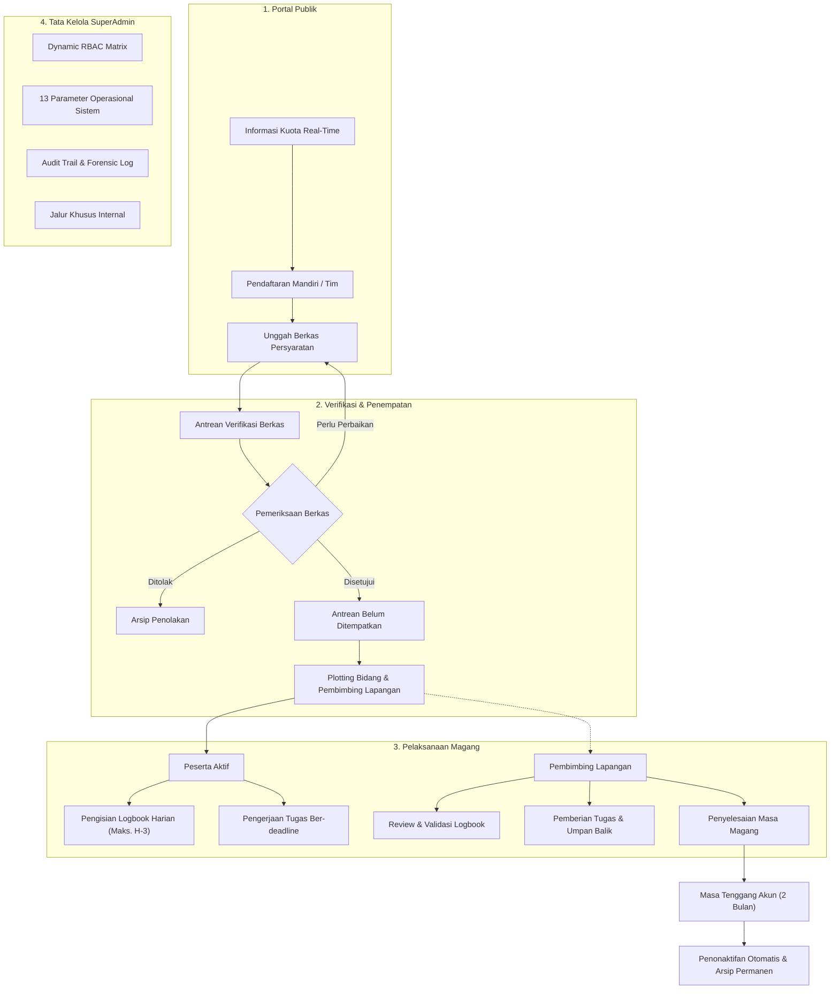

# MagKom — Portal Manajemen Magang Dinas Komunikasi dan Informatika

<div align="center">
  
  <br/>
  

  <p><strong>Sistem Informasi Manajemen dan Tata Kelola Magang Terpadu</strong><br/>
  Dinas Komunikasi dan Informatika</p>

  <p>
    <a href="#spesifikasi-teknis"></a>
    <a href="#spesifikasi-teknis"></a>
    <a href="#spesifikasi-teknis"></a>
    <a href="#spesifikasi-teknis"></a>
    <a href="#pengujian-otomatis-dan-kualitas-kode"></a>
    <a href="#pengujian-otomatis-dan-kualitas-kode"></a>
    <a href="#hak-cipta-dan-ketentuan-penggunaan"></a>
  </p>
</div>

---

> [!CAUTION]
> ### Pemberitahuan Hak Cipta dan Kepemilikan Sistem
> **Hak Cipta (c) 2026 Dinas Komunikasi dan Informatika. Seluruh hak cipta dilindungi undang-undang.**
>
> Sistem informasi, basis data, arsitektur teknis, dan dokumentasi **MagKom** merupakan kekayaan intelektual milik Dinas Komunikasi dan Informatika.
>
> Perangkat lunak ini **bukan perangkat lunak domain publik atau open-source umum**. Penggunaan, penggandaan, modifikasi, pendistribusian ulang, atau pemanfaatan sebagian maupun seluruh kode sumber dan aset sistem tanpa izin tertulis resmi dari Dinas Komunikasi dan Informatika dilarang keras dan melanggar hukum berdasarkan **Undang-Undang Nomor 28 Tahun 2014 tentang Hak Cipta** serta **Undang-Undang Informasi dan Transaksi Elektronik (UU ITE)**.

---

## Ringkasan Eksekutif

**MagKom (Magang Kominfo)** adalah portal web yang dibangun untuk mengelola seluruh siklus program Praktik Kerja Lapangan (PKL) dan magang bagi siswa SMK serta mahasiswa di lingkungan Dinas Komunikasi dan Informatika.

Sebelum implementasi MagKom, proses permohonan magang dilakukan secara konvensional melalui pengantaran surat fisik ke sekretariat dinas atau surat elektronik tanpa standardisasi. Hal ini menimbulkan sejumlah kendala operasional, seperti ketiadaan informasi kuota jurusan yang transparan bagi pemohon, penumpukan berkas yang lambat diverifikasi, tidak terstrukturnya plotting bidang dinas teknis, serta kesulitan pembimbing lapangan dalam memantau presensi aktivitas harian peserta.

MagKom menyatukan seluruh mata rantai administrasi tersebut ke dalam satu aplikasi berbasis web yang akuntabel, transparan, dan terintegrasi dari pendaftaran publik hingga arsip pasca-magang.

---

## Alur Kerja Sistem

Sistem mengorganisir interaksi antar-pengguna dalam alur kerja empat pilar aktor:



---

## Fungsionalitas Utama Sistem

### 1. Manajemen Kuota dan Alur Pendaftaran Publik
- **Transparansi Kuota Jurusan**: Publik dapat memantau kuota magang yang tersedia per jurusan dan per periode bulan secara real-time pada halaman utama.
- **Proteksi Konkurensi Atomik**: Alokasi kuota menggunakan mekanisme database locking (`lockForUpdate`) untuk memastikan tidak terjadi kondisi *race condition* atau kelebihan kuota ketika pendaftaran masuk bersamaan.
- **Dukungan Pendaftaran Tim**: Sistem mendukung pendaftaran individu maupun kelompok (ketua dan anggota) dengan pembatasan jumlah anggota yang dapat disesuaikan.
- **Seleksi Administratif Tegas**: Pendaftar yang mengajukan permohonan diverifikasi langsung dengan keputusan Diterima atau Ditolak tanpa perpanjangan antrean cadangan.

### 2. Penempatan Dua Tahap (Two-Stage Placement)
- **Pemisahan Verifikasi dan Alokasi**: Admin memverifikasi kelengkapan berkas terlebih dahulu. Pendaftar yang dinyatakan lolos masuk ke antrean *Belum Ditempatkan*.
- **Plotting Bidang dan Pembimbing**: Admin menempatkan peserta ke unit bidang teknis (Aplikasi Informatika, Informasi dan Komunikasi Publik, Statistik, Persandian, atau Sekretariat) serta menunjuk pembimbing lapangan berdasarkan rasio beban mentee yang tersedia.
- **Jalur Khusus Kedinasan**: Mengakomodasi penugasan magang kerja sama kelembagaan melalui alokasi slot internal yang terisolasi penuh dari kuota publik (*zero leak*).

### 3. Pelaksanaan Magang dan Pengendalian Aktivitas
- **Logbook Harian Berbatas Waktu**: Peserta mencatat uraian pekerjaan dan bukti dokumentasi harian. Untuk mencegah pelaporan rapel di akhir masa magang, sistem memberlakukan batas mundur pengisian maksimal 3 hari kerja (`BR-09`).
- **Tugas Terstruktur**: Pembimbing dapat menerbitkan instruksi penugasan dengan tenggat waktu. Status ketepatan penyerahan tugas dikalkulasi secara dinamis pada saat submission (`BR-16`).
- **Penyelesaian Masa Magang**: Pembimbing lapangan dapat menandai penyelesaian magang peserta setelah seluruh periode kerja dan target penugasan terpenuhi.

### 4. Pengawasan SLA Verifikasi Berkas (SLA Watchdog)
- Menghitung waktu tunggu berkas pendaftaran terhadap target Service Level Agreement dinas (standar 5 hari kerja).
- Antrean verifikasi menampilkan indikator visual bagi berkas yang mendekati atau telah melampaui batas SLA agar segera ditindaklanjuti oleh verifikator.

### 5. Matriks Perizinan Dinamis (Dynamic RBAC)
- SuperAdmin dapat mengelola hak akses perizinan secara granular untuk seluruh peran pengguna melalui matriks perizinan visual.
- Penambahan hak akses baru dan penyesuaian peran dapat dilakukan langsung melalui antarmuka administratif tanpa perlu mengubah berkas konfigurasi statis.

### 6. Rekam Jejak Audit (Audit Trail)
- Seluruh mutasi entitas utama (pendaftaran, penempatan, kuota, peran, dan konfigurasi) dicatat dalam tabel audit append-only yang kebal manipulasi.
- Sanitasi otomatis dijalankan terhadap informasi sensitif seperti token, kata sandi, dan kredensial sebelum dicatat ke dalam log.
- Dilengkapi fasilitas ekspor riwayat audit ke format spreadsheet yang terproteksi dari risiko formula injection.

### 7. Konfigurasi Aturan Bisnis Terpusat (13 Parameter Baku)
Aturan operasional sistem dikendalikan terpusat melalui panel SuperAdmin tanpa memerlukan deployment ulang:
1. Batas kuota umum publik per bulan.
2. Default alokasi slot jalur khusus.
3. Batas maksimal mentee per pembimbing lapangan.
4. Batas maksimal anggota pendaftaran kelompok.
5. Durasi magang maksimal yang diizinkan (bulan).
6. Batas mundur maksimal pengisian logbook (hari kerja).
7. Batas ukuran maksimal berkas unggahan (MB).
8. Ambang batas peringatan mendekati deadline tugas (hari).
9. Target SLA verifikasi berkas pendaftaran (hari kerja).
10. Durasi masa tenggang akun pasca-magang selesai (bulan).
11. Masa retensi data audit log (hari).
12. Sakelar fitur analitik eksekutif tahunan.
13. Sakelar fitur pendaftaran kelompok/tim.

---

## Peran Pengguna dan Hak Akses

| Peran | Deskripsi Tanggung Jawab | Lingkup Antarmuka |
| :--- | :--- | :--- |
| **SuperAdmin** | Mengelola konfigurasi aturan bisnis sistem, matriks perizinan RBAC, akun staf kedinasan, pemantauan telemetri, alokasi slot khusus, dan inspeksi jejak audit. | `/superadmin/*` |
| **Admin Verifikator** | Memeriksa berkas permohonan pendaftar, mengelola kuota jurusan per periode, melakukan penempatan dua tahap, dan memantau antrean SLA. | `/admin/*` |
| **Pembimbing Lapangan** | Mengawasi peserta bimbingan, meninjau dan memvalidasi logbook kegiatan harian, memberikan penugasan teknis, serta menandai penyelesaian magang. | `/pembimbing/*` |
| **Peserta Magang** | Melakukan pendaftaran (individu atau kelompok), mengunggah berkas persyaratan, mengisi logbook kegiatan harian, dan menyerahkan hasil pengerjaan tugas. | `/peserta/*` |

---

## Spesifikasi Teknis

| Komponen | Rincian Spesifikasi |
| :--- | :--- |
| **Bahasa Pemrograman** | PHP 8.3.x (Type Hinting Ketat, `declare(strict_types=1);`) |
| **Framework Backend** | Laravel 10.x |
| **Basis Data** | MySQL 8.0+ / MariaDB (InnoDB Storage Engine, Foreign Keys, Transactions) |
| **Frontend Pipeline** | Vite 6.x dengan Vanilla CSS Design Tokens dan Vanilla ES Modules |
| **Penyimpanan Berkas** | Storage Disk Privat terproteksi Temporary Signed URLs |
| **Standar Keamanan** | Proteksi CSRF, Anti-IDOR Authorization, Input Sanitization, Anti-Formula Injection, Header HTTP Terenkapsulasi (CSP, X-Frame-Options, X-Content-Type-Options) |
| **Linter dan Formatter** | Laravel Pint (Standar PSR-12) |
| **Analisis Statis** | Larastan / PHPStan Level 2 (Memory Limit 1G) |
| **Framework Pengujian** | PHPUnit 10.x (Feature & Unit Tests dengan basis data SQLite in-memory) |

---

## Panduan Instalasi dan Deployment

### 1. Prasyarat Lingkungan
- PHP versi 8.3 dengan ekstensi aktif: `bcmath`, `ctype`, `curl`, `dom`, `fileinfo`, `json`, `mbstring`, `openssl`, `pdo_mysql`, `tokenizer`, `xml`, `zip`.
- Composer 2.x
- Node.js versi 18 atau 20 LTS dan NPM
- Database MySQL Server 8.0 atau yang lebih baru

### 2. Pemasangan Kode Sumber dan Dependensi
```bash
git clone https://github.com/EvilAekt/MAGKOM.git
cd MAGKOM

# Pasang dependensi backend
composer install --optimize-autoloader --no-interaction

# Pasang dependensi frontend dan kompilasi aset
npm ci
npm run build
```

### 3. Konfigurasi Lingkungan
```bash
cp .env.example .env
php artisan key:generate
```

Sesuaikan parameter koneksi basis data pada berkas `.env`:
```env
APP_NAME=MagKom
APP_ENV=production
APP_DEBUG=false
APP_URL=https://magang.kominfo.go.id

DB_CONNECTION=mysql
DB_HOST=127.0.0.1
DB_PORT=3306
DB_DATABASE=magkom_db
DB_USERNAME=user_database
DB_PASSWORD=kata_sandi_database
```

### 4. Migrasi Basis Data dan Seeding Awal
```bash
# Menjalankan skema basis data dan master data konfigurasi
php artisan migrate --seed --force

# Menghubungkan direktori penyimpanan
php artisan storage:link
```

### 5. Optimasi Kinerja Produksi
```bash
php artisan config:cache
php artisan route:cache
php artisan view:cache
```

---

## Pengujian Otomatis dan Kualitas Kode

Setiap perubahan kode diverifikasi melalui rangkaian pengujian otomatis dan pipeline CI/CD GitHub Actions:

```bash
# Menjalankan seluruh test suite otomatis (740 tests)
php artisan test

# Menjalankan analisis statis PHPStan
./vendor/bin/phpstan analyse --memory-limit=1G

# Memeriksa standar penulisan kode PSR-12
./vendor/bin/pint --test
```

### Komponen Pengujian Utama
- **`CoreFoundationTest`**: Pengujian integritas model, casting enumerasi, dan immutability audit log.
- **`QuotaConcurrencyTest`**: Pengujian integritas transaksi atomik alokasi kuota pendaftaran.
- **`AdminPenempatanDuaTahapTest`**: Pengujian alur penempatan peserta dua tahap dan filter antrean belum ditempatkan.
- **`TugasLogbookTest`**: Pengujian batas mundur logbook harian dan kalkulasi keterlambatan tugas.
- **`PredikatBatasValidationTest`**: Pengujian batasan validasi dan audit logging 13 parameter operasional SuperAdmin.
- **`SuperAdminRolePermissionTest`**: Pengujian isolasi otorisasi matriks peran dinamis dan middleware boundary.
- **`EndToEndUatTest`**: Pengujian end-to-end skenario alur magang dari registrasi hingga penonaktifan akun pasca-magang.

---

## Struktur Repositori

```text
MAGKOM/
├── app/
│   ├── Console/Commands/      # Perintah CLI dan tugas terjadwal
│   ├── Http/
│   │   ├── Controllers/       # HTTP controller per modul aktor
│   │   ├── Middleware/        # Middleware autentikasi, verifikasi peran, dan CSP
│   │   └── Requests/          # Validasi form request terpusat
│   ├── Models/                # Model Eloquent dan relasi basis data
│   └── Services/              # Logika bisnis terisolasi (Placement, Audit, Metrics)
├── database/
│   ├── migrations/            # Berkas migrasi skema basis data
│   └── seeders/               # Seeder data master dan pengguna awal
├── docs/
│   ├── README.md              # Peta navigasi pusat dokumentasi
│   ├── PRODUCT.md             # Spesifikasi produk & batasan sistem
│   ├── 01-PRD-MagKom.md       # Product Requirements Document
│   ├── 02-TDD-MagKom.md       # Technical Design Document
│   ├── 04-SKEMA-DATABASE...   # Skema basis data dan kamus data
│   ├── 05-KEAMANAN-RBAC...    # Matriks keamanan dan otorisasi
│   ├── 08-DOKUMENTASI-LENGKAP... # Dokumentasi fitur & modul sistem
│   ├── DEVELOPMENT-GUIDE.md   # Panduan instalasi dan quality gates
│   └── FRONTEND-ARCHITECTURE.md # Arsitektur aset Vite dan panduan Blade
├── resources/
│   ├── css/                   # Stylesheet Vanilla CSS scoped per modul
│   ├── js/                    # Modul Vanilla JavaScript (ES Modules)
│   └── views/                 # Template Blade modular
├── routes/
│   └── web.php                # Definisi rute aplikasi
├── tests/
│   └── Feature/               # 740+ automated feature tests
├── CHANGELOG.md               # Catatan rilis dan riwayat versi
├── CONTRIBUTING.md            # Panduan kontribusi pengembang
├── LICENSE.md                 # Lisensi kepemilikan dan hak cipta
├── README.md                  # Halaman utama repositori
└── SECURITY.md                # Kebijakan pelaporan kerentanan keamanan
```

---

## Hak Cipta dan Ketentuan Penggunaan

Seluruh hak cipta, hak kekayaan intelektual, dan kepemilikan hukum atas perangkat lunak **MagKom (Magang Kominfo)**, termasuk kode sumber, desain antarmuka, struktur basis data, aset grafis, dan dokumentasi terkait adalah milik mutlak **Dinas Komunikasi dan Informatika**.

Dilarang keras menyalin, memodifikasi, menggandakan, menerbitkan ulang, mendistribusikan, menyewakan, atau mengomersialkan sistem ini baik sebagian maupun seluruhnya tanpa persetujuan tertulis resmi dari pihak Dinas Komunikasi dan Informatika.

Hak Cipta (c) 2026 Dinas Komunikasi dan Informatika. Seluruh hak cipta dilindungi undang-undang.
