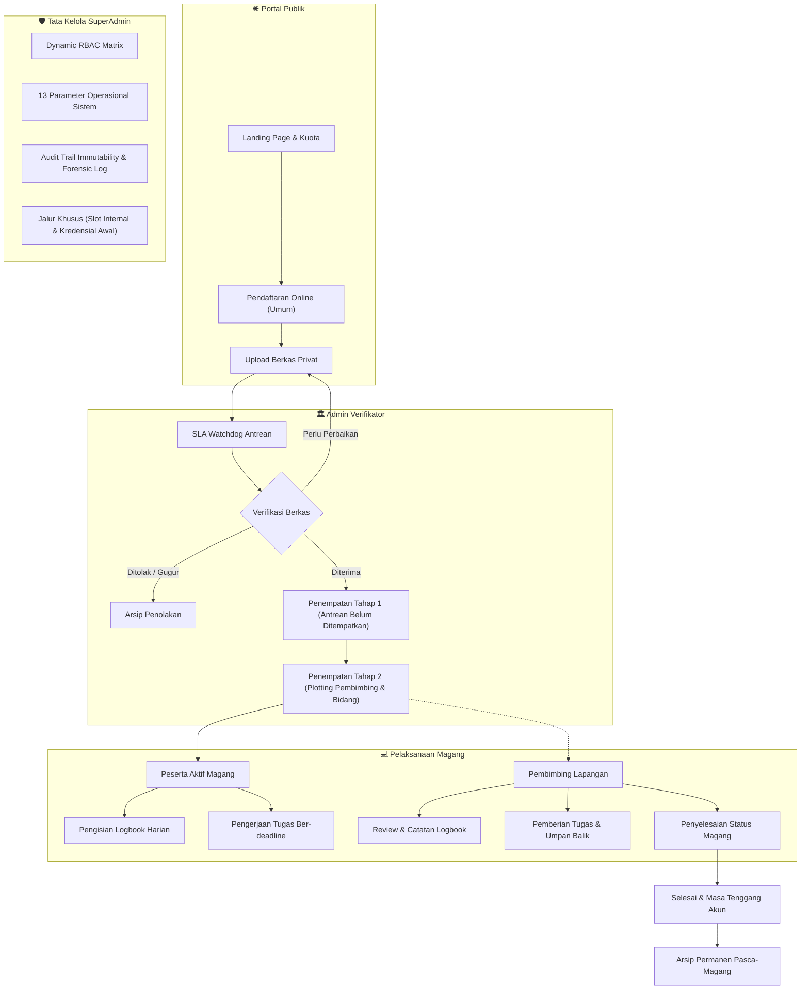

# 🏛️ MagKom (Magang Kominfo)

<div align="center">


### **Portal Manajemen & Tata Kelola Magang Terpadu**
#### **Dinas Komunikasi dan Informatika**

[](https://php.net)
[](https://laravel.com)
[](https://vitejs.dev)
[](https://mysql.com)
[](#-pengujian--quality-gates)
[](#-pengujian--quality-gates)
[](#-hak-cipta--ketentuan-hukum)

<br/>

<p align="center">
  <strong>MagKom</strong> adalah sistem informasi terpadu enterprise-grade untuk digitalisasi tata kelola program magang/praktik kerja lapangan di lingkungan <strong>Dinas Komunikasi dan Informatika</strong>. Sistem ini mengintegrasikan seluruh tahapan mulai dari publikasi kuota real-time, verifikasi berkas privat, penempatan dua tahap, monitoring logbook dan tugas harian, hingga tata kelola RBAC dinamis dan audit trail forensik.
</p>

</div>

---

> [!CAUTION]
> ### ⚠️ PEMBERITAHUAN HAK CIPTA & KEPEMILIKAN HUKUM (PROPRIETARY NOTICE)
> **Hak Cipta © 2026 Dinas Komunikasi dan Informatika. Seluruh Hak Cipta Dilindungi Undang-Undang.**
>
> Proyek perangkat lunak, arsitektur sistem, basis data, dan dokumentasi **MagKom** merupakan kekayaan intelektual milik instansi kedinasan terkait. 
> 
> - **DILARANG KERAS** menyalin, menggandakan, memodifikasi, mendistribusikan, mempublikasikan ulang, menjual, melisensikan kembali, atau memanfaatkan kode sumber ini untuk keperluan pribadi, komersial, maupun instansi lain tanpa izin tertulis resmi dari **Dinas Komunikasi dan Informatika**.
> - Penggunaan sistem ini hanya diizinkan untuk operasional kedinasan yang sah sesuai dengan surat penugasan atau regulasi resmi instansi.
> - Setiap bentuk pelanggaran hak cipta, kebocoran kode sumber, dan penggunaan tanpa hak akan diproses sesuai hukum yang berlaku di Republik Indonesia (**Undang-Undang No. 28 Tahun 2014 tentang Hak Cipta** dan **Undang-Undang Informasi dan Transaksi Elektronik / UU ITE**).

---

## 📌 Daftar Isi

1. [Arsitektur & Alur Kerja Sistem](#-arsitektur--alur-kerja-sistem)
2. [Fitur Unggulan Sistem](#-fitur-unggulan-sistem)
3. [Matriks Peran Pengguna (RBAC)](#-matriks-peran-pengguna-rbac)
4. [Spesifikasi Teknologi](#-spesifikasi-teknologi)
5. [Panduan Instalasi & Penerapan](#-panduan-instalasi--penerapan)
6. [Pengujian & Quality Gates](#-pengujian--quality-gates)
7. [Struktur Repositori & Dokumentasi](#-struktur-repositori--dokumentasi)
8. [Hak Cipta & Ketentuan Hukum](#-hak-cipta--ketentuan-hukum)

---

## 🔄 Arsitektur & Alur Kerja Sistem

Sistem MagKom dirancang dengan alur kerja modular yang aman dan akuntabel, menghubungkan empat pilar aktor dalam satu ekosistem:



---

## ✨ Fitur Unggulan Sistem

### 1. 🛡️ Transparansi Kuota & Zero Leak Jalur Khusus
- **Atomic Concurrency Protection**: Alokasi kuota per jurusan dan periode magang menggunakan database level lock (`lockForUpdate`) untuk menjamin tidak terjadi *race condition* atau *over-quota*.
- **Zero Leak Protection**: Slot magang jalur khusus kedinasan terisolasi penuh dari kalkulasi kuota publik di landing page.
- **Waiting List Engine**: Penanganan antrean otomatis ketika kuota reguler terpenuhi.

### 2. 📋 Penempatan Peserta Dua Tahap (*Two-Stage Placement*)
- **Tab Antrean Belum Ditempatkan**: Pendaftar yang berkasnya telah diverifikasi masuk ke daftar antrean tunggu alokasi.
- **Tab Peserta Terverifikasi**: Admin dapat memfilter penempatan aktif berdasarkan bidang dinas, pembimbing, dan periode gelombang.
- **Beban Pembimbing Terkendali**: Penegakan rasio beban maksimal peserta per pembimbing lapangan secara otomatis.

### 3. 📝 Manajemen Pelaksanaan & Logbook Berbatas Waktu
- **Logbook Harian Interaktif**: Pembatasan batas mundur pengisian logbook (standar 3 hari) guna mencegah rekayasa presensi di akhir periode (`BR-09`).
- **Deadline-Driven Tasks**: Pemberian penugasan berbasis tenggat waktu dengan visualisasi status keterlambatan dinamis pada runtime (`BR-16`).
- **Review Pembimbing**: Fasilitas umpan balik dan evaluasi catatan kegiatan harian secara terstruktur.

### 4. ⏱️ SLA Watchdog & Antrean Verifikasi
- Pemantauan otomatis masa tunggu pendaftaran terhadap ambang batas Service Level Agreement (SLA standar 5 hari kerja).
- Peringatan visual dan penyortiran prioritas untuk berkas yang mendekati atau melampaui batas SLA.

### 5. 🔐 Dynamic RBAC & Role Permission Matrix
- Manajemen hak akses matriks dinamis dari panel SuperAdmin untuk 4 peran pengguna.
- Penambahan izin (*permission*) baru dan penugasan perizinan tanpa perubahan kode sumber.

### 6. 📜 Audit Trail Immutability & Forensik Data
- Pencatatan otomatis setiap mutasi entitas, autentikasi, serta akses data sensitif (*read-audit*).
- Sanitasi otomatis terhadap kredensial rahasia (password, token, credential masking `[DISAMARKAN]`).
- Ekspor berkas audit log terenkapsulasi dalam format CSV & XLSX yang bersih dari formula injection.

### 7. ⚙️ Tata Kelola Parameter Terpusat (13 Konfigurasi Baku)
- Panel tata kelola SuperAdmin untuk mengendalikan aturan bisnis sistem secara dinamis tanpa perlu deploy ulang kode: kuota bulanan, slot khusus, rasio mentee-mentor, batas mundur logbook, ukuran maksimal berkas, durasi magang, SLA verifikasi, dan masa tenggang akun.

---

## 👥 Matriks Peran Pengguna (RBAC)

| Peran | Tanggung Jawab & Akses Utama | Ruang Lingkup Antarmuka |
| :--- | :--- | :--- |
| **SuperAdmin** | Tata kelola global sistem, konfigurasi master, RBAC matrix, manajemen akun staf, slot khusus, monitoring telemetri, dan audit trail. | `/superadmin/*` |
| **Admin Verifikator** | Verifikasi berkas pendaftar, penempatan dua tahap, pengelolaan kuota bulanan, monitoring antrean SLA, dan pelaporan operasional. | `/admin/*` |
| **Pembimbing Lapangan** | Pembagian tugas, penilaian progres tugas, verifikasi logbook harian, dan penyelesaian magang peserta bimbingan. | `/pembimbing/*` |
| **Peserta Magang** | Pendaftaran mandiri, upload kelengkapan berkas privat, pelaporan logbook harian, serta pengunggahan hasil tugas. | `/peserta/*` |

---

## 🛠️ Spesifikasi Teknologi

| Komponen | Spesifikasi & Versi |
| :--- | :--- |
| **Sistem Operasi Server** | Linux (Ubuntu LTS / RHEL) / Windows Server |
| **Web Server** | Nginx 1.24+ / Apache 2.4+ |
| **Runtime Bahasa** | **PHP 8.3.x** (Strict Typing `declare(strict_types=1);`) |
| **Framework Backend** | **Laravel 10.x** (Native Eloquent & Form Requests) |
| **Basis Data** | **MySQL 8.0+** (InnoDB Engine, utf8mb4) |
| **Frontend Pipeline** | **Vite 6.x**, Vanilla CSS Design Tokens, Vanilla ES Modules |
| **Penyimpanan Berkas** | Private Storage Disk terlindungi *Signed URLs* |
| **Arsitektur Keamanan** | Content Security Policy (CSP), CSRF Protection, Anti-Formula Injection, OWASP Top 10 Compliance |
| **Code Formatter** | Laravel Pint (Standar PSR-12) |
| **Alat Pengujian** | PHPUnit 10.x / Pest (Automated Feature & Unit Testing) |

---

## 📦 Panduan Instalasi & Penerapan

### 1. Prasyarat Sistem
Pastikan server atau mesin pengembangan lokal telah terinstal:
- PHP >= 8.3 dengan ekstensi: `bcmath`, `ctype`, `curl`, `dom`, `fileinfo`, `json`, `mbstring`, `openssl`, `pcre`, `pdo_mysql`, `tokenizer`, `xml`, `zip`.
- Composer 2.x
- Node.js >= 18.x & NPM
- MySQL Server 8.0+

### 2. Kloning & Pemasangan Dependensi
```bash
git clone https://github.com/EvilAekt/MAGKOM.git
cd MAGKOM

# Pasang dependensi backend
composer install --optimize-autoloader --no-dev

# Pasang dependensi frontend
npm install
```

### 3. Konfigurasi Lingkungan (`.env`)
Salin berkas contoh lingkungan dan buat application key:
```bash
cp .env.example .env
php artisan key:generate
```

Sesuaikan parameter koneksi basis data di `.env`:
```env
APP_NAME=MagKom
APP_ENV=production
APP_DEBUG=false
APP_URL=https://magang.kominfo.go.id

DB_CONNECTION=mysql
DB_HOST=127.0.0.1
DB_PORT=3306
DB_DATABASE=magkom_db
DB_USERNAME=nama_user_db
DB_PASSWORD=kata_sandi_rahasia
```

### 4. Migrasi Basis Data & Kompilasi Aset
```bash
# Jalankan migrasi basis data dan seeding data awal
php artisan migrate --seed --force

# Buat tautan penyimpanan publik (jika diperlukan)
php artisan storage:link

# Kompilasi aset frontend untuk produksi
npm run build
```

### 5. Optimasi Cache Produksi
```bash
php artisan config:cache
php artisan route:cache
php artisan view:cache
```

---

## 🧪 Pengujian & Quality Gates

Sistem MagKom dibangun dengan standar keandalan tinggi dan dilengkapi rangkaian pengujian otomatis komprehensif.

```bash
# Menjalankan seluruh test suite otomatis (740 tests)
php artisan test

# Memeriksa kepatuhan format kode (Pint PSR-12)
./vendor/bin/pint --test
```

### Cakupan Uji Otomatis:
- **`CoreFoundationTest`**: Pengujian integritas model, casting enum, dan proteksi immutability audit log.
- **`QuotaConcurrencyTest`**: Pengujian simulasi konkurensi alokasi kuota pendaftaran secara atomik.
- **`AdminPenempatanDuaTahapTest`**: Validasi alur penempatan dua tahap dan filtering antrean.
- **`TugasLogbookTest`**: Validasi aturan bisnis logbook batas mundur dan tugas ber-deadline.
- **`PredikatBatasValidationTest`**: Pengujian validasi integritas 13 parameter operasional SuperAdmin.
- **`SuperAdminRolePermissionTest`**: Validasi matriks RBAC dinamis dan otorisasi middleware.
- **`EndToEndUatTest`**: Validasi alur end-to-end seluruh skenario penerimaan pengguna.

---

## 📁 Struktur Repositori & Dokumentasi

```text
MAGKOM/
├── app/
│   ├── Http/
│   │   ├── Controllers/       # Controller modular (Admin, Pembimbing, Peserta, SuperAdmin)
│   │   ├── Middleware/        # Middleware otentikasi, otorisasi peran, & headers
│   │   └── Requests/          # Validasi form request ketat
│   ├── Models/                # Model Eloquent & relasi basis data
│   └── Services/              # Business logic terisolasi (Placement, Audit, Metrics)
├── database/
│   ├── migrations/            # Skema tabel basis data
│   └── seeders/               # Seeder data konfigurasi awal & master
├── docs/
│   ├── 01-PRD-MagKom.md       # Product Requirements Document
│   ├── 02-TDD-MagKom.md       # Technical Design Document
│   ├── 04-SKEMA-DATABASE...   # Kamus data & ERD lengkap
│   ├── 05-KEAMANAN-RBAC...    # Matriks keamanan & otorisasi
│   └── plans/                 # Riwayat PRD & spesifikasi teknis pengembangan
├── resources/
│   ├── css/                   # Desain token & styling halaman terpusat
│   ├── js/                    # Modul JavaScript Vanilla terstruktur
│   └── views/                 # Blade templates modular
├── routes/
│   └── web.php                # Kontrak rute terproteksi otorisasi
└── tests/
    └── Feature/               # 740 automated feature tests
```

---

## ⚖️ Hak Cipta & Ketentuan Hukum

```text
HAK CIPTA & KEPEMILIKAN PERANGKAT LUNAK:

Seluruh hak cipta, hak kepemilikan industri, dan hak kekayaan intelektual atas 
sistem aplikasi MagKom (Magang Kominfo), termasuk namun tidak terbatas pada kode sumber 
(source code), skema basis data, desain antarmuka, dokumentasi teknis, dan aset visual 
merupakan hak milik mutlak Dinas Komunikasi dan Informatika.

Perangkat lunak ini TIDAK DISEDIAKAN sebagai perangkat lunak open-source umum. 
Penggunaan, penggandaan, pendistribusian, modifikasi, atau penyebarluasan tanpa izin 
tertulis resmi dari instansi terkait merupakan tindakan melawan hukum dan dapat dikenakan 
sanksi perdata maupun pidana berdasarkan ketentuan perundang-undangan Republik Indonesia.

Hak Cipta © 2026 Dinas Komunikasi dan Informatika. All Rights Reserved.
```

<div align="center">
  <sub>Dikembangkan dengan dedikasi untuk transparansi, akuntabilitas, dan efisiensi tata kelola layanan publik.</sub>
</div>
