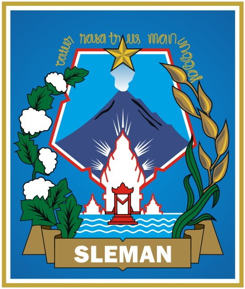
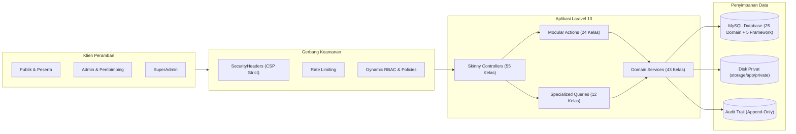

<div align="center">
  
  <h1>MAGKOM</h1>
  <p>
    <strong>Sistem Informasi Manajemen dan Tata Kelola Magang Terpadu</strong><br />
    Dinas Komunikasi dan Informatika Kabupaten Sleman
  </p>

  <p>
    
    
    
    
    
    
  </p>

  <p>
    
    
    
    
    
  </p>

  <p>
    <a href="./docs/README.md">Dokumentasi</a> &middot;
    <a href="#5-ringkasan-arsitektur-sistem">Arsitektur</a> &middot;
    <a href="#6-panduan-instalasi-cepat-quick-start">Instalasi Cepat</a> &middot;
    <a href="./SECURITY.md">Keamanan</a>
  </p>
</div>

---

## 1. Tentang MAGKOM

**MAGKOM** adalah portal web kedinasan untuk mengelola siklus penuh Praktik Kerja Lapangan (PKL) siswa SMK dan magang mahasiswa (D3/S1) di lingkungan Dinas Komunikasi dan Informatika (Diskominfo) Kabupaten Sleman&mdash;mulai dari publikasi kuota real-time, seleksi berkas, penempatan, bimbingan harian, hingga pengarsipan alumni.

<details>
<summary>Latar belakang &amp; konteks masalah yang diselesaikan</summary>

Sebelum adopsi MAGKOM, permohonan magang diajukan melalui penyerahan surat fisik ke sekretariat dinas tanpa visibilitas kuota jurusan, standar waktu verifikasi yang terukur, pemerataan pembimbing, maupun pelacakan progres bimbingan terpusat. MAGKOM menyatukan seluruh alur tersebut dalam satu sistem terintegrasi yang transparan dan akuntabel.

</details>

---

## 2. Fitur Utama Sistem

| Area Modul | Ringkasan Kapabilitas |
|---|---|
| **Portal & Pendaftaran** | Publikasi kuota real-time dengan penguncian atomik (`lockForUpdate`), pendaftaran individu maupun kelompok multi-akun (maks. 4 orang), serta antrean verifikasi berkas ber-SLA 5 hari kerja. |
| **Penempatan & Bimbingan** | Penempatan dua tahap (batas rasio 20 mentee/pembimbing), penugasan individu & tim (*batch classroom* + multi-link), alur *unsubmit* sebelum review, serta logbook harian berbatas H-3. |
| **Administrasi & Alumni** | Pengelolaan master data (bidang, bulan, jurusan), jalur khusus kemitraan, distribusi Surat Selesai (individu/kelompok), arsip alumni, dan ekspor Excel/CSV/PDF terproteksi *formula injection*. |
| **Tata Kelola & Keamanan** | Dynamic RBAC 13 modul, 2FA TOTP multi-role, sakelar kran kuota darurat, Visual Site Editor landing page, backup `.sql.gz` ber-hash SHA-256, serta *audit trail* 4 kanal *append-only*. |

---

## 3. Aktor Pengguna dan Lingkup Wewenang

| Peran Pengguna | Lingkup Tanggung Jawab | Area Antarmuka |
|---|---|---|
| **Peserta Magang** | Melakukan pendaftaran (mandiri/kelompok), mengunggah dokumen persyaratan, mengisi logbook harian (maks. H-3), mengumpulkan laporan tugas, dan melakukan unsubmit tugas. | `/peserta/*` |
| **Pembimbing Lapangan** | Mengawasi mentee aktif binaan bidang dinas, menerbitkan tugas mandiri/batch, mereview dan menyetujui logbook harian, memeriksa Profil 360 Mentee, mengunduh laporan kinerja (Excel/CSV/PDF), dan menetapkan penyelesaian magang. | `/pembimbing/*` |
| **Admin Verifikator** | Memeriksa berkas permohonan pendaftar dalam batas SLA 5 hari kerja, mengelola kuota jurusan per periode, melakukan penempatan dua tahap, dan mengunduh bundel berkas arsip ZIP. | `/admin/*` |
| **SuperAdmin** | Mengelola 12 parameter operasional aplikasi, mengatur matriks hak akses RBAC dinamis, mengelola akun staf kedinasan, mengelola slot kemitraan khusus, mengoperasikan backup dan restore basis data, memantau telemetri server, dan mengelola konten landing page. Bersifat *Read-Only* pada ranah tugas/logbook mentee. | `/superadmin/*` |

---

## 4. Tumpukan Teknologi (Technology Stack)

- **Bahasa Pemrograman**: PHP 8.3 dengan penegakan tipe data ketat (`declare(strict_types=1);`).
- **Framework Backend**: Laravel 10.x menerapkan pola *Modular Actions & Specialized Queries* (`app/Actions/`, `app/Queries/`, `app/Services/`).
- **Basis Data**: MySQL 8.0+ / MariaDB (InnoDB Storage Engine) mengelola 25 tabel domain aplikasi dan 5 tabel framework Laravel.
- **Frontend & Bundler**: Laravel Blade Templates dengan Vite 6.x mengelola 91 entri aset (39 stylesheet CSS dan 52 modul JavaScript ES Modules).
- **Keamanan HTTP**: Penegakan Content Security Policy (CSP) ketat `script-src 'self'` tanpa `unsafe-inline`, dengan kepatuhan 0 skrip inline di seluruh 187 Blade view.
- **Pustaka Animasi**: GSAP 3.15 untuk transisi splash preloader Sleman dan mikro-interaksi dashboard tanpa layout thrashing.
- **Pengujian Otomatis**: PHPUnit 10.x dengan 190 berkas pengujian terverifikasi yang dieksekusi di atas SQLite `:memory:`.

---

## 5. Ringkasan Arsitektur Sistem



---

## 6. Panduan Instalasi Cepat (Quick Start)

### 1. Prasyarat Lingkungan
- PHP 8.3 dengan ekstensi aktif: `bcmath`, `ctype`, `curl`, `dom`, `fileinfo`, `json`, `mbstring`, `openssl`, `pdo_mysql`, `tokenizer`, `xml`, `zip`.
- Composer 2.2+
- Node.js 18 atau 20 LTS dan NPM 10+
- MySQL Server 8.0+

### 2. Pemasangan Kode Sumber & Dependensi
```bash
git clone https://github.com/EvilAekt/MAGKOM.git
cd MAGKOM

# Pasang dependensi backend
composer install --optimize-autoloader

# Pasang dependensi frontend dan bangun aset
npm ci
npm run build
```

### 3. Konfigurasi Lingkungan (.env)
```bash
cp .env.example .env
php artisan key:generate
```

Sesuaikan parameter basis data pada berkas `.env`:
```env
DB_CONNECTION=mysql
DB_HOST=127.0.0.1
DB_PORT=3306
DB_DATABASE=magkom_db
DB_USERNAME=root
DB_PASSWORD=
```

### 4. Migrasi Basis Data & Inisialisasi Data Master
```bash
php artisan migrate --seed
php artisan storage:link
```

### 5. Menjalankan Server Pengembangan Lokal
Jalankan server pada dua jendela terminal:

```bash
# Terminal 1: Server Laravel Backend
php artisan serve --port=8000

# Terminal 2: Server Vite Frontend (Hot Module Replacement)
npm run dev
```
Akses portal melalui peramban di: `http://localhost:8000`

### 6. Akun Pengujian Lokal Bawaan
Setelah seeder dijalankan pada lingkungan lokal, akun pengujian berikut tersedia (kata sandi untuk seluruh akun pengujian: `password`):
- SuperAdmin: `superadmin@gmail.com`
- Admin Verifikator: `admin@gmail.com`
- Pembimbing Lapangan: `pembimbing@gmail.com`
- Peserta Magang: `peserta@gmail.com`

---

## 7. Pengujian Otomatis dan Kualitas Kode

Setiap perubahan kode diverifikasi melalui 4 tahapan pemeriksaan lokal dan pipeline CI/CD GitHub Actions:

```bash
# 1. Menjalankan seluruh test suite otomatis (1.020 kasus uji)
php artisan test

# 2. Analisis statis PHPStan / Larastan Level 2 (0 error)
./vendor/bin/phpstan analyse --memory-limit=1G

# 3. Pemeriksaan standar gaya kode PSR-12 dengan Laravel Pint
./vendor/bin/pint --test

# 4. Kompilasi build aset frontend Vite
npm run build
```

---

## 8. Navigasi Dokumentasi Lengkap

Dokumentasi rekayasa perangkat lunak MAGKOM dikelola secara modular berbasis kerangka kerja Diátaxis di dalam direktori `docs/`:

- [**Pusat Dokumentasi & Peta Navigasi (`docs/README.md`)**](docs/README.md)
- [**Ringkasan Produk & Batasan Sistem (`docs/product/overview.md`)**](docs/product/overview.md)
- [**Spesifikasi Kebutuhan & Aturan Bisnis BR-01 s/d BR-19 (`docs/product/requirements.md`)**](docs/product/requirements.md)
- [**Arsitektur Backend (`docs/architecture/backend.md`)**](docs/architecture/backend.md)
- [**Arsitektur Frontend & Panduan Aset Vite (`docs/architecture/frontend.md`)**](docs/architecture/frontend.md)
- [**Aliran Data & Diagram Sekuens (`docs/architecture/data-flow.md`)**](docs/architecture/data-flow.md)
- [**Skema Basis Data & Kamus Data Definitif (`docs/architecture/database.md`)**](docs/architecture/database.md)
- [**Peta 211 Rute HTTP & Middleware (`docs/architecture/routes.md`)**](docs/architecture/routes.md)
- [**Panduan Lengkap Pengembangan (`docs/development/development-guide.md`)**](docs/development/development-guide.md)
- [**Konvensi Penulisan Kode (`docs/development/coding-conventions.md`)**](docs/development/coding-conventions.md)
- [**Katalog 1.020 Kasus Uji Otomatis (`docs/development/testing.md`)**](docs/development/testing.md)
- [**Panduan Penanganan Masalah & Solusi Error (`docs/development/troubleshooting.md`)**](docs/development/troubleshooting.md)
- [**Model Ancaman & Ikhtisar Keamanan (`docs/security/security-overview.md`)**](docs/security/security-overview.md)
- [**Dynamic RBAC & Kebijakan Otorisasi (`docs/security/authentication-and-authorization.md`)**](docs/security/authentication-and-authorization.md)
- [**Panduan Otentikasi & 2FA SuperAdmin (`docs/security/superadmin-authentication.md`)**](docs/security/superadmin-authentication.md)
- [**Rekam Jejak Audit Forensik 4 Kanal (`docs/security/audit-trail.md`)**](docs/security/audit-trail.md)
- [**Panduan Penerapan Produksi Nginx (`docs/operations/deployment.md`)**](docs/operations/deployment.md)
- [**Panduan Queue Worker & Antrean Email (`docs/operations/queue-worker-deployment.md`)**](docs/operations/queue-worker-deployment.md)
- [**Runbook Backup Terenkripsi & Prosedur Restore (`docs/operations/backup-and-restore-runbook.md`)**](docs/operations/backup-and-restore-runbook.md)
- [**Pusat Cadangan & Pemulihan Basis Data (`docs/operations/backup-and-restore.md`)**](docs/operations/backup-and-restore.md)
- [**Glosarium Istilah Domain & Teknis (`docs/reference/glossary.md`)**](docs/reference/glossary.md)

---

## 9. Tim Pengembang & Wewenang Kontribusi

Sistem MAGKOM dikembangkan secara kolaboratif oleh 3 pengembang inti:

| Akun GitHub | Peran & Tanggung Jawab Utama |
|---|---|
| [@EvilAekt](https://github.com/EvilAekt) | **Lead Software Architect & Security Lead (Project Owner)**<br>Menetapkan arah arsitektur sistem, aturan bisnis definitif, skema basis data, konkurensi kuota atomik, otorisasi RBAC, suite pengujian otomatis, dan wewenang mutlak approval/merge final ke `main`. |
| [@aldiartha](https://github.com/aldiartha) | **Fullstack Developer & Admin Systems Specialist**<br>Mengelola modul Administrasi Kominfo (`/admin/*`), antrean verifikasi ber-SLA, penempatan dua tahap, pembatasan beban bimbingan, dan rekapitulasi ekspor spreadsheet kedinasan. |
| [@NAUFALFEBRIAN62](https://github.com/NAUFALFEBRIAN62) | **Frontend Specialist & UI/UX Interaction Engineer**<br>Mengembangkan antarmuka Blade kepatuhan Zero Inline CSS/JS, portal peserta (`/peserta/*`), dashboard Bento Grid, alur pendaftaran kelompok, dan interaktivitas Vanilla ES Modules/GSAP. |

Pedoman kontribusi lengkap dan tata kelola pull request dapat dibaca pada [CONTRIBUTING.md](CONTRIBUTING.md).

---

## 10. Hak Cipta dan Lisensi

Seluruh kode sumber, skema basis data, desain antarmuka, aset visual, dan dokumentasi sistem **MAGKOM** merupakan kekayaan intelektual milik **Dinas Komunikasi dan Informatika Kabupaten Sleman**.

Perangkat lunak ini berstatus **Proprietary Software (Hak Milik Terbatas)** dan **BUKAN** perangkat lunak domain publik atau sumber terbuka bebas. Dilarang keras menggandakan, memodifikasi, mendistribusikan ulang, menyewakan, atau memperjualbelikan sistem ini tanpa persetujuan tertulis resmi dari Dinas Komunikasi dan Informatika Kabupaten Sleman berdasarkan **Undang-Undang Nomor 28 Tahun 2014 tentang Hak Cipta** dan **Undang-Undang Informasi dan Transaksi Elektronik (UU ITE)**.

Hak Cipta (c) 2026 Dinas Komunikasi dan Informatika Kabupaten Sleman. Seluruh hak cipta dilindungi undang-undang.
