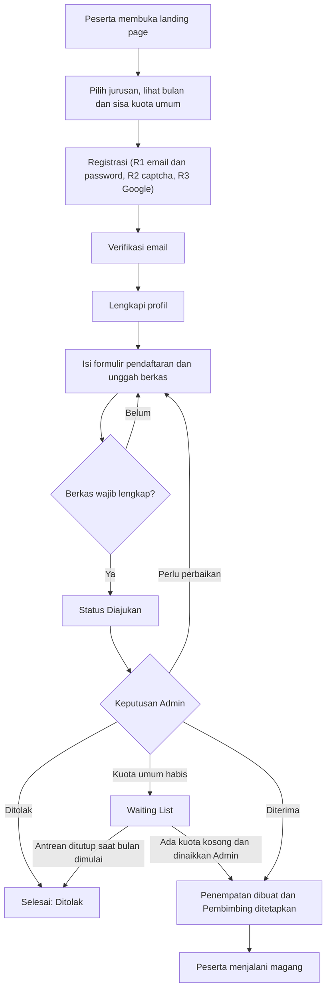
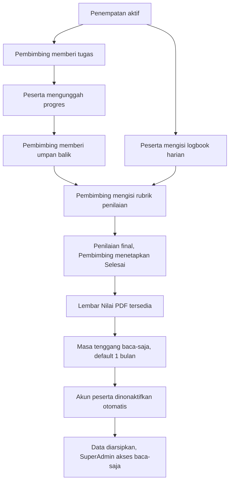
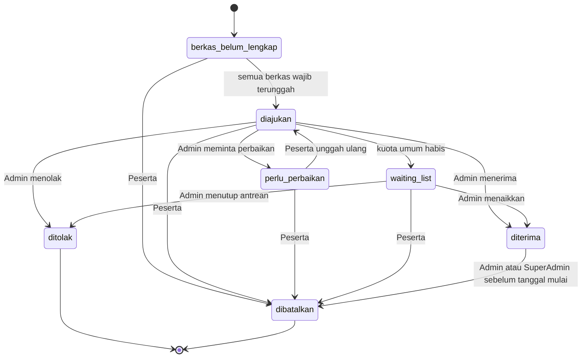
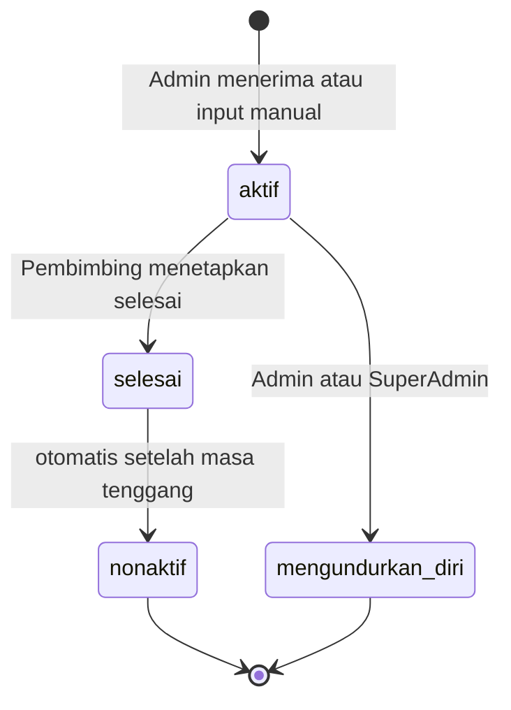

# PRD MagKom (Magang Kominfo)

**Product Requirements Document**  
Portal manajemen magang Dinas Komunikasi dan Informatika (Kominfo)

| Metadata | Keterangan |
|---|---|
| **Versi PRD** | 1.1 (Draft untuk review; revisi dari 1.0) |
| **Tanggal** | 7 Oktober 2026 |
| **Status** | Draft; belum disetujui Product Owner |
| **Penyusun / Reviewer** | Tim Pengembang MagKom |
| **Dokumen pendamping** | [`02-TDD-MagKom.md`](file:///g:/MAGKOM/docs/02-TDD-MagKom.md) (Dokumen Desain Teknis), [`03-ROADMAP-DAN-PANDUAN-EKSEKUSI.md`](file:///g:/MAGKOM/docs/03-ROADMAP-DAN-PANDUAN-EKSEKUSI.md) |
| **Sumber** | Rancangan Sistem MagKom Revisi 4 dan keputusan lanjutan. Dokumen ini **berdiri sendiri**: Revisi 4 tidak perlu dibuka untuk memahaminya (ringkasan perubahan ada di [Lampiran A](#lampiran-a-riwayat-revisi)) |
| **Tech stack wajib** | **Laravel 10** dengan **PHP 8.3** (alasan dan batasan ada di TDD) |

---

## Cara Membaca Dokumen Ini

**Untuk developer baru** (sekitar 45 menit): baca bab 1, 2, 3.3, 5, dan 6 lebih dulu. Lalu baca bab 7 dan 8 hanya untuk fitur yang sedang dikerjakan. Setelah itu buka [`02-TDD-MagKom.md`](file:///g:/MAGKOM/docs/02-TDD-MagKom.md).

### Konvensi Penulisan

| Penanda | Arti |
|---|---|
| **Wajib** / **Tidak boleh** | Persyaratan mutlak |
| **Sebaiknya** | Rekomendasi kuat; menyimpang harus ada alasan tertulis |
| `[Terkunci]` | Keputusan owner; tidak diubah tanpa persetujuan Product Owner |
| `[Usulan]` | Angka atau pilihan sementara. Boleh dipakai sampai ada keputusan; simpan di konfigurasi (`pengaturan`) agar mudah diganti |
| `[Klarifikasi]` | Penjelasan yang ditambahkan di v1.1 untuk menghilangkan ambiguitas v1.0 (daftar di [Lampiran A](#lampiran-a-riwayat-revisi)) |
| `F-`, `BR-`, `AC-`, `NFR-` | Fitur, aturan bisnis, acceptance criteria, non-functional requirement |
| `A-`, `R-`, `OQ-`, `D-` | Asumsi, risiko, pertanyaan terbuka, keputusan terkunci |

Acceptance criteria (AC) ditulis **"Jika [kondisi atau aksi], maka [hasil]"**. Setiap AC wajib punya minimal satu test otomatis atau satu langkah UAT.

**Bila dua bagian dokumen bertentangan**, urutan yang dipakai: Aturan Bisnis (bab 5) di atas AC (bab 7) di atas bagian lain. Laporkan pertentangan itu ke Product Owner agar dokumen diperbaiki; jangan menebak.

---

## Daftar Isi

1. [Ringkasan Produk](#1-ringkasan-produk)
2. [Latar Belakang, Tujuan, dan Metrik](#2-latar-belakang-tujuan-dan-metrik)
3. [Pengguna dan Hak Akses](#3-pengguna-dan-hak-akses)
4. [Scope dan Rencana Rilis](#4-scope-dan-rencana-rilis)
5. [Aturan Bisnis](#5-aturan-bisnis)
6. [Alur dan Status](#6-alur-dan-status)
7. [Kebutuhan Fungsional dan Acceptance Criteria](#7-kebutuhan-fungsional-dan-acceptance-criteria)
8. [Spesifikasi Data dan Form](#8-spesifikasi-data-dan-form)
9. [Desain UI dan Konten](#9-desain-ui-dan-konten)
10. [Non-Functional Requirement](#10-non-functional-requirement)
11. [Keputusan, Asumsi, Risiko, dan Pertanyaan Terbuka](#11-keputusan-asumsi-risiko-dan-pertanyaan-terbuka)
12. [Pengujian, UAT, dan Kriteria Rilis](#12-pengujian-uat-dan-kriteria-rilis)
13. [Matriks Keterlacakan](#13-matriks-keterlacakan)
- [Lampiran A: Riwayat Revisi](#lampiran-a-riwayat-revisi)

---

## 1. Ringkasan Produk

### 1.1 Ringkasan

| Item | Keterangan |
|---|---|
| **Nama produk** | MagKom (Magang Kominfo) |
| **Deskripsi** | Portal web terpadu untuk seluruh siklus magang di Dinas Kominfo: pendaftaran online, verifikasi dan penempatan, pemberian tugas dan logbook, hingga penilaian dan pengarsipan |
| **Instansi** | Dinas Komunikasi dan Informatika (studi kasus: Kabupaten Sleman) |
| **Arsitektur** | Single-tenant (hanya melayani Dinas Kominfo) |
| **Jenis aplikasi** | Aplikasi web server-rendered (Blade) |
| **Peran pengguna** | SuperAdmin, Administrasi Kominfo (Admin), Pembimbing, Peserta Magang |
| **Skala operasional** | 15 peserta baru per bulan (12 umum + 3 khusus), durasi 1 sampai 6 bulan, sehingga paling banyak sekitar 90 peserta aktif bersamaan; 1 Pembimbing |
| **Product owner** | *[diisi]* |
| **Stakeholder** | *[diisi]* |
| **Target go-live** | *[diisi]* |
| **Hosting** | *[diisi: server Kominfo atau cloud]* |

### 1.2 Glosarium

| Istilah | Arti |
|---|---|
| **Bulan Mulai** | Bulan awal magang yang dibuka untuk pendaftaran (menggantikan konsep "periode" pada rancangan awal) |
| **Jurusan** | Program studi atau kejuruan peserta. Master data: SMK (TKJ, RPL) dan Mahasiswa (Sistem Informasi, Manajemen Informatika, Informatika, Teknik Komputer) |
| **Jenjang** | Tingkat pendidikan peserta: `smk`, `d3`, atau `s1` |
| **Bidang** | Unit kerja internal Kominfo (misalnya Aplikasi Informatika, Statistik, Persandian, Sekretariat). Opsional pada versi ini |
| **Kuota Umum** | Jumlah penerimaan per bulan per jurusan untuk jalur umum. Tampil di landing page |
| **Slot Khusus** | Jumlah penerimaan jalur khusus per bulan. Diatur SuperAdmin dan **tidak pernah ditampilkan** di website atau landing page |
| **Jalur** | Asal penerimaan peserta: `umum` atau `khusus` |
| **Pendaftaran** | Pengajuan peserta untuk satu bulan mulai, lengkap dengan berkas, sampai ada keputusan |
| **Penempatan** | Record yang menandai peserta resmi menjalani magang (bulan, durasi, Pembimbing, jalur) |
| **Penempatan aktif** | Penempatan berstatus `aktif`: peserta boleh mengerjakan tugas dan mengisi logbook |
| **Waiting List** | Antrean pendaftar yang lolos verifikasi berkas tetapi kuota umum bulan itu sudah penuh |
| **Masa Tenggang** | Periode setelah magang ditetapkan selesai (default 1 bulan) saat akun peserta baca-saja |
| **Pembimbing** | Pegawai Kominfo yang membimbing dan menilai peserta. Saat ini satu orang |
| **Logbook** | Catatan kegiatan harian peserta, satu entri per tanggal |
| **Rubrik** | Daftar kriteria penilaian beserta bobotnya (total 100) |
| **Predikat** | Huruf mutu (A sampai E) yang diturunkan dari nilai akhir |
| **Lembar Nilai** | Dokumen PDF berisi rincian dan nilai akhir peserta |
| **Surat Keterangan Diterima** | Dokumen PDF yang menyatakan peserta diterima magang (R2) |

---

## 2. Latar Belakang, Tujuan, dan Metrik

### 2.1 Latar Belakang

Dinas Kominfo secara rutin menerima siswa dan mahasiswa magang dari jenjang SMK, D3, hingga S1. Prosesnya saat ini manual: pendaftaran diproses satu per satu, seleksi berdasarkan dokumen fisik atau email, dan pemantauan tugas serta penilaian belum terkomputerisasi. Akibatnya data tidak tercatat rapi, progres peserta sulit dipantau, dan rekap untuk pelaporan serta pengarsipan menyulitkan.

### 2.2 Tujuan Produk

1. Menyediakan satu pintu pendaftaran online dengan informasi jurusan, bulan mulai, status, dan sisa kuota umum yang selalu terbarui.
2. Mengotomatiskan verifikasi pendaftar, alokasi kuota, dan penempatan, tanpa risiko kuota minus saat diakses bersamaan.
3. Menyediakan ruang kerja digital bagi peserta untuk menerima tugas, melaporkan progres, dan mengisi logbook harian.
4. Membantu Pembimbing memantau progres dan menilai berbasis rubrik yang terukur dan konsisten.
5. Menyediakan arsip data magang yang rapi, dengan jejak audit lengkap untuk kebutuhan akuntabilitas internal.

### 2.3 Metrik Keberhasilan `[Usulan]`

Target perlu ditetapkan Product Owner (OQ-07).

| Metrik | Target | Cara ukur |
|---|---|---|
| Kuota minus atau melebihi batas | 0 kejadian | Query bulanan: `terisi > jumlah` pada `kuota` dan `slot_khusus`; test konkurensi lulus di CI |
| Pendaftaran yang diproses lewat sistem | 100% | Jumlah pendaftaran di sistem dibanding jumlah peserta yang ditempatkan per bulan |
| Waktu dari Diajukan sampai keputusan Admin | ≤ 5 hari kerja | `diputuskan_at - diajukan_at` (median dan persentil 90) |
| Penempatan selesai yang memiliki nilai akhir dan Lembar Nilai | 100% | Penempatan `selesai` tanpa `penilaian` final harus 0 |
| Aksi pengguna yang tercatat di audit log | 100% | Feature test: setiap aksi tulis menghasilkan baris audit |
| Halaman publik memenuhi Core Web Vitals (LCP ≤ 2,5 detik) | ≥ 75% kunjungan | Pengukuran lapangan atau Lighthouse pada staging |

### 2.4 Di Luar Scope

- Magang dinas lain dan rekap lintas-OPD (sistem single-tenant).
- Administrasi kepegawaian dan penggajian.
- Presensi kehadiran (proyek terpisah oleh kelompok lain; MagKom hanya menyediakan logbook).
- **Notifikasi dalam bentuk apa pun** (reminder deadline, hasil seleksi, peringatan nonaktif, WhatsApp). Satu-satunya email yang dikirim sistem adalah verifikasi email dan reset password.
- Peserta yang sama mengikuti lebih dari satu siklus magang. Akun yang sudah nonaktif tidak diaktifkan kembali pada versi ini `[Klarifikasi]`.
- Aplikasi mobile native. Antarmuka web responsif sudah cukup.

---

## 3. Pengguna dan Hak Akses

### 3.1 Peran dan Kebutuhan Utama

| Peran | Deskripsi | Kebutuhan utama (user story) | Cara memperoleh akun |
|---|---|---|---|
| **SuperAdmin** | Mengelola master data dan akun staf; mengatur slot khusus, status landing page, dan pengaturan sistem; mengakses arsip dan audit log. Pada fungsi Pembimbing (tugas, review, penilaian) **hanya dapat melihat** | Sebagai SuperAdmin, saya ingin mengelola master data, akun staf, slot khusus, dan pengaturan tanpa mengubah kode. Saya ingin menelusuri seluruh aktivitas lewat audit log yang tidak dapat saya ubah | Disiapkan pada seeding awal |
| **Administrasi Kominfo** | Mengisi kuota umum per bulan, memverifikasi pendaftaran dan berkas, memutuskan penerimaan, dan menetapkan penempatan | Sebagai Admin, saya ingin meninjau dan memutuskan pendaftaran tanpa takut kuota menjadi minus. Saya ingin mengelola Waiting List dan memasukkan peserta jalur khusus. Saya ingin mengekspor laporan (R2) | Dibuat SuperAdmin |
| **Pembimbing** | Pegawai Kominfo yang memberi tugas, meninjau progres dan logbook, menilai, serta menetapkan nilai akhir dan status selesai. Saat ini satu orang | Sebagai Pembimbing, saya ingin memberi tugas dan memantau progres serta logbook peserta bimbingan. Saya ingin menilai dengan rubrik yang konsisten dan menetapkan status selesai | Dibuat SuperAdmin |
| **Peserta Magang** | Siswa SMK atau mahasiswa D3/S1 yang mendaftar, mengerjakan tugas, mengisi logbook, dan melihat nilai | Sebagai calon peserta, saya ingin melihat jurusan, bulan, status, dan sisa kuota tanpa login. Sebagai peserta, saya ingin mendaftar dan memantau status secara online. Sebagai peserta aktif, saya ingin menerima tugas, mengisi logbook, dan melihat nilai | Registrasi mandiri; email wajib terverifikasi (R2: captcha; R3: Google) |

Calon peserta yang belum login dapat membuka halaman publik (jurusan, bulan tersedia, status, sisa kuota umum). Ini adalah tahap awal aktor Peserta, bukan aktor tersendiri.

### 3.2 Akun Staf

SuperAdmin, Admin, dan Pembimbing dibuat melalui menu SuperAdmin. Akun dan password awal **diserahkan ke staf secara manual di luar sistem**. Sistem tidak mengirim email undangan, dan staf tidak memakai login sosial. Staf **wajib** mengganti password saat login pertama (BR-15).

### 3.3 Matriks Hak Akses

Keterangan: **Ya** = boleh melakukan, **Lihat** = baca saja, **–** = tidak ada akses.

| Kemampuan | SuperAdmin | Admin | Pembimbing | Peserta |
|---|---|---|---|---|
| Buat akun Admin dan Pembimbing; nonaktifkan akun; reset password staf | Ya | – | – | – |
| Kelola master data: jurusan, bidang, rubrik | Ya | – | – | – |
| Buat dan ubah data bulan magang (tanggal buka/tutup, aktif) | Ya | – | – | – |
| Atur status landing page (override Tersedia, Tutup, Segera) | Ya | – | – | – |
| Atur slot khusus (bulan dan jumlah) | Ya | – | – | – |
| Isi kuota umum per bulan dan jurusan | Ya | Ya | – | – |
| Verifikasi pendaftaran dan berkas; putuskan Diterima, Ditolak, Waiting List, Perlu Perbaikan | Ya | Ya | – | – |
| Tetapkan penempatan dan Pembimbing; kelola Waiting List; pindahkan Pembimbing | Ya | Ya | – | – |
| Batalkan penerimaan atau catat pengunduran diri | Ya | Ya | – | – |
| Input peserta manual (termasuk jalur khusus) | Ya | Ya | – | – |
| Beri tugas, review progres dan logbook, isi dan ubah penilaian, tetapkan selesai | **Lihat** | – | Ya | – |
| Lihat tugas, logbook, dan nilai peserta | Lihat (semua) | – | Lihat (bimbingannya) | Lihat (miliknya) |
| Unduh Lembar Nilai | Ya (semua) | – | Ya (bimbingannya) | Ya (miliknya) |
| Unduh Surat Keterangan Diterima (R2) | Ya | Ya | – | Ya (miliknya) |
| Laporan dan ekspor CSV/Excel (R2) | Ya (termasuk rekap nilai) | Ya (tanpa rekap nilai) | – | – |
| Lihat audit log (tidak dapat mengubah atau menghapus) | Lihat | – | – | – |
| Pengaturan sistem (masa tenggang, batas beban Pembimbing, bobot rubrik, dan lain-lain) | Ya | – | – | – |
| Daftar magang, unggah berkas, kerjakan tugas, isi logbook | – | – | – | Ya |

`[Klarifikasi]` Pada v1.0 hak "buat data bulan" tidak eksplisit dan 6.4 menyebut Admin "membuka bulan". Di v1.1 **SuperAdmin membuat data bulan; Admin mengisi kuota** untuk bulan yang sudah dibuat (A-16, OQ-11). Admin tidak mengakses nilai, sehingga laporan Admin tidak memuat rekap nilai (A-20).

---

## 4. Scope dan Rencana Rilis

### 4.1 Daftar Fitur

Prioritas memakai MoSCoW dan dipetakan ke rilis: R1 (Must), R2 (Should), R3 (Could). Kolom "Bergantung pada" menunjukkan fitur yang harus ada lebih dulu.

| ID | Fitur | Ringkasan | Prioritas | Rilis | Bergantung pada |
|---|---|---|---|---|---|
| **F-01** | Landing page publik | Daftar jurusan (SMK dan Mahasiswa), bulan mulai, status Tersedia/Tutup/Segera, sisa kuota umum | Must | R1 | F-05, F-11 |
| **F-02** | Akun peserta | Registrasi, login, verifikasi email, reset password, profil | Must | R1 | – |
| **F-03** | Pendaftaran dan berkas | Formulir pendaftaran dan unggah berkas dari dashboard setelah login | Must | R1 | F-01, F-02, F-11 |
| **F-04** | Verifikasi dan keputusan | Admin meninjau dan memutuskan; Perlu Perbaikan; Waiting List | Must | R1 | F-03, F-05 |
| **F-05** | Kuota umum | Kuota per bulan dan jurusan, aman dari akses bersamaan | Must | R1 | F-11 |
| **F-06** | Slot khusus | Slot jalur khusus per bulan, diatur SuperAdmin, tidak tampil publik | Must | R1 | F-11 |
| **F-07** | Penempatan | Penempatan online dan manual, penetapan dan pemindahan Pembimbing | Must | R1 | F-04, F-05, F-06 |
| **F-08** | Tugas dan progres | Pembimbing memberi tugas, peserta unggah progres, umpan balik | Must | R1 | F-07 |
| **F-09** | Logbook harian | Catatan kegiatan harian per penempatan | Must | R1 | F-07 |
| **F-10** | Penilaian dan Lembar Nilai | Rubrik berbobot, nilai akhir, PDF Lembar Nilai | Must | R1 | F-07, F-11 |
| **F-11** | Master data dan akun staf | Jurusan, bidang, bulan, rubrik, status landing page, akun staf, pengaturan | Must | R1 | – |
| **F-12** | Masa tenggang dan nonaktif otomatis | Baca-saja setelah selesai, lalu nonaktif otomatis | Must | R1 | F-10 |
| **F-13** | Audit log | Pencatatan semua aksi, pemanggilan service, dan akses data | Must | R1 | – (fondasi, dibangun paling awal) |
| **F-14** | Captcha | Pada registrasi dan login | Should | R2 | F-02 |
| **F-15** | Lampiran logbook | Laporan PDF dan tautan hasil kerja | Should | R2 | F-09 |
| **F-16** | Surat Keterangan Diterima | PDF otomatis setelah diterima | Should | R2 | F-07 |
| **F-17** | Laporan dan ekspor | Laporan internal dan ekspor CSV/Excel | Should | R2 | F-07, F-10 |
| **F-18** | Login Google | Continue with Google khusus Peserta | Could | R3 | F-02 |
| **F-19** | Login Facebook | Menyusul setelah Google stabil (butuh review Meta) | Could | R3 | F-18 |

### 4.2 Rencana Rilis

| Rilis | Isi | Kriteria selesai | Tanggal |
|---|---|---|---|
| **R1** | F-01 sampai F-13. Registrasi memakai email dan password dengan rate limiting; **tanpa** captcha dan **tanpa** login sosial | Semua AC fitur R1 lulus; UAT bab 12 disetujui; checklist go-live bab 12 terpenuhi | *[diisi]* |
| **R2** | F-14 sampai F-17 | AC fitur R2 lulus; regresi R1 lulus | *[diisi]* |
| **R3** | F-18 dan F-19 | AC fitur R3 lulus; aplikasi OAuth disetujui penyedia | *[diisi]* |

#### Urutan Pengerjaan R1 yang Disarankan

| Gelombang | Isi | Alasan |
|---|---|---|
| **0. Fondasi** | Proyek Laravel, autentikasi dasar, enum, RBAC (middleware dan Policy), `AuditService` dan middleware audit, layout Blade, seeder | Dipakai semua fitur; audit lebih murah dipasang sejak awal daripada ditambal belakangan |
| **1. Konfigurasi** | F-11, F-05, F-06, F-01 | Data bulan, kuota, dan slot dibutuhkan sebelum ada yang bisa mendaftar |
| **2. Pendaftaran** | F-02, F-03, F-04, F-07 | Alur utama dari registrasi sampai penempatan, termasuk bagian paling berisiko (kuota atomik) |
| **3. Pelaksanaan** | F-08, F-09, F-10, F-12 | Berjalan setelah ada penempatan |
| **4. Penguatan** | Uji keamanan dan konkurensi, performa, UAT | Menutup R1 |

### 4.3 Fase Lanjutan (belum masuk rilis di atas)

- Sertifikat digital dengan kode QR (sementara cukup Lembar Nilai PDF).
- Integrasi dengan sistem presensi proyek lain, bila diperlukan saat penggabungan.
- Single Sign-On dengan akun ASN Kominfo untuk Admin dan Pembimbing.
- Survei kepuasan peserta pasca magang.
- Dashboard rekap tahunan (jumlah peserta, asal institusi, rata-rata nilai).

---

## 5. Aturan Bisnis

Aturan di bab ini adalah rujukan utama. Contoh tanggal memakai zona waktu WIB (`Asia/Jakarta`).

| ID | Aturan |
|---|---|
| **BR-01** | **Kuota umum** ditetapkan per bulan dan jurusan. Total kuota umum per bulan tidak melebihi batas di pengaturan (default 12). Jumlah kuota tidak boleh diturunkan di bawah jumlah terisi |
| **BR-02** | **Slot khusus** terpisah dari kuota umum. Default 3 per bulan, tetapi SuperAdmin bebas menentukan bulan dan jumlahnya (tanpa batas keras). Tidak pernah muncul di landing page, endpoint publik, atau sisa kuota yang dihitung untuk publik. Slot khusus dan kuota umum tidak saling mengurangi. Bila slot penuh atau belum ada slot untuk bulan itu, input peserta jalur khusus ditolak sampai SuperAdmin menambah jumlah `[Klarifikasi]` |
| **BR-03** | Satu peserta hanya boleh punya satu pendaftaran untuk satu bulan mulai. Bulan berstatus Tutup, Segera, atau nonaktif tidak dapat dipilih. Pendaftaran yang ditolak atau dibatalkan tidak dapat dibuat ulang untuk bulan yang sama; peserta dapat memilih bulan lain `[Klarifikasi]` |
| **BR-04** | **Status bulan di landing page** ditentukan berurutan: (1) bulan atau kuota nonaktif berarti Tutup; (2) override SuperAdmin; (3) otomatis: Segera satu bulan sebelum tanggal buka, Tersedia di antara tanggal buka dan tanggal tutup (inklusif), Tutup setelahnya. Bulan yang lebih dari satu bulan sebelum tanggal buka, atau yang tanggal mulainya sudah lewat, **tidak ditampilkan** (A-06, A-24). Sisa kuota 0 **tidak** menutup pendaftaran: status tetap Tersedia dan pendaftar masuk jalur Waiting List (BR-06) |
| **BR-05** | **Penerimaan bersifat atomik.** Dalam satu transaksi database: cek status pendaftaran masih Diajukan atau Waiting List, kunci baris kuota (`lockForUpdate`), cek `terisi < jumlah`, tambah `terisi`, buat penempatan dengan Pembimbing, ubah status, tulis audit. Bila salah satu langkah gagal, semuanya dibatalkan dan status pendaftaran tidak berubah |
| **BR-06** | **Waiting List:** masuk lewat keputusan Admin saat kuota umum habis (berkas tetap diverifikasi dulu), diurutkan berdasar waktu diajukan. Kenaikan ke Diterima dilakukan manual oleh Admin. Sisa antrean ditutup massal oleh Admin saat bulan dimulai (status Ditolak dengan catatan otomatis). Slot khusus tidak memiliki Waiting List |
| **BR-07** | **Pembatalan dan pengunduran diri.** Aksi dilakukan Admin atau SuperAdmin pada peserta yang sudah Diterima. *Sebelum tanggal mulai* (pembatalan): pendaftaran menjadi `dibatalkan`, penempatan menjadi `mengundurkan_diri`, kuota dikembalikan, akun peserta tetap aktif sehingga peserta dapat mendaftar bulan lain. *Sejak tanggal mulai* (pengunduran diri): penempatan menjadi `mengundurkan_diri`, pendaftaran tetap `diterima`, kuota **tidak** dikembalikan, dan akun peserta dinonaktifkan (A-17) `[Klarifikasi]` |
| **BR-08** | Durasi magang 1 sampai 6 bulan dipilih peserta. **Tanggal mulai** = tanggal 1 pada bulan mulai. **Tanggal selesai** = hari terakhir pada bulan ke-N (inklusif). Contoh: bulan mulai Januari 2027, durasi 3 bulan, maka 1 Januari 2027 sampai 31 Maret 2027 (A-14, OQ-10) `[Klarifikasi]` |
| **BR-09** | **Logbook:** hanya dapat diisi bila peserta punya penempatan aktif; tanggal dalam rentang magang dan tidak di masa depan; isi mundur dibatasi (default 3 hari, yaitu tanggal ≥ hari ini dikurangi 3; dapat diubah di pengaturan); satu entri per penempatan per tanggal; tanpa pembatasan hari kerja atau libur (A-19). Peserta dapat mengedit entri miliknya selama penempatan aktif bila entri masih dalam batas mundur atau berstatus `perlu_revisi`. Baca-saja setelah penempatan Selesai. Tidak ada approval wajib per entri: Pembimbing dapat menandai "perlu revisi" dengan catatan |
| **BR-10** | **Penilaian** sepenuhnya oleh Pembimbing; SuperAdmin hanya melihat. Nilai **dapat diubah**; setiap perubahan wajib disertai alasan dan dicatat (nilai lama dan baru). Status `draft`/`final` hanya penanda bahwa nilai sudah tampil ke peserta. Bobot rubrik disimpan sebagai snapshot di setiap penilaian. **Penetapan Selesai mensyaratkan penilaian berstatus final** `[Klarifikasi]`. Lembar Nilai dibuat saat diunduh dari data terbaru |
| **BR-11** | **Masa tenggang:** setelah Pembimbing menetapkan Selesai, akun peserta baca-saja selama masa tenggang (default 1 bulan, dapat diubah SuperAdmin), lalu dinonaktifkan otomatis. `tgl_nonaktif` = tanggal ditetapkan selesai + masa tenggang, dihitung saat penetapan; mengubah pengaturan tidak memengaruhi yang sudah dihitung. Data tidak dihapus; SuperAdmin mengakses arsip baca-saja |
| **BR-12** | **Penonaktifan master data:** jurusan, bulan, atau kuota yang masih memiliki pendaftaran atau penempatan aktif tidak dapat dinonaktifkan. Pembimbing tidak dapat dinonaktifkan sebelum penempatan aktifnya dipindahkan; sistem menolak bila ia satu-satunya Pembimbing aktif |
| **BR-13** | **Beban Pembimbing:** saat menerima peserta atau memindahkan penempatan, sistem memeriksa jumlah penempatan aktif terhadap `maks_peserta_aktif_per_pembimbing` di pengaturan. Bila nilainya belum diisi (null), tidak ada batas (OQ-01) |
| **BR-14** | **Tanpa notifikasi.** Peserta mengetahui status lewat dashboard (status, catatan Admin, timeline). Satu-satunya email: verifikasi email dan reset password |
| **BR-15** | Akun staf dibuat SuperAdmin dengan `must_change_password`: staf wajib mengganti password saat login pertama. Hal yang sama berlaku untuk akun peserta jalur khusus yang dibuat manual `[Usulan]`. Password tidak pernah disimpan atau dicatat dalam bentuk asli |
| **BR-16** | Status Terlambat pada tugas **dihitung saat dibaca** (deadline sudah lewat dan status belum Selesai), bukan disimpan atau dijadwalkan. Penanda "mendekati deadline" muncul bila sisa waktu ≤ 3 hari (`deadline_mendekati_hari`) |
| **BR-17** | Peserta hanya boleh memiliki **satu pendaftaran aktif** pada satu waktu (status `berkas_belum_lengkap`, `diajukan`, `perlu_perbaikan`, `waiting_list`, atau `diterima` dengan penempatan belum selesai). Mencegah peserta menempati dua kuota sekaligus `[Usulan]` (A-15) |

---

## 6. Alur dan Status

### 6.1 Alur Bisnis Empat Fase

| Fase | Inti alur |
|---|---|
| **1. Konfigurasi** | SuperAdmin menyiapkan jurusan, bidang (opsional), rubrik, akun staf, bulan magang, dan slot khusus. Admin mengisi kuota umum per jurusan pada bulan yang sudah dibuat. SuperAdmin dapat menonaktifkan bulan atau kuota dan mengatur status landing page |
| **2. Pendaftaran dan seleksi** | Calon peserta melihat jurusan, bulan, status, dan sisa kuota; registrasi; verifikasi email; melengkapi profil; mengisi formulir dan mengunggah berkas; Admin memutuskan |
| **3. Pelaksanaan** | Peserta ditempatkan ke Pembimbing; menerima tugas, mengunggah progres, dan mengisi logbook |
| **4. Penilaian dan kelulusan** | Pembimbing menilai berdasarkan rubrik, menetapkan nilai akhir dan status Selesai; Lembar Nilai PDF tersedia; masa tenggang; akun nonaktif otomatis; data diarsipkan |

### 6.2 Diagram Alur

#### Pendaftaran sampai Penempatan

#### Pelaksanaan sampai Pengarsipan

#### Status Pendaftaran

#### Status Penempatan

### 6.3 Tabel Transisi Status

#### Pendaftaran

| Dari | Ke | Dilakukan oleh | Syarat dan efek |
|---|---|---|---|
| (baru) | `berkas_belum_lengkap` | Peserta | Pendaftaran dibuat; berkas boleh diunggah bertahap |
| `berkas_belum_lengkap` | `diajukan` | Peserta | Semua berkas wajib ada; `diajukan_at` terisi; masuk antrean verifikasi |
| `diajukan` | `perlu_perbaikan` | Admin | Catatan wajib; peserta dapat mengganti berkas |
| `perlu_perbaikan` | `diajukan` | Peserta | Kembali ke antrean (`diajukan_at` baru) |
| `diajukan` | `diterima` | Admin | Atomik (BR-05): kuota bertambah terisi, penempatan dan Pembimbing dibuat |
| `diajukan` | `waiting_list` | Admin | Hanya bila kuota umum bulan-jurusan itu penuh |
| `diajukan` | `ditolak` | Admin | Catatan wajib; final |
| `waiting_list` | `diterima` | Admin | Hanya bila ada kuota kosong; atomik seperti di atas |
| `waiting_list` | `ditolak` | Admin | Penutupan antrean massal saat bulan dimulai |
| Status sebelum diterima | `dibatalkan` | Peserta | Final |
| `diterima` | `dibatalkan` | Admin / SuperAdmin | Hanya sebelum tanggal mulai; kuota dikembalikan; penempatan menjadi `mengundurkan_diri` (BR-07) |

#### Penempatan

| Dari | Ke | Dilakukan oleh | Syarat dan efek |
|---|---|---|---|
| (baru) | `aktif` | Admin (jalur online); SuperAdmin atau Admin (input manual) | Tugas dan logbook terbuka |
| `aktif` | `selesai` | Pembimbing | Penilaian final wajib ada; akun peserta masuk masa tenggang; `tgl_nonaktif` dihitung |
| `aktif` | `mengundurkan_diri` | Admin / SuperAdmin | Sebelum tanggal mulai: kuota kembali, akun tetap aktif. Sejak tanggal mulai: kuota tidak kembali, akun nonaktif (BR-07) |
| `selesai` | `nonaktif` | Scheduler harian | Akun peserta dinonaktifkan; data tetap utuh |

#### Status Lain

| Objek | Status |
|---|---|
| **Bulan di landing page** | `Tersedia`, `Tutup`, `Segera` (BR-04) |
| **Tugas** | `belum`, `proses`, `selesai`; "Terlambat" dihitung saat dibaca. Peserta mengubah belum menjadi proses; hanya Pembimbing menandai selesai (A-22) |
| **Progres** | `menunggu`, `diterima`, `perlu_revisi` |
| **Logbook** | `terkirim`, `perlu_revisi` |
| **Penilaian** | `draft` (belum tampil ke peserta), `final` (tampil; tetap dapat diubah dengan alasan) |

#### Siklus Akun Peserta

| Tahap | Akses |
|---|---|
| **Terdaftar (email belum terverifikasi)** | Hanya halaman verifikasi email dan kirim ulang |
| **Terverifikasi, profil belum lengkap** | Profil |
| **Pendaftar** | Profil, pendaftaran, berkas, status |
| **Peserta aktif** | Ditambah tugas, progres, logbook, nilai |
| **Masa tenggang** | Baca-saja; melihat dan mengunduh nilai dan Lembar Nilai |
| **Nonaktif** | Tidak dapat login; data tersimpan sebagai arsip |

---

## 7. Kebutuhan Fungsional dan Acceptance Criteria

### F-01 Landing Page Publik (R1)
**Aktor**: Pengunjung tanpa login. **Prasyarat**: Minimal satu bulan magang dan kuota sudah dibuat.

| ID | Acceptance Criteria |
|---|---|
| **AC-01-1** | Jika pengunjung membuka `/`, maka halaman menampilkan jurusan dikelompokkan "SMK" dan "Mahasiswa". Untuk tiap jurusan tampil bulan mulai yang boleh ditampilkan (BR-04), statusnya, dan sisa kuota umum (jumlah dikurangi terisi, minimal 0) |
| **AC-01-2** | Jika status bulan Tutup atau Segera, maka tombol Daftar tidak aktif; untuk Segera tampil tanggal buka |
| **AC-01-3** | Jika sisa kuota umum 0 dan status Tersedia, maka tampil label "Kuota penuh, pendaftaran masuk Waiting List" dan tombol Daftar tetap aktif |
| **AC-01-4** | Jika SuperAdmin mengubah override status atau Admin mengubah kuota, maka landing page mencerminkan perubahan paling lambat 60 detik `[Usulan]` |
| **AC-01-5** | HTML, JSON, dan endpoint publik mana pun **tidak** memuat data slot khusus (dijaga feature test) |
| **AC-01-6** | Halaman punya `<title>`, meta description, dan tag Open Graph; terbaca baik pada lebar layar 360 px ke atas; tidak membutuhkan login |

### F-02 Akun Peserta (R1)
**Aktor**: Calon peserta, peserta.

| ID | Acceptance Criteria |
|---|---|
| **AC-02-1** | Jika peserta mengisi registrasi dengan data valid dan mencentang persetujuan Kebijakan Privasi, maka akun role peserta dibuat, pengguna login otomatis, dan diarahkan ke halaman "Verifikasi email" |
| **AC-02-2** | Jika email sudah terdaftar atau password tidak memenuhi aturan (minimal 8 karakter, berhuruf dan berangka), maka muncul pesan validasi berbahasa Indonesia dan akun tidak dibuat |
| **AC-02-3** | Jika email belum terverifikasi, maka semua rute selain verifikasi, kirim ulang, dan logout mengarahkan ke halaman verifikasi |
| **AC-02-4** | Jika peserta membuka tautan verifikasi yang valid, maka `email_verified_at` terisi. Tautan bertanda tangan dan berlaku 60 menit `[Usulan]`; tautan kedaluwarsa menawarkan kirim ulang. Kirim ulang dibatasi 6 kali per menit |
| **AC-02-5** | Jika login gagal, maka pesan selalu seragam ("Email atau password salah"). Setelah 5 percobaan gagal dalam 1 menit untuk kombinasi email dan IP, login dikunci sementara dengan keterangan sisa waktu `[Usulan]` |
| **AC-02-6** | Jika "lupa password" diajukan, maka respons selalu seragam, baik email terdaftar maupun tidak. Email berisi tautan berlaku 60 menit. Akun staf tidak menerima email reset dan respons tetap seragam |
| **AC-02-7** | Jika peserta mengganti email di profil, maka `email_verified_at` dikosongkan dan verifikasi ulang diminta |
| **AC-02-8** | Jika akun nonaktif login dengan kredensial benar, maka login ditolak dengan pesan "Akun tidak aktif. Hubungi Admin Kominfo" |
| **AC-02-9** | Teks email verifikasi dan reset berbahasa Indonesia, dikirim dari domain resmi instansi |
| **AC-02-10** | (R1) Registrasi dibatasi 5 permintaan per menit per IP `[Usulan]` dan belum memakai captcha. Captcha masuk di F-14 |

### F-03 Pendaftaran dan Berkas (R1)
**Aktor**: Peserta. **Prasyarat**: Email terverifikasi dan profil lengkap.

| ID | Acceptance Criteria |
|---|---|
| **AC-03-1** | Jika profil belum lengkap, maka menu Pendaftaran terkunci dengan pesan "Lengkapi profil terlebih dahulu" |
| **AC-03-2** | Jika peserta membuka formulir, maka dropdown berantai bekerja: jurusan, lalu bulan (hanya yang berstatus Tersedia dan punya kuota aktif untuk jurusan itu), lalu durasi 1 sampai 6 bulan. Jurusan yang tampil sesuai jenjang peserta (A-18) |
| **AC-03-3** | Jika formulir dikirim, maka server memvalidasi ulang status bulan dan kuota (BR-04). Bila berubah, pesan tampil dan data tidak tersimpan |
| **AC-03-4** | Jika sudah ada pendaftaran untuk bulan itu atau pendaftaran aktif lain (BR-03, BR-17), maka pembuatan ditolak dengan pesan yang menjelaskan alasannya |
| **AC-03-5** | Jika peserta mengunggah berkas, maka tipe dicek dari isi file dan ukuran dicek terhadap batas (bab 8.4). Berkas tersimpan di disk privat dengan nama acak. Pelanggaran memunculkan pesan per berkas |
| **AC-03-6** | Status tetap `berkas_belum_lengkap` sampai semua berkas wajib untuk jenjangnya ada. Tombol Ajukan aktif hanya saat lengkap. Setelah diajukan, status `diajukan` dan `diajukan_at` terisi |
| **AC-03-7** | Jika status `berkas_belum_lengkap` atau `perlu_perbaikan`, maka peserta dapat mengganti berkas. Pada status lain berkas terkunci. Penggantian menimpa berkas lama; nama asli dan hash lama dan baru dicatat di audit |
| **AC-03-8** | Jika tombol Ajukan atau Unggah diklik dua kali, maka hanya satu proses yang berjalan (tombol nonaktif setelah klik dan constraint database mencegah duplikat) |
| **AC-03-9** | Jika peserta membatalkan pendaftaran yang belum diterima (setelah dialog konfirmasi), maka status menjadi `dibatalkan` dan final |
| **AC-03-10** | Dashboard menampilkan status, catatan Admin terakhir, timeline perubahan status, dan petunjuk "cek status di dashboard" |

### F-04 Verifikasi dan Keputusan (R1)
**Aktor**: Admin, SuperAdmin.

| ID | Acceptance Criteria |
|---|---|
| **AC-04-1** | Jika Admin membuka antrean, maka tampil pendaftaran berstatus `diajukan` dan `waiting_list` terurut `diajukan_at` terlama, dengan filter bulan, jurusan, status, jalur; pencarian nama, email, atau NIM/NISN; dan pagination 25 per halaman `[Usulan]` |
| **AC-04-2** | Halaman detail menampilkan profil, pilihan bulan, jurusan, durasi, berkas (diunduh lewat tautan bertanda tangan 5 menit), dan riwayat status |
| **AC-04-3** | Jika Admin memilih Perlu Perbaikan atau Ditolak, maka catatan minimal 10 karakter wajib diisi |
| **AC-04-4** | Jika kuota umum bulan dan jurusan itu belum penuh, maka opsi Waiting List tidak tersedia dan permintaan manual ditolak |
| **AC-04-5** | Jika dua Admin memutuskan pendaftaran yang sama bersamaan, maka keputusan pertama berlaku dan yang kedua menerima pesan "Status pendaftaran sudah berubah, muat ulang halaman" |
| **AC-04-6** | Jika Admin memilih Diterima, maka BR-05 dijalankan dan penempatan dibuat. Bila kuota ternyata penuh, status tidak berubah, tidak ada penempatan, dan Admin diarahkan memilih Waiting List |
| **AC-04-7** | Jika Admin memilih "Tutup antrean bulan ini" untuk bulan yang sudah dimulai, maka semua pendaftaran `waiting_list` bulan itu menjadi `ditolak` dengan catatan otomatis |
| **AC-04-8** | Setiap keputusan tercatat di audit: pelaku, waktu, status lama dan baru, catatan |
| **AC-04-9** | Peserta melihat keputusan dan catatan di dashboard tanpa email apa pun (BR-14) |

### F-05 Kuota Umum (R1)
**Aktor**: Admin, SuperAdmin.

| ID | Acceptance Criteria |
|---|---|
| **AC-05-1** | Jika Admin mengatur jumlah kuota per bulan dan jurusan pada bulan aktif, maka data tersimpan dan landing page mengikuti (AC-01-4) |
| **AC-05-2** | Jika total kuota umum satu bulan melebihi `kuota_umum_maks_per_bulan`, maka penyimpanan ditolak dengan pesan |
| **AC-05-3** | Jika jumlah diturunkan di bawah `terisi`, maka penyimpanan ditolak |
| **AC-05-4** | Jika dua penerimaan berjalan bersamaan untuk satu sisa kuota, maka tepat satu berhasil dan `terisi` tidak melebihi `jumlah` (test konkurensi) |
| **AC-05-5** | Jika pembatalan terjadi sebelum tanggal mulai, maka `terisi` berkurang 1; jika sejak tanggal mulai, `terisi` tidak berubah (BR-07) |
| **AC-05-6** | Jika kuota atau bulan masih punya pendaftaran atau penempatan aktif, maka penonaktifan ditolak (BR-12) |

### F-06 Slot Khusus (R1)
**Aktor**: SuperAdmin.

| ID | Acceptance Criteria |
|---|---|
| **AC-06-1** | Jika SuperAdmin membuka menu Slot Khusus, maka ia dapat membuat atau mengubah slot per bulan; nilai awal formulir memakai `slot_khusus_default` (3). Admin tidak melihat menu ini |
| **AC-06-2** | Jika slot atau kuota umum terisi, maka yang lain tidak berkurang (keduanya independen) |
| **AC-06-3** | Jika Admin atau SuperAdmin memasukkan peserta jalur khusus, maka satu slot terambil secara atomik. Bila slot penuh atau belum ada untuk bulan itu, input ditolak dengan pesan dan SuperAdmin dapat menambah jumlah |
| **AC-06-4** | Slot khusus tidak muncul di landing page, endpoint publik, atau perhitungan sisa kuota publik (feature test) |
| **AC-06-5** | Jumlah slot tidak boleh di bawah `terisi`; tidak ada Waiting List untuk slot khusus |

### F-07 Penempatan (R1)
**Aktor**: Admin, SuperAdmin.

| ID | Acceptance Criteria |
|---|---|
| **AC-07-1** | Jika pendaftaran jalur umum diterima, maka penempatan dibuat dengan status `aktif`, jalur `umum`, sumber `online`, `tgl_mulai` dan `tgl_selesai` sesuai BR-08, dan `kuota_id` terisi |
| **AC-07-2** | Jika hanya ada satu Pembimbing aktif, maka ia ditetapkan otomatis (A-11). Bila lebih dari satu, Admin wajib memilih. Batas beban dicek (BR-13) |
| **AC-07-3** | Jika Admin memasukkan peserta manual (akun, profil, bulan, durasi, Pembimbing), maka sistem membuat user role peserta (email terverifikasi, `must_change_password` aktif), profil, dan penempatan dengan `pendaftaran_id` kosong, sumber `manual`, jalur `khusus` (atau `umum` bila Admin memilihnya dan kuota tersedia) |
| **AC-07-4** | Jika Admin atau SuperAdmin memindahkan Pembimbing, maka penempatan beralih ke Pembimbing aktif lain, batas beban dicek, dan perpindahan tercatat di audit (A-12) |
| **AC-07-5** | Jika Admin membatalkan penerimaan atau mencatat pengunduran diri, maka efeknya mengikuti BR-07 dalam satu transaksi |
| **AC-07-6** | Jika penempatan aktif dibuat, maka menu Tugas dan Logbook peserta terbuka; sebelumnya Logbook tampil terkunci dengan pesan informatif |
| **AC-07-7** | SuperAdmin dapat melihat seluruh penempatan, termasuk yang nonaktif (arsip), secara baca-saja |

### F-08 Tugas dan Progres (R1)
**Aktor**: Pembimbing (menulis), peserta (mengerjakan), SuperAdmin (melihat).

| ID | Acceptance Criteria |
|---|---|
| **AC-08-1** | Jika Pembimbing membuat tugas untuk peserta bimbingannya yang penempatannya aktif, maka tugas tersimpan. `deadline` harus ≥ hari ini dan ≤ `tgl_selesai` penempatan |
| **AC-08-2** | Jika peserta membuka daftar tugas, maka hanya tugas miliknya tampil. Label "Terlambat" muncul bila deadline lewat dan status belum selesai; penanda "mendekati deadline" muncul bila sisa waktu ≤ 3 hari (BR-16) |
| **AC-08-3** | Jika peserta mengunggah progres (catatan wajib, berkas opsional), maka progres berstatus `menunggu` dan status tugas dapat menjadi `proses` |
| **AC-08-4** | Jika Pembimbing mereview progres, maka ia memilih `diterima` atau `perlu_revisi` (feedback wajib untuk `perlu_revisi`). Hanya Pembimbing yang menandai tugas `selesai` (A-22) |
| **AC-08-5** | Jika SuperAdmin mencoba membuat tugas, mereview, atau menilai, maka sistem menolak dengan 403 (feature test). Pembimbing hanya mengakses peserta bimbingannya |
| **AC-08-6** | Jika penempatan sudah selesai (masa tenggang) atau nonaktif, maka seluruh aksi tulis peserta ditolak (halaman baca-saja) |
| **AC-08-7** | Tugas dapat diedit Pembimbing selama belum selesai; penghapusan tugas tidak tersedia pada versi ini `[Usulan]` |

### F-09 Logbook Harian (R1)
**Aktor**: Peserta (mengisi), Pembimbing (meninjau).

| ID | Acceptance Criteria |
|---|---|
| **AC-09-1** | Jika peserta belum punya penempatan aktif, maka menu Logbook terkunci dengan pesan informatif |
| **AC-09-2** | Jika peserta menyimpan entri, maka tanggal harus dalam rentang magang, tidak di masa depan, dan ≥ hari ini dikurangi `logbook_maks_mundur_hari`; hanya satu entri per tanggal. Pelanggaran memunculkan pesan validasi |
| **AC-09-3** | Jika entri berstatus `perlu_revisi` atau masih dalam batas mundur, maka peserta dapat mengeditnya selama penempatan aktif. Setelah diedit, status kembali `terkirim` |
| **AC-09-4** | Jika Pembimbing membuka logbook bimbingannya, maka ia dapat memfilter peserta dan tanggal serta menandai `perlu_revisi` dengan catatan wajib. Tidak ada approval wajib |
| **AC-09-5** | Jika penempatan sudah selesai atau nonaktif, maka logbook baca-saja |
| **AC-09-6** | (R2, F-15) Jika entri memuat lampiran, maka berkas PDF (batas ukuran bab 8.4) atau tautan `https` tersimpan; tautan ditampilkan dengan `rel="noopener noreferrer"` dan skema selain `https` ditolak |

### F-10 Penilaian dan Lembar Nilai (R1)
**Aktor**: Pembimbing (menulis), peserta dan SuperAdmin (melihat).

| ID | Acceptance Criteria |
|---|---|
| **AC-10-1** | Jika Pembimbing mengisi skor 0 sampai 100 untuk tiap kriteria rubrik aktif, maka sistem menghitung nilai akhir = jumlah (skor × bobot) dibagi jumlah bobot, dibulatkan 2 desimal, serta predikat (bab 8.3). Bobot disalin sebagai snapshot di `penilaian_detail` |
| **AC-10-2** | Jika Pembimbing menyimpan sebagai `draft`, maka nilai belum tampil ke peserta; sebagai `final`, nilai tampil. Status final wajib berisi skor untuk semua kriteria |
| **AC-10-3** | Jika Pembimbing mengubah nilai, maka alasan minimal 10 karakter wajib dan baris riwayat (nilai lama dan baru, pelaku, waktu) tersimpan |
| **AC-10-4** | Jika SuperAdmin mengubah bobot rubrik, maka penilaian yang sudah ada tidak berubah (snapshot). Perubahan rubrik ditolak bila total bobot aktif tidak 100 |
| **AC-10-5** | Jika Pembimbing menetapkan Selesai tanpa penilaian final, maka aksi ditolak. Bila ada, status penempatan menjadi `selesai`, `tgl_ditetapkan_selesai` terisi, dan `tgl_nonaktif` dihitung (BR-11) |
| **AC-10-6** | Jika peserta (termasuk saat masa tenggang) mengunduh Lembar Nilai, maka PDF dibuat saat itu dari data terbaru dan memuat isi pada bab 8.5 |
| **AC-10-7** | Jika SuperAdmin membuka penilaian dan riwayatnya, maka semuanya tampil baca-saja; mencoba mengubah menghasilkan 403 |

### F-11 Master Data dan Akun Staf (R1)
**Aktor**: SuperAdmin.

| ID | Acceptance Criteria |
|---|---|
| **AC-11-1** | Jika SuperAdmin mengelola jurusan, bidang, bulan magang, dan rubrik, maka tersedia tambah dan ubah, **tanpa hapus**; penonaktifan memakai flag |
| **AC-11-2** | Jika penonaktifan melanggar BR-12, maka ditolak dengan pesan yang menyebut penyebabnya |
| **AC-11-3** | Jika SuperAdmin membuat akun Admin atau Pembimbing, maka `must_change_password` aktif, `email_verified_at` terisi, dan **tidak ada** email yang dikirim |
| **AC-11-4** | Jika SuperAdmin mereset password atau menonaktifkan akun staf, maka password baru diserahkan manual, `must_change_password` aktif, dan aksi tercatat di audit |
| **AC-11-5** | Jika staf login pertama kali, maka ia hanya dapat membuka halaman ganti password sampai berhasil; password baru tidak boleh sama dengan yang lama |
| **AC-11-6** | Jika SuperAdmin mengatur override status per bulan (Tersedia, Tutup, Segera, atau kosong), maka BR-04 diterapkan |
| **AC-11-7** | Jika SuperAdmin mengubah pengaturan (bab 8.6), maka nilai divalidasi tipe dan rentangnya, tercatat di audit, dan cache pengaturan dibersihkan |
| **AC-11-8** | Seeder membuat 6 jurusan, 9 jenis dokumen, rubrik awal, pengaturan awal, dan satu akun SuperAdmin. Password awal SuperAdmin berasal dari variabel lingkungan, bukan kode, dan wajib diganti saat login pertama |

### F-12 Masa Tenggang dan Nonaktif Otomatis (R1)

| ID | Acceptance Criteria |
|---|---|
| **AC-12-1** | Jika Pembimbing menetapkan Selesai, maka `tgl_nonaktif` = tanggal ditetapkan selesai + `masa_tenggang_bulan`. Mengubah pengaturan sesudahnya tidak mengubah nilai yang sudah dihitung |
| **AC-12-2** | Selama masa tenggang, peserta dapat login, semua halaman baca-saja, dan banner pasif menampilkan sisa hari serta tombol unduh Lembar Nilai |
| **AC-12-3** | Jika scheduler harian berjalan, maka akun dengan `tgl_nonaktif` ≤ hari ini dinonaktifkan dan penempatannya menjadi `nonaktif`. Menjalankannya dua kali berturut-turut tidak mengubah hasil (idempotent) |
| **AC-12-4** | Jika akun nonaktif, maka tidak dapat login, data tetap utuh, dan SuperAdmin dapat membuka arsipnya secara baca-saja |
| **AC-12-5** | Jika scheduler terlewat satu atau beberapa hari, maka eksekusi berikutnya memproses semua akun yang tertunda |

### F-13 Audit Log (R1)

| ID | Acceptance Criteria |
|---|---|
| **AC-13-1** | Setiap request terautentikasi diberi `request_id`. Peristiwa login, logout, gagal login, verifikasi, dan reset tercatat tanpa token |
| **AC-13-2** | Setiap aksi tulis tercatat: pelaku, aksi, entitas, id, nilai lama dan baru, waktu, IP |
| **AC-13-3** | Setiap pemanggilan method Service tercatat: nama, argumen yang sudah disanitasi, hasil (ok atau gagal), durasi |
| **AC-13-4** | Setiap akses data (daftar, detail, unduh, ekspor) tercatat **satu baris per request**: pengguna, entitas, filter, jumlah baris |
| **AC-13-5** | Audit tidak pernah memuat password, token, respons captcha, atau isi berkas (diuji dengan pencarian pola pada hasil test) |
| **AC-13-6** | SuperAdmin dapat melihat dan memfilter (tanggal, pengguna, tipe, entitas, `request_id`); tidak ada kontrol ubah atau hapus; akun database aplikasi tidak punya hak UPDATE dan DELETE pada tabel ini |
| **AC-13-7** | Audit aksi bisnis ditulis **di dalam transaksi yang sama** dengan aksinya (audit gagal berarti aksi dibatalkan). Audit akses data dan request ditulis setelah respons terkirim; kegagalannya masuk log aplikasi |

### F-14 sampai F-19 (R2 dan R3)

| ID | Acceptance Criteria |
|---|---|
| **AC-14-1** | (F-14, R2) Jika halaman registrasi atau login dibuka, maka widget captcha tampil dan token diverifikasi di server. Token tidak valid ditolak dengan pesan |
| **AC-14-2** | (F-14) Jika layanan captcha tidak dapat dihubungi, maka registrasi ditolak (fail closed) dan login tetap berjalan dengan rate limit (fail open) `[Usulan]` |
| **AC-16-1** | (F-16, R2) Jika penempatan terbentuk (online atau manual), maka peserta dan Admin dapat mengunduh Surat Keterangan Diterima PDF yang dibuat saat diunduh (isi bab 8.5) |
| **AC-17-1** | (F-17, R2) Admin dan SuperAdmin dapat menghasilkan laporan: rekap pendaftaran per bulan, jurusan, dan status; daftar penempatan; realisasi kuota umum dan slot khusus. Rekap nilai hanya untuk SuperAdmin (A-20) |
| **AC-17-2** | (F-17) Laporan dapat diekspor CSV dan XLSX dengan filter periode. Sel yang diawali `=`, `+`, `-`, atau `@` diberi awalan `'` agar tidak dieksekusi sebagai rumus. Setiap ekspor tercatat di audit |
| **AC-18-1** | (F-18, R3) Jika peserta memilih Continue with Google, maka akun dibuat atau ditautkan sesuai aturan keamanan di TDD bab 8; hanya role Peserta. Staf tidak dapat memakai login sosial |
| **AC-19-1** | (F-19, R3) Login Facebook mengikuti aturan yang sama dengan F-18 setelah aplikasi lolos review penyedia |

---

## 8. Spesifikasi Data dan Form

### 8.1 Nilai Enum (Database Level)

| Enum | Nilai di Database |
|---|---|
| **Role** | `superadmin`, `admin`, `pembimbing`, `peserta` |
| **Jenjang** | `smk`, `d3`, `s1` |
| **Kategori jurusan** | `smk`, `mahasiswa` (SMK untuk jenjang `smk`; Mahasiswa untuk `d3` dan `s1`) |
| **Jalur** | `umum`, `khusus` |
| **Sumber penempatan** | `online`, `manual` |
| **Status ketersediaan bulan** | `tersedia`, `tutup`, `segera` |
| **Status pendaftaran** | `berkas_belum_lengkap`, `diajukan`, `perlu_perbaikan`, `waiting_list`, `diterima`, `ditolak`, `dibatalkan` |
| **Status penempatan** | `aktif`, `selesai`, `mengundurkan_diri`, `nonaktif` |
| **Status tugas** | `belum`, `proses`, `selesai` |
| **Kompleksitas tugas** | `rendah`, `sedang`, `tinggi` |
| **Status review progres** | `menunggu`, `diterima`, `perlu_revisi` |
| **Status logbook** | `terkirim`, `perlu_revisi` |
| **Status penilaian** | `draft`, `final` |
| **Tipe audit** | `auth`, `aksi`, `service`, `akses_data` |

### 8.2 Spesifikasi Form

Semua pesan validasi berbahasa Indonesia. "Wajib" berarti tidak boleh kosong.

| Form | Field | Aturan |
|---|---|---|
| **Registrasi** | nama | Wajib, 3 sampai 100 karakter |
| | email | Wajib, format email valid, maksimal 255 karakter, unik, disimpan huruf kecil |
| | password | Wajib, minimal 8 karakter, memuat huruf dan angka, harus sama dengan konfirmasi |
| | persetujuan | Wajib dicentang (Kebijakan Privasi) |
| **Profil peserta** | nama | Wajib, 3 sampai 100 karakter |
| | no_hp | Wajib, 10 sampai 15 digit, diawali `08`, `62`, atau `+62` |
| | nim_nisn | Wajib, 5 sampai 20 karakter alfanumerik |
| | institusi | Wajib, 3 sampai 150 karakter |
| | jenjang | Wajib, salah satu dari `smk`, `d3`, `s1` |
| | jurusan | Wajib, jurusan aktif, kategorinya sesuai jenjang (A-18) |
| **Pendaftaran** | jurusan | Wajib; nilai awal dari profil; kategori sesuai jenjang |
| | bulan mulai | Wajib; hanya bulan Tersedia dengan kuota aktif untuk jurusan itu |
| | durasi | Wajib, bilangan bulat 1 sampai 6 |
| **Berkas** | jenis dan file | Sesuai bab 8.4 |
| **Keputusan pendaftaran** | keputusan | Wajib: Diterima, Ditolak, Waiting List, atau Perlu Perbaikan |
| | catatan | Wajib (minimal 10 karakter, maksimal 1000) untuk Ditolak dan Perlu Perbaikan; opsional untuk lainnya |
| **Kuota umum** | bulan, jurusan | Wajib; unik per kombinasi |
| | jumlah | Bilangan bulat ≥ 0; ≥ `terisi`; total bulan ≤ `kuota_umum_maks_per_bulan` |
| **Slot khusus** | bulan mulai | Wajib; unik |
| | jumlah | Bilangan bulat ≥ 0; ≥ `terisi` |
| **Bulan magang** | bulan_mulai | Wajib, format tahun-bulan, unik |
| | tgl_buka, tgl_tutup | Wajib; `tgl_buka` < `tgl_tutup` ≤ tanggal 1 pada bulan mulai |
| | override status | Opsional: `tersedia`, `tutup`, `segera`, atau kosong |
| **Akun staf** | nama | Wajib, 3 sampai 100 karakter |
| | email | Wajib, valid, unik |
| | role | Wajib: `admin` atau `pembimbing` |
| | bidang | Opsional, bidang aktif |
| | password awal | Wajib, aturan sama dengan password peserta |
| **Peserta manual** | akun | nama, email (unik), password awal |
| | profil | Sama dengan profil peserta |
| | bulan, durasi, Pembimbing | Wajib; jalur `khusus` (bawaan) atau `umum` |
| **Tugas** | judul | Wajib, 3 sampai 150 karakter |
| | deskripsi | Opsional, maksimal 2000 karakter |
| | kategori | Wajib, maksimal 50 karakter |
| | kompleksitas | Wajib: `rendah`, `sedang`, `tinggi` |
| | deadline | Wajib, tanggal; ≥ hari ini dan ≤ `tgl_selesai` penempatan |
| **Progres** | catatan | Wajib, 5 sampai 2000 karakter |
| | file | Opsional; PDF, JPG, atau PNG sesuai bab 8.4 |
| **Review progres** | status | Wajib: `diterima` atau `perlu_revisi` |
| | feedback | Wajib untuk `perlu_revisi`; maksimal 2000 karakter |
| **Logbook** | tanggal | Wajib; sesuai BR-09 |
| | kegiatan | Wajib, 10 sampai 2000 karakter |
| | lampiran (R2) | PDF atau tautan `https`, masing-masing opsional |
| **Review logbook** | catatan | Wajib bila ditandai `perlu_revisi`, maksimal 1000 karakter |
| **Penilaian** | skor per kriteria | Bilangan bulat 0 sampai 100; semua kriteria wajib untuk `final` |
| | catatan | Opsional, maksimal 2000 karakter |
| | alasan perubahan | Wajib saat mengubah nilai tersimpan, minimal 10 karakter |
| **Rubrik** | kriteria | Wajib, 3 sampai 100 karakter |
| | bobot | Bilangan bulat 1 sampai 100; total bobot aktif harus 100 |

### 8.3 Rubrik Awal dan Skala Nilai `[Usulan]`

| No | Kriteria | Bobot |
|---|---|---|
| 1 | Kualitas hasil kerja | 30 |
| 2 | Ketepatan waktu dan penyelesaian tugas | 20 |
| 3 | Inisiatif dan kemampuan belajar | 20 |
| 4 | Komunikasi dan kerja sama | 15 |
| 5 | Etika, disiplin, dan tanggung jawab | 15 |

Skala nilai akhir 0 sampai 100:

| Rentang Nilai Akhir | Predikat | Keterangan |
|---|---|---|
| 85,00 sampai 100,00 | A | Sangat Baik |
| 70,00 sampai kurang dari 85,00 | B | Baik |
| 55,00 sampai kurang dari 70,00 | C | Cukup |
| 40,00 sampai kurang dari 55,00 | D | Kurang |
| Kurang dari 40,00 | E | Sangat Kurang |

### 8.4 Berkas

| Jenjang | Berkas Wajib |
|---|---|
| `smk` | Surat pengantar sekolah, CV, rapor |
| `d3` | Surat pengantar kampus, CV, transkrip |
| `s1` | Surat pengantar kampus, CV, transkrip |

| Aturan | Nilai |
|---|---|
| Format yang diterima | PDF, JPG, JPEG, PNG `[Usulan]`; dicek dari isi file (magic bytes), bukan ekstensi |
| Ukuran maksimal | 2 MB per berkas (`berkas_maks_mb`) |
| Penyimpanan | Disk privat, nama acak; tidak dapat diakses langsung lewat URL |
| Unduhan | Lewat tautan bertanda tangan berumur 5 menit, setelah Policy lolos |

### 8.5 Isi Dokumen PDF

| Dokumen | Isi Minimal |
|---|---|
| **Lembar Nilai** | Identitas instansi; nama, NIM/NISN, institusi, jurusan; periode magang (`tgl_mulai` sampai `tgl_selesai`); nama Pembimbing; tabel kriteria, bobot, dan skor; nilai akhir dan predikat; catatan Pembimbing; tanggal cetak; nomor dokumen dan tanda tangan sesuai format instansi (OQ-03) |
| **Surat Keterangan Diterima (R2)** | Identitas instansi; nama, NIM/NISN, institusi, jurusan; periode magang; pernyataan diterima; tanggal terbit; nomor surat dan tanda tangan sesuai format instansi (OQ-03) |

### 8.6 Konfigurasi di `pengaturan`

| Kunci | Tipe | Nilai Awal | Keterangan |
|---|---|---|---|
| `masa_tenggang_bulan` | bilangan bulat ≥ 0 | 1 | BR-11 |
| `kuota_umum_maks_per_bulan` | bilangan bulat ≥ 0 | 12 | BR-01 |
| `slot_khusus_default` | bilangan bulat ≥ 0 | 3 | Nilai awal formulir slot (BR-02) |
| `maks_peserta_aktif_per_pembimbing` | bilangan bulat atau null | null (tanpa batas) | BR-13; OQ-01 |
| `logbook_maks_mundur_hari` | bilangan bulat ≥ 0 | 3 | BR-09 |
| `berkas_maks_mb` | bilangan bulat ≥ 1 | 2 | Bab 8.4 |
| `deadline_mendekati_hari` | bilangan bulat ≥ 0 | 3 | BR-16 |
| `predikat_batas` | JSON | A: 85, B: 70, C: 55, D: 40 | Bab 8.3 |

---

## 9. Desain UI dan Konten

### 9.1 Sumber Desain
Desain UI merujuk ke file Figma MagKom. Bila desain Figma bertentangan dengan PRD, **PRD yang berlaku untuk perilaku (aturan bisnis dan AC), Figma yang berlaku untuk estetika tampilan**.

### 9.2 Halaman per Area

| Area | Halaman |
|---|---|
| **Publik** | Landing page (jurusan, bulan mulai, status, sisa kuota umum), Kebijakan Privasi |
| **Auth** | Registrasi, login, verifikasi email, lupa dan reset password, ganti password wajib untuk staf |
| **Peserta** | Dashboard (status pendaftaran, timeline, catatan Admin), profil, formulir pendaftaran, berkas, tugas dan progres, logbook, nilai |
| **Admin** | Dashboard, kuota umum per bulan, antrean verifikasi, detail pendaftaran, Waiting List, penempatan, input peserta manual, laporan dan ekspor (R2) |
| **Pembimbing** | Dashboard, peserta bimbingan, tugas, review progres dan logbook, form penilaian |
| **SuperAdmin** | Master data (jurusan, bidang, bulan, rubrik, status landing), akun staf, slot khusus, penempatan, arsip peserta, audit log, pengaturan |

### 9.3 State UI Khusus yang Harus Ada di Desain
- Logbook tampil tetapi terkunci dengan pesan informatif sebelum peserta ditempatkan.
- Mode baca-saja pada masa tenggang: semua tombol tulis disembunyikan atau dinonaktifkan.
- Banner pasif berisi sisa hari dan tombol unduh Lembar Nilai selama masa tenggang.
- Label Terlambat dan penanda mendekati deadline pada daftar tugas.
- Halaman verifikasi email dan ganti password wajib staf.
- Menu Slot Khusus (internal), Waiting List, dan audit log.
- Status Waiting List dan Perlu Perbaikan beserta catatan Admin di dashboard peserta.
- Halaman error kustom untuk 403, 404, 419, 429, dan 500.

---

## 10. Non-Functional Requirement

### 10.1 Keamanan

| ID | Requirement | Cara Verifikasi |
|---|---|---|
| **NFR-S1** | RBAC berjenjang dengan Policy; SuperAdmin hanya-baca pada fungsi Pembimbing | Feature test matriks hak akses (bab 3.3) |
| **NFR-S2** | Password di-hash (`Hash::make`); minimal 8 karakter berhuruf dan berangka; staf wajib mengganti password awal | Feature test registrasi dan login pertama staf |
| **NFR-S3** | Verifikasi email wajib bagi Peserta sebelum mendaftar; reset password via email | AC-02-3, AC-02-4 |
| **NFR-S4** | Rate limiting pada login, registrasi, reset password, kirim ulang verifikasi, dan unggah berkas; captcha di R2 | Test throttle; nilai ambang di TDD bab 8 |
| **NFR-S5** | Proteksi CSRF; session diregenerasi saat login; cookie `secure`, `httponly`, `same_site=lax`; sesi berakhir setelah 120 menit tidak aktif | Pemeriksaan header dan konfigurasi pada staging |
| **NFR-S6** | Berkas di disk privat, nama acak, tipe dicek dari isi, ukuran dibatasi, diunduh lewat route ber-Policy dengan tautan bertanda tangan dan header `nosniff` | Feature test unduh (pemilik, bukan pemilik, tautan kedaluwarsa) |
| **NFR-S7** | Pencegahan IDOR: setiap akses record diperiksa kepemilikan atau hubungan bimbingan | Feature test akses lintas peserta dan lintas Pembimbing |
| **NFR-S8** | `role` tidak mass-assignable; tautan logbook hanya `https` dan berstatus `noopener noreferrer` | Test dan code review |
| **NFR-S9** | Login sosial hanya Peserta; penautan akun mencegah pembajakan akun yang belum terverifikasi | Feature test R3 |
| **NFR-S10** | Respons autentikasi seragam agar akun atau email terdaftar tidak dapat ditebak (login, lupa password) | AC-02-5, AC-02-6 |
| **NFR-S11** | Header keamanan HTTP: HSTS, `X-Content-Type-Options`, `Referrer-Policy`, `frame-ancestors`/`X-Frame-Options`, `Permissions-Policy`, dan Content-Security-Policy | Pemindaian header pada staging |
| **NFR-S12** | Dependensi dipindai kerentanannya pada setiap build; tidak ada rahasia di repositori | `composer audit` di CI; pemindaian rahasia pada pipeline |
| **NFR-S13** | Ekspor CSV/XLSX mencegah formula injection (AC-17-2) | Test ekspor |

### 10.2 Integritas Data

| ID | Requirement | Cara Verifikasi |
|---|---|---|
| **NFR-D1** | Kuota dan slot tidak pernah minus atau melebihi jumlah, walau diakses bersamaan | Test konkurensi (AC-05-4) |
| **NFR-D2** | Foreign key pada seluruh tabel turunan; unique constraint untuk satu pendaftaran per bulan dan satu logbook per tanggal | Review migrasi; test pelanggaran constraint |
| **NFR-D3** | Data master dan akun dinonaktifkan dengan flag, tidak dihapus | Review kode; tidak ada rute hapus |
| **NFR-D4** | Setiap perubahan nilai tercatat lengkap (nilai lama, nilai baru, pelaku, alasan) | AC-10-3 |

### 10.3 Auditabilitas

| ID | Requirement | Cara Verifikasi |
|---|---|---|
| **NFR-A1** | Audit log mencatat **semua aksi**, **semua pemanggilan service** (method, argumen tersanitasi, hasil, durasi), dan **semua akses data** per request (siapa, data apa, filter apa), termasuk aksi SuperAdmin | AC-13-1 sampai AC-13-4 |
| **NFR-A2** | Setiap request terautentikasi diberi `request_id`; peristiwa autentikasi tercatat tanpa token | AC-13-1 |
| **NFR-A3** | Tidak pernah mencatat password, token, respons captcha, atau isi berkas | AC-13-5 |
| **NFR-A4** | Audit log append-only; SuperAdmin hanya dapat melihat dan memfilter | AC-13-6 |
| **NFR-A5** | Retensi: log aksi tulis disimpan tanpa batas; detail akses data dipangkas setelah 1 tahun oleh maintenance cron | Prosedur pemeliharaan di TDD bab 9 |

---

## 11. Keputusan, Asumsi, Risiko, dan Pertanyaan Terbuka

### 11.1 Keputusan yang Sudah Dikunci `[Terkunci]`

| ID | Keputusan |
|---|---|
| **D-01** | Tech stack wajib Laravel 10 |
| **D-02** | Tidak ada notifikasi. Satu-satunya email adalah verifikasi email dan reset password untuk Peserta (Opsi A), sehingga SMTP diperlukan |
| **D-03** | Penerimaan 15 peserta per bulan: 12 umum dan 3 khusus. Slot khusus terpisah, jumlah dan bulannya diatur SuperAdmin, tidak ditampilkan di website atau landing page |
| **D-04** | Admin Kominfo yang menerima dan menempatkan peserta, lalu peserta ditempatkan ke Pembimbing. Pembimbing hanya satu orang |
| **D-05** | Penilaian sepenuhnya oleh Pembimbing; SuperAdmin hanya melihat |
| **D-06** | Nilai dapat diubah (tidak immutable), dengan jejak perubahan |
| **D-07** | Akun staf dibuat lewat menu SuperAdmin; akun dan password diberikan ke staf secara manual di luar sistem |
| **D-08** | Audit log mencatat semua service, pemanggilan data, dan semua aksi |
| **D-09** | Solusi untuk poin perbaikan lainnya mengikuti praktik terbaik (lihat BR dan NFR) |

### 11.2 Asumsi (berlaku sampai dikoreksi)

| # | Asumsi | Asal |
|---|---|---|
| **A-01** | Enam jurusan (TKJ, RPL, Sistem Informasi, Manajemen Informatika, Informatika, Teknik Komputer) adalah master jurusan, bukan bidang kerja | v1.0 |
| **A-02** | Kuota umum 12 per bulan dibagi per jurusan oleh Admin setiap bulan, total tidak melebihi batas di pengaturan | v1.0 |
| **A-03** | Bidang kerja Kominfo bersifat opsional karena tidak menentukan Pembimbing maupun kuota; tabelnya disimpan untuk pengembangan | v1.0 |
| **A-04** | Peserta khusus diinput manual oleh SuperAdmin atau Admin (tidak mendaftar sendiri); akunnya dibuat saat input dengan password diserahkan manual | v1.0 |
| **A-05** | SuperAdmin hanya-baca pada **seluruh** fungsi Pembimbing (tugas, review, penilaian, tetapkan selesai) | v1.0 |
| **A-06** | Bulan yang lebih dari satu bulan sebelum tanggal buka tidak ditampilkan di landing page | v1.0 |
| **A-07** | Berkas wajib per jenjang sesuai bab 8.4 | v1.0 |
| **A-08** | Batas ukuran berkas 2 MB dan isi logbook mundur maksimal 3 hari; keduanya dapat diubah di pengaturan | v1.0 |
| **A-09** | Retensi detail akses data pada audit log 1 tahun | v1.0 |
| **A-10** | Hasil seleksi hanya diketahui peserta lewat dashboard | v1.0 |
| **A-11** | Penempatan ke Pembimbing otomatis ke satu-satunya Pembimbing aktif; model data tetap mendukung banyak Pembimbing | v1.0 |
| **A-12** | SuperAdmin dan Admin boleh memindahkan penempatan ke Pembimbing lain (tercatat di audit) bila Pembimbing berhalangan | v1.0 |
| **A-13** | Target performa pada bab 10.4 adalah usulan | v1.0 |
| **A-14** | Tanggal mulai magang selalu tanggal 1 pada bulan mulai (BR-08) | v1.1 |
| **A-15** | Peserta hanya boleh punya satu pendaftaran aktif pada satu waktu (BR-17) | v1.1 |
| **A-16** | SuperAdmin membuat data bulan; Admin mengisi kuota (bab 3.3) | v1.1 |
| **A-17** | Pada pengunduran diri sejak tanggal mulai, akun peserta langsung dinonaktifkan (BR-07) | v1.1 |
| **A-18** | Jurusan yang dapat dipilih peserta mengikuti jenjangnya: SMK untuk `smk`; Mahasiswa untuk `d3` dan `s1` | v1.1 |
| **A-19** | Logbook tidak dibatasi hari kerja atau hari libur | v1.1 |
| **A-20** | Admin tidak mengakses nilai, sehingga laporan Admin tidak memuat rekap nilai | v1.1 |
| **A-21** | Kategori tugas berupa teks bebas, bukan enum | v1.1 |
| **A-22** | Hanya Pembimbing yang menandai tugas selesai | v1.1 |
| **A-23** | R1 memakai registrasi email dan password dengan rate limiting; captcha di R2, Google di R3 | v1.1 |
| **A-24** | Bulan yang tanggal mulainya sudah lewat tidak ditampilkan di landing page | v1.1 |
| **A-25** | Rubrik awal dan skala nilai pada bab 8.3 dipakai sampai ada keputusan (OQ-04) | v1.1 |
| **A-26** | Antarmuka publik, auth, dan Peserta wajib responsif (OQ-05) | v1.1 |

### 11.3 Risiko dan Mitigasi

| ID | Risiko | Dampak | Mitigasi | Pemilik |
|---|---|---|---|---|
| **R-01** | Laravel 10 dan PHP 8.1 tidak lagi menerima patch keamanan; PHP 8.2 menyusul pada akhir 2026 | Kerentanan pada sistem yang menyimpan data pribadi | Pakai PHP 8.3 sebagai minimum; tulis kode yang mudah dinaikkan (enum, Service class, tanpa API deprecated); feature test sebagai jaring pengaman upgrade; batasi akses jaringan; rencanakan upgrade ke Laravel yang masih didukung (TDD bab 13, ADR-01) | Tech lead |
| **R-02** | Pembimbing tunggal | Titik tunggal kegagalan: tanpa Pembimbing tidak ada yang bisa menilai | Model mendukung banyak Pembimbing; Admin atau SuperAdmin dapat memindahkan penempatan; sarankan menambah satu Pembimbing cadangan | Product Owner |
| **R-03** | Beban Pembimbing menumpuk | 15 peserta per bulan dengan durasi hingga 6 bulan dapat mencapai sekitar 90 peserta aktif bagi satu orang | Tetapkan `maks_peserta_aktif_per_pembimbing` (OQ-01); logbook tanpa approval wajib | Product Owner |
| **R-04** | SMTP tidak tersedia atau email masuk spam | Peserta tidak dapat memverifikasi akun dan tidak dapat mendaftar | Siapkan SMTP dengan SPF dan DKIM sebelum go-live; bila SMTP tidak mungkin, kembali ke opsi tanpa verifikasi email (penautan sosial tanpa email, reset manual) | Tim infrastruktur |
| **R-05** | Peserta tidak tahu hasil seleksi karena tanpa notifikasi | Peserta tidak mengecek dashboard | Tampilkan petunjuk "cek status di dashboard" pada halaman pendaftaran dan login | Product Owner |
| **R-06** | Volume audit log besar karena mencatat semua akses data | Tabel membengkak, query lambat | Satu baris per request (bukan per baris data), indeks, retensi, penulisan setelah respons | Tech lead |
| **R-07** | Review Meta untuk login Facebook | Jadwal R3 mundur | Google lebih dulu; Facebook menyusul | Tech lead |
| **R-08** | Data slot khusus bocor ke tampilan publik | Pelanggaran aturan bisnis | Tabel `slot_khusus` terpisah, tidak dipakai query publik, dijaga feature test | Tech lead |
| **R-09** | Keputusan yang belum final (bab 11.4) menghambat implementasi | Jadwal mundur | Pakai nilai usulan; simpan di konfigurasi sehingga perubahan tidak butuh perubahan kode | Product Owner |
| **R-10** | Data pribadi peserta bocor (berkas, transkrip) | Pelanggaran UU PDP, reputasi instansi | Disk privat, tautan bertanda tangan, Policy, audit akses data, HTTPS, backup terenkripsi di media terpisah | Tech lead dan instansi |

### 11.4 Pertanyaan Terbuka

Setiap pertanyaan punya pemilik, tenggat, dan nilai bawaan agar developer tidak terhenti. Tenggat memakai tonggak proyek karena tanggal kalender belum ditetapkan.

| ID | Pertanyaan | Pemilik | Tenggat | Nilai bawaan sampai diputuskan |
|---|---|---|---|---|
| **OQ-01** | Berapa batas maksimal peserta aktif per Pembimbing? | Product Owner dan Pembimbing | Sebelum UAT | Kosong (tanpa batas) |
| **OQ-02** | Apakah asumsi A-01 sampai A-05 sesuai kondisi di lapangan? | Product Owner | Sebelum gelombang 1 | Asumsi berlaku |
| **OQ-03** | Format resmi, penomoran, dan tanda tangan Lembar Nilai dan Surat Keterangan Diterima | Admin Kominfo dan pimpinan | Lembar Nilai: sebelum UAT R1. Surat: sebelum mulai R2 | Template sederhana tanpa tanda tangan basah |
| **OQ-04** | Skala nilai, predikat, dan bobot awal rubrik | Pembimbing dan Product Owner | Sebelum gelombang 3 | Bab 8.3 |
| **OQ-05** | Tampilan responsif ponsel: wajib atau tidak? | Product Owner dan desainer | Sebelum desain final | Wajib untuk publik, auth, dan Peserta |
| **OQ-06** | Hosting (server Kominfo atau cloud), spesifikasi, domain, dan akun SMTP | Tim infrastruktur | Sebelum staging | Server Linux sesuai TDD bab 10 |
| **OQ-07** | Product owner, stakeholder, target go-live, dan angka target metrik | Sponsor proyek | Sebelum kickoff | Metrik bab 2.3 |
| **OQ-08** | Kebijakan retensi dan penghapusan data arsip dan audit log | Pimpinan instansi dengan masukan hukum | Sebelum go-live | Tidak ada penghapusan otomatis; audit akses data 1 tahun |
| **OQ-09** | Konfirmasi BR-17 (satu pendaftaran aktif per peserta) | Product Owner | Sebelum gelombang 2 | BR-17 berlaku |
| **OQ-10** | Konfirmasi tanggal mulai magang = tanggal 1 (BR-08) | Product Owner dan Admin Kominfo | Sebelum gelombang 1 | Tanggal 1 |
| **OQ-11** | Konfirmasi pembagian peran: SuperAdmin membuat data bulan, Admin mengisi kuota | Product Owner | Sebelum gelombang 1 | Sesuai bab 3.3 |
| **OQ-12** | Teks Kebijakan Privasi dan penanggung jawab data pribadi | Pimpinan instansi dan hukum | Sebelum go-live | Teks ringkas dari tim, ditinjau sebelum rilis |
| **OQ-13** | Tautan final file Figma yang aktif | Desainer | Sebelum dokumen ini dirilis | Lihat bab 9.1 |

---

## 12. Pengujian, UAT, dan Kriteria Rilis

### 12.1 Definition of Ready (DoR)
Sebuah fitur siap dikerjakan bila: AC-nya jelas dan sudah ditinjau; desain Figma tersedia untuk halaman terkait; fitur prasyarat (kolom "Bergantung pada") sudah selesai atau dapat dipalsukan; pertanyaan terbuka yang memblokir sudah punya nilai bawaan.

### 12.2 Definition of Done (DoD)
Fitur dianggap selesai bila **semua** butir berikut terpenuhi:
1. Semua AC fitur lulus dan masing-masing punya test otomatis atau langkah UAT tertulis.
2. Matriks hak akses diuji untuk fitur tersebut (peran yang boleh dan tidak boleh).
3. Aksi tulis menghasilkan baris audit dan tidak membocorkan data sensitif ke audit.
4. Tidak ada N+1 pada halaman daftar; indeks yang dibutuhkan sudah ada di migrasi.
5. Pesan validasi dan teks antarmuka berbahasa Indonesia; empty state dan error state tersedia.
6. Migrasi dapat dijalankan dari nol dan dapat di-rollback; seeder tidak rusak.
7. Format kode dan analisis statis lulus (NFR-Q4); pull request ditinjau minimal satu orang.
8. Dokumen (PRD atau TDD) diperbarui bila ada perubahan perilaku.

### 12.3 Skenario UAT R1

| No | Skenario End-to-End | Aktor |
|---|---|---|
| **UAT-1** | Konfigurasi: buat bulan, atur kuota 12 dan slot 3, ubah override status, periksa landing page | SuperAdmin, Admin |
| **UAT-2** | Peserta mendaftar dari landing page sampai status Diajukan (verifikasi email & upload berkas) | Peserta |
| **UAT-3** | Admin memutuskan: Perlu Perbaikan, peserta memperbaiki, lalu Diterima; penempatan dan Pembimbing terbentuk | Admin, Peserta |
| **UAT-4** | Kuota penuh: pendaftar masuk Waiting List, lalu dinaikkan setelah ada pembatalan sebelum tanggal mulai | Admin |
| **UAT-5** | Input peserta jalur khusus; periksa bahwa slot khusus tidak tampil di landing page | Admin, Pengunjung |
| **UAT-6** | Pelaksanaan: tugas, progres, review, logbook (batas mundur & perlu revisi) | Pembimbing, Peserta |
| **UAT-7** | Penilaian: draft, final, ubah nilai dengan alasan, tetapkan Selesai, unduh Lembar Nilai | Pembimbing, Peserta, SuperAdmin |
| **UAT-8** | Masa tenggang dan nonaktif otomatis; arsip dibuka SuperAdmin; audit log menelusuri seluruh siklus | Peserta, SuperAdmin |

### 12.4 Kriteria Rilis dan Go-Live R1

- Semua AC R1 dan UAT-1 sampai UAT-8 lulus; tidak ada bug berprioritas tinggi yang terbuka.
- Checklist go-live di `TDD-MagKom.md` bab 10 terpenuhi: HTTPS, SMTP dengan SPF dan DKIM, backup dan uji pemulihan, cron aktif, `APP_DEBUG=false`, header keamanan, akun database terpisah, password SuperAdmin awal sudah diganti.
- Kebijakan Privasi tayang dan sudah ditinjau (OQ-12).
- Rencana rollback tertulis (versi sebelumnya dapat dipulihkan dalam kurang dari 1 jam, TDD bab 10) dan penanggung jawab pasca-rilis ditunjuk untuk dua minggu pertama.

---

## 13. Matriks Keterlacakan

| Fitur | Aturan Bisnis | NFR Utama | Tabel Utama (TDD bab 6) | Acceptance Criteria | Halaman (bab 9.2) |
|---|---|---|---|---|---|
| **F-01** | BR-02, BR-04 | NFR-P1, NFR-U2 | `bulan_magang`, `kuota`, `jurusan` | AC-01-1 sampai 6 | Landing page |
| **F-02** | BR-14, BR-15 | NFR-S2 sampai S5, S10 | `users`, `peserta_profil` | AC-02-1 sampai 10 | Auth, profil |
| **F-03** | BR-03, BR-04, BR-17 | NFR-S6, S7 | `pendaftaran`, `dokumen`, `jenis_dokumen` | AC-03-1 sampai 10 | Pendaftaran, berkas |
| **F-04** | BR-05, BR-06 | NFR-D1, A1 | `pendaftaran`, `penempatan` | AC-04-1 sampai 9 | Antrean, detail, Waiting List |
| **F-05** | BR-01, BR-07, BR-12 | NFR-D1 | `kuota` | AC-05-1 sampai 6 | Kuota umum |
| **F-06** | BR-02 | NFR-D1, R-08 | `slot_khusus` | AC-06-1 sampai 5 | Slot khusus |
| **F-07** | BR-05, BR-07, BR-08, BR-13 | NFR-D1, S7 | `penempatan` | AC-07-1 sampai 7 | Penempatan, input manual |
| **F-08** | BR-16 | NFR-S1, S7 | `tugas`, `progres_log` | AC-08-1 sampai 7 | Tugas, review |
| **F-09** | BR-09 | NFR-S1, S8 | `logbook` | AC-09-1 sampai 6 | Logbook |
| **F-10** | BR-10 | NFR-D4 | `rubrik`, `penilaian`, `penilaian_detail`, `penilaian_riwayat` | AC-10-1 sampai 7 | Form penilaian, nilai |
| **F-11** | BR-12, BR-15 | NFR-Q3 | `jurusan`, `bidang`, `bulan_magang`, `rubrik`, `pengaturan`, `users` | AC-11-1 sampai 8 | Master data, akun staf, pengaturan |
| **F-12** | BR-11 | NFR-D3 | `penempatan`, `users` | AC-12-1 sampai 5 | Banner masa tenggang |
| **F-13** | BR-05 | NFR-A1 sampai A5 | `audit_log` | AC-13-1 sampai 7 | Audit log |
| **F-14** | – | NFR-S4 | – | AC-14-1, 14-2 | Registrasi, login |
| **F-15** | BR-09 | NFR-S6, S8 | `logbook` | AC-09-6 | Logbook |
| **F-16** | BR-08 | NFR-S6 | `penempatan` | AC-16-1 | Dashboard peserta, detail penempatan |
| **F-17** | BR-10 | NFR-S13, A1 | semua | AC-17-1, 17-2 | Laporan |
| **F-18** | – | NFR-S9 | `users` | AC-18-1 | Registrasi, login |
| **F-19** | – | NFR-S9 | `users` | AC-19-1 | Registrasi, login |

---

## Lampiran A: Riwayat Revisi

### A.1 Perubahan v1.0 ke v1.1 (7 Oktober 2026)

| Bagian | Perubahan | Alasan |
|---|---|---|
| Seluruh dokumen | Dibuat **mandiri**: bagian yang membandingkan dengan Revisi 4 (penyesuaian Laravel 11 ke 10, perbaikan skema Revisi 4, daftar gambar yang perlu diperbarui) dihapus dari badan dokumen dan diringkas di A.2 | Pembaca baru tidak perlu memegang dokumen lama |
| Pembagian dokumen | Konten teknis (stack, struktur direktori, skema, aturan implementasi, infrastruktur) dipindah ke `TDD-MagKom.md`; PRD berisi apa dan mengapa | Praktik industri: PRD dan desain teknis dipisah |
| Cara membaca | Ditambah panduan baca, konvensi penanda (`[Terkunci]`, `[Usulan]`, `[Klarifikasi]`), dan aturan prioritas bila dokumen bertentangan | Memudahkan developer baru |
| Bab 2.3 | Metrik diberi kolom cara ukur; ditambah metrik Core Web Vitals | Metrik harus terukur |
| Bab 3 | Ditambah user story per peran; matriks hak akses diperbaiki: hak "buat data bulan" dibuat eksplisit untuk SuperAdmin, ditambah baris unduh Lembar Nilai, Surat Keterangan, dan batal/pindah | Menghapus pertentangan 3.2 dengan 6.4 pada v1.0; Admin tidak punya hak lihat nilai |
| Bab 4 | Ditambah kolom dependensi, rencana rilis dengan kriteria selesai, dan urutan pengerjaan | Perencanaan lebih jelas |
| Bab 5 | BR-02, BR-03, BR-04, BR-06, BR-07, BR-08, BR-09, BR-10, BR-11, BR-13, BR-15, BR-16 diperjelas; ditambah **BR-17**. BR-08 kini mendefinisikan tanggal mulai dan selesai dengan contoh | Menghapus ambiguitas (risiko off-by-one), menutup celah pembatalan dan pengunduran diri, dan mencegah satu peserta memakai dua kuota |
| Bab 6 | Diagram diberi penanda rilis dan jalur penutupan Waiting List; tabel transisi memuat syarat dan efek; ditambah tabel status progres | Konsisten dengan BR |
| Bab 7 (baru) | Kebutuhan fungsional per fitur dengan **acceptance criteria** (AC-xx-n) untuk F-01 sampai F-19 | v1.0 hanya memiliki ringkasan satu baris per fitur |
| Bab 8 (baru) | Nilai enum, spesifikasi form, rubrik dan skala nilai awal, aturan berkas, isi PDF, konfigurasi | Developer tidak perlu menebak field dan nilai |
| Bab 9 | Sumber desain diberi status konfirmasi; ditambah pedoman UX, aksesibilitas (WCAG 2.1 AA), dukungan browser, SEO, dan halaman Kebijakan Privasi | Praktik industri web |
| Bab 10 | Setiap NFR diberi cara verifikasi; ditambah header keamanan, pemindaian dependensi, endpoint kesehatan, RPO/RTO, privasi (UU PDP), dan penanda kapasitas yang realistis | NFR harus dapat diuji |
| Bab 11 | Keputusan, asumsi (A-14 sampai A-26 baru), risiko dengan pemilik, dan pertanyaan terbuka dengan pemilik, tenggat, dan nilai bawaan | Menghindari pekerjaan terhenti |
| Bab 12 dan 13 (baru) | Definition of Ready dan Done, skenario UAT, kriteria go-live, matriks keterlacakan | Praktik industri |
| Tech stack | PHP minimal **8.3** (v1.0 membolehkan 8.1 dan 8.2). PHP 8.1 sudah tidak menerima patch keamanan sejak akhir 2025 dan PHP 8.2 berakhir akhir 2026 | Risiko keamanan |
| Skema | Tabel `tugas` ditambah kolom `deskripsi`; tabel `audit_log` ditambah kolom `detail` (JSON) untuk argumen service, filter, dan jumlah baris (dibahas di TDD bab 6) | Tugas tanpa deskripsi tidak operasional; NFR-A1 membutuhkan tempat menyimpan argumen dan filter |
| Audit | NFR-A1 dipertahankan (D-08) tetapi diberi definisi operasional: "pemanggilan data" = satu baris per request | Agar dapat diimplementasikan dan diuji |

**Perubahan yang menambah aturan baru dan perlu persetujuan Product Owner sebelum dianggap final:** BR-08 (tanggal mulai tanggal 1), BR-17 (satu pendaftaran aktif), BR-07 (akun peserta nonaktif saat pengunduran diri), BR-10 (Selesai mensyaratkan nilai final), pembagian peran data bulan (A-16), rubrik dan skala nilai awal (A-25), serta responsif wajib (A-26).

### A.2 Ringkasan Perubahan dari Dokumen Rancangan Revisi 4

Bagian ini hanya untuk jejak sejarah; tidak perlu dibaca untuk memahami PRD.

| Topik | Perubahan terhadap Revisi 4 |
|---|---|
| Notifikasi | Seluruh notifikasi dan pengingat dihapus dari produk; satu-satunya email adalah verifikasi dan reset password |
| Peran | SuperAdmin tidak lagi mewarisi hak Pembimbing; hanya-baca pada fungsi Pembimbing. Ditambah wewenang SuperAdmin atas slot khusus dan audit log |
| Kuota | Per bulan dan jurusan (12 umum, default); ditambah slot khusus 3 (default) yang tidak tampil publik |
| Pendaftaran | Ditambah verifikasi email; status Perlu Perbaikan dan Dibatalkan; Waiting List dikelola manual oleh Admin |
| Pelaksanaan | Pengingat H-1 dihapus; Pembimbing dapat dipindahkan; status Terlambat dihitung saat dibaca; logbook dengan batas tanggal dan status terkirim atau perlu revisi |
| Penilaian | Aturan nilai Final immutable dihapus; nilai dapat diubah dengan alasan dan riwayat; SuperAdmin hanya melihat; banner masa tenggang menggantikan peringatan |
| Akun staf | Dibuat SuperAdmin, diserahkan manual, wajib ganti password saat login pertama |
| Skema | Ditambah `slot_khusus`, `jenis_dokumen`, `penilaian_detail`, `penilaian_riwayat`; indeks yang salah kolom diperbaiki; `password_hash` menjadi `password`; unik (penempatan_id, tanggal) pada logbook |
| Framework | Disesuaikan ke Laravel 10 (daftar penyesuaian ada di TDD bab 3) |

