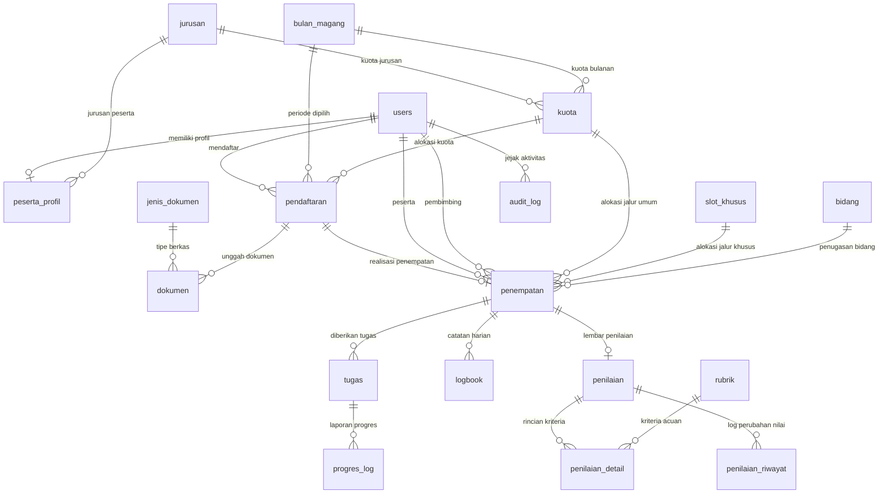

# TDD MagKom (Dokumen Desain Teknis)

**Technical Design Document** untuk portal manajemen magang Dinas Komunikasi dan Informatika (Kominfo)

| Metadata | Keterangan |
|---|---|
| **Versi** | 1.1 (Draft untuk review) |
| **Tanggal** | 7 Oktober 2026 |
| **Pendamping** | [`01-PRD-MagKom.md`](file:///g:/MAGKOM/docs/01-PRD-MagKom.md) v1.1. PRD menjelaskan **apa dan mengapa**; dokumen ini menjelaskan **bagaimana** membangunnya |
| **Pembaca** | Developer, reviewer kode, dan tim infrastruktur |
| **Status kode contoh** | Kode di dokumen ini adalah **ilustrasi pola**, bukan kode final. Nama kolom dan kelas mengikuti dokumen ini; detail mengikuti kondisi proyek |

---

## Daftar Isi

1. [Tujuan dan Cakupan](#1-tujuan-dan-cakupan)
2. [Stack dan Versi](#2-stack-dan-versi)
3. [Penyesuaian untuk Laravel 10](#3-penyesuaian-untuk-laravel-10)
4. [Arsitektur dan Struktur Direktori](#4-arsitektur-dan-struktur-direktori)
5. [Aturan Implementasi](#5-aturan-implementasi)
6. [Database](#6-database)
7. [Peta Rute](#7-peta-rute)
8. [Keamanan](#8-keamanan)
9. [Audit Log](#9-audit-log)
10. [Infrastruktur, CI/CD, dan Go-Live](#10-infrastruktur-cicd-dan-go-live)
11. [Strategi Pengujian](#11-strategi-pengujian)
12. [Glosarium Teknis](#12-glosarium-teknis)
13. [Catatan Keputusan Arsitektur](#13-catatan-keputusan-arsitektur)

---

## 1. Tujuan dan Cakupan

Dokumen ini menerjemahkan PRD menjadi rancangan teknis yang dapat langsung dikerjakan. Bila ada pertentangan antara dokumen ini dan PRD soal **perilaku bisnis**, PRD yang berlaku; soal **cara teknis**, dokumen ini yang berlaku. ID seperti BR-05 dan AC-04-6 merujuk ke PRD.

Hal-hal berikut sengaja dibuat sederhana karena skala sistem kecil (sekitar 15 peserta baru per bulan, satu server, satu instansi): tidak ada queue terpisah di R1, tidak ada microservice, tidak ada SPA terpisah. Kompleksitas ditambahkan hanya di tempat yang risikonya tinggi: kuota atomik, kontrol akses, dan audit.

---

## 2. Stack dan Versi

| Komponen | Pilihan | Catatan |
|---|---|---|
| **Framework** | **Laravel 10.x** | Wajib (D-01). Sudah tidak menerima patch keamanan resmi sejak Februari 2025; lihat ADR-01 |
| **Bahasa** | **PHP 8.3** (minimum dan rekomendasi) | PHP 8.1 EOL sejak akhir 2025; PHP 8.2 berakhir akhir 2026. Kunci di `composer.json` dengan platform PHP 8.3. Fitur yang dipakai: enum, constructor property promotion, named arguments, `declare(strict_types=1)` |
| **Database** | MySQL 8.0.16 ke atas atau MariaDB 10.5 ke atas, engine **InnoDB** | InnoDB wajib karena row lock. Versi minimum dipilih agar `CHECK constraint` ditegakkan |
| **Frontend** | Blade, Vite (bawaan Laravel 10), Tailwind CSS, Alpine.js `[Usulan]` | Disesuaikan dengan desain Figma. Bila memakai CSP ketat, gunakan build `@alpinejs/csp` |
| **Autentikasi** | Laravel Breeze 1.x (Blade stack) dengan `MustVerifyEmail` | Pakai versi Breeze yang kompatibel dengan Laravel 10. Laravel Socialite untuk login sosial (R3) |
| **PDF** | `barryvdh/laravel-dompdf` | Kunci di `composer.lock` |
| **Ekspor (R2)** | CSV dengan `fputcsv` atau `maatwebsite/excel` untuk XLSX `[Usulan]` | Sanitasi formula injection wajib (AC-17-2) |
| **Captcha (R2)** | Cloudflare Turnstile atau Google reCAPTCHA | Token diverifikasi di server |
| **Web server** | Nginx dengan PHP-FPM (atau Apache) | Document root ke `public/` |
| **Cache dan session** | Driver `file` untuk satu server; `database` bila multi-server | Cache harus mendukung kunci atomik (untuk `withoutOverlapping`) |
| **Queue** | Tidak dipakai di R1 | Email dikirim langsung synchronous. Bila SMTP lambat, pindah ke queue `database` |
| **Kualitas kode** | PHPUnit / Pest, Laravel Pint, Larastan | Dijalankan di CI (NFR-Q4) |

---

## 3. Penyesuaian untuk Laravel 10

Banyak tutorial dan paket terbaru ditulis untuk Laravel 11 ke atas. Padanan yang benar untuk Laravel 10:

| Gaya Laravel 11 ke atas | Yang Dipakai di Laravel 10 |
|---|---|
| Alias middleware di `bootstrap/app.php` | `app/Http/Kernel.php`, properti `$middlewareAliases` |
| `Schedule::command()` di `routes/console.php` | `app/Console/Kernel.php`, method `schedule()` |
| Method `casts()` pada Model | Properti `protected $casts = [...]` (cast enum didukung) |
| `Storage::temporaryUrl()` untuk disk privat lokal | Tidak tersedia native. Gunakan route unduhan dengan Policy dan `URL::temporarySignedRoute()` (bab 5.6) |
| Endpoint kesehatan bawaan `/up` | Tidak ada; buat route `/health` sendiri (bab 10) |
| Policy auto-discovery, Form Request, Enum cast, `lockForUpdate()`, `RateLimiter` | Tersedia dan dipakai apa adanya |

> **Risiko keamanan (R-01):** Laravel 10 tidak lagi menerima patch keamanan resmi. Mitigasi: tulis kode clean & modular (enum, Service class, hindari deprecated APIs), pertahankan test coverage tinggi sebagai safety net, isolasi jaringan, perbarui dependensi Composer secara berkala, dan rencanakan upgrade (ADR-01).

---

## 4. Arsitektur dan Struktur Direktori

Arsitektur: monolit Laravel server-rendered dengan pola:  
**Route → Middleware → Controller (tipis) → Form Request → Service → Model**.  
Otorisasi lewat Policy; logika bisnis terpusat di Service.

```text
magkom/
├── app/
│   ├── Console/
│   │   ├── Kernel.php                    # Penjadwalan harian
│   │   └── Commands/                     # NonaktifkanPesertaSelesai
│   ├── Enums/                            # RoleEnum, JenjangEnum, JalurEnum, SumberPenempatanEnum,
│   │                                     # StatusPendaftaranEnum, StatusPenempatanEnum, StatusTugasEnum,
│   │                                     # KompleksitasEnum, StatusKetersediaanEnum, StatusReviewProgresEnum,
│   │                                     # StatusLogbookEnum, StatusPenilaianEnum, TipeAuditEnum
│   ├── Exceptions/Domain/                # KuotaPenuhException, StatusSudahBerubahException,
│   │                                     # BebanPembimbingPenuhException, SlotKhususTidakTersediaException
│   ├── Http/
│   │   ├── Controllers/
│   │   │   ├── Public/                   # LandingController, KebijakanPrivasiController, HealthController
│   │   │   ├── Auth/                     # Bawaan Breeze, SocialiteController
│   │   │   ├── SuperAdmin/               # AkunStafController, JurusanController, BidangController,
│   │   │   │                             # BulanController, BulanStatusController, RubrikController,
│   │   │   │                             # SlotKhususController, PenempatanMasterController,
│   │   │   │                             # PesertaManualController, ArsipPesertaController,
│   │   │   │                             # AuditLogController, PengaturanController
│   │   │   ├── Admin/                    # KuotaController, PendaftaranController, WaitingListController,
│   │   │   │                             # PenempatanController, LaporanController
│   │   │   ├── Pembimbing/               # TugasController, ProgresReviewController,
│   │   │   │                             # LogbookReviewController, PenilaianController
│   │   │   └── Peserta/                  # ProfilController, PendaftaranController, BerkasController,
│   │   │                                 # TugasController, ProgresController, LogbookController,
│   │   │                                 # NilaiController
│   │   ├── Middleware/                   # EnsureUserHasRole, EnsureParticipantWritable,
│   │   │                                 # EnsurePasswordChanged, LogAuditTrail, SecurityHeaders
│   │   └── Requests/                     # Form Request per aksi tulis
│   ├── Models/                           # 20 Domain Model (User, PesertaProfil, Jurusan, Bidang, dll.)
│   ├── Policies/                         # PendaftaranPolicy, DokumenPolicy, PenempatanPolicy,
│   │                                     # TugasPolicy, LogbookPolicy, PenilaianPolicy
│   ├── Services/                         # QuotaAllocationService, PlacementService, BulanStatusService,
│   │                                     # ScoringService, MasaTenggangService, AuditService,
│   │                                     # AuditedService (abstract base)
│   ├── Support/                          # Pengaturan, PeriodeMagang
│   └── Providers/                        # AppServiceProvider, AuthServiceProvider
├── resources/views/                      # Blade views: public, auth, superadmin, admin, pembimbing, peserta, pdf
├── database/                             # Migrations, factories, seeders
├── storage/app/private/documents/        # Berkas pendaftar dan lampiran logbook (disk privat)
├── routes/web.php
└── config/
```

---

## 5. Aturan Implementasi

### 5.1 Pembagian Tanggung Jawab

| Lapisan | Boleh | Tidak Boleh |
|---|---|---|
| **Controller** | Menerima request, memanggil `authorize()`, memanggil Service, return view / redirect | Menulis query bisnis, menghitung kalkulasi bisnis |
| **Form Request** | Validasi struktur data dan otorisasi dasar | Memodifikasi database |
| **Service** | Aturan bisnis, DB Transaction, penulisan audit | Mengakses `request()` atau `session()` secara langsung |
| **Model** | Relasi Eloquent, casting, accessor / mutator sederhana, local scopes | Logika orchestration lintas-model |
| **Policy** | Memvalidasi kepemilikan data per record | Query agregasi berat |

### 5.2 RBAC dan Policy

1. Role disimpan sebagai PHP enum `RoleEnum` dan di-cast via `$casts`. Kolom `role` **dilarang keras** masuk ke `$fillable`.
2. Middleware otorisasi `role:` dipasang pada routing group.
3. Middleware `EnsureParticipantWritable` menolak (403) seluruh method mutasi (POST, PUT, PATCH, DELETE) bila peserta sedang masa tenggang atau sudah berstatus nonaktif.
4. **SuperAdmin Hanya-Baca pada Fungsi Pembimbing**:
   Method `before()` pada Policy hanya meloloskan ability baca. Kemampuan tulis pembimbing sengaja menghasilkan `null` agar dievaluasi oleh method policy spesifik yang menuntut `RoleEnum::Pembimbing`.

```php
// app/Policies/PenilaianPolicy.php
namespace App\Policies;

use App\Enums\RoleEnum;
use App\Models\Penilaian;
use App\Models\User;

class PenilaianPolicy
{
    public function before(User $user, string $ability): ?bool
    {
        if ($user->role !== RoleEnum::SuperAdmin) {
            return null;
        }

        $bacaDanAdmin = ['viewAny', 'view', 'viewRiwayat', 'downloadLembarNilai'];

        // Return null (bukan false) untuk ability selain baca,
        // sehingga evaluasi jatuh ke method di bawah yang memeriksa role pembimbing
        return in_array($ability, $bacaDanAdmin, true) ? true : null;
    }

    public function update(User $user, Penilaian $penilaian): bool
    {
        return $user->role === RoleEnum::Pembimbing
            && $penilaian->pembimbing_id === $user->id;
    }
}
```

### 5.3 Kuota Atomik dan Penerimaan (BR-05)

Seluruh mutasi kuota wajib dijalankan di dalam transaksi dengan **`lockForUpdate()`**. Urutan penguncian row: **Pendaftaran → Kuota (atau Slot Khusus) → Pembimbing**.

```php
// app/Services/PlacementService.php
namespace App\Services;

use App\Enums\JalurEnum;
use App\Enums\RoleEnum;
use App\Enums\StatusPendaftaranEnum;
use App\Enums\StatusPenempatanEnum;
use App\Enums\SumberPenempatanEnum;
use App\Exceptions\Domain\KuotaPenuhException;
use App\Exceptions\Domain\StatusSudahBerubahException;
use App\Models\Pendaftaran;
use App\Models\Penempatan;
use App\Models\User;
use App\Support\PeriodeMagang;
use Illuminate\Support\Facades\DB;

class PlacementService extends AuditedService
{
    public function terima(Pendaftaran $pendaftaran, User $admin): Penempatan
    {
        return $this->jalankan(__FUNCTION__, func_get_args(), function () use ($pendaftaran, $admin) {
            return DB::transaction(function () use ($pendaftaran, $admin) {
                // 1. Kunci baris pendaftaran
                $p = Pendaftaran::whereKey($pendaftaran->id)->lockForUpdate()->firstOrFail();
                if (! in_array($p->status, [StatusPendaftaranEnum::Diajukan, StatusPendaftaranEnum::WaitingList], true)) {
                    throw new StatusSudahBerubahException();
                }

                // 2. Kunci dan mutasi kuota
                $kuota = app(QuotaAllocationService::class)->ambilKuotaUmum($p->kuota_id);

                // 3. Tentukan Pembimbing
                $pembimbing = app(PembimbingAssignmentService::class)->tentukan($p);

                // 4. Hitung periode magang (BR-08)
                [$mulai, $selesai] = PeriodeMagang::hitung($p->bulanMagang->bulan_mulai, $p->durasi_bulan);

                // 5. Buat penempatan
                $penempatan = Penempatan::create([
                    'pendaftaran_id' => $p->id,
                    'peserta_id'     => $p->user_id,
                    'kuota_id'       => $p->kuota_id,
                    'pembimbing_id'  => $pembimbing->id,
                    'jalur'          => JalurEnum::Umum,
                    'sumber'         => SumberPenempatanEnum::Online,
                    'dibuat_oleh'    => $admin->id,
                    'tgl_mulai'      => $mulai->toDateString(),
                    'tgl_selesai'    => $selesai->toDateString(),
                    'status'         => StatusPenempatanEnum::Aktif,
                ]);

                // 6. Update status pendaftaran
                $p->update([
                    'status'         => StatusPendaftaranEnum::Diterima,
                    'verifikator_id' => $admin->id,
                    'diputuskan_at'  => now(),
                ]);

                // 7. Audit log dalam transaksi yang sama (AC-13-7)
                $this->audit->aksi($admin, 'pendaftaran.diterima', $p);

                return $penempatan;
            }, 3);
        });
    }
}
```

```php
// app/Services/QuotaAllocationService.php
namespace App\Services;

use App\Exceptions\Domain\KuotaPenuhException;
use App\Models\Kuota;
use Illuminate\Support\Facades\DB;

class QuotaAllocationService
{
    public function ambilKuotaUmum(int $kuotaId): Kuota
    {
        assert(DB::transactionLevel() > 0);

        $kuota = Kuota::whereKey($kuotaId)->lockForUpdate()->firstOrFail();

        if (! $kuota->aktif || $kuota->terisi >= $kuota->jumlah) {
            throw new KuotaPenuhException();
        }

        $kuota->increment('terisi');

        return $kuota;
    }
}
```

### 5.4 Status Bulan dan Periode Magang

`BulanStatusService` menjadi single source of truth untuk ketersediaan landing page dan validasi request pendaftaran:

```php
// app/Services/BulanStatusService.php
namespace App\Services;

use App\Enums\StatusKetersediaanEnum;
use App\Models\BulanMagang;
use App\Models\Kuota;
use Carbon\CarbonImmutable;

class BulanStatusService
{
    public function status(BulanMagang $bulan, ?Kuota $kuota = null, ?CarbonImmutable $sekarang = null): StatusKetersediaanEnum
    {
        $sekarang ??= CarbonImmutable::now('Asia/Jakarta');

        if (! $bulan->aktif || ($kuota && ! $kuota->aktif)) {
            return StatusKetersediaanEnum::Tutup;
        }

        if ($bulan->override_status !== null) {
            return $bulan->override_status;
        }

        $buka  = CarbonImmutable::parse($bulan->tgl_buka, 'Asia/Jakarta')->startOfDay();
        $tutup = CarbonImmutable::parse($bulan->tgl_tutup, 'Asia/Jakarta')->endOfDay();

        return match (true) {
            $sekarang->lt($buka)   => StatusKetersediaanEnum::Segera,
            $sekarang->lte($tutup) => StatusKetersediaanEnum::Tersedia,
            default                => StatusKetersediaanEnum::Tutup,
        };
    }

    public function tampilDiLanding(BulanMagang $bulan, ?CarbonImmutable $sekarang = null): bool
    {
        $sekarang ??= CarbonImmutable::now('Asia/Jakarta');

        $terlaluAwal = $bulan->override_status === null
            && $sekarang->lt(CarbonImmutable::parse($bulan->tgl_buka)->startOfDay()->subMonth());
        $sudahMulai = $sekarang->gte(CarbonImmutable::parse($bulan->bulan_mulai)->startOfMonth());

        return ! $terlaluAwal && ! $sudahMulai;
    }
}
```

```php
// app/Support/PeriodeMagang.php (BR-08)
namespace App\Support;

use Carbon\CarbonImmutable;
use Carbon\CarbonInterface;

final class PeriodeMagang
{
    /** @return array{0: CarbonImmutable, 1: CarbonImmutable} */
    public static function hitung(CarbonInterface|string $bulanMulai, int $durasi): array
    {
        $mulai   = CarbonImmutable::parse($bulanMulai, 'Asia/Jakarta')->startOfMonth();
        $selesai = $mulai->addMonthsNoOverflow($durasi - 1)->endOfMonth();

        return [$mulai, $selesai];
    }
}
```

### 5.5 Status Terlambat Dihitung Saat Dibaca (BR-16)

Status keterlambatan tugas dihitung runtime pada accessor / query scope, tidak disimpan sebagai status diskrit di kolom status.

```php
// app/Models/Tugas.php
public function getTerlambatAttribute(): bool
{
    return $this->status !== StatusTugasEnum::Selesai
        && $this->deadline->endOfDay()->isPast();
}

public function scopeTerlambat(Builder $query): Builder
{
    return $query->where('status', '!=', StatusTugasEnum::Selesai->value)
                 ->whereDate('deadline', '<', today('Asia/Jakarta'));
}
```

### 5.6 Berkas: Upload & Temporary Signed Download

Validasi form request memeriksa magic bytes:
```php
'file' => ['required', 'file', 'mimes:pdf,jpg,jpeg,png', 'max:'.(Pengaturan::int('berkas_maks_mb') * 1024)],
```

Penyimpanan di private disk:
```php
$path = $file->store('documents', 'private'); // storage/app/private/documents
$hash = hash_file('sha256', $file->getRealPath());
```

Download lewat Policy dan Temporary Signed Route (berlaku 5 menit):
```php
// routes/web.php
Route::get('/berkas/{dokumen}/unduh', [BerkasController::class, 'unduh'])
    ->middleware(['auth', 'signed'])->name('berkas.unduh');

// Controller download method
public function unduh(Dokumen $dokumen)
{
    $this->authorize('download', $dokumen);

    return Storage::disk('private')->download($dokumen->path, $dokumen->nama_asli, [
        'X-Content-Type-Options' => 'nosniff',
    ]);
}
```

### 5.7 Scheduler Harian (F-12)

Idempotent artisan command dijalankan via cron harian:

```php
// app/Console/Commands/NonaktifkanPesertaSelesai.php
namespace App\Console\Commands;

use App\Enums\StatusPenempatanEnum;
use App\Models\Penempatan;
use App\Services\AuditService;
use Illuminate\Console\Command;
use Illuminate\Support\Facades\DB;

class NonaktifkanPesertaSelesai extends Command
{
    protected $signature = 'magkom:nonaktifkan-peserta-selesai';
    protected $description = 'Menonaktifkan akun peserta yang telah melewati masa tenggang';

    public function handle(AuditService $audit): int
    {
        Penempatan::where('status', StatusPenempatanEnum::Selesai)
            ->whereDate('tgl_nonaktif', '<=', today('Asia/Jakarta'))
            ->chunkById(100, function ($batch) use ($audit) {
                foreach ($batch as $penempatan) {
                    DB::transaction(function () use ($penempatan, $audit) {
                        $penempatan->update(['status' => StatusPenempatanEnum::Nonaktif]);
                        $penempatan->peserta()->update(['status_aktif' => false]);
                        $audit->sistem('penempatan.dinonaktifkan_otomatis', $penempatan);
                    });
                }
            });

        return self::SUCCESS;
    }
}
```

---

## 6. Database

### 6.1 Prinsip Desain
- Database Engine: **InnoDB** (MySQL 8.0.16+).
- Soft deletes / Hard delete tidak digunakan: entitas dinonaktifkan via flag boolean (`aktif` atau `status_aktif`).
- Timezone: `Asia/Jakarta`.
- Append-only untuk `audit_log`.

### 6.2 Diagram ERD (20 Tabel Domain)



### 6.3 Daftar 20 Tabel Domain

1. `users` (id, nama, email, email_verified_at, password, role, provider, provider_id, bidang_id, status_aktif, must_change_password, dibuat_oleh, remember_token, timestamps)
2. `peserta_profil` (id, user_id [unique], nim_nisn, institusi, jurusan_id, jenjang, no_hp, timestamps)
3. `jurusan` (id, nama_jurusan [unique], kategori, aktif, timestamps)
4. `bidang` (id, nama_bidang, deskripsi, aktif, timestamps)
5. `bulan_magang` (id, bulan_mulai [unique], tgl_buka, tgl_tutup, override_status, aktif, timestamps)
6. `kuota` (id, bulan_magang_id, jurusan_id, jumlah, terisi, aktif, unique[bulan_magang_id, jurusan_id], timestamps)
7. `slot_khusus` (id, bulan_mulai [unique], jumlah, terisi, aktif, dibuat_oleh, timestamps)
8. `jenis_dokumen` (id, kode, nama, jenjang, wajib, aktif, unique[kode, jenjang], timestamps)
9. `pendaftaran` (id, user_id, bulan_magang_id, kuota_id, durasi_bulan, status, verifikator_id, catatan, diajukan_at, diputuskan_at, timestamps)
10. `dokumen` (id, pendaftaran_id, jenis_dokumen_id, path, nama_asli, mime, ukuran, hash, unique[pendaftaran_id, jenis_dokumen_id], timestamps)
11. `penempatan` (id, pendaftaran_id [unique null], peserta_id, kuota_id, slot_khusus_id, bidang_id, pembimbing_id, jalur, sumber, dibuat_oleh, tgl_mulai, tgl_selesai, tgl_ditetapkan_selesai, tgl_nonaktif, status, timestamps)
12. `tugas` (id, penempatan_id, judul, deskripsi, kategori, kompleksitas, deadline, status, timestamps)
13. `progres_log` (id, tugas_id, catatan, file, tgl_lapor, status_review, feedback, timestamps)
14. `logbook` (id, penempatan_id, tanggal, kegiatan, file_laporan, link_laporan, status, catatan_pembimbing, unique[penempatan_id, tanggal], timestamps)
15. `rubrik` (id, kriteria, bobot, aktif, timestamps)
16. `penilaian` (id, penempatan_id [unique], pembimbing_id, nilai_akhir, predikat, catatan, status, timestamps)
17. `penilaian_detail` (id, penilaian_id, rubrik_id, skor, bobot_snapshot, unique[penilaian_id, rubrik_id], timestamps)
18. `penilaian_riwayat` (id, penilaian_id, diubah_oleh, nilai_lama [json], nilai_baru [json], alasan, waktu)
19. `audit_log` (id, request_id, user_id, tipe, aksi, entitas, entitas_id, nilai_lama [json], nilai_baru [json], detail [json], metode, rute, status_http, durasi_ms, ip, user_agent, waktu)
20. `pengaturan` (id, kunci [unique], nilai, timestamps)

---

## 7. Peta Rute

| Area | HTTP Method & URI | Middleware & Guard | Deskripsi & Target |
|---|---|---|---|
| **Publik** | `GET /` | web | Landing Page (F-01) |
| **Publik** | `GET /kebijakan-privasi` | web | Kebijakan Privasi (NFR-R1) |
| **Publik** | `GET /health` | web | Healthcheck DB & Application (NFR-O1) |
| **Auth** | `GET/POST /register`, `/login`, `POST /logout` | guest / auth | Breeze Auth (F-02) |
| **Auth** | `GET /verify-email`, `POST /email/verification-notification` | auth, throttle:6,1 | Verifikasi Email (F-02) |
| **Auth** | `GET/POST /password/ganti` | auth, EnsurePasswordChanged | Ganti password wajib staf (F-11, BR-15) |
| **Peserta** | `GET /peserta/dashboard` | auth, verified, role:peserta | Dashboard Peserta (F-03) |
| **Peserta** | `GET/PUT /peserta/profil` | auth, verified, role:peserta | Form Profil Peserta (F-02) |
| **Peserta** | `GET/POST /peserta/pendaftaran` | auth, verified, role:peserta | Form & Ajukan Pendaftaran (F-03) |
| **Peserta** | `POST /peserta/pendaftaran/{id}/berkas` | auth, verified, role:peserta | Upload Berkas Pendaftaran (F-03) |
| **Peserta** | `GET /berkas/{dokumen}/unduh` | auth, signed | Unduh Berkas Privat (F-03, F-04) |
| **Peserta** | `GET /peserta/tugas`, `POST .../{id}/progres` | auth, verified, role:peserta, participant.writable | Kerjakan Tugas (F-08) |
| **Peserta** | `GET/POST /peserta/logbook`, `PUT .../{id}` | auth, verified, role:peserta, participant.writable | Isi Logbook Harian (F-09) |
| **Peserta** | `GET /peserta/nilai`, `GET .../lembar-nilai` | auth, verified, role:peserta | Nilai & Unduh PDF (F-10) |
| **Admin** | `GET /admin/dashboard` | auth, role:admin,superadmin | Dashboard Admin |
| **Admin** | `GET /admin/kuota`, `PUT /admin/kuota/{bulan}` | auth, role:admin,superadmin | Manajemen Kuota Umum (F-05) |
| **Admin** | `GET /admin/pendaftaran`, `POST .../{id}/keputusan`| auth, role:admin,superadmin | Verifikasi Pendaftaran (F-04) |
| **Admin** | `GET /admin/waiting-list`, `POST .../{id}/naikkan` | auth, role:admin,superadmin | Waiting List Management (F-04) |
| **Admin** | `GET/POST /admin/peserta-manual` | auth, role:admin,superadmin | Input Peserta Jalur Khusus (F-07) |
| **Pembimbing**| `GET /pembimbing/peserta` | auth, role:pembimbing,superadmin (read) | Daftar Peserta Bimbingan |
| **Pembimbing**| `POST /pembimbing/peserta/{penempatan}/tugas` | auth, role:pembimbing (Policy) | Beri Tugas (F-08) |
| **Pembimbing**| `POST /pembimbing/progres/{id}/review` | auth, role:pembimbing (Policy) | Review Progres Tugas (F-08) |
| **Pembimbing**| `POST /pembimbing/logbook/{id}/review` | auth, role:pembimbing (Policy) | Review Logbook (F-09) |
| **Pembimbing**| `GET/PUT /pembimbing/penilaian/{penempatan}` | auth, role:pembimbing (Policy) | Rubrik Nilai & Selesai (F-10) |
| **SuperAdmin**| `/superadmin/akun-staf` | auth, role:superadmin | Kelola Staf (F-11) |
| **SuperAdmin**| `/superadmin/jurusan`, `/bidang`, `/rubrik`, `/bulan` | auth, role:superadmin | Master Data (F-11) |
| **SuperAdmin**| `/superadmin/slot-khusus` | auth, role:superadmin | Manajemen Slot Khusus (F-06) |
| **SuperAdmin**| `GET /superadmin/audit-log` | auth, role:superadmin | Penelusuran Audit Trail (F-13) |
| **SuperAdmin**| `GET/PUT /superadmin/pengaturan` | auth, role:superadmin | Parameter Konfigurasi (F-11) |

---

## 8. Keamanan

### 8.1 Pemetaan OWASP Top 10 (2021)

| Risiko | Penanganan di MagKom |
|---|---|
| **A01 Broken Access Control** | `role:` middleware, Policy per record, scope kepemilikan (anti-IDOR), SuperAdmin hanya-baca pada fungsi Pembimbing, test matriks akses (bab 11) |
| **A02 Cryptographic Failures** | HTTPS wajib, `Hash::make` untuk password, cookie `secure`, berkas di disk privat, backup terenkripsi |
| **A03 Injection** | Eloquent dan query binding (tanpa `DB::raw` dengan input pengguna), escape Blade `{{ }}`, `https` saja untuk tautan logbook, sanitasi formula pada ekspor CSV/XLSX |
| **A04 Insecure Design** | Aturan bisnis atomik (BR-05), batas unik di database, CHECK constraint, keputusan arsitektur tercatat (bab 13) |
| **A05 Security Misconfiguration** | `APP_DEBUG=false`, header keamanan (bab 8.3), `.env` di luar document root, akun database berhak minimal, halaman error kustom |
| **A06 Vulnerable and Outdated Components** | `composer audit` di CI, pembaruan dependensi berkala, risiko Laravel 10 dan PHP dicatat (R-01) |
| **A07 Identification and Authentication Failures** | Rate limiting, respons seragam, verifikasi email, regenerasi session, ganti password wajib untuk staf, captcha (R2) |
| **A08 Software and Data Integrity Failures** | `composer.lock` dikomit, build dari CI, tautan unduh bertanda tangan, deploy dari repositori sendiri |
| **A09 Security Logging and Monitoring Failures** | Audit log (bab 9), log aplikasi dirotasi, pemantauan uptime dan kapasitas disk |
| **A10 Server-Side Request Forgery** | Aplikasi tidak pernah mengambil URL yang diberikan pengguna (tautan logbook hanya ditampilkan, tidak diambil server) |

### 8.2 Rate Limiting `[Usulan]`

Didefinisikan dengan `RateLimiter::for()` di `RouteServiceProvider` dan dipasang lewat middleware `throttle:`.

| Endpoint | Batas | Kunci |
|---|---|---|
| Login | 5 percobaan gagal per menit | email + IP (bawaan Breeze) |
| Registrasi | 5 per menit | IP |
| Lupa password | 5 per menit | IP |
| Kirim ulang verifikasi | 6 per menit | pengguna |
| Unggah berkas | 20 per menit | pengguna |
| Unduh berkas | 30 per menit | pengguna |
| Halaman publik | 120 per menit | IP |

Respons 429 menampilkan halaman kustom berbahasa Indonesia dengan sisa waktu tunggu.

### 8.3 Header Keamanan

```php
// app/Http/Middleware/SecurityHeaders.php (ilustrasi)
public function handle(Request $request, Closure $next): Response
{
    $response = $next($request);

    $response->headers->set('X-Content-Type-Options', 'nosniff');
    $response->headers->set('X-Frame-Options', 'DENY');
    $response->headers->set('Referrer-Policy', 'strict-origin-when-cross-origin');
    $response->headers->set('Permissions-Policy', 'camera=(), microphone=(), geolocation=()');

    if ($request->isSecure()) {
        $response->headers->set('Strict-Transport-Security', 'max-age=31536000');
    }
    if (app()->isProduction()) {
        $response->headers->set('Content-Security-Policy',
            "default-src 'self'; img-src 'self' data:; script-src 'self'; style-src 'self'; "
            ."frame-ancestors 'none'; base-uri 'self'; form-action 'self'");
    }

    return $response;
}
```

Catatan: tambahkan `includeSubDomains` pada HSTS hanya bila semua subdomain sudah HTTPS. CSP perlu disesuaikan saat memakai captcha di R2 (izinkan host skrip penyedia) dan bila memakai Alpine.js (gunakan build CSP atau izinkan sesuai kebutuhan). CSP hanya dipasang di produksi karena server pengembangan Vite memakai sumber yang berbeda.

### 8.4 Berkas dan Login Sosial

Aturan unggah, unduh, dan penautan akun sosial ada di bab 5.6 dan 5.7. Ringkasnya: tipe dicek dari isi, nama acak, disk privat, unduh lewat tautan bertanda tangan **dan** Policy, header `nosniff`; login sosial hanya untuk Peserta dengan pencegahan pembajakan akun.

### 8.5 Rahasia dan Konfigurasi

- Kredensial (database, SMTP, kunci OAuth, kunci captcha, `APP_KEY`) hanya di `.env` server atau pengelola rahasia; tidak pernah di repositori. `.env.example` hanya berisi nama variabel.
- Pemindaian rahasia dijalankan pada pipeline CI.
- `APP_KEY` yang bocor atau berubah akan membatalkan semua tautan bertanda tangan dan sesi; sertakan dalam prosedur pemulihan.

---

## 9. Audit Log

Mewujudkan keputusan D-08 dan NFR-A1 dengan definisi yang dapat diuji.

### 9.1 Tipe Audit

| Tipe | Isi | Kapan Ditulis | Pada Kegagalan Menulis |
|---|---|---|---|
| `auth` | Login, logout, gagal login, verifikasi, reset password (tanpa token) | Saat peristiwa | Dicatat ke log aplikasi |
| `aksi` | Setiap aksi tulis bisnis: pelaku, aksi, entitas, nilai lama dan baru | **Di dalam transaksi** aksi (AC-13-7) | Aksi dibatalkan |
| `service` | Satu baris per pemanggilan method Service: nama, argumen tersanitasi, hasil, durasi | Setelah method selesai, di luar transaksinya | Dicatat ke log aplikasi; aksi tidak dibatalkan |
| `akses_data` | **Satu baris per request** yang menampilkan, mengunduh, atau mengekspor data: pengguna, entitas, filter, jumlah baris | Setelah respons terkirim (terminable middleware) | Dicatat ke log aplikasi |

### 9.2 Pola Implementasi

**`AuditService`** adalah satu-satunya pintu penulisan ke `audit_log`. Ia menyisipkan `request_id`, pengguna, IP, dan sanitasi nilai.

**Pemanggilan service** dibungkus kelas dasar `AuditedService`:

```php
// app/Services/AuditedService.php (ilustrasi)
abstract class AuditedService
{
    public function __construct(protected AuditService $audit) {}

    protected function jalankan(string $metode, array $argumen, Closure $aksi): mixed
    {
        $mulai = hrtime(true);

        try {
            $hasil = $aksi();
            $this->audit->service(static::class, $metode, $argumen, 'ok', $this->ms($mulai));

            return $hasil;
        } catch (Throwable $e) {
            $this->audit->service(static::class, $metode, $argumen, 'gagal:'.class_basename($e), $this->ms($mulai));
            throw $e;
        }
    }

    private function ms(int $mulai): int
    {
        return (int) round((hrtime(true) - $mulai) / 1e6);
    }
}

// Pemakaian di setiap method publik Service
public function terima(Pendaftaran $pendaftaran, User $admin): Penempatan
{
    return $this->jalankan(__FUNCTION__, func_get_args(), function () use ($pendaftaran, $admin) {
        // isi method (lihat bab 5.3)
    });
}
```

Pola ini dipilih daripada proxy atau decorator karena Service di-inject lewat type-hint kelas konkret; proxy tidak akan lolos pemeriksaan tipe.

**Akses data** ditandai Controller lewat `AuditService::tandaiAkses()`, lalu ditulis satu kali oleh middleware terminable:

```php
// app/Http/Middleware/LogAuditTrail.php (ilustrasi)
public function handle(Request $request, Closure $next): Response
{
    $request->attributes->set('request_id', (string) Str::uuid());
    $request->attributes->set('mulai', hrtime(true));

    return $next($request)->header('X-Request-Id', $request->attributes->get('request_id'));
}

public function terminate(Request $request, Response $response): void
{
    try {
        app(AuditService::class)->tulisAksesData($request, $response);   // hanya bila ditandai
    } catch (Throwable $e) {
        report($e);                                                       // masuk log aplikasi
    }
}

// Di Controller daftar atau detail
$this->audit->tandaiAkses('pendaftaran', filter: $request->query(), jumlah: $hasil->total());
```

### 9.3 Sanitasi

`AuditService` menyanitasi semua argumen dan nilai sebelum disimpan (AC-13-5):

```php
private const KUNCI_RAHASIA = ['password', 'password_confirmation', 'token', 'remember_token',
                               'captcha', 'cf-turnstile-response', 'g-recaptcha-response', 'secret'];

private function sanitasi(mixed $nilai): mixed
{
    return match (true) {
        $nilai instanceof Model        => ['model' => class_basename($nilai), 'id' => $nilai->getKey()],
        $nilai instanceof UploadedFile => ['file' => $nilai->getClientOriginalName(), 'ukuran' => $nilai->getSize()],
        is_array($nilai)               => collect($nilai)->map(fn ($v, $k) =>
                                              in_array(strtolower((string) $k), self::KUNCI_RAHASIA, true)
                                                  ? '[disamarkan]' : $this->sanitasi($v))->all(),
        is_scalar($nilai) || $nilai === null => $nilai,
        default                        => get_debug_type($nilai),
    };
}
```

Isi berkas tidak pernah disimpan; hanya nama dan ukuran.

### 9.4 Append-Only

- Model `AuditLog` tidak memakai `updated_at` (`const UPDATED_AT = null`) dan menolak `update()` serta `delete()` di level aplikasi.
- Di level database, akun runtime aplikasi hanya diberi `SELECT` dan `INSERT` pada `audit_log`. Berikan hak **per tabel**, bukan per skema, karena hak yang diberikan di tingkat skema tidak dapat dicabut untuk satu tabel saja pada konfigurasi MySQL umum. Sisa tabel domain cukup `SELECT`, `INSERT`, `UPDATE` (data tidak dihapus); tabel `sessions` atau `cache` membutuhkan `DELETE` bila memakai driver database.

```sql
GRANT SELECT, INSERT ON magkom.audit_log TO 'magkom_app'@'localhost';
-- ulangi GRANT SELECT, INSERT, UPDATE per tabel domain lain
```

### 9.5 Retensi dan Pemangkasan

Log `aksi` dan `auth` disimpan tanpa batas. Detail `akses_data` dipangkas setelah 1 tahun `[Usulan]` (A-09, OQ-08). Karena akun aplikasi tidak punya hak `DELETE`, pemangkasan dilakukan oleh **pekerjaan pemeliharaan terpisah** dengan akun database khusus (`magkom_maint`, hanya `DELETE` pada `audit_log`), dijalankan bulanan lewat cron server dan bukan dari aplikasi. Hapus per batch (misalnya 10.000 baris) agar tidak mengunci tabel lama, dan catat hasilnya di log operasional.

### 9.6 Kinerja

Satu baris per request (bukan per baris data), indeks pada bab 6.5, penulisan akses data setelah respons, dan `detail` berupa JSON ringkas. Pantau ukuran tabel; bila melampaui sekitar 10 juta baris, pertimbangkan partisi per bulan.

---

## 10. Infrastruktur, CI/CD, dan Go-Live

### 10.1 Lingkungan

| Lingkungan | Fungsi | Data |
|---|---|---|
| **Lokal** | Pengembangan | Data dummy lewat factory dan seeder |
| **Staging** | Mirror produksi untuk UAT dan uji beban ringan; konfigurasi, versi PHP, dan versi database sama dengan produksi | Data dummy; **tidak** menyalin data pribadi produksi |
| **Produksi** | Layanan nyata | Data nyata |

### 10.2 Server

Linux (distribusi LTS), Nginx, PHP-FPM 8.3 dengan ekstensi standar Laravel ditambah `pdo_mysql`, `gd` (PDF), dan `zip` (ekspor XLSX). Document root diarahkan ke `public/`. HTTPS dengan sertifikat valid; HTTP dialihkan ke HTTPS. Hak akses berkas: hanya `storage/` dan `bootstrap/cache/` yang dapat ditulis oleh user PHP-FPM.

### 10.3 Konfigurasi Produksi

| Item | Nilai |
|---|---|
| `APP_ENV`, `APP_DEBUG` | `production`, `false` |
| `APP_URL` | `https://...` |
| Zona waktu | Atur `'timezone' => 'Asia/Jakarta'` di `config/app.php` (Laravel 10 belum membaca `APP_TIMEZONE`) |
| Bahasa | `'locale' => 'id'` dan paket terjemahan validasi bahasa Indonesia |
| Session | `SESSION_SECURE_COOKIE=true`, `SESSION_LIFETIME=120`, `same_site=lax` |
| Log | Channel `daily`, simpan 14 hari |
| Mail | SMTP resmi dengan **SPF dan DKIM** untuk domain pengirim |
| Disk `private` | `storage/app/private`, tidak ter-link ke `public/` |
| Cache konfigurasi | `config:cache`, `route:cache`, `view:cache`, `event:cache` pada setiap deploy |
| Akun database | `magkom_app` (runtime), `magkom_migrator` (hanya untuk migrasi saat deploy), `magkom_maint` (pemeliharaan audit) |

### 10.4 Alur Deploy

1. Build artefak di CI (`composer install --no-dev --optimize-autoloader`, `npm ci && npm run build`).
2. Unggah ke direktori rilis baru (`releases/<tanggal-jam>`); tautan `shared/.env` dan `shared/storage`.
3. `php artisan down` hanya bila migrasi tidak kompatibel mundur.
4. Jalankan migrasi dengan akun migrator: `DB_USERNAME=magkom_migrator DB_PASSWORD=... php artisan migrate --force`, **sebelum** `config:cache`.
5. `config:cache`, `route:cache`, `view:cache`, `event:cache`.
6. Alihkan tautan simbolik `current` ke rilis baru; reload PHP-FPM.
7. `php artisan up`; uji cepat `/health` dan satu alur login.

**Rollback:** arahkan `current` kembali ke rilis sebelumnya (simpan 3 rilis terakhir) dan reload PHP-FPM; target kurang dari 1 jam. Migrasi dirancang **kompatibel mundur** (tambah kolom dulu, hapus belakangan) agar rollback kode tidak membutuhkan rollback skema.

### 10.5 Pipeline CI

Dijalankan pada setiap pull request:

| Tahap | Perintah |
|---|---|
| Validasi dan dependensi | `composer validate --strict`, `composer audit` |
| Gaya kode | `vendor/bin/pint --test` |
| Analisis statis | `vendor/bin/phpstan analyse` (Larastan) |
| Test | `php artisan test` dengan **MySQL** sebagai service container (bukan SQLite) |
| Build frontend | `npm ci && npm run build` |
| Pemindaian rahasia | Alat pemindai rahasia pada riwayat commit |

Branch utama dilindungi: pull request wajib melewati CI dan ditinjau minimal satu orang. Pesan commit mengikuti format yang konsisten (misalnya Conventional Commits) `[Usulan]`.

### 10.6 Backup dan Pemulihan

| Item | Ketentuan `[Usulan]` |
|---|---|
| Database | Dump harian (`mysqldump --single-transaction`) |
| Berkas | Backup harian `storage/app/private` (rsync atau restic) |
| Penyimpanan | Lokasi terpisah dari server aplikasi, terenkripsi; simpan 30 harian dan 12 bulanan |
| Target | **RPO 24 jam, RTO 4 jam** |
| Uji pemulihan | Minimal satu kali per kuartal di staging; hasil dicatat |

### 10.7 Pemantauan

- Uptime monitor memeriksa `/health` (200 bila aplikasi dan database sehat).
- Peringatan kapasitas disk pada 80%.
- Scheduler: catat waktu eksekusi terakhir command harian; peringatan bila lebih dari 36 jam tidak berjalan (kegagalan cron paling sering tidak terlihat).
- Pelacakan error produksi (misalnya Sentry atau email ke pemilik sistem) `[Usulan]`.

### 10.8 Checklist Go-Live R1

- [ ] HTTPS aktif; HTTP dialihkan; sertifikat valid
- [ ] `APP_DEBUG=false`, `APP_ENV=production`, cache konfigurasi dibuat
- [ ] Tiga akun database terpisah dengan hak minimal; akun `magkom_app` tidak punya `UPDATE`/`DELETE` pada `audit_log`
- [ ] SMTP aktif dengan SPF dan DKIM; email verifikasi dan reset diuji sampai inbox
- [ ] Cron `schedule:run` aktif; command harian pernah dijalankan manual di staging
- [ ] Backup berjalan dan **uji pemulihan** pernah berhasil
- [ ] Header keamanan terverifikasi; halaman error kustom (403, 404, 419, 429, 500) tampil
- [ ] Seeder dijalankan; password SuperAdmin awal sudah diganti
- [ ] Kebijakan Privasi tayang dan ditinjau
- [ ] Uptime monitor dan peringatan disk aktif
- [ ] Skenario UAT-1 sampai UAT-8 lulus; tidak ada bug prioritas tinggi
- [ ] Penanggung jawab dua minggu pertama pasca-rilis ditunjuk; prosedur rollback sudah dilatih sekali

---

## 11. Strategi Pengujian

### 11.1 Lapisan Uji

| Lapisan | Cakupan | Alat |
|---|---|---|
| Unit | `PeriodeMagang`, `BulanStatusService`, `ScoringService` (nilai dan predikat), aksesor Terlambat | PHPUnit atau Pest |
| Feature | Setiap AC di PRD bab 7: alur lewat HTTP dengan database | PHPUnit atau Pest, MySQL |
| Policy dan RBAC | Seluruh matriks hak akses | Test berbasis tabel (di bawah) |
| Konkurensi | Kuota, slot, dan keputusan ganda | Test khusus (di bawah) |
| Keamanan | IDOR, unggahan, unduhan, header, formula injection | Feature test dan pemindaian header |
| UAT | UAT-1 sampai UAT-8 | Manual di staging (otomasi browser opsional) |

Target cakupan baris minimal 80% pada folder `Services` dan `Policies` `[Usulan]`.

### 11.2 Test Matriks Hak Akses

Buat test berbasis data (`dataProvider`) dari PRD bab 3.3: setiap baris menyebut peran, rute, dan status HTTP yang diharapkan (200, 302, atau 403). Test ini mencegah regresi otorisasi yang paling sering lolos review, termasuk aturan "SuperAdmin hanya-baca pada fungsi Pembimbing".

### 11.3 Test Konkurensi (AC-05-4)

Lock baris (`lockForUpdate`) tidak bekerja pada SQLite, dan `RefreshDatabase` membungkus tiap test dalam satu transaksi sehingga tidak ada dua koneksi yang benar-benar berebut. Karena itu:

1. Gunakan **MySQL sungguhan** (juga di CI).
2. Tandai test dengan grup `concurrency` dan jangan bungkus dalam transaksi; bersihkan data dengan truncate.
3. Siapkan satu kuota dengan sisa 1 dan dua pendaftaran `diajukan`.
4. Jalankan dua **proses PHP terpisah** (misalnya dua `Symfony\Component\Process\Process` yang memanggil command artisan khusus uji) yang sama-sama memanggil `PlacementService::terima()`.
5. Tegaskan: tepat satu berhasil, satu menerima `KuotaPenuhException`, dan `terisi` sama dengan `jumlah`.

Uji serupa untuk slot khusus dan untuk dua Admin yang memutuskan pendaftaran yang sama (AC-04-5).

### 11.4 Waktu dan Data

- Test yang bergantung waktu memakai `travelTo()` atau parameter `$sekarang` pada service (bab 5.4); jangan memakai `sleep()`.
- Factory untuk setiap model dan state yang bermakna (misalnya `Penempatan::factory()->selesai()`), sehingga test singkat dan mudah dibaca.
- Test wajib minimal (NFR-Q2): kuota dan slot pada akses bersamaan, matriks RBAC, slot khusus tidak bocor ke endpoint publik, transisi status, batas logbook, masa tenggang, nonaktif otomatis, audit tidak memuat rahasia, ekspor tanpa formula injection.

---

## 12. Glosarium Teknis

| Istilah | Arti |
|---|---|
| **ADR** | Architecture Decision Record: catatan singkat sebuah keputusan arsitektur, alasan, dan konsekuensinya |
| **Append-only** | Data hanya boleh ditambah; tidak boleh diubah atau dihapus |
| **CHECK constraint** | Aturan di database yang menolak data yang melanggar kondisi tertentu (misalnya `terisi <= jumlah`) |
| **CSP** | Content-Security-Policy: header yang membatasi sumber skrip dan sumber daya yang boleh dimuat browser |
| **CSRF** | Serangan yang membuat browser pengguna mengirim permintaan tanpa disadari; dicegah dengan token CSRF bawaan Laravel |
| **Deadlock** | Dua transaksi saling menunggu kunci yang dipegang yang lain; dicegah dengan urutan penguncian yang konsisten dan percobaan ulang |
| **Eager loading** | Memuat relasi sekaligus dalam sedikit query untuk mencegah N+1 |
| **EOL** | End of life: versi tidak lagi menerima perbaikan, termasuk patch keamanan |
| **Form Request** | Kelas Laravel untuk validasi dan otorisasi dasar sebelum Controller berjalan |
| **HSTS** | Header yang memerintahkan browser memakai HTTPS saja untuk domain tersebut |
| **Idempotent** | Dapat dijalankan berulang kali dengan hasil akhir sama (seperti command nonaktif otomatis) |
| **IDOR** | Insecure Direct Object Reference: pengguna mengakses data orang lain dengan mengganti ID di URL; dicegah dengan pemeriksaan kepemilikan |
| **`lockForUpdate()`** | Mengunci baris yang dibaca sampai transaksi selesai, sehingga proses lain menunggu |
| **Mass assignment** | Mengisi banyak atribut model sekaligus dari input; dibatasi dengan `$fillable` agar `role` tidak bisa diisi pengguna |
| **N+1** | Pola query yang menjalankan satu query tambahan untuk setiap baris hasil |
| **`nosniff`** | Header yang melarang browser menebak tipe berkas sendiri |
| **Policy** | Kelas Laravel yang memutuskan apakah pengguna boleh melakukan aksi pada sebuah record |
| **RBAC** | Role-Based Access Control: hak akses ditentukan oleh peran |
| **Rate limiting** | Pembatasan jumlah permintaan per waktu |
| **RPO / RTO** | Recovery Point / Time Objective: batas data yang boleh hilang dan batas waktu pemulihan |
| **Service (kelas)** | Kelas tempat aturan bisnis dan transaksi berada |
| **Signed URL** | URL yang ditandatangani server sehingga tidak dapat dimodifikasi dan dapat kedaluwarsa |
| **Snapshot** | Salinan nilai pada saat tertentu (misalnya bobot rubrik pada saat penilaian) |
| **SPF / DKIM** | Pengaturan DNS dan tanda tangan email yang membuktikan email berasal dari domain resmi |
| **Terminable middleware** | Middleware yang menjalankan `terminate()` setelah respons dikirim ke browser |
| **Transaksi** | Sekumpulan operasi database yang berhasil semua atau dibatalkan semua |

---

## 13. Catatan Keputusan Arsitektur

| ADR | Keputusan | Alasan | Konsekuensi |
|---|---|---|---|
| **ADR-01** | Memakai **Laravel 10** dan PHP 8.3 | Keputusan owner (D-01) | Laravel 10 tidak lagi menerima patch keamanan. Mitigasi di bab 3 dan R-01. Jadwal upgrade ke versi yang masih didukung: setelah R1 stabil. Test yang kuat adalah jaring pengaman upgrade |
| **ADR-02** | Aplikasi server-rendered (Blade), bukan SPA | Skala kecil, tim kecil, landing page butuh SEO, permukaan serangan lebih kecil | Interaksi kaya dibatasi pada Alpine.js |
| **ADR-03** | Service layer dan Policy; Controller tipis | Aturan bisnis dapat diuji tanpa HTTP dan tidak tersebar | Sedikit lebih banyak berkas untuk fitur sederhana |
| **ADR-04** | Pessimistic locking (`lockForUpdate`) untuk kuota | Kontensi rendah, tetapi kebenaran harus mutlak; lebih sederhana daripada optimistic locking dan retry | Transaksi harus singkat dan urutan kunci konsisten |
| **ADR-05** | Audit log di database, append-only, hak database dibatasi | Akuntabilitas tanpa infrastruktur tambahan | Pemangkasan harus lewat akun pemeliharaan terpisah |
| **ADR-06** | Zona waktu aplikasi `Asia/Jakarta` | Sistem satu instansi dan satu zona waktu | Jangan mengubah zona waktu server atau database setelah ada data |
| **ADR-07** | Tanpa queue pada R1 | Satu-satunya email adalah verifikasi dan reset; volume sangat kecil | Bila SMTP lambat, pindahkan pengiriman email ke queue `database` |
| **ADR-08** | Data tidak dihapus; master dan akun dinonaktifkan | Jejak audit dan arsip | Tidak ada rute `DELETE`; kebijakan retensi menunggu OQ-08 |

