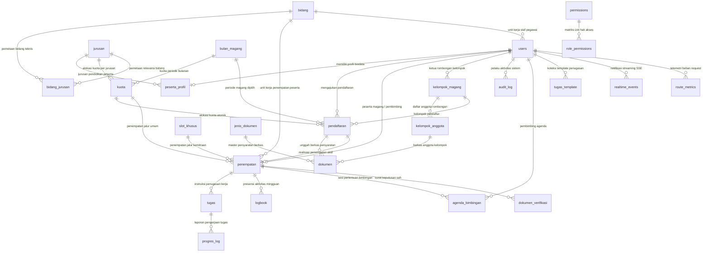

# Kamus Data, Skema Basis Data & Seeder MagKom

Dokumen ini memuat spesifikasi menyeluruh untuk skema basis data **MagKom (Magang Kominfo)** menggunakan engine **InnoDB** pada **MySQL 8.0.16+** / **MariaDB 10.5+** (serta **SQLite `:memory:`** untuk testing suite otomatis terisolasi).

---

## 1. Diagram Relasi Entitas (ERD) Definitif

Berikut adalah diagram relasi entitas untuk seluruh tabel domain aplikasi yang aktif:

---

## 2. Klasifikasi Tabel Basis Data

Skema basis data MAGKOM dipisahkan secara tegas menjadi dua kelompok:
1. **Tabel Domain Aplikasi MAGKOM (24 Tabel)**: Seluruh tabel yang dirancang spesifik untuk kebutuhan tata kelola magang Dinas Kominfo.
2. **Tabel Bawaan Framework Laravel (5 Tabel)**: Tabel standar ekosistem Laravel untuk autentikasi, sesi, token, dan antrean.

---

## 3. Kamus Data: Tabel Domain Aplikasi (24 Tabel)

### 1. `audit_log`
Mencatat jejak audit mutasi data dan sesi autentikasi secara append-only.
- **Engine**: InnoDB | **Karakteristik**: Immutable (Aplikasi tidak memiliki izin UPDATE/DELETE).

| Kolom | Tipe Data | Nullable | Default | Keterangan |
|---|---|---|---|---|
| `id` | BIGINT UNSIGNED | Tidak | Auto Inc | Primary Key |
| `user_id` | BIGINT UNSIGNED | Ya | NULL | FK ke `users.id` (aktor aksi; NULL jika aksi tamu/sistem) |
| `tipe` | VARCHAR(20) | Tidak | - | `auth`, `aksi`, `service`, `akses_data` |
| `channel` | VARCHAR(30) | Tidak | 'default' | Kanal filter log (`auth`, `pendaftaran`, `penempatan`, `system`) |
| `deskripsi` | TEXT | Tidak | - | Deskripsi aksi manusiawi |
| `metadata` | JSON | Ya | NULL | Payload perubahan data (kata sandi & token disensor rekursif) |
| `ip_address` | VARCHAR(45) | Ya | NULL | Alamat IPv4/IPv6 klien |
| `user_agent` | VARCHAR(255) | Ya | NULL | User Agent peramban |
| `created_at` | TIMESTAMP | Tidak | CURRENT_TIMESTAMP | Waktu pencatatan mutasi |

**Indeks**: `INDEX(tipe)`, `INDEX(channel)`, `INDEX(created_at)`.

---

### 2. `bulan_magang`
Master periode bulan pembukaan pendaftaran magang.

| Kolom | Tipe Data | Nullable | Default | Keterangan |
|---|---|---|---|---|
| `id` | BIGINT UNSIGNED | Tidak | Auto Inc | Primary Key |
| `tahun` | YEAR | Tidak | - | Tahun pelaksanaan magang (2026+) |
| `bulan` | TINYINT UNSIGNED | Tidak | - | Urutan bulan (1–12) |
| `nama_bulan` | VARCHAR(50) | Ya | NULL | Nama bulan representatif (misal: "Januari 2027") |
| `status_buka` | BOOLEAN | Tidak | FALSE | Status formasi pendaftaran aktif dibuka |
| `created_at` / `updated_at` | TIMESTAMP | Ya | NULL | Timestamps |

**Batasan**: `UNIQUE(tahun, bulan)`, `CHECK(bulan BETWEEN 1 AND 12)`.

---

### 3. `kuota`
Alokasi kapasitas kuota reguler per jurusan per periode bulan magang.

| Kolom | Tipe Data | Nullable | Default | Keterangan |
|---|---|---|---|---|
| `id` | BIGINT UNSIGNED | Tidak | Auto Inc | Primary Key |
| `bulan_magang_id` | BIGINT UNSIGNED | Tidak | - | FK ke `bulan_magang.id` (cascade delete) |
| `jurusan_id` | BIGINT UNSIGNED | Tidak | - | FK ke `jurusan.id` (restrict delete) |
| `jumlah_kuota` | SMALLINT UNSIGNED | Tidak | - | Batas daya tampung kuota umum |
| `terisi` | SMALLINT UNSIGNED | Tidak | 0 | Jumlah kuota yang telah resmi diterima |
| `status_aktif` | BOOLEAN | Tidak | TRUE | Status aktif formasi kuota |
| `created_at` / `updated_at` | TIMESTAMP | Ya | NULL | Timestamps |

**Batasan & Indeks**: `UNIQUE(bulan_magang_id, jurusan_id)`, `CHECK(terisi <= jumlah_kuota)`.

---

### 4. `slot_khusus`
Alokasi kuota diskresi kemitraan instansi atau sekolah yang terisolasi dari kuota umum publik.

| Kolom | Tipe Data | Nullable | Default | Keterangan |
|---|---|---|---|---|
| `id` | BIGINT UNSIGNED | Tidak | Auto Inc | Primary Key |
| `bulan_magang_id` | BIGINT UNSIGNED | Tidak | - | FK ke `bulan_magang.id` |
| `instansi` | VARCHAR(150) | Tidak | - | Nama lembaga kemitraan pemohon |
| `jumlah_slot` | SMALLINT UNSIGNED | Tidak | - | Jumlah kapasitas slot khusus |
| `terisi` | SMALLINT UNSIGNED | Tidak | 0 | Jumlah pendaftar khusus yang telah disetujui |
| `keterangan` | TEXT | Ya | NULL | Catatan disposisi / dasar kemitraan |
| `status_aktif` | BOOLEAN | Tidak | TRUE | Sakelar status slot khusus |
| `created_at` / `updated_at` | TIMESTAMP | Ya | NULL | Timestamps |

**Batasan**: `CHECK(terisi <= jumlah_slot)`.

---

### 5. `jurusan`
Master data program keahlian / jurusan pendidikan peserta magang.

| Kolom | Tipe Data | Nullable | Default | Keterangan |
|---|---|---|---|---|
| `id` | BIGINT UNSIGNED | Tidak | Auto Inc | Primary Key |
| `nama_jurusan` | VARCHAR(100) | Tidak | - | Nama konsentrasi keahlian |
| `kategori` | VARCHAR(20) | Tidak | - | `smk`, `mahasiswa` |
| `aktif` | BOOLEAN | Tidak | TRUE | Sakelar status aktif jurusan |
| `created_at` / `updated_at` | TIMESTAMP | Ya | NULL | Timestamps |

**Batasan**: `UNIQUE(nama_jurusan)`.

---

### 6. `bidang`
Master unit kerja bidang dinas teknis di lingkungan Dinas Kominfo Sleman.

| Kolom | Tipe Data | Nullable | Default | Keterangan |
|---|---|---|---|---|
| `id` | BIGINT UNSIGNED | Tidak | Auto Inc | Primary Key |
| `nama_bidang` | VARCHAR(100) | Tidak | - | Nama unit kerja dinas |
| `kode_bidang` | VARCHAR(20) | Tidak | - | Singkatan / kode unit (**UNIQUE**) |
| `deskripsi` | TEXT | Ya | NULL | Tugas pokok dan fungsi bidang |
| `aktif` | BOOLEAN | Tidak | TRUE | Status keaktifan bidang |
| `created_at` / `updated_at` | TIMESTAMP | Ya | NULL | Timestamps |

---

### 7. `bidang_jurusan`
Pivot pemetaan relevansi jurusan pendidikan terhadap unit kerja bidang dinas.

| Kolom | Tipe Data | Nullable | Default | Keterangan |
|---|---|---|---|---|
| `id` | BIGINT UNSIGNED | Tidak | Auto Inc | Primary Key |
| `bidang_id` | BIGINT UNSIGNED | Tidak | - | FK ke `bidang.id` (cascade delete) |
| `jurusan_id` | BIGINT UNSIGNED | Tidak | - | FK ke `jurusan.id` (cascade delete) |
| `created_at` / `updated_at` | TIMESTAMP | Ya | NULL | Timestamps |

**Batasan**: `UNIQUE(bidang_id, jurusan_id)`.

---

### 8. `jenis_dokumen`
Master persyaratan berkas pendaftaran berdasarkan jenjang pendidikan peserta.

| Kolom | Tipe Data | Nullable | Default | Keterangan |
|---|---|---|---|---|
| `id` | BIGINT UNSIGNED | Tidak | Auto Inc | Primary Key |
| `kode` | VARCHAR(50) | Tidak | - | Identifier jenis dokumen (`surat_pengantar`, `cv`, dll.) |
| `nama` | VARCHAR(100) | Tidak | - | Label nama dokumen resmi |
| `jenjang` | VARCHAR(20) | Tidak | - | `smk`, `d3`, `s1` |
| `wajib` | BOOLEAN | Tidak | TRUE | Penanda kewajiban berkas |
| `aktif` | BOOLEAN | Tidak | TRUE | Status keaktifan persyaratan |
| `created_at` / `updated_at` | TIMESTAMP | Ya | NULL | Timestamps |

**Batasan**: `UNIQUE(kode, jenjang)`.

---

### 9. `peserta_profil`
Biodata personal, akademik, kontak darurat, dan data pendukung peserta magang.

| Kolom | Tipe Data | Nullable | Default | Keterangan |
|---|---|---|---|---|
| `id` | BIGINT UNSIGNED | Tidak | Auto Inc | Primary Key |
| `user_id` | BIGINT UNSIGNED | Tidak | - | FK ke `users.id` (**UNIQUE**, cascade delete) |
| `asal_instansi` | VARCHAR(150) | Tidak | - | Nama sekolah / universitas |
| `jurusan_id` | BIGINT UNSIGNED | Tidak | - | FK ke `jurusan.id` (restrict delete) |
| `nim_nisn` | VARCHAR(50) | Tidak | - | Nomor Induk Siswa/Mahasiswa |
| `alamat` | TEXT | Ya | NULL | Alamat domisili lengkap |
| `pembimbing_sekolah`| VARCHAR(150) | Ya | NULL | Nama guru / dosen pembimbing akademik |
| `kontak_darurat_nama`| VARCHAR(100) | Ya | NULL | Nama kerabat kontak darurat |
| `kontak_darurat_nomor`| VARCHAR(20) | Ya | NULL | Nomor telepon kontak darurat |
| `persetujuan_wali` | BOOLEAN | Tidak | FALSE | Persetujuan orang tua/wali (UU PDP) |
| `foto` | VARCHAR(255) | Ya | NULL | Path berkas pasfoto formal |
| `created_at` / `updated_at` | TIMESTAMP | Ya | NULL | Timestamps |

---

### 10. `kelompok_magang`
Data rombongan magang kelompok (maksimal 4 orang: 1 ketua + 3 anggota).

| Kolom | Tipe Data | Nullable | Default | Keterangan |
|---|---|---|---|---|
| `id` | BIGINT UNSIGNED | Tidak | Auto Inc | Primary Key |
| `ketua_user_id` | BIGINT UNSIGNED | Tidak | - | FK ke `users.id` (ketua pendaftar, cascade delete) |
| `nama_kelompok` | VARCHAR(150) | Tidak | - | Nama tim / rombongan pendaftaran |
| `created_at` / `updated_at` | TIMESTAMP | Ya | NULL | Timestamps |

**Indeks**: `INDEX(ketua_user_id)`.

---

### 11. `kelompok_anggota`
Daftar mentee anggota rombongan di bawah naungan kelompok magang.

| Kolom | Tipe Data | Nullable | Default | Keterangan |
|---|---|---|---|---|
| `id` | BIGINT UNSIGNED | Tidak | Auto Inc | Primary Key |
| `kelompok_magang_id` | BIGINT UNSIGNED | Tidak | - | FK ke `kelompok_magang.id` (cascade delete) |
| `nama` | VARCHAR(255) | Tidak | - | Nama lengkap anggota tim |
| `nim_nisn` | VARCHAR(50) | Ya | NULL | NIM / NISN anggota |
| `no_hp` | VARCHAR(30) | Ya | NULL | Kontak telepon WhatsApp anggota |
| `email` | VARCHAR(255) | Ya | NULL | Alamat email anggota |
| `created_at` / `updated_at` | TIMESTAMP | Ya | NULL | Timestamps |

**Indeks**: `INDEX(kelompok_magang_id)`.

---

### 12. `pendaftaran`
Rekaman pendaftaran formasi magang dan riwayat keputusan verifikasi administratif.

| Kolom | Tipe Data | Nullable | Default | Keterangan |
|---|---|---|---|---|
| `id` | BIGINT UNSIGNED | Tidak | Auto Inc | Primary Key |
| `user_id` | BIGINT UNSIGNED | Tidak | - | FK ke `users.id` (peserta / ketua kelompok) |
| `bulan_magang_id` | BIGINT UNSIGNED | Tidak | - | FK ke `bulan_magang.id` |
| `kuota_id` | BIGINT UNSIGNED | Ya | NULL | FK ke `kuota.id` (jalur reguler) |
| `slot_khusus_id` | BIGINT UNSIGNED | Ya | NULL | FK ke `slot_khusus.id` (jalur kemitraan) |
| `kelompok_magang_id` | BIGINT UNSIGNED | Ya | NULL | FK ke `kelompok_magang.id` |
| `nomor_pendaftaran` | VARCHAR(30) | Tidak | - | Kode unik registrasi (**UNIQUE**) |
| `status` | VARCHAR(25) | Tidak | 'berkas_belum_lengkap' | `berkas_belum_lengkap`, `diajukan`, `diterima`, `ditolak`, `dibatalkan` |
| `catatan_admin` | TEXT | Ya | NULL | Catatan pertimbangan verifikator dinas |
| `file_surat_diterima` | VARCHAR(255) | Ya | NULL | Path berkas SK penerimaan resmi (PDF) |
| `created_at` / `updated_at` | TIMESTAMP | Ya | NULL | Timestamps |

**Indeks**: `INDEX(status)`, `INDEX(bulan_magang_id)`.

---

### 13. `dokumen`
Metadata berkas persyaratan yang diunggah peserta magang.

| Kolom | Tipe Data | Nullable | Default | Keterangan |
|---|---|---|---|---|
| `id` | BIGINT UNSIGNED | Tidak | Auto Inc | Primary Key |
| `pendaftaran_id` | BIGINT UNSIGNED | Tidak | - | FK ke `pendaftaran.id` (cascade delete) |
| `jenis_dokumen_id` | BIGINT UNSIGNED | Tidak | - | FK ke `jenis_dokumen.id` |
| `kelompok_anggota_id`| BIGINT UNSIGNED | Ya | NULL | FK ke `kelompok_anggota.id` (berkas anggota) |
| `nama_asli` | VARCHAR(255) | Tidak | - | Nama berkas asli saat diunggah |
| `path` | VARCHAR(255) | Tidak | - | Lokasi penyimpanan pada disk privat |
| `ukuran_kb` | INT UNSIGNED | Tidak | - | Ukuran file dalam kilobita |
| `mime_type` | VARCHAR(100) | Tidak | - | MIME type berkas (application/pdf, dll.) |
| `created_at` / `updated_at` | TIMESTAMP | Ya | NULL | Timestamps |

---

### 14. `dokumen_verifikasi`
Catatan riwayat verifikasi berkas permohonan oleh staf verifikator.

| Kolom | Tipe Data | Nullable | Default | Keterangan |
|---|---|---|---|---|
| `id` | BIGINT UNSIGNED | Tidak | Auto Inc | Primary Key |
| `pendaftaran_id` | BIGINT UNSIGNED | Tidak | - | FK ke `pendaftaran.id` (cascade delete) |
| `dokumen_id` | BIGINT UNSIGNED | Ya | NULL | FK ke `dokumen.id` (cascade delete) |
| `verifikator_id` | BIGINT UNSIGNED | Tidak | - | FK ke `users.id` (staf verifikator) |
| `status_verifikasi` | VARCHAR(20) | Tidak | - | `valid`, `tidak_valid` |
| `catatan` | TEXT | Ya | NULL | Catatan perbaikan berkas |
| `created_at` / `updated_at` | TIMESTAMP | Ya | NULL | Timestamps |

---

### 15. `penempatan`
Plotting resmi peserta magang aktif ke unit kerja bidang dan pembimbing ASN.

| Kolom | Tipe Data | Nullable | Default | Keterangan |
|---|---|---|---|---|
| `id` | BIGINT UNSIGNED | Tidak | Auto Inc | Primary Key |
| `pendaftaran_id` | BIGINT UNSIGNED | Tidak | - | FK ke `pendaftaran.id` (**UNIQUE**, restrict delete) |
| `peserta_id` | BIGINT UNSIGNED | Tidak | - | FK ke `users.id` (peserta magang aktif) |
| `pembimbing_id` | BIGINT UNSIGNED | Tidak | - | FK ke `users.id` (pembimbing lapangan ASN) |
| `bidang_id` | BIGINT UNSIGNED | Tidak | - | FK ke `bidang.id` (unit penempatan) |
| `tanggal_mulai` | DATE | Tidak | - | Tanggal awal pelaksanaan magang |
| `tanggal_selesai` | DATE | Tidak | - | Tanggal akhir pelaksanaan magang |
| `status` | VARCHAR(20) | Tidak | 'aktif' | `aktif`, `selesai`, `mengundurkan_diri`, `nonaktif` |
| `file_surat_diterima` | VARCHAR(255) | Ya | NULL | Salinan SK penempatan resmi |
| `created_at` / `updated_at` | TIMESTAMP | Ya | NULL | Timestamps |

**Batasan**: `CHECK(tanggal_selesai >= tanggal_mulai)`.

---

### 16. `tugas`
Instruksi penugasan kerja proyek bimbingan ber-deadline oleh pembimbing lapangan.

| Kolom | Tipe Data | Nullable | Default | Keterangan |
|---|---|---|---|---|
| `id` | BIGINT UNSIGNED | Tidak | Auto Inc | Primary Key |
| `penempatan_id` | BIGINT UNSIGNED | Tidak | - | FK ke `penempatan.id` (cascade delete) |
| `judul` | VARCHAR(150) | Tidak | - | Judul penugasan kerja |
| `deskripsi` | TEXT | Tidak | - | Rincian instruksi teknis tugas |
| `tenggat_waktu` | DATETIME | Tidak | - | Batas waktu penyelesaian tugas |
| `kompleksitas` | VARCHAR(20) | Tidak | 'sedang' | `rendah`, `sedang`, `tinggi` |
| `status` | VARCHAR(20) | Tidak | 'belum_dikerjakan' | `belum_dikerjakan`, `dalam_proses`, `selesai` |
| `lampiran` | VARCHAR(255) | Ya | NULL | Berkas lampiran tugas dari pembimbing |
| `link` | VARCHAR(255) | Ya | NULL | Tautan referensi pendukung tugas |
| `batch_id` | VARCHAR(50) | Ya | NULL | Identifier penugasan massal (multi-mentee) |
| `scheduled_at` | DATETIME | Ya | NULL | Penjadwalan penerbitan tugas otomatis |
| `created_at` / `updated_at` | TIMESTAMP | Ya | NULL | Timestamps |

---

### 17. `tugas_template`
Library template penugasan bimbingan mandiri milik pembimbing lapangan.

| Kolom | Tipe Data | Nullable | Default | Keterangan |
|---|---|---|---|---|
| `id` | BIGINT UNSIGNED | Tidak | Auto Inc | Primary Key |
| `user_id` | BIGINT UNSIGNED | Tidak | - | FK ke `users.id` (pembimbing pemilik template) |
| `judul` | VARCHAR(150) | Tidak | - | Nama judul template penugasan |
| `deskripsi` | TEXT | Tidak | - | Isi uraian instruksi template |
| `kompleksitas` | VARCHAR(20) | Tidak | 'sedang' | `rendah`, `sedang`, `tinggi` |
| `created_at` / `updated_at` | TIMESTAMP | Ya | NULL | Timestamps |

---

### 18. `progres_log`
Laporan berkala hasil pengerjaan penugasan oleh mentee beserta umpan balik pembimbing.

| Kolom | Tipe Data | Nullable | Default | Keterangan |
|---|---|---|---|---|
| `id` | BIGINT UNSIGNED | Tidak | Auto Inc | Primary Key |
| `tugas_id` | BIGINT UNSIGNED | Tidak | - | FK ke `tugas.id` (cascade delete) |
| `persentase` | TINYINT UNSIGNED | Tidak | - | Progres capaian kerja (0–100%) |
| `catatan` | TEXT | Tidak | - | Uraian capaian pengerjaan tugas |
| `file_progres` | VARCHAR(255) | Ya | NULL | Berkas bukti hasil kerja |
| `link` | VARCHAR(255) | Ya | NULL | Tautan repositori / hasil kerja daring |
| `umpan_balik_pembimbing`| TEXT | Ya | NULL | Evaluasi review dari pembimbing |
| `status_review` | VARCHAR(20) | Tidak | 'menunggu' | `menunggu`, `disetujui`, `revisi` |
| `created_at` / `updated_at` | TIMESTAMP | Ya | NULL | Timestamps |

**Batasan**: `CHECK(persentase BETWEEN 0 AND 100)`.

---

### 19. `logbook`
Presensi kegiatan harian/mingguan mentee dengan pembatasan batas mundur pengisian (H-3).

| Kolom | Tipe Data | Nullable | Default | Keterangan |
|---|---|---|---|---|
| `id` | BIGINT UNSIGNED | Tidak | Auto Inc | Primary Key |
| `penempatan_id` | BIGINT UNSIGNED | Tidak | - | FK ke `penempatan.id` (cascade delete) |
| `tanggal` | DATE | Tidak | - | Tanggal pelaksanaan aktivitas |
| `minggu_ke` | TINYINT UNSIGNED | Tidak | 1 | Urutan minggu pelaksanaan magang |
| `kegiatan` | TEXT | Tidak | - | Uraian kegiatan magang kedinasan |
| `kendala` | TEXT | Ya | NULL | Hambatan yang dihadapi mentee |
| `solusi` | TEXT | Ya | NULL | Solusi penyelesaian hambatan |
| `lampiran` | VARCHAR(255) | Ya | NULL | Foto/berkas dokumentasi kegiatan |
| `status` | VARCHAR(20) | Tidak | 'menunggu' | `menunggu`, `disetujui`, `revisi` |
| `catatan_pembimbing` | TEXT | Ya | NULL | Evaluasi catatan pembimbing ASN |
| `created_at` / `updated_at` | TIMESTAMP | Ya | NULL | Timestamps |

**Batasan**: `UNIQUE(penempatan_id, tanggal)`.

---

### 20. `agenda_bimbingan`
Jadwal sesi pertemuan atau konsultasi bimbingan lapangan.

| Kolom | Tipe Data | Nullable | Default | Keterangan |
|---|---|---|---|---|
| `id` | BIGINT UNSIGNED | Tidak | Auto Inc | Primary Key |
| `penempatan_id` | BIGINT UNSIGNED | Tidak | - | FK ke `penempatan.id` (cascade delete) |
| `pembimbing_id` | BIGINT UNSIGNED | Tidak | - | FK ke `users.id` |
| `judul` | VARCHAR(150) | Tidak | - | Topik agenda pertemuan |
| `tanggal_waktu` | DATETIME | Tidak | - | Jadwal pelaksanaan agenda |
| `lokasi` | VARCHAR(150) | Ya | NULL | Ruang pertemuan / tautan daring |
| `catatan` | TEXT | Ya | NULL | Notulensi hasil sesi bimbingan |
| `created_at` / `updated_at` | TIMESTAMP | Ya | NULL | Timestamps |

---

### 21. `realtime_events`
Event store untuk distribusi notifikasi Server-Sent Events (SSE) `/realtime/stream`.

| Kolom | Tipe Data | Nullable | Default | Keterangan |
|---|---|---|---|---|
| `id` | BIGINT UNSIGNED | Tidak | Auto Inc | Primary Key |
| `user_id` | BIGINT UNSIGNED | Tidak | - | FK ke `users.id` (penerima notifikasi) |
| `event_type` | VARCHAR(50) | Tidak | - | Tipe event (`tugas_baru`, `logbook_review`, dll.) |
| `payload` | JSON | Tidak | - | Data pesan interaktif dan tautan aksi |
| `is_read` | BOOLEAN | Tidak | FALSE | Penanda status notifikasi telah dibaca |
| `created_at` / `updated_at` | TIMESTAMP | Ya | NULL | Timestamps |

**Indeks**: `INDEX(user_id, is_read)`.

---

### 22. `route_metrics`
Telemetri beban server, waktu respons HTTP, dan utilisasi rute aplikasi.

| Kolom | Tipe Data | Nullable | Default | Keterangan |
|---|---|---|---|---|
| `id` | BIGINT UNSIGNED | Tidak | Auto Inc | Primary Key |
| `route_name` | VARCHAR(100) | Tidak | - | Nama rute rujukan (`landing`, `dashboard`, dll.) |
| `method` | VARCHAR(10) | Tidak | - | HTTP method (`GET`, `POST`, dll.) |
| `status_code` | SMALLINT UNSIGNED | Tidak | - | Kode status respons HTTP |
| `response_time_ms`| INT UNSIGNED | Tidak | - | Durasi eksekusi dalam milidetik |
| `memory_usage_mb`| DECIMAL(8,2) | Tidak | - | Konsumsi memori server dalam MB |
| `user_id` | BIGINT UNSIGNED | Ya | NULL | FK ke `users.id` |
| `created_at` | TIMESTAMP | Tidak | CURRENT_TIMESTAMP | Waktu telemetri request |

**Indeks**: `INDEX(route_name)`, `INDEX(created_at)`.

---

### 23. `pengaturan`
Konfigurasi 12 parameter operasional aplikasi yang dapat diubah dinamis oleh SuperAdmin.

| Kolom | Tipe Data | Nullable | Default | Keterangan |
|---|---|---|---|---|
| `id` | BIGINT UNSIGNED | Tidak | Auto Inc | Primary Key |
| `kunci` | VARCHAR(100) | Tidak | - | Key konfigurasi unik (**UNIQUE**) |
| `nilai` | TEXT | Ya | NULL | Nilai konfigurasi parameter |
| `created_at` / `updated_at` | TIMESTAMP | Ya | NULL | Timestamps |

**Daftar 12 Kunci Definitif**:
1. `kuota_umum_maks_per_bulan` (Default: 12)
2. `slot_khusus_default` (Default: 3)
3. `maks_peserta_aktif_per_pembimbing` (Default: 20)
4. `maks_anggota_kelompok` (Default: 4)
5. `durasi_magang_maks_bulan` (Default: 6)
6. `logbook_maks_mundur_hari` (Default: 3)
7. `berkas_maks_mb` (Default: 10)
8. `deadline_mendekati_hari` (Default: 3)
9. `sla_verifikasi_hari` (Default: 5)
10. `masa_tenggang_bulan` (Default: 2)
11. `retensi_audit_akses_data_hari` (Default: 365)
12. `fitur_pendaftaran_kelompok_aktif` (Default: 1)

---

### 24. `permissions` & `role_permissions`
Matriks hak akses dinamis 13 modul sistem untuk 4 peran pengguna.

#### A. `permissions`
| Kolom | Tipe Data | Nullable | Default | Keterangan |
|---|---|---|---|---|
| `id` | BIGINT UNSIGNED | Tidak | Auto Inc | Primary Key |
| `nama_modul` | VARCHAR(100) | Tidak | - | Label nama modul fungsional |
| `slug` | VARCHAR(100) | Tidak | - | Identifier modul unik (**UNIQUE**) |
| `kategori` | VARCHAR(50) | Tidak | - | Kategori grup modul (`Publik`, `Tata Kelola`, dll.) |
| `deskripsi` | TEXT | Ya | NULL | Uraian wewenang operasional modul |
| `is_system` | BOOLEAN | Tidak | TRUE | Penanda modul sistem inti (kebal hapus) |
| `urutan` | INT UNSIGNED | Tidak | 0 | Urutan tampilan pada matriks hak akses |
| `created_at` / `updated_at` | TIMESTAMP | Ya | NULL | Timestamps |

#### B. `role_permissions`
| Kolom | Tipe Data | Nullable | Default | Keterangan |
|---|---|---|---|---|
| `id` | BIGINT UNSIGNED | Tidak | Auto Inc | Primary Key |
| `permission_id` | BIGINT UNSIGNED | Tidak | - | FK ke `permissions.id` (cascade delete) |
| `role` | VARCHAR(20) | Tidak | - | Nama peran (`superadmin`, `admin`, `pembimbing`, `peserta`) |
| `created_at` / `updated_at` | TIMESTAMP | Ya | NULL | Timestamps |

**Batasan**: `UNIQUE(permission_id, role)`.

---

## 4. Kamus Data: Tabel Bawaan Framework Laravel (5 Tabel)

### 1. `users`
Tabel autentikasi bawaan framework yang diperkaya dengan atribut profil dan kendali kredensial kedinasan.

| Kolom | Tipe Data | Nullable | Default | Keterangan |
|---|---|---|---|---|
| `id` | BIGINT UNSIGNED | Tidak | Auto Inc | Primary Key |
| `nama` | VARCHAR(100) | Tidak | - | Nama lengkap pengguna |
| `email` | VARCHAR(255) | Tidak | - | Alamat email terotentikasi (**UNIQUE**) |
| `no_telp` | VARCHAR(20) | Ya | NULL | Nomor kontak telepon / WhatsApp |
| `email_verified_at` | TIMESTAMP | Ya | NULL | Waktu verifikasi alamat email |
| `password` | VARCHAR(255) | Ya | NULL | Bcrypt hash kata sandi |
| `password_awal` | VARCHAR(255) | Ya | NULL | Kredensial awal saat akun dibuatkan staf |
| `role` | VARCHAR(20) | Tidak | - | `superadmin`, `admin`, `pembimbing`, `peserta` |
| `provider` | VARCHAR(20) | Ya | NULL | Provider OAuth (`google`) |
| `provider_id` | VARCHAR(191) | Ya | NULL | ID unik dari provider Google OAuth |
| `bidang_id` | BIGINT UNSIGNED | Ya | NULL | FK ke `bidang.id` (khusus peran pegawai) |
| `status_aktif` | BOOLEAN | Tidak | TRUE | Sakelar status keaktifan akun pengguna |
| `must_change_password`| BOOLEAN | Tidak | FALSE | Penanda wajib ganti kata sandi login pertama |
| `foto` | VARCHAR(255) | Ya | NULL | Path avatar profil foto pengguna |
| `remember_token` | VARCHAR(100) | Ya | NULL | Token Remember-Me peramban |
| `created_at` / `updated_at` | TIMESTAMP | Ya | NULL | Timestamps |

---

### 2. `password_reset_tokens`
Token pengesahan reset kata sandi melalui tautan email.

| Kolom | Tipe Data | Nullable | Default | Keterangan |
|---|---|---|---|---|
| `email` | VARCHAR(255) | Tidak | - | Primary Key (email pemohon reset) |
| `token` | VARCHAR(255) | Tidak | - | Hash token reset kata sandi |
| `created_at` | TIMESTAMP | Ya | NULL | Waktu penerbitan token |

---

### 3. `sessions`
Penyimpanan sesi otentikasi pengguna berbasis basis data (`SESSION_DRIVER=database`).

| Kolom | Tipe Data | Nullable | Default | Keterangan |
|---|---|---|---|---|
| `id` | VARCHAR(255) | Tidak | - | Primary Key (session ID hash) |
| `user_id` | BIGINT UNSIGNED | Ya | NULL | ID pengguna pemilik sesi aktif |
| `ip_address` | VARCHAR(45) | Ya | NULL | Alamat IP klien |
| `user_agent` | TEXT | Ya | NULL | Metadata peramban pengguna |
| `payload` | LONGTEXT | Tidak | - | Data sesi terenkripsi |
| `last_activity` | INT | Tidak | - | Timestamp aktivitas terakhir |

---

### 4. `failed_jobs`
Catatan kegagalan eksekusi background jobs antrean Laravel Queue.

| Kolom | Tipe Data | Nullable | Default | Keterangan |
|---|---|---|---|---|
| `id` | BIGINT UNSIGNED | Tidak | Auto Inc | Primary Key |
| `uuid` | VARCHAR(255) | Tidak | - | UUID unik jobs (**UNIQUE**) |
| `connection` | TEXT | Tidak | - | Nama koneksi queue driver |
| `queue` | TEXT | Tidak | - | Nama antrean queue |
| `payload` | LONGTEXT | Tidak | - | Data payload job |
| `exception` | LONGTEXT | Tidak | - | Rincian stack trace kegagalan |
| `failed_at` | TIMESTAMP | Tidak | CURRENT_TIMESTAMP | Waktu pencatatan kegagalan |

---

### 5. `personal_access_tokens`
Token akses otentikasi API berbasis Laravel Sanctum.

| Kolom | Tipe Data | Nullable | Default | Keterangan |
|---|---|---|---|---|
| `id` | BIGINT UNSIGNED | Tidak | Auto Inc | Primary Key |
| `tokenable_type` | VARCHAR(255) | Tidak | - | Nama model entitas pemilik |
| `tokenable_id` | BIGINT UNSIGNED | Tidak | - | ID entitas pemilik token |
| `name` | VARCHAR(255) | Tidak | - | Deskripsi nama token |
| `token` | VARCHAR(64) | Tidak | - | SHA-256 hash token (**UNIQUE**) |
| `abilities` | TEXT | Ya | NULL | Cakupan izin token |
| `last_used_at` | TIMESTAMP | Ya | NULL | Waktu pemanfaatan token terakhir |
| `expires_at` | TIMESTAMP | Ya | NULL | Masa kedaluwarsa token |
| `created_at` / `updated_at` | TIMESTAMP | Ya | NULL | Timestamps |

---

## 5. Catatan Riwayat Dekomisioning Tabel (Historical Drop Record)

Berdasarkan keputusan arsitektur dan migrasi resmi bertanggal **9 November 2026**, tabel-tabel berikut telah **dihapus secara permanen dari basis data**:

| Nama Tabel yang Di-Drop | Migrasi Penghapusan | Alasan Dekomisioning |
|---|---|---|
| `penilaian` | `2026_11_09_200000_drop_penilaian_and_rubrik_tables.php` | Alur kelulusan disederhanakan menjadi penetapan status selesai 1-klik oleh Pembimbing tanpa lembar penilaian rubrik angka. |
| `penilaian_detail` & `penilaian_details` | `2026_11_09_200000_drop_penilaian_and_rubrik_tables.php` | Terhapus otomatis seiring penghapusan fitur penilaian rubrik. |
| `penilaian_riwayat` | `2026_11_09_200000_drop_penilaian_and_rubrik_tables.php` | Terhapus otomatis seiring penghapusan fitur penilaian rubrik. |
| `rubrik` | `2026_11_09_200000_drop_penilaian_and_rubrik_tables.php` | Terhapus otomatis seiring penghapusan fitur penilaian rubrik (seeder `RubrikSeeder.php` ditandai `@deprecated no-op`). |
| `survei_kepuasan` | `2026_11_09_300000_drop_survei_kepuasan_table.php` | Kuesioner evaluasi survei peserta pasca-magang dinonaktifkan dari sistem. |
| `modul_dinamis`, `modul_dinamis_field`, `modul_dinamis_data` | `2026_11_09_000001_drop_dynamic_modules_tables.php` | Dynamic CRUD module builder dihapus untuk menjaga kesederhanaan dan kestabilan skema basis data utama. |

---

## 6. Data Awal Seeder Definitif

### A. Master 13 Modul Sistem (`PermissionSeeder.php`)
Didaftarkan ke tabel `permissions` dan disinkronkan ke tabel `role_permissions`:
1. `publik.portal-registrasi` (Peran: SuperAdmin, Admin, Pembimbing, Peserta)
2. `pendaftaran.magang` (Peran: SuperAdmin, Peserta)
3. `seleksi.verifikasi-berkas` (Peran: SuperAdmin, Admin)
4. `kuota.manajemen` (Peran: SuperAdmin, Admin)
5. `penempatan.pembimbing` (Peran: SuperAdmin, Admin)
6. `bimbingan.logbook-tugas` (Peran: SuperAdmin, Pembimbing, Peserta)
7. `laporan.kinerja-portofolio` (Peran: SuperAdmin, Admin, Pembimbing)
8. `staf.manajemen` (Peran: SuperAdmin)
9. `kuota.slot-khusus` (Peran: SuperAdmin)
10. `konfigurasi.parameter` (Peran: SuperAdmin)
11. `sistem.cadangan-database` (Peran: SuperAdmin)
12. `sistem.telemetri-kesehatan` (Peran: SuperAdmin)
13. `keamanan.audit-trail` (Peran: SuperAdmin)

### B. Master Jenis Dokumen Persyaratan (`JenisDokumenSeeder.php`)
1. **Jenjang SMK (4 Dokumen)**:
   - `surat_pengantar`: Surat Permohonan PKL dari Sekolah (Wajib)
   - `cv`: Curriculum Vitae (CV) & Tautan Portofolio Proyek (Wajib)
   - `kartu_pelajar`: Salinan Kartu Pelajar (Wajib)
   - `surat_ortu`: Surat Pengantar dari Orang Tua (Opsional)
2. **Jenjang Kampus D3 (4 Dokumen)**:
   - `surat_pengantar`: Surat Pengantar Magang Resmi dari Dekanat / Fakultas (Wajib)
   - `cv`: Curriculum Vitae (CV) & Tautan Portofolio Proyek (Wajib)
   - `transkrip`: Transkrip Nilai Akademik Sementara (Wajib)
   - `proposal`: Proposal Rencana Kegiatan Magang (Wajib)
3. **Jenjang Kampus S1 (4 Dokumen)**:
   - `surat_pengantar`: Surat Pengantar Magang Resmi dari Dekanat / Fakultas (Wajib)
   - `cv`: Curriculum Vitae (CV) & Tautan Portofolio Proyek (Wajib)
   - `transkrip`: Transkrip Nilai Akademik Sementara (Wajib)
   - `proposal`: Proposal Rencana Kegiatan Magang (Wajib)

### C. Master Konfigurasi Parameter Sistem (`PengaturanSeeder.php`)
Memuat 12 parameter operasional aplikasi:
`kuota_umum_maks_per_bulan` (12), `slot_khusus_default` (3), `maks_peserta_aktif_per_pembimbing` (20), `maks_anggota_kelompok` (4), `durasi_magang_maks_bulan` (6), `logbook_maks_mundur_hari` (3), `berkas_maks_mb` (10), `deadline_mendekati_hari` (3), `sla_verifikasi_hari` (5), `masa_tenggang_bulan` (2), `retensi_audit_akses_data_hari` (365), `fitur_pendaftaran_kelompok_aktif` (1).
