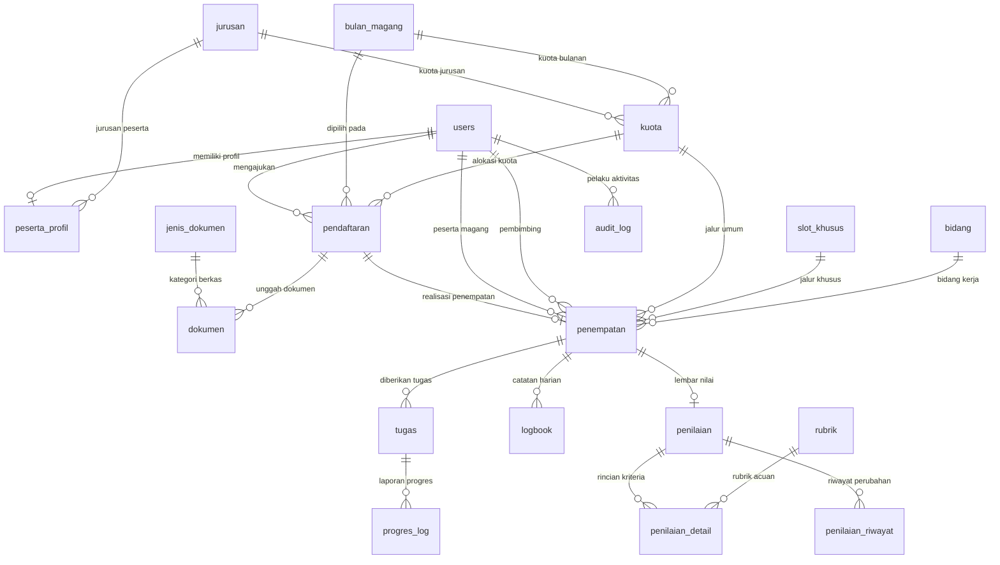

# Kamus Data, Skema Database & Seeder MagKom

Dokumen ini memuat spesifikasi menyeluruh untuk 20 tabel domain database MagKom (Magang Kominfo) menggunakan engine **InnoDB** pada **MySQL 8.0.16+** / **MariaDB 10.5+**.

---

## 1. Diagram Relasi Entitas (ERD)



---

## 2. Kamus Data 20 Tabel Domain

### 1. `users`
Menyimpan akun seluruh pengguna sistem (SuperAdmin, Admin, Pembimbing, Peserta).

| Kolom | Tipe Data | Nullable | Default | Keterangan |
|---|---|---|---|---|
| `id` | BIGINT UNSIGNED | Tidak | Auto Inc | Primary Key |
| `nama` | VARCHAR(100) | Tidak | - | Nama lengkap pengguna |
| `email` | VARCHAR(255) | Tidak | - | Alamat email (**UNIQUE**) |
| `email_verified_at` | TIMESTAMP | Ya | NULL | Waktu verifikasi email |
| `password` | VARCHAR(255) | Ya | NULL | Bcrypt hash (null bila via OAuth) |
| `role` | VARCHAR(20) | Tidak | - | `superadmin`, `admin`, `pembimbing`, `peserta` |
| `provider` | VARCHAR(20) | Ya | NULL | OAuth provider (`google`, `facebook`) |
| `provider_id` | VARCHAR(191) | Ya | NULL | ID unik dari provider OAuth |
| `bidang_id` | BIGINT UNSIGNED | Ya | NULL | FK ke `bidang.id` (staf) |
| `status_aktif` | BOOLEAN | Tidak | TRUE | Status aktif akun (flag) |
| `must_change_password`| BOOLEAN | Tidak | FALSE | Penanda wajib ubah password saat login |
| `dibuat_oleh` | BIGINT UNSIGNED | Ya | NULL | FK ke `users.id` (pembuat akun) |
| `remember_token` | VARCHAR(100) | Ya | NULL | Token sesi "ingat saya" |
| `created_at` / `updated_at` | TIMESTAMP | Ya | NULL | Waktu pembuatan / update |

**Indeks**: `UNIQUE(email)`, `INDEX(role, status_aktif)`, `UNIQUE(provider, provider_id)`.

---

### 2. `peserta_profil`
Data biodata pelengkap khusus pengguna dengan peran `peserta`.

| Kolom | Tipe Data | Nullable | Default | Keterangan |
|---|---|---|---|---|
| `id` | BIGINT UNSIGNED | Tidak | Auto Inc | Primary Key |
| `user_id` | BIGINT UNSIGNED | Tidak | - | FK ke `users.id` (**UNIQUE**) |
| `nim_nisn` | VARCHAR(20) | Tidak | - | Nomor Induk Siswa/Mahasiswa |
| `institusi` | VARCHAR(150) | Tidak | - | Nama Sekolah / Perguruan Tinggi |
| `jurusan_id` | BIGINT UNSIGNED | Tidak | - | FK ke `jurusan.id` |
| `jenjang` | VARCHAR(5) | Tidak | - | Enum: `smk`, `d3`, `s1` |
| `no_hp` | VARCHAR(20) | Tidak | - | Nomor WhatsApp / Telepon aktif |
| `created_at` / `updated_at` | TIMESTAMP | Ya | NULL | Timestamps |

---

### 3. `jurusan`
Master data program keahlian / kejuruan peserta magang.

| Kolom | Tipe Data | Nullable | Default | Keterangan |
|---|---|---|---|---|
| `id` | BIGINT UNSIGNED | Tidak | Auto Inc | Primary Key |
| `nama_jurusan` | VARCHAR(100) | Tidak | - | Nama kejuruan (**UNIQUE**) |
| `kategori` | VARCHAR(10) | Tidak | - | `smk` atau `mahasiswa` |
| `aktif` | BOOLEAN | Tidak | TRUE | Flag status aktif |
| `created_at` / `updated_at` | TIMESTAMP | Ya | NULL | Timestamps |

---

### 4. `bidang`
Master unit kerja internal di lingkungan Dinas Kominfo.

| Kolom | Tipe Data | Nullable | Default | Keterangan |
|---|---|---|---|---|
| `id` | BIGINT UNSIGNED | Tidak | Auto Inc | Primary Key |
| `nama_bidang` | VARCHAR(100) | Tidak | - | Nama unit kerja / bidang |
| `deskripsi` | TEXT | Ya | NULL | Uraian tugas fungsi |
| `aktif` | BOOLEAN | Tidak | TRUE | Flag status aktif |
| `created_at` / `updated_at` | TIMESTAMP | Ya | NULL | Timestamps |

---

### 5. `bulan_magang`
Periode pembukaan magang (selalu tanggal 1 pada bulan terkait).

| Kolom | Tipe Data | Nullable | Default | Keterangan |
|---|---|---|---|---|
| `id` | BIGINT UNSIGNED | Tidak | Auto Inc | Primary Key |
| `bulan_mulai` | DATE | Tidak | - | Tanggal 1 bulan magang (**UNIQUE**) |
| `tgl_buka` | DATE | Tidak | - | Tanggal mulai pendaftaran dibuka |
| `tgl_tutup` | DATE | Tidak | - | Tanggal penutupan pendaftaran |
| `override_status` | VARCHAR(10) | Ya | NULL | `tersedia`, `tutup`, `segera`, atau NULL |
| `aktif` | BOOLEAN | Tidak | TRUE | Flag status aktif |
| `created_at` / `updated_at` | TIMESTAMP | Ya | NULL | Timestamps |

---

### 6. `kuota`
Alokasi penerimaan jalur umum per bulan per jurusan.

| Kolom | Tipe Data | Nullable | Default | Keterangan |
|---|---|---|---|---|
| `id` | BIGINT UNSIGNED | Tidak | Auto Inc | Primary Key |
| `bulan_magang_id` | BIGINT UNSIGNED | Tidak | - | FK ke `bulan_magang.id` |
| `jurusan_id` | BIGINT UNSIGNED | Tidak | - | FK ke `jurusan.id` |
| `jumlah` | SMALLINT UNSIGNED | Tidak | 0 | Total daya tampung kuota |
| `terisi` | SMALLINT UNSIGNED | Tidak | 0 | Jumlah kuota yang telah diterima |
| `aktif` | BOOLEAN | Tidak | TRUE | Flag status aktif |
| `created_at` / `updated_at` | TIMESTAMP | Ya | NULL | Timestamps |

**Constraints**: `UNIQUE(bulan_magang_id, jurusan_id)`, `CHECK(terisi <= jumlah)`.

---

### 7. `slot_khusus`
Daya tampung penerimaan magang jalur khusus per bulan (internal SuperAdmin).

| Kolom | Tipe Data | Nullable | Default | Keterangan |
|---|---|---|---|---|
| `id` | BIGINT UNSIGNED | Tidak | Auto Inc | Primary Key |
| `bulan_mulai` | DATE | Tidak | - | Tanggal 1 bulan magang (**UNIQUE**) |
| `jumlah` | SMALLINT UNSIGNED | Tidak | 3 | Total slot khusus |
| `terisi` | SMALLINT UNSIGNED | Tidak | 0 | Slot khusus yang telah terpakai |
| `aktif` | BOOLEAN | Tidak | TRUE | Flag status aktif |
| `dibuat_oleh` | BIGINT UNSIGNED | Tidak | - | FK ke `users.id` (SuperAdmin) |
| `created_at` / `updated_at` | TIMESTAMP | Ya | NULL | Timestamps |

**Constraint**: `CHECK(terisi <= jumlah)`.

---

### 8. `jenis_dokumen`
Master jenis berkas persyaratan pendaftaran berdasarkan jenjang pendidikan.

| Kolom | Tipe Data | Nullable | Default | Keterangan |
|---|---|---|---|---|
| `id` | BIGINT UNSIGNED | Tidak | Auto Inc | Primary Key |
| `kode` | VARCHAR(40) | Tidak | - | Kode unik dokumen (`cv`, dsb.) |
| `nama` | VARCHAR(100) | Tidak | - | Nama berkas tampilan form |
| `jenjang` | VARCHAR(5) | Tidak | - | `smk`, `d3`, `s1` |
| `wajib` | BOOLEAN | Tidak | TRUE | Apakah berkas mandatory |
| `aktif` | BOOLEAN | Tidak | TRUE | Flag status aktif |
| `created_at` / `updated_at` | TIMESTAMP | Ya | NULL | Timestamps |

**Constraint**: `UNIQUE(kode, jenjang)`.

---

### 9. `pendaftaran`
Pengajuan pendaftaran calon peserta magang.

| Kolom | Tipe Data | Nullable | Default | Keterangan |
|---|---|---|---|---|
| `id` | BIGINT UNSIGNED | Tidak | Auto Inc | Primary Key |
| `user_id` | BIGINT UNSIGNED | Tidak | - | FK ke `users.id` (calon peserta) |
| `bulan_magang_id` | BIGINT UNSIGNED | Tidak | - | FK ke `bulan_magang.id` |
| `kuota_id` | BIGINT UNSIGNED | Tidak | - | FK ke `kuota.id` |
| `durasi_bulan` | TINYINT UNSIGNED | Tidak | - | Nilai 1 sampai 6 (**CHECK**) |
| `status` | VARCHAR(25) | Tidak | `berkas_belum_lengkap` | Status alur seleksi |
| `verifikator_id` | BIGINT UNSIGNED | Ya | NULL | FK ke `users.id` (Admin pemutus) |
| `catatan` | TEXT | Ya | NULL | Catatan revisi atau alasan penolakan |
| `diajukan_at` | TIMESTAMP | Ya | NULL | Waktu berkas lengkap diajukan |
| `diputuskan_at` | TIMESTAMP | Ya | NULL | Waktu keputusan verifikasi |
| `created_at` / `updated_at` | TIMESTAMP | Ya | NULL | Timestamps |

**Indeks**: `UNIQUE(user_id, bulan_magang_id)`, `INDEX(bulan_magang_id, status)`, `INDEX(status, diajukan_at)`.  
**Constraint**: `CHECK(durasi_bulan BETWEEN 1 AND 6)`.

---

### 10. `dokumen`
Berkas fisik pendaftaran yang tersimpan di disk privat server.

| Kolom | Tipe Data | Nullable | Default | Keterangan |
|---|---|---|---|---|
| `id` | BIGINT UNSIGNED | Tidak | Auto Inc | Primary Key |
| `pendaftaran_id` | BIGINT UNSIGNED | Tidak | - | FK ke `pendaftaran.id` |
| `jenis_dokumen_id`| BIGINT UNSIGNED | Tidak | - | FK ke `jenis_dokumen.id` |
| `path` | VARCHAR(255) | Tidak | - | Lokasi simpan file pada private disk |
| `nama_asli` | VARCHAR(255) | Tidak | - | Nama berkas asli saat diunggah |
| `mime` | VARCHAR(100) | Tidak | - | MIME type hasil inspeksi magic bytes |
| `ukuran` | INT UNSIGNED | Tidak | - | Ukuran berkas dalam bytes |
| `hash` | CHAR(64) | Tidak | - | SHA-256 checksum integritas berkas |
| `created_at` / `updated_at` | TIMESTAMP | Ya | NULL | Timestamps |

**Constraint**: `UNIQUE(pendaftaran_id, jenis_dokumen_id)`.

---

### 11. `penempatan`
Catatan penugasan resmi peserta magang di instansi.

| Kolom | Tipe Data | Nullable | Default | Keterangan |
|---|---|---|---|---|
| `id` | BIGINT UNSIGNED | Tidak | Auto Inc | Primary Key |
| `pendaftaran_id` | BIGINT UNSIGNED | Ya | NULL | FK ke `pendaftaran.id` (**UNIQUE** jika terisi) |
| `peserta_id` | BIGINT UNSIGNED | Tidak | - | FK ke `users.id` (peserta) |
| `kuota_id` | BIGINT UNSIGNED | Ya | NULL | FK ke `kuota.id` (jalur umum) |
| `slot_khusus_id` | BIGINT UNSIGNED | Ya | NULL | FK ke `slot_khusus.id` (jalur khusus) |
| `bidang_id` | BIGINT UNSIGNED | Ya | NULL | FK ke `bidang.id` |
| `pembimbing_id` | BIGINT UNSIGNED | Tidak | - | FK ke `users.id` (pembimbing) |
| `jalur` | VARCHAR(10) | Tidak | - | `umum` atau `khusus` |
| `sumber` | VARCHAR(10) | Tidak | - | `online` atau `manual` |
| `dibuat_oleh` | BIGINT UNSIGNED | Ya | NULL | FK ke `users.id` (Admin pembuat) |
| `tgl_mulai` | DATE | Tidak | - | Tanggal awal magang (tgl 1) |
| `tgl_selesai` | DATE | Tidak | - | Tanggal akhir masa magang |
| `tgl_ditetapkan_selesai` | DATE | Ya | NULL | Tanggal saat pembimbing klik selesai |
| `tgl_nonaktif` | DATE | Ya | NULL | Tanggal masa tenggang berakhir |
| `status` | VARCHAR(20) | Tidak | `aktif` | `aktif`, `selesai`, `mengundurkan_diri`, `nonaktif` |
| `created_at` / `updated_at` | TIMESTAMP | Ya | NULL | Timestamps |

**Constraints**:
- Tepat satu dari `kuota_id` atau `slot_khusus_id` terisi: `CHECK((kuota_id IS NULL) <> (slot_khusus_id IS NULL))`
- Integritas relasi jalur: `CHECK((jalur = 'umum' AND kuota_id IS NOT NULL) OR (jalur = 'khusus' AND slot_khusus_id IS NOT NULL))`

---

### 12. `tugas`
Instruksi penugasan kerja yang diberikan pembimbing.

| Kolom | Tipe Data | Nullable | Default | Keterangan |
|---|---|---|---|---|
| `id` | BIGINT UNSIGNED | Tidak | Auto Inc | Primary Key |
| `penempatan_id` | BIGINT UNSIGNED | Tidak | - | FK ke `penempatan.id` |
| `judul` | VARCHAR(150) | Tidak | - | Judul tugas |
| `deskripsi` | TEXT | Ya | NULL | Deskripsi dan instruksi pengerjaan |
| `kategori` | VARCHAR(50) | Tidak | - | Kategori tugas (free text) |
| `kompleksitas` | VARCHAR(10) | Tidak | - | `rendah`, `sedang`, `tinggi` |
| `deadline` | DATE | Tidak | - | Batas akhir pengumpulan |
| `status` | VARCHAR(10) | Tidak | `belum` | `belum`, `proses`, `selesai` |
| `created_at` / `updated_at` | TIMESTAMP | Ya | NULL | Timestamps |

---

### 13. `progres_log`
Laporan progres pekerjaan yang diunggah peserta.

| Kolom | Tipe Data | Nullable | Default | Keterangan |
|---|---|---|---|---|
| `id` | BIGINT UNSIGNED | Tidak | Auto Inc | Primary Key |
| `tugas_id` | BIGINT UNSIGNED | Tidak | - | FK ke `tugas.id` |
| `catatan` | TEXT | Tidak | - | Penjelasan progres pekerjaan |
| `file` | VARCHAR(255) | Ya | NULL | Berkas lampiran di disk privat |
| `tgl_lapor` | DATE | Tidak | - | Tanggal pengiriman laporan |
| `status_review` | VARCHAR(15) | Tidak | `menunggu` | `menunggu`, `diterima`, `perlu_revisi` |
| `feedback` | TEXT | Ya | NULL | Umpan balik dari pembimbing |
| `created_at` / `updated_at` | TIMESTAMP | Ya | NULL | Timestamps |

---

### 14. `logbook`
Catatan aktivitas harian peserta selama masa magang aktif.

| Kolom | Tipe Data | Nullable | Default | Keterangan |
|---|---|---|---|---|
| `id` | BIGINT UNSIGNED | Tidak | Auto Inc | Primary Key |
| `penempatan_id` | BIGINT UNSIGNED | Tidak | - | FK ke `penempatan.id` |
| `tanggal` | DATE | Tidak | - | Tanggal kegiatan |
| `kegiatan` | TEXT | Tidak | - | Rincian aktivitas yang dilakukan |
| `file_laporan` | VARCHAR(255) | Ya | NULL | Berkas PDF lampiran (opsional R2) |
| `link_laporan` | VARCHAR(500) | Ya | NULL | Tautan eksternal https (opsional R2) |
| `status` | VARCHAR(15) | Tidak | `terkirim` | `terkirim`, `perlu_revisi` |
| `catatan_pembimbing`| TEXT | Ya | NULL | Catatan evaluasi pembimbing |
| `created_at` / `updated_at` | TIMESTAMP | Ya | NULL | Timestamps |

**Constraint**: `UNIQUE(penempatan_id, tanggal)`.

---

### 15. `rubrik`
Master instrumen kriteria penilaian magang beserta bobotnya.

| Kolom | Tipe Data | Nullable | Default | Keterangan |
|---|---|---|---|---|
| `id` | BIGINT UNSIGNED | Tidak | Auto Inc | Primary Key |
| `kriteria` | VARCHAR(100) | Tidak | - | Nama kriteria penilaian |
| `bobot` | TINYINT UNSIGNED | Tidak | - | Persentase bobot (1-100, total = 100) |
| `aktif` | BOOLEAN | Tidak | TRUE | Flag status aktif |
| `created_at` / `updated_at` | TIMESTAMP | Ya | NULL | Timestamps |

---

### 16. `penilaian`
Lembar evaluasi nilai akhir peserta magang.

| Kolom | Tipe Data | Nullable | Default | Keterangan |
|---|---|---|---|---|
| `id` | BIGINT UNSIGNED | Tidak | Auto Inc | Primary Key |
| `penempatan_id` | BIGINT UNSIGNED | Tidak | - | FK ke `penempatan.id` (**UNIQUE**) |
| `pembimbing_id` | BIGINT UNSIGNED | Tidak | - | FK ke `users.id` (penilai) |
| `nilai_akhir` | DECIMAL(5,2) | Ya | NULL | Nilai terbobot (0.00 - 100.00) |
| `predikat` | CHAR(1) | Ya | NULL | Mutu huruf (`A`, `B`, `C`, `D`, `E`) |
| `catatan` | TEXT | Ya | NULL | Evaluasi akhir pembimbing |
| `status` | VARCHAR(10) | Tidak | `draft` | `draft` atau `final` |
| `created_at` / `updated_at` | TIMESTAMP | Ya | NULL | Timestamps |

---

### 17. `penilaian_detail`
Rincian skor per kriteria rubrik beserta snapshot bobot saat penilaian dibuat.

| Kolom | Tipe Data | Nullable | Default | Keterangan |
|---|---|---|---|---|
| `id` | BIGINT UNSIGNED | Tidak | Auto Inc | Primary Key |
| `penilaian_id` | BIGINT UNSIGNED | Tidak | - | FK ke `penilaian.id` |
| `rubrik_id` | BIGINT UNSIGNED | Tidak | - | FK ke `rubrik.id` |
| `skor` | TINYINT UNSIGNED | Tidak | - | Skor 0 sampai 100 (**CHECK**) |
| `bobot_snapshot`| TINYINT UNSIGNED | Tidak | - | Snapshot persentase bobot acuan |
| `created_at` / `updated_at` | TIMESTAMP | Ya | NULL | Timestamps |

**Constraints**: `UNIQUE(penilaian_id, rubrik_id)`, `CHECK(skor BETWEEN 0 AND 100)`.

---

### 18. `penilaian_riwayat`
Rekam jejak perubahan nilai bila pembimbing mengubah nilai final yang telah tersimpan.

| Kolom | Tipe Data | Nullable | Default | Keterangan |
|---|---|---|---|---|
| `id` | BIGINT UNSIGNED | Tidak | Auto Inc | Primary Key |
| `penilaian_id` | BIGINT UNSIGNED | Tidak | - | FK ke `penilaian.id` |
| `diubah_oleh` | BIGINT UNSIGNED | Tidak | - | FK ke `users.id` (Pembimbing) |
| `nilai_lama` | JSON | Tidak | - | Snapshot data nilai sebelum diedit |
| `nilai_baru` | JSON | Tidak | - | Snapshot data nilai setelah diedit |
| `alasan` | TEXT | Tidak | - | Alasan perubahan nilai (min 10 karakter) |
| `waktu` | TIMESTAMP | Tidak | CURRENT_TIMESTAMP | Waktu terjadinya perubahan |

---

### 19. `audit_log`
Tabel penampung jejak audit komprehensif berstatus append-only.

| Kolom | Tipe Data | Nullable | Default | Keterangan |
|---|---|---|---|---|
| `id` | BIGINT UNSIGNED | Tidak | Auto Inc | Primary Key |
| `request_id` | VARCHAR(36) | Tidak | - | UUID penanda unik request |
| `user_id` | BIGINT UNSIGNED | Ya | NULL | FK ke `users.id` (pelaku) |
| `tipe` | VARCHAR(15) | Tidak | - | `auth`, `aksi`, `service`, `akses_data` |
| `aksi` | VARCHAR(100) | Tidak | - | Nama tindakan bisnis |
| `entitas` | VARCHAR(60) | Ya | NULL | Nama model / tabel terkait |
| `entitas_id` | BIGINT UNSIGNED | Ya | NULL | ID entitas |
| `nilai_lama` | JSON | Ya | NULL | Data sebelum mutasi |
| `nilai_baru` | JSON | Ya | NULL | Data setelah mutasi |
| `detail` | JSON | Ya | NULL | Argumen service atau filter & total row |
| `metode` | VARCHAR(10) | Ya | NULL | HTTP Method (`GET`, `POST`, dll.) |
| `rute` | VARCHAR(150) | Ya | NULL | Route name / path |
| `status_http` | SMALLINT UNSIGNED | Ya | NULL | HTTP Response code |
| `durasi_ms` | INT UNSIGNED | Ya | NULL | Durasi eksekusi dalam milidetik |
| `ip` | VARCHAR(45) | Tidak | - | IP Address klien (IPv4 / IPv6) |
| `user_agent` | VARCHAR(255) | Ya | NULL | User Agent browser klien |
| `waktu` | TIMESTAMP | Tidak | CURRENT_TIMESTAMP | Timestamp pencatatan |

**Indeks**: `INDEX(user_id, waktu)`, `INDEX(entitas, entitas_id)`, `INDEX(request_id)`, `INDEX(tipe, waktu)`.

---

### 20. `pengaturan`
Tabel pasangan key-value untuk seluruh parameter konfigurasi aplikasi dinamis.

| Kolom | Tipe Data | Nullable | Default | Keterangan |
|---|---|---|---|---|
| `id` | BIGINT UNSIGNED | Tidak | Auto Inc | Primary Key |
| `kunci` | VARCHAR(100) | Tidak | - | Key konfigurasi unik (**UNIQUE**) |
| `nilai` | TEXT | Ya | NULL | Nilai konfigurasi (string/JSON) |
| `created_at` / `updated_at` | TIMESTAMP | Ya | NULL | Timestamps |

---

## 3. Data Awal Seeder (Default Seeder)

### A. Master Jurusan (6 Record)
```sql
INSERT INTO jurusan (nama_jurusan, kategori, aktif, created_at, updated_at) VALUES
('Teknik Komputer dan Jaringan (TKJ)', 'smk', 1, NOW(), NOW()),
('Rekayasa Perangkat Lunak (RPL)', 'smk', 1, NOW(), NOW()),
('Sistem Informasi', 'mahasiswa', 1, NOW(), NOW()),
('Manajemen Informatika', 'mahasiswa', 1, NOW(), NOW()),
('Informatika', 'mahasiswa', 1, NOW(), NOW()),
('Teknik Komputer', 'mahasiswa', 1, NOW(), NOW());
```

### B. Master Jenis Dokumen (9 Record)
```sql
INSERT INTO jenis_dokumen (kode, nama, jenjang, wajib, aktif, created_at, updated_at) VALUES
('surat_pengantar', 'Surat Pengantar Sekolah', 'smk', 1, 1, NOW(), NOW()),
('cv', 'Curriculum Vitae (CV)', 'smk', 1, 1, NOW(), NOW()),
('rapor', 'Salinan Rapor', 'smk', 1, 1, NOW(), NOW()),
('surat_pengantar', 'Surat Pengantar Kampus', 'd3', 1, 1, NOW(), NOW()),
('cv', 'Curriculum Vitae (CV)', 'd3', 1, 1, NOW(), NOW()),
('transkrip', 'Transkrip Nilai Akademik', 'd3', 1, 1, NOW(), NOW()),
('surat_pengantar', 'Surat Pengantar Kampus', 's1', 1, 1, NOW(), NOW()),
('cv', 'Curriculum Vitae (CV)', 's1', 1, 1, NOW(), NOW()),
('transkrip', 'Transkrip Nilai Akademik', 's1', 1, 1, NOW(), NOW());
```

### C. Master Rubrik Penilaian Awal (5 Record)
```sql
INSERT INTO rubrik (kriteria, bobot, aktif, created_at, updated_at) VALUES
('Kualitas hasil kerja', 30, 1, NOW(), NOW()),
('Ketepatan waktu dan penyelesaian tugas', 20, 1, NOW(), NOW()),
('Inisiatif dan kemampuan belajar', 20, 1, NOW(), NOW()),
('Komunikasi dan kerja sama', 15, 1, NOW(), NOW()),
('Etika, disiplin, dan tanggung jawab', 15, 1, NOW(), NOW());
```

### D. Konfigurasi Sistem Awal (8 Record)
```sql
INSERT INTO pengaturan (kunci, nilai, created_at, updated_at) VALUES
('masa_tenggang_bulan', '1', NOW(), NOW()),
('kuota_umum_maks_per_bulan', '12', NOW(), NOW()),
('slot_khusus_default', '3', NOW(), NOW()),
('maks_peserta_aktif_per_pembimbing', NULL, NOW(), NOW()),
('logbook_maks_mundur_hari', '3', NOW(), NOW()),
('berkas_maks_mb', '2', NOW(), NOW()),
('deadline_mendekati_hari', '3', NOW(), NOW()),
('predikat_batas', '{"A":85,"B":70,"C":55,"D":40}', NOW(), NOW());
```
