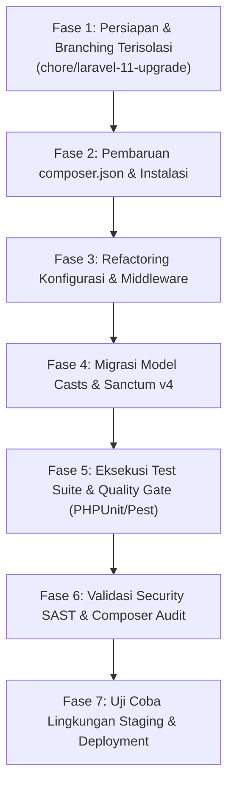

# Roadmap Peningkatan Versi Framework (Laravel 10 ke Laravel 11/12 LTS)

Dokumen ini merupakan analisis teknis dan rekomendasi strategis bagi tim pengembang **MAGKOM (Portal Manajemen Magang Kominfo)** terkait peningkatan versi framework dari **Laravel 10.x** ke **Laravel 11.x / 12.x LTS**.

---

## 1. Latar Belakang & Analisis Risiko Teknis (Risk Assessment)

### Kondisi Eksisting:
- **Framework Utama**: Laravel v10.48.x
- **Runtime PHP**: PHP 8.3.x
- **Komponen Inti**: Symfony Components v6.4 (HTTP Kernel, Routing, Mime, Yaml, Process, dll.)
- **Status Siklus Hidup**:
  - *Bug Fixes Support*: Berakhir pada **6 Agustus 2024**.
  - *Security Fixes Support*: Berakhir pada **4 Februari 2025** (Telah melewati masa dukungan keamanan resmi / End of Life).

### Temuan Audit Keamanan Terkait (`composer audit`):
Pemindaian `composer audit` pada basis kode MAGKOM menemukan **18 security advisories** yang mempengaruhi 7 paket dependensi, antara lain:
1. `dompdf/dompdf`:
   - CVE-2026-59943 (Medium): Kebocoran informasi eksistensi berkas via embedded SVG images.
   - CVE-2026-59942 (Medium): DoS via alokasi memori berlebih bitmap gambar.
   - CVE-2026-59941 (Medium): Uncontrolled resource consumption BMP.
   - CVE-2026-56722 (Medium): Local file read via SVG data-URI.
2. `symfony/http-kernel`:
   - CVE-2026-118518 (Low): Limitasi resource handling pada request besar.
3. `symfony/mime`:
   - CVE-2026-45070 (Medium): Email Header Injection via karakter non-token pada MIME parameter.
4. `symfony/routing`:
   - CVE-2026-118516 (Low/Medium): Host placeholder matching pada URL matcher.
5. `symfony/yaml`:
   - CVE-2026-123792 (Low): Parsing time amplification pada dokumen tertentu.

> [!IMPORTANT]
> Sebagian besar CVE tersebut telah diperbaiki pada Symfony 7.x dan Dompdf versi terbaru. Namun, paket-paket tersebut terkunci oleh batasan versi Laravel 10.x. Untuk menyelesaikan temuan ini secara permanen tanpa menimbulkan konflik dependensi, peningkatan ke Laravel 11 atau 12 merupakan langkah strategis yang harus dipersiapkan.

---

## 2. Analisis Kompatibilitas Dependensi (Package Compatibility Matrix)

| Paket Dependensi | Versi Terpasang | Kompatibilitas Laravel 11 | Catatan Migrasi |
| :--- | :--- | :--- | :--- |
| `php` | `^8.3` | :white_check_mark: Kompatibel | Laravel 11 mensyaratkan PHP >= 8.2; PHP 8.3 MAGKOM sudah ideal. |
| `barryvdh/laravel-dompdf` | `^2.0` | :white_check_mark: v2.1+ / v3.0+ | Upgrade ke versi 3.0+ menyelesaikan seluruh kerentanan Dompdf. |
| `guzzlehttp/guzzle` | `^7.2` | :white_check_mark: Kompatibel | Mendukung Laravel 11. |
| `laravel/sanctum` | `^3.2` | :white_check_mark: v4.0 | Sanctum v4 dirilis khusus untuk kompatibilitas Laravel 11. |
| `laravel/socialite` | `^5.0` | :white_check_mark: v5.12+ | Sudah mendukung Laravel 11. |
| `sentry/sentry-laravel` | `^4.29` | :white_check_mark: v4.30+ | Mendukung Laravel 11 secara native. |
| `larastan/larastan` | `2.9` | :white_check_mark: v2.9+ / v3.0 | Perlu penyesuaian level jika ada perubahan tipe di Laravel 11. |
| `laravel/pint` | `^1.0` | :white_check_mark: v1.14+ | Tetap kompatibel dengan standar PSR-12. |

---

## 3. Perubahan Struktural Utama pada Laravel 11 (Breaking Changes to Expect)

1. **Perampingan Struktur Aplikasi (*Slim Skeleton*)**:
   - `app/Http/Kernel.php` dihapus. Konfigurasi middleware dialihkan ke `bootstrap/app.php` menggunakan closure `withMiddleware()`.
   - `app/Console/Kernel.php` dihapus. Pendaftaran command terjadwal dialihkan ke `routes/console.php`.
   - Konfigurasi file di `config/` disederhanakan; opsi default kini ditangani secara internal oleh framework.
2. **Perubahan Format Model Casts**:
   - Properti `$casts` yang sebelumnya berupa array kini direkomendasikan beralih ke method `protected function casts(): array`.
3. **Penyederhanaan Default Auth & Password Reset**:
   - Laravel 11 mengubah mekanisme default throttling dan token expiration. Penyesuaian diperlukan pada middleware `EnsureTokenIsValid` atau rate limiter kustom.
4. **Pemisahan SQLite & MySQL Default Configuration**:
   - Penataan ulang koneksi database pada `config/database.php`.

---

## 4. Rencana Kerja Bertahap (Step-by-Step Execution Plan)



### Rincian Perintah pada Setiap Fase:

#### Fase 1: Branch Terisolasi
```bash
git checkout main
git pull origin main
git checkout -b chore/laravel-11-upgrade
```

#### Fase 2: Pembaruan Dependensi
```bash
composer require "laravel/framework:^11.0" "laravel/sanctum:^4.0" "barryvdh/laravel-dompdf:^3.0" --no-update
composer require --dev "nunomaduro/collision:^8.0" "spatie/laravel-ignition:^2.4" --no-update
composer update --with-all-dependencies
```

#### Fase 3 & 4: Penyesuaian Kode
- Pindahkan middleware kustom MAGKOM (seperti middleware audit log, rate limiter brute-force, dan verifikasi session) ke `bootstrap/app.php`.
- Perbarui method `casts()` pada seluruh Model Eloquent di `app/Models/`.

#### Fase 5 & 6: Quality Gate & Audit Keamanan
```bash
# Validasi sintaks dan gaya kode
composer check-platform-reqs
./vendor/bin/pint --test
./vendor/bin/phpstan analyse --memory-limit=1G

# Verifikasi seluruh rangkaian pengujian fitur
php artisan test

# Verifikasi eliminasi CVE
composer audit
```

---

## 5. Kesimpulan & Batasan Pekerjaan Saat Ini

Pekerjaan peningkatan major framework ini **TIDAK DIJALANKAN** dalam cakupan task saat ini untuk mematuhi aturan repositori:
> *"Stack yang harus dipertahankan: PHP 8.3.x, Laravel 10.x. Pertahankan arsitektur aplikasi, business logic, database schema, konfigurasi Laravel. Jangan melakukan migrasi besar pada framework sebagai bagian dari pekerjaan ini."*

Implementasi DevSecOps yang telah diselesaikan (Gitleaks, Semgrep, CodeQL, GitHub Actions supply-chain hardening, test suite in-tree, dan GitHub Projects) telah memberikan benteng pertahanan berlapis untuk memitigasi risiko keamanan eksisting secara efektif selama masa transisi menuju Laravel 11/12.

