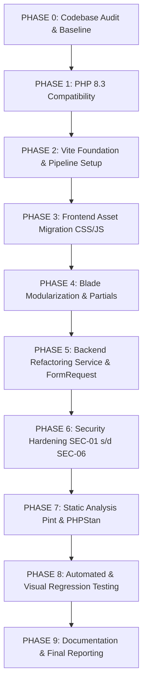

# TECHNICAL MIGRATION & REFACTORING AUDIT
**Aplikasi:** MAGKOM (Magang Kominfo Sleman)  
**Target:** PHP 8.3 Runtime, Laravel 10.x, Vite Asset Pipeline, Blade Modularization, Hardened Security, Code Quality  
**Status Audit:** Baseline Complete (PHASE 0)  
**Tanggal Audit:** 2026-11-02  

---

## 1. RINGKASAN EKSEKUTIF

Audit teknis komprehensif ini dilakukan terhadap repository MAGKOM pada branch `test-2` sebelum tindakan modifikasi kode dilakukan. Audit mencakup lapisan Backend (Controllers, Services, Requests, Models, Policies, Routes, Database), Frontend (Blade Views, CSS, Vanilla JS, Vite Pipeline), Keamanan (OWASP, CSP, Autentikasi, Otorisasi, Redaksi Audit), dan Kualitas Kode/Testing.

Berdasarkan audit:
1. **PHP & Framework:** Runtime terdeteksi lokal adalah PHP 8.2.12 (CLI), sementara target proyek adalah PHP 8.3. Persyaratan `composer.json` saat ini menetapkan `"php": "^8.1"`. Framework terkunci pada Laravel 10.48.29.
2. **Frontend & Asset Management:** Konfigurasi Vite (`vite.config.js` & `package.json`) sudah ada, namun belum diintegrasikan ke layout aplikasi. Seluruh Blade layout memuat stylesheet dan script dari `public/css/` dan `public/js/` via helper `asset()`, atau menanamkan ribuan baris CSS dan JavaScript inline dalam blok `<style>` dan `<script>`.
3. **Blade Views:** Terdapat file view monolitik yang sangat besar (hingga 3.572 baris pada `layouts/dashboard.blade.php`), di mana 2.800+ baris merupakan CSS mentah.
4. **Backend Architecture:** Controller tertentu memikul tanggung jawab orkestrasi data, query database manual, dan business logic yang belum dialirkan ke Form Request dan Service layer (contoh: `ModulDataController.php` 672 baris, `PenempatanController.php` 511 baris).
5. **Keamanan:** Teridentifikasi 6 temuan keamanan penting, mencakup fallback kata sandi default bersama (`Magkom2026!`), injeksi DOM XSS pada komponen Toast, pelanggaran inline script terhadap Content Security Policy (`script-src 'self'`), metode HTTP Logout (menerima GET), potensi SQL Injection pada resolusi kolom modul dinamis (`DB::raw`), dan celah pencatatan data rahasia pada audit log.
6. **Automated Testing Baseline:** Dari 501 test suite, 487 passed (3.175 assertions) dan 14 baseline test failures terisolasi pada artefak tanggal masa lalu (`PesertaPendaftaranFlowTest`) dan ekspektasi layout/string lama (`LandingPageTest`, `TypographyDesignSystemTest`, `BrandingDesignSystemTest`, `BidangJurusanMappingTest`).

---

## 2. INVENTARISASI FRONTEND ASSETS & PIPELINE

### 2.1 File CSS Eksisting
| Lokasi File | Ukuran | Status & Tanggung Jawab |
|---|---|---|
| `resources/css/app.css` | 0 B | Kosong. Target entry point utama Vite. |
| `public/css/admin-cockpit-clearview.css` | 8.9 KB | UI Cockpit Admin (Clearview styling) |
| `public/css/dashboard-cockpit-unified.css` | 25.7 KB | Unified cockpit layout & widget styling |
| `public/css/gentelella-theme.css` | 46.9 KB | Fork tema Gentelella internal MagKom |
| `public/css/landing-faq-redesign.css` | 8.4 KB | Accordion & FAQ styling landing page |
| `public/css/landing-modern.css` | 33.2 KB | Hero, benefit, & kuota landing page modern |
| `public/css/landing-peta-alur-modal.css` | 35.9 KB | Modal peta alur interaktif pada landing |
| `public/css/modul-studio.css` | 17.9 KB | UI Builder modul dinamis SuperAdmin |
| `public/css/peta-alur-fullscreen.css` | 30.9 KB | Simulator alur fullscreen (`/peta-alur-interaktif`) |
| `public/css/superadmin-dashboard.css` | 66.6 KB | SuperAdmin command center & analytics styling |

### 2.2 File JavaScript Eksisting
| Lokasi File | Ukuran | Status & Tanggung Jawab |
|---|---|---|
| `resources/js/app.js` | 22 B | Entry point Vite dasar (`import './bootstrap';`) |
| `resources/js/bootstrap.js` | 1.2 KB | Inisialisasi Axios & CSRF header |
| `public/js/dashboard-cockpit-unified.js` | 6.6 KB | Drawer, aside toggle, & dropdown interaktif dashboard |
| `public/js/gentelella-theme.js` | 7.1 KB | Sidebar collapse & sub-menu navigation |
| `public/js/landing-interactive.js` | 36.2 KB | Slider hero, tab jurusan, modal alur, filter kuota |
| `public/js/realtime-sse.js` | 10.9 KB | SSE client (RFC 8895), badge counter, floating toast |
| `public/js/superadmin-dashboard.js` | 8.7 KB | SuperAdmin tab switcher, drawer audit, chart update |

### 2.3 Pemanggilan CSS dan JS dari Blade
Seluruh layout dan view publik saat ini memuat asset via `asset()` dan CDN eksternal:
- `resources/views/layouts/dashboard.blade.php`:
  - Baris 27-28: `<link rel="stylesheet" href="{{ asset('css/gentelella-theme.css') }}">` & `<link rel="stylesheet" href="{{ asset('css/dashboard-cockpit-unified.css') }}">`
  - Baris 3992-3993: `<script src="{{ asset('js/gentelella-theme.js') }}"></script>` & `<script src="{{ asset('js/dashboard-cockpit-unified.js') }}"></script>`
- `resources/views/layouts/peserta.blade.php`:
  - Baris 23-24: Memuat `gentelella-theme.css` dan `dashboard-cockpit-unified.css` via `asset()`.
  - Baris 2146-2147: Memuat `gentelella-theme.js` dan `dashboard-cockpit-unified.js` via `asset()`.
- `resources/views/public/landing.blade.php`:
  - Baris 28-30: Memuat `landing-modern.css`, `landing-peta-alur-modal.css`, `landing-faq-redesign.css` via `asset()`.
  - Baris 1154: Memuat `landing-interactive.js` via `asset()`.
- `resources/views/public/kebijakan-privasi.blade.php` & `verifikasi-dokumen.blade.php`:
  - Memuat `<script src="https://cdn.tailwindcss.com"></script>` secara langsung dari CDN pihak ketiga.

---

## 3. AUDIT BLADE VIEWS & INLINE DEBT

### 3.1 Blok `<style>` Monolitik dalam Blade
Teridentifikasi 17 blok `<style>` di seluruh Blade views, dengan total lebih dari 11.000 baris stylesheet yang belum termigrasi:
1. `resources/views/layouts/dashboard.blade.php` (L49-L2880): **2.831 baris CSS** embedded langsung di dalam layout utama.
2. `resources/views/layouts/peserta.blade.php` (L51-L1638): **1.587 baris CSS** embedded.
3. `resources/views/superadmin/audit-log/partials/_styles.blade.php`: **1.945 baris CSS** yang disimpan dalam file Blade partial alih-alih file CSS eksternal.
4. `resources/views/layouts/auth.blade.php` (L42-L840): **~800 baris CSS** inline styling otentikasi.
5. `resources/views/layouts/app.blade.php` (L52-L1050): **~1.000 baris CSS**.
6. `resources/views/public/panduan-alur.blade.php` (L9-L2500): **~2.490 baris CSS**.
7. `resources/views/public/peta-alur-interaktif.blade.php` (L18-L940): **~920 baris CSS**.
8. `resources/views/public/partials/_peta_alur_modal.blade.php`: **~700 baris CSS**.
9. `resources/views/superadmin/health/index.blade.php`: **~1.200 baris CSS**.
10. `resources/views/pdf/*.blade.php`: Memiliki blok `<style>` untuk rendering PDF via DomPDF (dipertahankan karena DomPDF memerlukan embedded styles untuk print-rendering).

### 3.2 Blok `<script>` Inline dalam Blade
Teridentifikasi 27 blok `<script>` inline di dalam file Blade:
1. `resources/views/layouts/dashboard.blade.php` (L3744-L3991): **248 baris JS** untuk aside drawer, quick filter, quick notification, dan dropdown event.
2. `resources/views/layouts/peserta.blade.php` (L1910-L2145): **235 baris JS** untuk MagKomToast, auto-dismiss, drawer mobile, modal handler.
3. `resources/views/public/panduan-alur.blade.php` (L2526-L2790): **264 baris JS** untuk alur simulasi step navigation.
4. `resources/views/public/peta-alur-interaktif.blade.php` (L943-L1710): **767 baris JS** untuk kanvas SVG geometri jalan, simulasi gerak, audio synthesizer (`AudioContext`), dan timeline.
5. `resources/views/public/partials/_peta_alur_modal.blade.php` (L800-L1200): **400 baris JS** logika interaksi modal.
6. `resources/views/admin/dashboard.blade.php` (L166-L210): Inline script sinkronisasi filter periode.
7. `resources/views/pembimbing/dashboard.blade.php` (L482-L560): Inline script filter task & quick evaluation.

### 3.3 Inline Event Handlers & Inline `style=""`
- **Inline Event Handlers:** Ditemukan **92 pemanggilan `onclick="..."`** di dalam Blade views (misal: `onclick="dismissToast(this)"`, `onclick="openModal(...)"`, `onclick="toggleDrawer(...)"`).
- **Inline Style Attributes:** Ditemukan **348 atribut `style="..."`**. Sebagian besar merupakan static visual properties (width, display flex, margin, colors) yang seharusnya didefinisikan dalam class CSS scoped.

---

## 4. AUDIT BACKEND ARCHITECTURE

### 4.1 Controller Berukuran Besar (Fat Controllers)
| Controller | Baris | Masalah Arsitektur |
|---|---|---|
| `SuperAdmin/ModulDataController.php` | 672 | Memadukan CRUD data dinamis JSON, operasi tabel fisik raw DB, validasi field dinamis, penanganan unggahan file berkas, pencatatan audit log, dan resolusi query relasi. |
| `Admin/PenempatanController.php` | 511 | Melakukan query langsung ke 6 model berbeda di dalam action method `index()`, mengelola translasi data manual, dan menjalankan mutasi bulk batch update langsung di controller. |
| `SuperAdmin/HealthMonitorController.php` | 470 | Berisi logika pengecekan metrik sistem operasional, disk, db, redis/cache, dan telemetri rute. |
| `Admin/KuotaController.php` | 390 | Menyatukan logika form validation manual, sinkronisasi kuota lintas jurusan, dan kalkulasi kapasitas pembimbing. |
| `SuperAdmin/AuditLogController.php` | 386 | Menggabungkan streaming table, filter criteria builder, diff parser, dan CSV export formatting. |
| `SuperAdmin/ModulBuilderController.php` | 346 | Menangani manipulasi schema migration virtual, sinkronisasi tabel fisik, dan rekayasa field dinamis. |

### 4.2 Service Layer & Multi-Responsibility
- `app/Services/PlacementService.php` (543 baris): Bertanggung jawab atas verifikasi kuota, kalkulasi durasi magang, pembuatan akun instan jalur khusus, pembuatan profil peserta, pemetaan pembimbing, dan dispatching event.
- `app/Services/AuditService.php` (294 baris): Mengelola sanitasi parameter, resolusi severity/channel, deteksi impersonasi, dan retensi audit.

### 4.3 Ketiadaan Form Request pada Beberapa Modul Sensitif
Sejumlah controller masih melakukan validasi manual `$request->validate([...])` di dalam controller method alih-alih mendelegasikannya ke dedicated Form Request:
- `SuperAdmin/StafController.php`
- `SuperAdmin/BidangController.php`
- `SuperAdmin/JurusanController.php`
- `SuperAdmin/RoleController.php`
- `SuperAdmin/RubrikController.php`
- `Pembimbing/AgendaBimbinganController.php`

### 4.4 Potensi Inefisiensi Query & N+1 Problem
1. **`Admin/PenempatanController.php` (L88-L113):**
   Memanggil `BulanMagang::all()`, `SlotKhusus::all()`, `Bidang::all()`, `Jurusan::all()`, `Kuota::with(['bulanMagang', 'jurusan'])->all()`, `User::where('role', 'peserta')->all()` secara berturut-turut pada setiap render dashboard penempatan tanpa eager-loading terpadu atau caching query periodik.
2. **`ModulDataController.php` (L752):**
   Melakukan query lookups relasi di dalam loop iterasi field dynamic tanpa batch query.

---

## 5. TEMUAN KEAMANAN (SECURITY FINDINGS)

### 5.1 Temuan A: Shared Default Password pada Akun Baru
- **Lokasi:** `app/Services/PlacementService.php:387` dan `app/Http/Controllers/Admin/PenempatanController.php:266`
- **Kode Rawan:**
  ```php
  $plainPassword = ! empty($userData['password']) ? (string) $userData['password'] : 'Magkom2026!';
  $peserta->password = Hash::make($plainPassword);
  ...
  return $redirect->with('password_baru', $plainPassword);
  ```
- **Analisis Risiko:** Semua akun peserta baru yang ditempatkan melalui jalur khusus tanpa input kata sandi akan otomatis memiliki kata sandi bersama yang identik (`Magkom2026!`). Kata sandi plaintext kemudian disimpan ke session flash (`password_baru`) dan dikirimkan ke view.
- **Rekomendasi:** Gunakan cryptographically secure random password generator (`Str::random(12)`), simpan hashed password, jangan simpan plaintext pada session flash permanen, berikan token aktivasi satu kali (one-time activation token / password reset), dan dorong alur aktivasi resmi via email/token.

### 5.2 Temuan B: DOM XSS pada Komponen Toast
- **Lokasi:** `resources/views/layouts/peserta.blade.php:1943-1947`
- **Kode Rawan:**
  ```javascript
  toast.innerHTML = `
      <div class="toast-icon-badge ${type}">${iconSvg}</div>
      <div class="toast-content">
          ${title ? `<div class="toast-title">${title}</div>` : ''}
          <div class="toast-desc">${message}</div>
      </div>
  ...`;
  ```
- **Analisis Risiko:** Nilai `title` dan `message` diinterpolasikan langsung ke dalam template literal string `innerHTML` tanpa sanitasi entitas HTML atau penggunaan safe DOM APIs (`textContent` / `document.createElement()`). Jika pesan error atau nama peserta yang berisi payload `<script>` atau `` disalurkan ke toast, script berbahaya akan dieksekusi di browser user.
- **Rekomendasi:** Ubah pembuatan elemen DOM Toast agar menggunakan `document.createElement()`, isi text via `.textContent`, dan gunakan HTML statis yang aman hanya untuk icon badge SVG.

### 5.3 Temuan C: Content Security Policy (CSP) & Script Inline
- **Lokasi:** `app/Http/Middleware/SecurityHeaders.php:37`
- **Kode Rawan:**
  ```php
  if (app()->isProduction()) {
      $response->headers->set(
          'Content-Security-Policy',
          "default-src 'self'; img-src 'self' data:; script-src 'self'; style-src 'self' 'unsafe-inline'; frame-ancestors 'self'; base-uri 'self'; form-action 'self';"
      );
  }
  ```
- **Analisis Risiko:** Kebijakan CSP produksi menetapkan `script-src 'self'`. Namun di hampir semua file Blade layout, terdapat puluhan tag `<script>` inline serta pemanggilan CDN pihak ketiga (`cdn.tailwindcss.com`, `challenges.cloudflare.com`). Di production, browser akan memblokir script-script tersebut sehingga fitur dashboard dan landing page berhenti berfungsi.
- **Rekomendasi:** Pindahkan seluruh inline script ke modul JavaScript yang dikelola Vite (`script-src 'self'`), hilangkan inline event handlers, serta daftarkan origin eksternal terpercaya yang sah (`https://challenges.cloudflare.com`, `https://fonts.googleapis.com`, `https://fonts.gstatic.com`).

### 5.4 Temuan D: Logout HTTP Method Menerima GET
- **Lokasi:** `routes/web.php:124`
- **Kode Rawan:**
  ```php
  Route::match(['get', 'post'], '/logout', [AuthController::class, 'logout'])->name('logout');
  ```
- **Analisis Risiko:** Endpoint `/logout` menerima request `GET`. Ini melanggar standar RFC 7231 (GET harus safe & idempotent) dan membuka kerentanan Login/Logout CSRF di mana pengguna dapat di-logout secara paksa hanya dengan memicu request gambar ``.
- **Rekomendasi:** Ubah route menjadi `Route::post('/logout', ...)` saja, lindungi dengan CSRF token, dan pastikan seluruh tombol logout di sidebar dan navbar menggunakan submit form POST ber-token `@csrf`.

### 5.5 Temuan E: Potensi SQL Injection pada Resolusi Kolom Modul Dinamis
- **Lokasi:** `app/Http/Controllers/SuperAdmin/ModulDataController.php:753`
- **Kode Rawan:**
  ```php
  $displayCol = $field->relasi_kolom_tampil ?: 'nama';
  $rows = DB::table($table)
      ->select(['id', DB::raw("`{$displayCol}` as label")])
      ->limit(100)
      ->get();
  ```
- **Analisis Risiko:** Kolom `$displayCol` diambil langsung dari atribut `$field->relasi_kolom_tampil` dan dimasukkan ke dalam `DB::raw()` tanpa verifikasi `Schema::hasColumn($table, $displayCol)`.
- **Rekomendasi:** Validasi bahwa kolom tersebut benar-benar ada di tabel target menggunakan `Schema::hasColumn()`, atau gunakan parameterized expression / validasi regex identifier SQL standar `^[a-zA-Z0-9_]+$`.

### 5.6 Temuan F: Data Rahasia pada Audit Log Redaction
- **Lokasi:** `app/Services/AuditService.php:208`
- **Kode Rawan:**
  ```php
  if (in_array(strtolower((string) $key), self::KUNCI_RAHASIA, true)) {
      return '[DISAMARKAN]';
  }
  ```
- **Analisis Risiko:** Pencocokan kunci rahasia dilakukan secara eksak (`in_array(..., true)`). Jika field request bernama `current_password`, `new_password`, `old_password`, `user_password`, `access_token`, atau `id_token`, kunci tersebut tidak tersaring dan nilainya tercatat utuh dalam database `audit_log`.
- **Rekomendasi:** Perluas sanitasi agar mencakup substring matching regex (misal: `/(password|passwd|token|secret|kredensial|credential)/i`).

---

## 6. TABEL PRIORITAS & MATRIKS RISIKO

| ID | Kategori | Temuan Masalah | Dampak | Prioritas |
|---|---|---|---|---|
| SEC-01 | Security | Shared default password `Magkom2026!` & plaintext flash | Akun rentan credential stuffing | **Tinggi (P1)** |
| SEC-02 | Security | DOM XSS pada Toast `innerHTML` interpolasi | Potensi eksekusi script jahat di client | **Tinggi (P1)** |
| SEC-03 | Security | CSP `script-src 'self'` konflik dengan inline Blade scripts | Kerusakan fungsi interaktif di production | **Tinggi (P1)** |
| SEC-04 | Security | Logout via HTTP GET | Logout CSRF vulnerability | **Tinggi (P1)** |
| SEC-05 | Security | Injeksi kolom dinamis `DB::raw` di `ModulDataController` | Potensi SQLi pada modul dinamis | **Tinggi (P1)** |
| SEC-06 | Security | Sanitasi kunci rahasia audit log belum menangani variasi kata sandi | Kebocoran data sensitif ke tabel audit | **Sedang (P2)** |
| VITE-01 | Frontend | Aset frontend tidak dikelola Vite (`@vite` tidak dipakai) | Pipeline modern tidak berjalan, asset terpencar | **Tinggi (P1)** |
| BLADE-01 | Frontend | Blade monolitik ribuan baris (`dashboard.blade.php`, `peserta.blade.php`) | Sulit dipelihara, performa render terbebani | **Tinggi (P1)** |
| BLADE-02 | Frontend | 92 inline onclick handlers & 348 inline styles | Menghambat pengetatan CSP, violasi pemisahan tugas | **Sedang (P2)** |
| ARCH-01 | Backend | Fat Controller (`ModulDataController`, `PenempatanController`) | Duplikasi logic, sulit diuji unit | **Sedang (P2)** |
| ARCH-02 | Backend | Validasi manual tanpa Form Request pada beberapa controller | Kerapuhan validasi input | **Sedang (P2)** |
| PHP-01 | Runtime | Definisi platform requirement PHP masih `^8.1` | Inkonsistensi target PHP 8.3 | **Sedang (P2)** |
| CI-01 | DevOps | Workflow GitHub Actions belum mencakup branch `test-2` & PHP 8.3 | Ketiadaan quality gate otomatis saat push | **Sedang (P2)** |

---

## 7. STRATEGI & ROADMAP EKSEKUSI BERTAHAP

Sesuai arahan kerja pada Master Prompt, refactoring dilakukan secara berurutan:



### Prinsip Utama Selama Eksekusi:
1. **Zero UI/UX Modification (100% Visual Parity):** Nilai CSS, warna, font, padding, margin, layout, responsivitas, dan interaksi tidak boleh berubah sedikit pun.
2. **Business Logic Preservation:** Seluruh alur pendaftaran, penempatan dua tahap, kuota, logbook, rubrik penilaian, dan modul builder tetap bekerja sesuai fungsionalitas aslinya.
3. **Verified Step-by-Step:** Setiap tahap diverifikasi menggunakan PHPUnit test runner sebelum melangkah ke tahap selanjutnya.

---
*Dokumen ini disusun sebagai baseline resmi PHASE 0 sebelum implementasi teknis.*

