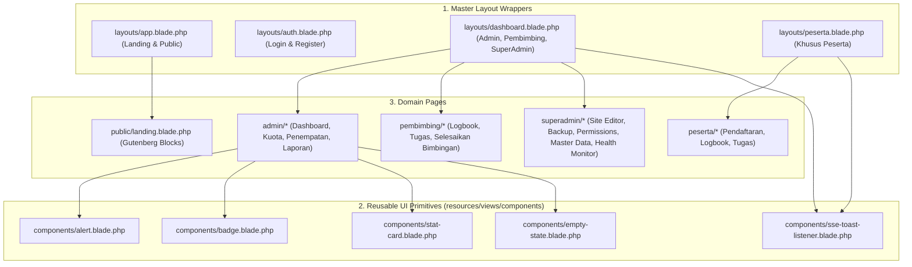

> Diperbarui: 2026-11-09 | mode: Verified Living Documentation

# Inventaris Komponen & Hubungan UI (COMPONENTS.md)

Dokumen ini memetakan seluruh komponen tampilan (Blade layouts, components, dan view partials) dalam Portal MagKom, mencakup hierarki pewarisan, tingkat penggunaan ulang, dan status dependensinya.

---

## 1. Diagram Hierarki Layout & Komponen

---

## 2. Inventaris Komponen Berdasarkan Kategori

### A. Layout Templates (`resources/views/layouts/`)
1. **`app.blade.php`**:
   - **Fungsi**: Layout publik utama untuk landing page, kebijakan privasi, dan halaman publik.
   - **Fitur Khusus**: Menyematkan CSS Variables lengkap DS-MagKom (Blue-600, Neutral, Status tokens), tipografi sistem, Meta OG Tags, Header navbar sticky (76px), dan Footer resmi Kominfo Sleman.
2. **`auth.blade.php`**:
   - **Fungsi**: Layout terisolasi untuk alur otentikasi (`/login`, `/register`, `/forgot-password`, `/reset-password`, ganti password wajib staf).
   - **Fitur Khusus**: Split layout (hero ilustrasi kiri + form kanan), penanganan flash messages, dan styling kartu otentikasi.
3. **`dashboard.blade.php`**:
   - **Fungsi**: Master dashboard terpadu untuk peran **Admin**, **Pembimbing**, dan **SuperAdmin**.
   - **Fitur Khusus**: Sidebar adaptif berdasarkan role aktif, header profil interaktif, breadcrumbs otomatis, dan integrasi komponen SSE toast listener.
4. **`peserta.blade.php`**:
   - **Fungsi**: Master workspace portal khusus untuk peserta magang.
   - **Fitur Khusus**: Navigasi bertahap (stepper alur pendaftaran s/d penyelesaian tugas), banner status penerimaan, widget progress logbook, dan toast listener.

### B. UI Primitives (`resources/views/components/`)
1. **`alert.blade.php`**:
   - **Props**: `type` (`info`, `success`, `warning`, `error`), `title`, `dismissible`.
   - **Tingkat Penggunaan**: Sangat Tinggi (dipanggil di form submit dan flash session).
2. **`badge.blade.php`**:
   - **Props**: `status` (`diterima`, `ditolak`, `menunggu_verifikasi`, `pending`, `aktif`, `selesai`), `size`.
   - **Tingkat Penggunaan**: Sangat Tinggi (tabel pendaftaran, status kuota, list logbook).
3. **`stat-card.blade.php`**:
   - **Props**: `title`, `value`, `icon`, `growth`, `variant`.
   - **Tingkat Penggunaan**: Tinggi (dashboard Admin, Pembimbing, SuperAdmin).
4. **`empty-state.blade.php`**:
   - **Props**: `title`, `description`, `icon`, `actionUrl`, `actionText`.
   - **Tingkat Penggunaan**: Sedang (tabel tanpa data, daftar tugas kosong).
5. **`sse-toast-listener.blade.php`**:
   - **Props**: None (mendengarkan stream event via JavaScript `EventSource('/realtime/stream')`).
   - **Tingkat Penggunaan**: Dimuat otomatis di semua layout dashboard terautentikasi.

### C. Komponen Cetak & Ekspor PDF (`resources/views/pdf/`)
1. **`surat-diterima.blade.php`**: Format resmi surat penetapan penerimaan magang lengkap dengan barcode/QR verifikasi.
2. **Catatan Dekomisioning**: Template lembar-nilai dan sertifikat digital telah dinonaktifkan sesuai penyederhanaan proses bisnis 2026.

---

## 3. Komponen Paling Sering Digunakan (Core Components)
1. **`<x-badge>`**: Digunakan di view form/tabel untuk standardisasi warna dan teks status pendaftaran/kuota.
2. **`<x-alert>`**: Digunakan di semua view form (`auth`, `pendaftaran`, `logbook`, `profil`).
3. **`<x-stat-card>`**: Komponen modular utama yang merender matriks eksekutif pada ketiga dashboard peran internal.

---

## 4. Komponen & Template Orphan (Tidak Terpakai)
| File | Ukuran | Status Temuan | Rekomendasi |
| :--- | :--- | :--- | :--- |
| `resources/views/welcome.blade.php` | 28.6 KB | **ORPHAN** (Bawaan installer Laravel default). Tidak ada route atau controller yang merender view ini (halaman root memanggil `LandingController` yang merender `public.landing`). | Dipertahankan sebagai baseline default, tidak digunakan secara aktif oleh sistem. |
