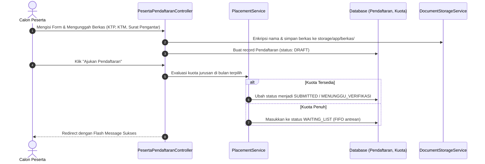
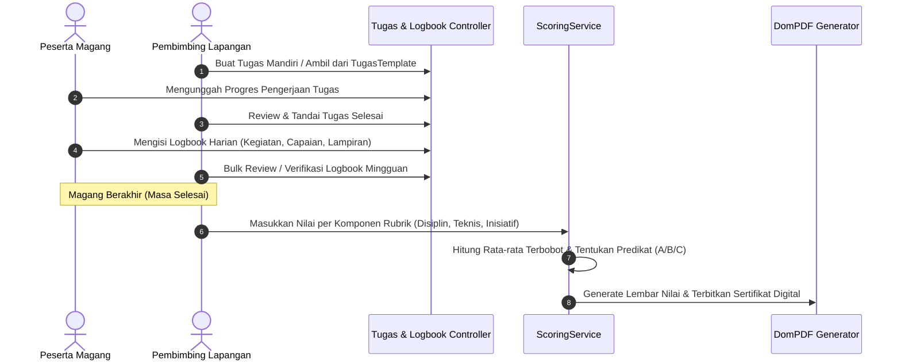
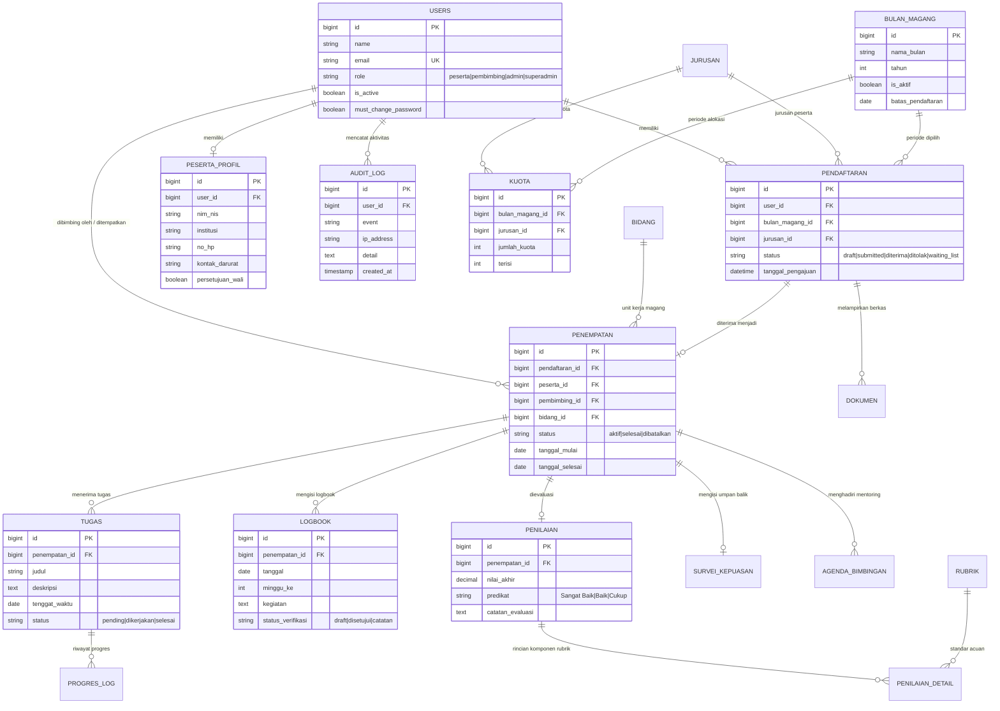

> Diperbarui: 2026-10-13 | commit: 1553e56 | mode: A

# Alur Data & Skema Database (DATA-FLOW.md)

Dokumen ini menjelaskan aliran data untuk proses bisnis inti, relasi antar entitas, serta Entity-Relationship Diagram (ERD) dari 25 model Eloquent dalam Portal MagKom.

---

## 1. Alur Data Fitur Utama

### A. Alur Pendaftaran & Seleksi Magang

### B. Alur Eksekusi Magang, Logbook & Penilaian

---

## 2. Entity-Relationship Diagram (ERD)

---

## 3. Strategi Penyimpanan Data & Session State

1. **Session Driver (`database`)**:
   - Seluruh sesi pengguna disimpan dalam tabel `sessions` MySQL untuk ketahanan serverless/multi-worker dan memungkinkan fitur pembatalan sesi simultan (*single session concurrency* bila diperlukan).
2. **Cache Store (`database`)**:
   - Menggunakan tabel `cache` untuk agregasi data kuota berkala dan metrik dashboard harian guna meminimalkan query repetitif ke tabel transaksi utama.
3. **Penyimpanan Berkas Privat (`local storage/app/berkas`)**:
   - Berkas fisik dipisahkan sepenuhnya dari direktori public web. Unduhan divalidasi melalui rute URL bertanda tangan relatif (`signed:relative`) dengan pengecekan kepemilikan data (IDOR mitigation).
