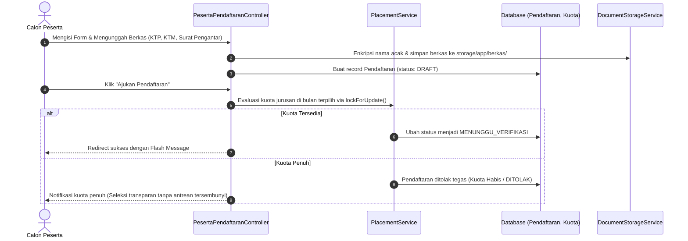
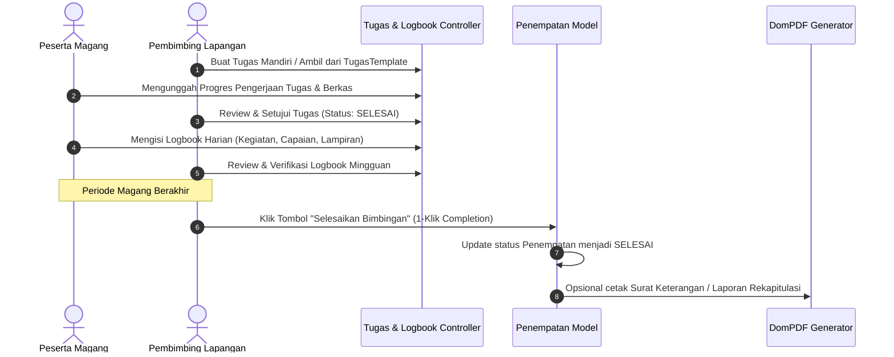
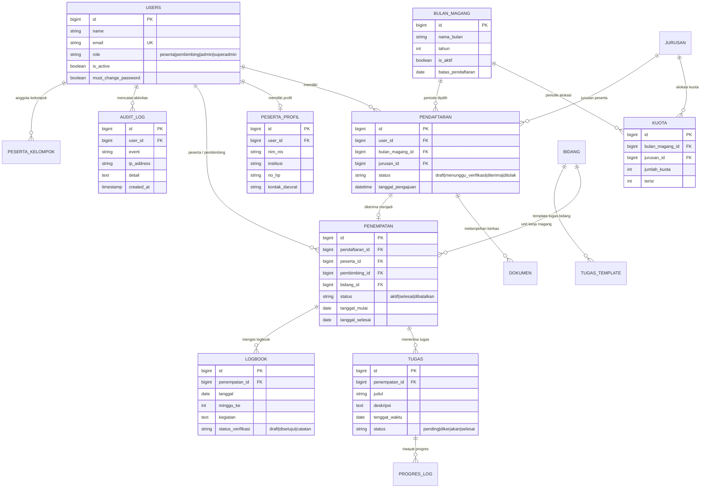

> Diperbarui: 2026-11-09 | mode: Verified Living Documentation

# Alur Data & Skema Database (DATA-FLOW.md)

Dokumen ini menjelaskan aliran data untuk proses bisnis inti, relasi antar entitas, serta Entity-Relationship Diagram (ERD) dari 24 tabel domain model Eloquent aktif dalam Portal MagKom.

> **Catatan Singkronisasi**:  
> Untuk rincian kamus data (*data dictionary*) lengkap 24 tabel domain dan 5 tabel framework, rujuk dokumen utama [docs/04-SKEMA-DATABASE-DAN-DATA-DICTIONARY.md](../04-SKEMA-DATABASE-DAN-DATA-DICTIONARY.md).

---

## 1. Alur Data Fitur Utama

### A. Alur Pendaftaran & Seleksi Magang (Tanpa Waiting List)

### B. Alur Eksekusi Magang, Logbook & Penyelesaian Bimbingan 1-Klik

---

## 2. Entity-Relationship Diagram (ERD) Domain Inti

---

## 3. Strategi Penyimpanan Data & Session State

1. **Session Driver (`database`)**:
   - Seluruh sesi pengguna disimpan dalam tabel framework `sessions` MySQL untuk ketahanan serverless/multi-worker dan memungkinkan fitur pembatalan sesi simultan bila diperlukan.
2. **Cache Store (`database`)**:
   - Menggunakan tabel framework `cache` untuk agregasi data kuota berkala dan metrik dashboard harian guna meminimalkan query repetitif ke tabel transaksi utama.
3. **Penyimpanan Berkas Privat (`storage/app/berkas`)**:
   - Berkas fisik dipisahkan sepenuhnya dari direktori public web. Unduhan divalidasi melalui rute URL bertanda tangan relatif (`signed:relative`) dengan verifikasi otorisasi Form Request / Policy (IDOR mitigation).
