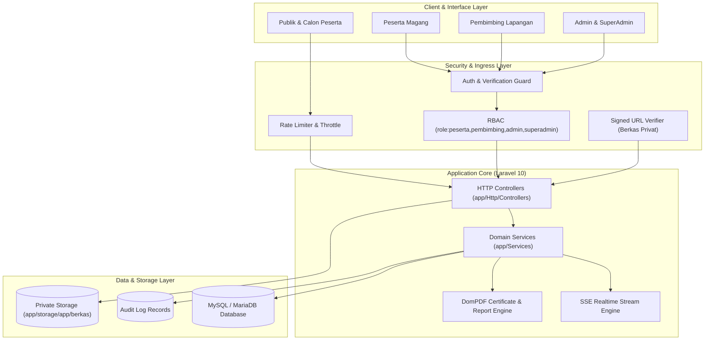

> Diperbarui: 2026-10-13 | commit: 1553e56 | mode: A

# Arsitektur Proyek: Portal MagKom (Magang Kominfo)

Portal MagKom adalah aplikasi web terintegrasi untuk manajemen dan transparansi program magang pada Dinas Komunikasi dan Informatika (Kominfo). Sistem melayani 4 peran pengguna utama: **Peserta**, **Pembimbing Lapangan**, **Administrator**, dan **Super Administrator**, dengan fokus pada transparansi kuota penerimaan, tata kelola berkas, monitoring logbook harian, serta evaluasi sertifikasi berbasis bukti.

---

## 1. Ringkasan Eksekutif & Stack Teknologi

| Komponen | Teknologi | Keterangan Versi & Konfigurasi |
| :--- | :--- | :--- |
| **Bahasa & Runtime** | PHP 8.2+ / Node.js 24.x | Strict typing `declare(strict_types=1)` diaktifkan pada controller dan service |
| **Framework Backend** | Laravel 10.x | Arsitektur MVC + Dedicated Domain Service Layer (`app/Services`) |
| **Frontend Rendering** | Blade Templates | Komponen Blade modular, native CSS variables, Vite bundler |
| **Styling & Design System**| Custom Design System (DS-MagKom) + Tailwind CSS | Palet warna korporat Kominfo (Blue 600 `#0751FF`), tipografi Open Sans |
| **Database & ORM** | MySQL / MariaDB (Eloquent ORM) | Skema relasional 25+ model dengan audit log trail dan strict foreign keys |
| **Keamanan & Auth** | Laravel Session + Sanctum + Socialite | Multi-guard RBAC, rate-limiting kustom, CSRF protection, signed URLs |
| **Realtime Engine** | Server-Sent Events (SSE) | HTTP streaming mandiri (`/realtime/stream`) via `RealtimeStreamController` |
| **Reporting & Export** | Barryvdh DomPDF & ZipArchive | Penerbitan PDF Surat Diterima, Lembar Nilai, Sertifikat, dan bundel berkas ZIP |
| **Testing Suite** | PHPUnit 10.x | 54 Feature Test suites + Automated Security Sweep |

---

## 2. Diagram Arsitektur Tingkat Tinggi



---

## 3. Struktur Direktori Beranotasi

```text
MAGKOM/
├── app/
│   ├── Console/Commands/       # Perintah Artisan kustom (AnonimkanPeserta, TutupWaitingList)
│   ├── Enums/                  # PHP 8.1+ Enums (RealtimeEventTypeEnum, StatusPendaftaran, dll.)
│   ├── Http/
│   │   ├── Controllers/        # Controller terbagi per domain: Admin, Auth, Pembimbing, Peserta, Public, SuperAdmin
│   │   ├── Middleware/         # Guard RBAC, verifikasi email, proteksi password staf, throttle
│   │   └── Requests/           # Validasi form terpusat (Form Request validation)
│   ├── Models/                 # 25 Eloquent Models dengan audit hooks dan relasi
│   ├── Providers/              # Service providers (RouteServiceProvider, AppServiceProvider)
│   └── Services/               # 18 Domain Services (PlacementService, ScoringService, AuditService, dll.)
├── database/
│   ├── factories/              # Factory data uji untuk automated testing
│   ├── migrations/             # 32 file migrasi database (skema terstruktur 2026)
│   └── seeders/                # Database seeder (akun default, master jurusan, data dummy 20 peserta)
├── docs/
│   ├── architecture/           # [READ-ONLY INSPECTOR] Dokumentasi struktural sistem ini
│   ├── plans/                  # Dokumen rencana teknis (web-planning)
│   └── *.md                    # Spesifikasi PRD, TDD, Keamanan, dan Design System resmi
├── public/                     # Web root: index.php, assets build, security.txt RFC 9116
├── resources/
│   ├── css/                    # Entry CSS Vite
│   ├── js/                     # Client JavaScript untuk interaksi form dan SSE listener
│   └── views/                  # Blade template hierarkis (layouts, components, admin, pembimbing, peserta, superadmin)
├── routes/
│   ├── web.php                 # Rute utama aplikasi berorientasi session (129+ endpoints)
│   └── api.php                 # Rute RESTful API / Sanctum
├── storage/                    # Tempat penyimpanan berkas privat peserta, PDF, dan cache
└── tests/
    ├── Feature/                # 54 file pengujian integrasi alur bisnis (UAT, RBAC, IDOR, Lifecycle)
    └── Unit/                   # Unit test komponen dasar
```

---

## 4. Filosofi Desain & Alur Bisnis Utama

Sistem dirancang dengan pemisahan tanggung jawab yang ketat (*Separation of Concerns*):
1. **Controller Ramping, Service Gemuk**: Controller hanya menerima input HTTP, memanggil Form Request untuk validasi, mendelegasikan ke `app/Services`, dan mengembalikan view atau JSON.
2. **Keamanan Berkas Privat**: Berkas lamaran dan identitas (KTP, KTM, Surat Pengantar) tidak diletakkan di `public/`, melainkan di private storage yang hanya bisa diunduh melalui `temporarySignedRoute` dengan batasan waktu aktif.
3. **Audit Trail Otomatis**: Setiap aksi sensitif (perubahan kuota, keputusan penolakan/penerimaan, pengubahan nilai, promosi waiting list) dicatat ke tabel `audit_log` via `AuditService`.
