# Peta Rute & Endpoint Aplikasi (ROUTES.md)

Dokumen ini memetakan seluruh rute pada `routes/web.php` dan `routes/api.php` MAGKOM secara komprehensif, mencakup metode HTTP, middleware proteksi, controller pemroses, dan fungsi bisnisnya.

---

## 1. Diagram Segmentasi Zona & Hak Akses Rute

```mermaid
graph LR
    subgraph PublicZone ["Publik & Guest Zone"]
        R_Landing["/ (Landing Page)"]
        R_Alur["/panduan-alur & /peta-alur"]
        R_Pdf["/panduan-magang-pdf"]
        R_Health["/health"]
        R_Privasi["/kebijakan-privasi"]
        R_Login["/login"]
        R_Register["/register (Mandiri & Kelompok)"]
        R_Oauth["/auth/{provider}/*"]
        R_VerifDoc["/verifikasi-dokumen/{kode}"]
        R_Captcha["/captcha/image"]
    end

    subgraph PesertaZone ["Area Peserta (/peserta/*)"]
        P_Dash["/peserta/dashboard"]
        P_Profil["/peserta/profil"]
        P_Daftar["/peserta/pendaftaran"]
        P_Berkas["/peserta/pendaftaran/{id}/berkas"]
        P_SK["/peserta/pendaftaran/{id}/surat-diterima"]
        P_Tugas["/peserta/tugas (Khusus Diterima)"]
        P_Logbook["/peserta/logbook (Maks. Mundur H-3)"]
        P_Akun["/peserta/pengaturan"]
    end

    subgraph PembimbingZone ["Area Pembimbing (/pembimbing/*)"]
        M_Dash["/pembimbing/dashboard"]
        M_Peserta["/pembimbing/peserta (Profil 360 Mentee)"]
        M_Template["/pembimbing/tugas/template"]
        M_Tugas["/pembimbing/tugas (Beri Tugas & Review)"]
        M_Logbook["/pembimbing/logbook (Review Mingguan)"]
        M_Selesai["/pembimbing/penempatan/{id}/selesai (1-Klik)"]
        M_Kinerja["/pembimbing/laporan-kinerja (Ekspor PDF)"]
        M_Profil["/pembimbing/profil & pengaturan"]
    end

    subgraph AdminZone ["Area Administrator (/admin/*)"]
        A_Dash["/admin/dashboard"]
        A_Kuota["/admin/kuota (Formasi Bulan & Bidang)"]
        A_Pendaftaran["/admin/pendaftaran (Verifikasi Berkas)"]
        A_Zip["/admin/pendaftaran/download-zip"]
        A_Penempatan["/admin/penempatan (Plotting Pembimbing)"]
        A_Laporan["/admin/laporan (Pendaftaran & Penempatan)"]
        A_Profil["/admin/profil & pengaturan"]
    end

    subgraph SuperAdminZone ["Area SuperAdmin (/superadmin/*)"]
        SA_Dash["/superadmin/dashboard"]
        SA_Bulan["/superadmin/bulan"]
        SA_Slot["/superadmin/slot-khusus"]
        SA_Khusus["/superadmin/peserta-khusus"]
        SA_Staf["/superadmin/staf"]
        SA_Role["/superadmin/role (Matriks Izin Dinamis)"]
        SA_Master["/superadmin/jurusan & bidang"]
        SA_Config["/superadmin/pengaturan (12 Parameter)"]
        SA_Cms["/superadmin/cms-landing (Staging Sandbox)"]
        SA_Editor["/superadmin/site-editor/* (Gutenberg Canvas)"]
        SA_Arsip["/superadmin/arsip-peserta"]
        SA_Audit["/superadmin/audit-log (4 Kanal Stream)"]
        SA_Health["/superadmin/health-monitor (Diagnostik)"]
        SA_Backup["/superadmin/backup (Disaster Recovery)"]
    end

    subgraph RealtimeZone ["Realtime Event Stream"]
        RT_Stream["/realtime/stream (SSE)"]
        RT_Read["/realtime/read/{id}"]
    end

    PublicZone -->|Login Peserta| PesertaZone
    PublicZone -->|Login Pembimbing| PembimbingZone
    PublicZone -->|Login Admin| AdminZone
    PublicZone -->|Login SuperAdmin| SuperAdminZone
    PesertaZone -.-> RealtimeZone
    PembimbingZone -.-> RealtimeZone
    AdminZone -.-> RealtimeZone
    SuperAdminZone -.-> RealtimeZone
```

---

## 2. Rute Publik & Tamu (Guest Zone)

Middleware dasar: `web`. Rute autentikasi menggunakan `middleware('guest')`.

| HTTP Method | URI Path | Nama Rute | Controller & Method | Deskripsi Bisnis |
|---|---|---|---|---|
| `GET` | `/` | `landing` | `LandingController` | Landing page utama (informasi kuota real-time, hero, benefit, FAQ). |
| `GET` | `/panduan-alur` | `panduan-alur` | `AlurMagangController` | Halaman panduan persyaratan dan alur pendaftaran magang. |
| `GET` | `/peta-alur` | `peta-alur` | `AlurMagangController@petaInteraktif` | Peta simulator interaktif alur seleksi dan bimbingan. |
| `GET` | `/panduan-magang-pdf` | `panduan.pdf` | `PanduanPdfController@download` | Unduh dokumen resmi panduan magang format PDF. |
| `GET` | `/health` | `health` | `HealthController` | Probe status ketersediaan sistem publik. |
| `GET` | `/kebijakan-privasi` | `kebijakan-privasi` | View `public.kebijakan-privasi` | Dokumen hukum kebijakan privasi dan kepatuhan UU PDP. |
| `GET` | `/.well-known/security.txt`| `security.txt` | Closure | RFC 9116 security disclosure policy. |
| `GET` | `/verifikasi-dokumen/{kode}`| `dokumen.verifikasi` | `VerifikasiDokumenController` | Validasi keaslian dokumen SK via pemindaian kode QR / barcode. |
| `GET` | `/captcha/image` | `captcha.image` | `CaptchaController@image` | Generator gambar captcha dinamis anti-bot. |
| `GET` | `/login` | `login` | `AuthController@showLogin` | Halaman login formulir kredensial. |
| `POST`| `/login` | `login` | `AuthController@login` | Proses autentikasi login (throttled: `throttle:login`). |
| `GET` | `/register` | `register` | `AuthController@showRegister`| Halaman pendaftaran akun calon peserta (Mandiri / Kelompok). |
| `POST`| `/register` | `register` | `AuthController@register` | Registrasi akun baru (throttled: `throttle:pendaftaran`). |
| `GET` | `/auth/{provider}/redirect` | `oauth.redirect` | `SocialiteController@redirect` | Pengalihan ke Google OAuth login. |
| `GET` | `/auth/{provider}/callback` | `oauth.callback` | `SocialiteController@callback` | Callback penerimaan token dari Google OAuth. |
| `GET` | `/forgot-password` | `password.request` | `ResetPasswordController@showForgot` | Permohonan tautan reset kata sandi via email. |
| `POST`| `/forgot-password` | `password.email` | `ResetPasswordController@sendResetLink` | Pengiriman tautan reset kata sandi ke email. |
| `GET` | `/reset-password/{token}` | `password.reset` | `ResetPasswordController@showReset` | Formulir pembaharuan kata sandi dari token email. |
| `POST`| `/reset-password` | `password.update` | `ResetPasswordController@reset` | Simpan kata sandi baru. |
| `POST`| `/logout` | `logout` | `AuthController@logout` | Sesi logout pengguna (**POST-only** dengan proteksi CSRF). |

---

## 3. Rute Bersama Terotentikasi (Authenticated Common Zone)

Middleware dasar: `['auth']`.

| HTTP Method | URI Path | Nama Rute | Controller & Method | Deskripsi Bisnis |
|---|---|---|---|---|
| `GET` | `/dashboard` | `dashboard` | Closure | Pengalihan rute dashboard otomatis sesuai peran pengguna (`role`). |
| `GET` | `/email/verify` | `verification.notice` | `VerificationController@notice` | Halaman peringatan wajib verifikasi alamat email. |
| `GET` | `/email/verify/{id}/{hash}`| `verification.verify`| `VerificationController@verify` | Verifikasi tautan email (signed URL & throttle). |
| `POST`| `/email/verification-notification` | `verification.send` | `VerificationController@resend` | Kirim ulang tautan verifikasi email. |
| `GET` | `/password/ganti` | `password.ganti` | `PasswordController@showGanti` | Formulir wajib ganti kata sandi perdana staf/peserta khusus. |
| `POST`| `/password/ganti` | `password.ganti.update` | `PasswordController@updateGanti` | Simpan kata sandi baru pasca-reset. |
| `GET` | `/berkas/{dokumen}/download` | `berkas.download` | `BerkasController@unduh` | Unduh berkas privat dengan proteksi temporary signed URL (5 menit). |
| `GET` | `/berkas/{dokumen}/pratinjau`| `berkas.pratinjau` | `BerkasController@pratinjau` | Pratinjau berkas privat PDF/gambar di peramban. |

---

## 4. Rute Portal Peserta Magang (`/peserta/*`)

Middleware: `['auth', 'verified', 'must_change_password', 'account.active', 'role:peserta']`  
Prefix: `peserta`, Name: `peserta.`

| HTTP Method | URI Path | Nama Rute | Controller & Method | Deskripsi Bisnis |
|---|---|---|---|---|
| `GET` | `/peserta/dashboard` | `dashboard` | `PesertaDashboardController@index` | Dashboard linimasa, status seleksi, dan ringkasan bimbingan. |
| `GET` | `/peserta/profil` | `profil.show` | `PesertaProfilController@show` | Formulir biodata diri, kontak darurat, dan persetujuan wali. |
| `POST`| `/peserta/profil` | `profil.simpan` | `PesertaProfilController@simpan` | Simpan pembaruan biodata diri peserta. |
| `GET` | `/peserta/pengaturan` | `pengaturan.index` | `PesertaPengaturanController@index` | Pengaturan preferensi akun dan keamanan kata sandi. |
| `PUT` | `/peserta/pengaturan/password` | `pengaturan.password.update` | `PesertaPengaturanController@updatePassword` | Perbarui kata sandi akun peserta. |
| `POST`| `/peserta/pengaturan/preferensi`| `pengaturan.preferensi.update` | `PesertaPengaturanController@updatePreferensi` | Simpan preferensi UI peserta (misal: tema). |
| `GET` | `/peserta/pendaftaran` | `pendaftaran.index` | `PesertaPendaftaranController@index` | Formulir pengajuan magang dan pemilihan formasi bulan. |
| `POST`| `/peserta/pendaftaran` | `pendaftaran.store` | `PesertaPendaftaranController@store` | Simpan draf pengajuan pendaftaran magang. |
| `GET` | `/peserta/pendaftaran/{pendaftaran}` | `pendaftaran.detail` | `PesertaPendaftaranController@detail` | Rincian pendaftaran dan status pemeriksaan berkas. |
| `POST`| `/peserta/pendaftaran/{pendaftaran}/ajukan` | `pendaftaran.ajukan` | `PesertaPendaftaranController@ajukan` | Ajukan berkas pendaftaran secara final ke antrean seleksi. |
| `POST`| `/peserta/pendaftaran/{pendaftaran}/batalkan` | `pendaftaran.batalkan` | `PesertaPendaftaranController@batalkan` | Batalkan pengajuan pendaftaran (sebelum diverifikasi). |
| `POST`| `/peserta/pendaftaran/{pendaftaran}/berkas` | `berkas.unggah` | `BerkasController@unggah` | Unggah dokumen persyaratan jenjang SMK/D3/S1. |
| `GET` | `/peserta/pendaftaran/{pendaftaran}/surat-diterima` | `pendaftaran.surat-diterima` | `PesertaPendaftaranController@unduhSuratDiterimaPendaftaran` | Unduh salinan Surat Keputusan (SK) Penerimaan (PDF). |
| `GET` | `/peserta/pendaftaran/{pendaftaran}/surat-diterima/pratinjau` | `pendaftaran.surat-diterima.pratinjau` | `PesertaPendaftaranController@pratinjauSuratDiterimaPendaftaran` | Pratinjau SK Penerimaan langsung pada peramban. |
| `GET` | `/peserta/penempatan/{penempatan}/surat-diterima` | `penempatan.surat-diterima` | `PesertaPendaftaranController@unduhSuratDiterima` | Unduh SK resmi penempatan peserta aktif. |
| `GET` | `/peserta/penempatan/{penempatan}/surat-diterima/pratinjau` | `penempatan.surat-diterima.pratinjau` | `PesertaPendaftaranController@pratinjauSuratDiterima` | Pratinjau SK resmi penempatan peserta aktif. |

### Rute Pelaksanaan Magang (Khusus Status Diterima: `middleware('peserta.diterima')`)
| HTTP Method | URI Path | Nama Rute | Controller & Method | Deskripsi Bisnis |
|---|---|---|---|---|
| `GET` | `/peserta/tugas` | `tugas.index` | `PesertaTugasController@index` | Daftar tugas proyek yang diberikan pembimbing lapangan. |
| `GET` | `/peserta/tugas/{tugas}` | `tugas.show` | `PesertaTugasController@show` | Rincian instruksi tugas dan linimasa pengumpulan progres. |
| `GET` | `/peserta/tugas/{tugas}/lampiran` | `tugas.lampiran` | `PesertaTugasController@unduhLampiran` | Unduh berkas lampiran instruksi tugas. |
| `POST`| `/peserta/tugas/{tugas}/progres` | `tugas.progres` | `PesertaTugasController@unggahProgres` | Serahkan laporan capaian pengerjaan tugas dan tautan hasil. |
| `GET` | `/peserta/logbook` | `logbook.index` | `PesertaLogbookController@index` | Daftar presensi aktivitas harian/mingguan mentee. |
| `POST`| `/peserta/logbook` | `logbook.store` | `PesertaLogbookController@store` | Simpan rekaman aktivitas harian (batas mundur maks. H-3). |
| `PUT` | `/peserta/logbook/{logbook}` | `logbook.update` | `PesertaLogbookController@update` | Perbarui catatan logbook berstatus revisi. |
| `GET` | `/peserta/logbook/{logbook}/lampiran` | `logbook.lampiran` | `PesertaLogbookController@unduhLampiran` | Unduh berkas bukti dokumentasi logbook. |

---

## 5. Rute Portal Pembimbing Magang (`/pembimbing/*`)

Middleware: `['auth', 'verified', 'must_change_password', 'account.active', 'role:pembimbing,admin,superadmin', 'superadmin.readonly']`  
Prefix: `pembimbing`, Name: `pembimbing.`

| HTTP Method | URI Path | Nama Rute | Controller & Method | Deskripsi Bisnis |
|---|---|---|---|---|
| `GET` | `/pembimbing/dashboard` | `dashboard` | `PembimbingDashboardController@index` | Dashboard bento pembimbing, kalender, beban mentee, tugas aktif. |
| `GET` | `/pembimbing/peserta` | `peserta.index` | `PembimbingPesertaController@index` | Direktori peserta magang yang sedang dibimbing. |
| `GET` | `/pembimbing/peserta/{penempatan}` | `peserta.show` | `PembimbingPesertaController@show` | **Profil 360 Mentee**: Donut chart tugas, linimasa durasi, dan bio. |
| `POST`| `/pembimbing/penempatan/{penempatan}/selesai` | `penempatan.selesai` | `PembimbingPesertaController@selesai` | **Penyelesaian Magang 1-Klik**: Menetapkan status selesai bimbingan. |
| `GET` | `/pembimbing/tugas` | `tugas.index` | `PembimbingTugasController@index` | Daftar penugasan proyek bimbingan lapangan. |
| `GET` | `/pembimbing/tugas/create` | `tugas.create` | `PembimbingTugasController@create` | Formulir pembuatan instruksi penugasan kerja baru. |
| `POST`| `/pembimbing/tugas` | `tugas.store` | `PembimbingTugasController@store` | Simpan penugasan baru (mendukung multi-mentee batch). |
| `GET` | `/pembimbing/tugas/{tugas}` | `tugas.show` | `PembimbingTugasController@show` | Tinjauan tugas dan riwayat pengumpulan progres mentee. |
| `GET` | `/pembimbing/tugas/{tugas}/edit` | `tugas.edit` | `PembimbingTugasController@edit` | Formulir pengeditan tugas yang belum selesai. |
| `PUT` | `/pembimbing/tugas/{tugas}` | `tugas.update` | `PembimbingTugasController@update` | Simpan perubahan instruksi tugas kerja. |
| `GET` | `/pembimbing/tugas/{tugas}/lampiran` | `tugas.lampiran` | `PembimbingTugasController@unduhLampiran` | Unduh lampiran tugas yang diunggah. |
| `POST`| `/pembimbing/tugas/{tugas}/selesai` | `tugas.selesai` | `PembimbingTugasController@selesai` | Tandai tugas mentee telah disetujui tuntas. |
| `POST`| `/pembimbing/progres/{progres}/review` | `progres.review` | `PembimbingTugasController@reviewProgres` | Berikan evaluasi catatan dan status progres kerja mentee. |
| `GET` | `/pembimbing/tugas/template` | `tugas.template.index` | `PembimbingTugasTemplateController@index` | Library template penugasan bimbingan mandiri. |
| `POST`| `/pembimbing/tugas/template` | `tugas.template.store` | `PembimbingTugasTemplateController@store` | Simpan draf template tugas baru. |
| `GET` | `/pembimbing/tugas/template-picker` | `tugas.template.picker` | `PembimbingTugasTemplateController@pickerJson` | Endpoint JSON pemilih template penugasan cepat. |
| `PUT` | `/pembimbing/tugas/template/{template}` | `tugas.template.update` | `PembimbingTugasTemplateController@update` | Perbarui isi template penugasan. |
| `DELETE`| `/pembimbing/tugas/template/{template}` | `tugas.template.destroy` | `PembimbingTugasTemplateController@destroy` | Hapus template penugasan mandiri. |
| `GET` | `/pembimbing/logbook` | `logbook.index` | `PembimbingLogbookReviewController@index` | Antrean review logbook kegiatan mingguan mentee. |
| `POST`| `/pembimbing/logbook/bulk-review` | `logbook.bulk-review` | `PembimbingLogbookReviewController@bulkReview` | Persetujuan massal logbook mingguan sekaligus. |
| `POST`| `/pembimbing/logbook/{logbook}/review` | `logbook.review` | `PembimbingLogbookReviewController@review` | Persetujuan atau permintaan revisi logbook individu. |
| `GET` | `/pembimbing/laporan-kinerja` | `laporan-kinerja.index` | `PembimbingLaporanKinerjaController@index` | Rekapitulasi laporan capaian mentoring pegawai ASN Sleman. |
| `GET` | `/pembimbing/laporan-kinerja/export` | `laporan-kinerja.export` | `PembimbingLaporanKinerjaController@export` | Ekspor rekapitulasi portofolio mentoring ke Excel XLSX. |
| `GET` | `/pembimbing/laporan-kinerja/cetak` | `laporan-kinerja.cetak` | `PembimbingLaporanKinerjaController@cetak` | Cetak portofolio mentoring resmi format PDF. |
| `GET` | `/pembimbing/profil` | `profil.show` | `PembimbingProfilController@show` | Biodata profil pembimbing lapangan. |
| `POST`/`PUT` | `/pembimbing/profil` | `profil.update` | `PembimbingProfilController@update` | Perbarui kontak dan profil pembimbing. |
| `GET` | `/pembimbing/pengaturan` | `pengaturan.index` | `PembimbingPengaturanController@index` | Pengaturan akun dan kata sandi pembimbing. |
| `PUT` | `/pembimbing/pengaturan/password` | `pengaturan.password.update` | `PembimbingPengaturanController@updatePassword` | Simpan kata sandi baru pembimbing. |
| `POST`| `/pembimbing/pengaturan/preferensi` | `pengaturan.preferensi.update` | `PembimbingPengaturanController@updatePreferensi` | Simpan preferensi antarmuka pembimbing. |

---

## 6. Rute Administrator Verifikator (`/admin/*`)

Middleware: `['auth', 'verified', 'must_change_password', 'account.active', 'role:admin,superadmin', 'superadmin.readonly']`  
Prefix: `admin`, Name: `admin.`

| HTTP Method | URI Path | Nama Rute | Controller & Method | Deskripsi Bisnis |
|---|---|---|---|---|
| `GET` | `/admin/dashboard` | `dashboard` | `AdminDashboardController@index` | Dashboard KPI admin: antrean verifikasi, utilisasi kuota, SLA. |
| `GET` | `/admin/kuota` | `kuota.index` | `KuotaController@index` | Manajemen daya tampung kuota per bulan dan jurusan. |
| `POST`| `/admin/kuota` | `kuota.store` | `KuotaController@store` | Tambah alokasi kuota jurusan pada bulan tertentu. |
| `POST`| `/admin/kuota/bulan` | `kuota.bulan.store` | `KuotaController@storeBulan` | Buka periode bulan pendaftaran baru. |
| `PUT` | `/admin/kuota/bulan/{bulanMagang}` | `kuota.bulan.update` | `KuotaController@updateBulan` | Ubah status pembukaan bulan pendaftaran. |
| `PUT` | `/admin/kuota/bidang/{bidang}` | `kuota.bidang.update` | `KuotaController@updateBidangKuota` | Alokasikan kuota maksimal per bidang dinas. |
| `PUT` | `/admin/kuota/{kuota}` | `kuota.update` | `KuotaController@update` | Ubah kapasitas daya tampung kuota jurusan. |
| `PATCH`| `/admin/kuota/{kuota}/toggle` | `kuota.toggle` | `KuotaController@toggleAktif` | Sakelar status keaktifan baris kuota. |
| `GET` | `/admin/pendaftaran` | `pendaftaran.index` | `AdminPendaftaranController@index` | Antrean verifikasi berkas permohonan pendaftar (SLA 5 hari). |
| `GET` | `/admin/pendaftaran/download-zip` | `pendaftaran.download-zip` | `AdminPendaftaranController@downloadBundelZip` | Unduh berkas pendaftar sekaligus dalam arsip ZIP. |
| `GET` | `/admin/pendaftaran/{pendaftaran}` | `pendaftaran.show` | `AdminPendaftaranController@show` | Meja verifikasi berkas pendaftar dan validasi berkas. |
| `POST`| `/admin/pendaftaran/{pendaftaran}/putuskan` | `pendaftaran.putuskan` | `AdminPendaftaranController@putuskan` | Keputusan seleksi berkas: **Diterima** atau **Ditolak**. |
| `GET` | `/admin/pendaftaran/{pendaftaran}/surat-diterima` | `pendaftaran.surat-diterima` | `AdminPendaftaranController@unduhSuratDiterima` | Unduh SK penerimaan peserta format PDF. |
| `GET` | `/admin/pendaftaran/{pendaftaran}/surat-diterima/pratinjau` | `pendaftaran.surat-diterima.pratinjau` | `AdminPendaftaranController@pratinjauSuratDiterima` | Pratinjau SK penerimaan peserta di peramban. |
| `GET` | `/admin/penempatan` | `penempatan.index` | `AdminPenempatanController@index` | Manajemen penempatan dua tahap dan alokasi pembimbing. |
| `POST`| `/admin/penempatan/tetapkan` | `penempatan.tetapkan` | `AdminPenempatanController@tetapkan` | Plotting peserta ke unit kerja bidang dan pembimbing ASN. |
| `POST`| `/admin/penempatan/manual` | `penempatan.manual` | `AdminPenempatanController@storeManual` | Pendaftaran penempatan khusus dinas. |
| `POST`| `/admin/penempatan/bulk-reassign` | `penempatan.bulk-reassign` | `AdminPenempatanController@bulkReassignPembimbing` | Pindah pembimbing massal secara simultan. |
| `GET` | `/admin/penempatan/{penempatan}` | `penempatan.show` | `AdminPenempatanController@show` | Detail penempatan peserta dan riwayat mutasi bimbingan. |
| `POST`| `/admin/penempatan/{penempatan}/pindah-pembimbing` | `penempatan.pindah-pembimbing` | `AdminPenempatanController@pindahPembimbing` | Reassign pembimbing individu 1-klik. |
| `POST`| `/admin/penempatan/{penempatan}/batalkan` | `penempatan.batalkan` | `AdminPenempatanController@batalkan` | Pembatalan penempatan peserta aktif. |
| `GET` | `/admin/penempatan/ekspor-surat-diterima` | `penempatan.ekspor-surat-diterima` | `AdminPenempatanController@exportRekapSuratDiterima` | Rekapitulasi surat penempatan format Excel XLSX. |
| `GET` | `/admin/laporan` | `laporan.index` | `LaporanController@index` | Pusat laporan operasional pendaftaran dan penempatan. |
| `GET` | `/admin/laporan/pendaftaran` | `laporan.pendaftaran` | `LaporanController@pendaftaran` | Ekspor tabular rekapitulasi pendaftar ke Excel XLSX. |
| `GET` | `/admin/laporan/penempatan` | `laporan.penempatan` | `LaporanController@penempatan` | Ekspor tabular rekapitulasi penempatan ke Excel XLSX. |
| `GET` | `/admin/profil` | `profil.show` | `AdminProfilController@show` | Biodata profil administrator kedinasan. |
| `POST`/`PUT`| `/admin/profil` | `profil.update` | `AdminProfilController@update` | Simpan pembaruan profil administrator. |
| `GET` | `/admin/pengaturan` | `pengaturan.index` | `AdminPengaturanController@index` | Pengaturan akun dan kata sandi admin. |
| `PUT` | `/admin/pengaturan/password` | `pengaturan.password.update` | `AdminPengaturanController@updatePassword` | Simpan kata sandi baru administrator. |
| `POST`| `/admin/pengaturan/preferensi` | `pengaturan.preferensi.update` | `AdminPengaturanController@updatePreferensi` | Simpan preferensi UI administrator. |

---

## 7. Rute SuperAdmin (`/superadmin/*`)

Middleware: `['auth', 'verified', 'must_change_password', 'account.active', 'role:superadmin']`  
Prefix: `superadmin`, Name: `superadmin.`

| HTTP Method | URI Path | Nama Rute | Controller & Method | Deskripsi Bisnis |
|---|---|---|---|---|
| `GET` | `/superadmin/dashboard` | `dashboard` | `SuperAdminDashboardController@index` | Executive command center: metrik sistem, audit, dan telemetri. |
| `GET` | `/superadmin/bulan` | `bulan.index` | `BulanController@index` | Master periode bulan pendaftaran magang. |
| `POST`| `/superadmin/bulan` | `bulan.store` | `BulanController@store` | Terbitkan periode formasi magang baru. |
| `PUT` | `/superadmin/bulan/{bulan}` | `bulan.update` | `BulanController@update` | Perbarui status pembukaan bulan pendaftaran. |
| `PATCH`| `/superadmin/bulan/{bulan}/toggle` | `bulan.toggle` | `BulanController@toggleAktif` | Sakelar status formasi bulan magang. |
| `GET` | `/superadmin/slot-khusus` | `slot-khusus.index` | `SlotKhususController@index` | Alokasi slot khusus kemitraan instansi / kampus. |
| `POST`| `/superadmin/slot-khusus` | `slot-khusus.store` | `SlotKhususController@store` | Tambah kuota kemitraan slot khusus baru. |
| `PUT` | `/superadmin/slot-khusus/{slot_khusus}` | `slot-khusus.update` | `SlotKhususController@update` | Perbarui kuota dan data kemitraan instansi. |
| `PATCH`| `/superadmin/slot-khusus/{slot_khusus}/toggle` | `slot-khusus.toggle` | `SlotKhususController@toggleAktif` | Sakelar keaktifan kuota slot khusus. |
| `GET` | `/superadmin/peserta-khusus/create` | `peserta-khusus.create` | `PesertaJalurKhususController@create` | Formulir pendaftaran instan peserta jalur kemitraan dinas. |
| `POST`| `/superadmin/peserta-khusus` | `peserta-khusus.store` | `PesertaJalurKhususController@store` | Pembuatan akun peserta khusus dan penerbitan `password_awal`. |
| `GET` | `/superadmin/staf` | `staf.index` | `StafController@index` | Manajemen akun pegawai kedinasan (Admin & Pembimbing). |
| `POST`| `/superadmin/staf` | `staf.store` | `StafController@store` | Daftarkan akun pegawai baru. |
| `PUT` | `/superadmin/staf/{staf}` | `staf.update` | `StafController@update` | Ubah identitas, peran, dan unit bidang pegawai. |
| `POST`| `/superadmin/staf/{staf}/reset-password` | `staf.reset-password` | `StafController@resetPassword` | Kirim tautan reset kata sandi staf via email. |
| `POST`| `/superadmin/staf/{staf}/regenerate-password` | `staf.regenerate-password` | `StafController@regenerateTemporaryPassword` | Regenerasi kredensial awal acak dan tampilkan modal salin. |
| `PATCH`| `/superadmin/staf/{staf}/toggle` | `staf.toggle` | `StafController@toggleAktif` | Nonaktifkan / aktifkan kembali akun staf dinas. |
| `GET` | `/superadmin/role` | `role.index` | `RoleController@index` | **Matriks Hak Akses Dinamis**: Tinjauan perizinan 13 modul sistem. |
| `POST`| `/superadmin/role/permission` | `role.permission.store` | `RoleController@storePermission` | Daftarkan izin hak akses kustom baru. |
| `PUT` | `/superadmin/role/matrix` | `role.matrix.update` | `RoleController@updateMatrix` | Simpan pembaruan matriks izin hak akses peran pengguna. |
| `DELETE`| `/superadmin/role/permission/{permission}` | `role.permission.destroy` | `RoleController@destroyPermission` | Hapus izin modul kustom (kebal hapus jika modul sistem). |
| `GET` | `/superadmin/jurusan` | `jurusan.index` | `JurusanController@index` | Master data jurusan pendidikan peserta magang. |
| `POST`| `/superadmin/jurusan` | `jurusan.store` | `JurusanController@store` | Daftarkan jurusan baru. |
| `PUT` | `/superadmin/jurusan/{jurusan}` | `jurusan.update` | `JurusanController@update` | Ubah nama atau kategori jenjang jurusan. |
| `PATCH`| `/superadmin/jurusan/{jurusan}/toggle` | `jurusan.toggle` | `JurusanController@toggleAktif` | Sakelar keaktifan jurusan. |
| `GET` | `/superadmin/bidang` | `bidang.index` | `BidangController@index` | Master unit kerja bidang teknis Dinas Kominfo Sleman. |
| `POST`| `/superadmin/bidang` | `bidang.store` | `BidangController@store` | Tambah unit bidang teknis baru. |
| `PUT` | `/superadmin/bidang/{bidang}` | `bidang.update` | `BidangController@update` | Ubah nama, kode, atau tupoksi bidang. |
| `PATCH`| `/superadmin/bidang/{bidang}/toggle` | `bidang.toggle` | `BidangController@toggleAktif` | Sakelar keaktifan bidang dinas. |
| `GET` | `/superadmin/pengaturan` | `pengaturan.index` | `PengaturanController@index` | Konfigurasi 12 parameter operasional aplikasi. |
| `PUT` | `/superadmin/pengaturan` | `pengaturan.update` | `PengaturanController@update` | Simpan perubahan parameter operasional. |
| `GET` | `/superadmin/pengaturan/export-json` | `pengaturan.export-json` | `PengaturanController@exportMasterSnapshotJson` | Unduh snapshot master konfigurasi sistem format JSON. |
| `POST`| `/superadmin/pengaturan/purge-audit` | `pengaturan.purge-audit` | `PengaturanController@triggerPurgeAudit` | Trigger pembersihan rekam jejak audit yang melebihi retensi. |
| `GET` | `/superadmin/cms-landing` | `landing.index` | `LandingCmsController@index` | Pengelolaan konten landing page publik (Staging Sandbox). |
| `PUT` | `/superadmin/cms-landing` | `landing.update` | `LandingCmsController@update` | Simpan draf perubahan konten landing page. |
| `POST`| `/superadmin/cms-landing/publish` | `landing.publish` | `LandingCmsController@publishDraft` | Terbitkan draf konten ke antarmuka produksi publik. |
| `DELETE`| `/superadmin/cms-landing/discard` | `landing.discard` | `LandingCmsController@discardDraft` | Batalkan draf perubahan konten landing. |
| `GET` | `/superadmin/cms-landing/preview` | `landing.preview` | `LandingCmsController@preview` | Pratinjau tampilan landing page dari draf staging. |
| `DELETE`| `/superadmin/cms-landing/foto` | `landing.destroy-foto` | `LandingCmsController@destroyFoto` | Hapus aset gambar banner landing page. |
| `DELETE`| `/superadmin/cms-landing/panduan` | `landing.destroy-panduan` | `LandingCmsController@destroyPanduan` | Hapus berkas PDF panduan magang terunggah. |

### Rute WordPress-Style Visual Site Editor (`/superadmin/site-editor/*`)
Prefix: `superadmin.site-editor.`

| HTTP Method | URI Path | Nama Rute | Controller & Method | Deskripsi Bisnis |
|---|---|---|---|---|
| `GET` | `/superadmin/site-editor` | `index` | `LandingCmsSiteEditorController@index` | Antarmuka Gutenberg-style block editor canvas. |
| `POST`| `/superadmin/site-editor/save-draft` | `save-draft` | `LandingCmsSiteEditorController@saveDraft` | Simpan struktur blok ke dalam draf revisi. |
| `POST`| `/superadmin/site-editor/publish` | `publish` | `LandingCmsSiteEditorController@publish` | Publikasikan susunan blok ke landing produksi. |
| `DELETE`| `/superadmin/site-editor/discard` | `discard` | `LandingCmsSiteEditorController@discard` | Buang perubahan kanvas editor. |
| `POST`| `/superadmin/site-editor/rollback` | `rollback` | `LandingCmsSiteEditorController@rollback` | Rollback susunan blok ke publikasi sebelumnya. |
| `GET` | `/superadmin/site-editor/revisions` | `revisions` | `LandingCmsSiteEditorController@revisions` | Riwayat revisi dan riwayat publikasi kanvas. |
| `GET` | `/superadmin/site-editor/revisions/{id}/preview` | `revisions.preview` | `LandingCmsSiteEditorController@previewRevision` | Pratinjau visual rekaman revisi lampau. |
| `POST`| `/superadmin/site-editor/revisions/{id}/restore` | `revisions.restore` | `LandingCmsSiteEditorController@restoreRevision` | Pulihkan susunan kanvas dari revisi masa lalu. |
| `GET` | `/superadmin/site-editor/media` | `media.index` | `LandingCmsSiteEditorController@mediaIndex` | Media Library picker untuk aset blok gambar/banner. |
| `POST`| `/superadmin/site-editor/media/upload` | `media.upload` | `LandingCmsSiteEditorController@uploadMedia` | Unggah media baru ke Media Library. |
| `POST`| `/superadmin/site-editor/media/{id}/replace` | `media.replace` | `LandingCmsSiteEditorController@replaceMedia` | Timpa/ganti berkas media yang ada. |
| `PUT` | `/superadmin/site-editor/media/{id}` | `media.update` | `LandingCmsSiteEditorController@updateMedia` | Perbarui alt text dan metadata media. |
| `DELETE`| `/superadmin/site-editor/media/{id}` | `media.delete` | `LandingCmsSiteEditorController@deleteMedia` | Hapus aset media dari pustaka. |
| `POST`| `/superadmin/site-editor/blocks/add` | `blocks.add` | `LandingCmsSiteEditorController@addBlock` | Tambah blok baru ke kanvas kerja. |
| `POST`| `/superadmin/site-editor/blocks/duplicate`| `blocks.duplicate` | `LandingCmsSiteEditorController@duplicateBlock` | Duplikasi blok yang dipilih. |
| `POST`| `/superadmin/site-editor/blocks/delete` | `blocks.delete` | `LandingCmsSiteEditorController@deleteBlock` | Hapus blok dari susunan kanvas. |
| `POST`| `/superadmin/site-editor/blocks/reorder` | `blocks.reorder` | `LandingCmsSiteEditorController@reorderBlocks` | Urutkan ulang posisi susunan blok. |
| `POST`| `/superadmin/site-editor/blocks/toggle-visibility` | `blocks.toggle-visibility` | `LandingCmsSiteEditorController@toggleVisibility` | Sembunyikan / tampilkan blok. |
| `POST`| `/superadmin/site-editor/blocks/toggle-lock` | `blocks.toggle-lock` | `LandingCmsSiteEditorController@toggleLock` | Kunci blok dari penghapusan tidak sengaja. |
| `GET` | `/superadmin/site-editor/patterns` | `patterns.index` | `LandingCmsSiteEditorController@patternsIndex` | Pattern Library: Template susunan blok siap pakai. |
| `POST`| `/superadmin/site-editor/patterns/insert` | `patterns.insert` | `LandingCmsSiteEditorController@insertPattern` | Sisipkan template pattern ke kanvas. |
| `POST`| `/superadmin/site-editor/patterns/custom` | `patterns.save-custom` | `LandingCmsSiteEditorController@saveCustomPattern` | Simpan susunan blok menjadi custom pattern. |
| `DELETE`| `/superadmin/site-editor/patterns/custom/{id}`| `patterns.delete-custom` | `LandingCmsSiteEditorController@deleteCustomPattern` | Hapus custom pattern. |
| `GET` | `/superadmin/site-editor/reusable-blocks` | `reusable.index` | `LandingCmsSiteEditorController@reusableBlocksIndex` | Reusable Blocks Engine: Blok yang dapat digunakan berulang. |
| `POST`| `/superadmin/site-editor/reusable-blocks` | `reusable.create` | `LandingCmsSiteEditorController@createReusableBlock` | Buat reusable block baru. |
| `POST`| `/superadmin/site-editor/reusable-blocks/insert` | `reusable.insert` | `LandingCmsSiteEditorController@insertReusableBlock` | Masukkan reusable block ke dokumen. |
| `PUT` | `/superadmin/site-editor/reusable-blocks/{id}` | `reusable.update` | `LandingCmsSiteEditorController@updateReusableBlock` | Perbarui isi konten reusable block global. |
| `DELETE`| `/superadmin/site-editor/reusable-blocks/{id}` | `reusable.delete` | `LandingCmsSiteEditorController@deleteReusableBlock` | Hapus definisi reusable block. |
| `POST`| `/superadmin/site-editor/reusable-blocks/{blockId}/detach` | `reusable.detach` | `LandingCmsSiteEditorController@detachReusableBlock` | Pisahkan reusable block menjadi blok reguler mandiri. |

### Rute Tata Kelola Lanjutan SuperAdmin
| HTTP Method | URI Path | Nama Rute | Controller & Method | Deskripsi Bisnis |
|---|---|---|---|---|
| `GET` | `/superadmin/arsip-peserta` | `arsip.index` | `ArsipPesertaController@index` | Direktori arsip alumni peserta magang yang telah purna tugas. |
| `GET` | `/superadmin/arsip-peserta/{penempatan}` | `arsip.show` | `ArsipPesertaController@show` | Modal penelusuran rekam jejak arsip alumni magang. |
| `GET` | `/superadmin/audit-log` | `audit-log.index` | `AuditLogController@index` | Pemantauan jejak audit mutasi data (append-only). |
| `GET` | `/superadmin/audit-log/channel/{channel}`| `audit-log.channel`| `AuditLogController@index` | Filter rekam jejak audit berdasarkan 4 kanal spesifik. |
| `GET` | `/superadmin/audit-log/export` | `audit-log.export` | `AuditLogController@export` | Ekspor rekam jejak audit format CSV terproteksi formula injection. |
| `GET` | `/superadmin/health-monitor` | `health.index` | `HealthMonitorController@index` | Command center telemetri kesehatan infrastruktur dan server. |
| `GET` | `/superadmin/health-monitor/telemetry-data` | `health.telemetry-data` | `HealthMonitorController@telemetryData` | Polling data real-time beban CPU, memori, dan latensi DB. |
| `POST`| `/superadmin/health-monitor/security-sweep`| `health.security-sweep`| `HealthMonitorController@runSecuritySweep` | **Diagnostik 1**: Uji penetrasi in-tree keamanan & audit berkas. |
| `POST`| `/superadmin/health-monitor/optimize-db` | `health.optimize-db` | `HealthMonitorController@optimizeDatabase` | **Diagnostik 2**: Optimasi dan analisis indeks tabel basis data. |
| `POST`| `/superadmin/health-monitor/clear-cache` | `health.clear-cache` | `HealthMonitorController@clearSystemCache` | **Diagnostik 3**: Pembersihan cache aplikasi, rute, dan konfigurasi. |
| `POST`| `/superadmin/health-monitor/test-storage` | `health.test-storage` | `HealthMonitorController@testStorageWrite` | **Diagnostik 4**: Uji coba penulisan dan keterbacaan storage privat. |
| `GET` | `/superadmin/backup` | `backup.index` | `BackupController@index` | **Disaster Recovery Hub**: Riwayat berkas snapshot database. |
| `POST`| `/superadmin/backup/snapshot` | `backup.snapshot` | `BackupController@triggerSnapshot` | Buat cadangan instan basis data (`.sql.gz`) dengan SHA-256. |
| `GET` | `/superadmin/backup/{filename}/download`| `backup.download` | `BackupController@download` | Unduh file backup terkompresi dengan verifikasi otorisasi. |
| `DELETE`| `/superadmin/backup/{filename}` | `backup.destroy` | `BackupController@destroy` | Hapus arsip backup kedaluwarsa dari storage privat. |
| `GET` | `/superadmin/profil` | `profil.show` | `SuperAdminProfilController@show` | Biodata profil super administrator. |
| `POST`/`PUT`| `/superadmin/profil` | `profil.update` | `SuperAdminProfilController@update` | Simpan pembaruan profil super administrator. |
| `GET` | `/superadmin/akun` | `akun.index` | `SuperAdminAkunController@index` | Pengaturan preferensi keamanan dan kata sandi SuperAdmin. |
| `PUT` | `/superadmin/akun/password` | `akun.password.update` | `SuperAdminAkunController@updatePassword` | Simpan kata sandi baru SuperAdmin. |
| `POST`| `/superadmin/akun/preferensi` | `akun.preferensi.update` | `SuperAdminAkunController@updatePreferensi` | Simpan preferensi UI SuperAdmin. |

---

## 8. Rute Server-Sent Events (SSE Real-Time Stream)

Middleware: `['auth']`

| HTTP Method | URI Path | Nama Rute | Controller & Method | Deskripsi Bisnis |
|---|---|---|---|---|
| `GET` | `/realtime/stream` | `realtime.stream` | `RealtimeStreamController@stream` | HTTP streaming Server-Sent Events (SSE) notifikasi interaktif. |
| `POST`| `/realtime/read/{id}` | `realtime.read` | `RealtimeStreamController@markRead` | Menandai rekaman notifikasi SSE telah dibaca pengguna. |
