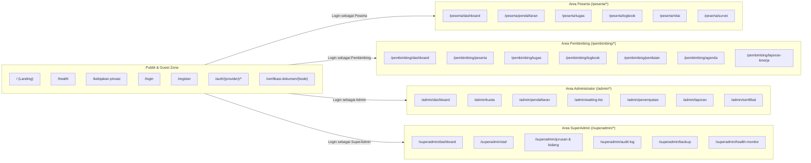

> Diperbarui: 2026-10-13 | commit: 1553e56 | mode: A

# Peta Rute & Endpoint (ROUTES.md)

Dokumen ini memetakan seluruh rute pada `routes/web.php` dan `routes/api.php`, lengkap dengan middleware proteksi, layout pembungkus, controller pemroses, dan sumber data utamanya.

---

## 1. Diagram Peta Navigasi & Segmentasi Hak Akses

---

## 2. Tabel Rute Lengkap

### A. Rute Publik & Tamu (Guest)
| Method | URI | Controller / Action | Layout View | Data Source / Model | Middleware / Auth |
| :--- | :--- | :--- | :--- | :--- | :--- |
| `GET` | `/` | `Public\LandingController` | `layouts.app` | `BulanMagang`, `Kuota`, `Jurusan` | None |
| `GET` | `/health` | `Public\HealthController` | JSON / Plain | DB connection check | None |
| `GET` | `/kebijakan-privasi` | View `public.kebijakan-privasi` | `layouts.app` | Static Content | None |
| `GET` | `/.well-known/security.txt`| Closure | Plain text | `public/.well-known/security.txt` | None |
| `GET` | `/verifikasi-dokumen/{kode}`| `Public\VerifikasiDokumenController`| `layouts.app` | `DokumenVerifikasi`, `Penempatan` | `throttle:60,1` |
| `GET` | `/login` | `Auth\AuthController@showLogin` | `layouts.auth` | - | `guest` |
| `POST`| `/login` | `Auth\AuthController@login` | - | `User` | `guest`, `throttle:login` |
| `GET` | `/register` | `Auth\AuthController@showRegister`| `layouts.auth`| `Jurusan` | `guest` |
| `POST`| `/register` | `Auth\AuthController@register` | - | `User`, `PesertaProfil` | `guest`, `throttle:pendaftaran` |
| `GET` | `/auth/{provider}/redirect`| `Auth\SocialiteController@redirect`| - | Google OAuth API | `guest` |
| `GET` | `/auth/{provider}/callback`| `Auth\SocialiteController@callback`| - | `User`, Google OAuth API | `guest` |
| `GET` | `/forgot-password` | `Auth\ResetPasswordController@showForgot`| `layouts.auth`| - | `guest` |
| `POST`| `/forgot-password` | `Auth\ResetPasswordController@sendResetLink`| - | Password broker | `guest`, `throttle:5,1` |
| `GET` | `/reset-password/{token}` | `Auth\ResetPasswordController@showReset`| `layouts.auth`| - | `guest` |
| `POST`| `/reset-password` | `Auth\ResetPasswordController@reset`| - | `User` | `guest` |

### B. Rute Berkas Privat & Verifikasi Akun
| Method | URI | Controller / Action | Layout View | Data Source / Model | Middleware / Auth |
| :--- | :--- | :--- | :--- | :--- | :--- |
| `POST`| `/logout` | `Auth\AuthController@logout` | - | Session purge | `auth` |
| `GET` | `/email/verify` | `Auth\VerificationController@notice` | `layouts.auth` | `User` | `auth` |
| `GET` | `/email/verify/{id}/{hash}`| `Auth\VerificationController@verify` | - | `User` | `auth`, `signed`, `throttle:6,1`|
| `POST`| `/email/verification-notification`| `Auth\VerificationController@resend` | - | Mail notification | `auth`, `throttle:6,1` |
| `GET` | `/password/ganti` | `Auth\PasswordController@showGanti` | `layouts.auth` | `User` | `auth` |
| `POST`| `/password/ganti` | `Auth\PasswordController@updateGanti` | - | `User` | `auth` |
| `GET` | `/berkas/{dokumen}/download`| `Peserta\BerkasController@unduh` | File Stream | `Dokumen`, `DocumentStorageService`| `auth`, `signed:relative` |
| `GET` | `/berkas/{dokumen}/pratinjau`| `Peserta\BerkasController@pratinjau`| File Stream | `Dokumen`, `DocumentStorageService`| `auth`, `signed:relative` |

### C. Rute Portal Peserta (`prefix: peserta`)
*Middleware Terapan*: `['auth', 'verified', 'must_change_password', 'role:peserta']`

| Method | URI | Controller / Action | Layout View | Data Source / Model |
| :--- | :--- | :--- | :--- | :--- |
| `GET` | `/peserta/dashboard` | `Peserta\DashboardController@index` | `layouts.peserta` | `Pendaftaran`, `Penempatan`, `Tugas`, `Logbook` |
| `GET` | `/peserta/profil` | `Peserta\ProfilController@show` | `layouts.peserta` | `User`, `PesertaProfil`, `Jurusan` |
| `POST`| `/peserta/profil` | `Peserta\ProfilController@simpan` | - | `User`, `PesertaProfil` |
| `GET` | `/peserta/pengaturan` | `Peserta\PengaturanController@index` | `layouts.peserta` | `User` |
| `PUT` | `/peserta/pengaturan/password`| `Peserta\PengaturanController@updatePassword`| - | `User` |
| `POST`| `/peserta/pengaturan/preferensi`| `Peserta\PengaturanController@updatePreferensi`| - | `User` |
| `GET` | `/peserta/pendaftaran` | `Peserta\PendaftaranController@index` | `layouts.peserta` | `BulanMagang`, `Pendaftaran`, `Kuota` |
| `POST`| `/peserta/pendaftaran` | `Peserta\PendaftaranController@store` | - | `Pendaftaran`, `PlacementService` |
| `GET` | `/peserta/pendaftaran/{id}` | `Peserta\PendaftaranController@detail`| `layouts.peserta` | `Pendaftaran`, `Dokumen` |
| `POST`| `/peserta/pendaftaran/{id}/ajukan`| `Peserta\PendaftaranController@ajukan`| - | `Pendaftaran` |
| `POST`| `/peserta/pendaftaran/{id}/batalkan`| `Peserta\PendaftaranController@batalkan`| - | `Pendaftaran` |
| `POST`| `/peserta/pendaftaran/{id}/berkas`| `Peserta\BerkasController@unggah` | - | `Dokumen`, Storage |
| `GET` | `/peserta/penempatan/{id}/surat-diterima`| `Peserta\PendaftaranController@unduhSuratDiterima`| PDF stream | `SuratDiterimaPdfService` |
| `GET` | `/peserta/tugas` | `Peserta\TugasController@index` | `layouts.peserta` | `Tugas`, `ProgresLog` *(Khusus peserta diterima)* |
| `GET` | `/peserta/tugas/{id}` | `Peserta\TugasController@show` | `layouts.peserta` | `Tugas`, `ProgresLog` |
| `POST`| `/peserta/tugas/{id}/progres`| `Peserta\TugasController@unggahProgres`| - | `ProgresLog` |
| `GET` | `/peserta/logbook` | `Peserta\LogbookController@index` | `layouts.peserta` | `Logbook` |
| `POST`| `/peserta/logbook` | `Peserta\LogbookController@store` | - | `Logbook` |
| `PUT` | `/peserta/logbook/{id}`| `Peserta\LogbookController@update` | - | `Logbook` |
| `GET` | `/peserta/nilai` | `Peserta\NilaiController@show` | `layouts.peserta` | `Penilaian`, `PenilaianDetail` |
| `GET` | `/peserta/nilai/unduh`| `Peserta\NilaiController@unduhPdf` | PDF stream | `Penilaian`, DomPDF |
| `GET` | `/peserta/survei` | `Peserta\SurveiController@show` | `layouts.peserta` | `SurveiKepuasan` |
| `POST`| `/peserta/survei` | `Peserta\SurveiController@store` | - | `SurveiKepuasan` |

### D. Rute Portal Pembimbing (`prefix: pembimbing`)
*Middleware Terapan*: `['auth', 'verified', 'must_change_password', 'account.active', 'role:pembimbing,admin,superadmin']`

| Method | URI | Controller / Action | Layout View | Data Source / Model |
| :--- | :--- | :--- | :--- | :--- |
| `GET` | `/pembimbing/dashboard` | `Pembimbing\DashboardController@index` | `layouts.dashboard` | `PembimbingDashboardMetricsService` |
| `GET` | `/pembimbing/peserta` | `Pembimbing\PesertaController@index` | `layouts.dashboard` | `Penempatan`, `User` |
| `GET` | `/pembimbing/peserta/{id}`| `Pembimbing\PesertaController@show` | `layouts.dashboard` | `Penempatan`, `Logbook`, `Tugas` |
| `GET` | `/pembimbing/tugas/template`| `Pembimbing\TugasTemplateController@index`| `layouts.dashboard`| `TugasTemplate` |
| `POST`| `/pembimbing/tugas/template`| `Pembimbing\TugasTemplateController@store`| - | `TugasTemplate` |
| `GET` | `/pembimbing/tugas/template-picker`| `Pembimbing\TugasTemplateController@pickerJson`| JSON | `TugasTemplate` |
| `GET` | `/pembimbing/tugas` | `Pembimbing\TugasController@index` | `layouts.dashboard` | `Tugas` |
| `POST`| `/pembimbing/tugas` | `Pembimbing\TugasController@store` | - | `Tugas` |
| `POST`| `/pembimbing/progres/{id}/review`| `Pembimbing\TugasController@reviewProgres`| - | `ProgresLog`, `Tugas` |
| `GET` | `/pembimbing/logbook` | `Pembimbing\LogbookReviewController@index`| `layouts.dashboard`| `Logbook`, `Penempatan` |
| `POST`| `/pembimbing/logbook/bulk-review`| `Pembimbing\LogbookReviewController@bulkReview`| - | `Logbook` |
| `GET` | `/pembimbing/penilaian` | `Pembimbing\PenilaianController@index` | `layouts.dashboard` | `Penempatan`, `Penilaian` |
| `POST`| `/pembimbing/penilaian/{id}`| `Pembimbing\PenilaianController@store` | - | `Penilaian`, `ScoringService` |
| `GET` | `/pembimbing/agenda` | `Pembimbing\AgendaBimbinganController@index`| `layouts.dashboard`| `AgendaBimbingan` |
| `GET` | `/pembimbing/laporan-kinerja`| `Pembimbing\LaporanKinerjaController@index`| `layouts.dashboard`| Mentoring analytics |

### E. Rute Portal Administrator (`prefix: admin`)
*Middleware Terapan*: `['auth', 'verified', 'must_change_password', 'role:admin,superadmin']`

| Method | URI | Controller / Action | Layout View | Data Source / Model |
| :--- | :--- | :--- | :--- | :--- |
| `GET` | `/admin/dashboard` | `Admin\DashboardController@index` | `layouts.dashboard` | `AdminDashboardMetricsService` |
| `GET` | `/admin/kuota` | `Admin\KuotaController@index` | `layouts.dashboard` | `Kuota`, `BulanMagang`, `Jurusan` |
| `POST`| `/admin/kuota` | `Admin\KuotaController@store` | - | `Kuota`, `AuditService` |
| `GET` | `/admin/pendaftaran` | `Admin\PendaftaranController@index` | `layouts.dashboard` | `Pendaftaran`, `PesertaProfil` |
| `GET` | `/admin/pendaftaran/download-zip`| `Admin\PendaftaranController@downloadBundelZip`| ZIP stream | `ZipArchive`, `Dokumen` |
| `POST`| `/admin/pendaftaran/{id}/putuskan`| `Admin\PendaftaranController@putuskan`| - | `Pendaftaran`, `PlacementService` |
| `GET` | `/admin/waiting-list` | `Admin\WaitingListController@index` | `layouts.dashboard` | `Pendaftaran` (status: waiting_list) |
| `POST`| `/admin/waiting-list/promote`| `Admin\WaitingListController@promoteFifo`| - | `PlacementService`, `AuditService` |
| `GET` | `/admin/penempatan` | `Admin\PenempatanController@index` | `layouts.dashboard` | `Penempatan`, `User` |
| `POST`| `/admin/penempatan/bulk-reassign`| `Admin\PenempatanController@bulkReassignPembimbing`| - | `Penempatan` |
| `GET` | `/admin/laporan` | `Admin\LaporanController@index` | `layouts.dashboard` | `ExportReportService` |
| `GET` | `/admin/sertifikat` | `Admin\SertifikatController@index` | `layouts.dashboard` | `Penempatan`, `Penilaian` |
| `GET` | `/admin/sertifikat/{id}/cetak`| `Admin\SertifikatController@cetak` | PDF stream | `DomPDF`, QR Verification |

### F. Rute Super Administrator (`prefix: superadmin`)
*Middleware Terapan*: `['auth', 'verified', 'must_change_password', 'role:superadmin']`

| Method | URI | Controller / Action | Layout View | Data Source / Model |
| :--- | :--- | :--- | :--- | :--- |
| `GET` | `/superadmin/dashboard` | `SuperAdmin\DashboardController@index`| `layouts.dashboard` | `SuperAdminExecutiveMetricsService`|
| `GET` | `/superadmin/monitoring-peserta`| `SuperAdmin\MonitoringPesertaController@index`| `layouts.dashboard`| Realtime placement tracking |
| `GET` | `/superadmin/bulan` | `SuperAdmin\BulanController@index` | `layouts.dashboard` | `BulanMagang` |
| `GET` | `/superadmin/slot-khusus` | `SuperAdmin\SlotKhususController@index`| `layouts.dashboard` | `SlotKhusus` |
| `GET` | `/superadmin/staf` | `SuperAdmin\StafController@index` | `layouts.dashboard` | `User` (role != peserta) |
| `GET` | `/superadmin/role` | `SuperAdmin\RoleController@index` | `layouts.dashboard` | RBAC Matrix |
| `GET` | `/superadmin/jurusan` | `SuperAdmin\JurusanController@index` | `layouts.dashboard` | `Jurusan` |
| `GET` | `/superadmin/bidang` | `SuperAdmin\BidangController@index` | `layouts.dashboard` | `Bidang` |
| `GET` | `/superadmin/rubrik` | `SuperAdmin\RubrikController@index` | `layouts.dashboard` | `Rubrik` |
| `GET` | `/superadmin/pengaturan` | `SuperAdmin\PengaturanController@index`| `layouts.dashboard` | `Pengaturan` |
| `GET` | `/superadmin/arsip-peserta`| `SuperAdmin\ArsipPesertaController@index`| `layouts.dashboard`| `Penempatan`, `Dokumen` |
| `GET` | `/superadmin/audit-log` | `SuperAdmin\AuditLogController@index` | `layouts.dashboard` | `AuditLog` |
| `GET` | `/superadmin/health-monitor`| `SuperAdmin\HealthMonitorController@index`| `layouts.dashboard`| Server stats, DB latency |
| `POST`| `/superadmin/health-monitor/security-sweep`| `SuperAdmin\HealthMonitorController@runSecuritySweep`| - | `SecuritySweepService` |
| `GET` | `/superadmin/backup` | `SuperAdmin\BackupController@index` | `layouts.dashboard` | Database backup files |

### G. Realtime SSE Stream & API
| Method | URI | Controller / Action | Keterangan |
| :--- | :--- | :--- | :--- |
| `GET` | `/realtime/stream` | `RealtimeStreamController@stream` | Text/event-stream SSE, interval heartbeat 15s |
| `POST`| `/realtime/read/{id}` | `RealtimeStreamController@markRead` | Menandai notifikasi telah dibaca |
| `GET` | `/api/user` | Closure via `auth:sanctum` | Informasi profil pengguna API |
