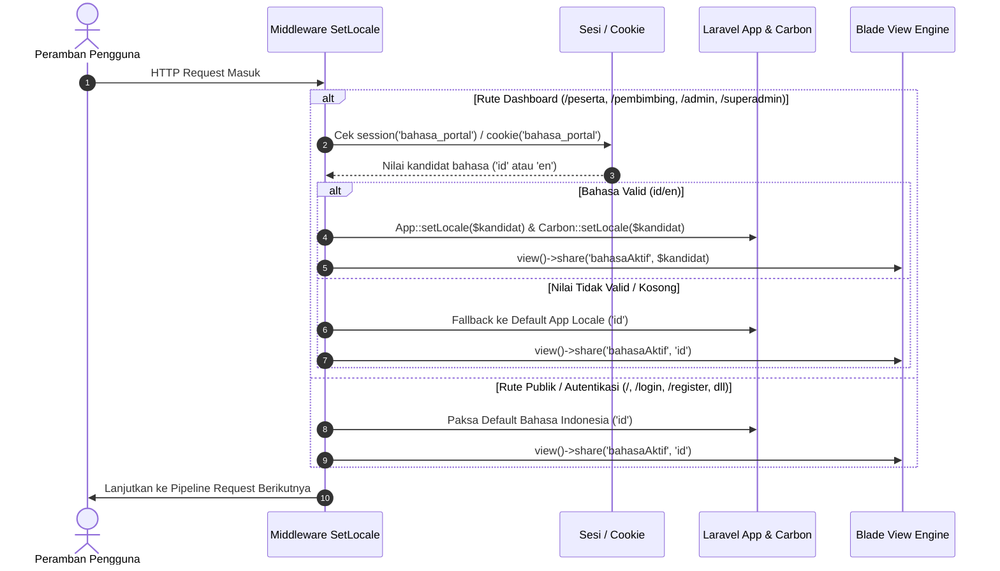

# Arsitektur Backend MAGKOM

| Informasi | Keterangan |
|---|---|
| Status | Verified |
| Terakhir Diverifikasi | 2026-11-25 |
| Cakupan | Controller, Actions, Queries, Services, Models, Policies, Enums, Middleware, SetLocale Localization |
| Referensi Implementasi | `app/Actions/`, `app/Queries/`, `app/Services/`, `app/Http/`, `app/Models/`, `app/Policies/`, `app/Enums/` |

---

## 1. Pendahuluan

MAGKOM menggunakan framework **Laravel 10.x** dengan runtime **PHP 8.3** dan penegakan deklarasi tipe data ketat (`declare(strict_types=1);`) pada setiap berkas.

Arsitektur backend memisahkan secara tegas antara penerimaan permintaan HTTP, validasi masukan data, otorisasi hak akses, eksekusi operasi mutasi, pemfilteran data kueri, dan transaksi penyimpanan basis data.

Pemisahan ini disusun berdasarkan pola **Modular Actions and Specialized Queries** untuk menjaga kode tetap modular, mudah diuji, dan mencegah penumpukan logika bisnis di dalam Controller (*Skinny Controllers*).

---

## 2. Struktur Lapisan Backend

Secara visual, aliran pemanggilan komponen backend adalah sebagai berikut:

```
[ Request HTTP Masuk ]
         │
         ▼
 1. [ Middleware Pipeline ]      ── Otentikasi, CSP, RBAC, Read-Only Guard
         │
         ▼
 2. [ Form Request Validation ]  ── Validasi tipe data, aturan bisnis input
         │
         ▼
 3. [ HTTP Controller ]          ── Orkestrasi alur, pemanggilan Action / Query
        ├── Operasi Baca (Read)  ──► Delegasi ke [ Query Class ]
        └── Operasi Tulis (Mutate) ──► Delegasi ke [ Action Class ]
                                             │
                                             ▼
                                     [ Service Layer ]
                                             │
                                             ▼
                                     [ Eloquent Model ]
                                             │
                                             ▼
                                     [ Basis Data MySQL ]
```

---

## 3. Komponen Utama Backend

### 3.1 HTTP Middleware
Middleware bertindak sebagai gerbang pengaman pertama sebelum permintaan mencapai controller:

| Middleware | Lokasi Berkas | Fungsi Utama |
|---|---|---|
| `SecurityHeaders` | `app/Http/Middleware/SecurityHeaders.php` | Menginjeksi header keamanan OWASP standar: CSP `script-src 'self'`, `X-Frame-Options: SAMEORIGIN`, `X-Content-Type-Options: nosniff`. |
| `EnsureUserHasRole` | `app/Http/Middleware/EnsureUserHasRole.php` | Memverifikasi apakah pengguna memiliki peran yang sesuai (`superadmin`, `admin`, `pembimbing`, `peserta`) sebelum mengakses rute domain. |
| `EnsureSuperAdminReadOnly` | `app/Http/Middleware/EnsureSuperAdminReadOnly.php` | Mencegah akun SuperAdmin melakukan mutasi data pada ranah bimbingan mentee (tugas dan logbook). |
| `EnsureParticipantWritable` | `app/Http/Middleware/EnsureParticipantWritable.php` | Memastikan peserta aktif tidak sedang berada dalam status kedaluwarsa atau dinonaktifkan saat mengirimkan tugas/logbook. |
| `EnsurePesertaDiterima` | `app/Http/Middleware/EnsurePesertaDiterima.php` | Membatasi rute logbook dan tugas hanya untuk peserta yang berstatus penempatan aktif. |
| `LogAuditTrail` | `app/Http/Middleware/LogAuditTrail.php` | Merekam aktivitas permintaan pengguna ke kanal audit stream `akses_data`. |
| `SetLocale` | `app/Http/Middleware/SetLocale.php` | Mengatur locale bahasa aplikasi (`id` atau `en`) secara dinamis khusus pada rute 4 dashboard internal (`peserta.*`, `pembimbing.*`, `admin.*`, `superadmin.*`) serta mengunci rute publik dan autentikasi ke Bahasa Indonesia (`id`). |

#### 3.1.1 Mekanisme Resolusi Bahasa & Isolasi Dashboard (`SetLocale`)
Untuk menjamin wibawa dan konsistensi pelayanan publik Pemkab Sleman, fitur pemilihan bahasa Inggris (`en`) dibatasi secara ketat hanya dapat digunakan di dalam 4 Portal Dashboard internal.

Aliran kerja evaluasi locale pada `app/Http/Middleware/SetLocale.php` digambarkan sebagai berikut:



**Aturan Teknis Resolusi:**
1. **Prioritas Sumber**: Sesi pengguna (`session('bahasa_portal')`) diprioritaskan di atas cookie peramban (`cookie('bahasa_portal')`).
2. **Penyimpanan Permanen**: Saat staf atau peserta mengubah bahasa di halaman Preferensi Akun (`*.pengaturan.preferensi.update`), nilai disimpan ganda: ke dalam session dan ke cookie terenkripsi selama 1 tahun (525.600 menit).
3. **Pengabaian Total pada Halaman Publik & Auth**: Jika pengguna dengan preferensi `en` membuka Landing Page, Formulir Login, atau Lupa Kata Sandi, middleware tidak mengevaluasi cookie tersebut dan langsung menetapkan locale `'id'`.

---

### 3.2 Form Request Layer
Form Request bertanggung jawab memvalidasi input sebelum method controller dijalankan. Controller tidak diperkenankan menjalankan validasi manual via `$request->validate()` di dalam method jika terdapat aturan bisnis kompleks.

Daftar Form Request penting:
- `PendaftaranRequest`: Memvalidasi kelengkapan form pendaftaran mandiri dan kelompok.
- `TetapkanPenempatanRequest`: Memvalidasi penetapan bidang dan pembimbing pada penempatan dua tahap.
- `LogbookRequest`: Memvalidasi batas mundur tanggal logbook maksimal H-3 (`logbook_maks_mundur_hari`).
- `TugasRequest`: Memvalidasi instruksi penugasan, lampiran berkas, dan batas akhir pengerjaan.
- `KuotaRequest` & `BulanMagangRequest`: Memvalidasi pembuatan kapasitas kuota dan pembukaan periode bulan.

---

### 3.3 HTTP Controller Layer (Skinny Controllers)
Controller hanya bertugas mengorkestrasi request. Controller tidak memuat query SQL mentah, kalkulasi bisnis mendalam, atau transaksi basis data langsung.

Rata-rata method controller hanya terdiri dari 15–30 baris kode:
1. Menjalankan otorisasi objek melalui Policy (`$this->authorize(...)`).
2. Memanggil Action (untuk operasi tulis) atau Query (untuk operasi baca).
3. Mengembalikan respons berupa Blade View dengan data yang dipersiapkan, file download response, atau HTTP Redirect.

Contoh implementasi controller pada `app/Http/Controllers/Admin/PenempatanController.php`:

```php
public function store(
    TetapkanPenempatanRequest $request, 
    AssignPesertaAction $action
): RedirectResponse {
    $this->authorize('assign', Penempatan::class);

    $action->execute(
        pendaftaranId: (int) $request->validated('pendaftaran_id'),
        bidangId: (int) $request->validated('bidang_id'),
        pembimbingId: (int) $request->validated('pembimbing_id'),
        tanggalMulai: $request->validated('tanggal_mulai'),
        tanggalSelesai: $request->validated('tanggal_selesai')
    );

    return redirect()
        ->route('admin.penempatan.index')
        ->with('success', 'Peserta berhasil ditempatkan pada bidang dinas.');
}
```

---

### 3.4 Modular Actions (`app/Actions/`)
Terdapat **24 kelas Action** yang mengisolasi setiap operasi mutasi data:

#### A. Domain Admin (12 Kelas)
- `Admin\Kuota\StoreBulanMagangAction`: Membuat periode bulan magang baru.
- `Admin\Kuota\UpdateBulanMagangAction`: Memperbarui informasi nama dan status bulan.
- `Admin\Kuota\StoreKuotaAction`: Membuat alokasi kuota per jurusan dan periode.
- `Admin\Kuota\UpdateKuotaAction`: Memperbarui nilai kapasitas kuota jurusan.
- `Admin\Kuota\UpdateBidangKuotaAction`: Memperbarui pemetaan kapasitas per bidang kerja.
- `Admin\Kuota\ToggleKuotaAction`: Mengubah status aktif/nonaktif kuota secara cepat.
- `Admin\Pendaftaran\PutuskanPendaftaranAction`: Menetapkan keputusan verifikasi berkas (Disetujui, Perlu Perbaikan, Ditolak).
- `Admin\Penempatan\AssignPesertaAction`: Memproses penempatan dua tahap dari pendaftar berstatus diterima ke bidang dan pembimbing ASN.
- `Admin\Penempatan\CreateManualPenempatanAction`: Mendaftarkan dan menempatkan peserta magang jalur khusus kedinasan secara manual.
- `Admin\Penempatan\ReassignPembimbingAction`: Memindahkan mentee ke pembimbing lain dengan verifikasi kapasitas bimbingan.
- `Admin\Penempatan\BulkReassignPembimbingAction`: Memindahkan seluruh mentee dari satu pembimbing ke pembimbing pengganti secara serentak.
- `Admin\Penempatan\CancelPenempatanAction`: Membatalkan penempatan peserta dan mengembalikan status ke antrean.

#### B. Domain Pembimbing (6 Kelas)
- `Pembimbing\Logbook\ReviewLogbookAction`: Memberikan persetujuan atau catatan revisi pada logbook individu.
- `Pembimbing\Logbook\BulkReviewLogbookAction`: Menyetujui banyak entri logbook mentee sekaligus (*bulk approval*).
- `Pembimbing\Tugas\CreateBatchTugasAction`: Menerbitkan tugas serentak (*classroom batch*) ke beberapa mentee terpilih.
- `Pembimbing\Tugas\UpdateTugasAction`: Memperbarui tenggat waktu, deskripsi, atau lampiran pedoman tugas.
- `Pembimbing\Tugas\ReviewTugasProgresAction`: Memeriksa laporan progres tugas mentee dan memberikan status Diterima / Revisi.
- `Pembimbing\Tugas\MarkTugasCompletedAction`: Menandai seluruh tugas bimbingan selesai dan merampungkan masa magang mentee.

#### C. Domain Peserta (6 Kelas)
- `Peserta\Pendaftaran\CreatePendaftaranAction`: Membuat draf pendaftaran (individu atau kelompok) dan mengunggah berkas awal.
- `Peserta\Pendaftaran\AjukanPendaftaranAction`: Mengunci berkas, mengalokasikan kuota dengan `lockForUpdate`, dan memajukan status ke `diajukan`.
- `Peserta\Pendaftaran\BatalkanPendaftaranAction`: Membatalkan pengajuan sebelum diverifikasi dan mengembalikan sisa kuota formasi.
- `Peserta\Logbook\CreateLogbookAction`: Merekam kegiatan harian baru beserta multi-lampiran dengan batas H-3.
- `Peserta\Logbook\UpdateLogbookAction`: Memperbarui rincian logbook yang berstatus `perlu_revisi`.
- `Peserta\Profil\UpdatePesertaProfilAction`: Memperbarui data diri, kontak darurat, dan informasi institusi mentee.

---

### 3.5 Specialized Queries (`app/Queries/`)
Terdapat **12 kelas Query** yang mengisolasi proses pembacaan data, pemfilteran dinamis, dan pencarian:

| Query Class | Peran & Parameter Filter |
|---|---|
| `Admin\Kuota\KuotaIndexQuery` | Mengambil daftar kuota per periode bulan, status buka/tutup, dan keterisian. |
| `Admin\Pendaftaran\PendaftaranIndexQuery` | Mengambil antrean pendaftar dengan filter status, jurusan, jenjang, pencarian nama, dan pengurutan urgensi SLA. |
| `Admin\Penempatan\PenempatanAntreanQuery` | Mengambil kandidat peserta yang telah berstatus `diterima` namun belum memiliki pembimbing (`penempatan_id IS NULL`). |
| `Admin\Penempatan\PenempatanIndexQuery` | Mengambil daftar peserta aktif, riwayat bidang, dan pembimbing dengan filter bidang dinas. |
| `Pembimbing\LaporanKinerjaQuery` | Mengambil matriks rekapitulasi penyelesaian tugas dan logbook seluruh mentee binaan pembimbing. |
| `Pembimbing\LogbookIndexQuery` | Mengambil daftar entri logbook mentee dengan filter status (Terkirim, Disetujui, Perlu Revisi) dan rentang minggu. |
| `Pembimbing\PenempatanAktifQuery` | Mengambil daftar mentee yang sedang aktif dibimbing oleh pembimbing yang login. |
| `Pembimbing\PenempatanLogbookQuery` | Mengambil riwayat logbook per mentee untuk keperluan review berkala. |
| `Pembimbing\TugasIndexQuery` | Mengambil daftar tugas yang diterbitkan oleh pembimbing beserta jumlah penyerahan mentee. |
| `Peserta\LogbookIndexQuery` | Mengambil seluruh entri logbook milik peserta yang login, terurut dari tanggal terbaru. |
| `Peserta\Pendaftaran\PendaftaranIndexQuery` | Mengambil riwayat pendaftaran peserta dan kelengkapan dokumen persyaratan. |
| `Peserta\Profil\PesertaProfilQuery` | Mengambil data profil lengkap, berkas identitas, dan status penempatan aktif peserta. |

---

### 3.6 Domain Services (`app/Services/` — 43 Kelas)
Service Layer menangani operasi bisnis lintas-entitas yang membutuhkan integrasi transaksi multi-tabel:

- **`QuotaAllocationService`**: Mengelola pemotongan dan pengembalian kuota bulanan secara atomik dengan `lockForUpdate()`.
- **`PlacementService`**: Mengorkestrasi aturan penempatan dua tahap, rotasi pembimbing massal, dan alokasi slot khusus.
- **`AuditService`**: Menangani pencatatan mutasi ke tabel `audit_log`, menyensor data kredensial secara rekursif melalui ekspresi reguler.
- **`BackupDatabaseService`**: Melakukan snapshot basis data MySQL menggunakan `mysqldump`, kompresi Gzip on-the-fly, kalkulasi hash SHA-256, dan retensi maksimal 30 berkas (FIFO).
- **`XlsxExportService`**: Membangun berkas spreadsheet `.xlsx` murni (OpenXML) menggunakan `ZipArchive` bawaan PHP dengan sanitasi anti-formula injection pada setiap sel.
- **`PermissionService`**: Mengelola matriks izin akses 13 modul sistem dan memastikan izin bawaan selalu ter-provisioning secara idempotent.
- **`LandingCmsService` & `LandingPage\*`**: Mengelola arsitektur blok visual Gutenberg untuk konten dinamis landing page publik.
- **`SuratDiterimaPdfService`**: Menerbitkan Surat Penerimaan resmi berformat PDF lengkap dengan tanda tangan digital dan QR Code verifikasi.
- **`DocumentStorageService`**: Mengelola penyimpanan berkas privat pada disk lokal non-publik dan mengenerasi Temporary Signed URL berumur 5 menit.

---

### 3.7 Kebijakan Otorisasi Objek (Laravel Policies)
Terdapat **5 kelas Policy** di `app/Policies/` untuk mencegah kerentanan Insecure Direct Object Reference (IDOR):

1. **`PendaftaranPolicy`**: Memastikan peserta hanya dapat melihat atau membatalkan permohonan miliknya sendiri.
2. **`PenempatanPolicy`**: Memastikan pembimbing hanya dapat mengakses data mentee yang secara sah ditempatkan di bawah bimbingannya.
3. **`TugasPolicy`**: Memastikan peserta hanya dapat mengumpulkan tugas yang ditujukan untuknya, dan pembimbing hanya dapat menilai tugas buatannya sendiri.
4. **`LogbookPolicy`**: Membatasi aksi review dan revisi logbook hanya oleh pembimbing yang ditugaskan pada mentee terkait.
5. **`DokumenPolicy`**: Membatasi akses unduhan berkas persyaratan hanya untuk pemilik dokumen, admin verifikator, dan SuperAdmin.

---

### 3.8 Nilai Baku Sistem (PHP 8.1+ Enums)
Sistem menggunakan 13 Backed Enums bervalue `string` untuk menjamin integritas tipe data:

- `RoleEnum`: `superadmin`, `admin`, `pembimbing`, `peserta`.
- `StatusPendaftaranEnum`: `berkas_belum_lengkap`, `diajukan`, `perlu_perbaikan`, `waiting_list`, `diterima`, `ditolak`, `dibatalkan`.
- `StatusPenempatanEnum`: `aktif`, `selesai`, `mengundurkan_diri`, `nonaktif`.
- `StatusLogbookEnum`: `terkirim`, `disetujui`, `perlu_revisi`.
- `StatusTugasEnum`: `belum`, `proses`, `selesai`.
- `StatusReviewProgresEnum`: `menunggu`, `diterima`, `perlu_revisi`.
- `JalurEnum`: `umum`, `khusus`.
- `JenjangEnum`: `smk`, `d3`, `s1`.
- `KompleksitasEnum`: `rendah`, `sedang`, `tinggi`.
- `SumberPenempatanEnum`: `online`, `manual`.
- `StatusKetersediaanEnum`: `tersedia`, `tutup`, `segera`.
- `TipeAuditEnum`: `auth`, `aksi`, `service`, `akses_data`.
- `RealtimeEventTypeEnum`: `pendaftaran_baru`, `status_pendaftaran`, `kuota_berubah`, `logbook_baru`, `logbook_direviu`, `tugas_baru`, `tugas_dikumpulkan`, `progres_direviu`, `ancaman_keamanan`.

---

## 4. Panduan Menambahkan Aksi Bisnis Baru (Developer Guide)

Bagi pengembang yang akan menambahkan alur mutasi baru ke sistem MAGKOM, ikuti panduan 5 langkah standar berikut:

### Langkah 1: Buat Form Request
Buat berkas validasi di `app/Http/Requests/`:
- Tetapkan aturan otorisasi di method `authorize()`.
- Tetapkan aturan validasi di method `rules()`.

### Langkah 2: Buat Action Class
Buat berkas aksi di `app/Actions/{Domain}/`:
- Beri satu method publik `execute()`.
- Lakukan operasi penulisan model di dalam method tersebut.
- Jika aksi memodifikasi kuota atau slot terbatas, apit proses dengan `DB::transaction()` dan `lockForUpdate()`.
- Panggil `AuditService` untuk mencatat mutasi data penting.

### Langkah 3: Siapkan Query Class (Jika Diperlukan)
Jika fitur membutuhkan halaman index atau filter kompleks:
- Buat kelas Query di `app/Queries/{Domain}/`.
- Beri method `get()` atau `paginate()` yang mengembalikan `LengthAwarePaginator` atau `Collection`.

### Langkah 4: Hubungkan ke Controller Ramping
Pada method Controller yang bersangkutan:
- Inject Form Request dan Action via method injection.
- Panggil `$this->authorize(...)` jika membutuhkan validasi kepemilikan objek.
- Panggil `$action->execute(...)`.
- Kembalikan `redirect()` dengan flash message.

### Langkah 5: Buat Automated Feature Test
Buat test di `tests/Feature/`:
- Uji skenario sukses (*happy path*).
- Uji skenario otorisasi (*unauthorized user rejected with 403*).
- Uji kegagalan validasi (*invalid input rejected with 422*).
- Pastikan test berjalan hijau melalui `php artisan test`.
