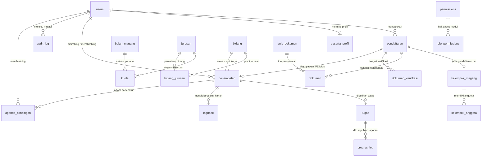

# Skema Basis Data dan Kamus Data MAGKOM

| Informasi | Keterangan |
|---|---|
| Status | Verified |
| Terakhir Diverifikasi | 2026-11-25 |
| Cakupan | ERD definitif, kamus data 25 tabel domain + 5 framework, relasi & constraints |
| Referensi Implementasi | `database/migrations/`, `app/Models/` |

---

## 1. Pendahuluan

Sistem MAGKOM menggunakan mesin basis data **MySQL 8.0+ / MariaDB** dengan engine **InnoDB** yang mendukung penuh integritas referensial kunci asing (*foreign key constraints*), transaksi ACID atomik, dan penguncian baris pesimistik (*pessimistic row locking*).

Berdasarkan audit migrasi terbaru (pasca-decommissioning fitur rubrik penilaian, survei kepuasan, dan tabel telemetri `route_metrics`, serta penambahan tabel pivot `tugas_peserta` untuk tugas tim), basis data MAGKOM mengelola **25 tabel domain aplikasi** dan **5 tabel framework Laravel** (total 30 tabel aktif).

---

## 2. Diagram Relasi Entitas (Entity-Relationship Diagram)

---

## 3. Kamus Data 24 Tabel Domain Aplikasi

### 1. `audit_log`
Merekam jejak audit mutasi data sistem secara append-only.
- `id` (BIGINT UNSIGNED, PK, Auto Increment)
- `user_id` (BIGINT UNSIGNED, FK `users.id`, Nullable)
- `tipe` (VARCHAR 20): `auth`, `aksi`, `service`, `akses_data`.
- `aksi` (VARCHAR 100): Nama operasi/event (misal: `login`, `ajukan_pendaftaran`).
- `deskripsi` (TEXT, Nullable): Uraian narasi aktivitas.
- `data_lama` (JSON, Nullable): Snapshot nilai sebelum mutasi (tersanitasi).
- `data_baru` (JSON, Nullable): Snapshot nilai setelah mutasi (tersanitasi).
- `ip_address` (VARCHAR 45, Nullable)
- `user_agent` (VARCHAR 255, Nullable)
- `created_at` (TIMESTAMP)

### 2. `bulan_magang`
Master periode bulan pembukaan magang.
- `id` (BIGINT UNSIGNED, PK, Auto Increment)
- `nama_bulan` (VARCHAR 50): Nama representasi bulan (misal: `Januari 2027`).
- `tahun` (INT): Tahun pelaksanaan.
- `bulan` (TINYINT): Angka bulan (1–12).
- `status` (VARCHAR 20): `tersedia`, `tutup`, `segera`.
- `override_status` (VARCHAR 20, Nullable): Status intervensi kran darurat SuperAdmin (`tersedia`, `tutup`, `null/otomatis`).
- `aktif` (BOOLEAN, Default: true): Status keaktifan periode.
- `created_at`, `updated_at` (TIMESTAMP)

### 3. `kuota`
Kapasitas kuota formasi pendaftaran umum bulanan per jurusan.
- `id` (BIGINT UNSIGNED, PK, Auto Increment)
- `bulan_id` (BIGINT UNSIGNED, FK `bulan_magang.id`, Cascade)
- `jurusan_id` (BIGINT UNSIGNED, FK `jurusan.id`, Cascade)
- `jumlah` (INT): Batas kuota maksimal.
- `terisi` (INT, Default: 0): Jumlah kuota yang telah dikunci/digunakan.
- `created_at`, `updated_at` (TIMESTAMP)

### 4. `slot_khusus`
Kuota diskresi kemitraan instansi / kampus luar jalur umum.
- `id` (BIGINT UNSIGNED, PK, Auto Increment)
- `instansi` (VARCHAR 150): Nama institusi mitra.
- `jumlah_slot` (INT): Jumlah alokasi slot khusus.
- `terpakai` (INT, Default: 0): Slot yang telah terisi.
- `keterangan` (TEXT, Nullable)
- `created_at`, `updated_at` (TIMESTAMP)

### 5. `jurusan`
Master data program keahlian / program studi pendaftar.
- `id` (BIGINT UNSIGNED, PK, Auto Increment)
- `nama_jurusan` (VARCHAR 100, Unique)
- `kategori` (VARCHAR 10): `smk` atau `mahasiswa`.
- `aktif` (BOOLEAN, Default: true)
- `created_at`, `updated_at` (TIMESTAMP)

### 6. `bidang`
Master 5 bidang unit kerja teknis di lingkungan Diskominfo Sleman.
- `id` (BIGINT UNSIGNED, PK, Auto Increment)
- `nama_bidang` (VARCHAR 100): Aptika, IKP, Statistik, Persandian, Sekretariat.
- `deskripsi` (TEXT, Nullable)
- `aktif` (BOOLEAN, Default: true)
- `created_at`, `updated_at` (TIMESTAMP)

### 7. `bidang_jurusan` (Pivot Table)
Tabel penghubung relasi many-to-many relevansi kejuruan terhadap bidang dinas.
- `id` (BIGINT UNSIGNED, PK, Auto Increment)
- `bidang_id` (BIGINT UNSIGNED, FK `bidang.id`, Cascade)
- `jurusan_id` (BIGINT UNSIGNED, FK `jurusan.id`, Cascade)
- `created_at`, `updated_at` (TIMESTAMP)

### 8. `jenis_dokumen`
Master persyaratan berkas pendaftaran berdasarkan jenjang pendidikan.
- `id` (BIGINT UNSIGNED, PK, Auto Increment)
- `nama_dokumen` (VARCHAR 100)
- `jenjang` (VARCHAR 10): `smk`, `d3`, `s1`, `semua`.
- `wajib` (BOOLEAN, Default: true)
- `format_diizinkan` (VARCHAR 100, Default: `pdf,jpg,png`)
- `ukuran_maks_mb` (INT, Default: 10)
- `created_at`, `updated_at` (TIMESTAMP)

### 9. `peserta_profil`
Biodata personal lengkap peserta magang.
- `id` (BIGINT UNSIGNED, PK, Auto Increment)
- `user_id` (BIGINT UNSIGNED, FK `users.id`, Cascade, Unique)
- `nim_nisn` (VARCHAR 50, Nullable)
- `institusi` (VARCHAR 150, Nullable): Nama sekolah atau universitas.
- `jenjang` (VARCHAR 10, Nullable): `smk`, `d3`, `s1`.
- `jurusan` (VARCHAR 100, Nullable)
- `alamat` (TEXT, Nullable)
- `nama_kontak_darurat` (VARCHAR 100, Nullable)
- `no_kontak_darurat` (VARCHAR 20, Nullable)
- `hubungan_kontak_darurat` (VARCHAR 50, Nullable)
- `persetujuan_wali` (BOOLEAN, Default: false)
- `nama_pembimbing_sekolah` (VARCHAR 100, Nullable)
- `kontak_pembimbing_sekolah` (VARCHAR 50, Nullable)
- `foto` (VARCHAR 255, Nullable)
- `created_at`, `updated_at` (TIMESTAMP)

### 10. `kelompok_magang`
Entitas master rombongan pendaftaran kelompok.
- `id` (BIGINT UNSIGNED, PK, Auto Increment)
- `ketua_user_id` (BIGINT UNSIGNED, FK `users.id`, Cascade)
- `nama_kelompok` (VARCHAR 100)
- `kode_kelompok` (VARCHAR 20, Unique)
- `created_at`, `updated_at` (TIMESTAMP)

### 11. `kelompok_anggota`
Daftar anggota di bawah kelompok magang (maksimal 3 anggota tambahan).
- `id` (BIGINT UNSIGNED, PK, Auto Increment)
- `kelompok_magang_id` (BIGINT UNSIGNED, FK `kelompok_magang.id`, Cascade)
- `user_id` (BIGINT UNSIGNED, FK `users.id`, Nullable, NullOnDelete): Kaitan ke akun login mandiri anggota tim.
- `nama` (VARCHAR 100)
- `nim_nisn` (VARCHAR 50)
- `email` (VARCHAR 100)
- `no_telp` (VARCHAR 20)
- `created_at`, `updated_at` (TIMESTAMP)

### 12. `pendaftaran`
Rekaman pendaftaran formasi magang dan status seleksi.
- `id` (BIGINT UNSIGNED, PK, Auto Increment)
- `user_id` (BIGINT UNSIGNED, FK `users.id`, Cascade)
- `jurusan_id` (BIGINT UNSIGNED, FK `jurusan.id`)
- `bulan_id` (BIGINT UNSIGNED, FK `bulan_magang.id`)
- `kelompok_id` (BIGINT UNSIGNED, FK `kelompok_magang.id`, Nullable)
- `slot_khusus_id` (BIGINT UNSIGNED, FK `slot_khusus.id`, Nullable)
- `jalur` (VARCHAR 20, Default: `umum`): `umum` atau `khusus`.
- `status` (VARCHAR 30): `berkas_belum_lengkap`, `diajukan`, `perlu_perbaikan`, `waiting_list`, `diterima`, `ditolak`, `dibatalkan`.
- `tgl_pengajuan` (DATETIME, Nullable)
- `tgl_selesai_seleksi` (DATETIME, Nullable)
- `catatan_verifikasi` (TEXT, Nullable)
- `file_surat_diterima` (VARCHAR 255, Nullable)
- `created_at`, `updated_at` (TIMESTAMP)

### 13. `dokumen`
Metadata berkas persyaratan yang diunggah peserta.
- `id` (BIGINT UNSIGNED, PK, Auto Increment)
- `pendaftaran_id` (BIGINT UNSIGNED, FK `pendaftaran.id`, Cascade)
- `jenis_dokumen_id` (BIGINT UNSIGNED, FK `jenis_dokumen.id`)
- `kelompok_anggota_id` (BIGINT UNSIGNED, FK `kelompok_anggota.id`, Nullable)
- `file_path` (VARCHAR 255): Lokasi berkas di disk privat.
- `file_name` (VARCHAR 255): Nama asli berkas.
- `file_size` (INT): Ukuran dalam byte.
- `mime_type` (VARCHAR 100)
- `status` (VARCHAR 20, Default: `menunggu`): `menunggu`, `valid`, `invalid`.
- `catatan` (TEXT, Nullable)
- `created_at`, `updated_at` (TIMESTAMP)

### 14. `dokumen_verifikasi`
Catatan riwayat verifikasi berkas oleh admin.
- `id` (BIGINT UNSIGNED, PK, Auto Increment)
- `dokumen_id` (BIGINT UNSIGNED, FK `dokumen.id`, Cascade)
- `admin_id` (BIGINT UNSIGNED, FK `users.id`)
- `status` (VARCHAR 20): `valid`, `invalid`.
- `catatan` (TEXT, Nullable)
- `created_at`, `updated_at` (TIMESTAMP)

### 15. `penempatan`
Penetapan penempatan peserta aktif ke bidang dinas dan pembimbing ASN.
- `id` (BIGINT UNSIGNED, PK, Auto Increment)
- `pendaftaran_id` (BIGINT UNSIGNED, FK `pendaftaran.id`, NullOnDelete; composite unique `penempatan_pendaftaran_peserta_unique` dengan `peserta_id`)
- `peserta_id` (BIGINT UNSIGNED, FK `users.id`)
- `bidang_id` (BIGINT UNSIGNED, FK `bidang.id`)
- `pembimbing_id` (BIGINT UNSIGNED, FK `users.id`)
- `sumber` (VARCHAR 20, Default: `online`): `online` atau `manual`.
- `tanggal_mulai` (DATE)
- `tanggal_selesai` (DATE)
- `tanggal_selesai_aktual` (DATETIME, Nullable)
- `status` (VARCHAR 20, Default: `aktif`): `aktif`, `selesai`, `mengundurkan_diri`, `nonaktif`.
- `file_surat_diterima` (VARCHAR 255, Nullable)
- `file_surat_selesai` (VARCHAR 255, Nullable): Surat Keterangan Selesai Magang per peserta.
- `tgl_upload_surat_selesai` (TIMESTAMP, Nullable)
- `catatan` (TEXT, Nullable)
- `created_at`, `updated_at` (TIMESTAMP)

### 16. `agenda_bimbingan`
Jadwal pertemuan dan agenda asistensi teknis antara pembimbing dan mentee.
- `id` (BIGINT UNSIGNED, PK, Auto Increment)
- `penempatan_id` (BIGINT UNSIGNED, FK `penempatan.id`, Cascade)
- `pembimbing_id` (BIGINT UNSIGNED, FK `users.id`, Cascade)
- `judul_kegiatan` (VARCHAR 150)
- `tipe` (VARCHAR 20, Default: `tatap_muka`): `tatap_muka`, `daring`.
- `tgl_bimbingan` (DATE)
- `jam_mulai` (VARCHAR 10, Default: `09:00`)
- `lokasi_ruang` (VARCHAR 150, Nullable)
- `notulensi_arahan` (TEXT, Nullable)
- `status` (VARCHAR 20, Default: `terjadwal`): `terjadwal`, `terlaksana`, `batal`.
- `created_at`, `updated_at` (TIMESTAMP)

### 17. `tugas`
Instruksi tugas proyek bimbingan terstruktur ber-deadline (individu maupun tim).
- `id` (BIGINT UNSIGNED, PK, Auto Increment)
- `penempatan_id` (BIGINT UNSIGNED, FK `penempatan.id`, Nullable untuk tugas tim murni)
- `tipe` (VARCHAR 20, Default: `individu`): `individu`, `tim`.
- `kelompok_magang_id` (BIGINT UNSIGNED, FK `kelompok_magang.id`, Nullable)
- `judul` (VARCHAR 150)
- `deskripsi` (TEXT)
- `lampiran` (VARCHAR 255, Nullable): Berkas panduan tugas.
- `link_referensi` (VARCHAR 2048, Nullable): Tautan acuan tugas pembimbing (mendukung multi-link format JSON array atau URL tunggal, diparsing via aksesor runtime `links`).
- `tgl_mulai` (DATE, Nullable)
- `deadline` (DATETIME)
- `status` (VARCHAR 20, Default: `belum`): `belum`, `proses`, `selesai`.
- `kompleksitas` (VARCHAR 20, Default: `sedang`): `rendah`, `sedang`, `tinggi`.
- `is_batch` (BOOLEAN, Default: false): Penanda penugasan serentak.
- `batch_id` (VARCHAR 64, Nullable)
- `created_at`, `updated_at` (TIMESTAMP)

### 18. `tugas_peserta` (Pivot Table)
Penugasan spesifik anggota tim pada project bersama / tugas tim (`unique(tugas_id, user_id)`).
- `id` (BIGINT UNSIGNED, PK, Auto Increment)
- `tugas_id` (BIGINT UNSIGNED, FK `tugas.id`, Cascade)
- `penempatan_id` (BIGINT UNSIGNED, FK `penempatan.id`, Nullable, NullOnDelete)
- `user_id` (BIGINT UNSIGNED, FK `users.id`, Cascade)
- `created_at`, `updated_at` (TIMESTAMP)

### 19. `tugas_template`
Pustaka template tugas pembimbing untuk kemudahan penugasan berulang.
- `id` (BIGINT UNSIGNED, PK, Auto Increment)
- `user_id` (BIGINT UNSIGNED, FK `users.id`, Cascade)
- `judul` (VARCHAR 150)
- `deskripsi` (TEXT)
- `link_referensi` (VARCHAR 2048, Nullable): Tautan referensi template tugas multi-link.
- `kompleksitas` (VARCHAR 20, Default: `sedang`)
- `created_at`, `updated_at` (TIMESTAMP)

### 20. `progres_log`
Laporan hasil pengerjaan tugas yang dikumpulkan mentee.
- `id` (BIGINT UNSIGNED, PK, Auto Increment)
- `tugas_id` (BIGINT UNSIGNED, FK `tugas.id`, Cascade)
- `user_id` (BIGINT UNSIGNED, FK `users.id`, Nullable, NullOnDelete): Pengirim progres pada tugas tim.
- `file_hasil` (VARCHAR 255, Nullable)
- `link` (VARCHAR 255 / TEXT, Nullable): Tautan hasil kerja mentee (mendukung multi-link format JSON array atau URL tunggal, diparsing via aksesor runtime `links`).
- `catatan` (TEXT, Nullable)
- `status` (VARCHAR 20, Default: `menunggu`): `menunggu`, `diterima`, `perlu_revisi`.
- `catatan_revisi` (TEXT, Nullable)
- `tgl_submit` (DATETIME)
- `created_at`, `updated_at` (TIMESTAMP)

### 20. `logbook`
Presensi kegiatan kerja harian mentee (batas toleransi H-3).
- `id` (BIGINT UNSIGNED, PK, Auto Increment)
- `penempatan_id` (BIGINT UNSIGNED, FK `penempatan.id`, Cascade)
- `tgl_kegiatan` (DATE)
- `minggu_ke` (INT, Default: 1)
- `uraian` (TEXT)
- `file_lampiran` (VARCHAR 255, Nullable)
- `status` (VARCHAR 20, Default: `terkirim`): `terkirim`, `disetujui`, `perlu_revisi`.
- `catatan_pembimbing` (TEXT, Nullable)
- `created_at`, `updated_at` (TIMESTAMP)

### 21. `realtime_events`
Event store penyimpanan Server-Sent Events (SSE) berumur pendek.
- `id` (BIGINT UNSIGNED, PK, Auto Increment)
- `event_type` (VARCHAR 50)
- `user_id` (BIGINT UNSIGNED, FK `users.id`, Nullable)
- `role` (VARCHAR 20, Nullable)
- `payload` (JSON)
- `is_broadcast` (BOOLEAN, Default: false)
- `created_at` (TIMESTAMP)

### 22. `pengaturan`
Penyimpanan nilai terpusat 12 parameter operasional aplikasi.
- `id` (BIGINT UNSIGNED, PK, Auto Increment)
- `kunci` (VARCHAR 100, Unique)
- `nilai` (TEXT, Nullable)
- `created_at`, `updated_at` (TIMESTAMP)

### 23. `permissions`
Master 13 modul sistem definitif pembentuk Dynamic RBAC Matrix.
- `id` (BIGINT UNSIGNED, PK, Auto Increment)
- `nama_modul` (VARCHAR 100)
- `slug` (VARCHAR 100, Unique): Misal `publik.portal-registrasi`, `seleksi.verifikasi-berkas`.
- `kategori` (VARCHAR 50)
- `deskripsi` (TEXT, Nullable)
- `urutan` (INT, Default: 0)
- `is_system` (BOOLEAN, Default: true)
- `created_at`, `updated_at` (TIMESTAMP)

### 24. `role_permissions` (Pivot Table)
Pemetaan relasi peran terhadap modul izin akses fungsional.
- `id` (BIGINT UNSIGNED, PK, Auto Increment)
- `role` (VARCHAR 20): `superadmin`, `admin`, `pembimbing`, `peserta`.
- `permission_id` (BIGINT UNSIGNED, FK `permissions.id`, Cascade)
- `created_at`, `updated_at` (TIMESTAMP)

---

## 4. Kamus Data 5 Tabel Bawaan Framework Laravel

### 1. `users`
Akun pengguna terotentikasi (diperkaya dengan atribut domain magang).
- `id` (BIGINT UNSIGNED, PK, Auto Increment)
- `name` (VARCHAR 255)
- `email` (VARCHAR 255, Unique)
- `email_verified_at` (TIMESTAMP, Nullable)
- `password` (VARCHAR 255)
- `role` (VARCHAR 20, Default: `peserta`): Cast ke `App\Enums\RoleEnum`.
- `no_telp` (VARCHAR 20, Nullable)
- `foto` (VARCHAR 255, Nullable)
- `password_awal` (VARCHAR 255, Nullable): Untuk kredensial sementara staf/jalur khusus.
- `must_change_password` (BOOLEAN, Default: false)
- `is_active` (BOOLEAN, Default: true)
- `remember_token` (VARCHAR 100, Nullable)
- `created_at`, `updated_at` (TIMESTAMP)

### 2. `password_reset_tokens`
Token pengaturan ulang kata sandi email (`email`, `token`, `created_at`).

### 3. `sessions`
Penyimpanan sesi otentikasi pengguna berbasis basis data (`id`, `user_id`, `ip_address`, `user_agent`, `payload`, `last_activity`).

### 4. `failed_jobs`
Antrean penampung kegagalan eksekusi background jobs (`id`, `uuid`, `connection`, `queue`, `payload`, `exception`, `failed_at`).

### 5. `personal_access_tokens`
Penyimpanan token API Laravel Sanctum (`id`, `tokenable_type`, `tokenable_id`, `name`, `token`, `abilities`, `last_used_at`, `expires_at`, timestamps).

---

## 5. Ringkasan Perubahan Skema Historis (Audit Changelog)

| Tanggal | Berkas Migrasi | Aksi Skema Basis Data |
|---|---|---|
| **2026-11-08** | `create_permissions_and_role_permissions_tables` | Pembuatan tabel RBAC dinamis 13 modul sistem definitif. |
| **2026-11-09** | `drop_dynamic_modules_tables` | Menghapus permanen sisa tabel `modul_dinamis` eksperimental lama. |
| **2026-11-09** | `drop_penilaian_and_rubrik_tables` | Menghapus permanen tabel `penilaian`, `penilaian_detail`, `penilaian_riwayat`, dan `rubrik`. |
| **2026-11-09** | `drop_survei_kepuasan_table` | Menghapus permanen tabel survei kepuasan yang tidak digunakan. |
| **2026-11-13** | `sanitize_nilai_dan_sertifikat_residues_in_pengaturan` | Membersihkan kunci usang `predikat_batas` dan `sertifikat` dari tabel `pengaturan`. |
| **2026-11-13** | `drop_route_metrics_table` | Menghapus permanen tabel telemetri `route_metrics` demi efisiensi basis data. |
| **2026-11-13** | `add_composite_index_to_audit_log_table` | Menambahkan indeks komposit pada `audit_log` (`user_id`, `tipe`, `created_at`) untuk optimasi kueri forensik. |
| **2026-11-23** | `upgrade_kelompok_tugas_and_penempatan_tables` | Menambahkan `kelompok_anggota.user_id`, `tugas.tipe`, `tugas.kelompok_magang_id`, tabel `tugas_peserta`, serta kolom `file_surat_selesai` dan `tgl_upload_surat_selesai` pada `penempatan`. |
| **2026-11-23** | `allow_multiple_penempatan_per_pendaftaran_kelompok` | Mengubah unique constraint `penempatan` menjadi composite unique (`pendaftaran_id`, `peserta_id`) agar 1 pendaftaran kelompok menaungi banyak penempatan anggota. |
| **2026-11-25** | `add_user_id_to_progres_log_and_nullable_penempatan_on_tugas` | Menambahkan `progres_log.user_id` untuk identifikasi pengirim tugas tim dan menjadikan `tugas.penempatan_id` nullable untuk tugas tim murni. |
