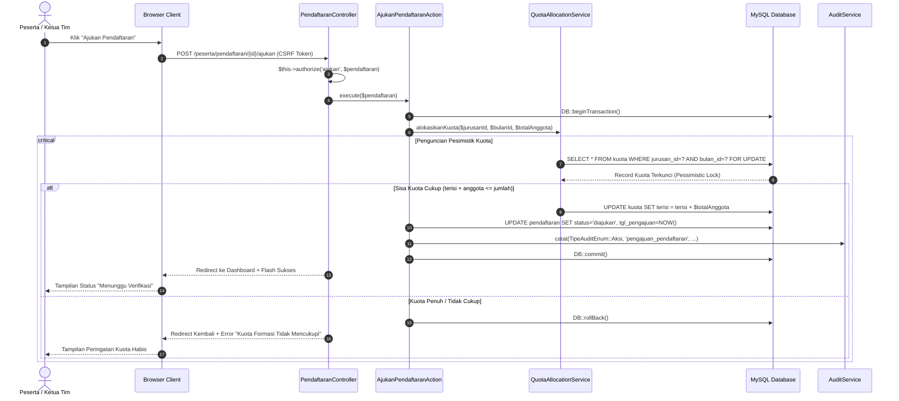
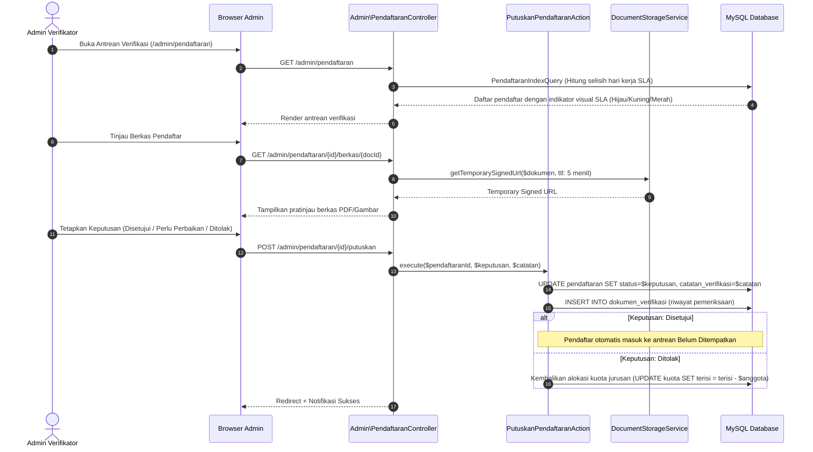
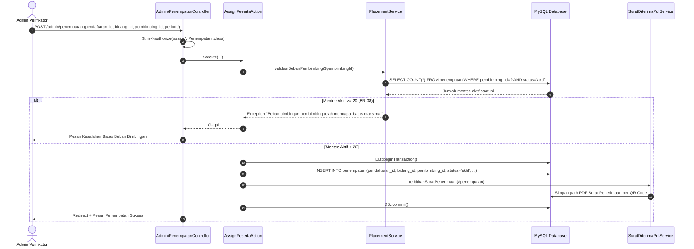
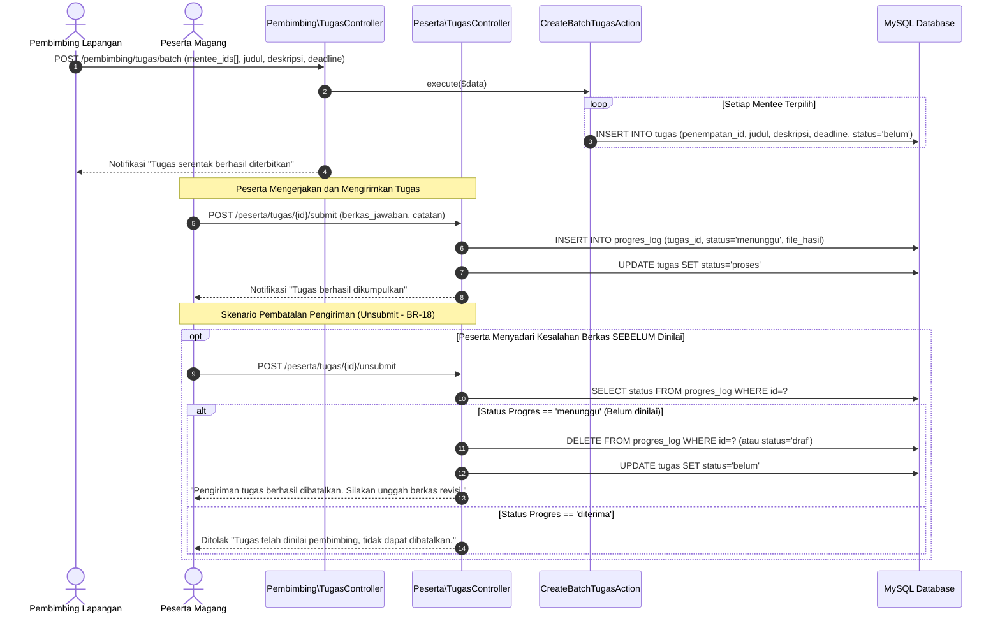
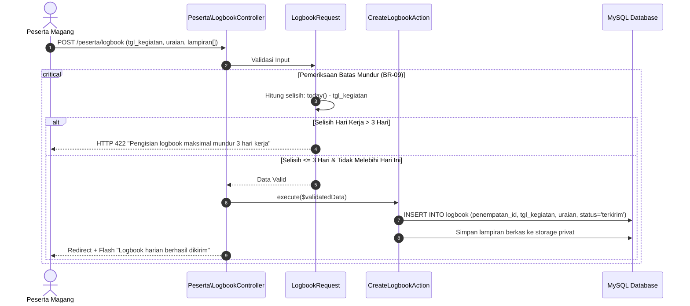
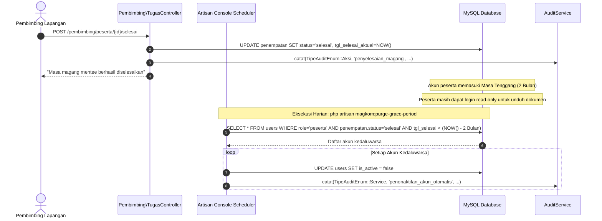
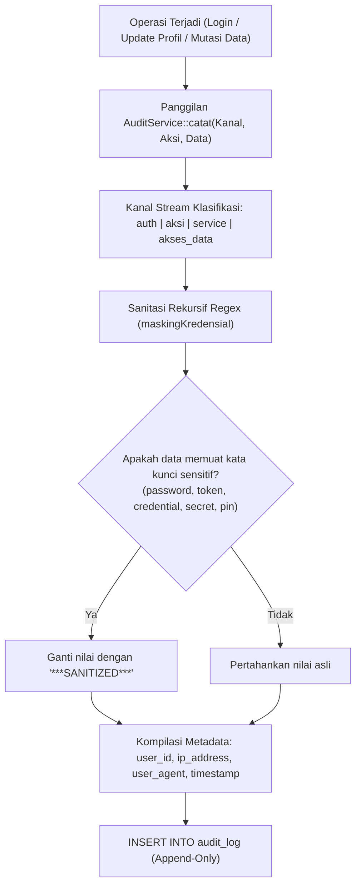

# Aliran Data dan Siklus Proses MAGKOM

| Informasi | Keterangan |
|---|---|
| Status | Verified |
| Terakhir Diverifikasi | 2026-11-15 |
| Cakupan | Alur data lintas entitas, sekuens interaksi komponen, konkurensi atomik |
| Referensi Implementasi | `app/Actions/`, `app/Queries/`, `app/Services/`, `routes/web.php` |

---

## 1. Pendahuluan

Dokumen ini menjelaskan bagaimana data mengalir di dalam sistem MAGKOM pada seluruh proses bisnis utama. Setiap diagram menggambarkan interaksi antara Klien (Browser), Lapisan Keamanan, Controller, Action/Query, Service, dan Basis Data.

---

## 2. Alur 1: Pendaftaran dan Alokasi Kuota Atomik (BR-05)

Pendaftaran magang membutuhkan proteksi konkurensi ketat agar alokasi kuota jurusan tidak mengalami *overselling* atau bernilai negatif saat banyak pendaftar mengakses sistem secara simultan.

---

## 3. Alur 2: Verifikasi Berkas & SLA Watchdog (BR-06)

Antrean verifikasi berkas dipantau oleh SLA Watchdog dengan batasan waktu 5 hari kerja.

---

## 4. Alur 3: Penempatan Dua Tahap & Plotting Pembimbing (BR-07 & BR-08)

Pemisahan antara tahap kelolosan seleksi berkas dan penetapan penempatan bidang dinas.

---

## 5. Alur 4: Tugas Terstruktur, Batch Assignment & Batal Kirim (BR-18 & BR-19)

Menggambarkan alur penugasan serentak (*batch classroom*) oleh pembimbing serta hak peserta untuk melakukan *unsubmit* laporan sebelum dinilai.

---

## 6. Alur 5: Logbook Harian dengan Batas Mundur H-3 (BR-09)

Validasi batas pengisian logbook untuk mencegah pelaporan rapel di akhir masa magang.

---

## 7. Alur 6: Siklus Penyelesaian Magang, Masa Tenggang & Penonaktifan (BR-11 & BR-12)

---

## 8. Alur 7: Audit Trail Multi-Kanal & Sanitasi Kredensial (BR-14)

Seluruh mutasi sistem melewati sanitasi rekursif untuk mencegah kebocoran informasi sensitif ke dalam log forensik:

