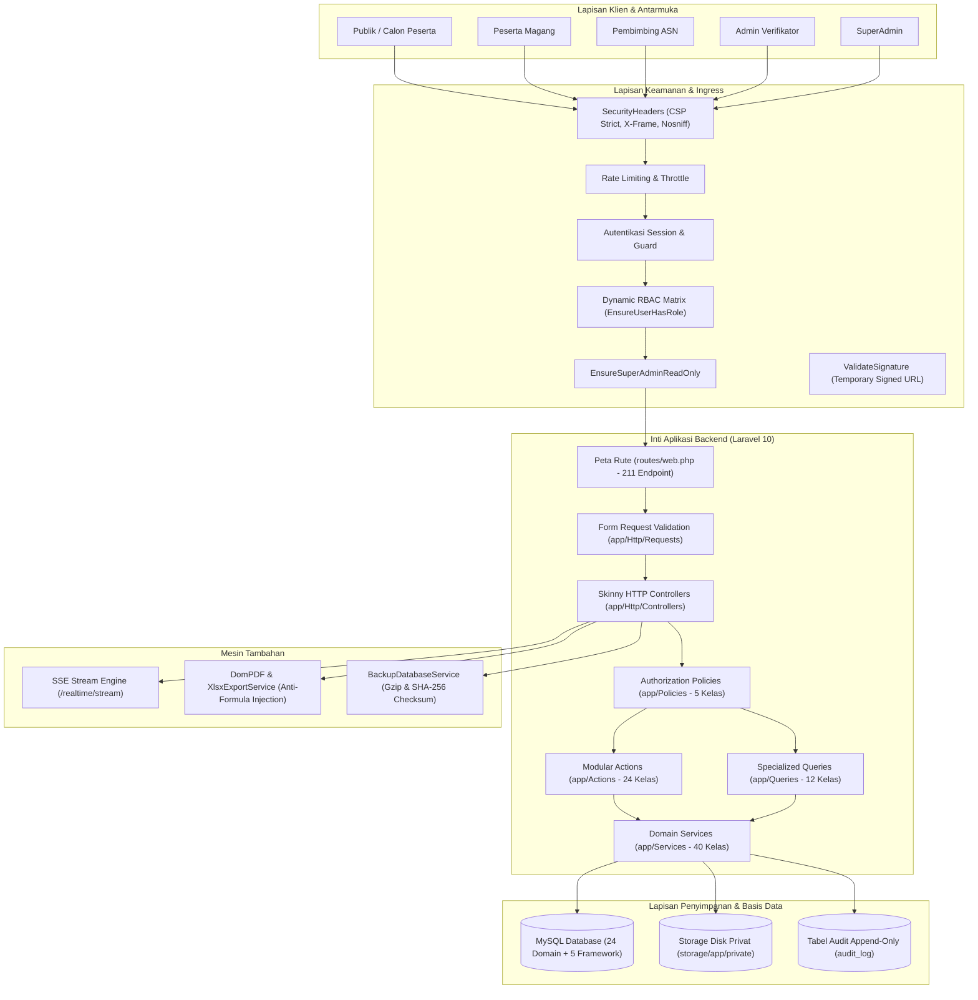

# Ikhtisar Arsitektur Sistem MAGKOM

| Informasi | Keterangan |
|---|---|
| Status | Verified |
| Terakhir Diverifikasi | 2026-11-15 |
| Cakupan | Arsitektur keseluruhan sistem, gaya arsitektur, pilar komponen, batas teknologi |
| Referensi Implementasi | `app/`, `bootstrap/`, `config/`, `routes/`, `database/migrations/` |

---

## 1. Gaya dan Filosofi Arsitektur

MAGKOM dirancang menggunakan gaya **Clean Layered Architecture** yang dikombinasikan dengan pola **Modular Actions and Specialized Queries Pattern** di atas framework Laravel 10.x.

Filosofi utama arsitektur ini adalah **Pemisahan Tanggung Jawab Secara Ketat (Strict Separation of Concerns)**:
1. **Controller Ramping (Skinny Controllers)**: Controller hanya berfungsi menerima permintaan HTTP, memanggil Form Request untuk validasi, mengarahkan otorisasi ke Policy, mendelegasikan proses penulisan ke Action atau pembacaan ke Query, dan mengembalikan HTTP Response (View Blade, Redirect, atau JSON).
2. **Mutasi Data Terisolasi (Single-Purpose Actions)**: Seluruh operasi yang mengubah keadaan (*state mutations* seperti Create, Update, Delete) ditempatkan dalam kelas Action tersendiri di dalam `app/Actions/`. Setiap Action memiliki satu tanggung jawab tunggal.
3. **Pembacaan Teroptimasi (Specialized Queries)**: Operasi pembacaan data yang melibatkan filter kompleks, pengurutan dinamis, pencarian, dan paginasi diisolasi ke dalam kelas Query di `app/Queries/`.
4. **Logika Domain Lintas Entitas (Service Layer)**: Operasi transaksi multi-tabel, integrasi eksternal, perhitungan metrik, ekspor data, dan pencadangan basis data ditangani oleh kelas Service di `app/Services/`.
5. **Presentasi Bebas Skrip Sebaris (Zero Inline Blade)**: Template Blade hanya berfungsi sebagai lapisan markup semantik HTML. Seluruh aturan tampilan dikelola via stylesheet CSS terpisah dan interaktivitas ditangani via Vanilla ES Modules melalui Vite bundler, mematuhi standar ketat Content Security Policy (CSP).

---

## 2. Diagram Arsitektur Tingkat Tinggi

Diagram berikut mengilustrasikan alur interaksi antarlapisan arsitektur dalam sistem MAGKOM:



---

## 3. Spesifikasi Teknis Komponen Sistem

| Komponen | Spesifikasi & Versi | Peran dalam Sistem |
|---|---|---|
| **Runtime Bahasa** | PHP 8.3.x (`declare(strict_types=1);`) | Eksekusi backend dengan pengetikan statis ketat. |
| **Framework Web** | Laravel 10.50.x | Pondasi MVC, routing, middleware, Eloquent ORM, dan dependency injection container. |
| **Basis Data Relasional** | MySQL 8.0+ / MariaDB | Penyimpanan transaksi berintegritas tinggi dengan mesin InnoDB, foreign keys, indeks komposit, dan transactional locking. |
| **Frontend Pipeline** | Vite 6.x + Laravel Vite Plugin 1.3.x | Bundling 87 aset mandiri (39 file CSS scoped dan 48 file JS modular). |
| **Sistem Desain UI** | DS-MagKom (Vanilla CSS Tokens) | Konsistensi palet warna kedinasan Pemkab Sleman, Bento Grid layout, dan Dark Mode native. |
| **Pustaka Animasi** | GSAP 3.15.x | Transisi preloader Sleman dan mikro-interaksi dashboard tanpa memicu jank layout. |
| **Keamanan HTTP** | Custom Middleware `SecurityHeaders` | Penegakan CSP `script-src 'self'` tanpa `unsafe-inline`, perlindungan clickjacking (`SAMEORIGIN`), dan anti-MIME sniffing. |
| **Mesin Realtime** | Server-Sent Events (SSE) | Distribusi notifikasi satu arah berbasis HTTP stream pada `/realtime/stream` sesuai RFC 8895. |
| **Ekspor Dokumen** | `barryvdh/laravel-dompdf` & `XlsxExportService` | Penerbitan Surat Penerimaan resmi ber-QR Code dan lembar kerja Excel/CSV berproteksi formula injection. |
| **Pencadangan Data** | `BackupDatabaseService` | Snapshot basis data mandiri `.sql.gz` dengan verifikasi integritas hash SHA-256. |
| **Pengujian Otomatis** | PHPUnit 10.x | 942 automated feature & unit tests yang dijalankan di atas SQLite `:memory:`. |

---

## 4. Aliran Siklus Permintaan HTTP (Request Lifecycle)

Untuk memahami bagaimana sebuah request diproses oleh MAGKOM dari awal hingga selesai, perhatikan siklus 7 langkah berikut:

```
[ HTTP Request Masuk ]
       │
       ▼
 1. [ Web Server & PHP-FPM ] ── Nginx me-reverse proxy ke PHP-FPM
       │
       ▼
 2. [ HTTP Middleware Pipeline ]
    ├── SecurityHeaders (Inject CSP, X-Frame-Options, Nosniff)
    ├── EncryptCookies & StartSession
    ├── VerifyCsrfToken (Proteksi metode POST/PUT/DELETE)
    ├── Authenticate & EnsureAccountActive
    ├── EnsureUserHasRole (Verifikasi RBAC dinamis)
    └── EnsureSuperAdminReadOnly (Mencegah modifikasi ranah pembimbing)
       │
       ▼
 3. [ Routing (`routes/web.php`) ] ── Pencocokan pola URL dan HTTP method
       │
       ▼
 4. [ Form Request Validation ]
    ├── Otorisasi dasar via FormRequest::authorize()
    └── Validasi struktur data via FormRequest::rules() (Gagal: 422 Unprocessable Entity)
       │
       ▼
 5. [ Controller Action Execution ]
    ├── Pengecekan otorisasi objek spesifik via Laravel Policy (Gagal: 403 Forbidden)
    ├── Delegasi ke Action class (jika operasi mutasi/tulis)
    │   └── Menjalankan DB::transaction dengan lockForUpdate (jika mutasi kuota)
    └── Delegasi ke Query class (jika operasi pembacaan/filter)
       │
       ▼
 6. [ Service & Model Operations ]
    ├── Interaksi basis data via Eloquent ORM
    ├── Pemuatan / penyimpanan berkas via DocumentStorageService
    ├── Pencatatan mutasi ke tabel audit_log via AuditService
    └── Penyiaran event realtime via RealtimeEventService
       │
       ▼
 7. [ HTTP Response Output ]
    ├── Render View Blade (HTML semantik bebas skrip inline)
    ├── Unduhan berkas privat (BinaryFileResponse dengan TTL 5 menit)
    └── HTTP Redirect dengan flash notification session
```

---

## 5. Batasan dan Keputusan Arsitektural Penting (Architectural Decision Records)

### ADR-01: Modular Actions & Specialized Queries daripada Fat Controllers / Fat Services
- **Konteks**: Modul seperti Pendaftaran, Penempatan, Tugas, dan Logbook memiliki alur bisnis yang kompleks. Menumpuk semua logika pada Controller atau satu kelas Service monolitik membuat kode sulit diuji dan rentan regresi.
- **Keputusan**: Seluruh operasi penulisan dipecah menjadi kelas Action mandiri (misal: `AssignPesertaAction`, `CreateBatchTugasAction`, `PutuskanPendaftaranAction`). Seluruh operasi pembacaan difaktorkan ke kelas Query mandiri (misal: `PenempatanAntreanQuery`, `PendaftaranIndexQuery`).
- **Dampak**: Controller menjadi sangat tipis (rata-rata 15–30 baris per method), mudah dibaca oleh developer baru, dan setiap aksi bisnis dapat diuji secara terisolasi.

### ADR-02: Zero Inline CSS & Zero Inline JavaScript untuk Kepatuhan CSP Ketat
- **Konteks**: Aplikasi kedinasan rentan terhadap serangan Cross-Site Scripting (XSS). Penulisan skrip inline di Blade view menyulitkan penegakan Content Security Policy (CSP).
- **Keputusan**: Blade dilarang keras memuat tag `<style>`, tag `<script>`, maupun inline handler seperti `onclick=""` atau atribut `style=""`. Seluruh tampilan dan skrip dipisah ke direktori `resources/css/` dan `resources/js/` lalu dikompilasi oleh Vite.
- **Dampak**: Header CSP dapat dikunci secara mutlak ke `script-src 'self'` tanpa `unsafe-inline` atau `unsafe-eval`. Kepatuhan ini diverifikasi 100% oleh test suite otomatis `SecurityHeadersProductionTest` pada seluruh 185 file Blade.

### ADR-03: Decommissioning Fitur Rubrik/Penilaian dan Telemetri Loop
- **Konteks**: Pada versi awal sistem (Oktober 2026), terdapat tabel `rubrik`, `penilaian`, `penilaian_detail`, `survei_kepuasan`, dan `route_metrics`. Fitur penilaian rubrik angka tidak sesuai dengan alur kerja riil dinas yang lebih mengutamakan portofolio hasil tugas dan logbook aktivitas. Tabel `route_metrics` juga memicu beban I/O berulang pada server.
- **Keputusan**: Pada migrasi November 2026, tabel-tabel tersebut di-decommission secara permanen. Evaluasi bimbingan disederhanakan menjadi penetapan status selesai magang langsung oleh pembimbing setelah target penugasan tercapai, dan pemantauan performa dialihkan ke metrik diagnostik terisolasi.
- **Dampak**: Skema database lebih bersih (24 tabel domain aktif), performa query meningkat, dan alur kerja pengguna lebih sesuai dengan kebutuhan lapangan.
