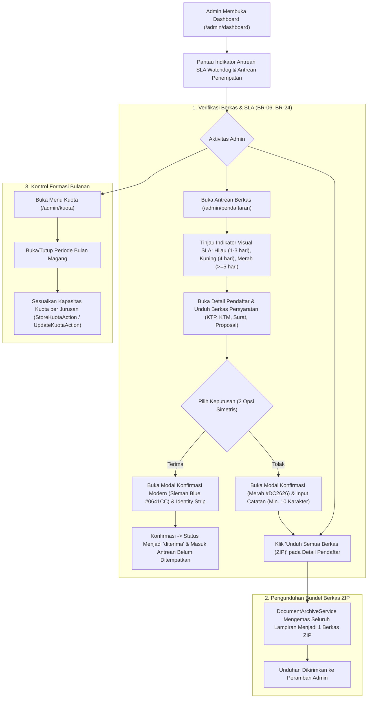

# Dokumentasi Fitur: Administrasi & Seleksi Magang

| Informasi | Keterangan |
|---|---|
| Status | Verified |
| Terakhir Diverifikasi | 2026-11-18 |
| Modul Sistem | `seleksi.verifikasi-berkas`, `kuota.manajemen`, `laporan.rekapitulasi` |
| Rute Terkait | `/admin/dashboard`, `/admin/pendaftaran/*`, `/admin/kuota/*`, `/admin/penempatan/*`, `/admin/laporan/*` |
| Referensi Implementasi | `app/Http/Controllers/Admin/`, `app/Actions/Admin/`, `app/Queries/Admin/` |

---

## 1. Overview
Modul Administrasi ditujukan bagi staf tata usaha dan sekretariat Diskominfo Sleman. Modul ini bertanggung jawab mengelola antrean verifikasi berkas permohonan pendaftar dengan pengawasan waktu layanan **SLA Watchdog** (standar 5 hari kerja), penetapan keputusan seleksi administratif, pengunduhan bundel berkas pendaftar dalam arsip ZIP, pengelolaan kuota formasi bulanan per kejuruan, serta pelaporan data kedinasan.

---

## 2. Business Context
Sebelum adanya MAGKOM, berkas fisik pendaftaran magang menumpuk di meja sekretariat tanpa kejelasan batas waktu verifikasi, menimbulkan komplain dari pihak sekolah dan kampus pemohon. Pengawasan SLA digital memberikan kepastian hukum dan waktu proses bagi para pendaftar, sekaligus menyajikan metrik akuntabilitas bagi pimpinan dinas.

---

## 3. User Roles
- **Admin Verifikator (Administrasi Kominfo)**: Memeriksa berkas permohonan, memberikan keputusan verifikasi, mengunduh bundel arsip ZIP, mengontrol kapasitas kuota formasi, dan memantau antrean penempatan dua tahap.

---

## 4. Preconditions
- Pengguna terotentikasi dengan peran `admin` atau `superadmin`.
- Akun berstatus aktif dan terdaftar secara sah pada sistem kedinasan.

---

## 5. Workflow

---

## 6. Business Rules
- **BR-02 (Kapasitas Kuota Bulanan)**: Admin mengalokasikan kuota per jurusan dalam batas maksimal yang diizinkan oleh parameter global (`kuota_umum_maks_per_bulan = 12`).
- **BR-06 (SLA Verifikasi Berkas 5 Hari Kerja)**: Sistem secara otomatis menghitung selisih hari kerja sejak berkas diajukan dengan mengecualikan hari Sabtu, Minggu, dan hari libur resmi dinas (`AdminSlaWorkingDaysTest`). Antrean verifikasi menampilkan lencana visual urgensi agar berkas yang mendekati atau melampaui batas SLA dapat segera ditindaklanjuti.
- **BR-07 (Penempatan Dua Tahap)**: Keputusan `diterima` pada tahap verifikasi berkas tidak langsung menempatkan peserta ke pembimbing, melainkan memindahkannya ke antrean *Belum Ditempatkan*.
- **BR-24 (Keputusan Verifikasi 2 Opsi Simetris & Modal Konfirmasi Modern)**: Panel keputusan verifikasi berkas admin (`admin.pendaftaran.show`) disederhanakan secara ergonomis menjadi segmented button 2 opsi simetris: **Terima** dan **Tolak**. Opsi `perlu_perbaikan` ditiadakan dari form keputusan aktif (pengajuan keputusan `perlu_perbaikan` ditolak oleh validasi backend HTTP 422), sedangkan data riwayat pendaftar lama yang berstatus `perlu_perbaikan` tetap dapat difilter dan dibaca secara aman untuk kepatuhan audit forensik (`AdminPendaftaranPerbaikanFlowTest`). Penolakan berkas mewajibkan input alasan penolakan minimal 10 karakter. Setiap tombol memunculkan modal konfirmasi modern (`confirm-modal.css`) yang dilengkapi *User Identity Strip* (nama pendaftar, institusi, jurusan), *Impact Notice Card*, tipografi Plus Jakarta Sans, serta aksen warna terstandarisasi: Sleman Blue (`#0641CC`) untuk persetujuan dan Crimson Red (`#DC2626`) untuk penolakan.
- **BR-23 (Keamanan Sanitasi Formula & Performa Ekspor Data)**:
  - **Pencegahan Spreadsheet Formula Injection**: Seluruh data teks pendaftar yang diekspor ke CSV atau Excel disanitasi secara otomatis; setiap sel yang diawali karakter formula berbahaya (`=`, `+`, `-`, `@`, `\t`, `\r`) dipasangi awalan tanda petik tunggal (`'`) untuk memitigasi eksekusi kode dinamis atau eksploitasi DDE pada peramban/aplikasi spreadsheet pengguna.
  - **Streaming Download Memori Rendah**: Modul rekapitulasi laporan pendaftaran memanfaatkan Laravel `StreamedResponse` dengan pemrosesan basis data berbasis chunking (200 data per iterasi), mempertahankan konsumsi memori server tetap efisien di bawah 20 MB.

---

## 7. Technical Implementation
- **Controller**:
  - `Admin\DashboardController`: Menghitung metrik antrean verifikasi, utilisasi kuota, dan sisa SLA.
  - `Admin\PendaftaranController`: Menangani antrean seleksi, pratinjau berkas, keputusan verifikasi, dan download ZIP.
  - `Admin\KuotaController`: Mengelola master periode bulan dan alokasi kapasitas jurusan.
  - `Admin\PenempatanController`: Mengelola antrean penempatan dua tahap.
  - `Admin\LaporanController`: Menyediakan antarmuka rekapitulasi data pendaftaran dan mengalirkan unduhan file ekspor yang telah disanitasi.
- **Action Classes**:
  - `PutuskanPendaftaranAction`: Menjalankan mutasi status verifikasi dan pembaruan riwayat pemeriksaan berkas.
  - `StoreKuotaAction` & `UpdateKuotaAction`: Membuat dan memperbarui kapasitas kuota jurusan.
  - `ToggleKuotaAction`: Mengubah status aktif/nonaktif kuota secara cepat.
- **Query Classes**:
  - `Admin\Pendaftaran\PendaftaranIndexQuery`: Mengambil data pendaftar dengan kalkulasi hari kerja SLA dan filter status.
  - `Admin\Kuota\KuotaIndexQuery`: Mengambil matriks kuota jurusan per periode bulan.
- **Service**:
  - `DocumentArchiveService`: Menggunakan pustaka `ZipArchive` bawaan PHP untuk mengemas berkas pendaftar menjadi arsip ZIP terkompresi.
- **Frontend Modular Stylesheet**:
  - `resources/css/pages/admin/laporan.css`: Stylesheet modular khusus untuk antarmuka laporan, kartu statistik rekap, dan popover unduhan data.

---

## 8. Database Interaction
- Membaca dan memperbarui tabel `pendaftaran`.
- Membaca dan memperbarui tabel `dokumen` dan `dokumen_verifikasi`.
- Membaca dan memperbarui tabel `kuota` dan `bulan_magang`.
- Mencatat seluruh keputusan verifikasi berkas ke dalam tabel `audit_log` pada kanal stream `aksi`.

---

## 9. Validation and Authorization
- Seluruh rute dilindungi oleh middleware `auth` dan `role:admin`.
- Aksi keputusan verifikasi divalidasi memastikan hanya pendaftaran berstatus `diajukan` yang dapat diputuskan.
- Otorisasi penolakan permohonan wajib menyertakan alasan penolakan pada kolom `catatan_verifikasi`.

---

## 10. Error Handling
- Jika terjadi kesalahan saat pengemasan berkas ZIP (misalnya ada satu berkas yang hilang secara fisik dari disk penyimpanan), sistem tetap melanjutkan pengemasan berkas yang tersedia dan menambahkan berkas teks catatan `README_BERKAS_HILANG.txt` di dalam ZIP untuk menginformasikan file yang terlewat.
- Percobaan verifikasi ganda dicegah melalui transaksi basis data.

---

## 11. Testing
- `Tests\Feature\AdminPendaftaranTest`: Menguji pemfilteran antrean, perhitungan SLA hari kerja, dan eksekusi putusan verifikasi.
- `Tests\Feature\AdminKuotaTest`: Menguji pembuatan dan pembatasan alokasi kuota jurusan.
- `Tests\Feature\AdminSlaWorkingDaysTest`: Menguji kalkulasi batas waktu SLA verifikasi pendaftaran khusus pada hari kerja aktif kedinasan (mengecualikan Sabtu, Minggu, dan libur nasional).

---

## 12. Limitations
- Admin tidak memiliki wewenang untuk mengubah parameter operasional sistem atau memanipulasi matriks izin peran (wewenang eksklusif SuperAdmin).
