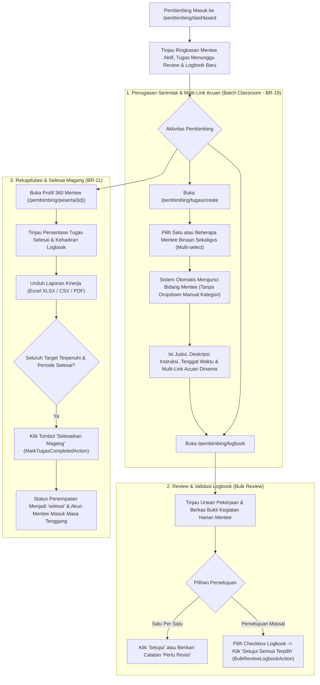

# Dokumentasi Fitur: Pembimbing Lapangan & Tata Kelola Mentee

| Informasi | Keterangan |
|---|---|
| Status | Verified |
| Terakhir Diverifikasi | 2026-11-25 |
| Modul Sistem | `bimbingan.logbook-tugas`, `laporan.kinerja-portofolio` |
| Rute Terkait | `/pembimbing/dashboard`, `/pembimbing/peserta/*`, `/pembimbing/tugas/*`, `/pembimbing/tugas/kelompok/*`, `/pembimbing/logbook/*`, `/pembimbing/laporan-kinerja/*` |
| Referensi Implementasi | `app/Http/Controllers/Pembimbing/`, `app/Actions/Pembimbing/`, `app/Exports/Pembimbing/` |

---

## 1. Overview
Modul Pembimbing Lapangan dirancang khusus untuk Aparatur Sipil Negara (ASN) di lingkungan Diskominfo Sleman yang ditugaskan sebagai pembimbing teknis magang. Modul ini menyediakan cockpit pemantauan peserta binaan, penerbitan tugas proyek (**Individu**, **Batch Classroom**, dan **Project Bersama / Tugas Tim** pada `/pembimbing/tugas/kelompok/{kelompok}`), filter tampilan **Semua / Individu / Tim** pada daftar tugas dan logbook, koreksi dan review hasil pekerjaan, validasi logbook harian (termasuk persetujuan massal *bulk review*), inspeksi komprehensif **Profil 360 Mentee**, ekspor laporan kinerja bimbingan (Excel XLSX, CSV, dan PDF), serta penetapan kelulusan selesai magang 1-klik.

---

## 2. Business Context
Sebelum adanya sistem ini, staf pembimbing ASN yang memiliki tugas pokok kedinasan sering kali terbebani oleh administrasi kertas bimbingan magang, buku presensi fisik, dan pembuatan lembar evaluasi manual. Modul Pembimbing memangkas birokrasi tersebut sehingga pembimbing dapat fokus pada transfer pengetahuan teknis dan pemantauan kualitas hasil kerja mentee.

---

## 3. User Roles
- **Pembimbing Lapangan ASN**: Membimbing maksimal 20 mentee aktif, menerbitkan tugas, mereview logbook, dan menerbitkan laporan kinerja.
- **SuperAdmin**: Memiliki visibilitas pemantauan (*read-only*), namun **dilarang keras** memiliki tombol mutasi untuk membuat tugas atau memvalidasi logbook mentee (Prinsip Emas #2).

---

## 4. Preconditions
- Pengguna terotentikasi dengan peran `pembimbing` dan akun berstatus aktif.
- Pembimbing telah ditugaskan secara sah pada rekaman penempatan peserta aktif (`penempatan.pembimbing_id = auth()->id()`).

---

## 5. Workflow

---

## 6. Business Rules
- **BR-08 (Batas Rasio Beban Mentee)**: Pembimbing lapangan hanya dapat membimbing maksimal 20 mentee aktif secara simultan (`maks_peserta_aktif_per_pembimbing = 20`).
- **BR-11 (Penyelesaian Masa Magang 1-Klik)**: Pembimbing berwenang penuh menetapkan kelulusan magang mentee secara langsung melalui tombol aksi 1-klik setelah seluruh kewajiban penugasan selesai, menggantikan mekanisme rubrik nilai lama yang telah dihapus permanen.
- **BR-17 (Proteksi Sanitasi Ekspor)**: Layanan ekspor lembar kerja bimbingan wajib menyaring karakter formula injection (`=`, `+`, `-`, `@`) untuk melindungi perangkat komputer pembimbing.
- **BR-19 (Penugasan Serentak Multi-Mentee & Multi-Link Acuan)**: Pembimbing dapat menerbitkan tugas batch classroom serentak ke beberapa mentee binaan dengan satu formulir input terpadu. Form ini mengeliminasi dropdown kategori bidang manual (otomatis mengambil bidang mentee) dan mendukung penambahan beberapa tautan acuan/referensi secara dinamis dalam format JSON array yang disimpan ke kolom `link_referensi`.
- **BR-20 (Evaluasi & Review Tugas Terfokus)**: Halaman review hasil tugas mentee (`/pembimbing/tugas/{id}`) menyajikan kartu tautan pengumpulan peserta, status revisi, dan modal konfirmasi penilaian dengan konfirmasi status terpadu.

---

## 7. Technical Implementation
- **Controller**:
  - `Pembimbing\DashboardController`: Menghitung metrik beban bimbingan dan ringkasan tugas.
  - `Pembimbing\PesertaController`: Mengelola daftar mentee aktif dan Profil 360 Mentee.
  - `Pembimbing\TugasController`: Menerbitkan tugas tunggal dan penugasan serentak `storeBatch()`.
  - `Pembimbing\LogbookReviewController`: Menangani review tunggal dan `bulkReview()`.
  - `Pembimbing\LaporanKinerjaController`: Mengelola ekspor rekapitulasi data bimbingan.
- **Action Classes**:
  - `CreateBatchTugasAction`: Menerbitkan record tugas ke banyak mentee dalam satu transaksi.
  - `ReviewLogbookAction` & `BulkReviewLogbookAction`: Memperbarui status logbook ke `disetujui` atau `perlu_revisi`.
  - `ReviewTugasProgresAction`: Mengoreksi dan menyetujui berkas laporan tugas mentee.
  - `MarkTugasCompletedAction`: Menyelesaikan penugasan dan masa magang.
- **Export Engine**:
  - `LaporanKinerjaExcelExport`: Membangun berkas `.xlsx` OpenXML ber-header Royal Blue `#0641CC` via `XlsxExportService`.
  - `LaporanKinerjaCsvExport`: Membangun format data tabular CSV terproteksi formula injection.

---

## 8. Database Interaction
- Membaca tabel `penempatan` yang terikat pada `pembimbing_id`.
- Membaca dan memperbarui tabel `tugas` dan `progres_log`.
- Membaca dan memperbarui tabel `logbook`.
- Membaca tabel `peserta_profil` untuk menyusun lembar Profil 360 Mentee.

---

## 9. Validation and Authorization
- **Guard Khusus**: Middleware `EnsureSuperAdminReadOnly` memastikan SuperAdmin tidak dapat mengakses method mutasi pada controller ini.
- **Policy**: `PenempatanPolicy`, `TugasPolicy`, dan `LogbookPolicy` membatasi pembimbing agar hanya dapat mereview dan menilai data dari mentee yang secara sah berada di bawah bimbingannya. Percobaan mereview mentee pembimbing lain otomatis menghasilkan respon HTTP 403 Forbidden.

---

## 10. Error Handling
- Jika pembimbing mencoba menyetujui logbook yang sudah disetujui sebelumnya, sistem mengabaikan aksi tanpa memicu duplikasi audit log.
- Jika terjadi kegagalan sistem saat kompilasi ekspor Excel atau PDF, sistem menangkap exception secara graceful dan memberikan notifikasi flash yang informatif tanpa menampilkan stack trace sensitif.

---

## 11. Testing
- `Tests\Feature\MultiLinkTugasTest`: Menguji validasi multi-link referensi tugas, penyimpanan payload array URL, dan kompatibilitas ke belakang format URL tunggal.
- `Tests\Feature\PembimbingFocusedMenteeTugasViewTest`: Menguji tampilan review tugas bimbingan terfokus dan isolasi antar mentee.
- `Tests\Feature\PembimbingTugasArchitectureSafetyTest`: Menguji isolasi wewenang penugasan batch dan integritas lampiran tugas.
- `Tests\Feature\PembimbingLaporanKinerjaExportArchitectureTest`: Menguji sanitasi sel anti-formula injection pada ekspor CSV dan XLSX.

---

## 12. Limitations
- Pembimbing tidak dapat mengubah bidang penempatan mentee secara mandiri; rotasi bidang dan pembimbing merupakan wewenang mutlak Admin Verifikator.
