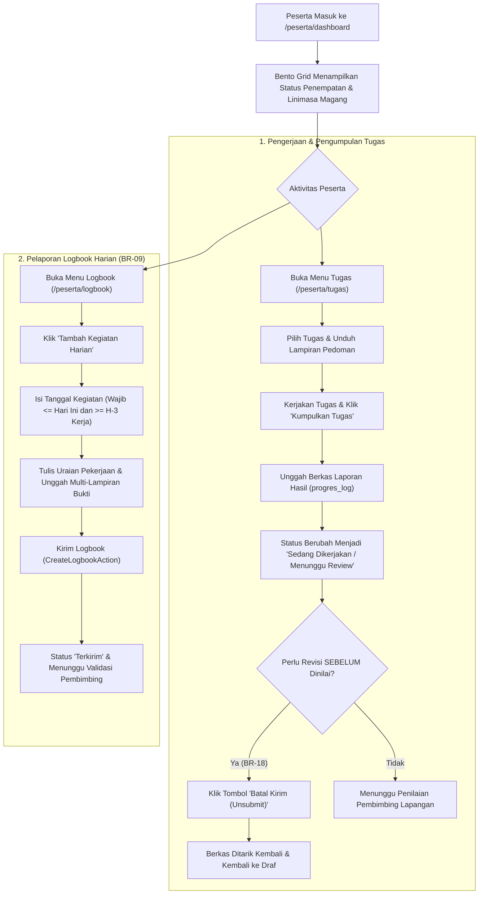

# Dokumentasi Fitur: Portal Peserta Magang

| Informasi | Keterangan |
|---|---|
| Status | Verified |
| Terakhir Diverifikasi | 2026-11-15 |
| Modul Sistem | `bimbingan.logbook-tugas`, `pendaftaran.magang` |
| Rute Terkait | `/peserta/dashboard`, `/peserta/tugas/*`, `/peserta/logbook/*`, `/peserta/profil` |
| Referensi Implementasi | `app/Http/Controllers/Peserta/`, `resources/views/peserta/` |

---

## 1. Overview
Portal Peserta adalah antarmuka kerja terpadu bagi siswa SMK dan mahasiswa selama menjalani program magang di Diskominfo Sleman. Fitur ini mengusung arsitektur dashboard **Bento Grid** modern yang ergonomis, sistem penyerahan tugas proyek bimbingan terstruktur ala Google Classroom, alur pembatalan pengiriman tugas (*unsubmit workflow*) untuk revisi mandiri, presensi logbook kegiatan harian berbatas waktu (maksimal mundur 3 hari kerja), serta pengelolaan profil dan kontak darurat.

---

## 2. Business Context
Peserta magang dominan mengakses sistem melalui perangkat ponsel pintar. Ketiadaan transparansi status bimbingan dan pelaporan logbook rapel manual di masa lalu sering kali menyulitkan pembimbing dalam memberikan evaluasi berkala. Portal Peserta menyederhanakan pelaporan harian menjadi proses digital beberapa klik yang akuntabel dan ramah seluler.

---

## 3. User Roles
- **Peserta Magang Aktif**: Memantau progres magang, mengerjakan dan mengumpulkan tugas, melakukan unsubmit tugas yang keliru, mencatat aktivitas logbook harian, dan memperbarui biodata diri.

---

## 4. Preconditions
- Pengguna terotentikasi dengan peran `peserta` dan akun berstatus aktif (`is_active = true`).
- Untuk mengakses menu Tugas dan Logbook, peserta wajib memiliki catatan penempatan bimbingan yang berstatus `aktif` (`penempatan.status = 'aktif'`). Jika belum ditempatkan, antarmuka dashboard akan menampilkan status antrean penempatan.

---

## 5. Workflow

---

## 6. Business Rules
- **BR-09 (Batas Mundur Pengisian Logbook)**: Pengisian tanggal aktivitas logbook dibatasi maksimal 3 hari kerja sebelum hari ini (`logbook_maks_mundur_hari = 3`). Tanggal lampau lebih dari H-3 otomatis ditolak sistem untuk mencegah pelaporan rapel di akhir masa magang.
- **BR-10 (Multi-Lampiran Logbook)**: Logbook mendukung lampiran banyak dokumen pendukung kegiatan dalam format gambar (JPG, PNG) atau dokumen (PDF).
- **BR-16 (Status Ketepatan Waktu Tugas)**: Sistem mencatat timestamp saat penyerahan berkas tugas. Jika diserahkan melewati tenggat waktu (*deadline*), status tugas ditandai sebagai *Terlambat*.
- **BR-18 (Alur Batal Kirim Tugas / Unsubmit)**: Peserta berhak membatalkan pengiriman tugas secara mandiri selama status progres masih `menunggu` (belum direview atau dinilai oleh pembimbing). Setelah unsubmit, peserta dapat mengunggah berkas revisi baru.

---

## 7. Technical Implementation
- **Controller**:
  - `Peserta\DashboardController`: Memuat ringkasan Bento Grid (sisa hari magang, tugas mendekati deadline, kalender logbook).
  - `Peserta\TugasController`: Menangani daftar tugas, unduhan lampiran instruksi, submit laporan, dan aksi `unsubmit`.
  - `Peserta\LogbookController`: Menangani entri harian, pembaruan logbook revisi, dan riwayat presensi.
  - `Peserta\ProfilController`: Mengelola data pribadi dan data institusi.
- **Action Classes**:
  - `CreateLogbookAction` & `UpdateLogbookAction`: Merekam dan memperbarui entri kegiatan harian.
  - `UpdatePesertaProfilAction`: Menyimpan perubahan biodata mentee.
- **Query Classes**:
  - `Peserta\LogbookIndexQuery`: Mengambil seluruh riwayat logbook peserta dengan pengurutan kronologis terbalik.
  - `Peserta\Profil\PesertaProfilQuery`: Mengambil informasi profil lengkap dengan eager loading relasi penempatan.

---

## 8. Database Interaction
- Membaca tabel `penempatan` untuk memastikan relasi bimbingan aktif.
- Menulis dan membaca tabel `tugas` dan `progres_log`.
- Menulis dan membaca tabel `logbook`.
- Menyimpan berkas laporan tugas ke disk privat `storage/app/private/tugas/` dan lampiran logbook ke `storage/app/private/logbook/`.

---

## 9. Validation and Authorization
- **Middleware**:
  - `EnsurePesertaDiterima`: Mencegah akses ke menu bimbingan jika peserta belum memiliki penempatan aktif.
  - `EnsureParticipantWritable`: Mencegah pengiriman tugas atau logbook jika akun peserta telah memasuki masa nonaktif.
- **Form Request**: `LogbookRequest` memvalidasi batasan H-3 dan format lampiran berkas.
- **Policy**: `TugasPolicy` dan `LogbookPolicy` memastikan peserta hanya dapat mengakses tugas dan logbook miliknya sendiri (Anti-IDOR).

---

## 10. Error Handling
- Jika peserta mencoba mengisi tanggal logbook yang melanggar batas H-3, sistem mengembalikan validasi error HTTP 422: *"Tanggal kegiatan tidak boleh lebih lampau dari 3 hari kerja sebelumnya."*
- Jika peserta mencoba melakukan unsubmit pada tugas yang sudah berstatus `diterima` oleh pembimbing, sistem menolak aksi dengan pesan: *"Tugas telah diperiksa dan disetujui oleh pembimbing lapangan sehingga tidak dapat dibatalkan."*

---

## 11. Testing
- `Tests\Feature\TugasLogbookTest`: Menguji penolakan validasi tanggal mundur logbook dan penyimpanan multi-lampiran.
- `Tests\Feature\PesertaTugasBatalKirimTest`: Menguji keberhasilan unsubmit saat tugas belum direview dan pencegahan unsubmit pasca-review.

---

## 12. Limitations
- Entri logbook yang telah disetujui (`status = 'disetujui'`) oleh pembimbing terkunci secara permanen dan tidak dapat diedit atau dihapus kembali oleh peserta.
- Peserta tidak dapat menyerahkan tugas setelah masa penempatan magang berakhir secara resmi.
