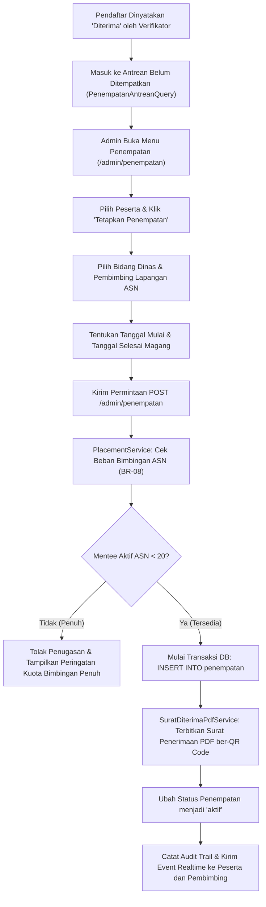

# Dokumentasi Fitur: Penempatan Dua Tahap & Plotting Pembimbing

| Informasi | Keterangan |
|---|---|
| Status | Verified |
| Terakhir Diverifikasi | 2026-11-15 |
| Modul Sistem | `penempatan.pembimbing` |
| Rute Terkait | `/admin/penempatan`, `/admin/penempatan/reassign`, `/admin/penempatan/bulk-reassign` |
| Referensi Implementasi | `app/Actions/Admin/Penempatan/`, `app/Services/PlacementService.php` |

---

## 1. Overview
Fitur Penempatan Dua Tahap (*Two-Stage Placement*) mengatur alur kerja pemisahan antara kelulusan seleksi administrasi berkas dan penetapan penempatan teknis kedinasan. Pendaftar yang berkasnya dinyatakan disetujui masuk ke antrean *Belum Ditempatkan*. Administrator kemudian melakukan plotting peserta ke unit kerja bidang teknis (Aptika, IKP, Statistik, Persandian, atau Sekretariat) serta menunjuk Aparatur Sipil Negara (ASN) pembimbing berdasarkan rasio batas beban bimbingan (*mentee limiter*).

---

## 2. Business Context
Pada sistem konvensional, peserta sering kali langsung masuk tanpa persiapan unit kerja teknis atau terjadi penumpukan bimbingan pada satu staf tertentu. Alur dua tahap menjamin seluruh peserta yang diterima terdistribusi merata sesuai kapasitas kerja dan keahlian bidang teknis yang relevan dengan latar belakang pendidikan peserta.

---

## 3. User Roles
- **Admin Verifikator**: Mengakses antrean belum ditempatkan, memilih bidang kerja, menunjuk pembimbing lapangan, melakukan rotasi pembimbing jika diperlukan, dan menerbitkan Surat Penerimaan resmi.
- **Pembimbing Lapangan ASN**: Menerima peserta yang telah ditempatkan di bawah bimbingannya.
- **Peserta Magang**: Melihat informasi bidang penempatan, nama pembimbing, jadwal masa kerja, dan mengunduh Surat Penerimaan ber-QR Code.

---

## 4. Preconditions
- Permohonan pendaftaran telah berstatus `diterima` pada tahap verifikasi berkas.
- Pendaftar belum memiliki rekaman penempatan aktif (`pendaftaran.penempatan_id IS NULL`).
- Pembimbing lapangan yang dipilih berstatus ASN aktif dan memiliki kapasitas bimbingan tersisa (< 20 mentee).

---

## 5. Workflow

---

## 6. Business Rules
- **BR-07 (Penempatan Dua Tahap)**: Verifikasi berkas tidak langsung mengikat pembimbing. Penempatan merupakan proses administratif tersendiri yang dijalankan oleh admin setelah kelulusan berkas.
- **BR-08 (Batas Beban Pembimbing / Mentee Limiter)**: Jumlah mentee aktif per pembimbing lapangan dibatasi maksimal 20 orang (`maks_peserta_aktif_per_pembimbing = 20`). Penugasan mentee baru otomatis diblokir jika batas telah tercapai.
- **Rotasi Pembimbing Massal (Bulk Reassign)**: Jika seorang pembimbing dipindahtugaskan atau cuti dinas, admin dapat memindahkan seluruh mentee aktif binaannya ke pembimbing pengganti dalam satu aksi transaksi atomik.

---

## 7. Technical Implementation
- **Controller**: `App\Http\Controllers\Admin\PenempatanController`.
- **Query Classes**:
  - `PenempatanAntreanQuery`: Mengambil daftar pendaftar berstatus `diterima` yang belum memiliki penempatan.
  - `PenempatanIndexQuery`: Mengambil seluruh rekam penempatan aktif dengan filter bidang dan status.
- **Action Classes**:
  - `AssignPesertaAction`: Menyimpan penetapan penempatan baru dan memicu penerbitan surat penerimaan.
  - `ReassignPembimbingAction`: Memindahkan mentee ke pembimbing baru dengan validasi kapasitas.
  - `BulkReassignPembimbingAction`: Memindahkan seluruh mentee bimbingan dari pembimbing lama ke pembimbing baru.
  - `CancelPenempatanAction`: Membatalkan penempatan peserta dan mengembalikan status ke antrean.
  - `CreateManualPenempatanAction`: Menangani penempatan langsung untuk peserta jalur kemitraan khusus instansi dinas.
- **Service**:
  - `PlacementService`: Memvalidasi aturan batas mentee dan mengelola pemindahan massal.
  - `SuratDiterimaPdfService`: Mengenerasi dokumen Surat Penerimaan resmi format PDF ber-QR Code.

---

## 8. Database Interaction
- Membaca dan memperbarui tabel `pendaftaran`.
- Membaca tabel `users` (filter role `pembimbing` dan keaktifan akun).
- Menyimpan baris baru pada tabel `penempatan` (`pendaftaran_id`, `bidang_id`, `pembimbing_id`, `sumber`, `tanggal_mulai`, `tanggal_selesai`, `status='aktif'`).
- Mencatat aksi penempatan ke `audit_log` pada kanal stream `aksi`.

---

## 9. Validation and Authorization
- **Validasi**: `TetapkanPenempatanRequest` memvalidasi keberadaan ID pendaftaran, bidang, pembimbing, dan memastikan `tanggal_selesai >= tanggal_mulai`.
- **Otorisasi**: `PenempatanPolicy` membatasi aksi penetapan penempatan hanya untuk pengguna dengan peran `admin` dan `superadmin`.

---

## 10. Error Handling
- Jika pembimbing yang dipilih telah membimbing 20 mentee aktif, sistem membatalkan aksi dan mengembalikan pesan validasi error: *"Pembimbing yang dipilih telah mencapai batas maksimal 20 peserta aktif."*
- Jika terjadi kegagalan saat penerbitan berkas PDF Surat Penerimaan, transaksi basis data di-rollback untuk mencegah inkonsistensi data penempatan tanpa dokumen resmi.

---

## 11. Testing
- `Tests\Feature\AdminPenempatanDuaTahapTest`: Menguji alur penempatan dua tahap dan transisi status pendaftar.
- `Tests\Feature\AdminPenempatanArchitectureAndSecurityTest`: Menguji penolakan sistem saat pembimbing mencapai batas 20 mentee dan pengujian rotasi pembimbing massal.

---

## 12. Limitations
- Penempatan hanya dapat dilakukan ke 5 bidang unit kerja resmi yang terdaftar di master `bidang`.
- Tanggal penempatan tidak boleh melampaui batas maksimal durasi magang 6 bulan dari tanggal mulai.
