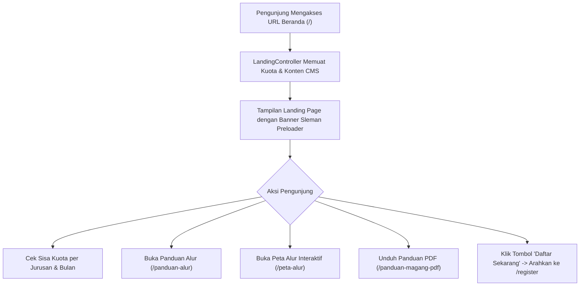

# Dokumentasi Fitur: Portal Publik & Informasi Magang

| Informasi | Keterangan |
|---|---|
| Status | Verified |
| Terakhir Diverifikasi | 2026-11-17 |
| Modul Sistem | `publik.portal-registrasi` |
| Rute Terkait | `/`, `/panduan-alur`, `/peta-alur`, `/panduan-magang-pdf`, `/health` |
| Referensi Implementasi | `app/Http/Controllers/Public/`, `resources/views/public/`, `resources/js/pages/public/` |

---

## 1. Overview
Portal Publik MAGKOM adalah gerbang utama informasi kedinasan bagi masyarakat, siswa SMK, dan mahasiswa perguruan tinggi. Portal ini menyajikan informasi ketersediaan kuota formasi magang secara real-time, panduan alur pendaftaran, peta alur interaktif berbasis diagram siklus, pengunduhan berkas panduan resmi berformat PDF, serta verifikasi keabsahan dokumen bertanda tangan digital.

---

## 2. Business Context
Sebelum adanya portal publik, pemohon magang harus datang langsung ke kantor dinas untuk menanyakan ketersediaan kuota. Hal ini membebani petugas resepsionis dan menimbulkan ketidakpastian bagi pendaftar luar daerah. Portal publik menyelesaikan masalah ini dengan mendemokratisasi akses informasi kuota dan prosedur penerimaan secara transparan.

---

## 3. User Roles
- **Publik / Tamu (Guest)**: Melihat sisa kuota bulanan, membaca panduan, melihat peta alur, mengunduh panduan PDF, dan memverifikasi dokumen.
- **Calon Peserta**: Mengakses tautan menuju halaman pendaftaran akun mandiri.
- **SuperAdmin**: Mengelola susunan blok teks, gambar, dan tata letak landing page melalui modul Visual Site Editor.

---

## 4. Preconditions
- Sistem dan basis data telah terisi data master periode bulan magang (`bulan_magang`) dan alokasi kapasitas (`kuota`).
- Pengaturan parameter sistem pada tabel `pengaturan` telah ter-provisioning.

---

## 5. Workflow

---

## 6. Business Rules
- **Transparansi Kuota**: Sisa kuota dihitung dari `jumlah - terisi`. Jika sisa kuota = 0, status ditampilkan sebagai `Penuh`.
- **Status Bulan Magang**: Hanya bulan yang berstatus `tersedia` yang dapat dipilih pada formulir pendaftaran. Bulan berstatus `tutup` atau `segera` hanya ditampilkan sebagai informasi jadwal mendatang.
- **Zero Inline Script**: Interaktivitas tab kuota, FAQ accordion, carousel interaktif, dan animasi visual landing page dieksekusi via `resources/js/pages/public/landing.js`.
- **Penguncian Statis Tema & Bahasa**: Seluruh rute portal publik secara statis berstatus `data-theme="light"` dan `lang="id"`. Engine anti-flash tema membatalkan pembacaan mode gelap pada halaman publik demi mempertahankan identitas resmi Sleman.
- **Identitas Kemitraan & Tata Letak Footer Sleman Modern**:
  - **Tiga Logo Mitra**: Menampilkan logo Pemerintah Kabupaten Sleman (Diskominfo), Universitas AMIKOM Yogyakarta (`public/images/logo-amikom.png`), dan D3 Manajemen Informatika (`public/images/logo-mi.png`) secara berdampingan di atas teks hak cipta dengan tautan resmi.
  - **Grid Simetris 5 Kolom Desktop**: Disusun dengan proporsi `1.75fr 1fr 1fr 1fr 1fr` yang mencakup: Profil Dinas/Alamat, Tautan Terkait, Media Sosial, Akun, dan kolom profil **Tim Pengembang** (*Aldi Artha Mida, Naufal Febrian, Galang Adhitya*).
  - **Grid Simetris 2x2 Kolom Mobile**: Pada layar $\le 768\text{px}$, kolom navigasi di bawah profil dinas tertata dalam 2 baris 2 kolom seimbang (Baris 1: Tautan Terkait & Akun; Baris 2: Media Sosial & Pengembang).
- **Pengalaman Pengguna Seluler Tingkat Lanjut (Mobile UX Overhaul)**:
  - **Jalan Lurus Vertikal Tahapan Magang (`#tahapan`)**: Lintasan aspal SVG dikonversi menjadi garis vertikal lurus ($X = 48$) dengan mobil bergerak tegak lurus $90^\circ$ saat di-scroll, 4 simpul checkpoint sejajar di sumbu tengah, serta bendera START dan FINISH yang presisi.
  - **Tombol Aksi Sejajar Tahapan Mobile**: Dua tombol aksi ('Unduh Panduan PDF' dan 'Peta Alur Interaktif') disusun sejajar dalam grid 2-kolom seimbang (`1fr 1fr`, gap 8px) dengan padding ringkas untuk ergonomi satu tangan.
  - **Indikator Geser Kuota Carousel Mobile (`#kuota`)**: Menghadirkan sinergi dots pagination dinamis (`#kuotaCarouselDots`), tombol panah melayang, dan micro-swipe hint badge (*"Bidang X dari Y · Geser untuk melihat bidang lainnya ➔"*).
  - **Hero Carousel 4-Slide Mobile**: Pada mobile, Hero section dibagi menjadi 4 slide terfokus: Slide 1 (Overview Pendaftaran + Tombol CTA "Daftar Sekarang"), Slide 2 (Persyaratan Umum), Slide 3 (Dokumen Pendaftaran), dan Slide 4 (Foto Kegiatan Magang Resmi Diskominfo).
- **Harmonisasi Halaman Kebijakan Privasi (`/kebijakan-privasi`)**:
  - Navigasi breadcrumb redundan dihapus untuk memusatkan perhatian pengunjung pada substansi regulasi.
  - Latar belakang container diselaraskan dengan estetika landing page modern.

---

## 7. Technical Implementation
- **Controller**: `App\Http\Controllers\Public\LandingController` memanggil `LandingCmsService` untuk mengambil konten blok dinamis dan `QuotaIndexQuery` untuk kalkulasi sisa kapasitas formasi.
- **Peta Alur Interaktif**: `App\Http\Controllers\Public\AlurMagangController` merender tahapan visual menggunakan Vanilla ES Module dan GSAP 3.15.
- **Captcha Anti-Bot**: `App\Http\Controllers\Public\CaptchaController` menghasilkan token SVG captcha dinamis tanpa library eksternal.
- **Interactive Script Modules**:
  - `resources/js/pages/public/landing.js`: Mengelola engine scroll mobil tahapan (`initTahapanRoad`), carousel kuota dengan dots dinamis (`initKuotaExplorer`, `renderKuotaDots`), dan hero slider 4-slide touch swipe (`initHeroCarousel`).
  - `resources/js/pages/public/kebijakan-privasi.js`: Penanganan interaksi dokumen privasi.

---

## 8. Database Interaction
- Membaca tabel `bulan_magang`, `kuota`, dan `jurusan` dengan eager loading relasi untuk mencegah isu N+1 queries.
- Membaca tabel `pengaturan` untuk blok konfigurasi teks landing page (`landing_*`).

---

## 9. Validation and Authorization
- Akses publik bebas tanpa kewajiban otentikasi.
- Rate limiting diterapkan pada endpoint captcha dan verifikasi dokumen (`throttle:60,1`).
- Header CSP ketat diterapkan via `SecurityHeaders` middleware.

---

## 10. Error Handling
- Jika koneksi basis data mengalami gangguan, rute `/health` mengembalikan status HTTP 503 dengan format JSON diagnostik aman.
- Jika berkas panduan PDF tidak ditemukan di storage, sistem memberikan fallback download yang ramah pengguna.

---

## 11. Testing
- `Tests\Feature\LandingPage\LandingPageTest`: Menguji pemuatan landing page dan kalkulasi kuota.
- `Tests\Feature\LandingPageToRegistrationPrefillTest`: Menguji 10 skenario aliran parameter kuota dari landing page ke formulir registrasi, penguncian dropdown kuota, dan pembersihan URL login.
- `Tests\Feature\SecurityHeadersProductionTest`: Memverifikasi 0 inline script pada seluruh view publik.

---

## 12. Limitations
- Landing page dirancang untuk informasi pembacaan statis dan semi-dinamis. Pembelian atau transaksi kuota di luar alur registrasi resmi tidak didukung.
