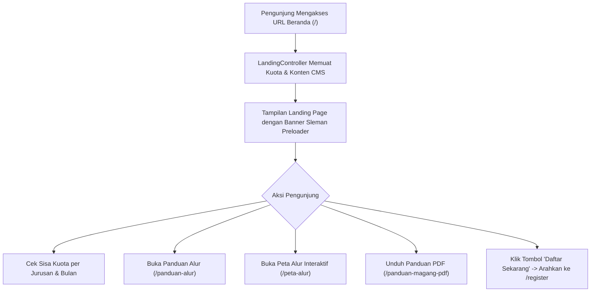

# Dokumentasi Fitur: Portal Publik & Informasi Magang

| Informasi | Keterangan |
|---|---|
| Status | Verified |
| Terakhir Diverifikasi | 2026-11-17 |
| Modul Sistem | `publik.portal-registrasi` |
| Rute Terkait | `/`, `/panduan-alur`, `/peta-alur`, `/panduan-magang-pdf`, `/health` |
| Referensi Implementasi | `app/Http/Controllers/Public/`, `resources/views/public/`, `resources/js/pages/public/` |

---

## 1. Overview
Portal Publik MAGKOM adalah gerbang utama informasi kedinasan bagi masyarakat, siswa SMK, dan mahasiswa perguruan tinggi. Portal ini menyajikan informasi ketersediaan kuota formasi magang secara real-time, panduan alur pendaftaran, peta alur interaktif berbasis diagram siklus, pengunduhan berkas panduan resmi berformat PDF, serta verifikasi keabsahan dokumen bertanda tangan digital.

---

## 2. Business Context
Sebelum adanya portal publik, pemohon magang harus datang langsung ke kantor dinas untuk menanyakan ketersediaan kuota. Hal ini membebani petugas resepsionis dan menimbulkan ketidakpastian bagi pendaftar luar daerah. Portal publik menyelesaikan masalah ini dengan mendemokratisasi akses informasi kuota dan prosedur penerimaan secara transparan.

---

## 3. User Roles
- **Publik / Tamu (Guest)**: Melihat sisa kuota bulanan, membaca panduan, melihat peta alur, mengunduh panduan PDF, dan memverifikasi dokumen.
- **Calon Peserta**: Mengakses tautan menuju halaman pendaftaran akun mandiri.
- **SuperAdmin**: Mengelola susunan blok teks, gambar, dan tata letak landing page melalui modul Visual Site Editor.

---

## 4. Preconditions
- Sistem dan basis data telah terisi data master periode bulan magang (`bulan_magang`) dan alokasi kapasitas (`kuota`).
- Pengaturan parameter sistem pada tabel `pengaturan` telah ter-provisioning.

---

## 5. Workflow

---

## 6. Business Rules
- **Transparansi Kuota**: Sisa kuota dihitung dari `jumlah - terisi`. Jika sisa kuota = 0, status ditampilkan sebagai `Penuh`.
- **Status Bulan Magang**: Hanya bulan yang berstatus `tersedia` yang dapat dipilih pada formulir pendaftaran. Bulan berstatus `tutup` atau `segera` hanya ditampilkan sebagai informasi jadwal mendatang.
- **Zero Inline Script**: Interaktivitas tab kuota, FAQ accordion, dan animasi visual landing page dieksekusi via `resources/js/pages/public/landing.js`.
- **Penguncian Statis Tema & Bahasa**: Seluruh rute portal publik secara statis berstatus `data-theme="light"` dan `lang="id"`. Engine anti-flash tema membatalkan pembacaan mode gelap pada halaman publik demi mempertahankan identitas resmi Sleman.
- **Responsivitas Mobile (Lentera Sleman Style)**: Tampilan kartu kuota, navigasi drawer header, bottom sheet login, dan peta alur dioptimasi khusus untuk pengalaman navigasi satu tangan pada smartphone.

---

## 7. Technical Implementation
- **Controller**: `App\Http\Controllers\Public\LandingController` memanggil `LandingCmsService` untuk mengambil konten blok dinamis dan `QuotaIndexQuery` untuk kalkulasi sisa kapasitas formasi.
- **Peta Alur Interaktif**: `App\Http\Controllers\Public\AlurMagangController` merender tahapan visual menggunakan Vanilla ES Module dan GSAP 3.15.
- **Captcha Anti-Bot**: `App\Http\Controllers\Public\CaptchaController` menghasilkan token SVG captcha dinamis tanpa library eksternal.

---

## 8. Database Interaction
- Membaca tabel `bulan_magang`, `kuota`, dan `jurusan` dengan eager loading relasi untuk mencegah isu N+1 queries.
- Membaca tabel `pengaturan` untuk blok konfigurasi teks landing page (`landing_*`).

---

## 9. Validation and Authorization
- Akses publik bebas tanpa kewajiban otentikasi.
- Rate limiting diterapkan pada endpoint captcha dan verifikasi dokumen (`throttle:60,1`).
- Header CSP ketat diterapkan via `SecurityHeaders` middleware.

---

## 10. Error Handling
- Jika koneksi basis data mengalami gangguan, rute `/health` mengembalikan status HTTP 503 dengan format JSON diagnostik aman.
- Jika berkas panduan PDF tidak ditemukan di storage, sistem memberikan fallback download yang ramah pengguna.

---

## 11. Testing
- `Tests\Feature\LandingPage\LandingPageTest`: Menguji pemuatan landing page dan kalkulasi kuota.
- `Tests\Feature\SecurityHeadersProductionTest`: Memverifikasi 0 inline script pada seluruh view publik.

---

## 12. Limitations
- Landing page dirancang untuk informasi pembacaan statis dan semi-dinamis. Pembelian atau transaksi kuota di luar alur registrasi resmi tidak didukung.
