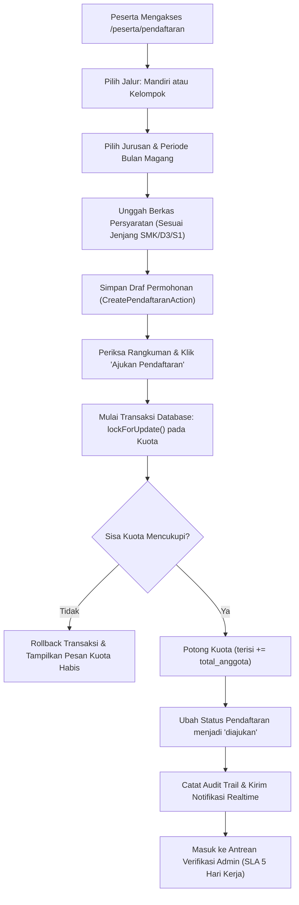

# Dokumentasi Fitur: Pendaftaran & Alokasi Kuota Magang

| Informasi | Keterangan |
|---|---|
| Status | Verified |
| Terakhir Diverifikasi | 2026-11-25 |
| Modul Sistem | `pendaftaran.magang` |
| Rute Terkait | `/peserta/pendaftaran`, `/peserta/pendaftaran/{id}/ajukan`, `/peserta/pendaftaran/{id}/batal` |
| Referensi Implementasi | `app/Actions/Peserta/Pendaftaran/`, `app/Services/QuotaAllocationService.php` |

---

## 1. Overview
Fitur Pendaftaran mengelola proses pengajuan permohonan magang secara online, baik untuk pendaftar individu (mandiri) maupun tim (secara teknis disimpan dengan `tipe = 'kelompok'`). Modul ini menangani pengisian data akademik, pengunggahan dokumen persyaratan bertanda tangan (KTP, KTM, Surat Pengantar, Proposal), pemilihan periode formasi bulan, penguncian kuota secara atomik berbasis database locking, hingga pembatalan permohonan mandiri.

---

## 2. Business Context
Pendaftaran konvensional rawan memicu kondisi penumpukan permohonan melebihi daya tampung fisik ruangan dinas. Dengan adanya alur pendaftaran terpusat ini, Diskominfo Sleman dapat mengontrol kapasitas penerimaan siswa dan mahasiswa secara presisi dan terukur sesuai kapasitas pembimbing teknis.

---

## 3. User Roles
- **Peserta Mandiri / Ketua Tim**: Mengisi formulir pendaftaran, mengunggah dokumen persyaratan, mengunci alokasi kuota, dan mengajukan permohonan.
- **Anggota Tim**: Didaftarkan oleh ketua tim dan datanya diverifikasi sebagai satu kesatuan tim.
- **Admin Verifikator**: Menerima berkas pendaftaran yang telah berstatus `diajukan` untuk diperiksa.

---

## 4. Preconditions
- Pengguna telah memiliki akun terotentikasi dan alamat email telah terverifikasi (`email_verified_at IS NOT NULL`).
- Sisa kuota pada jurusan dan periode bulan yang dipilih masih tersedia (`jumlah > terisi`).
- Pendaftar tidak memiliki permohonan lain yang sedang aktif berjalan.

---

## 5. Workflow

---

## 6. Business Rules
- **BR-01 (Durasi Magang)**: Durasi pelaksanaan wajib 1 s/d 6 bulan (`durasi_magang_maks_bulan = 6`).
- **BR-03 (Jenjang & Berkas)**: Persyaratan berkas divalidasi sesuai jenjang SMK, D3, atau S1. Berkas wajib diunggah dalam format PDF/JPG/PNG dengan ukuran maksimal 10 MB (`berkas_maks_mb = 10`).
- **BR-04 (Pendaftaran Tim Multi-Akun & Dynamic Team Roster Cards)**: Tim dibatasi maksimal 4 orang (1 ketua + 3 anggota). Pendaftaran tim hanya aktif jika `fitur_pendaftaran_kelompok_aktif = 1`. Pada halaman registrasi, pemilihan jalur tim memunculkan kartu anggota tim dinamis (*Dynamic Team Roster Cards*) yang dikelola secara interaktif via `resources/js/pages/auth/auth-depth.js` dengan validasi instan terhadap keunikan NISN/NIM, nama lengkap, dan format email setiap anggota tim. Seluruh anggota tim dibuatkan akun login mandiri (`kelompok_anggota.user_id`) serta mendapat penempatan masing-masing agar dapat mengakses dashboard, tugas tim, dan logbook secara independen (`KelompokMultiAccountRegistrationTest`). Autentikasi login, registrasi, dan reset password juga mendukung alur **Zero-Page Reload** (AJAX + retensi input).
- **BR-05 (Konkurensi Atomik)**: Pemotongan kuota wajib menggunakan transaksi basis data dengan `lockForUpdate()`. Dilarang memotong kuota tanpa penguncian pesimistik.
- **BR-20 (Pendaftaran Ulang Pasca Ditolak - Re-apply Workflow)**: Peserta yang permohonan magangnya telah diputuskan `ditolak` oleh tim administrasi berhak mengajukan permohonan baru pada formasi/periode bulan lain. Sistem mengarsipkan permohonan lama untuk kebutuhan audit forensik dan membuka kembali antarmuka pendaftaran baru bagi pengguna tersebut (`PesertaReapplyAfterRejectionTest`).
- **BR-21 (Kartu Kuota Terpilih, Penguncian Formasi, & Sanitasi URL Login)**:
  - **Preselected Quota Locking**: Tautan pendaftaran dari Landing Page yang menyertakan query parameter kuota (`?bulan=...&jurusan=...`) otomatis merender kartu ringkasan kuota (`_selected_quota_card.blade.php`) di halaman registrasi, serta mengunci pilihan tipe dan jurusan (*locked & disabled*) demi mencegah inkonsistensi pilihan formasi.
  - **Sanitasi Navigasi Login**: Tautan *"Sudah punya akun? Login"* pada formulir registrasi dibersihkan tanpa membawa query parameter kuota (`route('login')`), menjamin halaman login tetap bersih, terfokus pada otentikasi kredensial, dan bebas dari kartu pilihan magang yang tidak relevan.

---

## 7. Technical Implementation
- **Controller**: `App\Http\Controllers\Peserta\PendaftaranController`.
- **Action Classes**:
  - `CreatePendaftaranAction`: Menyimpan draf pendaftaran dan mengaitkan berkas unggahan.
  - `AjukanPendaftaranAction`: Memanggil `QuotaAllocationService` di dalam transaksi database dan mengubah status menjadi `diajukan`.
  - `BatalkanPendaftaranAction`: Membatalkan pengajuan sebelum diverifikasi dan mengembalikan alokasi kuota jurusan.
- **Service**: `App\Services\QuotaAllocationService` menangani logika pesimistik locking dan kalkulasi sisa kuota.
- **Storage**: `App\Services\DocumentStorageService` menyimpan dokumen ke disk privat `storage/app/private/documents/`.

---

## 8. Database Interaction
- `pendaftaran`: Menyimpan data induk permohonan, status seleksi, dan tanggal pengajuan.
- `kelompok_magang` & `kelompok_anggota`: Menyimpan rombongan tim jika mendaftar kelompok.
- `dokumen`: Metadata berkas persyaratan (ukuran, MIME type, path privat).
- `kuota`: Penguncian baris (`FOR UPDATE`) dan pembaruan kolom `terisi`.
- `audit_log`: Pencatatan mutasi pengajuan dan pembatalan pendaftaran.

---

## 9. Validation and Authorization
- **Validasi**: `App\Http\Requests\PendaftaranRequest` memvalidasi kelengkapan field, batas tanggal, dan validasi ekstensi berkas.
- **Otorisasi**: `App\Policies\PendaftaranPolicy` memastikan peserta hanya dapat mengubah atau membatalkan permohonan miliknya sendiri.

---

## 10. Error Handling
- Jika terjadi kontensi kuota konkuren dan kuota tersisa tidak mencukupi, sistem melakukan rollback transaksi atomik dan mengembalikan respon error ramah: *"Mohon maaf, kuota formasi pada periode yang Anda pilih telah habis saat permohonan diproses."*
- Berkas korup atau MIME type berbahaya (seperti skrip executable `.php`, `.sh`, `.exe`) otomatis ditolak oleh validasi server.

---

## 11. Testing
- `Tests\Feature\QuotaConcurrencyTest`: Menguji integritas transaksi locking atomik saat banyak permintaan pengajuan masuk secara paralel.
- `Tests\Feature\PesertaPendaftaranTest`: Menguji validasi form pendaftaran, unggah berkas, dan pengajuan status.
- `Tests\Feature\PesertaReapplyAfterRejectionTest`: Menguji skenario komprehensif pendaftaran ulang setelah peserta ditolak, pelepasan status penolakan lama, dan pengajuan baru.
- `Tests\Feature\QuotaKelompokAllocationTest`: Menguji pemotongan kuota rombongan tim secara atomik.
- `Tests\Feature\PendaftaranKelompokTest`: Menguji validasi anggota kelompok, batas maksimal 4 orang, dan pendaftaran mandiri.
- `Tests\Feature\LandingPageToRegistrationPrefillTest`: Menguji 10 skenario lengkap aliran kuota dari beranda ke registrasi, kartu ringkasan kuota terpilih, penguncian dropdown, dan URL login bersih tanpa parameter.

---

## 12. Limitations
- Setiap akun peserta hanya dapat memiliki satu pengajuan magang yang aktif dalam satu siklus waktu.
- Pembatalan mandiri hanya dapat dilakukan selama permohonan belum diproses atau diverifikasi oleh admin.
