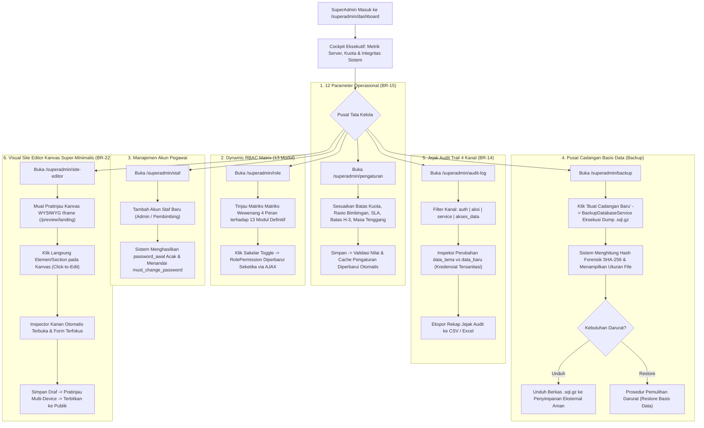

# Dokumentasi Fitur: Tata Kelola SuperAdmin & Pusat Sistem

| Informasi | Keterangan |
|---|---|
| Status | Verified |
| Terakhir Diverifikasi | 2026-11-17 |
| Modul Sistem | `konfigurasi.parameter`, `staf.manajemen`, `kuota.slot-khusus`, `sistem.cadangan-database`, `sistem.telemetri-kesehatan`, `keamanan.audit-trail`, `cms.site-editor` |
| Rute Terkait | `/superadmin/dashboard`, `/superadmin/pengaturan`, `/superadmin/role`, `/superadmin/staf`, `/superadmin/backup/*`, `/superadmin/audit-log/*`, `/superadmin/landing-cms/*`, `/superadmin/site-editor/*` |
| Referensi Implementasi | `app/Http/Controllers/SuperAdmin/`, `app/Services/BackupDatabaseService.php`, `app/Services/PermissionService.php` |

---

## 1. Overview
Modul SuperAdmin adalah command center tata kelola sistem tingkat tinggi pada MAGKOM. Modul ini menyediakan kontrol eksekutif penuh terhadap konfigurasi 12 parameter operasional aplikasi, pengelolaan matriks perizinan dinamis (*Dynamic RBAC Matrix* 13 modul), administrasi akun staf pegawai (Admin dan Pembimbing), alokasi kuota diskresi jalur kemitraan dinas (*slot khusus*), pusat pencadangan dan pemulihan darurat basis data (*disaster recovery*), inspeksi jejak audit forensik 4 kanal stream, telemetri kesehatan server & 4 aksi diagnostik, serta pengelolaan landing page publik melalui editor blok visual (*Visual Site Editor*).

---

## 2. Business Context
Sistem kedinasan membutuhkan fleksibilitas konfigurasi tanpa harus melakukan re-deploy atau perubahan kode program di setiap penyesuaian aturan tahunan (seperti perubahan batas kuota bulanan, rasio pembimbing, atau toleransi SLA). Di sisi lain, kepatuhan audit forensik dan kesiapan pemulihan bencana (*Disaster Recovery*) merupakan mandat wajib regulasi pemerintah daerah.

---

## 3. User Roles
- **SuperAdmin**: Memiliki wewenang tata kelola sistem tertinggi.
- **Batasan Khusus (Prinsip Emas #2)**: Pada ranah bimbingan teknis (penerbitan tugas mentee, penilaian tugas, dan validasi logbook kegiatan), SuperAdmin berstatus **Read-Only mutlak** dan dicegah oleh middleware `EnsureSuperAdminReadOnly` agar tidak mengintervensi wewenang profesional pembimbing lapangan.

---

## 4. Preconditions
- Pengguna terotentikasi dengan peran `superadmin`.
- Akun berstatus aktif dan telah mengganti kata sandi awal jika pertama kali login.

---

## 5. Workflow

---

## 6. Business Rules
- **BR-02 (Slot Khusus Kemitraan)**: Kuota slot khusus kemitraan instansi dikelola terpisah dari kuota umum dan tidak memotong formasi publik (*zero quota leakage*).
- **BR-14 (Audit Trail Append-Only)**: Seluruh mutasi data dicatat ke `audit_log` dengan penyensoran rekursif kata sandi/token. Tabel bersifat read-only bagi aplikasi (dilarang update/delete).
- **BR-15 (12 Parameter Baku)**: Nilai parameter divalidasi dengan batas bawah dan batas atas yang masuk akal pada `PredikatBatasValidationTest`.
- **BR-22 (Canvas Site Editor Super-Minimalis & Click-to-Edit Flow)**: Modul Visual Site Editor (`/superadmin/site-editor`) dirampingkan secara arsitektural menjadi editor blok super-minimalis yang berfokus pada pengubahan langsung teks, gambar, dan urutan blok tanpa kompleksitas antarmuka yang berlebihan:
  - **Penghapusan Inserter Drawer**: Laci Inserter (`_inserter.blade.php`), tombol `+` di Topbar (`#btn-toggle-inserter`), serta tombol `+` melayang antar-blok di kanvas (`.wp-canvas-add-handle`) dihapus permanen. Seluruh struktur seksi landing page kedinasan bersifat terstandardisasi (Hero, Informasi, Kuota, Tahapan, FAQ, Footer, Kebijakan Privasi).
  - **Pola Interaksi Click-to-Edit**: Mengklik elemen/section mana pun pada iframe kanvas pratinjau secara instan mengaktifkan blok (chip badge `BLOK: [NAMA_SEKSI]`) dan otomatis membuka panel Inspector kanan ("Pengaturan Blok") dengan form isian konten lengkap (General, Style, Advanced).
  - **Integrasi Media Library**: Penggantian latar gambar hero banner atau berkas panduan PDF dilakukan langsung melalui tombol "Ganti Gambar" di panel Inspector kanan yang terhubung ke Modal Media Library (`_media_modal.blade.php`).
  - **Integritas Draf & Terbit**: Sistem mempertahankan alur simpan draf (`saveDraft`), pratinjau responsif (Desktop, Tablet, Mobile), penerbitan atomik (`publish`), dan pemulihan riwayat versi sebelumnya (*rollback*).

---

## 7. Technical Implementation
- **Controller Utama**:
  - `SuperAdmin\DashboardController`: Metrik telemetri, utilisasi server, dan ringkasan eksekutif. Mendukung rotasi tema gelap (Bento Navy) dan lokalisasi dwibahasa.
  - `SuperAdmin\PengaturanController`: Pengelolaan 12 parameter operasional terpusat dengan dukungan styling dark mode terstandarisasi (`cfg-card`).
  - `SuperAdmin\RoleController`: Antarmuka visual matriks perizinan dinamis.
  - `SuperAdmin\StafController`: Pembuatan akun pegawai dan reset kredensial acak.
  - `SuperAdmin\BackupController`: Manajemen snapshot basis data `.sql.gz`.
  - `SuperAdmin\AuditLogController`: Penelusuran dan ekspor log audit forensik.
  - `SuperAdmin\LandingCmsSiteEditorController`: Pengendali editor blok visual kanvas super-minimalis (`index`, `saveDraft`, `publish`, `rollback`, `uploadMedia`).
- **Arsitektur Frontend Site Editor**:
  - `resources/js/pages/superadmin/site-editor/editor-app.js`: Koordinator utama state editor, menangani auto-open Inspector saat `onBlockSelected`, penataan ulang blok (Naik/Turun), dan sinkronisasi payload draf JSON.
  - `resources/js/pages/superadmin/site-editor/canvas-bridge.js`: Jembatan komunikasi `postMessage` dua arah antara shell editor utama dan iframe kanvas.
  - `resources/js/pages/public/landing-canvas-runtime.js`: Runtime interaktivitas di dalam iframe kanvas untuk menangani seleksi elemen klik, floating action toolbar, dan visual highlights tanpa elemen DOM inserter.
  - `resources/css/pages/superadmin/site-editor.css`: Stylesheet terdedikasi untuk canvas viewport, floating toolbar, dan panel inspector kanan tanpa stylesheet mati inserter.
- **Service Utama**:
  - `BackupDatabaseService`: Menjalankan `mysqldump`, kompresi Gzip on-the-fly, kalkulasi hash SHA-256, dan retensi FIFO maksimal 30 arsip cadangan.
  - `PermissionService`: Memastikan ke-13 modul sistem terdaftar di database secara transaksional dan idempotent.
  - `SecuritySweepService`: Memindai integritas berkas, status debug production, dan hak akses storage privat.

---

## 8. Database Interaction
- Membaca dan memperbarui tabel `pengaturan` (dengan pembersihan cache otomatis pada event model `booted`).
- Menulis tabel `permissions` dan `role_permissions`.
- Menulis dan memperbarui tabel `users` (kolom `password_awal`, `must_change_password`, `is_active`).
- Membaca tabel `audit_log` secara read-only dengan indeks komposit teroptimasi (`user_id, tipe, created_at`).
- Mengelola data master pada tabel `bidang`, `jurusan`, `bulan_magang`, dan `slot_khusus`.

---

## 9. Validation and Authorization
- **Middleware**: Dilindungi oleh `auth`, `role:superadmin`, dan `EnsureSuperAdminReadOnly`.
- **Validasi Nilai Parameter**: Memeriksa batasan nilai minimum dan maksimum (misal: `kuota_umum_maks_per_bulan` minimal 1, `maks_peserta_aktif_per_pembimbing` minimal 1).

---

## 10. Error Handling
- Prosedur backup memeriksa sisa ruang disk bebas (minimal 500 MB tersisa) sebelum mengizinkan pembuatan dump baru untuk mencegah kondisi kehabisan ruang disk server (*disk exhaustion*).
- Prosedur pemulihan data (*restore*) memverifikasi integritas format arsip Gzip sebelum mengeksekusi impor SQL.

---

## 11. Testing
- `Tests\Feature\SuperAdminRolePermissionTest`: Menguji isolasi hak akses matriks izin dinamis dan kepatuhan guard read-only.
- `Tests\Feature\PredikatBatasValidationTest`: Menguji batas validasi nilai 12 parameter operasional aplikasi.
- `Tests\Feature\BackupDatabaseTest`: Menguji pembuatan arsip cadangan, kompresi Gzip, hash SHA-256, dan retensi 30 berkas.

---

## 12. Limitations
- SuperAdmin tidak dapat menghapus atau menyunting baris riwayat audit trail (prinsip integritas hukum kedinasan).
- SuperAdmin tidak dapat menerbitkan tugas bimbingan atas namanya sendiri.
