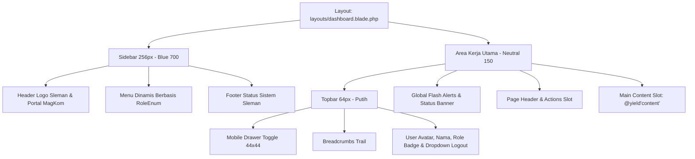

# Plan: Layout Master Dashboard Terpadu (resources/views/layouts/dashboard.blade.php)

- **Tanggal**: 2026-10-09
- **Status**: Selesai (Completed)
- **Author**: Antigravity (web-planning)
- **Rujukan**: [`docs/07-DESIGN-SYSTEM-MAGKOM.md`](file:///g:/MAGKOM/docs/07-DESIGN-SYSTEM-MAGKOM.md), [`docs/01-PRD-MagKom.md`](file:///g:/MAGKOM/docs/01-PRD-MagKom.md), [`docs/02-TDD-MagKom.md`](file:///g:/MAGKOM/docs/02-TDD-MagKom.md)

---

## 1. Tujuan
Membangun template master **Layout Dashboard Terpadu (`resources/views/layouts/dashboard.blade.php`)** yang berfungsi sebagai fondasi visual dan struktur antarmuka untuk 4 peran pengguna (*Peserta, Pembimbing, Admin, dan SuperAdmin*). 

Layout ini wajib mematuhi standar desain [Design System MagKom Bab 2 dan 3](file:///g:/MAGKOM/docs/07-DESIGN-SYSTEM-MAGKOM.md) dengan sidebar dinamis berbasis peran, topbar dengan menu pengguna & breadcrumbs, container flash message global, navigasi drawer responsif (desktop & mobile), serta aksesibilitas WCAG 2.1 AA.

---

## 2. Asumsi & Pertanyaan Terbuka
- **Asumsi**:
  1. Halaman dashboard diakses oleh pengguna terautentikasi (`auth()->check()`) yang memiliki peran salah satu dari enum `RoleEnum` (`superadmin`, `admin`, `pembimbing`, `peserta`).
  2. Font antarmuka menggunakan **Open Sans** (sesuai Design System Bab 2.2).
  3. Menggunakan Vanilla CSS terintegrasi (CSS Variables / Design Tokens) tanpa ketergantungan compile eksternal agar langsung dapat dirender secara instan dan aman di lingkungan CSP (`style-src 'self'`).
  4. Ikon antarmuka menggunakan **Lucide SVG Inline** berukuran 18–20px untuk menghindari masalah latensi font icon eksternal dan menjaga kepatuhan CSP.
- **Pertanyaan Terbuka**: Tidak ada. Spesifikasi menu tiap role dan token warna telah terkunci di PRD dan Design System.

---

## 3. Pendekatan Desain & Arsitektur

### Opsi Terpilih: Modular Blade Layout dengan Self-Contained Design Tokens & Dynamic Role Navigation
- **Alasan Pemilihan**:
  1. **Konsistensi Visual & Kecepatan Rendering**: Menerapkan token resmi [Design System MagKom Bab 2.1](file:///g:/MAGKOM/docs/07-DESIGN-SYSTEM-MAGKOM.md) (`--blue-700: #0641CC`, `--blue-600: #0751FF`, `--neutral-150: #F5F7FB`, `--neutral-0: #FFFFFF`, dll.) secara langsung di level layout sehingga seluruh halaman turunan (`@extends('layouts.dashboard')`) otomatis mewarisi styling yang seragam tanpa perlu konfigurasi ulang.
  2. **RBAC Menu Dinamis**: Menampilkan menu navigasi sidebar secara kondisional sesuai `auth()->user()->role` sehingga Peserta, Pembimbing, Admin, dan SuperAdmin hanya melihat tautan yang relevan dan berhak diakses.
  3. **Zero External Overhead**: Tidak membutuhkan server bundler tambahan saat runtime; berjalan mulus langsung di Laravel Blade server-side rendering.

### Alternatif yang Dipertimbangkan:
- *Opsi B (Pemisahan 4 Layout terpisah: `peserta.blade.php`, `admin.blade.php`, dst)*: Ditolak karena duplikasi kode CSS token, header, skrip drawer mobile, dan flash alert di 4 file berbeda akan menyulitkan pemeliharaan dan berisiko inkonsistensi visual.

---

## 4. Perincian Struktur Komponen Layout

### Detail Navigasi Menu per Peran (PRD Bab 9.2):
1. **Peserta** (`peserta`):
   - 👤 **Profil Saya**: `peserta.profil.show` (Ikon `user`)
   - 📝 **Pendaftaran Magang**: `peserta.pendaftaran.index` (Ikon `clipboard-list`)
   - 📖 **Logbook Harian**: `peserta.logbook.index` (Ikon `book-open`)
   - 📋 **Tugas & Progres**: `peserta.tugas.index` (Ikon `list-checks`)
   - 🏆 **Lembar Nilai**: `peserta.nilai.show` (Ikon `award`)
2. **Pembimbing** (`pembimbing`):
   - 📋 **Tugas Peserta**: `pembimbing.tugas.index` (Ikon `list-checks`)
   - 📖 **Reviu Logbook**: `pembimbing.logbook.index` (Ikon `book-open`)
   - 🏆 **Penilaian Magang**: `pembimbing.penilaian.index` (Ikon `award`)
3. **Admin** (`admin`):
   - 🔍 **Verifikasi Pendaftaran**: `admin.pendaftaran.index` (Ikon `file-search`)
   - 📊 **Manajemen Kuota**: `admin.kuota.index` (Ikon `layout-dashboard`)
   - ⏳ **Antrean Waiting List**: `admin.waiting-list.index` (Ikon `clock`)
   - 👥 **Penempatan Magang**: `admin.penempatan.index` (Ikon `users`)
   - 📑 **Laporan & Rekapitulasi**: `admin.laporan.pendaftaran` (Ikon `scroll-text`)
4. **SuperAdmin** (`superadmin`):
   - 📅 **Periode Bulan Magang**: `superadmin.bulan.index` (Ikon `calendar`)
   - 🛡️ **Slot Khusus Internal**: `superadmin.slot-khusus.index` (Ikon `shield-check`)
   - 👥 **Manajemen Staf**: `superadmin.staf.index` (Ikon `users`)
   - 🏫 **Master Jurusan**: `superadmin.jurusan.index` (Ikon `building-2`)
   - 🏛️ **Master Bidang Dinas**: `superadmin.bidang.index` (Ikon `building-2`)
   - ⚖️ **Master Rubrik Nilai**: `superadmin.rubrik.index` (Ikon `award`)
   - ⚙️ **Pengaturan Sistem**: `superadmin.pengaturan.index` (Ikon `settings`)
   - 📜 **Jejak Audit Log**: `superadmin.audit-log.index` (Ikon `scroll-text`)

---

## 5. Perubahan File

| File Path | Aksi | Ringkasan Perubahan |
| :--- | :---: | :--- |
| [`resources/views/layouts/dashboard.blade.php`](file:///g:/MAGKOM/resources/views/layouts/dashboard.blade.php) | **Create** | Master Dashboard Layout baru dengan CSS Tokens, Sidebar per Role, Topbar responsif, User Menu, Alerts, dan Slot Konten. |
| [`tests/Feature/DashboardLayoutTest.php`](file:///g:/MAGKOM/tests/Feature/DashboardLayoutTest.php) | **Create** | Feature test otomatis pengujian rendering multi-peran dan banner masa tenggang. |

---

## 6. Langkah Implementasi
*Catatan: Checklist di bawah ini telah dieksekusi dan diverifikasi.*

- [x] **Langkah 1**: Buat file [`resources/views/layouts/dashboard.blade.php`](file:///g:/MAGKOM/resources/views/layouts/dashboard.blade.php) dengan fondasi HTML5 semantik, meta tags, CSRF token, dan Google Fonts Open Sans.
- [x] **Langkah 2**: Definisikan CSS Tokens di tag `<style>` sesuai Design System Bab 2.1 (Neutral, Blue 700, Blue 600, Blue Tint, Status Colors, Focus ring, Radius, Elevations).
- [x] **Langkah 3**: Buat struktur grid/flex desktop & drawer mobile:
  - Sidebar selebar 256px dengan latar `--blue-700` (`#0641CC`).
  - Item navigasi dengan target sentuh minimal 44px, radius 8px, padding 10px 12px.
  - State aktif (latar putih, teks `--blue-700`, font-weight 600) vs state inaktif (teks putih/85%, hover putih/15%).
- [x] **Langkah 4**: Implementasikan logika percabangan menu Blade per peran (`auth()->user()->role`) untuk Peserta, Pembimbing, Admin, dan SuperAdmin dengan tautan rute dan ikon SVG inline Lucide.
- [x] **Langkah 5**: Bangun Topbar setinggi 64px berlatar putih dengan border bawah `--neutral-400`:
  - Tombol toggle hamburger (mobile < 1024px) berukuran minimal 44x44px.
  - Slot breadcrumbs (`@yield('breadcrumbs')`).
  - Avatar inisial pengguna (38px, Blue Tint + Blue 700), nama lengkap, dan badge chip peran.
  - Dropdown interaktif akun (Profil, Ganti Password, Ke Beranda Publik, dan Tombol Logout aman via POST form).
- [x] **Langkah 6**: Buat komponen Flash Alert seragam untuk notifikasi pesan sesi (`session('success')`, `session('error')`, `session('warning')`, `session('info')`, dan `$errors->any()`).
- [x] **Langkah 7**: Buat komponen Banner Masa Tenggang khusus role peserta saat penempatan berstatus `selesai` dan akun dalam masa tenggang (AC-12-2).
- [x] **Langkah 8**: Tambahkan skrip interaksi vanilla JS ringan (toggle drawer sidebar mobile, tutup drawer via backdrop/Esc, toggle dropdown profil pengguna dengan klik luar / Esc).
- [x] **Langkah 9**: Uji sintaks Blade dan verifikasi rendering layout dengan mengakses salah satu route dashboard untuk memastikan tidak ada kesalahan sintaks atau link rute yang rusak.

---

## 7. Strategi Testing & Verifikasi
- **Automated / Syntax Verification**:
  - `php artisan view:cache` berjalan mulus dan sukses caching view.
  - `php artisan test --filter=DashboardLayoutTest` lulus 100% (5 tests, 47 assertions).
- **Manual / Visual Verification**:
  - Desktop (≥ 1024px): Sidebar 256px terpancang rapi di sisi kiri dan area kerja menggunakan latar `#F5F7FB`.
  - Mobile (360px – 768px): Sidebar tersembunyi menjadi drawer dan tombol hamburger 44x44px membuka drawer dengan latar scrim gelap.
  - Menu item aktif berubah sesuai URL halaman yang sedang dibuka.
  - Dropdown akun dapat dibuka dan form logout bekerja dengan benar.

---

## 8. Risiko & Mitigasi
- **Risiko Rute Belum Ada / Parameter Khusus**: Menggunakan pengecekan `Route::has(...)` dan fallback yang aman.
- **Risiko Aksesibilitas Kontras (WCAG 2.1 AA)**: Mengikuti aturan perbaikan K-1 s/d K-5 pada Design System Bab 2.6.
- **Risiko Keamanan**: Seluruh aksi POST (logout) dilindungi `@csrf`.

---

## 9. Kriteria Selesai (Definition of Done)
- [x] File [`resources/views/layouts/dashboard.blade.php`](file:///g:/MAGKOM/resources/views/layouts/dashboard.blade.php) berhasil dibuat dan lulus `php artisan view:cache`.
- [x] Tampilan memenuhi seluruh token warna resmi Diskominfo Sleman pada Design System.
- [x] Keempat peran pengguna mendapatkan daftar menu sidebar yang sesuai hak aksesnya.
- [x] Responsif dari resolusi 360px hingga layar desktop tanpa overflow horizontal.
- [x] Test suite `DashboardLayoutTest` lulus 100% tanpa error regresi.
