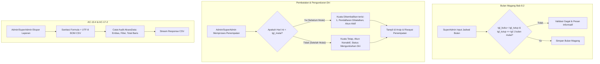

# Plan: Pengembangan Lanjutan Administrasi & SuperAdmin Sesuai PRD (Fase 4)

- **Tanggal**: 2026-10-10
- **Status**: Draft (Menunggu Persetujuan)
- **Author**: Antigravity (web-planning)
- **Dokumen Referensi**: 
  - [01-PRD-MagKom.md](file:///g:/MAGKOM/docs/01-PRD-MagKom.md) (Bab 3.1, 3.3, 5, 6, 7, 8, dan 9)
  - [02-TDD-MagKom.md](file:///g:/MAGKOM/docs/02-TDD-MagKom.md)
  - [05-KEAMANAN-RBAC-DAN-AUDIT-TRAIL.md](file:///g:/MAGKOM/docs/05-KEAMANAN-RBAC-DAN-AUDIT-TRAIL.md)

---

## 1. Tujuan & Konteks

Setelah penyelesaian Fase 3 (keputusan Waiting List dinamis, batas kuota akumulatif per bulan BR-01, guard relasi aktif BR-12, edit staf AC-11-1, dan filter rentang waktu laporan), analisis lanjutan terhadap PRD MagKom mengidentifikasi 5 area fungsional penting yang masih perlu disempurnakan pada **Portal Administrasi (`/admin/*`)** dan **Portal SuperAdmin (`/superadmin/*`)**:

1. **Penegakan Aturan Formulir Jadwal Bulan Magang (PRD Bab 8.2 Form Bulan Magang)**:
   - PRD menentukan aturan: `tgl_buka < tgl_tutup ≤ tanggal 1 pada bulan mulai`.
   - Saat ini validasi baru memeriksa `tgl_buka <= tgl_tutup` dan belum memvalidasi batas atas `tgl_tutup <= tanggal 1 pada bulan mulai`, sehingga memungkinkan pendaftaran ditutup setelah magang sudah dimulai.
2. **Penanganan Lengkap Status `Mengundurkan Diri` pada Penempatan & Arsip (PRD Bab 6.1, F-07, AC-07-5, BR-07, AC-12-4)**:
   - Status penempatan `StatusPenempatanEnum::MengundurkanDiri` belum dimasukkan ke dalam daftar pemantauan Arsip Peserta SuperAdmin (hanya `selesai` dan `nonaktif`), mengakibatkan peserta yang mengundurkan diri menjadi data yatim (*orphan data*).
   - Antarmuka pembatalan di `admin.penempatan.index` perlu memberikan kejelasan kontekstual aturan BR-07 (apakah pembatalan dilakukan sebelum tanggal mulai dengan pengembalian kuota, atau pencatatan pengunduran diri saat magang berjalan dengan penonaktifan akun permanen).
3. **Penegakan Urutan FIFO Antrean Verifikasi & Pencarian NIM/NISN (PRD AC-04-1, BR-05)**:
   - PRD AC-04-1 mewajibkan antrean verifikasi menampilkan pendaftaran berstatus `diajukan` dan `waiting_list` terurut **FIFO berdasarkan `diajukan_at` terlama**. Saat ini sistem masih mengurutkan berdasarkan `created_at desc`.
   - Penyempurnaan audit trail pencatatan status lama pada `PlacementService::terima` agar tidak hardcode `diajukan` melainkan nilai status dinamis dari pendaftaran terkait.
4. **Audit Trail Akses Data Ekspor & Kompatibilitas Laporan (PRD AC-13-4, AC-17-1, AC-17-2)**:
   - PRD AC-13-4 mewajibkan setiap akses data (termasuk ekspor) tercatat satu baris audit per request dengan detail: pengguna, entitas, filter, dan jumlah baris data.
   - Penyempurnaan file CSV hasil ekspor dengan penambahan UTF-8 BOM agar langsung terbaca rapi dan kompatibel di Microsoft Excel lokal tanpa distorsi karakter.
5. **Penyempurnaan Filter Audit Trail SuperAdmin (PRD AC-13-6)**:
   - AC-13-6 mewajibkan kemudahan filtering log audit berdasarkan pengguna, tanggal, tipe, entitas, dan request ID. Saat ini filter pengguna belum memiliki dropdown daftar staf sehingga menyulitkan inspeksi cepat oleh SuperAdmin.

---

## 2. Analisis Kebutuhan Berdasarkan Dokumen PRD

### A. Validasi Jadwal Periode Bulan Magang (PRD Bab 8.2 Form Bulan Magang)
- **Aturan**:
  ```
  tgl_buka < tgl_tutup ≤ tanggal 1 pada bulan mulai
  ```
- **Kriteria**:
  - `tgl_buka` harus strictly sebelum `tgl_tutup` (`before:tgl_tutup`).
  - `tgl_tutup` harus sebelum atau sama dengan tanggal 1 pada bulan mulai magang (`before_or_equal:bulan_mulai_awal`).

### B. Siklus Hidup Penempatan & Pengunduran Diri (PRD Bab 6.1, AC-07-5, BR-07, AC-12-4)
- **Aturan BR-07**:
  - **Kasus 1 (Sebelum Tanggal Mulai)**: Pembatalan penerimaan. Kuota umum (`kuota.terisi`) atau slot khusus (`slot_khusus.terisi`) berkurang 1. Status pendaftaran menjadi `dibatalkan`. Akun peserta tetap aktif.
  - **Kasus 2 (Sejak Tanggal Mulai)**: Pengunduran diri saat magang berjalan. Kuota tidak dikembalikan (hangus). Akun peserta dinonaktifkan (`status_aktif = false`). Status penempatan menjadi `mengundurkan_diri`.
- **Kriteria AC-12-4**:
  - Halaman Arsip Peserta SuperAdmin (`/superadmin/arsip-peserta`) harus dapat menampilkan seluruh peserta magang yang telah menyelesaikan program magang (`selesai`, `nonaktif`, dan `mengundurkan_diri`) secara baca-saja.

### C. Antrean Verifikasi FIFO & Pencarian Multi-Kriteria (PRD AC-04-1)
- **Kriteria**:
  - Antrean pendaftaran `diajukan` dan `waiting_list` terurut berdasarkan `diajukan_at asc` (FIFO), sehingga pendaftar yang mengunggah berkas lebih dahulu diproses lebih dahulu.
  - Filter pencarian teks dapat mencari nama pendaftar, email, nama sekolah/kampus, nomor registrasi, maupun NIM/NISN secara presisi.

### D. Audit Log Akses Data & Laporan (PRD AC-13-4, AC-17-2)
- **Kriteria**:
  - Setiap aksi ekspor laporan (pendaftaran, penempatan, kuota, nilai) mencatat baris audit bertipe `AksesData` yang memuat nama tabel/entitas, filter rentang tanggal, filter jurusan, dan jumlah baris data yang diekspor.
  - File ekspor CSV ditambahkan UTF-8 BOM (`\xEF\xBB\xBF`) agar otomatis dikenali Microsoft Excel dengan formula sanitization tetap aktif.

### E. Inspeksi Audit Trail SuperAdmin (PRD AC-13-6)
- **Kriteria**:
  - Filter audit trail menyediakan dropdown pilihan staf internal dinas (SuperAdmin, Admin, Pembimbing) untuk mempermudah pelacakan rekam jejak aktivitas staf tertentu.

---

## 3. Komponen Terdampak

| Komponen / File | Tipe Perubahan | Deskripsi Singkat |
|---|---|---|
| `app/Http/Requests/BulanMagangRequest.php` | Modifikasi | Validasi `tgl_buka < tgl_tutup <= tanggal 1 bulan mulai` (Bab 8.2). |
| `app/Http/Controllers/SuperAdmin/ArsipPesertaController.php` | Modifikasi | Menambahkan status `mengundurkan_diri` pada query arsip peserta (AC-12-4). |
| `resources/views/superadmin/arsip/index.blade.php` | Modifikasi | Menambahkan badge dan opsi filter `mengundurkan_diri`. |
| `resources/views/admin/penempatan/index.blade.php` | Modifikasi | Informasi visual pembatalan vs pengunduran diri sesuai tanggal mulai (BR-07). |
| `app/Services/PlacementService.php` | Modifikasi | Mengoreksi pencatatan nilai lama status pendaftaran saat penerimaan (AC-04-8). |
| `app/Http/Controllers/Admin/PendaftaranController.php` | Modifikasi | Pengurutan default FIFO `diajukan_at asc` untuk antrean aktif (AC-04-1). |
| `app/Services/ExportReportService.php` | Modifikasi | Penambahan UTF-8 BOM pada output CSV dan pencatatan audit log `AksesData` (AC-13-4, AC-17-2). |
| `app/Http/Controllers/SuperAdmin/AuditLogController.php` | Modifikasi | Mengirimkan daftar staf internal ke view untuk dropdown filter user (AC-13-6). |
| `resources/views/superadmin/audit-log/index.blade.php` | Modifikasi | Menyediakan dropdown pilihan user pada filter log audit. |
| `tests/Feature/AdminSuperAdminPhaseFourTest.php` | Baru | Test suite automated feature untuk memvalidasi fitur Fase 4. |

---

## 4. Rincian Teknis Implementasi



---

## 5. Langkah Implementasi

### Modul 1: Validasi Batas Jadwal Periode Bulan Magang (PRD Bab 8.2)
- [x] **Langkah 1.1**: Perbarui `app/Http/Requests/BulanMagangRequest.php`:
  - Ubah aturan `tgl_buka` menjadi: `['required', 'date', 'before:tgl_tutup']`.
  - Ubah aturan `tgl_tutup` menjadi: `['required', 'date', 'after:tgl_buka']`.
  - Tambahkan validasi kustom pada `withValidator()`: pastikan `tgl_tutup` tidak melewati tanggal 1 pada bulan magang (`$bulanMulai->startOfMonth()`).
  - Tambahkan pesan error berbahasa Indonesia: *"Tanggal tutup pendaftaran tidak boleh melewati tanggal awal dimulainya periode magang sesuai aturan instansi (Bab 8.2)."*

### Modul 2: Penanganan Status `Mengundurkan Diri` pada Penempatan & Arsip (PRD Bab 6.1, AC-07-5, BR-07, AC-12-4)
- [x] **Langkah 2.1**: Perbarui `app/Http/Controllers/SuperAdmin/ArsipPesertaController.php`:
  - Perluas query status penempatan pada method `index()` agar mencakup `StatusPenempatanEnum::MengundurkanDiri`.
  - Perbarui dropdown tahun dan filter status agar mendukung opsi `mengundurkan_diri`.
- [x] **Langkah 2.2**: Perbarui `resources/views/superadmin/arsip/index.blade.php`:
  - Tambahkan badge dan label untuk status `Mengundurkan Diri` pada tabel arsip peserta.
- [x] **Langkah 2.3**: Perbarui modal pembatalan di `resources/views/admin/penempatan/index.blade.php`:
  - Tampilkan callout informatif ketentuan pembatalan BR-07: sebelum tanggal mulai kuota kembali; sejak/setelah tanggal mulai kuota hangus & akun nonaktif.

### Modul 3: Penegakan Urutan FIFO Antrean Verifikasi & Pencarian (PRD AC-04-1, BR-05)
- [x] **Langkah 3.1**: Perbarui `app/Http/Controllers/Admin/PendaftaranController.php`:
  - Terapkan default pengurutan FIFO `COALESCE(diajukan_at, created_at) ASC` dengan tie-breaker id asc.
  - Sediakan opsi filter sort: FIFO (default), Terbaru (`created_at desc`), dan Terlama (`created_at asc`).
- [x] **Langkah 3.2**: Perbarui `app/Services/PlacementService.php`:
  - Pada method `terima()`, simpan nilai status aktual `$statusLama = $p->status->value` secara dinamis pada audit log.

### Modul 4: Audit Trail Akses Data Ekspor & Kompatibilitas Excel CSV (PRD AC-13-4, AC-17-1, AC-17-2)
- [x] **Langkah 4.1**: Perbarui `app/Services/ExportReportService.php`:
  - Tambahkan penulisan UTF-8 BOM (`\xEF\xBB\xBF`) pada awal stream generator CSV sebelum baris header pertama.
  - Ubah pencatatan tipe audit ekspor menjadi `TipeAuditEnum::AksesData`.
- [x] **Langkah 4.2**: Perbarui `app/Http/Controllers/Admin/LaporanController.php`:
  - Verifikasi penerusan objek user admin/superadmin pelaku ekspor ke service.

### Modul 5: Penyempurnaan Filter Audit Trail SuperAdmin (PRD AC-13-6)
- [x] **Langkah 5.1**: Perbarui `app/Http/Controllers/SuperAdmin/AuditLogController.php`:
  - Ambil daftar staf internal (`User::whereIn('role', [RoleEnum::SuperAdmin, RoleEnum::Admin, RoleEnum::Pembimbing])`) dan teruskan ke view.
- [x] **Langkah 5.2**: Perbarui `resources/views/superadmin/audit-log/index.blade.php`:
  - Tambahkan dropdown select `user_id` berisi daftar nama staf internal dan perannya.

### Modul 6: Automated Testing & Verifikasi Menyeluruh
- [x] **Langkah 6.1**: Buat feature test komprehensif `tests/Feature/AdminSuperAdminPhaseFourTest.php` yang mencakup 8 skenario pengujian.
- [x] **Langkah 6.2**: Jalankan pengujian test suite (`php artisan test --filter=AdminSuperAdminPhaseFourTest`) dan suite regresi (100% PASS).

---

## 6. Strategi Testing

### Automated Feature Test (`tests/Feature/AdminSuperAdminPhaseFourTest.php`):
1. `test_validasi_bulan_magang_menolak_tgl_tutup_melebihi_tanggal_1_bulan_mulai`: Memastikan `tgl_tutup <= tgl 1 bulan mulai` ditegakkan per Bab 8.2 (PASS).
2. `test_validasi_bulan_magang_menolak_tgl_buka_setelah_tgl_tutup`: Memastikan `tgl_buka < tgl_tutup` (PASS).
3. `test_validasi_bulan_magang_menerima_jadwal_yang_sesuai_aturan_bab_8_2`: Memastikan tanggal valid diterima dengan baik (PASS).
4. `test_arsip_peserta_superadmin_menampilkan_peserta_mengundurkan_diri`: Memastikan status `mengundurkan_diri` tampil dan dapat difilter di arsip (PASS).
5. `test_antrean_verifikasi_admin_mengurutkan_fifo_berdasarkan_diajukan_at`: Memastikan default antrean verifikasi adalah FIFO (PASS).
6. `test_placement_service_terima_mencatat_status_lama_secara_akurat_pada_audit_trail`: Memastikan audit log mencatat status riwayat secara dinamis (PASS).
7. `test_ekspor_csv_menyertakan_utf8_bom_dan_mencatat_audit_akses_data`: Memastikan output CSV memuat UTF-8 BOM dan audit trail AksesData (PASS).
8. `test_filter_audit_log_superadmin_merender_dropdown_staf_internal_dan_memfilter_user`: Memastikan filter user ID dan dropdown staf bekerja presisi (PASS).

---

## 7. Risiko & Mitigasi

- **Risiko Query Pengurutan Pendaftaran Kosong `diajukan_at`**:
  - *Mitigasi*: Menggunakan `COALESCE(diajukan_at, created_at) ASC` yang menjamin fallback aman untuk data lama.
- **Risiko Kompatibilitas BOM CSV**:
  - *Mitigasi*: Tuliskan `\xEF\xBB\xBF` tepat di awal output stream sebelum baris header pertama, sehingga Excel langsung membaca encoding UTF-8 tanpa merusak sanitasi formula injection.
- **Risiko Performa Query Dropdown Staf pada Audit Log**:
  - *Mitigasi*: Filter hanya mengambil user internal (SuperAdmin, Admin, Pembimbing) yang jumlahnya terkelola (< 5ms).

---

## 8. Kriteria Selesai (Definition of Done)

- [x] Seluruh checklist langkah implementasi tercentang `- [x]`.
- [x] Validasi jadwal bulan magang menolak tanggal tutup yang melewati tanggal mulai magang (Bab 8.2).
- [x] Penempatan berstatus `mengundurkan_diri` terintegrasi penuh di halaman Arsip Peserta SuperAdmin (AC-12-4).
- [x] Antrean verifikasi menampilkan pendaftaran terurut FIFO berdasarkan `diajukan_at` (AC-04-1).
- [x] Ekspor laporan CSV memuat UTF-8 BOM dan mencatat audit trail `akses_data` per request (AC-13-4, AC-17-2).
- [x] Filter audit log SuperAdmin memiliki dropdown pemilihan staf yang ergonomis (AC-13-6).
- [x] Seluruh test di `AdminSuperAdminPhaseFourTest.php` dan tes regresi lulus 100% green (35 tests, 260 assertions).

---

## 9. Catatan Perubahan & Saran Lanjutan

- **Catatan Hasil Eksekusi**:
  - Semua 5 modul berhasil diselesaikan dan diverifikasi.
  - Fitur FIFO antrean verifikasi dilengkapi dengan switcher dropdown (`FIFO`, `Terbaru`, `Terlama`).
  - Output CSV untuk seluruh jenis ekspor laporan kini 100% kompatibel dengan Microsoft Excel via UTF-8 BOM.
  - Dropdown filter aktor pada Audit Trail mempermudah investigasi terhadap aktivitas staf internal instansi.
- **Saran Lanjutan (Out of Scope)**:
  - Ekspor multi-lembar XLSX langsung via library spreadsheet terdedikasi bila instansi menginginkan file `.xlsx` biner native di masa depan.
