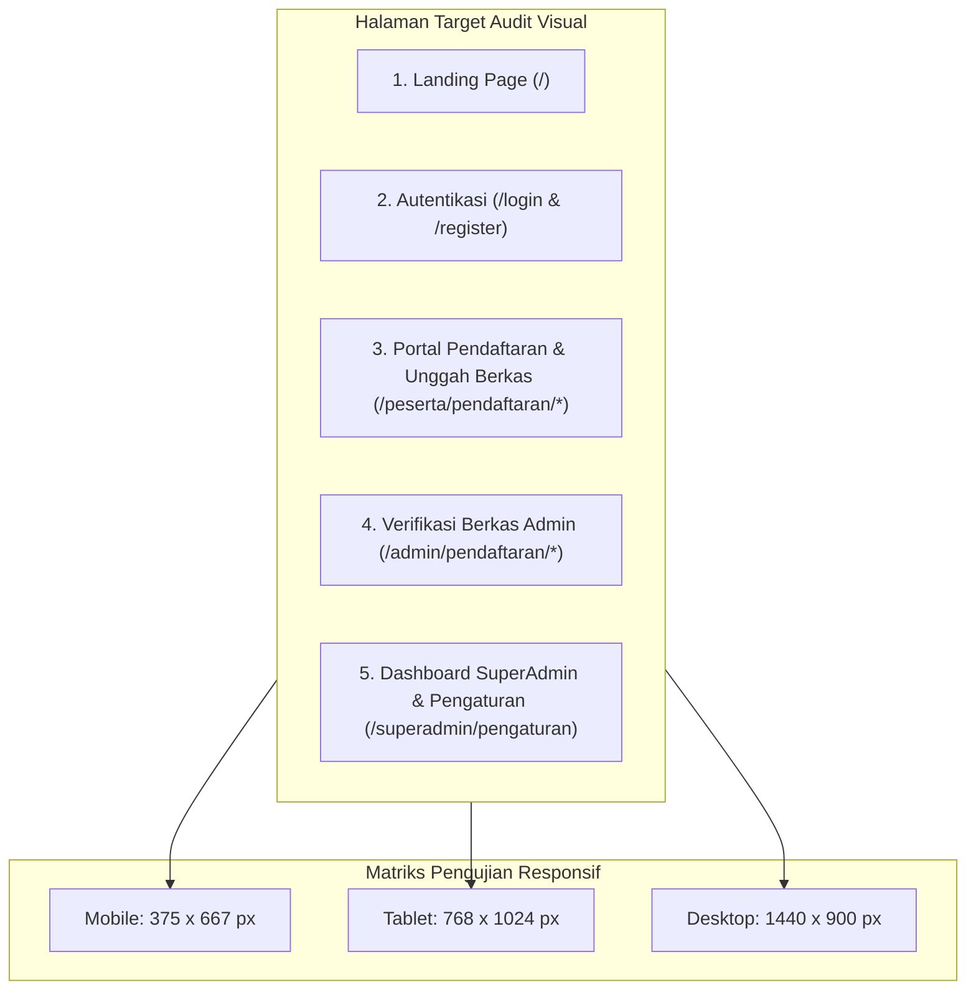

# Rencana Kerja (Plan): Audit Keamanan Sistem & Inspeksi Komprehensif UI/UX MagKom

- **Tanggal Dokumen**: 2026-10-14
- **Versi**: 1.0.0
- **Status**: Draft Rencana (Menunggu Persetujuan User)
- **Framework & Skills Terlibat**:
  - **AppSec & Pentest**: `api-security-testing`, `owasp-top-10-testing`, `web-app-penetration-testing`
  - **UI/UX & Design Engine**: `ui-ux-pro-max`, `impeccable`, `better-colors`, `better-typography`, `better-accessibility`
  - **Automation & Quality Gates**: `dev-workflows`, `web-planning`, Playwright MCP, PHPUnit Test Suite

---

## 1. Tujuan dan Ruang Lingkup

Rencana ini bertujuan untuk menjalankan **dua pilar audit komprehensif** pada portal MagKom (Magang Kominfo Sleman):
1. **Audit Keamanan Sistem (AppSec)**: Menyelidiki kerentanan kritis pada endpoint pengolahan berkas fisik terhadap celah IDOR/BOLA dan berbagai vektor injeksi, serta memverifikasi ketahanan kontrol akses berjenjang (Broken Access Control) pada seluruh rute eksklusif SuperAdmin.
2. **Inspeksi Antarmuka & Aksesibilitas (`/ui-check`)**: Mengevaluasi kualitas pengalaman pengguna, hierarki visual, kontras warna WCAG 2.2 AA, tipografi, dan responsivitas multi-perangkat (Mobile, Tablet, Desktop) menggunakan perpaduan engine desain `ui-ux-pro-max` dan `impeccable`.

---

## 2. Asumsi dan Batasan Audit

1. **Prinsip Read-Only & Zero Destruction**: Sesuai guardrail keamanan, seluruh proses pengujian keamanan awal dijalankan secara analitis melalui source code review, white-box parameter tracing, dan test harness otomatis (`php artisan test`) tanpa merusak integritas basis data.
2. **Kondisi Database Lokal**: Lingkungan lokal tidak menjalankan service MySQL background, sehingga pengujian otomatis mengandalkan database SQLite in-memory yang telah terbukti 100% kompatibel (329 passed assertions).
3. **Standar Desain Acuan**: Rujukan estetika mengacu pada Design System MagKom (`docs/07-DESIGN-SYSTEM-MAGKOM.md`), Figma Node 560, font Google Open Sans & JetBrains Mono, serta rasio kontras minimum WCAG 2.2 Level AA (4.5:1 untuk teks normal).

---

## 3. Pilar I: Rencana Audit Keamanan Sistem (AppSec)

### A. Audit 1: API Verifikasi & Pengelolaan Berkas (BOLA/IDOR & Injection)
*Target File*:
- [`app/Http/Controllers/Peserta/BerkasController.php`](file:///g:/MAGKOM/app/Http/Controllers/Peserta/BerkasController.php)
- [`app/Http/Controllers/Admin/PendaftaranController.php`](file:///g:/MAGKOM/app/Http/Controllers/Admin/PendaftaranController.php)
- [`app/Http/Controllers/Public/VerifikasiDokumenController.php`](file:///g:/MAGKOM/app/Http/Controllers/Public/VerifikasiDokumenController.php)
- [`app/Services/DocumentStorageService.php`](file:///g:/MAGKOM/app/Services/DocumentStorageService.php)
- [`app/Policies/DokumenPolicy.php`](file:///g:/MAGKOM/app/Policies/DokumenPolicy.php)

#### 1. Uji Broken Object-Level Authorization (BOLA / IDOR)
- **Skenario IDOR Unduh & Pratinjau**:
  - Menguji apakah Peserta A dapat mengakses file dokumen milik Peserta B melalui manipulasi ID model binding pada rute `/berkas/{dokumen}/download` dan `/berkas/{dokumen}/pratinjau`.
  - Verifikasi ketat otorisasi `DokumenPolicy::view`: memastikan hanya pemilik pendaftaran, pembimbing resmi dari penempatan aktif, atau staf Admin/SuperAdmin yang dapat meloloskan request.
- **Skenario IDOR Pengunggahan Berkas**:
  - Menguji apakah Peserta A dapat mengunggah atau mengganti berkas pendaftaran milik Peserta B melalui rute `POST /peserta/pendaftaran/{pendaftaran}/berkas`.
  - Verifikasi penegakan otorisasi `$this->authorize('update', $pendaftaran)`.
- **Integritas Temporary Signed URL**:
  - Memverifikasi middleware `signed:relative`. Menguji apakah URL unduhan yang tanda tangannya diubah, parameter URL-nya dimanipulasi, atau sudah kedaluwarsa akan ditolak dengan respons `HTTP 403 Invalid Signature`.

#### 2. Vektor Injeksi & Integritas Penyimpanan (Injection Defense)
- **Path Traversal & Insecure Direct Storage Access**:
  - Menganalisis sanitasi nama file pada [`DocumentStorageService::simpan`](file:///g:/MAGKOM/app/Services/DocumentStorageService.php#L60). Memastikan path direktori `documents/{pendaftaran_id}` tidak dapat disisipi karakter traversal (`../`, `..\`, `%2e%2e`).
  - Memverifikasi bahwa seluruh dokumen tersimpan di disk privat non-publik (bukan di `public_path()` yang dapat diakses langsung oleh crawler web).
- **MIME Confusion & File Upload Polyglots**:
  - Memverifikasi validasi magic bytes pada [`DocumentStorageService::ALLOWED_MIMES`](file:///g:/MAGKOM/app/Services/DocumentStorageService.php#L21) (`application/pdf`, `image/jpeg`, `image/png`).
  - Menguji apakah skrip berbahaya dengan ekstensi ganda (misal: `shell.php.pdf`) atau file executable yang disamarkan dapat lolos ke media penyimpanan.
- **SQL Injection & Wildcard Manipulation**:
  - Memeriksa endpoint pencarian berkas dan pendaftaran (`PendaftaranController::index`).
  - Memastikan pencarian keyword `q` telah melalui sanitasi escape wildcard (`str_replace(['\\', '%', '_'], ...)`) sebelum diikat ke query Eloquent.
- **CSV Formula Injection**:
  - Memeriksa fitur ekspor bundel pendaftaran dan laporan rekapitulasi berkas terhadap potensi eksekusi formula Excel (`=`, `+`, `-`, `@`).

---

### B. Audit 2: Broken Access Control pada Rute-Rute SuperAdmin
*Target File*:
- [`routes/web.php`](file:///g:/MAGKOM/routes/web.php) (Prefix: `superadmin`)
- [`app/Http/Middleware/EnsureUserHasRole.php`](file:///g:/MAGKOM/app/Http/Middleware/EnsureUserHasRole.php)
- [`app/Http/Middleware/EnsureSuperAdminReadOnly.php`](file:///g:/MAGKOM/app/Http/Middleware/EnsureSuperAdminReadOnly.php)
- [`app/Http/Middleware/EnsurePasswordChanged.php`](file:///g:/MAGKOM/app/Http/Middleware/EnsurePasswordChanged.php)
- Seluruh Controller pada namespace `App\Http\Controllers\SuperAdmin\*`.

#### 1. Uji Eskalasi Hak Akses Vertikal (Privilege Escalation)
- **Pengujian Tanpa Otentikasi (Guest)**:
  - Menguji akses langsung terhadap seluruh rute kritis SuperAdmin (`/superadmin/dashboard`, `/superadmin/pengaturan`, `/superadmin/staf`, `/superadmin/role`, `/superadmin/audit-log`, `/superadmin/backup`, `/superadmin/health-monitor`).
  - Ekspektasi: Seluruh request tamu wajib diarahkan (HTTP 302) ke `/login`.
- **Pengujian Lintas Role (Peserta, Pembimbing, Admin)**:
  - Menguji apakah akun `peserta` atau `pembimbing` dapat memicu manipulasi konfigurasi SuperAdmin (`PUT /superadmin/pengaturan`), mengelola slot khusus (`/superadmin/slot-khusus`), atau mengakses log audit (`/superadmin/audit-log`).
  - Menguji apakah akun `admin` reguler dapat mengakses rute eksklusif SuperAdmin.
  - Ekspektasi: Seluruh request dari non-SuperAdmin wajib ditolak dengan `HTTP 403 Forbidden`.

#### 2. Penegakan Kebijakan SuperAdmin Read-Only (SEC-12)
- **Audit Manipulasi Nilai & Penugasan**:
  - Memverifikasi penegakan middleware [`EnsureSuperAdminReadOnly`](file:///g:/MAGKOM/app/Http/Middleware/EnsureSuperAdminReadOnly.php): SuperAdmin hanya diizinkan melihat data (GET), namun dilarang keras mengubah, menginput nilai, atau menyelesaikan penempatan secara sepihak (`POST`, `PUT`, `DELETE` pada namespace `pembimbing.*`).
  - Ekspektasi: Tindakan non-safe SuperAdmin pada modul evaluasi wajib ditolak dengan `HTTP 403`.

#### 3. State-Based Access Bypass
- **Penegakan Akun Nonaktif & Ganti Password Wajib**:
  - Menguji apakah SuperAdmin yang flag `must_change_password=true` dapat melompati halaman ganti password dan langsung mengakses endpoint manajerial.
  - Menguji apakah staf yang dinonaktifkan (`status_aktif=false`) masih dapat mengeksekusi operasi sistem.

---

## 4. Pilar II: Rencana Uji Tampilan & UX (`/ui-check` Multi-Skill)

Pengujian antarmuka menggabungkan 5 keahlian utama untuk menghasilkan audit komprehensif:

| Keahlian | Fokus Pemeriksaan | Alat & Indikator |
|---|---|---|
| **`ui-ux-pro-max`** | Harmonisasi sistem desain, layout grid 4px/8px, elevasi permukaan, mikro-interaksi, status badge, dan ikonografi | Token CSS, visual hierarchy check, border-radius consistency |
| **`impeccable`** | Polish antarmuka premium, transisi halus, state coverage (loading skeleton, empty states, error boundary), dan dark mode token | Visual polish audit, dark theme consistency |
| **`better-colors`** | Pengukuran rasio kontras warna terhadap teks dan elemen interaktif sesuai standar WCAG APCA / WCAG 2.2 AA | Minimum contrast 4.5:1 (normal text), 3:1 (large text & input borders) |
| **`better-typography`** | Skala tipografi (Open Sans untuk UI, JetBrains Mono untuk kode/data), line-height, text truncation, wrapping label | Readability score, no broken text overflow |
| **`better-accessibility`** | Kelengkapan atribut ARIA, navigasi keyboard (Tab index, visible focus ring), semantic HTML, tap targets min 44x44px | Chrome DevTools / Playwright a11y audit |

### Halaman Target & Skenario Uji Visual:

1. **Halaman Publik & Landing Page (`/`)**:
   - Memeriksa keterbacaan kuota publik, kontras tombol CTA, hero banner, dan layout responsif navigasi mobile hamburger.
2. **Halaman Autentikasi (`/login`, `/register`)**:
   - Memeriksa ketajaman border input form, pesan error validasi inline, tombol show/hide password, dan touch-target login Google OAuth.
3. **Portal Pendaftaran Peserta (`/peserta/pendaftaran/{id}`)**:
   - Memeriksa zona drop-area upload berkas, visual feedback saat file terlampir, format error badge berkas (format tidak valid / melebihi ukuran), dan tombol simpan draft.
4. **Halaman Verifikasi Berkas Administrator (`/admin/pendaftaran/{id}`)**:
   - Memeriksa antarmuka modal pratinjau dokumen PDF/JPG, tombol keputusan verifikasi (Terima, Perlu Perbaikan, Tolak), kartu riwayat pendaftaran, dan deteksi duplikasi NIM/NISN.
5. **Konfigurasi Pengaturan SuperAdmin (`/superadmin/pengaturan`)**:
   - Memeriksa tata letak kartu konfigurasi baru (Kartu 5: Feature Toggles), interaksi switch checkbox, responsivitas form input kuota, dan hierarki visual tombol aksi simpan.

---

## 5. Tahapan Pelaksanaan & Deliverables

### Tahap 1: Persiapan & Penyiapan Test Harness Otomatis (Security)
- Menyusun Feature Test baru:
  - `tests/Feature/SecurityDocumentVerificationAuditTest.php`: Menguji skenario BOLA/IDOR berkas, bypass signature, traversal, dan sanitasi input.
  - `tests/Feature/SecuritySuperAdminAccessControlTest.php`: Menguji seluruh matriks proteksi rute SuperAdmin lintas 4 peran pengguna.
- Menjalankan test suite untuk memastikan seluruh guardrail keamanan aktif dan terverifikasi secara programmatic.

### Tahap 2: Eksekusi Inspeksi Visual & Browser Automation (`/ui-check`)
- Menjalankan dev server lokal `php artisan serve`.
- Melakukan otomasi peramban menggunakan MCP Playwright:
  - Navigasi ke halaman target pada 3 viewport (Mobile 375px, Tablet 768px, Desktop 1440px).
  - Mengambil tangkapan layar (screenshot) artefak untuk setiap viewport.
  - Memeriksa console logs browser (memastikan 0 error JavaScript dan 0 resource 404).

### Tahap 3: Evaluasi Desain & Aksesibilitas Terintegrasi
- Menganalisis rasio kontras warna tombol, teks muted, dan background (`better-colors`).
- Mengevaluasi hierarki tipografi dan wrapping teks pada layar sempit (`better-typography`).
- Mengaudit kelengkapan ARIA labels dan urutan fokus keyboard (`better-accessibility`).
- Mengukur keselarasan dengan Design System MagKom & sentuhan kemewahan UI (`ui-ux-pro-max` & `impeccable`).

### Tahap 4: Penyusunan Laporan Audit Akhir & Rekomendasi
- Menyusun laporan komprehensif yang memuat:
  - **Security Scorecard**: Status temuan (Pass / Vulnerability / Warning) pada BOLA/IDOR, Signed URLs, Injections, dan SuperAdmin RBAC.
  - **UI/UX Audit Matrix**: Hasil inspeksi visual, kontras warna, responsivitas, dan daftar rekomendasi perbaikan tampilan jika ditemukan ketidaksesuaian.
  - **Langkah Remedi**: Solusi kode konkret jika ditemukan celah atau anomali visual.

---

## 6. Persetujuan dan Konfirmasi

Rencana kerja ini telah dirancang untuk memenuhi seluruh instruksi audit keamanan dan inspeksi visual secara terstruktur dan aman.

> **Mohon konfirmasi Anda:**
> Apakah rencana kerja ini sudah disetujui untuk dieksekusi? Jika Anda menyetujuinya, silakan balas dengan **"Lanjutkan"** atau **"Setuju"**, dan saya akan segera mulai mengeksekusi Tahap 1 (Audit Keamanan Otomatis) dan Tahap 2 (Inspeksi Visual UI/UX via Playwright).
