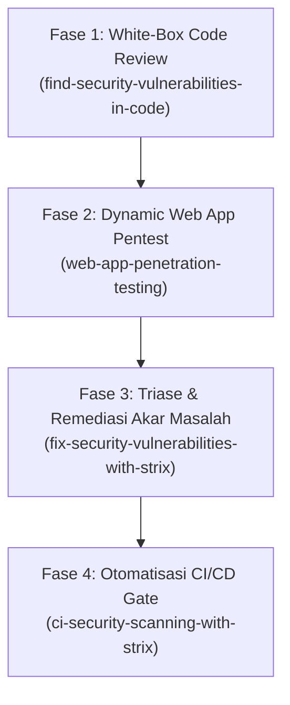

# Rencana Kerja Komprehensif Audit Keamanan Aplikasi (Strix Security Suite)

**Tanggal Dibuat**: 14 Oktober 2026  
**Target Aplikasi**: Portal Magang Terpadu Dinas Kominfo Sleman (MagKom)  
**Lingkup Pengujian**: White-Box Code Review, DAST Web Application Pentesting, Remediasi Akar Masalah, dan Otomatisasi CI/CD Security Gate.  
**Referensi Skill**:
- [`ci-security-scanning-with-strix`](file:///g:/MAGKOM/.agents/skills/ci-security-scanning-with-strix/SKILL.md)
- [`find-security-vulnerabilities-in-code`](file:///g:/MAGKOM/.agents/skills/find-security-vulnerabilities-in-code/SKILL.md)
- [`fix-security-vulnerabilities-with-strix`](file:///g:/MAGKOM/.agents/skills/fix-security-vulnerabilities-with-strix/SKILL.md)
- [`managed-pentesting-with-strix`](file:///g:/MAGKOM/.agents/skills/managed-pentesting-with-strix/SKILL.md)
- [`penetration-testing-with-strix`](file:///g:/MAGKOM/.agents/skills/penetration-testing-with-strix/SKILL.md)
- [`web-app-penetration-testing`](file:///g:/MAGKOM/.agents/skills/web-app-penetration-testing/SKILL.md)

---

## 1. Arsitektur & Pemilihan Engine Strix

Strix menyediakan dua jalur eksekusi yang menghasilkan output temuan (SARIF 2.1.0, Markdown, JSON) yang identik:

| Parameter | Opsi A: Managed Cloud Platform (`managed-pentesting-with-strix`) | Opsi B: Self-Hosted OSS CLI (`penetration-testing-with-strix`) |
| :--- | :--- | :--- |
| **Kebutuhan Lingkungan** | **Nol infrastruktur lokal** (Tidak butuh Docker, tidak butuh LLM API key lokal). | Butuh **Docker Desktop** aktif & LLM key sendiri (`STRIX_LLM`, `LLM_API_KEY`). |
| **Rekomendasi Lingkungan** | **Sangat Disarankan untuk host Windows saat ini** (Docker belum terpasang). | Cocok jika Docker sudah diaktifkan di WSL2/Host atau runner CI private. |
| **Aksesibilitas Hasil** | Dasbor tim online (`app.strix.ai`), unduhan laporan PDF resmi, integrasi webhook. | File lokal dalam direktori `strix_runs/<run-name>/`. |
| **Perintah Utama** | `strix cloud login` -> `strix cloud scans start --source .` | `strix -n -t ./ --scan-mode standard --max-budget 15` |

---

## 2. Rincian Alur Kerja 4 Fase



---

### Fase 1: White-Box Code Vulnerability Scanning (`find-security-vulnerabilities-in-code`)
**Tujuan**: Menginspeksi kode sumber Laravel untuk memetakan alur data (routes, sinks, auth layers) dan membuktikan kerentanan berbasis logika bisnis atau kontrol akses.

1. **Persiapan Ruang Lingkup (Scope Instruction)**:
   - Fokus 1: Otorisasi objek (IDOR/BOLA) pada modul pendaftaran, unduh dokumen ber-signature, dan isolasi mentee pembimbing.
   - Fokus 2: Pengecekan mass-assignment pada model `User`, `Penempatan`, dan `Penilaian`.
   - Fokus 3: Validasi sanitasi CSV Injection pada seluruh endpoint ekspor laporan admin & superadmin.
2. **Eksekusi Pemindaian**:
   - Jika via Cloud:
     ```bash
     strix cloud scans start --source . --instruction "Fokus audit: 1. IDOR pada /berkas/{dokumen}/download dan /pratinjau. 2. Role escalation pada /superadmin/* dan mass assignment $fillable. 3. Verifikasi middleware account.active."
     ```
   - Jika via Local CLI (bila Docker sudah aktif):
     ```bash
     strix -n -t ./ --scan-mode standard --max-budget 15 --instruction "Focus on authorization and input sinks in app/Http/Controllers"
     ```

---

### Fase 2: Dynamic Web App Penetration Testing (`web-app-penetration-testing`)
**Tujuan**: Menguji aplikasi yang sedang berjalan (live local server `http://127.0.0.1:8000`) dengan kredensial uji nyata untuk membuktikan exploitability lintas akun.

1. **Prasyarat & Konfigurasi Lingkungan**:
   - Menjalankan local dev server: `php artisan serve --port=8000`.
   - Menyiapkan set kredensial akun uji untuk 4 level peran:
     - Peserta A (Siswa SMK) & Peserta B (Mahasiswa)
     - Pembimbing Lapangan
     - Administrator Verifikator
     - Super Administrator
2. **Skenario Penetrasi Prioritas**:
   - **Cross-Account IDOR**: Memverifikasi apakah Peserta B dapat mengakses berkas privat atau membatalkan pendaftaran Peserta A.
   - **Vertical Privilege Escalation**: Memverifikasi apakah akun role Pembimbing atau Admin dapat mengakses rute konfigurasi SuperAdmin (`/superadmin/pengaturan`, `/staf`, `/backup`).
   - **State Access Violation**: Memverifikasi penegakan status non-aktif (`status_aktif = false`) langsung memutus sesi aktif.
   - **Brute Force & Rate Limiting**: Memverifikasi pembatasan 5 percobaan login gagal per menit (HTTP 429).
3. **Eksekusi Penetrasi**:
   ```bash
   strix -n -t ./ -t http://host.docker.internal:8000 --max-budget 20 \
     --instruction "Uji web app dinamis. Akun uji tersedia: superadmin@magkom.go.id, admin@magkom.go.id, pembimbing@magkom.go.id, peserta@magkom.go.id (password: Password123!). Uji IDOR antar peserta dan bypass rute SuperAdmin."
   ```

---

### Fase 3: Triase & Remediasi Terverifikasi (`fix-security-vulnerabilities-with-strix`)
**Tujuan**: Memperbaiki akar penyebab kerentanan (root-cause), bukan sekadar memblokir payload sementara, lalu membuktikan penutupan celah via pengujian ulang.

1. **Triase Temuan Berdasarkan Severity**:
   - Mengurutkan temuan dari artefak `strix_runs/<run>/vulnerabilities/` atau `strix cloud vulns list`:
     - **Critical / High**: Broken Access Control, IDOR, Remote Execution, SQLi, Auth Bypass.
     - **Medium**: CSRF exception, XSS, insecure file handling, credential leakage.
     - **Low / Info**: Security headers missing, verbose error pages.
2. **Prinsip Remediasi Akar Masalah**:
   - Jangan menyaring string manual; gunakan mekanisme bawaan framework (Laravel Middleware, Eloquent Parameterization, Blade auto-escaping, FormRequest validation).
   - Pastikan model `$fillable` tetap mengunci atribut sensitif (`role`, `status_aktif`).
3. **Verifikasi Ulang (Proof-of-Fix Re-Test)**:
   - Buat unit/feature test otomatis di `tests/Feature/` untuk setiap temuan.
   - Jalankan pemindaian diff-scoped Strix untuk memastikan kerentanan hilang dan exit code kembali `0`:
     ```bash
     strix -n -t ./ --scan-mode quick --scope-mode diff --max-budget 5
     ```

---

### Fase 4: Otomatisasi CI/CD Security Gate (`ci-security-scanning-with-strix`)
**Tujuan**: Mengintegrasikan Strix ke dalam alur kerja Git (GitHub Actions) sehingga setiap Pull Request (PR) otomatis dipindai sebelum diizinkan *merge* ke branch utama.

1. **Pembuatan File Konfigurasi Workflow**:
   - Membuat file [`.github/workflows/security.yml`](file:///g:/MAGKOM/.github/workflows/security.yml).
2. **Mekanisme Guardrail**:
   - Mode `quick` berbiaya rendah (diff-scoped scan terhadap branch target).
   - Unggah hasil laporan ke **GitHub Code Scanning (SARIF 2.1.0)**.
   - Blokir merge otomatis jika ditemukan kerentanan dengan tingkat keparahan `>= high`.

---

## 3. Langkah Aksi Segera (Action Plan Matrix)

| No | Tindakan | Skill Terkait | Kebutuhan Awal |
| :---: | :--- | :--- | :--- |
| **1** | **Pilih Jalur Strix**: Tentukan apakah menggunakan **Strix Cloud** (paling praktis, tanpa Docker) atau mengaktifkan **Docker Desktop** lokal. | `penetration-testing-with-strix` / `managed-pentesting-with-strix` | Keputusan user (Cloud vs Docker). |
| **2** | **Deploy CI Security Workflow**: Pasang file workflow GitHub Actions `.github/workflows/security.yml` untuk diff-scoped scan. | `ci-security-scanning-with-strix` | Repositori GitHub remote. |
| **3** | **Jalankan Audit Web App Hybrid**: Scan source code + local server `http://127.0.0.1:8000` dengan 4 akun demo. | `find-security-vulnerabilities-in-code` + `web-app-penetration-testing` | Server lokal aktif + token Strix. |
| **4** | **Remediasi & Verifikasi Otomatis**: Patch temuan apapun yang muncul dan verifikasi dengan PHPUnit test. | `fix-security-vulnerabilities-with-strix` | Test suite Laravel aktif. |

---

## 4. Status Kesiapan Aplikasi Saat Ini

Sebagai hasil dari audit tahap sebelumnya:
- **Test Keamanan MagKom**: 15 test spesifik (62 assertions) lulus 100%.
- **Test Regresi Sistem**: 342 test (1.892 assertions) lulus 100%.
- **Proteksi Aktif**:
  - Signed URLs + IDOR isolation di `BerkasController`
  - Strict middleware `role`, `account.active`, dan `superadmin.readonly`
  - Anti-brute force rate limiter pada `/login` dan `/register`
  - Magic bytes file upload validation & private storage hashing
  - Header HTTP OWASP lengkap di `SecurityHeaders`
