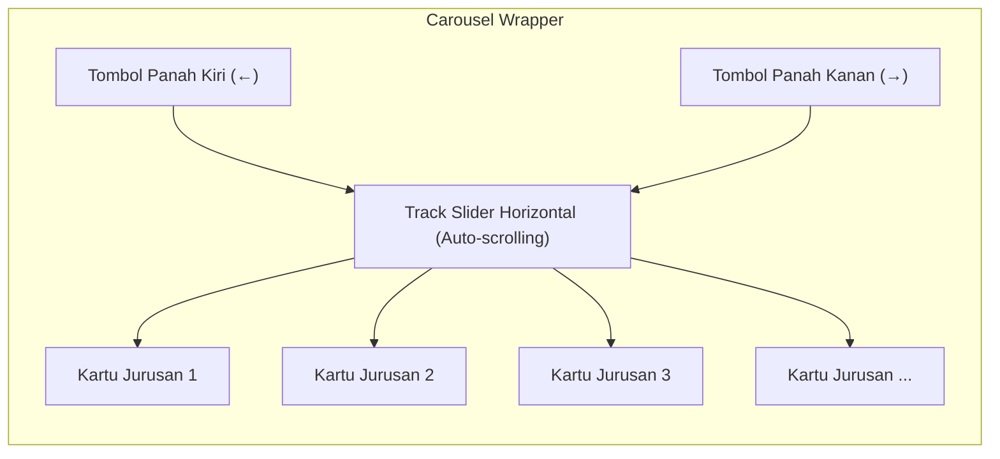

# Rencana Kerja: Desain & Implementasi Interactive Carousel Bidang dan Kuota Landing Page

**Tanggal:** 14 Oktober 2026  
**Status Dokumen:** Siap Review / Menunggu Persetujuan Pengguna  
**Terkait:** Interaktivitas & Dinamika Visual Bagian "Bidang dan kuota" di Halaman Depan (`resources/views/public/landing.blade.php`)  

---

## 1. Ringkasan Eksekutif & Tujuan

Pada versi saat ini, kartu program studi dan kuota magang pada bagian **"Bidang dan kuota"** disusun menggunakan CSS Grid statis vertikal ke bawah (`.quota-grid`). Dengan bertambahnya daftar jurusan baru di Diskominfo Sleman (4 jurusan SMK dan belasan jurusan Mahasiswa), tampilan memanjang ke bawah secara monoton dan membuat pengalaman pengguna (UX) terasa statis.

**Tujuan Pembaruan:**
Mengubah tata letak kartu bidang/kuota menjadi **Interactive Horizontal Carousel / Slider** yang:
1. **Dinamis & Bergerak Otomatis (Continuous Autoplay Motion)**: Kartu berjalan secara halus dari kanan ke kiri secara otomatis saat tidak diinteraksi, sehingga landing page terlihat aktif, hidup, dan memikat (wow factor).
2. **Kontrol Manual Tombol Panah (Arrow Navigation Buttons)**: Menyediakan tombol panah kiri (`←`) dan panah kanan (`→`) yang modern, elegan, dan presisi untuk navigasi manual langsung.
3. **Smart Pause on Interaction**: Otomatis berhenti sejenak saat kursor diarahkan ke kartu (*hover*) atau saat pengguna menyentuh layar (*touch*), agar pengguna dapat membaca rincian kuota dan mengklik tombol "Daftar Sekarang" dengan nyaman.
4. **Indikator Scroll & Drag Support**: Mendukung sentuhan geser (*drag/swipe*) pada perangkat seluler dan desktop serta indikator visual progress.
5. **Independensi Tab**: Berfungsi mulus pada kedua tab (*Jalur SMK* dan *Jalur Mahasiswa (D3 / S1)*).

---

## 2. Arsitektur Interaktivitas & UI/UX

### 2.1 Konsep Visual & Komponen


1. **`.quota-carousel-container`**:
   - Pembungkus relatif dengan perlindungan overflow (`overflow: hidden`).
   - Dilengkapi efek gradien pudar (*fade mask gradient*) di tepi kiri dan kanan untuk memberikan kesan kontinuitas yang mewah.
2. **`.quota-carousel-track`**:
   - Kontainer fleksibel horizontal (`display: flex; gap: 1.5rem; overflow-x: auto; scroll-behavior: smooth;`).
   - Scrollbar disembunyikan secara bersih (`scrollbar-width: none;`).
3. **`.figma-quota-card`**:
   - Diberikan lebar tetap yang proporsional: `flex: 0 0 360px` pada layar desktop dan `flex: 0 0 85vw` pada layar ponsel pintar (<640px).
   - Seluruh kartu mempertahankan elevasi, padding, badge bidang (IKP, EGOV, ITI, Sekretariat), dan tombol aksi pendaftaran.
4. **Tombol Navigasi Panah (`.carousel-nav-btn`)**:
   - Bentuk lingkaran elegan (diameter 46px), latar putih semi-transparan (*glassmorphism* `backdrop-filter: blur(8px)`), border halus, bayangan melayang (`box-shadow: 0 4px 14px rgba(0,0,0,0.1)`), dan ikon panah SVG tajam.
   - Micro-interaction: membesar halus saat hover (`transform: scale(1.08)`), warna berubah menjadi biru Pemkab Sleman (`var(--blue-600)`), dan transisi lembut saat diklik.
   - Diletakkan di samping kiri dan kanan kartu atau di baris kontrol atas yang selaras dengan tab pill button.

---

### 2.2 Logika Perilaku (Behavioral Logic)

1. **Auto-Scroll Mulus (Continuous Autoplay)**:
   - Menggunakan mekanisme `requestAnimationFrame` atau timer interval dengan pergeseran `scrollLeft += speed`.
   - Gerakan berkecepatan terkalibrasi (nyaman dilihat, tidak membuat pusing, ~0.6px per frame).
   - Ketika scroll mencapai titik ujung kanan (`scrollLeft + clientWidth >= scrollWidth - 2`), posisi scroll berputar kembali ke awal secara halus (*seamless wrap-around*).
2. **Pause on Hover / Focus / Touch**:
   - Event `mouseenter` / `touchstart` / `focusin`: menghentikan autoplay sementara (`isPaused = true`).
   - Event `mouseleave` / `touchend`: melanjutkan autoplay setelah jeda sejenak (delay 1.5 detik).
3. **Klik Tombol Panah Manual**:
   - Klik `prev`: menggeser slider ke kiri sebesar 1 kartu (`carousel.scrollBy({ left: -cardWidth, behavior: 'smooth' })`).
   - Klik `next`: menggeser slider ke kanan sebesar 1 kartu (`carousel.scrollBy({ left: cardWidth, behavior: 'smooth' })`).
   - Autoplay di-pause sesaat setelah tombol ditekan agar pengguna memiliki kendali penuh.
4. **Integrasi dengan Tab Switcher**:
   - Saat tab beralih antara "Jalur SMK" dan "Jalur Mahasiswa", animasi carousel pada tab aktif dihidupkan, dan tab yang tidak aktif dihentikan untuk menghemat penggunaan CPU dan baterai perangkat.

---

## 3. Spesifikasi Teknis Perubahan Kode

### 3.1 Berkas yang Dimodifikasi
- **Target Utama:** [`resources/views/public/landing.blade.php`](file:///g:/MAGKOM/resources/views/public/landing.blade.php)

### 3.2 Struktur CSS yang Diperkenalkan
```css
/* Carousel Container & Masking */
.quota-carousel-wrapper {
    position: relative;
    width: 100%;
    margin-bottom: 2.5rem;
}

.quota-carousel-track {
    display: flex;
    gap: 1.5rem;
    overflow-x: auto;
    scroll-behavior: smooth;
    scrollbar-width: none;
    -ms-overflow-style: none;
    padding: 0.75rem 0.25rem 1.5rem;
}

.quota-carousel-track::-webkit-scrollbar {
    display: none;
}

/* Fixed Width for Cards in Slider */
.quota-carousel-track .figma-quota-card {
    flex: 0 0 360px;
    width: 360px;
}

@media (max-width: 640px) {
    .quota-carousel-track .figma-quota-card {
        flex: 0 0 85vw;
        width: 85vw;
    }
}

/* Glassmorphism Floating Arrow Buttons */
.carousel-nav-btn {
    position: absolute;
    top: 50%;
    transform: translateY(-50%);
    width: 46px;
    height: 46px;
    border-radius: 50%;
    background: rgba(255, 255, 255, 0.92);
    backdrop-filter: blur(8px);
    border: 1px solid var(--neutral-300, #CBD5E1);
    box-shadow: 0 4px 14px rgba(15, 23, 42, 0.12);
    color: var(--neutral-800, #1E293B);
    display: flex;
    align-items: center;
    justify-content: center;
    cursor: pointer;
    z-index: 10;
    transition: all 0.2s cubic-bezier(0.16, 1, 0.3, 1);
}

.carousel-nav-btn:hover {
    background: var(--blue-600);
    color: #ffffff;
    border-color: var(--blue-600);
    box-shadow: 0 6px 18px rgba(7, 81, 255, 0.35);
    transform: translateY(-50%) scale(1.08);
}

.carousel-nav-btn.prev {
    left: -20px;
}

.carousel-nav-btn.next {
    right: -20px;
}

@media (max-width: 768px) {
    .carousel-nav-btn.prev { left: 4px; }
    .carousel-nav-btn.next { right: 4px; }
}
```

### 3.3 Struktur JavaScript
- Modul JavaScript murni (*vanilla JS*, tanpa library eksternal berat seperti Swiper/Slick demi performa kilat dan skor Core Web Vitals optimal).
- Fungsi inisialisasi:
  - `initQuotaCarousel(trackId, prevBtnId, nextBtnId)`
  - Mengelola loop autoplay dengan `requestAnimationFrame` atau timer interval.
  - Event listener untuk `mouseenter`, `mouseleave`, `click`, dan `visibilitychange`.
  - Penanganan transisi tab di `switchTab(type)`.

---

## 4. Langkah demi Langkah Implementasi (Execution Steps)

1. **Pembaruan Markup HTML**:
   - Mengubah pembungkus `.quota-grid` menjadi `.quota-carousel-wrapper` dan `.quota-carousel-track` pada kontainer SMK dan Mahasiswa.
   - Menambahkan elemen tombol panah navigasi `.carousel-nav-btn.prev` dan `.carousel-nav-btn.next` lengkap dengan SVG panah dan atribut `aria-label`.
2. **Pembaruan Gaya CSS**:
   - Menambahkan aturan styling untuk track horizontal, pembatasan lebar kartu, efek hover, serta positioning tombol panah yang responsif.
3. **Penyusunan Logika JavaScript Carousel**:
   - Menulis skrip kontrol autoplay, pause-on-hover, navigasi per-kartu saat panah diklik, serta listener touch gesture.
   - Mengintegrasikan siklus hidup (*lifecycle*) animasi dengan pergantian tab SMK/Mahasiswa.
4. **Verifikasi Visual di Browser**:
   - Menguji kehalusan animasi gerak horizontal saat kondisi *idle*.
   - Menguji bahwa animasi berhenti seketika saat kursor mouse diarahkan ke kartu atau tombol daftar.
   - Menguji fungsi tombol panah kiri dan kanan.
   - Menguji pergantian antara tab SMK dan Mahasiswa.
5. **Uji Regresi Otomatis (Quality Gate)**:
   - Menjalankan seluruh test suite `php artisan test` untuk memastikan 369 automated tests tetap 100% hijau (PASSED).

---

## 5. Rencana Pengujian (Testing Strategy)

- **Pengujian Fungsional & Visual**:
  - Memastikan seluruh kartu jurusan (termasuk tag bidang seperti `[IKP]`, `[EGOV]`, `[ITI]`, `[Sekretariat]`) tetap utuh dan terbaca jelas.
  - Memastikan tombol "Daftar Sekarang" dan "Daftar Waiting List" dapat diklik tanpa tergeser tiba-tiba.
  - Memeriksa tampilan di berbagai viewport: Desktop (1920px & 1366px), Tablet (768px), dan Mobile (375px).
- **Pengujian Kinerja & Aksesibilitas**:
  - Tidak ada lag/jank pada pergeseran frame (60fps).
  - Navigasi keyboard dapat menjangkau tombol panah dan kartu.
  - `prefers-reduced-motion` dihormati secara otomatis.
- **Automated Tests**:
  - `php artisan test` tetap menghasilkan status 369 passed.

---

## 6. Kriteria Selesai (Definition of Done)

- [ ] Kartu bidang & kuota di landing page tersaji dalam slider horizontal interaktif (tidak lagi berderet ke bawah).
- [ ] Tersedia tombol panah kiri dan kanan yang dapat diklik untuk menggeser kartu secara presisi.
- [ ] Kartu bergerak otomatis secara halus (*auto-scrolling animation*) saat tidak diklik.
- [ ] Animasi berhenti otomatis saat kursor mouse berada di atas kartu (*pause on hover*).
- [ ] Berfungsi independen dan mulus pada kedua tab (SMK & Mahasiswa).
- [ ] Responsif sempurna di desktop, tablet, dan smartphone.
- [ ] 369 automated tests tetap 100% lulus (PASSED).
