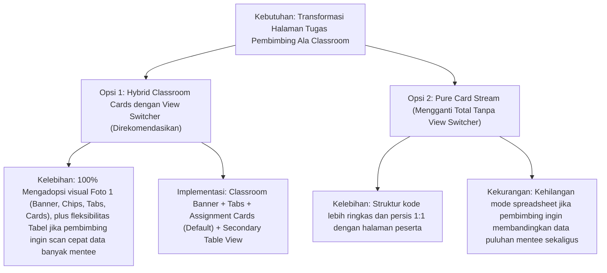

# Rencana Kerja: Redesain Halaman Penugasan Pembimbing Mengadopsi Tampilan Classroom Portal Peserta Magang

- **Tanggal**: 2026-10-14
- **Status**: Selesai Diimplementasikan (Passed 366 Tests)
- **Author**: Antigravity (Skill: `web-implementation`)
- **Tautan Target**: [`resources/views/pembimbing/tugas/index.blade.php`](file:///g:/MAGKOM/resources/views/pembimbing/tugas/index.blade.php) & [`app/Http/Controllers/Pembimbing/TugasController.php`](file:///g:/MAGKOM/app/Http/Controllers/Pembimbing/TugasController.php)
- **Acuan Desain (Foto Pengguna)**:
  - **Foto 1 (Acuan Target)**: [`resources/views/peserta/tugas/index.blade.php`](file:///g:/MAGKOM/resources/views/peserta/tugas/index.blade.php) (`http://127.0.0.1:8000/peserta/tugas` - Classroom Banner, Stat Chips, Horizontal Filter Tabs, Assignment Stream Cards).
  - **Foto 2 (Kondisi Eksisting)**: [`resources/views/pembimbing/tugas/index.blade.php`](file:///g:/MAGKOM/resources/views/pembimbing/tugas/index.blade.php) (`http://127.0.0.1:8000/pembimbing/tugas` - Tabel HTML flat kaku dengan form toolbar filter).

---

## 1. Tujuan & Ringkasan Eksekutif

Pembaruan ini bertujuan untuk merombak tampilan halaman utama **Manajemen Penugasan & Progres Pembimbing** ([`resources/views/pembimbing/tugas/index.blade.php`](file:///g:/MAGKOM/resources/views/pembimbing/tugas/index.blade.php)) yang saat ini masih berupa tabel HTML administratif datar (Foto 2), agar bertransformasi mengadopsi bahasa desain visual modern bergaya **Google Classroom** seperti yang diterapkan pada halaman tugas peserta magang (Foto 1).

### Fokus Pembaruan:
1. **Classroom Hero Banner**: Menghadirkan banner biru gradien resmi Sleman (`classroom-banner`) yang memuat judul modul, informasi bidang ASN pembimbing, jumlah mentee aktif, tombol aksi "+ Buat Tugas Baru", dan 4 chip statistik real-time (`Total Tugas`, `Ditugaskan`, `Sedang Dikerjakan`, `✓ Selesai`).
2. **Horizontal Tab Navigation Ala Classroom**: Menggantikan filter status dropdown kaku dengan bilah navigasi tab modern (`classroom-tabs`) berperekat count badge yang memungkinkan pembimbing memfilter tugas dengan 1-klik (`Semua Tugas`, `Ditugaskan`, `Sedang Dikerjakan`, `Selesai`).
3. **Assignment Stream Cards (Kartu Tugas Interaktif)**: Menggantikan baris tabel kaku dengan kartu tugas modern (`assignment-card`) berikon status bulat, judul interaktif, indikator tenggat waktu cerdas (`.assignment-due` dengan penanda terlambat/mendekati), deskripsi ringkas, tag kategori & lampiran, serta tombol aksi kontekstual (`Detail & Reviu` / `Evaluasi Progres`).
4. **Konteks Khusus Pembimbing (Mentee Identification Chip)**: Menambahkan chip identitas mentee penerima tugas (Avatar, Nama Mentee, dan Asal Kampus/Sekolah) pada setiap kartu tugas sehingga pembimbing dapat memantau penugasan banyak mentee secara sekilas (*at-a-glance supervision*).
5. **View Mode Switcher (Opsi Tampilan Card vs Tabel)**: Menyediakan tombol pengalih (*toggle view*) antara tampilan Kartu Stream Classroom (default) dan Tampilan Tabel Administratif bagi pembimbing yang menyukai ringkasan tabular berdensitas tinggi.
6. **Harmonisasi Dark Mode Penuh (`[data-theme="dark"]`)**: Menjamin estetika warna, kontras teks, border, dan bayangan 100% konsisten dengan Design System DS-MagKom Bab 2.1 & 2.2.

---

## 2. Asumsi & Pertanyaan Terbuka

### Asumsi Teknis & Fungsional:
1. **Integritas Rute & Data**: Endpoint URL `pembimbing/tugas` tetap tidak berubah. Controller `app/Http/Controllers/Pembimbing/TugasController.php` tetap menjadi penyedia data utama dengan dukungan pencarian kata kunci (`q`), filter mentee (`penempatan_id`), dan paginasi.
2. **Efisiensi Kueri (Bebas N+1)**: Kueri relasi `penempatan.peserta.profil.jurusan`, `penempatan.bidang`, dan `progresLogs` yang sudah dieksekusi di `TugasController` akan dimanfaatkan optimal untuk merender kartu penugasan tanpa kueri tambahan.
3. **Statistik Akurat**: Metrik chip di dalam Classroom Banner dihitung dari keseluruhan tugas aktif bimbingan pembimbing yang bersangkutan (bukan hanya item halaman aktif saat terpaginasi).
4. **Alur Pembuatan Tugas**: Tombol "+ Buat Tugas Baru" di banner tetap mengarah ke workspace pembuatan tugas layar penuh yang sudah ada (`pembimbing.tugas.create`).

### Pertanyaan Terbuka untuk Pengguna:
- Tidak ada pertanyaan pemblokir (blocking issues). Opsi desain default yang diajukan adalah **Card Stream Classroom sebagai tampilan utama** yang dilengkapi **View Mode Switcher** opsional agar pembimbing tetap dapat melihat format tabel jika diinginkan.

---

## 3. Pendekatan Desain & Arsitektur

### Perbandingan Pendekatan:



### Opsi Terpilih & Landasan Desain:
**Opsi 1 (Hybrid Classroom Cards dengan View Switcher)** direkomendasikan. Pembimbing adalah supervisor yang mengelola banyak mahasiswa/siswa dari berbagai kampus. Mode default **Classroom Card Stream** memberikan pengalaman visual yang sangat modern, bersih, dan menyenangkan (seperti di Foto 1). Penyediaan tombol toggle view tabel memberikan nilai ergonomi tambahan tanpa merusak estetika utama.

---

## 4. Perubahan File

| File Path | Aksi | Ringkasan Perubahan |
| :--- | :--- | :--- |
| [`resources/views/pembimbing/tugas/index.blade.php`](file:///g:/MAGKOM/resources/views/pembimbing/tugas/index.blade.php) | **Modify** | Merombak layout dari tabel datar menjadi Classroom Hero Banner bergradien, Stat Chips, Navigasi Tab status ala Classroom, Toolbar pencarian ringkas, Komponen Assignment Stream Cards lengkap dengan Mentee Identity Chip, serta pagination responsif. |
| [`app/Http/Controllers/Pembimbing/TugasController.php`](file:///g:/MAGKOM/app/Http/Controllers/Pembimbing/TugasController.php) | **Modify** | Menambahkan kalkulasi metrik ringkasan tugas pembimbing (`totalSemua`, `totalBelum`, `totalProses`, `totalSelesai`, `totalPerluReview`) agar angka pada Stat Chips Banner dan Count Tabs selalu akurat secara global. |
| [`tests/Feature/ClassroomAssignmentWorkspaceTest.php`](file:///g:/MAGKOM/tests/Feature/ClassroomAssignmentWorkspaceTest.php) | **Modify** | Menambahkan pengujian assertion untuk memastikan halaman index pembimbing merender banner classroom, tab filter, dan kartu penugasan dengan benar tanpa regresi. |

---

## 5. Rencana Mockup Visual Antarmuka Baru

```
+-------------------------------------------------------------------------------------------------------------------------+
|  [ MagKom Kominfo Sleman ]  Dashboard / Tugas Peserta                                              [ Pembimbing Lapangan v] |
+-------------------------------------------------------------------------------------------------------------------------+
|                                                                                                                         |
|  +===================================================================================================================+  |
|  |  Tugas & Proyek Bimbingan Magang                                                   +---------------------------+  |  |
|  |  Bidang: Aplikasi Informatika (Aptika)  •  Pembimbing: Budi Santoso  •  5 Mentee   |  [+ Buat Tugas Baru]      |  |  |
|  |                                                                                    +---------------------------+  |  |
|  |  ( Total: 5 Tugas )   ( Ditugaskan: 1 )   ( Sedang Dikerjakan: 3 )   (✓ Selesai: 1 )   (! Perlu Review: 2 )     |  |
|  +===================================================================================================================+  |
|                                                                                                                         |
|  [Semua Tugas (5)]   [Ditugaskan (1)]   [Sedang Dikerjakan (3)]   [Selesai (1)]               [Cari Tugas...] [Filter v]|
|  ---------------------------------------------------------------------------------------------------------------------  |
|                                                                                                                         |
|  +-------------------------------------------------------------------------------------------------------------------+  |
|  | (⏰)  Pengembangan Antarmuka Dashboard Portal MagKom                                      ⏳ Tenggat: 16 Okt 2026 |  |
|  |      Menyusun komponen antarmuka web modern sesuai standar Design System MagKom dan WCAG.                         |  |
|  |                                                                                                                   |  |
|  |      [👤 Ahmad Mentee • SMK N 1 Sleman]   [🏷️ Fitur Baru]   [📎 1 Dokumen Acuan]   [📩 1 Laporan Diserahkan]       |  |
|  |                                                                                                                   |  |
|  |      [● Sedang Dikerjakan]                                                              [ Evaluasi Progres → ]    |  |
|  +-------------------------------------------------------------------------------------------------------------------+  |
|                                                                                                                         |
|  +-------------------------------------------------------------------------------------------------------------------+  |
|  | (⚠️)  Migrasi Skema Modul Audit Forensik                                                  ⚠️ Terlambat: 11 Okt 2026|  |
|  |      Optimalisasi struktur relasi tabel dan penyesuaian query index logbook.                                       |  |
|  |                                                                                                                   |  |
|  |      [👤 Maya Anggraini • Universitas Amikom]   [🏷️ Backend Database]                     [● Sedang Dikerjakan]   |  |
|  |                                                                                                                   |  |
|  |                                                                                         [ Detail & Reviu → ]      |  |
|  +-------------------------------------------------------------------------------------------------------------------+  |
|                                                                                                                         |
+-------------------------------------------------------------------------------------------------------------------------+
```

---

## 6. Langkah Implementasi Terperinci

### Tahap 1: Penyempurnaan Controller (`TugasController.php`)
- [x] **Langkah 1.1**: Di method `index(Request $request)`, tambahkan kueri ringkasan status tugas pembimbing berbasis database:
  - `$countSemua`: Total seluruh tugas milik pembimbing yang login.
  - `$countBelum`: Total tugas berstatus `StatusTugasEnum::Belum`.
  - `$countProses`: Total tugas berstatus `StatusTugasEnum::Proses`.
  - `$countSelesai`: Total tugas berstatus `StatusTugasEnum::Selesai`.
  - `$countPerluReview`: Total tugas yang memiliki `progresLogs` berstatus `menunggu`.
- [x] **Langkah 1.2**: Teruskan data statistik (`counts`) tersebut ke view `pembimbing.tugas.index`.

### Tahap 2: Styling & Token Desain Classroom di Blade View
- [x] **Langkah 2.1**: Salin dan sesuaikan definisi CSS classroom dari `peserta/tugas/index.blade.php`:
  - `.classroom-banner`: Gradien biru khas Sleman (`#0641CC` ke `#0751FF`), border radius `16px`, elevasi bayangan halus, tekstur grafis.
  - `.banner-stat-chip`: Chip semi-transparan dengan `backdrop-filter: blur(10px)` untuk metrik penugasan.
  - `.classroom-tabs`: Navigasi tab horizontal dengan border bawah aktif biru dan count badge.
  - `.assignment-card`: Kartu interaktif stream dengan efek hover translateY(-2px), border transisi, dan bayangan elegan.
  - `.assignment-icon-wrapper`: Lingkaran ikon tematik (biru/amber/hijau/merah) penanda status tugas.
  - `.mentee-chip`: Chip khusus pembimbing yang menampilkan foto/avatar inisial peserta, nama lengkap mentee, dan institusi pendidikan.
  - `.assignment-due`: Indikator tenggat dinamis (`terlambat`, `mendekati`, `normal`).
  - `.table-view-container`: Wadah tabel alternatif untuk toggle view.

### Tahap 3: Implementasi Struktur Komponen Blade
- [x] **Langkah 3.1**: Bangun **Classroom Hero Banner** di bagian atas view, menampilkan:
  - Judul "Manajemen Penugasan & Progres (F-08)".
  - Breadcrumb dan subjudul bimbingan ASN.
  - 4-5 Banner Stat Chips (`Total Tugas`, `Ditugaskan`, `Sedang Dikerjakan`, `✓ Selesai`).
  - Tombol aksi utama: `+ Buat Tugas Baru` dengan ikon plus modern.
- [x] **Langkah 3.2**: Bangun **Navigasi Tabs & Filter Bar Terpadu**:
  - Tombol Tab: `Semua Tugas`, `Ditugaskan`, `Sedang Dikerjakan`, `Selesai`.
  - Filter Mentee Dropdown ringkas (bisa filter spesifik per anak bimbingan).
  - Kolom pencarian judul/topik tugas instan.
  - Tombol Switcher Tampilan (Ikon Grid/Card vs Ikon Table).
- [x] **Langkah 3.3**: Bangun **Assignment Stream Cards**:
  - Iterasi data `$tugasList`.
  - Tampilkan icon status, judul tugas yang dapat diklik, deadline pill di kanan atas.
  - Deskripsi tugas yang terpotong rapi (maksimal 2 baris).
  - Baris metadata: **Chip Identitas Mentee** (`👤 Nama Mentee • Institusi`), Tag Kategori, Badge Lampiran Dokumen, Badge Link Referensi.
  - Footer kartu: Badge Status Pill dan Tombol Aksi Reviu (`Evaluasi Progres →` jika ada laporan belum direviu, atau `Detail & Reviu →`).
- [x] **Langkah 3.4**: Bangun **Empty State Interaktif**:
  - Jika belum ada tugas pada filter terkait, tampilkan ilustrasi lingkaran bersih dan tombol ajakan "+ Buat Tugas Baru".

### Tahap 4: Interaktivitas Client-Side (JavaScript)
- [x] **Langkah 4.1**: Implementasikan fungsi filter tab instan (`filterTugasClassroom(status, btn)`) atau integrasi query param URL yang mulus.
- [x] **Langkah 4.2**: Implementasikan fungsi toggle view (Card View vs Table View) dengan persistensi preferensi di `localStorage.getItem('pembimbing_task_view')`.

### Tahap 5: Responsivitas & Mode Gelap
- [x] **Langkah 5.1**: Pastikan banner, filter toolbar, dan kartu tugas tampil proporsional di layar tablet (&le;1024px) dan mobile (&le;768px).
- [x] **Langkah 5.2**: Verifikasi styling `[data-theme="dark"]` agar kontras teks memenuhi WCAG 2.1 AA (rasio &ge; 4.5:1).

---

## 7. Strategi Testing

### 1. Automated Testing (PHPUnit / Pest):
- Jalankan test terkait pembimbing dan classroom:
  ```powershell
  php artisan test --filter=ClassroomAssignmentWorkspaceTest
  php artisan test --filter=PembimbingPortalFeatureTest
  php artisan test --filter=RichTaskAssignmentTest
  ```
- Tambahkan test assertion baru:
  - Memastikan halaman `route('pembimbing.tugas.index')` merender banner classroom, tab filter, dan kartu stream penugasan.
  - Memastikan seluruh 366 automated tests eksisting tetap 100% lulus (green).

### 2. Manual & Visual Verification (Browser Subagent):
- Akses halaman `http://127.0.0.1:8000/pembimbing/tugas` menggunakan akun Pembimbing Lapangan.
- Bandingkan langsung visual halaman sebelum vs sesudah:
  - Banner biru Sleman dan stat chips muncul persis seperti Foto 1.
  - Filter tabs berfungsi mengubah daftar kartu.
  - Kartu penugasan menampilkan nama mentee bimbingan dengan rapi.
  - Tombol "+ Buat Tugas Baru" membuka form pembuatan tugas tanpa kendala.

---

## 8. Risiko & Mitigasi

| Risiko | Dampak | Mitigasi |
| :--- | :--- | :--- |
| **Kueri Berat / N+1 Query** saat merender nama mentee dan progres log pada setiap kartu | Penurunan performa load halaman | Pastikan eager loading pada controller: `with(['penempatan.peserta.profil.jurusan', 'penempatan.bidang', 'progresLogs'])` tetap aktif. |
| **Paginasi Terganggu oleh Filter JS** | Pengguna berpindah tab namun hanya melihat 15 item per halaman | Kombinasikan navigasi tab dengan query param URL `?status=...` sehingga paginasi Laravel tetap akurat dan sinkron dengan filter tab. |
| **Perbedaan Resolusi Layar (Mobile/Desktop)** | Banner atau kartu tugas terpotong pada layar kecil | Terapkan layout flexbox dan grid responsif dengan breakpoint `@media (max-width: 768px)` seperti pada template peserta. |

---

## 9. Kriteria Selesai (Definition of Done)

- [x] Tampilan halaman `pembimbing/tugas/index.blade.php` memiliki Classroom Banner, Stat Chips, Nav Tabs, dan Assignment Stream Cards yang selaras dengan Foto 1.
- [x] Setiap kartu penugasan memuat informasi identitas mentee (Nama & Institusi), kategori, deadline dengan alert cerdas, dan status progres.
- [x] Filter tab (Semua, Ditugaskan, Sedang Dikerjakan, Selesai) dan pencarian berfungsi responsif.
- [x] Tombol "+ Buat Tugas Baru" tetap berfungsi sempurna menuju halaman workspace tugas.
- [x] Seluruh 366 automated test suite lulus 100% tanpa regresi.
- [x] Desain patuh pada token Design System DS-MagKom dan ramah mode terang/gelap.

---

## 10. Catatan Perubahan & Saran Lanjutan

- **Perubahan selama pengerjaan**: *(Akan dicatat saat eksekusi)*
- **Saran Lanjutan (Out of Scope)**:
  - Penambahan fitur *Bulk Assignment* (memberikan 1 tugas sekaligus ke beberapa mentee).
  - Tampilan mode Kanban Board untuk drag-and-drop status tugas.
