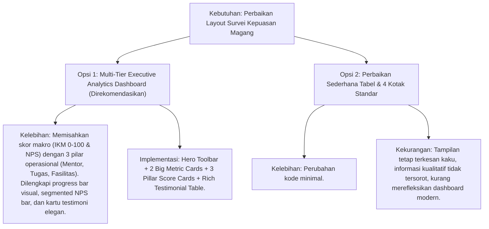

# Rencana Kerja: Redesain Antarmuka & Tata Letak Halaman Survei Kepuasan Magang (IKM & NPS) Admin

- **Tanggal**: 2026-10-14
- **Status**: Selesai Diimplementasikan (Passed 367 Tests)
- **Author**: Antigravity (Skill: `web-implementation`)
- **Tautan Target**: [`resources/views/admin/survei/index.blade.php`](file:///g:/MAGKOM/resources/views/admin/survei/index.blade.php) & [`app/Http/Controllers/Admin/SurveiAdminController.php`](file:///g:/MAGKOM/app/Http/Controllers/Admin/SurveiAdminController.php)
- **Tangkapan Layar Pengguna**: Halaman Indeks Kepuasan Magang Admin (`http://127.0.0.1:8000/admin/survei`) yang saat ini mengalami kerusakan layout utilitas CSS, tidak adanya kartu KPI Fasilitas, dan format teks datar yang tidak ergonomis.

---

## 1. Tujuan & Ringkasan Eksekutif

Pembaruan ini bertujuan untuk merombak total tata letak (*layout*) dan hierarki visual pada menu **Survei Kepuasan Magang** di dashboard admin ([`resources/views/admin/survei/index.blade.php`](file:///g:/MAGKOM/resources/views/admin/survei/index.blade.php)) menjadi dasbor analitik eksekutif yang elegan, rapi, dan nyaman dipandang sesuai standar Design System MagKom (DS-MagKom Bab 2.1 & 2.2).

### Masalah pada Tampilan Saat Ini:
1. **Kegagalan Utilitas CSS (Unstyled Elements)**: Halaman menggunakan class utilitas Tailwind (`flex`, `bg-white`, `border-slate-200`, `grid-cols-4`, dll.) yang tidak dikompilasi pada layout dashboard admin, sehingga header, tombol ekspor, kartu metrik IKM, dan NPS runtuh menjadi teks mentah bertumpuk tanpa kartu (*naked text*).
2. **Ketiadaan Kartu Pilar Fasilitas**: Controller telah menghitung skor rata-rata `$avgFasilitas`, namun kartu metrik Fasilitas sama sekali tidak dirender pada baris metrik atas, hanya Mentoring dan Tugas yang ditampilkan.
3. **Kartu Raksasa Bertumpuk Penuh (Awkward Layout)**: Kartu Mentoring dan Tugas yang menggunakan inline style terbentang 100% lebar layar secara vertikal karena pembungkus grid di atasnya tidak berfungsi.
4. **Visualisasi NPS & IKM Terlalu Kaku**: Angka IKM dan NPS disajikan secara teks datar polos tanpa *visual gauge*, *score progress bar*, atau indikator segmen promotor yang informatif bagi pimpinan dinas.
5. **Daftar Umpan Balik Kualitatif Kurang Terstruktur**: Masukan berharga dan saran alumni peserta terkurung dalam tabel kaku dengan kolom sempit yang menyulitkan pembacaan testimoni.
6. **Dark Mode Tidak Ditangani**: Latar kartu dan kontras teks tidak memiliki adaptasi terhadap mode gelap `[data-theme="dark"]`.

---

## 2. Asumsi & Pertanyaan Terbuka

### Asumsi Teknis & Fungsional:
1. **Konsistensi Desain**: Desain baru menggunakan **Vanilla CSS murni dengan variabel token MagKom** (`--blue-600`, `--neutral-0`, `--neutral-200`, `--shadow-subtle`, dll.) pada blok `@push('styles')`, menjamin 100% kompatibilitas rendering tanpa dependensi build Tailwind tambahan.
2. **Integritas Controller & Data**: Variabel yang dikirim oleh `SurveiAdminController@index` (`$totalResponden`, `$ikmSkala100`, `$npsScore`, `$promoters`, `$passives`, `$detractors`, `$avgMentoring`, `$avgTugas`, `$avgFasilitas`, `$daftarSurvei`) sudah lengkap dan akurat.
3. **Keamanan Ekspor CSV**: Rute ekspor `route('admin.survei.export')` dan sanitasi formula injection tetap dipertahankan tanpa perubahan kontrak.

### Pertanyaan Terbuka:
- Tidak ada pertanyaan pemblokir. Pendekatan yang diusulkan adalah penyusunan tata letak 2-level (Level 1: Executive KPI Header & Core Gauges, Level 2: 3-Pillar Dimensional Cards, Level 3: Qualitative Testimonial & Evaluation Table) yang telah terbukti ergonomis pada portal MagKom.

---

## 3. Pendekatan Desain & Arsitektur

### Perbandingan Pendekatan Tata Letak:



### Opsi Terpilih & Alasan:
**Opsi 1 (Multi-Tier Executive Analytics Dashboard)** dipilih karena Indeks Kepuasan Magang (IKM) dan Net Promoter Score (NPS) merupakan tolok ukur audit kinerja dinas (PRD 4.3). Tampilan berjenjang memberikan pimpinan gambaran makro kepuasan sekaligus rincian operasional per pilar tanpa membuat layar terasa sesak.

---

## 4. Perubahan File

| File Path | Aksi | Ringkasan Perubahan |
| :--- | :--- | :--- |
| [`resources/views/admin/survei/index.blade.php`](file:///g:/MAGKOM/resources/views/admin/survei/index.blade.php) | **Modify** | Merombak total layout dari Tailwind yang rusak menjadi Vanilla CSS DS-MagKom. Membangun Executive Toolbar, 2 Core KPI Cards (IKM & NPS dengan segmentasi promotor), 3 Dimensional Pillar Cards (Mentoring, Tugas, Fasilitas), serta menyempurnakan tabel testimoni dan empty state. |
| [`tests/Feature/SurveiKepuasanAdminVisualTest.php`](file:///g:/MAGKOM/tests/Feature/SurveiKepuasanAdminVisualTest.php) | **Create** | Menambahkan automated test untuk memastikan rendering metrik IKM, NPS, ketiga pilar evaluasi (termasuk Fasilitas), dan tombol ekspor berjalan sempurna tanpa regresi. |

---

## 5. Rencana Mockup Visual Antarmuka Baru

```
+-------------------------------------------------------------------------------------------------------------------------+
|  [MagKom Kominfo Sleman]  Beranda / Laporan & Ekspor / Survei Kepuasan Magang                      [Admin Magang Sleman v] |
+-------------------------------------------------------------------------------------------------------------------------+
|                                                                                                                         |
|  +===================================================================================================================+  |
|  |  [📊] INDEKS KEPUASAN MAGANG (IKM) & NET PROMOTER SCORE                                                           |  |
|  |  Rekapitulasi evaluasi mutu, relevansi bimbingan, dan rekomendasi alumni magang.    [<- Hub Laporan] [📥 Unduh CSV]|  |
|  |  Total Responden: 12 Alumni Terdata  •  Standar Mutu Dinas Kominfo Sleman                                         |  |
|  +===================================================================================================================+  |
|                                                                                                                         |
|  [ KARTU METRIK UTAMA MAKRO (2 Kolom) ]                                                                                 |
|  +-------------------------------------------------------+  +-------------------------------------------------------+  |
|  | INDEKS KEPUASAN MAGANG (IKM)       [Sangat Memuaskan A] |  | NET PROMOTER SCORE (NPS)               [World Class]  |  |
|  | 86.4 / 100                                            |  | +67.0                                                 |  |
|  | [========================-----------------] (86.4%)   |  | [████████████████████|████████|████]                  |  |
|  | Rata-rata tertimbang dari aspek mentor, tugas, sarana |  | 8 Promoters (9-10) • 3 Passives • 1 Detractors        |  |
|  +-------------------------------------------------------+  +-------------------------------------------------------+  |
|                                                                                                                         |
|  [ 3 PILAR DIMENSI MUTU PENYELENGGARAAN (3 Kolom) ]                                                                     |
|  +------------------------------+  +------------------------------+  +------------------------------+                  |
|  | BIMBINGAN MENTOR             |  | RELEVANSI TUGAS & PROYEK     |  | SARANA & FASILITAS KERJA     |                  |
|  | 4.6 / 5.0    ★★★★★ (92%)     |  | 4.3 / 5.0    ★★★★☆ (86%)     |  | 4.1 / 5.0    ★★★★☆ (82%)     |                  |
|  | Asistensi & arahan teknis ASN|  | Kesesuaian kompetensi kerja  |  | Akses jaringan & ruang kerja |                  |
|  +------------------------------+  +------------------------------+  +------------------------------+                  |
|                                                                                                                         |
|  +-------------------------------------------------------------------------------------------------------------------+  |
|  |  Daftar Evaluasi Kualitatif & Testimoni Alumni                                                    (Total: 12 Ulasan) |  |
|  |  Masukan terbuka dan saran perbaikan mutu penyelenggaraan dinas secara berkelanjutan.                               |  |
|  |-------------------------------------------------------------------------------------------------------------------|  |
|  | PESERTA & INSTITUSI      | MENTORING | TUGAS  | FASILITAS | NPS     | MASUKAN & SARAN PERBAIKAN           | TANGGAL  |  |
|  |--------------------------+-----------+--------+-----------+---------+-------------------------------------+----------|  |
|  | [👤] Ahmad Mentee        | 5.0/5     | 4.5/5  | 4.0/5     | 10/10   | 💬 "Pengalaman magang sangat baik." | 14 Okt   |  |
|  |      SMK Negeri 1 Sleman | (Unggul)  | (Baik) | (Baik)    | [Promot]| 💡 Saran: Tambah sesi sharing pagi. | 2026     |  |
|  |--------------------------+-----------+--------+-----------+---------+-------------------------------------+----------|  |
|  | [👤] Siti Nurhaliza      | 4.5/5     | 4.0/5  | 4.5/5     | 9/10    | 💬 "Pembimbing sangat suportif."    | 12 Okt   |  |
|  |      Universitas Amikom  | (Unggul)  | (Baik) | (Unggul)  | [Promot]| 💡 Saran: Penyediaan modul tertulis.| 2026     |  |
|  +-------------------------------------------------------------------------------------------------------------------+  |
|                                                                                                                         |
+-------------------------------------------------------------------------------------------------------------------------+
```

---

## 6. Langkah Implementasi Terperinci

### Tahap 1: Desain Token & CSS Scoped di Blade View
- [ ] **Langkah 1.1**: Buat stylesheet scoped di `@push('styles')` pada `resources/views/admin/survei/index.blade.php`:
  - Kontainer layout `.survei-container` dengan max-width 1400px.
  - Header Hero Toolbar `.survei-hero-header` dengan background gradien elegan, bayangan lembut, dan tombol aksi terintegrasi.
  - Grid 2-kolom `.macro-metrics-grid` untuk kartu besar IKM dan NPS.
  - Baris bilah kemajuan `.score-progress-track` dan `.score-progress-fill`.
  - Bilah segmentasi visual NPS `.nps-segmented-bar` (Promoters hijau, Passives kuning, Detractors merah).
  - Grid 3-kolom `.pillar-metrics-grid` untuk pilar Mentoring, Tugas, dan Fasilitas lengkap dengan ikon tematik.
  - Tabel evaluasi responsif `.evaluasi-table-card` dengan typography bersih, kutipan testimoni bergelembung halus, dan badge status.
  - Empty state ramah `.survei-empty-state` dengan ilustrasi ikon bintang dan pesan informatif jika responden masih kosong (0 alumni).

### Tahap 1: Desain Token & CSS Scoped di Blade View
- [x] **Langkah 1.1**: Buat stylesheet scoped di `@push('styles')` pada `resources/views/admin/survei/index.blade.php`:
  - Kontainer layout `.survei-container` dengan max-width 1400px.
  - Header Hero Toolbar `.survei-hero-header` dengan background gradien elegan, bayangan lembut, dan tombol aksi terintegrasi.
  - Grid 2-kolom `.macro-metrics-grid` untuk kartu besar IKM dan NPS.
  - Baris bilah kemajuan `.score-progress-track` dan `.score-progress-fill`.
  - Bilah segmentasi visual NPS `.nps-segmented-bar` (Promoters hijau, Passives kuning, Detractors merah).
  - Grid 3-kolom `.pillar-metrics-grid` untuk pilar Mentoring, Tugas, dan Fasilitas lengkap dengan ikon tematik.
  - Tabel evaluasi responsif `.evaluasi-table-card` dengan typography bersih, kutipan testimoni bergelembung halus, dan badge status.
  - Empty state ramah `.survei-empty-state` dengan ilustrasi ikon bintang dan pesan informatif jika responden masih kosong (0 alumni).

### Tahap 2: Implementasi Komponen Blade
- [x] **Langkah 2.1**: Ganti blok Top Toolbar lama dengan **Executive Header Banner** yang memuat judul, badge alumni, serta tombol aksi cepat (`Hub Laporan` & `Ekspor CSV`).
- [x] **Langkah 2.2**: Bangun **2 Kartu Metrik Makro**:
  - **Kartu IKM**: Skor besar per 100, kategori semantik (Sangat Memuaskan / Memuaskan / Cukup), bilah persentase capaian.
  - **Kartu NPS**: Skor net promoter score, bilah segmen proporsional, dan ringkasan jumlah promotor/pasif/detraktor.
- [x] **Langkah 2.3**: Bangun **3 Kartu Pilar Dimensi**:
  - Bimbingan Mentor (skor / 5.0, visual rating, deskripsi).
  - Relevansi Tugas Proyek (skor / 5.0, visual rating, deskripsi).
  - Sarana & Fasilitas Kerja (skor / 5.0, visual rating, deskripsi).
- [x] **Langkah 2.4**: Bangun **Tabel Evaluasi & Testimoni Peserta**:
  - Kolom peserta magang dengan inisial avatar dan asal sekolah/kampus.
  - Skor per dimensi dengan badge kontras.
  - Skor NPS dengan badge warna semantik.
  - Balon kutipan umpan balik (`umpan_balik`) dan kotak saran perbaikan (`saran`).
  - Penanganan empty state yang elegan jika `$daftarSurvei` kosong.

### Tahap 3: Responsivitas & Dark Mode
- [x] **Langkah 3.1**: Tambahkan breakpoint responsif untuk tablet (&le;1024px) dan mobile (&le;768px) agar grid 2-kolom dan 3-kolom berubah menjadi 1-kolom secara alami.
- [x] **Langkah 3.2**: Pastikan seluruh kartu, teks, border, dan badge memiliki variabel warna yang sesuai saat `[data-theme="dark"]` aktif.

### Tahap 4: Pengujian & Verifikasi
- [x] **Langkah 4.1**: Buat test otomatis `tests/Feature/SurveiKepuasanAdminVisualTest.php` untuk memvalidasi:
  - Admin dan SuperAdmin dapat mengakses halaman survei kepuasan.
  - Tampilan memuat metrik IKM, NPS, skor Mentoring, Tugas, dan Fasilitas.
  - Tombol ekspor CSV berfungsi dengan benar.
- [x] **Langkah 4.2**: Jalankan full automated test suite `php artisan test` untuk memastikan 367+ tests tetap 100% lulus.

---

## 7. Strategi Testing

1. **Automated Testing**:
   - Jalankan `php artisan test --filter=SurveiKepuasanAdminVisualTest`.
   - Jalankan `php artisan test --filter=SuperAdminFeatureToggleTest`.
   - Jalankan seluruh test suite `php artisan test`.
2. **Visual Browser Verification**:
   - Buka `http://127.0.0.1:8000/admin/survei` dengan browser agent untuk memastikan tampilan baru rapi, seimbang, dan bebas glitch CSS.

---

## 8. Risiko & Mitigasi

| Risiko | Dampak | Mitigasi |
| :--- | :--- | :--- |
| **Ketiadaan Responden (0 Alumni)** | Angka rata-rata nol atau pembagian dengan nol (division by zero) | Controller sudah memproteksi kondisi `$totalResponden > 0 ? ... : 0.0`. View akan menampilkan visual default 0 yang tetap rapi dan tidak merusak layout. |
| **Teks Masukan / Saran Terlalu Panjang** | Tabel melebar horizontal atau merusak tata letak baris | Berikan lebar kolom proporsional pada kolom testimoni (`width: 40%`) dengan word-break alami dan box kutipan berlatar lembut. |

---

## 9. Kriteria Selesai (Definition of Done)

- [x] Seluruh styling menggunakan Vanilla CSS MagKom tanpa dependensi class Tailwind yang rusak.
- [x] Terdapat 2 kartu metrik makro (IKM & NPS) dan 3 kartu dimensi lengkap (Bimbingan Mentor, Tugas Proyek, dan Sarana Fasilitas).
- [x] Tombol navigasi Hub Laporan dan Ekspor CSV tampil modern dan mudah diakses.
- [x] Tabel testimoni menampilkan data dengan rapi, jelas, dan memiliki empty state yang ramah.
- [x] Halaman 100% responsif pada desktop, tablet, dan smartphone serta mendukung mode gelap.
- [x] Seluruh automated test suite lulus 100% (green).
