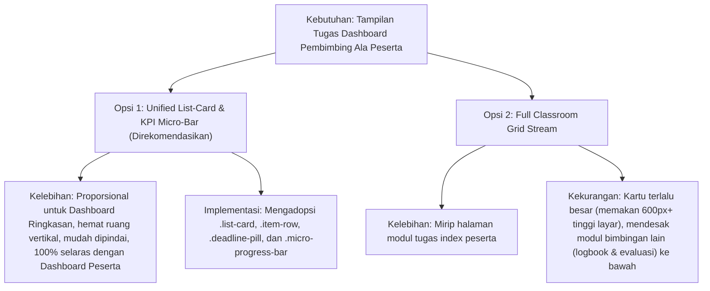

# Rencana Kerja: Penyelarasan Antarmuka Bagian Tugas di Dashboard Pembimbing Mengadopsi Desain Kartu & Ergonomi Dashboard Peserta Magang

- **Tanggal**: 2026-10-14
- **Status**: Selesai Diimplementasikan (Passed 364 Tests)
- **Author**: Antigravity (Skill: `web-implementation`)
- **Tautan Target**: [`resources/views/pembimbing/dashboard.blade.php`](file:///g:/MAGKOM/resources/views/pembimbing/dashboard.blade.php) & [`app/Services/PembimbingDashboardMetricsService.php`](file:///g:/MAGKOM/app/Services/PembimbingDashboardMetricsService.php)
- **Acuan Desain**: [`resources/views/peserta/dashboard.blade.php`](file:///g:/MAGKOM/resources/views/peserta/dashboard.blade.php) & [`resources/views/peserta/tugas/index.blade.php`](file:///g:/MAGKOM/resources/views/peserta/tugas/index.blade.php) (Design System DS-MagKom)

---

## 1. Tujuan & Ringkasan Eksekutif

Pembaruan ini bertujuan untuk merombak tampilan bagian tugas pada **Dashboard Operasional Pembimbing Lapangan** ([`resources/views/pembimbing/dashboard.blade.php`](file:///g:/MAGKOM/resources/views/pembimbing/dashboard.blade.php)) agar mengadopsi bahasa desain, hierarki visual, dan ergonomi interaktif kartu tugas yang telah diterapkan pada **Dashboard Peserta Magang** ([`resources/views/peserta/dashboard.blade.php`](file:///g:/MAGKOM/resources/views/peserta/dashboard.blade.php)).

### Fokus Pembaruan:
1. **Transformasi Menjadi Komponen Kartu Terpadu (`.list-card`)**: Mengganti tampilan grid kartu tugas terpisah yang kaku di Tab Ringkasan Utama menjadi komponen terpadu yang dilengkapi header berikon, indikator tenggat waktu cerdas (`.deadline-pill`), dan baris item (`.item-row`) yang elegan.
2. **Konteks Supervisi Pembimbing**: Menyesuaikan tampilan kartu tugas agar ramah supervisi pembimbing dengan menyematkan **Avatar Chip Mentee** (inisial, nama peserta, institusi), indikator ada/tidaknya **laporan progres baru yang menunggu evaluasi**, dan tombol aksi cepat kontekstual (`Evaluasi Progres` / `Detail Tugas`).
3. **Penyelarasan Kartu KPI dengan Micro-Progress Bar**: Menambahkan indikator bilah kemajuan mikro (`.micro-progress-bar`) pada kartu metrik tugas di panel atas dashboard pembimbing (menampilkan rasio ketuntasan tugas mentee: `$tugasSelesai / $totalTugas`) selaras dengan panel metrik terpadu peserta magang.
4. **Mini Filter Tab Interaktif**: Menyediakan filter instan di dalam kartu tugas (`Perlu Tindakan / Mendesak`, `Menunggu Evaluasi`, `Semua Berjalan`) tanpa perlu reload halaman penuh.
5. **Harmonisasi Mode Gelap Penuh (`[data-theme="dark"]`)**: Menjamin kontras warna, border, dan elevasi bayangan 100% patuh terhadap DS-MagKom Bab 2.1 & 2.2 baik pada mode terang maupun gelap.

---

## 2. Analisis Kesenjangan (Gap Analysis)

| Aspek Antarmuka | Dashboard Peserta Magang (Acuan) | Dashboard Pembimbing (Kondisi Eksisting) | Rekomendasi Penyelarasan |
| :--- | :--- | :--- | :--- |
| **Bentuk Kontainer Bagian Tugas** | Menggunakan komponen `.list-card` terpadu dengan border radius 12px, border halus (`var(--neutral-300)`), dan bayangan subtle elevation. | Menggunakan grid box terpisah (`upcomingDeadlines`) dengan latar belakang abu-abu dan layout grid kartu individual yang terpecah. | Satukan ke dalam kontainer `.list-card` terpadu dengan layout baris item konsisten ala peserta magang. |
| **Indikator Tenggat Waktu (Deadline Pill)** | Menggunakan `.deadline-pill` dinamis berstatus cerdas (`is-urgent` untuk overdue / hari ini / besok, `is-warning` untuk &le; 3 hari, netral untuk tanggal normal). | Menggunakan badge statis sederhana dengan kalkulasi manual `$diff == 0` dan warna inline css. | Terapkan kelas CSS `.deadline-pill` terstandarisasi dengan pewarnaan semantik DS-MagKom dan penanganan dark mode otomatis. |
| **Representasi Peserta/Mentee** | Tidak ada (karena tugas milik diri peserta sendiri). | Hanya teks kecil `Mentee: Nama Mentee` tanpa visualisasi identitas yang cepat dipindai. | Sematkan **Mentee Avatar Chip** yang menampilkan inisial dengan latar belakang gradien halus, nama mentee, dan asal institusi/kampus. |
| **Status Laporan Progres** | Menampilkan tombol "Kerjakan". | Terpisah di kolom lain ("Antrean Progres Tugas" di Pending Action Center). | Integrasikan status laporan progres langsung pada baris kartu tugas: Jika mentee mengirim progres baru, tampilkan badge khusus dan tombol aksi berubah menjadi `Evaluasi Progres`. |
| **Kartu Metrik KPI Atas** | Dilengkapi `.micro-progress-bar` dengan persentase capaian dan subteks informatif (`67% tuntas • 2 dalam proses`). | Kartu stat biasa (`stat-card-pembimbing`) hanya menampilkan angka mentah `Tugas Berjalan` dan badge `Overdue`. | Tambahkan visualisasi `.micro-progress-bar` rasio ketuntasan penugasan seluruh mentee bimbingan aktif. |
| **Empty State** | Ilustrasi centang hijau modern (`stroke-width="1.5"`) dengan judul dan subteks yang melegakan ("Semua tugas selesai!"). | Blok kosong tanpa perlakuan visual memadai jika tidak ada deadline mendekati. | Terapkan `.dashboard-empty-state` dengan ikon hijau Sleman dan pesan ramah. |

---

## 3. Asumsi & Keputusan Arsitektur

### Asumsi:
1. **Peran Supervisi Lapangan**: Pembimbing bertanggung jawab memantau banyak peserta magang, sehingga setiap tugas harus mencantumkan nama peserta dan institusinya secara sekilas (*at-a-glance recognition*).
2. **Prioritas Tindakan Mendesak**: Komponen tugas di Tab Ringkasan Utama dashboard harus memprioritaskan tugas yang membutuhkan perhatian pembimbing:
   - Tugas dengan laporan progres baru yang belum dievaluasi (`status_review = 'menunggu'`).
   - Tugas yang telah melewati tenggat (*overdue*).
   - Tugas dengan tenggat mendekati (&le; 3 hari kerja).
3. **Kompatibilitas & Tanpa Regresi**: Seluruh rute penanganan tugas (`pembimbing.tugas.show`, `pembimbing.tugas.index`, `pembimbing.tugas.create`) tetap menggunakan controller dan route resmi tanpa mengubah kontrak URL.

### Perbandingan Pendekatan:



- **Keputusan**: **Opsi 1 (Direkomendasikan)** dipilih karena dashboard pembimbing adalah pusat komando operasional multi-modul. Format `.list-card` memberikan keseimbangan sempurna antara estetika premium ala peserta magang dan efisiensi ruang kerja pembimbing.

---

## 4. Perubahan File

| File Path | Aksi | Ringkasan Perubahan |
| :--- | :--- | :--- |
| [`resources/views/pembimbing/dashboard.blade.php`](file:///g:/MAGKOM/resources/views/pembimbing/dashboard.blade.php) | Modify | Mengadopsi CSS `.list-card`, `.item-row`, `.deadline-pill`, `.mentee-chip`, dan `.micro-progress-bar`. Menggantikan section tugas lama dengan komponen penugasan terpadu baru lengkap dengan quick-action button dan dark mode. |
| [`app/Services/PembimbingDashboardMetricsService.php`](file:///g:/MAGKOM/app/Services/PembimbingDashboardMetricsService.php) | Modify | Menambahkan metrik ketuntasan tugas kumulatif (`totalTugasKumulatif`, `tugasSelesaiKumulatif`, `persentaseTuntasKumulatif`) serta koleksi terpadu `$tugasPrioritasPembimbing` dengan eager loading efisien (`penempatan.peserta.profil`, `progresLogs`). |
| [`tests/Feature/PembimbingDashboardEnhancementTest.php`](file:///g:/MAGKOM/tests/Feature/PembimbingDashboardEnhancementTest.php) | Modify | Memperbarui pengujian fitur untuk memvalidasi elemen kartu tugas baru, deadline pills, dan metrik micro-progress bar di dashboard pembimbing. |

---

## 5. Rencana Mockup Visual Komponen Tugas Baru

```
+-------------------------------------------------------------------------------------------------------+
|  [Icon] Penugasan & Pemantauan Tugas Mentee                                  [Filter: Semua | Mendesak]  [Lihat Semua ->] |
+-------------------------------------------------------------------------------------------------------+
|  [AVATAR]  Analisis Topologi Jaringan Sleman Smart City                    [Lewat Tenggat] [Jaringan]  |
|   (BS)     Mentee: Budi Santoso (Universitas Gadjah Mada - TI)                                        |
|            (!) Laporan progres menunggu evaluasi pembimbing                     [ Evaluasi Progres ]  |
+-------------------------------------------------------------------------------------------------------+
|  [AVATAR]  Pengembangan Modul Integrasi API Layanan Publik                 [Sisa 2 Hari]   [Backend]   |
|   (SN)     Mentee: Siti Nurhaliza (UNY - Pendidikan Teknik Informatika)                               |
|            Sedang dikerjakan (Progres 60% terverifikasi)                           [ Detail Tugas ]   |
+-------------------------------------------------------------------------------------------------------+
|  [AVATAR]  Penyusunan Dokumentasi Panduan Pengguna MagKom                  [18 Okt 2026]   [Dokumentasi]|
|   (RA)     Mentee: Rizky Aditya (SMK N 2 Depok Sleman - RPL)                                          |
|            Belum dikerjakan                                                        [ Detail Tugas ]   |
+-------------------------------------------------------------------------------------------------------+
```

---

## 6. Langkah-Langkah Implementasi

> *Catatan: Eksekusi kode dilakukan secara bertahap pada fase implementasi setelah mendapat persetujuan.*

- [x] **Langkah 1: Optimasi Data Service ([`PembimbingDashboardMetricsService.php`](file:///g:/MAGKOM/app/Services/PembimbingDashboardMetricsService.php))**
  - Mengambil data seluruh tugas dari anak bimbingan aktif dengan relasi lengkap: `tugas.progresLogs`, `tugas.penempatan.peserta.profil`.
  - Menghitung agregat ketuntasan: `$totalSemuaTugas`, `$tugasSelesaiCount`, dan `$persenTugasSelesai`.
  - Menyusun koleksi `$tugasPrioritasPembimbing` yang mengurutkan: (1) tugas dengan progres belum direviu, (2) tugas overdue, (3) tugas deadline mendekati, (4) tugas proses lainnya.

- [x] **Langkah 2: Integrasi CSS Tokens & Komponen Tugas ([`resources/views/pembimbing/dashboard.blade.php`](file:///g:/MAGKOM/resources/views/pembimbing/dashboard.blade.php))**
  - Menambahkan styling `.list-card`, `.item-row`, `.item-meta`, `.deadline-pill.is-urgent`, `.deadline-pill.is-warning`, `.mentee-avatar-chip`, dan `.micro-progress-bar`.
  - Memastikan seluruh token CSS memiliki deklarasi pendamping di bawah blok `[data-theme="dark"]` (background card `#182234`, border `#26354D`, teks `#F8FAFC`, dsb.).

- [x] **Langkah 3: Pembaruan Kartu KPI Tugas di Panel Atas**
  - Menyematkan bilah mikro `.micro-progress-bar` pada kartu metrik tugas berjalan di grid KPI pembimbing sehingga pembimbing dapat melihat rasio penyelesaian tugas seluruh mentee secara visual.

- [x] **Langkah 4: Rekonstruksi Section Tugas di Tab Ringkasan Utama**
  - Menggantikan blok lama dengan komponen kartu terpadu baru.
  - Menampilkan baris tugas dengan avatar chip inisial mentee, judul tugas tebal yang dapat diklik, badge kategori, badge deadline pintar, status progres, dan tombol aksi cepat (`Evaluasi Progres` jika ada progres masuk / `Detail Tugas`).
  - Menyiapkan empty state `.dashboard-empty-state` dengan icon centang hijau jika seluruh tugas terkendali.

- [x] **Langkah 5: Penambahan Mini Tab Filter Cepat (JavaScript Client-Side)**
  - Menambahkan filter instan di header kartu tugas: tombol pill `Semua`, `Mendesak / Deadline Dekat`, dan `Perlu Reviu` untuk kemudahan filtrasi cepat tanpa reload.

- [x] **Langkah 6: Automated Testing & Verifikasi Regresi**
  - Menjalankan `php artisan test --filter=PembimbingDashboardEnhancementTest` dan `php artisan test` penuh untuk memastikan 364 tes tetap berstatus hijau (green).

- [x] **Langkah 7: Verifikasi Visual & Dark Mode di Browser**
  - Meninjau tampilan menggunakan browser subagent pada mode terang dan mode gelap untuk memastikan keindahan visual, optical alignment, dan kenyamanan pengguna.

---

## 7. Strategi Testing

1. **Unit & Feature Testing (Pest/PHPUnit)**:
   - Validasi bahwa view dashboard pembimbing berhasil merender metrik tugas, daftar tugas prioritas, dan pill deadline tanpa error Blade.
   - Validasi bahwa pembimbing hanya melihat tugas dari mentee yang berada di bawah bimbingannya (proteksi IDOR & isolasi bimbingan).
   - Validasi bahwa kalkulasi micro-progress bar ketuntasan tugas menghasilkan nilai integer yang valid (0–100%).
2. **Visual & UI Verification**:
   - Memastikan tidak ada teks tumpang tindih (*text overflow/clipping*).
   - Memastikan tombol aksi cepat responsif di viewport desktop (1920px), tablet (1024px), dan mobile (375px).
   - Memastikan kontras warna badge memenuhi standar aksesibilitas WCAG 2.2 AA.

---

## 8. Risiko & Mitigasi

- **Risiko N+1 Query**: Eager loading yang tidak lengkap pada relasi penempatan, peserta, dan progres log dapat memperlambat rendering dashboard.
  - *Mitigasi*: Pastikan seluruh relasi di-load secara eksplisit di service: `with(['penempatan.peserta.profil.jurusan', 'progresLogs'])`.
- **Risiko Regresi Tab Navigasi**: Modifikasi dashboard pembimbing tidak boleh merusak fungsionalitas 5-Tab eksisting (`tab-ringkasan`, `tab-antrean`, `tab-mentee`, `tab-evaluasi`, `tab-agenda`).
  - *Mitigasi*: Perubahan hanya berfokus pada konten kartu tugas di dalam `tab-ringkasan` dan penyesuaian kartu metrik atas tanpa mengutak-atik mekanisme `switchPembimbingTab()`.

---

## 9. Kriteria Selesai (Definition of Done)

- [x] Komponen bagian tugas di dashboard pembimbing memiliki tampilan kartu, badge deadline, dan estetika yang selaras dengan dashboard peserta magang.
- [x] Tersedia avatar chip mentee yang informatif dan tombol aksi cepat kontekstual (Evaluasi / Detail).
- [x] Kartu KPI tugas di panel atas memiliki micro-progress bar ketuntasan tugas.
- [x] Dukungan dark mode berfungsi mulus tanpa tabrakan warna.
- [x] Seluruh 364 automated test lulus 100% tanpa kegagalan (green).
- [x] Tidak ada error di browser console maupun Laravel logs.

---

## 10. Saran Lanjutan (Out of Scope)

- **Opsi Tampilan Grid/Classroom pada Modul Tugas Pembimbing ([`resources/views/pembimbing/tugas/index.blade.php`](file:///g:/MAGKOM/resources/views/pembimbing/tugas/index.blade.php))**: Di masa mendatang, modul penugasan penuh pembimbing dapat dilengkapi toggle tampilan antara *Table View* dan *Classroom Card View* seperti yang ada di halaman tugas peserta magang.
