# Rencana Kerja: Penyelarasan Navigasi Sidebar SuperAdmin (Bagian Pembimbing & Modul Operasional) Sesuai Figma Node 560-24892

## 1. Ringkasan Eksekutif & Sasaran

- **Tujuan Utama**: Memutakhirkan antarmuka bilah navigasi samping (*sidebar*) pada Dashboard SuperAdmin di [`resources/views/layouts/dashboard.blade.php`](file:///g:/MAGKOM/resources/views/layouts/dashboard.blade.php), khususnya pada kelompok **`MODUL OPERASIONAL`**, agar 100% presisi dan selaras dengan acuan desain **Figma Node `560-24892`** (*Figma: MAGKOM Kominfo Sleman*).
- **Fokus Perubahan**:
  1. Mentransformasikan menu **`Pembimbing`** dari tautan tunggal statis (*single flat link*) menjadi kelompok menu lipat interaktif (**Collapsible Accordion Group**) yang setara dan harmonis dengan menu `Administrasi` dan `Peserta`.
  2. Menyediakan akses pengawasan langsung bagi SuperAdmin (*read-only governance*) ke seluruh instrumen bimbingan lapangan: **Penilaian Akhir**, **Reviu Logbook Mingguan/Harian**, **Manajemen Tugas**, **Agenda Mentoring**, dan **Laporan Kinerja Mentoring**.
  3. Memastikan deteksi status aktif (*active state*) dan pembukaan otomatis (*auto-expand*) berjalan mulus saat SuperAdmin mengakses sub-fitur pembimbing tanpa merusak scrollbar maupun responsivitas mobile.
- **Kepatuhan Desain**: Mengikuti Design System MagKom (DS-MagKom Bab 2.1 & 2.2) dengan warna tema Navy MagKom (`#0751FF` / `#0641CC`), ikon stroke monokrom 20x20, dan tipografi Open Sans.

---

## 2. Analisis Kesenjangan (Gap Analysis)

| Elemen Sidebar | Kondisi Sistem Saat Ini | Standar Desain Figma (Node `560-24892`) | Rekomendasi Solusi |
| :--- | :--- | :--- | :--- |
| **Menu Pembimbing** | Single flat link kaku (`<a href="...penilaian...">`) yang hanya mengarah ke satu halaman saja. | Kelompok navigasi operasional yang terstruktur rapi untuk memantau aktivitas mentoring ASN. | Ubah menjadi komponen accordion `.nav-group-container` dengan tombol `.nav-group-btn`, ikon chevron putar 90°, dan submenu `.nav-sub-menu`. |
| **Sub-Menu Pengawasan Bimbingan** | Tidak ada submenu. Superadmin kesulitan beralih langsung ke reviu logbook atau tugas peserta dari sidebar. | Akses cepat ke instrumen pembimbing lapangan: Penilaian, Logbook, Tugas, Agenda, Kinerja. | Pasang tautan sub-menu resmi: `pembimbing.penilaian.index`, `pembimbing.logbook.index`, `pembimbing.tugas.index`, `pembimbing.agenda.index`, dan `pembimbing.laporan-kinerja.index`. |
| **Konsistensi MODUL OPERASIONAL** | Struktur visual asimetris (Administrasi dropdown, Pembimbing link biasa, Peserta dropdown). | Struktur simetris dan elegan: Ketiga pilar utama operasional berformat accordion collapsible seragam. | Standarisasi seluruh 3 entitas operasional (`Administrasi`, `Pembimbing`, `Peserta`) menggunakan format markup accordion yang sama. |
| **Deteksi Status Aktif** | Hanya mengecek `request()->routeIs('pembimbing.*')` pada tag `<a>` tunggal. | Otomatis mengekspansi submenu pembimbing (`class="show"`) dan menandai tombol induk (`has-active`) saat berada di sub-halaman terkait. | Terapkan kondisional Blade `@php $isOperasionalPembimbingActive = request()->routeIs('pembimbing.*'); @endphp` dengan `aria-expanded="true"`. |

---

## 3. Struktur Hierarki Navigasi Baru Sidebar SuperAdmin

```mermaid
graph TD
    Sidebar["Sidebar SuperAdmin (Node 560-24892)"]
    
    Header["Brand: MagKom KOMINFO PORTAL"]
    Dashboard["Dashboard Eksekutif (route: superadmin.dashboard)"]
    
    ModulOperasional["Label: MODUL OPERASIONAL"]
    Administrasi["📁 Administrasi (Collapsible)"]
    SubAdmin1["Verifikasi Berkas"]
    SubAdmin2["Kuota Magang"]
    SubAdmin3["Waiting List"]
    SubAdmin4["Penempatan"]
    SubAdmin5["Laporan & Ekspor"]
    SubAdmin6["Sertifikat & Survei"]
    
    Pembimbing["👨‍🏫 Pembimbing (Collapsible Baru)"]
    SubPem1["Penilaian Peserta (pembimbing.penilaian.index)"]
    SubPem2["Reviu Logbook (pembimbing.logbook.index)"]
    SubPem3["Tugas Magang (pembimbing.tugas.index)"]
    SubPem4["Agenda Bimbingan (pembimbing.agenda.index)"]
    SubPem5["Laporan Kinerja (pembimbing.laporan-kinerja.index)"]
    
    Peserta["👥 Peserta (Collapsible)"]
    SubPes1["Monitoring Peserta"]
    SubPes2["Arsip Peserta"]
    
    Sistem["Label: SISTEM"]
    SubSis1["Pengguna (superadmin.staf.index)"]
    SubSis2["Role (superadmin.role.index)"]
    SubSis3["Rubrik (superadmin.rubrik.index)"]
    SubSis4["Audit Log (superadmin.audit-log.index)"]
    SubSis5["Konfigurasi (Collapsible)"]
    
    Footer["Footer: Status Sistem Internal Kominfo"]

    Sidebar --> Header
    Sidebar --> Dashboard
    Sidebar --> ModulOperasional
    ModulOperasional --> Administrasi
    Administrasi --> SubAdmin1 & SubAdmin2 & SubAdmin3 & SubAdmin4 & SubAdmin5 & SubAdmin6
    ModulOperasional --> Pembimbing
    Pembimbing --> SubPem1 & SubPem2 & SubPem3 & SubPem4 & SubPem5
    ModulOperasional --> Peserta
    Peserta --> SubPes1 & SubPes2
    Sidebar --> Sistem
    Sistem --> SubSis1 & SubSis2 & SubSis3 & SubSis4 & SubSis5
    Sidebar --> Footer
```

---

## 4. Rincian Berkas yang Dimodifikasi & Dibuat

| Berkas | Aksi | Deskripsi Perubahan |
| :--- | :---: | :--- |
| [`resources/views/layouts/dashboard.blade.php`](file:///g:/MAGKOM/resources/views/layouts/dashboard.blade.php) | **Modify** | Memperbarui blok navigasi SuperAdmin (`@elseif($userRole === 'superadmin')`) pada baris 1485–1495: mengganti tag link tunggal `Pembimbing` dengan struktur accordion `.nav-group-container`, icon mentorship, tombol toggle, serta 5 sub-menu resmi. |
| [`tests/Feature/SuperAdminFigmaDesignAlignmentTest.php`](file:///g:/MAGKOM/tests/Feature/SuperAdminFigmaDesignAlignmentTest.php) | **Modify** | Menambahkan assertion pengujian baru untuk memvalidasi markup accordion Pembimbing (`Penilaian Peserta`, `Reviu Logbook`, `Tugas Magang`, `Agenda Bimbingan`, `Laporan Kinerja`) serta memastikan state accordion aktif saat rute pembimbing diakses SuperAdmin. |
| [`docs/plans/2026-10-14-superadmin-sidebar-modul-operasional-figma-alignment-plan.md`](file:///g:/MAGKOM/docs/plans/2026-10-14-superadmin-sidebar-modul-operasional-figma-alignment-plan.md) | **Create** | Dokumentasi rencana kerja formal dan pelacakan checklist eksekusi. |

---

## 5. Tahapan Langkah Eksekusi (Implementation Steps)

### Fase 1: Perombakan Markup Sidebar di `resources/views/layouts/dashboard.blade.php`
- [x] Hitung kondisi status aktif pembimbing (`$isOperasionalPembimbingActive = request()->routeIs('pembimbing.*')`).
- [x] Ganti tag `<a href="{{ route('pembimbing.penilaian.index') }}">` dengan container accordion `.nav-group-container` lengkap dengan tombol toggle dan 5 sub-menu resmi.
- [x] Pastikan styling hover, focus state, dan transisi CSS accordion tetap menggunakan token warna `--neutral-0`, `--blue-600`, dan opacity halus yang sudah ada.

### Fase 2: Penyesuaian Automated Testing Suite
- [x] Buka [`tests/Feature/SuperAdminFigmaDesignAlignmentTest.php`](file:///g:/MAGKOM/tests/Feature/SuperAdminFigmaDesignAlignmentTest.php).
- [x] Tambahkan skenario test untuk:
  - Memverifikasi rendering tombol toggle `Pembimbing` dengan atribut `aria-expanded`.
  - Memverifikasi keberadaan seluruh 5 tautan sub-menu pembimbing (`Penilaian Peserta`, `Reviu Logbook`, `Tugas Magang`, `Agenda Bimbingan`, `Laporan Kinerja`).
  - Memverifikasi bahwa class `show` dan `has-active` aktif ketika SuperAdmin membuka salah satu rute pembimbing (misal `route('pembimbing.penilaian.index')`).

### Fase 3: Pengujian Regresi & Verifikasi Browser
- [x] Jalankan test terarah: `php artisan test tests/Feature/SuperAdminFigmaDesignAlignmentTest.php` (PASS 6/6 tests).
- [x] Jalankan regression test penuh: `php artisan test` (memastikan seluruh 357 test lulus 100%, 0 failures).
- [x] Gunakan `browser_subagent` untuk melakukan verifikasi visual dan interaksi klik expand/collapse pada dashboard SuperAdmin lokal (`http://127.0.0.1:8000`).
- [x] Sinkronisasi knowledge graph dengan `graphify update .`.

---

## 6. Kriteria Keberhasilan (Definition of Done)

1. Sidebar SuperAdmin memiliki 3 kelompok operasional yang simetris dan rapi di bawah label **`MODUL OPERASIONAL`**: `Administrasi`, `Pembimbing`, dan `Peserta`.
2. Menu `Pembimbing` dapat di-klik untuk membuka dan menutup (*collapsible*) 5 instrumen pengawasan pembimbing lapangan.
3. Saat SuperAdmin sedang membuka salah satu fitur pembimbing, menu `Pembimbing` otomatis terbuka (`.show`) dan tombol induk memiliki highlight aktif (`.has-active`).
4. Seluruh automated test suite lulus 100% tanpa regresi.
