# Rencana Implementasi: Penggantian Logo Kabupaten Sleman & Pembaruan Master Data Jurusan per Bidang

**Tanggal:** 14 Oktober 2026  
**Status Dokumen:** Siap Review / Menunggu Persetujuan Pengguna  
**Terkait:** Identitas Visual Portal MagKom & Data Master Penerimaan Magang Dinas Kominfo Sleman  

---

## 1. Ringkasan Eksekutif & Tujuan

Portal MagKom Dinas Komunikasi dan Informatika Kabupaten Sleman memerlukan pembaruan identitas visual resmi dan penyelarasan data akademik penerimaan magang:
1. **Penggantian Logo Aplikasi**:
   Mengganti representasi logo huruf sementara ("M") dan ikon SVG generik di seluruh antarmuka portal dengan **Logo Resmi Pemerintah Kabupaten Sleman** yang bersumber dari berkas yang disediakan di `Logo/Logo/WhatsApp Image 2026-10-13 at 13.22.31.jpeg`.
2. **Pembaruan Data Master Bidang & Jurusan yang Diterima**:
   Menyelaraskan struktur unit kerja/bidang di Diskominfo Sleman menjadi 4 bidang utama serta memetakan daftar program studi / jurusan yang diterima untuk jenjang SMK dan Perguruan Tinggi (Mahasiswa) sesuai spesifikasi resmi:
   - **IKP (Informasi dan Komunikasi Publik)**: Statistik, Ilmu Komunikasi, Desain Grafis (Grafik Desain), Komunikasi Penyiaran Islam.
   - **EGOV (E-Government / Aplikasi Informatika)**: Informatika, Manajemen Informatika, Sistem Informasi, Teknologi Informasi.
   - **ITI (Infrastruktur Teknologi Informasi)**: Informatika, Teknik Komputer dan Jaringan (TKJ), Teknologi Informasi.
   - **Sekretariat (Sekretariat Dinas)**: Ilmu Komunikasi, Komunikasi Penyiaran Islam, Desain Grafis (Grafik Desain), Ekonomi dan Sosial (KPE), Administrasi Perkantoran (Manajemen Perkantoran), Kearsipan (Ilmu Kearsipan / Manajemen Rekod).

---

## 2. Inventarisasi Aset & Lokasi Pembaruan Logo

### 2.1 Sumber Berkas Logo
- **Lokasi Sumber:** `g:\MAGKOM\Logo\Logo\WhatsApp Image 2026-10-13 at 13.22.31.jpeg` (Lambang Kabupaten Sleman: perisai hijau berbingkai emas, bintang bersudut lima, Merapi, candi, kapas, padi, dan pita semboyan *Sleman*).
- **Target Aset Publik:**
  - `public/images/logo-sleman.png`: Aset gambar beresolusi tajam dengan rasio aspek terjaga untuk seluruh navbar dan sidebar.
  - `public/favicon.ico`: Ikon peramban resmi pada browser tab.

### 2.2 Titik Sentuh Antarmuka (Touchpoints)
1. **Halaman Publik / Landing Page (`resources/views/layouts/app.blade.php`)**:
   - *Lokasi:* Navbar (`.brand-logo-icon`) & Footer brand.
   - *Tindakan:* Mengganti kotak biru huruf "M" dengan `` dengan dimensi proporsional (~38px - 42px).
2. **Halaman Otentikasi / Login & Register (`resources/views/layouts/auth.blade.php`)**:
   - *Lokasi:* Header visual panel kiri (`auth-visual-content`).
   - *Tindakan:* Mengganti SVG kotak huruf "M" putih dengan elemen `` Logo Resmi Sleman dengan filter drop-shadow yang elegan di atas background gradien biru Kominfo.
3. **Dashboard Staf (Admin, Pembimbing, SuperAdmin) (`resources/views/layouts/dashboard.blade.php`)**:
   - *Lokasi:* Bagian atas sidebar navigasi (`.sidebar-brand-emblem`).
   - *Tindakan:* Mengganti SVG ikon tumpukan layer generik dengan Logo Sleman (~32px - 36px) yang menyatu serasi baik di mode terang maupun gelap.
4. **Dashboard Peserta Magang (`resources/views/layouts/peserta.blade.php`)**:
   - *Lokasi:* Header sidebar peserta (`.brand-icon`).
   - *Tindakan:* Mengganti kotak biru huruf "M" dengan Logo Sleman resmi.
5. **Favicon Tab Browser (`public/favicon.ico` & tag `<link rel="icon">`)**:
   - Memastikan seluruh layout memuat favicon baru secara konsisten.

---

## 3. Matriks Pemetaan Bidang & Jurusan yang Diterima

### 3.1 Struktur 4 Bidang Diskominfo Sleman
| Kode / Singkatan | Nama Resmi Bidang | Deskripsi Layanan |
|---|---|---|
| **IKP** | Informasi dan Komunikasi Publik | Pengelolaan kanal informasi resmi pemerintah daerah, publikasi multimedia, peliputan berita, dan komunikasi publik. |
| **EGOV** | Aplikasi Informatika & E-Government | Perancangan, pengembangan, integrasi aplikasi layanan publik, arsitektur SPBE, dan rekayasa perangkat lunak pemerintah. |
| **ITI** | Infrastruktur Teknologi Informasi | Pengelolaan jaringan fiber optik pemerintah, data center, server, keamanan siber (CSIRT), dan infrastruktur TIK. |
| **Sekretariat** | Sekretariat Dinas | Pengelolaan administrasi perkantoran, persuratan, tata kelola kearsipan/manajemen rekod, dan perbendaharaan/SDM. |

### 3.2 Matriks Jurusan yang Diterima per Bidang
Berdasarkan instruksi pengguna, berikut adalah pemetaan lengkap beserta kategorisasi jenjang pendidikannya:

```mermaid
graph TD
    subgraph Bidang Kominfo
        IKP[IKP - Informasi & Komunikasi Publik]
        EGOV[EGOV - E-Government & Aptika]
        ITI[ITI - Infrastruktur TIK]
        SEK[Sekretariat Dinas]
    end

    subgraph Jurusan SMK
        TKJ[Teknik Komputer dan Jaringan]
        DKV_SMK[Desain Grafis / DKV SMK]
        ADM_SMK[Administrasi / Manajemen Perkantoran SMK]
    end

    subgraph Jurusan Mahasiswa
        IF[Informatika]
        SI[Sistem Informasi]
        TI[Teknologi Informasi]
        MI[Manajemen Informatika]
        STAT[Statistik]
        ILKOM[Ilmu Komunikasi]
        KPI[Komunikasi Penyiaran Islam]
        DKV_MHS[Desain Grafis / DKV Mahasiswa]
        KPE[Ekonomi dan Sosial - KPE]
        ADM_MHS[Administrasi / Manajemen Perkantoran Mahasiswa]
        ARSIP[Kearsipan / Manajemen Rekod]
    end

    IKP --> STAT
    IKP --> ILKOM
    IKP --> DKV_SMK
    IKP --> DKV_MHS
    IKP --> KPI

    EGOV --> IF
    EGOV --> MI
    EGOV --> SI
    EGOV --> TI

    ITI --> IF
    ITI --> TKJ
    ITI --> TI

    SEK --> ILKOM
    SEK --> KPI
    SEK --> DKV_SMK
    SEK --> DKV_MHS
    SEK --> KPE
    SEK --> ADM_SMK
    SEK --> ADM_MHS
    SEK --> ARSIP
```



### 3.3 Daftar Entitas Master Jurusan Unik di Database
Untuk mencegah duplikasi nama namun tetap mengakomodasi jenjang pendidikan yang tepat:
1. **Teknik Komputer dan Jaringan (TKJ)** (`kategori: smk`)
2. **Desain Grafis / DKV (SMK)** (`kategori: smk`)
3. **Administrasi Perkantoran / Manajemen Perkantoran (SMK)** (`kategori: smk`)
4. **Informatika** (`kategori: mahasiswa`)
5. **Sistem Informasi** (`kategori: mahasiswa`)
6. **Teknologi Informasi** (`kategori: mahasiswa`)
7. **Manajemen Informatika** (`kategori: mahasiswa`)
8. **Statistik** (`kategori: mahasiswa`)
9. **Ilmu Komunikasi** (`kategori: mahasiswa`)
10. **Komunikasi Penyiaran Islam** (`kategori: mahasiswa`)
11. **Desain Komunikasi Visual / Desain Grafis** (`kategori: mahasiswa`)
12. **Ekonomi dan Sosial (KPE)** (`kategori: mahasiswa`)
13. **Administrasi / Manajemen Perkantoran** (`kategori: mahasiswa`)
14. **Kearsipan (Ilmu Kearsipan / Manajemen Rekod)** (`kategori: mahasiswa`)

---

## 4. Desain Skema Database & Pendekatan Teknis

### 4.1 Tabel Pivot `bidang_jurusan` (Many-to-Many)
Agar pemetaan jurusan yang diterima per bidang tersimpan secara terstruktur dan dapat digunakan di seluruh modul (Landing Page, Pendaftaran, dan Penempatan Admin):
- **Migrasi Baru:** `database/migrations/2026_10_14_130000_create_bidang_jurusan_table.php`
  - Kolom: `id`, `bidang_id` (foreign key ke `bidang`), `jurusan_id` (foreign key ke `jurusan`), `timestamps`.
  - Unique composite index: `['bidang_id', 'jurusan_id']`.

### 4.2 Pembaruan Model Eloquent
- **`App\Models\Bidang`**:
  ```php
  public function jurusan(): BelongsToMany
  {
      return $this->belongsToMany(Jurusan::class, 'bidang_jurusan', 'bidang_id', 'jurusan_id')->withTimestamps();
  }
  ```
- **`App\Models\Jurusan`**:
  ```php
  public function bidang(): BelongsToMany
  {
      return $this->belongsToMany(Bidang::class, 'bidang_jurusan', 'jurusan_id', 'bidang_id')->withTimestamps();
  }
  ```

### 4.3 Pembaruan Seeder Database
1. **`database/seeders/BidangSeeder.php` (Seeder Baru)**:
   - Mengisi 4 bidang (IKP, EGOV, ITI, Sekretariat) dengan method `updateOrCreate` berbasis `nama_bidang` agar aman dan idempotensial.
2. **`database/seeders/JurusanSeeder.php`**:
   - Memperbarui daftar jurusan SMK dan Mahasiswa sesuai daftar baru, mempertahankan id eksisting jika sudah ada korelasi foreign key.
3. **`database/seeders/BidangJurusanSeeder.php` (Seeder Baru)**:
   - Mengaitkan relasi pivot antar 4 bidang dengan jurusan-jurusan yang diizinkan sesuai matriks di atas.
4. **Pembaruan `DatabaseSeeder.php`**:
   - Mendaftarkan `BidangSeeder` dan `BidangJurusanSeeder` ke dalam pipeline seeder utama.

---

## 5. Rencana Perubahan Antarmuka (UI/UX)

### 5.1 Landing Page (`resources/views/public/landing.blade.php`)
- Pada kartu Kuota & Bidang (baik Jalur SMK maupun Jalur Mahasiswa), tambahkan badge informasi bidang yang menerima jurusan tersebut:
  - Contoh: Kartu *Informatika* memiliki chip: `[EGOV]` `[ITI]`.
  - Kartu *Statistik* memiliki chip: `[IKP]`.
  - Kartu *Administrasi Perkantoran* memiliki chip: `[Sekretariat]`.
- Ini memberikan transparansi maksimal kepada calon pendaftar magang mengenai unit penempatan mereka di Diskominfo Sleman.

### 5.2 Formulir Penempatan Magang Admin (`resources/views/admin/penempatan/index.blade.php`)
- Dropdown pilihan bidang akan secara otomatis menampilkan 4 bidang resmi: IKP, EGOV, ITI, dan Sekretariat.
- Admin dapat melihat rekomendasi bidang yang cocok sesuai jurusan pendaftar.

### 5.3 Modul Master SuperAdmin (`superadmin/bidang` & `superadmin/jurusan`)
- CRUD master data bidang dan jurusan langsung mencerminkan data dinas terkini.

---

## 6. Tahapan Eksekusi Langkah demi Langkah (Execution Steps)

1. **Persiapan & Optimasi Aset Gambar Logo**:
   - Memproses `WhatsApp Image 2026-10-13 at 13.22.31.jpeg` menjadi `public/images/logo-sleman.png` dan `public/favicon.ico`.
2. **Pembaruan Layouts untuk Integrasi Logo**:
   - Mengganti lambang "M" / SVG generik di `layouts/app.blade.php`, `layouts/auth.blade.php`, `layouts/dashboard.blade.php`, dan `layouts/peserta.blade.php`.
   - Mengatur styling CSS agar logo tampil tajam, proporsional, dan elegan di semua resolusi dan mode (terang/gelap).
3. **Pembuatan Migrasi Database Pivot `bidang_jurusan`**:
   - Menjalankan migrasi `create_bidang_jurusan_table`.
4. **Pembaruan Model Eloquent**:
   - Menambahkan relasi `belongsToMany` di `App\Models\Bidang` dan `App\Models\Jurusan`.
5. **Pembuatan & Penyesuaian Database Seeders**:
   - Menulis `BidangSeeder.php` dan `BidangJurusanSeeder.php`, memperbarui `JurusanSeeder.php`.
   - Menjalankan seeder tanpa merusak data mentee/user yang sudah tersimpan.
6. **Pembaruan Tampilan Landing Page**:
   - Menampilkan badge unit kerja penerima pada kartu jurusan di landing page.
7. **Pengujian Regresi & Validasi**:
   - Menjalankan PHPUnit test suite (`php artisan test`) untuk memastikan 369 automated tests tetap lulus 100%.
   - Menginspeksi visual lewat browser subagent pada halaman login, landing page, dan sidebar dashboard.

---

## 7. Rencana Pengujian (Testing Strategy)

- **Unit & Feature Tests**:
  - `php artisan test --filter=LandingPageTest`
  - `php artisan test --filter=AdminPenempatanTest`
  - `php artisan test --filter=SuperAdminTest`
  - Menjalankan keseluruhan `php artisan test` (369 test case).
- **Manual / Visual QA**:
  - Memeriksa tampilan Logo Sleman di Navbar Landing, Halaman Login, Sidebar Admin, dan Sidebar Peserta.
  - Memverifikasi mode gelap (dark theme) tidak menyebabkan latar logo terlihat berantakan.
  - Memverifikasi filter jurusan SMK vs Mahasiswa di Landing Page.

---

## 8. Definisi Selesai (Definition of Done)

- [ ] Aset `public/images/logo-sleman.png` dan `public/favicon.ico` terpasang dengan rasio aspek presisi.
- [ ] Navbar landing, login auth, sidebar staf, dan sidebar peserta menampilkan Logo Resmi Sleman.
- [ ] 4 Bidang resmi (IKP, EGOV, ITI, Sekretariat) terdaftar di database.
- [ ] Seluruh 14 jurusan unik terdaftar dengan kategori SMK / Mahasiswa yang tepat.
- [ ] Relasi pivot bidang dan jurusan tersimpan rapi dan dapat di-seed secara idempotent.
- [ ] Kartu jurusan di landing page menampilkan bidang penempatan yang relevan.
- [ ] 100% automated test suite (369 test) tetap hijau (PASSED).
