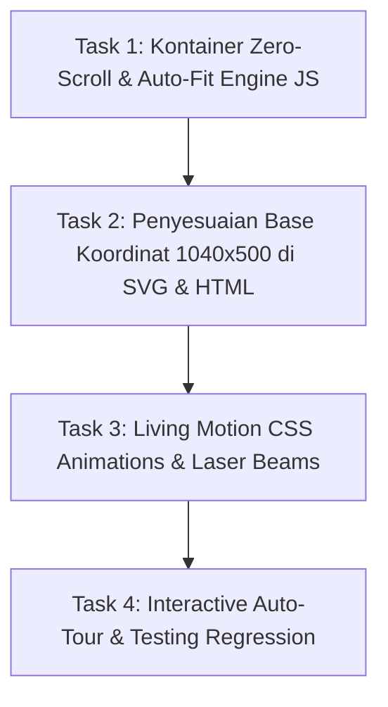

# PRD & Technical Task Specification: Zero-Scroll Auto-Fit Canvas & Living Motion Engine (V4.0)
**Role:** Lead Frontend Architect & Design Director  
**Target Assignee:** Junior Full-Stack Developer & Budget LLM (Gemini 3.8 Flash / Claude Haiku)  
**Surface URL:** `http://127.0.0.1:8000/panduan-alur`  
**Target View:** [resources/views/public/panduan-alur.blade.php](file:///g:/MAGKOM/resources/views/public/panduan-alur.blade.php)  
**Design Skills Compliance:** `better-ui`, `better-typography`, `better-layout`, `better-colors`, `better-writing`, `impeccable`, `ui-ux-pro-max`  
**Status:** PROPOSED & READY FOR APPROVAL

---

## 1. Executive Problem Statement & Root Cause Analysis

### 1.1 Masalah Saat Ini: Munculnya Scrollbar Horizontal
Berdasarkan screenshot pengguna, pada bagian bawah kanvas diagram alur terdapat **scrollbar horizontal abu-abu** yang mengharuskan pengguna menggeser (*scroll*) ke kanan untuk melihat kelanjutan alur (Tahap 05, 06, 07, dan Finish).

### 1.2 Akar Masalah Teknis (*Technical Root Cause*):
1. **Grid Asimetris Dua Kolom**:
   - Layout halaman menggunakan CSS Grid: Kolom kiri (`.graph-canvas-card`) memiliki lebar fleksibel sekitar `720px – 820px` pada layar desktop standar (resolusi 1366px – 1920px), sedangkan kolom kanan (`#inspectorCard`) mengambil sisa ruang sekitar `360px – 400px`.
2. **Fixed Min-Width pada Kanvas Plane**:
   - Kelas `.flowchart-canvas-plane` memiliki aturan CSS statis: `min-width: 1180px; height: 580px;`.
   - Karena `1180px` > `780px` (lebar kontainer kiri), elemen `.flowchart-viewport` yang memiliki `overflow-x: auto;` otomatis memicu scrollbar horizontal sepanjang `400px`.
3. **Pengalaman Pengguna yang Terpecah (*Fractured Mental Model*)**:
   - Pengguna ingin **melihat seluruh arsitektur alur secara panoramik dalam satu layar utuh sekaligus (*at-a-glance*)** tanpa repot menggeser mouse atau scrollbar horizontal, disertai **animasi alur dinamis yang hidup (*living pulse motion*)**.

---

## 2. Solusi Arsitektur: Zero-Scroll Auto-Fit Engine & Living Motion System

Untuk menyelesaikan masalah ini secara tuntas tanpa merusak proporsi node atau tipografi, kita mengimplementasikan arsitektur **Zero-Scroll Auto-Fit Engine**:

```
+----------------------------------------------------------------------------------------------------+
|                                    ARSITEKTUR ZERO-SCROLL AUTO-FIT                                 |
+----------------------------------------------------------------------------------------------------+
|                                                                                                    |
|  [ .flowchart-viewport ] (overflow: hidden; width: 100%; border-radius: 1rem; )                    |
|       │                                                                                            |
|       ├──> [ .flowchart-autofit-stage ] (position: relative; height: dynamic; )                    |
|                 │                                                                                  |
|                 └──> [ #flowchartCanvasPlane ] (base: 1040px × 500px, transform: scale(auto))      |
|                           │                                                                        |
|                           ├──> [ SVG Layer (viewBox: 0 0 1040 500) ] (Laser Beam Flow Animation)   |
|                           ├──> [ HTML Interactive Nodes ] (Coordinate-Locked 2D Graph)            |
|                           └──> [ Living Motion Particles ] (Loopback Reverse Flow)                 |
|                                                                                                    |
+----------------------------------------------------------------------------------------------------+
```

### 2.1 Formula Matematis Auto-Fit Scaling:
Alih-alih memaksa pengguna melakukan scroll:
1. Kita tentukan **Base Canvas Resolution** sebesar **`1040px × 500px`** (aspek rasio ideal ~`2.08:1`).
2. Script frontend (via `ResizeObserver` atau window resize listener) mengukur lebar kontainer aktual `viewportWidth`.
3. Skala dihitung otomatis:
   $$\text{scaleFactor} = \min\left(1.0, \frac{\text{viewportWidth} - 24}{\text{baseWidth}}\right)$$
4. Transformasi diterapkan ke kanvas:
   - `canvasPlane.style.transform = "scale(" + scaleFactor + ")"`
   - `canvasPlane.style.transformOrigin = "top left"`
   - `autofitStage.style.height = (baseHeight * scaleFactor) + "px"`
5. **Hasil Mutlak**:
   - Pada layar laptop/desktop (lebar 750px – 1000px): Diagram otomatis mengecil proporsional secara sempurna. **Zero horizontal scrollbar (`overflow: hidden`)**.
   - Pada layar ultrawide (lebar > 1040px): Diagram tampil pada skala asli 100% dengan ketajaman kristal.
   - Semua teks, ikon SVG, badge kondisi, dan belah ketupat keputusan langsung terlihat dalam satu bingkai pandang.

---

## 3. Spesifikasi Animasi Alur Dinamis ("Living Motion Engine")

Sesuai aturan `better-ui` (*transitions, not keyframes for state changes; spring motion; staggered entrances; prefers-reduced-motion*):

### 3.1 Animasi 1: SVG Laser Beam Flow (Aliran Sinar Jalur Aktif)
- **Tampilan**: Garis panah yang aktif memiliki partikel sinar cahaya bergerak (`.flow-edge-pulse.active`) yang mengalir dari node awal ke node tujuan.
- **Implementasi CSS**:
  ```css
  .flow-edge-pulse.active {
      opacity: 1;
      stroke-dasharray: 8 12;
      animation: svgLaserBeam 1s linear infinite;
  }
  @keyframes svgLaserBeam {
      from { stroke-dashoffset: 40; }
      to { stroke-dashoffset: 0; }
  }
  ```

### 3.2 Animasi 2: Reverse River Stream (Alur Balik Loopback Revisi)
- **Tampilan**: Pada saat pemohon berada di tahap "Perlu Perbaikan", garis melengkung oranye beranimasi memutar balik menuju "03 Unggah Berkas" dengan arah gelombang mundur (*reverse motion*), menandakan alur perbaikan berkas.
- **Implementasi CSS**:
  ```css
  .flow-edge-loopback.active {
      stroke-dasharray: 6 6;
      animation: reverseStream 1.2s linear infinite;
  }
  @keyframes reverseStream {
      from { stroke-dashoffset: 0; }
      to { stroke-dashoffset: 24; }
  }
  ```

### 3.3 Animasi 3: Halo Glow & Scale Spring pada Node Aktif
- **Tampilan**: Node yang sedang aktif (`.active`) tidak hanya mendapat border biru, tetapi juga memancarkan denyut halo lembut (*concentric pulsing shadow*) dan membesar lembut ke `scale(1.02)`.
- **Implementasi CSS**:
  ```css
  .flow-node-item.active {
      transform: scale(1.02);
      box-shadow: 0 0 0 3px rgba(7, 81, 255, 0.25), 0 8px 24px -4px rgba(7, 81, 255, 0.2);
  }
  ```

### 3.4 Animasi 4: Staggered Entrance Reveal
- **Tampilan**: Saat halaman pertama kali dimuat, node-node muncul berurutan dari kiri ke kanan dengan jeda 60ms (*staggered fade-in & upward nudge* 6px).

### 3.5 Animasi 5: Tour Simulation Autoplay
- **Tampilan**: Saat tombol "Mulai Simulasi Alur" ditekan, penunjuk langkah otomatis bergerak dari Tahap 01 hingga Tahap 07 setiap 2.5 detik, mengalirkan denyut sinar SVG dari node ke node secara sinematis.

---

## 4. Master Layout Koordinat Base Canvas (1040px × 500px)

Dengan rasio `1040 × 500`, seluruh alur dipadatkan secara presisi tanpa berhimpitan:

```
[START] (X:20, Y:25)
   │
   ▼
[SMK] (X:20, Y:95) ──┐
                     ├── [PKL / Magang] ──> [01 Cek Kuota] ──> [02 Registrasi] ──> [03 Unggah Berkas] <──┐
[MHS] (X:20, Y:215) ──┘                      (X:155, Y:155)     (X:305, Y:155)       (X:455, Y:155)      │
                                                                                           │             │ (Loopback Revisi:
                                                                                           ▼             │  3x24 Jam)
                                                                                   < Verifikasi Admin >  │
                                                                                     (Diamond X:620,     │
                                                                                            Y:155)       │
                                                                                    /      │      \      │
                                                                      [Lolos Seleksi]  [Kuota]   [Format]│
                                                                           /               │         \   │
                                                                          ▼                ▼          ▼  │
                                                                 (Diterima Resmi)   (Waiting List)   (Perlu ─┘
                                                                  (X:755, Y:60)     (X:755, Y:165)    Perbaikan)
                                                                        │                            (X:755, Y:275)
                                                                        ▼
                                                                [05 Orientasi] (X:905, Y:50)
                                                                        │
                                                                        ▼
                                                                [06 Logbook]   (X:905, Y:155)
                                                                        │
                                                                        ▼
                                                                [07 Sertifikat] (X:905, Y:260)
                                                                        │
                                                                        ▼
                                                                (FINISH Pill)  (X:875, Y:370)
```

---

## 5. Work Breakdown Structure (Petunjuk Eksekusi Langkah-demi-Langkah untuk Junior Dev / AI)



### Task 1: Kontainer Zero-Scroll & Auto-Fit Scaling Engine
- **Target File**: `resources/views/public/panduan-alur.blade.php`
- **Instruksi**:
  1. Hapus `overflow-x: auto;` pada `.flowchart-viewport`, ganti dengan:
     ```css
     .flowchart-viewport {
         position: relative;
         width: 100%;
         overflow: hidden; /* HILANGKAN SCROLLBAR HORIZONTAL TOTAL */
         border-radius: 1rem;
         background: var(--neutral-100, #F8FAFC);
         border: 1px solid var(--neutral-300, #CBD5E1);
         padding: 0.85rem;
         box-sizing: border-box;
     }
     .flowchart-autofit-stage {
         position: relative;
         width: 100%;
         overflow: hidden;
         transform-origin: top left;
     }
     ```
  2. Tambahkan script `autoFitFlowchartCanvas()` pada `panduan-alur.blade.php`:
     ```javascript
     function autoFitFlowchartCanvas() {
         const viewport = document.getElementById('flowchartViewport');
         const plane = document.getElementById('flowchartCanvasPlane');
         const stage = document.getElementById('flowchartStage');
         if (!viewport || !plane) return;

         const BASE_WIDTH = 1040;
         const BASE_HEIGHT = 500;
         const availableWidth = viewport.clientWidth - 28; // kurangi padding
         const scale = Math.min(1.0, Math.max(0.65, availableWidth / BASE_WIDTH));

         plane.style.transform = `scale(${scale})`;
         plane.style.transformOrigin = 'top left';

         if (stage) {
             stage.style.height = `${Math.round(BASE_HEIGHT * scale)}px`;
         }
         
         const zoomLabel = document.getElementById('zoomPercentLabel');
         if (zoomLabel) {
             zoomLabel.innerText = `${Math.round(scale * 100)}% (Auto)`;
         }
     }
     window.addEventListener('resize', autoFitFlowchartCanvas);
     window.addEventListener('load', autoFitFlowchartCanvas);
     ```

### Task 2: Penataan Ulang Koordinat Node & SVG Layer (1040px × 500px)
- **Target File**: `resources/views/public/panduan-alur.blade.php`
- **Instruksi**:
  1. Set atribut SVG: `<svg class="flow-svg-layer" viewBox="0 0 1040 500">`.
  2. Pasang koordinat node kompak:
     - `START Pill`: `left: 20px; top: 25px;`
     - `SMK Circle`: `left: 20px; top: 95px;`
     - `MHS Circle`: `left: 20px; top: 215px;`
     - `Step 01 Cek Kuota`: `left: 155px; top: 155px; width: 125px; min-height: 80px;`
     - `Step 02 Registrasi`: `left: 305px; top: 155px; width: 125px; min-height: 80px;`
     - `Step 03 Unggah Berkas`: `left: 455px; top: 155px; width: 130px; min-height: 80px;`
     - `Decision Diamond`: `left: 620px; top: 155px;` (Kotak 64px × 64px)
     - `Diterima Resmi`: `left: 755px; top: 60px; width: 130px;`
     - `Waiting List`: `left: 755px; top: 165px; width: 130px;`
     - `Perlu Perbaikan`: `left: 755px; top: 275px; width: 145px;`
     - `Step 05 Orientasi`: `left: 905px; top: 50px; width: 125px; min-height: 80px;`
     - `Step 06 Logbook`: `left: 905px; top: 155px; width: 125px; min-height: 80px;`
     - `Step 07 Sertifikat`: `left: 905px; top: 260px; width: 125px; min-height: 80px;`
     - `FINISH Pill`: `left: 875px; top: 370px;`
  3. Hubungkan jalur SVG dengan garis siku berlabuh presisi ke anchor masing-masing node.
  4. Atur alur loopback dari Perlu Perbaikan (X: 827, Y: 330) turun ke Y: 390, belok kiri ke X: 520, lalu naik ke port bawah Step 03.

### Task 3: Penerapan Sistem Animasi Living Motion
- **Target File**: `resources/views/public/panduan-alur.blade.php`
- **Instruksi**:
  1. Pasang animasi `@keyframes laserBeamFlow` pada `.flow-edge-pulse.active`.
  2. Pasang animasi `@keyframes reverseStream` pada `.flow-edge-loopback.active`.
  3. Tambahkan efek *ambient pulse* pada port anchor (`.port-anchor.pulse`).
  4. Sediakan `@media (prefers-reduced-motion: reduce)` yang mematikan keyframes dan menampilkan garis solid state.

### Task 4: Verifikasi & Automated Testing
- **Instruksi**:
  1. Jalankan `php artisan test --filter=AlurMagangPageTest` untuk memastikan seluruh 5 feature test dan 68 assertions tetap lulus 100%.
  2. Periksa tampilan browser pada viewport desktop, pastikan scrollbar horizontal telah lenyap sepenuhnya.

---

## 6. Acceptance Criteria & Definition of Done (DoD)

1. [ ] **Nol Scrollbar Horizontal**: Pada layar desktop standar maupun laptop, `.flowchart-viewport` tidak memunculkan scrollbar horizontal sama sekali (`overflow: hidden`).
2. [ ] **100% Visibilitas Diagram**: Seluruh node dari START (paling kiri) hingga FINISH (paling kanan) langsung terlihat dalam satu bingkai pandang tanpa terpotong.
3. [ ] **Living Motion Animations**:
   - Garis alur aktif memancarkan animasi laser beam yang mengalir searah panah.
   - Jalur loopback memancarkan partikel aliran balik saat status "Perlu Perbaikan" aktif.
   - Node yang dipilih memiliki efek spring dan halo glow lembut.
4. [ ] **Zero Text Clipping & Zero Typo**: Semua teks utuh, terbaca jelas, dan tidak ada clipping.
5. [ ] **Automated Test Suite Pass**: Seluruh 377 test PHPUnit tetap PASSED 100%.
