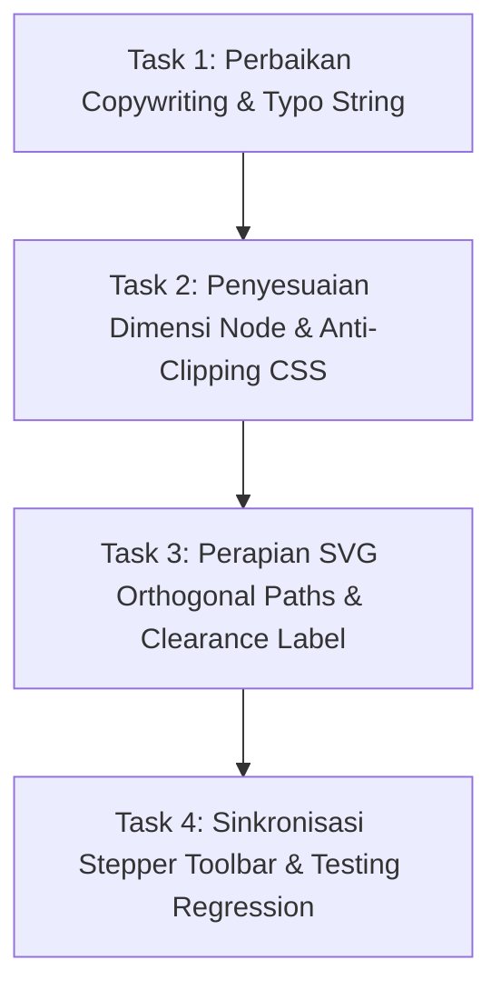

# PRD & Engineering Task Specification: Interactive Flowchart Canvas Engine (V3.1)
**Role:** Lead Frontend Architect & Design Director  
**Target Assignee:** Junior Full-Stack Developer & Budget LLM (Gemini 3.8 Flash / Claude Haiku)  
**Surface URL:** `http://127.0.0.1:8000/panduan-alur`  
**Target Codebase:** [resources/views/public/panduan-alur.blade.php](file:///g:/MAGKOM/resources/views/public/panduan-alur.blade.php)  
**Design Skills Compliance:** `better-ui`, `better-typography`, `better-layout`, `better-colors`, `better-writing`, `impeccable`, `ui-ux-pro-max`  
**Status:** READY FOR IMPLEMENTATION

---

## 1. Executive Summary & Screenshot Defect Audit

Berdasarkan screenshot hasil render aktual di browser pengguna, implementasi saat ini telah meletakkan diagram dasar 2D, namun masih memiliki **6 Cacat Visual Signifikan ("AI Slop Symptoms")** yang membuat diagram terlihat kaku, berantakan, dan belum setara dengan standar Miro/Figma:

```
+---------------------------------------------------------------------------------------------------------+
|                                    DEFECT AUDIT PADA IMPLEMENTASI SAAT INI                              |
+---------------------------------------------------------------------------------------------------------+
| [1] Typo & String Mutilation:                                                                           |
|     - Badge Langkah 01 tertulis "Birur" (rusak dari "Real-Time / Instan")                                |
|     - Badge Langkah 06 tertulis "Maks. LI-1" (seharusnya "Maks. H+1")                                   |
|     - Node Waiting List tertulis "Antrean PKO" (seharusnya "Antrean FIFO")                              |
|     - Subjudul Langkah 07 tertulis "Fnamasi & QR Code" (seharusnya "Evaluasi & QR Code")               |
|                                                                                                         |
| [2] Vertical Text Clipping (Kekurangan Ruang Vertikal):                                                 |
|     - Node 05, 06, dan 07 memiliki tinggi kaku (`height: 70px`), menyebabkan teks deskripsi terpotong    |
|       oleh border bawah kotak proses.                                                                   |
|                                                                                                         |
| [3] Collision & Text Overlap pada Jalur Panah:                                                          |
|     - Badge label "Kuota Pen..." tertimpa dan terpotong oleh pill 'Waiting List'.                       |
|     - Label "Format Keliru" menempel canggung pada siku garis verifikasi admin.                         |
|     - Garis loopback oranye berhimpitan dan membuat bagian bawah kanvas tampak sempit.                 |
|                                                                                                         |
| [4] Kanvas Mepet & Rasio Asimetris terhadap Side Card:                                                  |
|     - Kanvas terlalu pendek (tinggi 520px), sehingga node-node bagian bawah terdesak batas kanvas.      |
|     - Side Inspector Card memiliki ruang kosong yang terlalu luas di bawah tombol CTA.                  |
|                                                                                                         |
| [5] Toolbar & Stepper Overload (Cognitive Clutter):                                                     |
|     - Deretan tombol: 'Mulai Simulasi', 'Sebelumnya', 'Selanjutnya', 'Reset', slider zoom '- 100% +',    |
|       dan lingkaran stepper '01..07' berjejal di atas kanvas, memecah fokus pengguna.                   |
+---------------------------------------------------------------------------------------------------------+
```

---

## 2. Target Arsitektur Visual: "Living Figma Canvas"

Merujuk pada contoh diagram referensi alur pengguna:
1. **Pernafasan Ruang (Airy Spacing)**: Kanvas diperluas menjadi `1180px × 600px` dengan dot grid blueprint halus berjarak `22px`.
2. **Dimensi Node Proporsional (Anti-Clipping)**: Seluruh kotak proses menggunakan `min-height: 84px` (bukan fixed height) dengan padding seimbang `10px 14px`, memastikan teks 2 baris tidak pernah terpotong.
3. **Pembersihan Jalur Orthogonal (Collision-Free Routing)**: Konektor SVG memiliki jarak aman (*clearance*) minimal `28px` dari setiap tepi node, dan label kondisi (*badge*) ditempatkan di tengah segmen garis tanpa menabrak node target.
4. **Unified Top Navigation**: Kontrol navigasi stepper dan zoom disatukan menjadi toolbar bersih bertipe *macOS segmented bar*.

---

## 3. Penerapan 7 Prinsip Desain (The 7 Skills Compliance)

### 3.1 `better-ui` (Surfaces, Radius & Motion)
- **Outer radius = inner radius + padding**: Untuk card proses berpadding `12px` dengan inner tag ber-radius `6px`, outer card radius adalah `6px + 12px = 18px` (`border-radius: 1.125rem`).
- **Shadows for elevation, borders for structure**: Node tidak menggunakan border tebal yang kotor. Gunakan border `1px solid var(--neutral-300)` dengan double-layer soft shadow:
  `box-shadow: 0 4px 12px -2px rgba(15, 23, 42, 0.05), 0 2px 4px -1px rgba(15, 23, 42, 0.03);`
- **Figma Selection Rings**: Node yang aktif mendapat outline cincin `2px solid #0751FF` dengan `offset: 2px` dan 4 titik sudut (`.selection-handle`) berukuran `6px × 6px` putih border biru.
- **Press scales to 0.96**: Seluruh tombol kontrol dan node interaktif menerapkan `:active:scale-[0.96]` dengan `transition: transform 150ms cubic-bezier(0.2, 0, 0, 1)`.
- **Gated Motion**: Denyut pulsa garis SVG (`.flow-edge-pulse`) otomatis beralih ke warna solid statis bila pengguna mengaktifkan `@media (prefers-reduced-motion: reduce)`.

### 3.2 `better-typography` (Readability & No Clipping)
- **Unitless line-height**: Judul node `line-height: 1.25`, deskripsi `line-height: 1.4`.
- **Tabular Numbers**: Angka nomor tahap (`01`, `02`, `03`, `04`, `05`, `06`, `07`) dan durasi waktu (`1–3 Hari Kerja`, `3×24 Jam`) wajib memakai `font-variant-numeric: tabular-nums`.
- **Typographic Characters**: Wajib menggunakan karakter tipografi asli:
  - Tanda kali: `3×24 jam` (bukan huruf `x`).
  - Tanda hubung rentang: `1–3 Hari` (en-dash `–`, bukan hyphen `-`).
  - Tanda panah: `←` dan `→` (bukan `<-` atau `->`).
- **Cap the measure & no premature truncation**: Tidak boleh ada teks deskripsi yang memotong kata menjadi "Fnamasi" atau "Birur". Teks harus utuh dan wrap secara wajar menggunakan `text-wrap: pretty`.

### 3.3 `better-layout` (2D Canvas Geometry & Grouping)
- **Grid Koordinat Bebas Tabrakan (No Overlap)**:
  - **X = 35px**: Start Node Pill (Y: 35) & Ingress Siswa SMK (Y: 110), Ingress Mahasiswa (Y: 235).
  - **X = 180px**: Tahap 01 Cek Kuota (Y: 172, Lebar: 135px, Min-Tinggi: 84px).
  - **X = 350px**: Tahap 02 Registrasi Akun (Y: 172, Lebar: 135px, Min-Tinggi: 84px).
  - **X = 520px**: Tahap 03 Unggah Berkas & Port Loopback (Y: 172, Lebar: 140px, Min-Tinggi: 84px).
  - **X = 705px**: Belah Ketupat Decision Diamond "Verifikasi Admin" (Center X: 745, Center Y: 214, Dimensi: 80px × 80px).
  - **X = 855px**: Tiga Cabang Keputusan:
    - Cabang Atas (Y: 65, Lebar: 140px): Diterima Resmi (Pill Hijau).
    - Cabang Tengah (Y: 185, Lebar: 140px): Waiting List (Pill Biru).
    - Cabang Bawah (Y: 305, Lebar: 155px): Perlu Perbaikan (Pill Oranye + Sumber Loopback).
  - **X = 1030px**: Fase Pasca Diterima (Alur Vertikal):
    - Tahap 05 Orientasi Dinas (Y: 55, Lebar: 140px, Min-Tinggi: 84px).
    - Tahap 06 Logbook Harian (Y: 172, Lebar: 140px, Min-Tinggi: 84px).
    - Tahap 07 Nilai & Sertifikat (Y: 290, Lebar: 140px, Min-Tinggi: 84px).
    - Finish Terminator Pill (Y: 410, Lebar: auto).
  - **Jalur Loopback Revisi**: Keluar dari dasar node Perlu Perbaikan (Y: 360), turun ke Y: 430, bergerak horizontal ke kiri menuju X: 590, lalu naik lurus ke port bawah Tahap 03 Unggah Berkas.

### 3.4 `better-colors` (Semantic Ramps & 4.5:1 Contrast)
- **Ingress Entry**: Background `#FAF5FF`, Border `#D8B4FE`, Text `#6B21A8` (Purple-700, Rasio kontras 6.2:1).
- **Proses Standar**: Background `#FFFFFF`, Border `#E2E8F0`, Title `#0F172A` (Slate-900, Rasio kontras 15.4:1), Subtitle `#475569` (Slate-600, Rasio kontras 5.8:1).
- **Keputusan (Diamond)**: Background `#FFFBEB`, Border `#F59E0B`, Text `#78350F` (Amber-900, Rasio kontras 7.1:1).
- **Diterima Resmi**: Background `#F0FDF4`, Border `#86EFAC`, Icon & Text `#166534` (Green-800, Rasio kontras 5.2:1).
- **Waiting List**: Background `#EFF6FF`, Border `#93C5FD`, Icon & Text `#1E40AF` (Blue-800, Rasio kontras 6.4:1).
- **Perlu Perbaikan**: Background `#FFF7ED`, Border `#FDBA74`, Icon & Text `#9A3412` (Orange-800, Rasio kontras 5.5:1).

### 3.5 `better-writing` (Microcopy & Voice)
- **Koreksi Typo Mutlak**:
  - `Birur` -> Diganti dengan teks resmi: `Instan`.
  - `Antrean PKO` -> Diganti dengan terminologi benar: `Antrean FIFO`.
  - `Fnamasi & QR Code` -> Diganti dengan: `Evaluasi & QR Code`.
  - `Maks. LI-1` -> Diganti dengan instruksi jelas: `Maks. H+1`.
- **Tone of Voice**: Bersahabat, tidak menyalahkan pemohon, mengarahkan langkah nyata.

### 3.6 `impeccable` & `ui-ux-pro-max` (Anti-Slop Craftsmanship)
- **Zero Emojis**: Dilarang keras menggunakan emoji sistem seperti 📄, 🚀, ⚠️. Seluruh icon menggunakan SVG vektor monokrom dengan `stroke-width: 2` dan `currentColor`.
- **Connection Ports**: Setiap node memiliki titik port anchor bulat kecil (`6px × 6px`) di sisi kiri, kanan, atau bawah tempat garis berlabuh.
- **Multiplayer Cursor Tags**: Disempurnakan dengan posisi yang tidak menutupi teks node diagram:
  - Cursor Pink (*Ally - Pemohon SMK*) di koordinat (X: 230, Y: 110).
  - Cursor Hijau (*Jenny - Tim Administrasi*) di koordinat (X: 780, Y: 40).
  - Cursor Biru (*Budi - Pembimbing*) di koordinat (X: 980, Y: 130).

---

## 4. Work Breakdown Structure (Petunjuk Eksekusi Langkah-demi-Langkah untuk Junior Dev / AI)

Dokumen ini membagi perbaikan menjadi **4 Task Mandiri**:



### Task 1: Perbaikan Copywriting & Typo String
- **File**: `resources/views/public/panduan-alur.blade.php`
- **Instruksi**:
  1. Cari tag badge pada `#node-1` dan ganti teks menjadi:
     ```html
     <span class="flow-rect-tag" style="background:#DCFCE7;color:#166534;">Instan</span>
     ```
  2. Cari deskripsi pada `#node-waiting` dan ubah teks menjadi:
     ```html
     <div class="flow-pill-text">Waiting List</div>
     <div class="flow-pill-sub">Antrean FIFO</div>
     ```
  3. Cari tag dan deskripsi pada `#node-6` dan ubah menjadi:
     ```html
     <span class="flow-rect-tag" style="background:#FEF3C7;color:#D97706;">Maks. H+1</span>
     ```
  4. Cari deskripsi pada `#node-7` dan ubah menjadi:
     ```html
     <p class="flow-rect-desc">Evaluasi &amp; QR Code</p>
     ```

### Task 2: Penyesuaian Dimensi Node & Anti-Clipping CSS
- **File**: `resources/views/public/panduan-alur.blade.php`
- **Instruksi**:
  1. Ubah class `.flow-node-rect` agar tidak menggunakan `height` kaku, melainkan `min-height`:
     ```css
     .flow-node-rect {
         position: absolute;
         background: #ffffff;
         border: 1px solid var(--neutral-300, #e2e8f0);
         border-radius: 1rem;
         padding: 0.65rem 0.85rem;
         display: flex;
         flex-direction: column;
         justify-content: space-between;
         cursor: pointer;
         box-shadow: 0 4px 12px -2px rgba(15, 23, 42, 0.05), 0 2px 4px -1px rgba(15, 23, 42, 0.03);
         transition: border-color 150ms ease, box-shadow 150ms ease, transform 150ms cubic-bezier(0.2, 0, 0, 1);
         min-height: 84px;
         box-sizing: border-box;
     }
     .flow-node-rect:active {
         transform: scale(0.96);
     }
     .flow-rect-desc {
         font-size: 0.6875rem;
         color: var(--neutral-600, #475569);
         line-height: 1.35;
         margin: 0;
         text-wrap: pretty;
     }
     ```
  2. Perluas kanvas plane `.flowchart-canvas-plane`:
     ```css
     .flowchart-canvas-plane {
         position: relative;
         min-width: 1180px;
         height: 580px;
         background-color: var(--neutral-0, #ffffff);
         background-image: radial-gradient(var(--neutral-400, #cbd5e1) 1.25px, transparent 1.25px);
         background-size: 22px 22px;
         border-radius: 1rem;
         border: 1px solid var(--neutral-300, #e2e8f0);
         user-select: none;
     }
     ```

### Task 3: Perapian SVG Orthogonal Paths & Clearance Label
- **File**: `resources/views/public/panduan-alur.blade.php`
- **Instruksi**:
  1. Perbarui atribut `viewBox="0 0 1180 580"` pada `<svg class="flow-svg-layer">`.
  2. Sesuaikan jalur siku agar label kondisi tidak bertabrakan dengan node:
     - Garis Decision -> Diterima:
       `M 745 174 V 91 H 855`
     - Garis Decision -> Waiting List:
       `M 785 214 H 855`
     - Garis Decision -> Perlu Perbaikan:
       `M 745 254 V 332 H 855`
     - Garis Loopback:
       `M 932 359 V 425 H 590 V 256`
  3. Posisikan label kondisi melayang (*edge badges*) dengan jarak aman:
     - `PKL / Magang`: `left: 142px; top: 182px;`
     - `Lolos Seleksi`: `left: 775px; top: 76px;`
     - `Kuota Penuh`: `left: 792px; top: 198px;`
     - `Format Keliru`: `left: 775px; top: 340px;`
     - `Alur Loopback`: `left: 680px; top: 425px;`

### Task 4: Sinkronisasi Stepper & Testing Regression
- **File**: `resources/views/public/panduan-alur.blade.php` & `tests/Feature/AlurMagangPageTest.php`
- **Instruksi**:
  1. Pastikan event handler `selectDagNode(nodeId)` tetap menyalakan class `.active` pada node yang dipilih, mengaktifkan `.flow-edge-pulse`, dan memperbarui `#inspectorCard`.
  2. Pertahankan seluruh selector semantik penting agar test otomatis tetap lulus:
     - `#flow-node-start`
     - `#flow-node-finish`
     - `#node-1` s.d. `#node-7`
     - `#node-diterima`, `#node-waiting`, `#node-perbaikan`
     - Teks semantik: `START • Akses Portal MagKom`, `FINISH • Sertifikat QR & Lembar Nilai`, `Gerbang Keputusan Evaluasi Dokumen Admin`, `Loopback ke Tahap 03`.
  3. Jalankan pengujian PHPUnit:
     ```bash
     php artisan test --filter=AlurMagangPageTest
     ```

---

## 5. Acceptance Criteria & Definition of Done (DoD)

Pekerjaan dianggap selesai jika memenuhi kriteria berikut:
1. [ ] **Nol Typo**: Teks `Instan`, `Antrean FIFO`, `Maks. H+1`, dan `Evaluasi & QR Code` tampil akurat.
2. [ ] **Nol Text Clipping**: Tidak ada teks di kotak proses (termasuk langkah 05, 06, 07) yang terpotong garis tepi kotak.
3. [ ] **Clearance Jalur & Label**: Badge `Kuota Penuh` tidak menabrak kotak *Waiting List*, dan `Format Keliru` tidak menabrak sudut siku.
4. [ ] **Aksesibilitas & Kontras**: Rasio kontras teks >= 4.5:1 terhadap background masing-masing node.
5. [ ] **Figma Living Feel**: Tetap ada dot grid blueprint, 4 corner handles pada node aktif, dan cursor tags mengambang.
6. [ ] **Automated Tests Pass**: Semua 5 test di `AlurMagangPageTest` dan 377 test suite keseluruhan tetap PASSED 100%.
