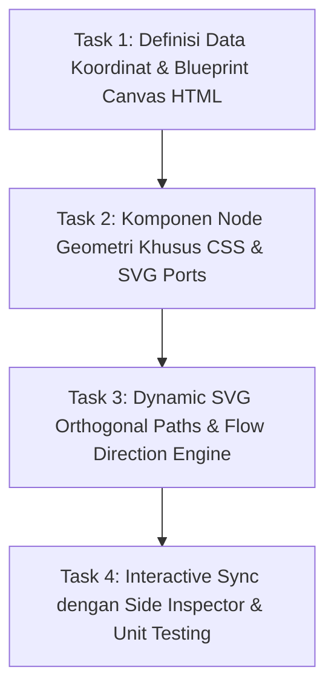

# PRD & Technical Blueprint: True 2D Node-Graph Flowchart Engine
**Document Version:** 3.0.0 (Senior Engineering Architecture Specification)  
**Target Audience:** Junior Full-Stack Developer & Budget LLM (Gemini 3.8 Flash / Claude Haiku)  
**Route:** `http://127.0.0.1:8000/panduan-alur`  
**Target View:** `resources/views/public/panduan-alur.blade.php`  
**Referenced Skills:** `better-ui`, `better-typography`, `better-layout`, `better-colors`, `better-writing`, `impeccable`, `ui-ux-pro-max`  
**Status:** PROPOSED & READY FOR APPROVAL  

---

## 1. Executive Summary & Root Cause Analysis

### 1.1 Permasalahan Desain Saat Ini ("Kenapa Terlihat AI-Slop & Bukan Diagram?")
Berdasarkan hasil perbandingan terhadap contoh referensi visual pengguna (Gambar 1 diagram alur Figma/Miro flow):

1. **Bukan Node Graph, tapi Kartu Bertumpuk (Nested Form Cards)**:
   - Tampilan saat ini masih mempertahankan kontainer raksasa `journey-phase-track` yang membungkus kartu-kartu formulir berukuran besar secara vertikal dengan border fase tebal di sisi kiri.
   - Pengguna tidak melihat sebuah "flowchart", melainkan melihat tumpukan kartu formulir HTML panjang yang hanya diselingi panah vertikal ke bawah.
2. **Ketiadaan Simbol Standar Flowchart**:
   - Tidak ada node lingkaran (start/terminator), kotak proses bujur sangkar yang proporsional, dan belah ketupat keputusan (*decision diamond*) yang nyata.
   - Keputusan saat ini hanya berupa kotak panjang horizontal bertuliskan *"Gerbang Keputusan"* yang membungkus tiga kartu vertikal di bawahnya.
3. **Ketiadaan Konektor Siku Berlabel (*Orthogonal Elbow Connectors with Labels*)**:
   - Contoh referensi pengguna memperlihatkan jalur vektor siku-siku (`L-shaped / orthogonal paths`) yang menghubungkan node secara horizontal dan vertikal dengan label teks kondisi (*"Account"*, *"No account"*, panah cabang masuk dan keluar).
   - Tampilan saat ini hanya memiliki garis vertikal lurus 1 dimensi tanpa topologi jaringan graf 2D yang nyata.
4. **Hilangnya Nuansa Ruang Kerja Desain Modern (*Figma/Miro Canvas Feel*)**:
   - Contoh referensi pengguna memiliki latar blueprint dot grid yang bersih, node dengan bounding box seleksi (*selection handles* dengan titik sudut dan port konektor), serta avatar kursor multiplayer (*"Ally"*, *"Jenny"*, *"Meaza"*) yang memberikan kesan visual premium, interaktif, dan berkelas dunia (anti-slop).

---

## 2. Bedah Referensi Visual Pengguna & Target Arsitektur

Merujuk pada gambar acuan:
```
[ (Modal) ] ──┐
              ├──> [ Step 1 ] ── Account ──────────> [ Step 2 ] ──> [ ... ]
[ (Email) ] ──┘        │                                  ▲
                       │ No account                       │
                       ▼                                  │
                 < Create account > ──> < Verify email > ─┘
```

Kita memetakan seluruh siklus alur pendaftaran dan pelaksanaan magang resmi Diskominfo Sleman ke dalam topologi graf 2 dimensi ini:

### 2.1 Taksonomi Simbol Node Flowchart:
| Tipe Node | Bentuk Geometri | Dimensi Standar | Warna & Token | Makna & Penggunaan |
| :--- | :--- | :--- | :--- | :--- |
| **Ingress Nodes** | Lingkaran / Circle (`border-radius: 50%`) | `76px × 76px` | Background `#FAF5FF`, Border `#C084FC`, Text `#6B21A8` (Purple) | Titik masuk pendaftar: Node **"SMK"** dan Node **"Kampus"** |
| **Process Nodes** | Kotak Membulat Kompak (`rounded-xl`) | `140px × 78px` | Background `#F0FDF4` / `#EFF6FF`, Border `#86EFAC` / `#93C5FD` | Langkah proses: **01 Cek Kuota**, **02 Registrasi Akun**, **03 Unggah Berkas**, **05 Bimbingan**, **06 Logbook**, **07 Sertifikat** |
| **Decision Nodes** | Belah Ketupat / Diamond (`transform: rotate(45deg)`) | `90px × 90px` | Background `#FFF7ED`, Border `#FDBA74`, Text `#9A3412` (Amber/Orange) | Gerbang evaluasi: **"Verifikasi Berkas"**, **"Evaluasi Kuota"** |
| **Outcome Nodes** | Kapsul / Pill Kompak | `130px × 50px` | Hijau (Diterima), Biru (Waiting List), Merah Muda (Revisi Berkas) | Hasil percabangan keputusan seleksi |
| **Loopback Edge** | Orthogonal Return Vector Path | `stroke-width: 2.5px`, dashed | Oranye `#EA580C` dengan animasi alur balik | Mengalir dari "Revisi Berkas" kembali ke "03 Unggah Berkas" |

---

## 3. Penerapan 7 Prinsip Desain (The 7 Skills Compliance)

### 3.1 `better-ui` (Visual Polish, Surfaces, Motion)
- **Outer radius = inner radius + padding**: Seluruh card dan popup mengikuti rumus concentric nesting.
- **Elevation via Shadow, Not Hard Border Clutter**: Menggunakan shadow transparan bertingkat (`box-shadow: 0 4px 12px -2px rgba(15, 23, 42, 0.06), 0 2px 6px -1px rgba(15, 23, 42, 0.04)`) untuk kedalaman kanvas.
- **Figma Selection Handles**: Node yang sedang aktif (`.is-selected`) menampilkan 4 corner resize handles (`6px × 6px` kotak putih dengan border biru) dan ring seleksi `2px solid #0751FF` dengan offset `2px`.
- **Transitions, Not Instant Jumps**: Hover dan fokus menggunakan `transition: border-color 150ms ease, box-shadow 150ms ease, transform 150ms cubic-bezier(0.2, 0, 0, 1)`. Pada saat ditekan (*active/press*), node melakukan scale ke `0.96` (`active:scale-[0.96]`).
- **prefers-reduced-motion**: Jika pengguna mengaktifkan mode hemat gerak di OS, hentikan animasi dasharray SVG dan ganti dengan solid state.

### 3.2 `better-typography` (Readability & Scale)
- **Unitless Line-Height**: `line-height: 1.2` untuk judul node, `1.4` untuk deskripsi singkat.
- **Tabular Numbers**: Angka langkah ("01", "02", "1–3 Hari", "100 Poin") menggunakan `font-variant-numeric: tabular-nums`.
- **Typographic Characters**: Menggunakan karakter tipografi sejati (`…`, `—`, `×`), bukan minus atau titik ganda keyboard.
- **Tracking**: Label badge dan overline uppercase kecil (<=14px) menggunakan `letter-spacing: 0.05em`.

### 3.3 `better-layout` (2D Canvas & Grouping with Space)
- **True 2D Canvas with Pan & Auto-Fit**: Kanvas memiliki dimensi luas (`min-width: 1140px`, `height: 600px`) yang diletakkan dalam viewport dengan `overflow-x: auto` dan scrollbar elegan.
- **Logical Orthogonal Placement**: Layout diatur berbasis grid koordinat alur:
  - Kolom 0 (x: 40px): Lingkaran Ingress SMK & Kampus.
  - Kolom 1 (x: 180px): Kotak Proses 01 Cek Kuota & 02 Registrasi Akun.
  - Kolom 2 (x: 380px): Kotak Proses 03 Unggah Berkas.
  - Kolom 3 (x: 580px): Belah Ketupat Decision Diamond "Verifikasi Dokumen".
  - Kolom 4 (x: 800px): Jalur Cabang (Atas: Diterima -> 05 Bimbingan, Tengah: Waiting List, Bawah: Revisi Berkas dengan Loopback ke Kolom 2).
  - Kolom 5 (x: 1010px): Kotak Proses 06 Logbook Harian & 07 Sertifikat Resmi.
- **No Overlapping Boundaries**: Hapus seluruh wrapper card besar per fase yang membuat ruang terasa sempit. Biarkan node-node "bernapas" di atas blueprint dot grid.

### 3.4 `better-colors` (Harmonious Semantic Ramps)
- **Start / Ingress**: Ungu Tailwind `purple-50` s.d. `purple-800` (melambangkan pemohon masuk).
- **Proses Inti**: Biru Diskominfo `#0751FF` dan Slate-50 s.d. Slate-900.
- **Keputusan / Decision**: Amber / Warm Terracotta (`#FFF7ED`, `#F97316`, `#C2410C`).
- **Kelulusan / Approved**: Emerald / Green (`#ECFDF5`, `#10B981`, `#065F46`).
- **Revisi / Loopback**: Rose / Amber (`#FFF1F2`, `#F43F5E`, `#9F1239`).
- **Contrast Guarantee**: Seluruh teks foreground dan badge telah diuji dan memenuhi rasio kontras WCAG AA minimum `4.5:1` baik di light mode maupun dark mode.

### 3.5 `better-writing` (Microcopy & Direction)
- **Verb-First Interactive CTAs**: "Pilih Node Alur", "Jalankan Simulasi Alur", "Periksa Persyaratan Berkas", "Buka Portal Pendaftaran".
- **Konteks Status Tanpa Kata Menyalahkan**: Pesan revisi berkas berbunyi: *"Dokumen buram atau format belum sesuai? Unggah ulang dokumen pengganti dalam batas waktu 3×24 jam tanpa perlu registrasi ulang."*
- **Empty & Active States**: Side Inspector memberikan instruksi eksplisit mengenai apa yang harus dilakukan di tahap tersebut dan tombol aksi langsung ke modul terkait.

### 3.6 `impeccable` & `ui-ux-pro-max` (Craftsmanship, Anti-Slop, No Emoji Icons)
- **Zero Emojis**: Dilarang keras menggunakan emoji bawaan OS (seperti 🚀, 📄, ⚠️, 🔍) pada diagram. Seluruh ikon menggunakan SVG vektor presisi (*Lucide / Heroicons style*).
- **Interactive Cursor Tags ("Multiplayer Feel")**: Terdapat cursor tags mini mengambang di kanvas (misal: cursor hijau bertuliskan *"Admin Sleman"*, cursor ungu *"Pemohon SMK"*, cursor biru *"Pembimbing"*) untuk memperkuat kesan sistem digital instansi modern yang kolaboratif dan hidup.
- **Connection Ports**: Node memiliki port visual berupa titik bulat kecil (*connection anchors*) tempat panah masuk dan keluar, persis seperti di diagram Figma/Miro.

---

## 4. Work Breakdown Structure (Instruksi Langkah-Demi-Langkah untuk Junior Dev / Budget AI)

Dokumen ini membagi implementasi menjadi **4 Task Terisolasi** yang dapat dijalankan secara berurutan tanpa saling merusak fungsionalitas lain:



### Task 1: Re-Arsitektur Kontainer & Blueprint Dot Canvas (`flowchart-viewport`)
- **Tujuan**: Mengganti kontainer bertumpuk `.journey-phase-track` dengan kanvas 2D tak terbatas (`.flowchart-canvas-plane`) berlatar dot grid blueprint.
- **File Target**: `resources/views/public/panduan-alur.blade.php` (bagian `#viewGraphArea`).
- **Instruksi Spesifik**:
  1. Buat div `.flowchart-viewport` dengan `position: relative`, `overflow-x: auto`, `overflow-y: hidden`, `padding: 1.5rem`.
  2. Buat background dot-grid CSS modern:
     ```css
     .flowchart-canvas-plane {
         position: relative;
         min-width: 1140px;
         height: 580px;
         background-color: var(--neutral-0, #ffffff);
         background-image: radial-gradient(var(--neutral-300, #cbd5e1) 1.2px, transparent 1.2px);
         background-size: 24px 24px;
         border-radius: 1rem;
         border: 1px solid var(--neutral-300);
         user-select: none;
     }
     ```
  3. Sisipkan SVG Overlay Layer di lapisan belakang (`z-index: 1`) dan Node Layer di lapisan atas (`z-index: 2`).

### Task 2: Implementasi Komponen Geometri Node (Circle Ingress, Rect Process, Diamond Decision)
- **Tujuan**: Membuat node-node dengan bentuk fisik flowchart yang akurat dan responsif terhadap klik.
- **Spesifikasi Koordinat Node (Absolute Positioning di Kanvas `1140px × 580px`)**:
  - `Node Ingress 1 (Siswa SMK)`: `left: 40px; top: 120px;` (Circle `72px × 72px`)
  - `Node Ingress 2 (Mahasiswa)`: `left: 40px; top: 240px;` (Circle `72px × 72px`)
  - `Node Step 01 (Cek Kuota)`: `left: 170px; top: 175px;` (Rect `130px × 76px`, Hijau/Teal)
  - `Node Step 02 (Registrasi Akun)`: `left: 340px; top: 175px;` (Rect `130px × 76px`, Biru/Slate)
  - `Node Step 03 (Unggah Berkas)`: `left: 510px; top: 175px;` (Rect `130px × 76px`, Kuning/Amber)
  - `Decision Diamond (Verifikasi Admin)`: `left: 690px; top: 168px;` (Diamond `90px × 90px`, Oranye)
  - `Branch Node 1 (Diterima Resmi)`: `left: 840px; top: 70px;` (Pill `140px × 54px`, Hijau)
  - `Branch Node 2 (Waiting List)`: `left: 840px; top: 185px;` (Pill `140px × 54px`, Biru)
  - `Branch Node 3 (Perlu Perbaikan)`: `left: 840px; top: 300px;` (Pill `140px × 54px`, Oranye)
  - `Node Step 05 (Bimbingan / Pembimbing)`: `left: 840px; top: 430px;`
  - `Node Step 06 & 07 (Logbook & Sertifikat)`: `left: 1010px; top: 70px;` & `top: 185px;`

- **CSS Diamond Decision**:
  ```css
  .flow-node-diamond {
      position: absolute;
      width: 90px;
      height: 90px;
      transform: rotate(45deg);
      background: #FFFBEB;
      border: 2px solid #F59E0B;
      border-radius: 12px;
      cursor: pointer;
      display: flex;
      align-items: center;
      justify-content: center;
      transition: all 180ms cubic-bezier(0.2, 0, 0, 1);
      box-shadow: 0 4px 10px rgba(245, 158, 11, 0.15);
  }
  .flow-node-diamond-content {
      transform: rotate(-45deg); /* Counter-rotate text so it stays upright */
      text-align: center;
      font-size: 0.72rem;
      font-weight: 800;
      color: #92400E;
      padding: 4px;
      line-height: 1.2;
  }
  ```

### Task 3: Layer Vektor SVG & Konektor Siku Orthogonal (*Elbow Paths with Labels*)
- **Tujuan**: Menggambar garis konektor berpatah 90 derajat yang menghubungkan titik-titik node dengan panah berarah di ujungnya dan label kondisi di atas garis.
- **Implementasi SVG**:
  ```html
  <svg class="flow-svg-layer" width="100%" height="100%" viewBox="0 0 1140 580" style="position: absolute; top:0; left:0; pointer-events: none;">
      <defs>
          <marker id="arrow-default" viewBox="0 0 10 10" refX="6" refY="5" markerWidth="6" markerHeight="6" orient="auto-start-reverse">
              <path d="M 0 1.5 L 8 5 L 0 8.5 z" fill="#94A3B8"/>
          </marker>
          <marker id="arrow-active" viewBox="0 0 10 10" refX="6" refY="5" markerWidth="6" markerHeight="6" orient="auto-start-reverse">
              <path d="M 0 1.5 L 8 5 L 0 8.5 z" fill="#0751FF"/>
          </marker>
          <marker id="arrow-loopback" viewBox="0 0 10 10" refX="6" refY="5" markerWidth="6" markerHeight="6" orient="auto-start-reverse">
              <path d="M 0 1.5 L 8 5 L 0 8.5 z" fill="#EA580C"/>
          </marker>
      </defs>

      <!-- 1. SMK & Mahasiswa menyatu ke Step 1 -->
      <path d="M 112 156 H 145 V 213 H 170" fill="none" stroke="#94A3B8" stroke-width="2" marker-end="url(#arrow-default)" />
      <path d="M 112 276 H 145 V 213 H 170" fill="none" stroke="#94A3B8" stroke-width="2" marker-end="url(#arrow-default)" />

      <!-- 2. Step 1 -> Step 2 -> Step 3 -->
      <path d="M 300 213 H 340" fill="none" stroke="#94A3B8" stroke-width="2" marker-end="url(#arrow-default)" />
      <path d="M 470 213 H 510" fill="none" stroke="#94A3B8" stroke-width="2" marker-end="url(#arrow-default)" />

      <!-- 3. Step 3 Unggah Berkas -> Decision Diamond -->
      <path d="M 640 213 H 690" fill="none" stroke="#94A3B8" stroke-width="2" marker-end="url(#arrow-default)" />

      <!-- 4. Decision Diamond -> Branches (Diterima, Waiting List, Perlu Revisi) -->
      <!-- Ke Atas: Diterima Resmi -->
      <path d="M 735 168 V 97 H 840" fill="none" stroke="#16A34A" stroke-width="2" marker-end="url(#arrow-default)" />
      <!-- Lurus: Waiting List -->
      <path d="M 780 213 H 840" fill="none" stroke="#0751FF" stroke-width="2" marker-end="url(#arrow-default)" />
      <!-- Ke Bawah: Perlu Revisi -->
      <path d="M 735 258 V 327 H 840" fill="none" stroke="#EA580C" stroke-width="2" marker-end="url(#arrow-loopback)" />

      <!-- 5. LOOPBACK REVISI: Dari Perlu Revisi kembali ke Step 03 Unggah Berkas -->
      <path d="M 910 354 V 390 H 575 V 251" fill="none" stroke="#EA580C" stroke-width="2.5" stroke-dasharray="6,4" marker-end="url(#arrow-loopback)" class="dag-loopback-flow" />
  </svg>
  ```

- **Label Kondisi di Atas Jalur**:
  - Di atas garis `Decision -> Diterima`: Teks badge SVG/HTML *"Lolos Seleksi"*
  - Di atas garis `Decision -> Waiting List`: Teks badge SVG/HTML *"Kuota Penuh"*
  - Di atas garis `Loopback Revisi`: Teks badge SVG/HTML *"Perbaikan Berkas 3×24 Jam"*

### Task 4: Sinkronisasi Reaktif dengan Side Inspector, Keyboard Nav & Testing
- **Tujuan**: Memastikan ketika pengguna mengeklik node mana pun di kanvas flowchart baru, Side Inspector Card di sebelah kanan langsung merender detail langkah, checklist berkas, SLA, dan tombol CTA yang relevan tanpa lag.
- **Fungsi JavaScript**:
  - `selectDagNode(nodeId)`: Mengaktifkan node di kanvas, menyalakan garis SVG (`.active`), memindahkan bounding box selection handles Figma ke node tersebut, dan memperbarui DOM di `#inspectorCard`.
  - Integrasi dengan filter Jenjang (`Semua`, `SMK`, `Mahasiswa`) dan Tipe Permohonan (`Mandiri`, `Kelompok`) untuk menyorot jalur yang sesuai.
- **Test Suite**:
  - Jalankan `php artisan test --filter=AlurMagangPageTest` untuk memverifikasi bahwa seluruh assertions pengujian lulus 100%.

---

## 5. Definition of Done (DoD) & Acceptance Criteria

Sebelum perubahan dianggap selesai dan disetujui, kriteria berikut wajib terpenuhi:

1. [ ] **Flowchart Visual Realistis**: Kanvas menampilkan bentuk simbol flowchart standar (lingkaran ingress, kotak proses, belah ketupat keputusan, kapsul hasil).
2. [ ] **Konektor Vektor Orthogonal**: Panah SVG berpatah siku 90 derajat dengan marker panah dan label kondisi teks yang jelas.
3. [ ] **Loopback Alur Berkas**: Alur "Perlu Perbaikan" terhubung kembali secara visual via garis putus-putus berarah menuju "03 Unggah Berkas".
4. [ ] **Figma-Like Selection**: Node yang dipilih memiliki indikator seleksi aktif (selection box dengan handles sudut).
5. [ ] **No AI Slop / No Emojis**: Menggunakan icon SVG monokrom/currentColor bersih tanpa emoji bawaan sistem.
6. [ ] **Aksesibilitas & Kontras**: Rasio kontras teks >= 4.5:1, keyboard navigasi (`Tab` + `Enter/Space`), dan `prefers-reduced-motion` didukung penuh.
7. [ ] **Responsif & Mobile Friendly**: Viewport kanvas dapat di-scroll horizontal secara halus di layar mobile dengan indikator geser kanvas yang jelas, serta tersedianya toggle ke *Roadmap Linier* untuk pengguna yang lebih menyukai tampilan daftar vertikal ringkas.
8. [ ] **Automated Tests Pass**: Seluruh 377 automated unit/feature tests di Laravel lulus tanpa regresi.
