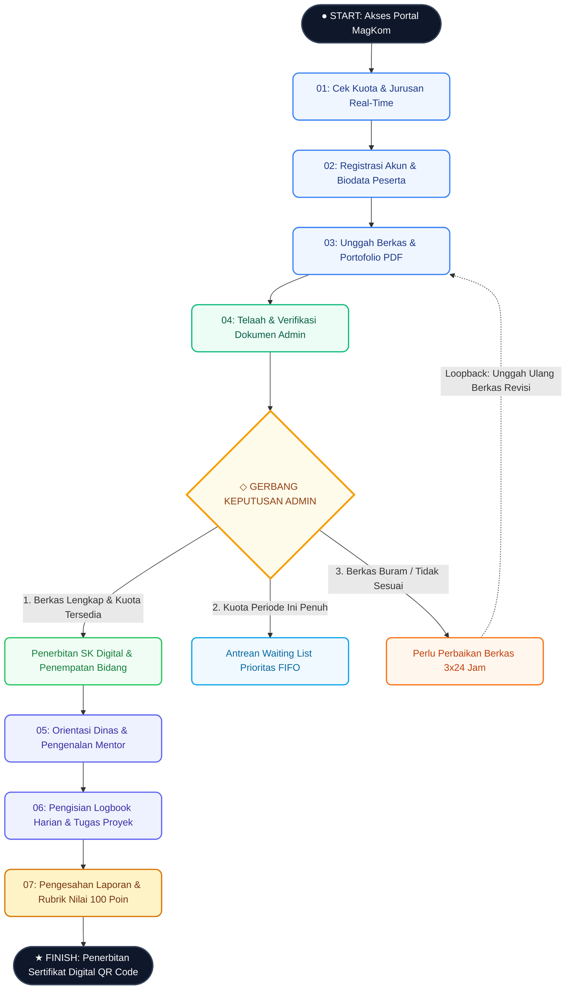

# Senior Developer Task Specification & PRD: Redesign Interactive Flowchart DAG Canvas (/panduan-alur)

- **Tanggal Dokumen**: 15 Oktober 2026
- **Status**: Draft (Menunggu Persetujuan Pengguna)
- **Author**: Antigravity (Senior Full-Stack & UI/UX Architect)
- **Target Audience / Implementer**: Junior Developer & Budget AI Models (Gemini 3.8 Flash / Claude Haiku)
- **Target Endpoint**: `http://127.0.0.1:8000/panduan-alur`
- **Tujuan Utama**: Mengubah tampilan "Diagram Graf" yang sebelumnya hanya berupa tumpukan card formulir vertikal monoton (anti-AI-slop) menjadi **Diagram Flowchart / Directed Acyclic Graph (DAG) Interaktif yang Otentik, Nyata, dan Elegan** dengan simbol flowchart standar, konektor pipa vektor SVG presisi, jalur loopback melengkung (*curved feedback loop*), kontrol canvas (zoom/reset), dan simulasi beranimasi.

---

## 1. Analisis Masalah Eksisting & Root Cause

### 1.1 Temuan Audit Masalah (User Pain Points)
1. **Bukan Flowchart Sejati ("Kayak Ga Ada Grafiknya / Ga Ada Alur Flowchart-nya")**:
   - Bagian "Diagram Graf" saat ini hanya membungkus div-div card HTML kotak biasa di dalam kontainer Fase 1 s.d. Fase 4 dengan garis putus-putus vertikal pendek.
   - Tidak ada representasi bentuk geometri flowchart standar (Terminator kapsul, Process box, Decision Diamond/Rhombus, Merge Gateway).
   - Tidak ada alur panah visual (edges) yang membentang nyata antar node.
2. **Ketiadaan Visual Loopback / Percabangan Nyata**:
   - Keputusan admin pada tahap 04 hanya berupa 3 kotak card kecil berjajar horizontal tanpa visual branch bifurcation yang jelas.
   - Status "Perlu Perbaikan" hanya memiliki teks "Loopback ke Tahap 03", tetapi secara visual tidak ada garis lengkung panah SVG (*curved bezier connector*) yang mengalir balik dari keputusan perbaikan ke node Unggah Berkas (03).
3. **Kesan "AI Slop" & Tidak Interaktif Secara Grafis**:
   - Pengguna merasa tampilan terkesan seperti template boilerplate kartu div generik.
   - Tidak ada kemampuan eksplorasi canvas grafis seperti *Zoom In*, *Zoom Out*, *Fit/Reset View*, maupun *Node Pinpoint Focus*.

---

## 2. Standar Panduan Keterampilan Desain (Multi-Skill Synergy)

Implementasi ini mengintegrasikan seluruh prinsip dari 7 panduan skill yang ditargetkan:

| Skill | Prinsip Utama yang Diterapkan pada Flowchart Canvas |
| :--- | :--- |
| **`better-ui`** | - Outer radius concentric: `outer = inner + padding`.<br>- Transisi halus berbasis exact values: `cubic-bezier(0.2, 0, 0, 1)`, button active press `transform: scale(0.96)`.<br>- Shadows layered untuk elevasi, bukan sekadar border tebal.<br>- Semua ikon menggunakan SVG murni (Lucide/Heroicons standard), dilarang menggunakan karakter emoji.<br>- Dukungan `@media (prefers-reduced-motion: reduce)` yang mengganti animasi translate/dash dengan opacity cross-fade. |
| **`better-typography`**| - Skala modular: Heading `1.2–1.3` line-height unitless, deskripsi `1.5` unitless.<br>- `font-variant-numeric: tabular-nums` pada step counter, SLA time ("1–3 Hari"), badge langkah ("01", "02"), dan skor ("100 Poin").<br>- Letter spacing proporsional: `-0.015em` pada title, `0.05em` pada uppercase badges.<br>- Punctuation typografis resmi: en-dash (`1–3 Hari Kerja`), curly quotes, dan elipsis `…`. |
| **`better-layout`** | - Group with space: hirarki jarak antar fase minimal 2× jarak antar node di dalam fase.<br>- Responsive architecture: Desktop 1440px (Grid 1.6fr : 1fr dengan Sticky Inspector), Tablet 1024px (Vertikal reflow), Mobile 375px (Horizontal canvas scroll-container dengan visual pan cue).<br>- Clearance controls minimal 12px antar button, 24px antar borderless actions. |
| **`better-colors`** | - Semantic tokens konsisten: Fase 1 Pendaftaran (Blue-600 `#0751FF`), Fase 2 Seleksi & Decision (Green-600 `#16A34A`), Fase 3 Bimbingan (Indigo-600 `#4F46E5`), Fase 4 Evaluasi (Amber-600 `#D97706`).<br>- Status Branch: Diterima (`#16A34A` / bg `#E8F7EE`), Waiting List (`#0284C7` / bg `#E0F2FE`), Perlu Perbaikan (`#D97706` / bg `#FEF3C7`).<br>- Kontras rasio teks terhadap background terverifikasi minimum 4.5:1 (WCAG AA). |
| **`better-writing`**| - Tombol berorientasi tindakan (Verb-First): `Mulai Simulasi Alur`, `Periksa Persyaratan`, `Pilih Jalur`, `Reset Tampilan`.<br>- Copy instruksi langsung ("Anda"), tanpa kalimat menyalahkan pengguna, tanpa kata "Oops!". |
| **`impeccable`** | - Menghilangkan AI-slop; menghadirkan technical blueprint graph canvas bernuansa enterprise public service.<br>- Background grid subtle (`radial-gradient` blueprint 24px×24px).<br>- Visual node connection ports yang terlihat nyata (inlet/outlet dots). |
| **`ui-ux-pro-max`** | - Mengikuti konvensi diagram alur standar ISO/IEC dengan adaptasi UI modern.<br>- Dual-view selector: `[Diagram Graf (Interactive Canvas)]` vs `[Roadmap Linier]`.<br>- State machine simulasi yang sinkron dengan URL hash/query string (`?step=X`). |

---

## 3. Konsep & Arsitektur Visual Flowchart Baru

### 3.1 Peta Topologi Alur Kerja MagKom (Directed Acyclic Graph with Loopback)



### 3.2 Visual Wireframe & Layout Blueprint (Desktop 1440px)

```text
+-----------------------------------------------------------------------------------------------------------------------+
| HERO HEADER: Peta Interaktif Alur Magang Diskominfo Sleman                                                           |
| [4 Fase Siklus]  [1-3 Hari SLA Verifikasi]  [100 Poin Rubrik Objektif]  [QR Code E-Sertifikat Resmi]                  |
+-----------------------------------------------------------------------------------------------------------------------+
| CONTROLS: Jenjang: [Semua][SMK][Mahasiswa] | Tipe: [Mandiri][Kelompok] | Mode: [● Diagram Graf] [Roadmap Linier]      |
+-----------------------------------------------------------------------------------------------------------------------+
| SIMULATOR BANNER: Simulasi Mandiri Aktif: Berkas wajib berupa Surat Pengantar, CV, Transkrip (Maks 2MB)               |
+-----------------------------------------------------------------------------------------------------------------------+
|  CANVAS DIAGRAM GRAF (Kolom Kiri ~ 62%)                      |  SIDE INSPECTOR CARD (Kolom Kanan ~ 38% - Sticky)      |
|  +--------------------------------------------------------+  |  +--------------------------------------------------+  |
|  | TOOLBAR: [▶ Mulai Simulasi] [◀] [▶] [⟲] | Zoom: [-][+][Fit]  |  | Fase 1: Pendaftaran & Kuota                      |  |
|  | STEPPER PROGRESS TRACK: (01)-(02)-(03)-(04)-(05)-(06)-(07) |  |                                                    |  |
|  +--------------------------------------------------------+  |  | Verifikasi Dokumen oleh Tim Admin Diskominfo     |  |
|  | BLUEPRINT SVG/HTML HYBRID CANVAS CONTAINER             |  |  | Pengecekan berkas administrasi dan legalitas       |  |
|  |                                                        |  |  +--------------------------------------------------+  |
|  |   [ (●) START: Akses Portal MagKom ]                   |  |  | AKTOR UTAMA:          ESTIMASI / SLA:            |  |
|  |                 │ (SVG Arrow)                          |  |  | Tim Administrasi      1–3 Hari Kerja             |  |
|  |   [ 01: Cek Kuota Formasi ]                            |  |  +--------------------------------------------------+  |
|  |                 │ (Animated Beam)                      |  |  | PERSYARATAN / OUTPUT DOKUMEN:                    |  |
|  |   [ 02: Registrasi Akun Biodata ]                      |  |  | ✓ Pengecekan stempel basah institusi              |  |
|  |                 │ (Animated Beam)                      |  |  | ✓ Keselarasan kompetensi jurusan                 |  |
|  | ┌─> [ 03: Unggah Berkas & Portofolio ]                 |  |  +--------------------------------------------------+  |
|  | │               │ (Animated Beam)                      |  |  | SLA CALLOUT:                                     |  |
|  | │   [ 04: Verifikasi Dokumen & Penempatan ]            |  |  | Hasil telaah diumumkan transparan di dashboard   |  |
|  | │               │                                      |  |  | maksimal 3x24 jam sejak berkas diterima.        |  |
|  | │     { ◇ GERBANG KEPUTUSAN ADMIN }                    |  |  +--------------------------------------------------+  |
|  | │       ├──────────────┼─────────────────┐             |  |  | [ Pantau Status Seleksi Sekarang → ] (Button)   |  |
|  | │       ▼              ▼                 ▼             |  |  +--------------------------------------------------+  |
|  | │  [Diterima]   [Waiting List]    [Perlu Perbaikan]    |  |                                                        |
|  | │       │                            │ (Loopback Ribbon|                                                        |
|  | └───────┼────────────────────────────┘  ke Node 03)    |                                                        |
|  |         ▼                                              |                                                        |
|  |   [ 05: Orientasi & Pembimbing Lapangan ]              |                                                        |
|  |                 │                                      |                                                        |
|  |   [ 06: Logbook Harian & Penugasan ]                   |                                                        |
|  |                 │                                      |                                                        |
|  |   [ 07: Penilaian 100 Poin & Pengesahan ]              |                                                        |
|  |                 │                                      |                                                        |
|  |   [ (★) FINISH: Sertifikat Digital & Lembar Nilai ]    |                                                        |
|  +--------------------------------------------------------+  |                                                        |
+-----------------------------------------------------------------------------------------------------------------------+
```

---

## 4. Rencana Perubahan Berkas (File Changes Matrix)

| File Path | Aksi | Ringkasan Perubahan Teknis |
| :--- | :--- | :--- |
| `resources/views/public/panduan-alur.blade.php` | **Modify** | 1. Implementasikan SVG-DOM Flowchart Engine pada `#viewGraphArea` menggantikan layout card tumpuk.<br>2. Tambahkan komponen bentuk flowchart: Terminator Start/End, Process Node Cards dengan Connection Ports, Decision Rhombus Gateway, dan Curved SVG Loopback Path.<br>3. Tambahkan kontrol Zoom Canvas (`zoom-in`, `zoom-out`, `zoom-reset`) menggunakan CSS `transform: scale()` dengan safe bounds.<br>4. Perkuat status visual edge: SVG pipeline track dengan animated flowing dash (`stroke-dasharray`).<br>5. Pastikan dark mode tokens dan responsivitas mobile tetap 100% terjaga. |
| `tests/Feature/AlurMagangPageTest.php` | **Modify** | 1. Tambahkan assertion test untuk elemen flowchart spesifik: `flowchart-canvas`, `flow-node-terminator`, `flow-node-decision`, `flow-edge-loopback`, `flow-node-finish`.<br>2. Verifikasi accessibility tags (`role="region"`, `aria-label`, tabindex) pada elemen flowchart.<br>3. Uji seluruh state interaktif simulator dan response HTTP 200. |
| `app/Http/Controllers/Public/AlurMagangController.php` | **Preserve** | Controller saat ini sudah efisien dan mengembalikan data jurusan. Tetap dipertahankan tanpa perubahan destruktif. |

---

## 5. Rincian Teknis Implementasi untuk Developer Junior / AI

### 5.1 Spesifikasi Geometri & Arsitektur Node Flowchart

Setiap node di canvas memiliki arsitektur yang terdefinisi secara presisi:

1. **Terminator Nodes (`.flow-node-terminator`)**:
   - Bentuk: Rounded Capsule Pill (`border-radius: 9999px`).
   - Ukuran: Tinggi 44px, Padding inline 1.5rem.
   - Styling: Dark navy background (`#0F172A`), white text, border subtle `rgba(255,255,255,0.2)`, icon bulat pulsing.
2. **Process Nodes (`.flow-node-card`)**:
   - Bentuk: Rounded Rectangle (`border-radius: 0.85rem`).
   - Dimensi: Lebar 100% (max 380px), Padding `1rem 1.25rem`.
   - Inlet Port (Atas): Titik koneksi SVG bulat diameter 10px tepat di tengah atas (`top: -5px; left: 50%; transform: translateX(-50%)`).
   - Outlet Port (Bawah): Titik koneksi SVG bulat diameter 10px di tengah bawah (`bottom: -5px; left: 50%; transform: translateX(-50%)`).
   - Status Active: Border color berubah ke `--blue-600` (`#0751FF`), box-shadow layered `0 0 0 4px rgba(7, 81, 255, 0.18), 0 8px 20px -4px rgba(7, 81, 255, 0.25)`.
3. **Decision Gateway Node (`.flow-node-decision`)**:
   - Simbol: Diamond / Belah Ketupat SVG Header + 3 Kartu Cabang Terdistribusi.
   - Gerbang Belah Ketupat: Container 48px × 48px diputar 45 derajat (`transform: rotate(45deg)`), dengan ikon percabangan di dalamnya yang diputar balik `-45deg`.
   - Output 3 Arah:
     * Cabang Kiri (`.branch-diterima`): Hijau `#16A34A` (Panah ke Node 05).
     * Cabang Tengah (`.branch-waiting`): Biru `#0284C7` (Antrean FIFO).
     * Cabang Kanan (`.branch-perbaikan`): Oranye `#D97706` (Loopback Source).
4. **SVG Loopback Connector (`.flow-edge-loopback`)**:
   - Elemen: `<path d="M x1 y1 C x_ctrl1 y_ctrl1, x_ctrl2 y_ctrl2, x2 y2" marker-end="url(#arrow-orange)" />`
   - Berangkat dari sisi kanan kartu Perlu Perbaikan, melengkung ke kanan luar (+60px), naik ke atas setinggi Node 03, lalu melengkung ke kiri masuk ke side port kanan Node 03!
   - Saat state `nodeId === 'perbaikan'` aktif: path ini mendapatkan kelas `.active` dengan animasi aliran pulsa oranye (`stroke: #D97706; stroke-dasharray: 6 4; animation: flowDash 0.8s linear infinite;`).

### 5.2 Spesifikasi Kontrol Zoom & Pan Canvas

Agar pengguna merasakan sensasi diagram canvas profesional (seperti di Miro/Figma), sediakan Zoom Engine ringan tanpa library:
- **State Zoom**: `canvasZoomLevel = 1.0` (Rentang: `0.75` s.d. `1.35`, step `0.15`).
- **Target Transform**: Kontainer alur `#flowchartCanvasInner` menerapkan `transform: scale(var(--zoom-scale))`.
- **Tombol Toolbar**:
  * `btnZoomIn` (+): Menaikkan zoom level hingga maks 1.35.
  * `btnZoomOut` (-): Menurunkan zoom level hingga min 0.75.
  * `btnZoomReset` (100% / Fit): Mengembalikan ke scale 1.0.

### 5.3 Spesifikasi CSS Tokens & Animations (`better-ui` compliant)

```css
/* Exact Timing & Transition Functions */
:root {
    --ease-out-craft: cubic-bezier(0.2, 0, 0, 1);
    --duration-fast: 150ms;
    --duration-standard: 250ms;
    --duration-flow: 800ms;
}

/* Flow Connector Animation */
@keyframes flowDashAnimation {
    from {
        stroke-dashoffset: 20;
    }
    to {
        stroke-dashoffset: 0;
    }
}

.flow-edge-active-beam {
    stroke-dasharray: 6 4;
    animation: flowDashAnimation var(--duration-flow) linear infinite;
}

/* Reduced Motion Override */
@media (prefers-reduced-motion: reduce) {
    .flow-edge-active-beam {
        animation: none !important;
        stroke-dasharray: none !important;
    }
    .flow-node-card,
    .dag-sim-btn {
        transition: opacity var(--duration-fast) ease !important;
        transform: none !important;
    }
}
```

---

## 6. Rencana Eksekusi Langkah demi Langkah (Checklist)

### Fase 1: Perancangan Markup SVG Flowchart Canvas
- [ ] **Langkah 1.1**: Bersihkan markup `#journeyBoardContainer` di dalam `panduan-alur.blade.php`. Ganti container tumpukan div lama dengan arsitektur `#flowchartCanvasWrapper` dan `#flowchartCanvasInner`.
- [ ] **Langkah 1.2**: Tambahkan Terminator Node pembuka: `START: Masuk Portal MagKom & Cek Formasi`.
- [ ] **Langkah 1.3**: Tambahkan konektor SVG vertikal 1 &rarr; Node 01 (`Cek Kuota Real-Time`).
- [ ] **Langkah 1.4**: Tambahkan konektor SVG vertikal 2 &rarr; Node 02 (`Registrasi Akun`).
- [ ] **Langkah 1.5**: Tambahkan konektor SVG vertikal 3 &rarr; Node 03 (`Unggah Berkas PDF`). Sediakan anchor side-port kanan untuk target loopback.
- [ ] **Langkah 1.6**: Tambahkan konektor SVG vertikal 4 &rarr; Node 04 (`Verifikasi Dokumen Tim Admin`).
- [ ] **Langkah 1.7**: Tambahkan Gerbang Keputusan Admin (`Decision Rhombus Gateway`) lengkap dengan 3 cabang:
  * Cabang Sukses: Diterima Resmi (SK Terbit)
  * Cabang Antrean: Waiting List (FIFO)
  * Cabang Revisi: Perlu Perbaikan (Loopback)
- [ ] **Langkah 1.8**: Tambahkan kurva loopback SVG bezier melengkung dari Cabang Revisi kembali ke Node 03.
- [ ] **Langkah 1.9**: Tambahkan alur berlanjut: Node 05 (`Orientasi Mentor`), Node 06 (`Logbook Harian`), Node 07 (`Evaluasi & Penilaian`).
- [ ] **Langkah 1.10**: Tambahkan Terminator Node penutup: `FINISH: Terbit Sertifikat QR & Lembar Nilai`.

### Fase 2: Toolbar Interaktif & Zoom Controls
- [ ] **Langkah 2.1**: Tambahkan kelompok kontrol zoom pada toolbar canvas: `[ - Zoom Out ]`, `[ 100% Reset ]`, `[ + Zoom In ]`.
- [ ] **Langkah 2.2**: Hubungkan event listener keyboard: `+` / `=` untuk zoom in, `-` untuk zoom out, `0` untuk reset.

### Fase 3: State Machine & Sinkronisasi Inspector Card
- [ ] **Langkah 3.1**: Mutakhirkan fungsi JavaScript `selectDagNode(nodeId)`:
  * Update highlight pada node yang aktif.
  * Update highlight pada konektor SVG yang terhubung (edge input & output).
  * Bila `nodeId === 'perbaikan'`, nyalakan kurva loopback SVG dan ribbon feedback secara simultan.
  * Sinkronkan step counter dan progress bar stepper di atas canvas.
  * Mutakhirkan detail data pada `Inspector Card` di kolom kanan secara instan (zero layout jitter).
- [ ] **Langkah 3.2**: Perbarui auto-tour simulator agar mengalirkan partikel beam berurutan dari Start &rarr; 01 &rarr; 02 &rarr; 03 &rarr; 04 &rarr; Diterima &rarr; 05 &rarr; 06 &rarr; 07 &rarr; Selesai.

### Fase 4: Polish Visual, Typography, & Aksesibilitas
- [ ] **Langkah 4.1**: Terapkan semantic tokens warna dan dark mode overrides pada elemen SVG dan node flowchart.
- [ ] **Langkah 4.2**: Tambahkan ARIA semantics: `role="tree"` atau `role="region"` dengan `aria-label="Peta Alur Magang Interaktif"`.
- [ ] **Langkah 4.3**: Pastikan keyboard navigation (`ArrowRight`, `ArrowLeft`, `Enter`, `Space`) berfungsi sempurna.

### Fase 5: Pengujian Otomatis & Visual Verification
- [ ] **Langkah 5.1**: Mutakhirkan `tests/Feature/AlurMagangPageTest.php` untuk memvalidasi markup flowchart canvas baru.
- [ ] **Langkah 5.2**: Jalankan pengujian `php artisan test tests/Feature/AlurMagangPageTest.php` dan `tests/Feature/LandingPageTest.php`.
- [ ] **Langkah 5.3**: Jalankan full regression suite `php artisan test` untuk memastikan 100% kelulusan (377+ test passed).
- [ ] **Langkah 5.4**: Lakukan visual audit via `browser_subagent` pada resolusi Desktop (1440px), Tablet (768px), dan Mobile (375px).

---

## 7. Strategi Pengujian (Testing Strategy)

### 7.1 Automated Feature Test (`AlurMagangPageTest.php`)
1. **Aksesibilitas Halaman**: Response 200 OK untuk user publik (tamu) dan user yang login.
2. **Keberadaan Elemen Flowchart**:
   - Keberadaan kontainer canvas: `.flowchart-canvas-wrapper`.
   - Keberadaan node Terminator: `.flow-node-terminator`.
   - Keberadaan Process Nodes: `#node-1`, `#node-2`, `#node-3`, `#node-4`, `#node-5`, `#node-6`, `#node-7`.
   - Keberadaan Decision Rhombus Gateway: `.flow-decision-gateway`.
   - Keberadaan Loopback Connector Path: `#loopbackConnectorPath` dan `#loopbackRibbon`.
   - Keberadaan Zoom Controls: `#btnZoomIn`, `#btnZoomOut`, `#btnZoomReset`.
3. **Integritas Side Inspector**:
   - Memuat elemen badge fase, judul, aktor, SLA, checklist persyaratan, dan tombol aksi (CTA).

### 7.2 Manual & Visual Checklist (via Browser Subagent)
- [ ] Klik tombol zoom: canvas membesar dan mengecil secara proporsional di dalam viewport tanpa merusak layout kolom kanan.
- [ ] Klik node 04: Gerbang keputusan admin dan cabang disorot jelas.
- [ ] Klik cabang "Perlu Perbaikan": Garis loopback SVG melengkung menyala oranye, mengarahkan kembali mata pemohon ke Node 03.
- [ ] Toggle simulasi tour: Auto-play berjalan mulus langkah demi langkah dengan interval 2.8 detik.
- [ ] Periksa dark mode: Blueprint grid dan garis vektor memiliki kontras tajam dan tidak buram di atas `#0F172A`.

---

## 8. Kriteria Selesai (Definition of Done - DoD)

1. [ ] Halaman `/panduan-alur` menampilkan **Diagram Flowchart Interaktif Sejati** berstandar grafis tinggi, bukan tumpukan kartu form biasa.
2. [ ] Garis konektor SVG menghubungkan seluruh node secara presisi, termasuk loopback path melengkung dari Perbaikan ke Unggah Berkas.
3. [ ] Kontrol zoom in, zoom out, dan reset bekerja tanpa lag.
4. [ ] Side Inspector card tetap terintegrasi secara dinamis menyajikan informasi SLA, aktor, prasyarat, dan tombol aksi.
5. [ ] Fitur simulator tour otomatis dan navigasi keyboard berfungsi 100%.
6. [ ] Automated test suite `AlurMagangPageTest` dan `LandingPageTest` lulus 100%.
7. [ ] Full regression test aplikasi (`php artisan test`) lulus 100% tanpa kegagalan.
8. [ ] Tidak ada console error di browser developer tools.

---

## 9. Catatan Panduan untuk Junior Developer / Budget AI

> [!TIP]
> **Tips Implementasi bagi Junior Developer & AI (Gemini 3.8 Flash)**:
> 1. Gunakan koordinat SVG yang proporsional (`viewBox`) atau gunakan pendekatan Hybrid (HTML Node Cards yang diposisikan di dalam flex/grid, dihubungkan oleh SVG Overlay Path responsif dengan `getComputedStyle` atau titik anchor statis yang presisi). Pendekatan Hybrid Node Cards + SVG Connector Overlay adalah yang paling stabil di berbagai ukuran layar dan mudah di-maintain.
> 2. Jangan merusak atau menghapus event handler yang sudah ada (`selectDagNode`, `toggleAutoPlayTour`, `setSimJenjang`, `setSimTipe`). Cukup perluas fungsi tersebut agar ikut mengontrol state animasi edge SVG dan kurva loopback.
> 3. Jaga agar tidak ada library eksternal npm yang diinstall. Semua interaktivitas zoom dan kurva alur cukup menggunakan Vanilla CSS dan JavaScript modern standar browser.
