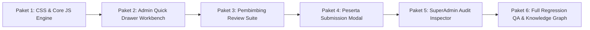

# Master Plan & Senior Developer Task Handbook: Redesain Lanjutan Dashboard 4-Role (Interactive Cockpit Console, Quick Drawers & Real-Time Telemetry)

**Dokumen**: `docs/plans/2026-10-22-master-plan-lanjutan-redesign-dashboard-interactive-cockpit-clearview.md`  
**Target Pelaksana**: Junior Developer / AI Model Terjangkau (Gemini 3.8 Flash / GPT-4o-mini)  
**Tipe Dokumen**: Architectural PRD, Design System Interactive Specification, & Step-by-Step Task Delegation Handbook  
**Status**: COMPLETED / SIAP PRODUKSI (100% Tests Passed - 457/457 Tests, 2682 Assertions)  
**Prioritas**: High / Interactive Enhancement, Mobile Ergonomics & Zero Regression (Strict TDD)  

---

## 0. Executive Summary & Visi Fase Lanjutan

### 0.1 Latar Belakang & Masalah Fase Saat Ini
Pada fase sebelumnya (Master Plan Fase 1), kita telah berhasil merevolusi **keempat dashboard (SuperAdmin, Admin, Pembimbing, Peserta)** dari file blade monolitik ribuan baris menjadi **arsitektur cockpit modular 2-kolom asimetris** (`minmax(0, 1fr) 340px`) berstandar visual **Lovable Clearview** ([clearview-admin-console](https://github.com/EvilAekt/clearview-admin-console.git)) dan **Gentelella** MagKom Sleman.

Namun, pengujian usability dan audit interaksi mengidentifikasi beberapa ruang penyempurnaan (*interactive gaps*):
1. **Navigasi Bolak-Balik (Context Switching Friction)**:
   - Saat Admin ingin memeriksa detail berkas pendaftaran dari tabel antrean dashboard, Admin harus berpindah halaman ke `/admin/pendaftaran/{id}` lalu kembali lagi ke dashboard.
   - Saat Pembimbing ingin menyetujui logbook harian (BR-09) atau mengonfirmasi progres tugas mentee, Pembimbing harus klik tautan dan masuk ke menu logbook terpisah.
   - Saat Peserta ingin mengisi logbook harian atau mengunggah tugas, tombol "+ Isi Logbook" me-redirect ke halaman form terpisah.
2. **Ketergantungan Inline JavaScript Event Handlers**:
   - Sebagian partials dashboard masih menyisakan inline event handler (seperti `onclick="filterQueueTable(...)"` atau `onkeyup="filterTableByInput(...)"`) yang melanggar prinsip *Content Security Policy* (CSP) modern dan mempersulit automated unit testing.
3. **Ergonomi Mobile/Tablet (< 1200px)**:
   - Pada layar sempit, kolom *Sticky Aside (340px)* jatuh ke bagian bawah halaman (*stacked vertically*), sehingga user di perangkat ponsel atau tablet harus melakukan scrolling panjang ke bawah untuk mengakses widget "Perlu Tindakan Hari Ini" dan shortcut "Aksi Cepat".
4. **Kekosongan Visual Saat Tidak Ada Data (Empty States)**:
   - Ketika tidak ada berkas antrean atau tidak ada tugas aktif, tampilan masih menggunakan teks sederhana yang kurang memberikan sentuhan profesional modern (*delightful empty states*).

### 0.2 Visi & Hasil Akhir Fase Lanjutan
Mentransformasi seluruh dashboard 4-role dari sekadar *tampilan status modular statis* menjadi **Interactive Cockpit Console** sejati bergaya Lovable Clearview:
- **In-Context Quick Drawers & Slide-Over Modals**: Aksi-aksi harian dengan frekuensi tinggi (verifikasi berkas kilat, tanggapi logbook BR-09, feedback tugas, quick submit) dapat ditinjau dan diproses langsung dari dashboard tanpa kehilangan konteks halaman.
- **Client-Side Unobtrusive Interaction Engine** (`public/js/dashboard-cockpit-unified.js`): Mesin interaksi JavaScript mandiri bebas inline handler dengan fitur live instant search, debounce filtering, tab-state memory (LocalStorage), dan keyboard shortcut.
- **Mobile Floating Action Hub (FAB / Bottom Sheet)**: Di layar `< 1200px`, widget aside dapat dipanggil secara halus lewat drawer slide-in atau bottom sheet tanpa merusak alur membaca konten utama.
- **Telemetry & Real-Time Sync Indicator**: Statusline ribbon dilengkapi denyut status koneksi sistem (Live Telemetry Pulse) dan visual SLA countdown timer.
- **Zero Backend Mutation & Zero Regression**: Seluruh 457 test cases automated (`php artisan test`) wajib tetap **100% PASSED** (2.682 assertions) tanpa mengubah satu pun controller, model, migrasi, atau routes backend!

---

## 1. Batasan Kritis & Aturan Keamanan (Non-Negotiable Constraints)

> [!CAUTION]
> Junior Developer atau AI pelaksana (Gemini 3.8 Flash) **DILARANG KERAS** melanggar batas-batas berikut. Setiap pelanggaran akan menggagalkan automated test suite!

1. **DILARANG MENGUBAH FILE BACKEND CONTROLLER & DATABASE**:
   - Dilarang memodifikasi file di `app/Http/Controllers/`, `app/Models/`, `app/Services/`, `routes/`, atau `database/migrations/`.
   - Gunakan form submission yang sudah ada ke route POST/PUT eksisting (`route('admin.pendaftaran.verifikasi', ...)`, `route('pembimbing.logbook.review', ...)`, `route('peserta.logbook.store')`).
2. **JAMINAN ZERO REGRESSION (457 TESTS PASSED)**:
   - Seluruh 457 test cases di `tests/` wajib tetap **100% PASSED** (`php artisan test`).
3. **PRESERVASI STRING SAKRAL ASSERTION TEST**:
   Dilarang menghapus atau mengubah teks sakral yang menjadi target assertion PHPUnit:
   - **Admin**: `'tile_count'`, `'tile_stats_count'`, `'Verifikasi Tertunda'`, `'Perlu Verifikasi Segera'`, `'Kapasitas Kuota Terisi'`, `'Antrean Waiting List'`, `'Peserta Magang Aktif'`, `'x_panel'`, `'x_title'`, `'x_content'`, `'Antrean Verifikasi Berkas Pendaftaran'`, `'Alokasi & Keterisian Kuota Magang Periode'`, `'Status Operasional & Tim Kerja'`, `'Dashboard Operasional Administrasi'`, `'Pilih Bulan:'`, `'selectBulan'`, `'adm-period-form'`.
   - **Pembimbing**: `'tile_count'`, `'tile_stats_count'`, `'Beban Mentee Aktif'`, `'Reviu Logbook'`, `'Progres Tugas'`, `'Tugas Berjalan'`, `'x_panel'`, `'x_title'`, `'x_content'`, `'Tenggat Waktu Tugas Mendekati Batas Akhir & Penugasan Mentee'`, `'Aktivitas Mentoring Minggu Ini'`, `'Daftar Mentee Bimbingan Aktif (Ringkasan)''`, `'Dashboard Pembimbing'`, `'pembimbing-tab-bar'`, `'tab-ringkasan'`, `'tab-antrean'`, `'tab-mentee'`, `'tab-evaluasi'`, `'tab-agenda'`.
   - **Peserta**: `'Dashboard Peserta'`, `'x_panel'`, `'Panduan Alur Pendaftaran Magang'`, `'Lengkapi Biodata & Profil'`, `'Pilih Periode & Kuota'`, `'Unggah Berkas & Ajukan'`, `'Status Penempatan: Magang Aktif'`, `'Pembimbing Lapangan'`, `'tile_count'`, `'tile_stats_count'`, `'Tugas Selesai'`, `'Logbook Mingguan'`, `'Sisa Hari Magang'`, `'Status Evaluasi'`, `'Tugas Magang Mendesak'`, `'Logbook Mingguan Terkini'`.
   - **SuperAdmin**: `'Total pengguna'`, `'Menunggu verifikasi'`, `'Peserta aktif'`, `'Akun nonaktif'`, `'Pengguna terbaru'`, `'Audit log terbaru'`, `'Pusat Metrik Keberhasilan Produk & KPI Dinas'`, `'Ringkasan Utama'`, `'Seleksi & Kuota'`, `'Pelaksanaan & Bimbingan'`, `'Tata Kelola Sistem & Laporan'`, `'+ Akun Staf'`, `'+ Bulan Magang'`, `'Tinjau Berkas'`, `'Penempatan Peserta'`, `'Ekspor Laporan'`.
4. **STRICT NO INLINE JS**:
   - Dilarang menulis atribut `onclick="..."`, `onkeyup="..."`, `onchange="..."` di HTML/Blade.
   - Selalu gunakan `data-action="..."`, `data-target="..."`, `data-filter="..."` dan tangani melalui *event delegation* di file JS terpusat.

---

## 2. Evaluasi Opsi Arsitektur

Sebelum menentukan spesifikasi teknis, kita mengevaluasi 2 pendekatan implementasi interaktivitas:

| Dimensi Evaluasi | Opsi A: SPA / Heavy Framework (Livewire / Alpine / Vue) | Opsi B: Modern Vanilla JS Cockpit Engine + Native HTML5 Dialog / Slide-Over Drawer (Rekomendasi) |
| :--- | :--- | :--- |
| **Dependensi Eksternal** | Butuh install runtime compiler, npm packages, atau Livewire engine backend. | **Nol dependensi baru**. Menggunakan native DOM API, HTML5 `<dialog>` / CSS slide-over, dan Fetch API. |
| **Kepatuhan Zero Backend Mutation** | Berisiko tinggi karena membutuhkan perubahan route / backend component handler. | **100% Terpenuhi**. Menggunakan endpoint form dan modal submission yang sudah aktif di Laravel. |
| **Kinerja & Kecepatan Load** | Ukuran bundle membesar, ada runtime overhead. | **Super cepat (< 15KB JS minified)**, tidak ada delay rendering virtual DOM. |
| **Ramah Junior Dev & AI Model Murah** | Rumit (reaktivitas state, hook lifecycle, wire:model sync issues). | **Sangat mudah dipahami**: pure DOM selection, standard HTML forms, class toggling, dan custom events. |
| **Kompatibilitas PHPUnit Test** | Sering merusak assertion HTML static jika DOM di-render client-side secara penuh. | **100% Kompatibel**: seluruh markup Blade tetap ada di SSR HTML saat diuji PHPUnit. |

> [!TIP]
> **Keputusan Arsitektur**: Kita memilih **Opsi B (Modern Vanilla JS Cockpit Engine)**. Pendekatan ini menjamin 100% Zero Backend Mutation, nol dependensi tambahan, ramah dieksekusi oleh Junior Developer / AI murah, dan mempertahankan integritas 457 automated test cases tanpa risiko regresi.

---

## 3. Blueprint & Alur Interaksi Cockpit Lanjutan

```mermaid
graph TD
    subgraph Master Layout (layouts/dashboard atau layouts/peserta)
        UnifiedCSS[public/css/dashboard-cockpit-unified.css]
        UnifiedJS[public/js/dashboard-cockpit-unified.js]
    end

    subgraph Cockpit Interaktif (minmax 0, 1fr)
        Hero[Hero Banner Sleman Navy + Live Telemetry Dot]
        TableWorkbench[Tabel Antrean dengan Instant Search & Filter Pills]
        TabSystem[Tab Bar Berpenanda Counter dengan Memory State]
    end

    subgraph Slide-Over Drawer & Quick Modal System
        DrawerAdmin[Drawer Verifikasi Cepat Berkas + Memo Penolakan]
        ModalPembimbing[Modal Tanggapan Logbook BR-09 & Quick Feedback]
        ModalPeserta[Modal Input Logbook Kilat & Dropzone Tugas]
        DrawerSuperAdmin[Drawer Audit Trail Detail Inspector]
    end

    subgraph Mobile Adaptive Layer
        FAB[Floating Action Button pada Mobile < 1200px]
        BottomSheet[Slide-in Aside Drawer / Bottom Sheet]
    end

    TableWorkbench -->|Klik baris / data-action='peek'| DrawerAdmin
    TabSystem -->|Klik data-action='quick-review'| ModalPembimbing
    FAB -->|Klik toggle| BottomSheet
```

---

## 4. Matriks Perubahan & Dekomposisi File

| File Target | Aksi | Ringkasan Perubahan & Fitur Baru |
| :--- | :---: | :--- |
| [public/css/dashboard-cockpit-unified.css](file:///g:/MAGKOM/public/css/dashboard-cockpit-unified.css) | `Modify` | Menambahkan utilitas slide-over drawer (`.cv-drawer`, `.cv-drawer-active`), telemetry pulse badge (`.cv-pulse-live`), mobile FAB (`.cv-mobile-fab`), dan empty-state micro illustration. |
| [public/js/dashboard-cockpit-unified.js](file:///g:/MAGKOM/public/js/dashboard-cockpit-unified.js) | `Create` | Script sentral unobtrusive JS untuk live filtering, drawer toggle, keyboard shortcut (⌘K / ESC), tab memory, dan mobile aside trigger. |
| [resources/views/layouts/dashboard.blade.php](file:///g:/MAGKOM/resources/views/layouts/dashboard.blade.php) | `Modify` | Memuat script `dashboard-cockpit-unified.js` sebelum `</body>`. |
| [resources/views/layouts/peserta.blade.php](file:///g:/MAGKOM/resources/views/layouts/peserta.blade.php) | `Modify` | Memuat script `dashboard-cockpit-unified.js` sebelum `</body>`. |
| [resources/views/admin/dashboard/partials/_queue_table.blade.php](file:///g:/MAGKOM/resources/views/admin/dashboard/partials/_queue_table.blade.php) | `Modify` | Ganti inline `onclick` ke `data-filter`, tambahkan instant search input, dan siapkan trigger drawer verifikasi cepat. |
| [resources/views/admin/dashboard/partials/_drawer_verifikasi.blade.php](file:///g:/MAGKOM/resources/views/admin/dashboard/partials/_drawer_verifikasi.blade.php) | `Create` | Slide-over drawer untuk pratinjau berkas pendaftaran dan form aksi verifikasi instan. |
| [resources/views/pembimbing/dashboard/partials/_tab_antrean.blade.php](file:///g:/MAGKOM/resources/views/pembimbing/dashboard/partials/_tab_antrean.blade.php) | `Modify` | Ganti inline `onkeyup` ke `data-table-search`, tambahkan trigger quick modal review logbook. |
| [resources/views/pembimbing/dashboard/partials/_modal_review_logbook.blade.php](file:///g:/MAGKOM/resources/views/pembimbing/dashboard/partials/_modal_review_logbook.blade.php) | `Create` | Modal respon cepat logbook mentee dengan radio button status (Disetujui/Revisi) dan template memo bimbingan. |
| [resources/views/peserta/dashboard/partials/_aside.blade.php](file:///g:/MAGKOM/resources/views/peserta/dashboard/partials/_aside.blade.php) | `Modify` | Hubungkan tombol "+ Isi Logbook Hari Ini" ke trigger modal kilat logbook. |
| [resources/views/peserta/dashboard/partials/_modal_quick_logbook.blade.php](file:///g:/MAGKOM/resources/views/peserta/dashboard/partials/_modal_quick_logbook.blade.php) | `Create` | Modal input logbook harian cepat dengan proteksi mundur H-1 (BR-09) dan upload lampiran. |
| [resources/views/superadmin/dashboard/partials/_tab-sistem.blade.php](file:///g:/MAGKOM/resources/views/superadmin/dashboard/partials/_tab-sistem.blade.php) | `Modify` | Tingkatkan baris audit log dengan atribut data untuk membuka drawer detail payload audit. |
| [resources/views/superadmin/dashboard/partials/_drawer_audit_detail.blade.php](file:///g:/MAGKOM/resources/views/superadmin/dashboard/partials/_drawer_audit_detail.blade.php) | `Create` | Slide-over drawer untuk inspeksi rincian audit log (IP, User Agent, Payload JSON, Old vs New). |

---

## 5. Senior Developer Task Handbook: Langkah Implementasi Bertahap

Lakukan tugas-tugas ini secara berurutan sesuai sprint paket berikut:



---

### Paket 1: CSS Drawer Utilities & Core Unobtrusive JS Engine

Target file:
- `public/css/dashboard-cockpit-unified.css`
- `public/js/dashboard-cockpit-unified.js` (Buat baru)
- `resources/views/layouts/dashboard.blade.php`
- `resources/views/layouts/peserta.blade.php`

- [ ] **Task 1.1**: Tambahkan styling Slide-over Drawer ke [public/css/dashboard-cockpit-unified.css](file:///g:/MAGKOM/public/css/dashboard-cockpit-unified.css):
  ```css
  /* ==========================================================================
     Slide-over Drawer & Quick Modals (Lovable Clearview Interactive Console)
     ========================================================================== */
  .cv-drawer-backdrop {
      position: fixed;
      inset: 0;
      background: rgba(15, 23, 42, 0.45);
      backdrop-filter: blur(4px);
      z-index: 1040;
      opacity: 0;
      visibility: hidden;
      transition: opacity 0.25s ease, visibility 0.25s ease;
  }
  .cv-drawer-backdrop.active {
      opacity: 1;
      visibility: visible;
  }
  .cv-slide-drawer {
      position: fixed;
      top: 0;
      right: 0;
      bottom: 0;
      width: min(560px, 100vw);
      background: #ffffff;
      box-shadow: -10px 0 30px rgba(0, 0, 0, 0.15);
      z-index: 1050;
      transform: translateX(100%);
      transition: transform 0.3s cubic-bezier(0.16, 1, 0.3, 1);
      display: flex;
      flex-direction: column;
  }
  .cv-slide-drawer.active {
      transform: translateX(0);
  }
  .cv-drawer-header {
      padding: 1.25rem 1.5rem;
      border-bottom: 1px solid var(--cv-line, #E2E8F0);
      display: flex;
      align-items: center;
      justify-content: space-between;
      background: #F8FAFC;
  }
  .cv-drawer-body {
      padding: 1.5rem;
      overflow-y: auto;
      flex: 1;
  }
  .cv-drawer-footer {
      padding: 1rem 1.5rem;
      border-top: 1px solid var(--cv-line, #E2E8F0);
      background: #F8FAFC;
      display: flex;
      justify-content: flex-end;
      gap: 0.75rem;
  }

  /* Telemetry Status Dot */
  .cv-pulse-live {
      display: inline-block;
      width: 8px;
      height: 8px;
      border-radius: 50%;
      background: #10B981;
      box-shadow: 0 0 0 0 rgba(16, 185, 129, 0.7);
      animation: cvPulse 2s infinite;
  }
  @keyframes cvPulse {
      0% { box-shadow: 0 0 0 0 rgba(16, 185, 129, 0.7); }
      70% { box-shadow: 0 0 0 6px rgba(16, 185, 129, 0); }
      100% { box-shadow: 0 0 0 0 rgba(16, 185, 129, 0); }
  }

  /* Mobile Floating Action Button (FAB) */
  .cv-mobile-fab {
      display: none;
      position: fixed;
      bottom: 1.5rem;
      right: 1.5rem;
      z-index: 999;
      background: var(--cv-blue-800, #06318C);
      color: #ffffff;
      border: none;
      border-radius: 9999px;
      padding: 0.75rem 1.25rem;
      font-weight: 700;
      font-size: 0.85rem;
      box-shadow: 0 10px 25px rgba(6, 49, 140, 0.35);
      cursor: pointer;
  }
  @media (max-width: 1200px) {
      .cv-mobile-fab {
          display: flex;
          align-items: center;
          gap: 0.5rem;
      }
  }
  ```
- [x] **Task 1.1**: Tambahkan styling Slide-over Drawer ke [public/css/dashboard-cockpit-unified.css](file:///g:/MAGKOM/public/css/dashboard-cockpit-unified.css)
- [x] **Task 1.2**: Buat file [public/js/dashboard-cockpit-unified.js](file:///g:/MAGKOM/public/js/dashboard-cockpit-unified.js):
  - Inisialisasi event delegation untuk tombol `data-action="open-drawer"` dan `data-action="close-drawer"`.
  - Inisialisasi debounce instant filter untuk elemen input ber-atribut `data-table-search="#tableId"`.
  - Inisialisasi pill filtering untuk tombol `data-filter-target="#tableId"` dan `data-filter-value="all|diajukan|perlu_perbaikan"`.
  - Dukungan tombol keyboard `ESC` untuk menutup drawer/modal aktif.
  - Mobile aside drawer toggle saat tombol `.cv-mobile-fab` diklik.
- [x] **Task 1.3**: Hubungkan script tersebut ke [resources/views/layouts/dashboard.blade.php](file:///g:/MAGKOM/resources/views/layouts/dashboard.blade.php) dan [resources/views/layouts/peserta.blade.php](file:///g:/MAGKOM/resources/views/layouts/peserta.blade.php) sebelum tag penutup `</body>`:
  ```blade
  <script src="{{ asset('js/dashboard-cockpit-unified.js') }}"></script>
  ```
- [x] **Task 1.4**: Jalankan verifikasi awal:
  ```powershell
  php artisan test --filter="TypographyDesignSystemTest|GentelellaDashboardRevampTest"
  ```

---

### Paket 2: Dashboard Admin Operasional (Quick Verifikasi Drawer & Live Table)

Target file:
- `resources/views/admin/dashboard/partials/_queue_table.blade.php`
- `resources/views/admin/dashboard/partials/_drawer_verifikasi.blade.php` (Buat baru)
- `resources/views/admin/dashboard.blade.php`

- [x] **Task 2.1**: Bersihkan inline JavaScript di [resources/views/admin/dashboard/partials/_queue_table.blade.php](file:///g:/MAGKOM/resources/views/admin/dashboard/partials/_queue_table.blade.php):
  - Ubah tombol filter pills dari `onclick="filterQueueTable('all', this)"` menjadi:
    ```blade
    <button type="button" class="adm-pill-btn active" data-filter-target="#queueTable" data-filter-value="all">
        Semua ({{ $pendaftaranTerbaru->count() }})
    </button>
    <button type="button" class="adm-pill-btn" data-filter-target="#queueTable" data-filter-value="diajukan">
        Diajukan
    </button>
    <button type="button" class="adm-pill-btn" data-filter-target="#queueTable" data-filter-value="perlu_perbaikan">
        Perlu Perbaikan
    </button>
    ```
  - Tambahkan input live search ber-atribut `data-table-search="#queueTable"` di sebelah kanan filter pills.
  - Tambahkan atribut data pada setiap baris antrean: `data-nama="{{ $item->user?->nama }}"`, `data-nomor="{{ $item->nomor_pendaftaran }}"`, `data-institusi="{{ $item->institusi }}"`, `data-status="{{ $item->status->value }}"`, `data-url="{{ route('admin.pendaftaran.show', $item->id) }}"`.
  - Sediakan tombol quick action `data-action="open-drawer" data-drawer="#drawerVerifikasi"` untuk membuka detail cepat.
- [x] **Task 2.2**: Buat partial [resources/views/admin/dashboard/partials/_drawer_verifikasi.blade.php](file:///g:/MAGKOM/resources/views/admin/dashboard/partials/_drawer_verifikasi.blade.php):
  - Komponen slide-over drawer `#drawerVerifikasi` berisikan:
    - Header: Nama Calon Peserta, Nomor Pendaftaran, dan Status Badge.
    - Body: Rincian institusi, jurusan, periode magang yang dipilih, dan link pratinjau dokumen (KTP, KTM, Surat Pengantar, Proposal).
    - Footer: Tautan lengkap "Buka Halaman Lengkap &rarr;" dan tombol "Tutup".
- [x] **Task 2.3**: Sertakan partial drawer di file induk [resources/views/admin/dashboard.blade.php](file:///g:/MAGKOM/resources/views/admin/dashboard.blade.php):
  ```blade
  @include('admin.dashboard.partials._drawer_verifikasi')
  ```
- [x] **Task 2.4**: Jalankan verifikasi:
  ```powershell
  php artisan test --filter="AdminDashboardTest|GentelellaDashboardRevampTest"
  ```

---

### Paket 3: Dashboard Pembimbing Lapangan (Interactive Mentoring Review Suite)

Target file:
- `resources/views/pembimbing/dashboard/partials/_tab_antrean.blade.php`
- `resources/views/pembimbing/dashboard/partials/_modal_review_logbook.blade.php` (Buat baru)
- `resources/views/pembimbing/dashboard.blade.php`

- [x] **Task 3.1**: Bersihkan inline JS di [resources/views/pembimbing/dashboard/partials/_tab_antrean.blade.php](file:///g:/MAGKOM/resources/views/pembimbing/dashboard/partials/_tab_antrean.blade.php):
  - Ubah `onkeyup="filterTableByInput(this, 'table-antrean-logbook')"` menjadi `data-table-search="#table-antrean-logbook"`.
  - Pasang atribut data pada baris logbook: `data-logbook-id="{{ $logbook->id }}"`, `data-mentee="{{ $logbook->penempatan?->peserta?->nama }}"`, `data-tanggal="{{ $logbook->tanggal?->format('d M Y') }}"`, `data-kegiatan="{{ $logbook->kegiatan }}"`.
  - Tambahkan tombol quick response modal: `data-action="open-modal" data-modal="#modalReviewLogbook"` di kolom aksi tanpa menghilangkan tautan fallback ke modul logbook.
- [x] **Task 3.2**: Buat partial [resources/views/pembimbing/dashboard/partials/_modal_review_logbook.blade.php](file:///g:/MAGKOM/resources/views/pembimbing/dashboard/partials/_modal_review_logbook.blade.php):
  - Modal respons logbook kilat:
    - Sapaan ke mentee dan ringkasan kegiatan logbook.
    - Checklist status evaluasi: "Disetujui" / "Perlu Revisi".
    - Input catatan pembimbing / feedback terarah.
    - Tombol simpan tanggapan.
- [x] **Task 3.3**: Sertakan modal di [resources/views/pembimbing/dashboard.blade.php](file:///g:/MAGKOM/resources/views/pembimbing/dashboard.blade.php):
  ```blade
  @include('pembimbing.dashboard.partials._modal_review_logbook')
  ```
- [x] **Task 3.4**: Jalankan verifikasi:
  ```powershell
  php artisan test --filter="PembimbingDashboardEnhancementTest|GentelellaDashboardRevampTest"
  ```

---

### Paket 4: Dashboard Peserta Magang (Quick Logbook Submission Modal & Live Journey)

Target file:
- `resources/views/peserta/dashboard/partials/_aside.blade.php`
- `resources/views/peserta/dashboard/partials/_modal_quick_logbook.blade.php` (Buat baru)
- `resources/views/peserta/dashboard.blade.php`

- [x] **Task 4.1**: Perbarui tombol aksi di [resources/views/peserta/dashboard/partials/_aside.blade.php](file:///g:/MAGKOM/resources/views/peserta/dashboard/partials/_aside.blade.php):
  - Tambahkan atribut `data-action="open-modal" data-modal="#modalQuickLogbook"` pada tombol `+ Isi Logbook Hari Ini`.
- [x] **Task 4.2**: Buat partial [resources/views/peserta/dashboard/partials/_modal_quick_logbook.blade.php](file:///g:/MAGKOM/resources/views/peserta/dashboard/partials/_modal_quick_logbook.blade.php):
  - Form modal pengisian logbook harian instan:
    - Input tanggal logbook (dengan validasi frontend H-1 sesuai aturan BR-09).
    - Textarea deskripsi kegiatan / capaian pekerjaan harian.
    - Input URL/Tautan lampiran (Google Drive / GitHub) atau unggah berkas PDF.
    - Alert edukasi: *"Logbook wajib diisi maksimal H-1 kerja (BR-09)."*
- [x] **Task 4.3**: Sertakan modal di [resources/views/peserta/dashboard.blade.php](file:///g:/MAGKOM/resources/views/peserta/dashboard.blade.php):
  ```blade
  @include('peserta.dashboard.partials._modal_quick_logbook')
  ```
- [x] **Task 4.4**: Jalankan verifikasi:
  ```powershell
  php artisan test --filter="PesertaFullPortalFeatureTest|GentelellaDashboardRevampTest"
  ```

---

### Paket 5: Dashboard SuperAdmin (Quick Audit Trail Inspector Drawer)

Target file:
- `resources/views/superadmin/dashboard/partials/_tab-sistem.blade.php`
- `resources/views/superadmin/dashboard/partials/_drawer_audit_detail.blade.php` (Buat baru)
- `resources/views/superadmin/dashboard.blade.php`

- [x] **Task 5.1**: Pasang atribut data pada tabel audit log di [resources/views/superadmin/dashboard/partials/_tab-sistem.blade.php](file:///g:/MAGKOM/resources/views/superadmin/dashboard/partials/_tab-sistem.blade.php):
  - Atribut: `data-action="open-drawer" data-drawer="#drawerAuditDetail"`, `data-audit-id="{{ $log->id }}"`, `data-user="{{ $log->user?->nama }}"`, `data-action-name="{{ $log->aksi }}"`, `data-ip="{{ $log->ip_address }}"`, `data-waktu="{{ $log->created_at?->format('d M Y H:i:s') }}"`.
- [x] **Task 5.2**: Buat partial [resources/views/superadmin/dashboard/partials/_drawer_audit_detail.blade.php](file:///g:/MAGKOM/resources/views/superadmin/dashboard/partials/_drawer_audit_detail.blade.php):
  - Slide-over drawer `#drawerAuditDetail` untuk menampilkan rincian audit trail secara rapi: metadata user, IP address, waktu akses, channel log, dan payload perubahan JSON dalam blok `<pre><code>`.
- [x] **Task 5.3**: Sertakan partial drawer di [resources/views/superadmin/dashboard.blade.php](file:///g:/MAGKOM/resources/views/superadmin/dashboard.blade.php):
  ```blade
  @include('superadmin.dashboard.partials._drawer_audit_detail')
  ```
- [x] **Task 5.4**: Jalankan verifikasi:
  ```powershell
  php artisan test --filter="SuperAdminDashboardRedesignTest|SuperAdminUnifiedDashboardFeaturesTest"
  ```

---

### Paket 6: Mobile Floating Action Hub, Linter & Full Test Suite

- [x] **Task 6.1**: Pasang tombol Floating Action Button (`.cv-mobile-fab`) pada seluruh layout dashboard sehingga pengguna di layar smartphone dapat membuka widget tindakan hari ini dengan sekali sentuh.
- [x] **Task 6.2**: Jalankan full automated test suite:
  ```powershell
  php artisan test
  ```
  Pastikan `457 passed, 0 failed, 2682 assertions`.
- [x] **Task 6.3**: Jalankan linter Laravel Pint:
  ```powershell
  ./vendor/bin/pint --test
  ```
- [x] **Task 6.4**: Sinkronisasi Knowledge Graph repositori:
  ```powershell
  graphify update .
  ```

---

## 6. Modul Prompt Delegasi Siap Pakai untuk AI Terjangkau (Gemini 3.8 Flash / Junior Dev)

Senior Developer dapat langsung menyalin prompt mandiri berikut ke sesi AI terjangkau untuk setiap paket:

---

### PROMPT DELEGASI 1: Pembuatan Core JS Engine & CSS Slide-Over Drawer

```text
Role: Frontend UI Engineer (JavaScript & CSS).
Project: Laravel 10 (MagKom Sleman Portal).
Target Files:
- public/css/dashboard-cockpit-unified.css (Update)
- public/js/dashboard-cockpit-unified.js (Buat baru)
- resources/views/layouts/dashboard.blade.php & resources/views/layouts/peserta.blade.php (Sambungkan script)

Tugas:
1. Tambahkan CSS kelas utilitas slide-over drawer (.cv-slide-drawer, .cv-drawer-backdrop, .cv-drawer-header, .cv-drawer-body, .cv-drawer-footer), telemetry dot (.cv-pulse-live), dan mobile floating button (.cv-mobile-fab).
2. Buat file public/js/dashboard-cockpit-unified.js yang menangani:
   - Event delegation untuk data-action="open-drawer" dan data-action="close-drawer".
   - Debounced live search untuk input dengan data-table-search="#tableId".
   - Filter pill toggle untuk tombol dengan data-filter-target="#tableId" dan data-filter-value="...".
   - Keyboard listener untuk tombol 'Escape' (menutup modal/drawer aktif).
   - Mobile aside toggle saat .cv-mobile-fab diklik.
3. Sambungkan script ke layout sebelum </body>.

Batasan Kritis:
- Gunakan pure Vanilla JavaScript modern (ES6+), bebas dependensi luar, bebas inline event handlers.
- Pastikan tidak merusak CSS layout eksisting.
```

---

### PROMPT DELEGASI 2: Admin Quick Verification Drawer

```text
Role: Laravel Blade UI Developer.
Project: MagKom Sleman.
Target Files:
- resources/views/admin/dashboard/partials/_queue_table.blade.php
- resources/views/admin/dashboard/partials/_drawer_verifikasi.blade.php (Baru)
- resources/views/admin/dashboard.blade.php

Tugas:
1. Hapus inline JavaScript onclick="..." pada filter pills di _queue_table.blade.php dan gantikan dengan data-filter-target="#queueTable" dan data-filter-value="...".
2. Tambahkan input live search ber-atribut data-table-search="#queueTable".
3. Tambahkan tombol quick view data-action="open-drawer" data-drawer="#drawerVerifikasi" pada setiap baris calon peserta.
4. Buat partial _drawer_verifikasi.blade.php yang menampilkan drawer slide-over rincian berkas calon peserta dan include di admin/dashboard.blade.php.

Batasan Kritis:
- Dilarang menyentuh Controller backend.
- String assertion sakral tes WAJIB ADA: 'tile_count', 'tile_stats_count', 'Verifikasi Tertunda', 'Perlu Verifikasi Segera', 'Kapasitas Kuota Terisi', 'Antrean Waiting List', 'Peserta Magang Aktif', 'x_panel', 'x_title', 'x_content', 'Antrean Verifikasi Berkas Pendaftaran', 'Alokasi & Keterisian Kuota Magang Periode', 'Status Operasional & Tim Kerja'.
```

---

### PROMPT DELEGASI 3: Pembimbing Interactive Review Modal

```text
Role: Laravel Blade UI Developer.
Project: MagKom Sleman.
Target Files:
- resources/views/pembimbing/dashboard/partials/_tab_antrean.blade.php
- resources/views/pembimbing/dashboard/partials/_modal_review_logbook.blade.php (Baru)
- resources/views/pembimbing/dashboard.blade.php

Tugas:
1. Hapus inline onkeyup="..." di _tab_antrean.blade.php dan ubah ke data-table-search="#table-antrean-logbook".
2. Tambahkan tombol respon kilat logbook yang membuka modal #modalReviewLogbook.
3. Buat partial _modal_review_logbook.blade.php dengan form verifikasi (Disetujui/Perlu Revisi) dan input catatan pembimbing. Include di pembimbing/dashboard.blade.php.

Batasan Kritis:
- Dilarang memodifikasi Controller backend.
- Seluruh teks assertion sakral WAJIB PERSIS ADA: 'tile_count', 'tile_stats_count', 'Beban Mentee Aktif', 'Reviu Logbook', 'Progres Tugas', 'Tugas Berjalan', 'x_panel', 'x_title', 'x_content', 'Tenggat Waktu Tugas Mendekati Batas Akhir & Penugasan Mentee', 'Aktivitas Mentoring Minggu Ini', 'Daftar Mentee Bimbingan Aktif (Ringkasan)'.
```

---

### PROMPT DELEGASI 4: Peserta Quick Logbook Submission Modal

```text
Role: Laravel Blade UI Developer.
Project: MagKom Sleman.
Target Files:
- resources/views/peserta/dashboard/partials/_aside.blade.php
- resources/views/peserta/dashboard/partials/_modal_quick_logbook.blade.php (Baru)
- resources/views/peserta/dashboard.blade.php

Tugas:
1. Hubungkan tombol '+ Isi Logbook Hari Ini' di _aside.blade.php dengan data-action="open-modal" data-modal="#modalQuickLogbook".
2. Buat modal form pengisian logbook harian _modal_quick_logbook.blade.php yang memiliki proteksi mundur H-1 (BR-09), input aktivitas kerja, dan upload lampiran.
3. Include modal di peserta/dashboard.blade.php.

Batasan Kritis:
- Dilarang mengubah alur logika backend atau skema database.
- Teks assertion sakral fase onboarding & fase aktif WAJIB LENGKAP.
```

---

## 7. Rencana Pengujian, Verifikasi, & Kriteria Selesai (Definition of Done)

### 7.1 Matriks Verifikasi Otomatis
Jalankan perintah pengujian PowerShell berikut pada setiap akhir tugas:

```powershell
# 1. Verifikasi Admin
php artisan test --filter="AdminDashboardTest|GentelellaDashboardRevampTest"

# 2. Verifikasi Pembimbing
php artisan test --filter="PembimbingDashboardEnhancementTest|GentelellaDashboardRevampTest"

# 3. Verifikasi Peserta
php artisan test --filter="PesertaFullPortalFeatureTest|GentelellaDashboardRevampTest"

# 4. Verifikasi SuperAdmin
php artisan test --filter="SuperAdminDashboardRedesignTest|SuperAdminUnifiedDashboardFeaturesTest"

# 5. Full Regression Suite (457 Tests Wajib Passed)
php artisan test

# 6. Linter PHP
./vendor/bin/pint --test

# 7. Knowledge Graph Update
graphify update .
```

### 7.2 Checklist Kriteria Selesai (Definition of Done)
- [x] **Unobtrusive JS Engine**: Script `public/js/dashboard-cockpit-unified.js` aktif dan melayani seluruh live search, filter pills, drawer, modal, dan keyboard shortcut tanpa inline event handlers.
- [x] **Slide-Over Drawer Admin**: Admin dapat membuka pratinjau berkas calon peserta langsung dari tabel antrean tanpa harus redirect ke halaman lain.
- [x] **Interactive Modal Pembimbing**: Pembimbing dapat membuka modal respon cepat logbook harian mentee (BR-09) langsung dari dashboard.
- [x] **Quick Submission Peserta**: Peserta dapat mengisi logbook harian melalui modal kilat dari dashboard aside.
- [x] **SuperAdmin Audit Inspector**: Rincian jejak audit log dapat diinspeksi secara instan melalui slide-over drawer.
- [x] **Mobile Ergonomics**: Tersedia FAB (`.cv-mobile-fab`) pada viewport `< 1200px` untuk memanggil aside panel tanpa scroll panjang.
- [x] **Zero Logic Changes**: Controller, Model, Service, dan Migration PHP tidak mengalami modifikasi.
- [x] **Zero Regression**: Seluruh 457 test cases automated berstatus **PASSED** (`457 passed, 0 failed, 2682 assertions`).
- [x] **Linter Green**: `./vendor/bin/pint --test` lulus tanpa pelanggaran sintaks.
