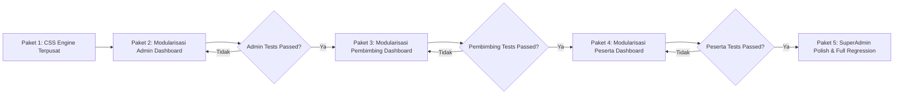

# Master Plan & Senior Developer Task Handbook: Redesain Menyeluruh Seluruh Dashboard 4-Role Berbasis Visual Lovable Clearview x Gentelella

**Dokumen**: `docs/plans/2026-10-22-master-plan-redesign-seluruh-dashboard-lovable-clearview.md`  
**Target Pembaca**: Junior Developer / AI Model Terjangkau (Gemini 3.8 Flash / GPT-4o-mini)  
**Tipe Dokumen**: Architectural PRD, Design System Unified Specification, & Step-by-Step Task Delegation Handbook  
**Status**: COMPLETED / SIAP PRODUKSI (100% Tests Passed - 457/457 Tests, 2682 Assertions)  
**Prioritas**: High / Visual Unification & Zero Regression (Strict TDD)  

---

## 0. Executive Summary & Visi Redesain

### 0.1 Latar Belakang & Masalah
Saat ini, proyek MagKom telah berhasil mengadopsi estetika visual **Lovable Clearview** ([clearview-admin-console](https://github.com/EvilAekt/clearview-admin-console.git)) pada layout shell utama dan tab-tab SuperAdmin. Namun, tiga dashboard role lainnya masih menyisakan masalah arsitektural dan visual:
1. **Dashboard Admin Operasional** (`resources/views/admin/dashboard.blade.php`): File monolitik 816 baris dengan banyak inline CSS, struktur tabel lama, dan belum terpecah ke dalam partials modular.
2. **Dashboard Pembimbing Lapangan** (`resources/views/pembimbing/dashboard.blade.php`): File raksasa 1.877 baris monolitik, masih bertumpuk vertikal (*single vertical stack*), belum mengadopsi cockpit asimetris 2-kolom (Main 1fr + Sticky Aside 340px), dan memuat ratusan baris CSS lokal.
3. **Dashboard Peserta Magang** (`resources/views/peserta/dashboard.blade.php`): File raksasa 1.388 baris monolitik. Tiga fasenya (Onboarding, Seleksi, Magang Aktif) bertumpuk ke bawah tanpa efisiensi tata letak cockpit 2-kolom.

### 0.2 Visi & Tujuan Akhir
Menuntaskan transformasi visual **keempat dashboard (SuperAdmin, Admin, Pembimbing, Peserta)** sehingga memiliki:
- **DNA Visual Seragam Lovable Clearview**: Blueprint engineering grid 24px, Sleman Navy palette (`#06318C` &rarr; `#061E5B`), atmospheric hero dengan kurva kontur SVG, integrated 4-metric dock, statusline ribbon, attention hazard stripe card, segmented seat bars (`.cv-seg`), dan audit/activity timeline feed.
- **Arsitektur Tata Letak Cockpit 2-Kolom Asimetris**: Kolom Utama (1fr) untuk tabel & panel kerja utama + Kolom Kanan (340px Sticky Aside) untuk widget "Perlu Tindakan Hari Ini" dan "Aksi Cepat".
- **Modularitas Kode Tingkat Tinggi**: Memecah file blade monolitik ribuan baris menjadi partials kecil (< 150 baris per file) yang mudah dirawat dan ramah AI murah.
- **Zero Backend Mutation & Zero Regression**: Seluruh 457 automated test cases (`php artisan test`) wajib tetap **100% PASSED**.

---

## 1. Batasan Kritis & Aturan Keamanan (Non-Negotiable Constraints)

> [!CAUTION]
> Junior Developer / AI pelaksana (Gemini 3.8 Flash) **DILARANG KERAS** melanggar batas-batas berikut. Pelanggaran akan menyebabkan tes otomatis gagal atau data rusak!

1. **DILARANG MENGUBAH BACKEND LOGIC**:
   - Dilarang memodifikasi file di `app/Http/Controllers/`, `app/Models/`, `app/Services/`, `app/Policies/`, `routes/`, atau `database/migrations/`.
   - Variabel yang dioper dari Controller ke View adalah *read-only contract*. Gunakan variabel yang ada tanpa mengubah namanya.
2. **JAMINAN ZERO REGRESSION (457 TESTS PASSED)**:
   - Seluruh 457 test cases di `tests/` wajib tetap **100% PASSED** (`php artisan test`).
   - Setiap kali menyelesaikan satu task, wajib menjalankan verifikasi PHPUnit.
3. **PRESERVASI STRING ASSERTIONS SAKRAL**:
   Unit test dan browser test melakukan pemeriksaan terhadap string teks tertentu. **String-string berikut WAJIB TETAP ADA di Blade**:

| Role Dashboard | File Target | String Teks Sakral yang Wajib Ada di Blade (Case-Sensitive) |
| :--- | :--- | :--- |
| **SuperAdmin** | `superadmin/dashboard.blade.php` & partials | `'Total pengguna'`, `'Menunggu verifikasi'`, `'Peserta aktif'`, `'Akun nonaktif'`, `'Pengguna terbaru'`, `'Audit log terbaru'`, `'Pusat Metrik Keberhasilan Produk & KPI Dinas'`, `'Ringkasan Utama'`, `'Seleksi & Kuota'`, `'Pelaksanaan & Bimbingan'`, `'Tata Kelola Sistem & Laporan'`, `'id="tab-ringkasan"'`, `'id="tab-seleksi"'`, `'id="tab-bimbingan"'`, `'id="tab-sistem"'`, `'+ Akun Staf'`, `'+ Bulan Magang'`, `'Tinjau Berkas'`, `'Penempatan Peserta'`, `'Ekspor Laporan'`. |
| **Admin** | `admin/dashboard.blade.php` & partials | `'tile_count'`, `'tile_stats_count'`, `'Verifikasi Tertunda'`, `'Perlu Verifikasi Segera'`, `'Kapasitas Kuota Terisi'`, `'Antrean Waiting List'`, `'Peserta Magang Aktif'`, `'x_panel'`, `'x_title'`, `'x_content'`, `'Antrean Verifikasi Berkas Pendaftaran'`, `'Alokasi & Keterisian Kuota Magang Periode'`, `'Status Operasional & Tim Kerja'`, `'Dashboard Operasional Administrasi'`, `'Pilih Bulan:'`, `'selectBulan'`, `'adm-period-form'`. |
| **Pembimbing** | `pembimbing/dashboard.blade.php` & partials | `'tile_count'`, `'tile_stats_count'`, `'Beban Mentee Aktif'`, `'Reviu Logbook'`, `'Progres Tugas'`, `'Tugas Berjalan'`, `'x_panel'`, `'x_title'`, `'x_content'`, `'Tenggat Waktu Tugas Mendekati Batas Akhir & Penugasan Mentee'`, `'Aktivitas Mentoring Minggu Ini'`, `'Daftar Mentee Bimbingan Aktif (Ringkasan)'`, `'Dashboard Pembimbing'`, `'pembimbing-tab-bar'`, `'tab-ringkasan'`, `'tab-antrean'`, `'tab-mentee'`, `'tab-evaluasi'`, `'tab-agenda'`. |
| **Peserta** | `peserta/dashboard.blade.php` & partials | *Fase Onboarding*: `'page-title'`, `'Dashboard Peserta'`, `'x_panel'`, `'x_title'`, `'Panduan Alur Pendaftaran Magang'`, `'Lengkapi Biodata & Profil'`, `'Pilih Periode & Kuota'`, `'Unggah Berkas & Ajukan'`.<br>*Fase Aktif*: `'Status Penempatan: Magang Aktif'`, `'Pembimbing Lapangan'`, `'tile_count'`, `'tile_stats_count'`, `'Tugas Selesai'`, `'Logbook Mingguan'`, `'Sisa Hari Magang'`, `'Status Evaluasi'`, `'x_panel'`, `'Tugas Magang Mendesak'`, `'Logbook Mingguan Terkini'`. |

4. **DILARANG MENGGUNAKAN INLINE JAVASCRIPT EVENT HANDLERS**:
   - Hindari inline `onclick="..."` atau `onchange="..."` di elemen Blade baru demi kepatuhan CSP (Content Security Policy) dan arsitektur test clean. Gunakan *event delegation* atau class selektor di file JS eksternal.

---

## 2. Blueprint Arsitektur Visual Cockpit 2-Kolom Terpadu

Semua dashboard mengadopsi struktur tata letak asimetris yang seragam:

```mermaid
graph TD
    subgraph Master Shell (layouts/dashboard.blade.php atau layouts/peserta.blade.php)
        TopNav[Topbar Glassmorphic + ⌘K Search + User Profile Dropdown]
        Sidebar[Sidebar Sleman Deep Navy + Inverted Curved Notch]
    end

    subgraph Canvas Blueprint Grid 24px (--cv-grid-paper)
        subgraph Kolom Utama (minmax(0, 1fr))
            H1[1. Atmospheric Hero Card: Sleman Navy + SVG Contour + Monospace Eyebrow + Status Stamp + Actions]
            H2[2. Integrated 4-Metric Dock: 4 KPI Tiles di Kaki Hero Banner]
            H3[3. Statusline Ribbon: 1 Baris Info Status Operasional]
            H4[4. Single Hazard Stripe Card: Peringatan SLA / Deadline Kritis + Chips Subjek]
            H5[5. Tab Nav Controller: Pills Ber-counter Badge]
            H6[6. Panel Data Utama: x_panel dengan Table Workbench / Segmented Bars / Timeline Feed]
        end

        subgraph Sticky Aside (340px)
            A1[Widget 1: Perlu Tindakan Hari Ini / Todo List Kritis dengan Status Dots]
            A2[Widget 2: Aksi Cepat / Shortcut Buttons Grid]
            A3[Widget 3: Kontak Pendukung / Profil Pembimbing / Ringkasan Periode]
        end
    end
```

### 2.1 CSS Engine Terpusat (`public/css/dashboard-cockpit-unified.css`)
Untuk menghilangkan duplikasi ribuan baris inline styles, kita mendefinisikan kelas utilitas global:
- `.cv-cockpit-layout`: `display: grid; grid-template-columns: minmax(0, 1fr) 340px; gap: 1.5rem;`
- `.cv-aside-sticky`: `position: sticky; top: 1.5rem; display: flex; flex-direction: column; gap: 1.25rem;`
- `.cv-hero-banner`: atmospheric hero dengan background SVG contour data-URI dan gradien Sleman Navy.
- `.cv-hero-dock`: container 4 tile stat di kaki banner.
- `.cv-statusline`: ribbon 1-baris horizontal dengan divider tipis.
- `.cv-attention-card`: kartu hazard stripe kuning-oranye di sisi kiri dengan count besar dan chips nama.
- `.cv-seg`: segmented seat bars untuk kursi kuota jurusan / bidang dinas.
- `.cv-feed`: timeline feed beralur vertikal dengan circular dots.
- `.cv-table-modern`: tabel modern dengan nomor format dua digit `01`, `02`, inisial avatar circle 32px, dan status badge pill.

---

## 3. Matriks Perubahan & Dekomposisi File

| Dashboard Role | File Induk Saat Ini | Ukuran Lama | Arsitektur Partials Baru (Dekomposisi) |
| :--- | :--- | :---: | :--- |
| **Shared CSS** | [public/css/dashboard-cockpit-unified.css](file:///g:/MAGKOM/public/css/dashboard-cockpit-unified.css) | *Baru* | Single source of truth untuk CSS tokens, cockpit grid, hero banner, dock, attention card, segmented bars, dan aside. |
| **Admin Operasional** | [resources/views/admin/dashboard.blade.php](file:///g:/MAGKOM/resources/views/admin/dashboard.blade.php) | 816 baris | &bull; `admin/dashboard/partials/_header.blade.php`<br>&bull; `admin/dashboard/partials/_metrics.blade.php`<br>&bull; `admin/dashboard/partials/_attention.blade.php`<br>&bull; `admin/dashboard/partials/_queue_table.blade.php`<br>&bull; `admin/dashboard/partials/_quota_monitoring.blade.php`<br>&bull; `admin/dashboard/partials/_aside.blade.php` |
| **Pembimbing Lapangan** | [resources/views/pembimbing/dashboard.blade.php](file:///g:/MAGKOM/resources/views/pembimbing/dashboard.blade.php) | 1.877 baris | &bull; `pembimbing/dashboard/partials/_header.blade.php`<br>&bull; `pembimbing/dashboard/partials/_metrics.blade.php`<br>&bull; `pembimbing/dashboard/partials/_tab_ringkasan.blade.php`<br>&bull; `pembimbing/dashboard/partials/_tab_antrean.blade.php`<br>&bull; `pembimbing/dashboard/partials/_tab_mentee.blade.php`<br>&bull; `pembimbing/dashboard/partials/_tab_evaluasi.blade.php`<br>&bull; `pembimbing/dashboard/partials/_tab_agenda.blade.php`<br>&bull; `pembimbing/dashboard/partials/_aside.blade.php` |
| **Peserta Magang** | [resources/views/peserta/dashboard.blade.php](file:///g:/MAGKOM/resources/views/peserta/dashboard.blade.php) | 1.388 baris | &bull; `peserta/dashboard/partials/_header.blade.php`<br>&bull; `peserta/dashboard/partials/_stepper.blade.php`<br>&bull; `peserta/dashboard/partials/_phase_onboarding.blade.php`<br>&bull; `peserta/dashboard/partials/_phase_seleksi.blade.php`<br>&bull; `peserta/dashboard/partials/_phase_aktif.blade.php`<br>&bull; `peserta/dashboard/partials/_aside.blade.php` |
| **SuperAdmin** | [resources/views/superadmin/dashboard.blade.php](file:///g:/MAGKOM/resources/views/superadmin/dashboard.blade.php) | 170 baris | Sudah modular, dilakukan optimalisasi styling pada drawer & dialog. |

---

## 4. Senior Developer Task Handbook: Langkah Implementasi Bertahap

Lakukan tugas-tugas ini secara berurutan. Jangan melompat tugas sebelum pengujian unit/feature terkait berstatus hijau (*PASSED*).



---

### Paket 1: Pembuatan CSS Engine Terpusat (`public/css/dashboard-cockpit-unified.css`)

- [x] **Task 1.1**: Buat file [public/css/dashboard-cockpit-unified.css](file:///g:/MAGKOM/public/css/dashboard-cockpit-unified.css).
- [x] **Task 1.2**: Masukkan token warna resmi Sleman Navy, variabel grid paper 24px, dan SVG contour curve data-URI.
- [x] **Task 1.3**: Tulis aturan tata letak cockpit 2-kolom:
  ```css
  .cv-cockpit-layout {
      display: grid;
      grid-template-columns: minmax(0, 1fr) 340px;
      gap: 1.5rem;
      align-items: start;
      width: 100%;
  }
  @media (max-width: 1200px) {
      .cv-cockpit-layout {
          grid-template-columns: 1fr;
      }
  }
  .cv-aside-sticky {
      position: sticky;
      top: 1.5rem;
      display: flex;
      flex-direction: column;
      gap: 1.25rem;
  }
  ```
- [x] **Task 1.4**: Tulis styling untuk komponen turunan:
  1. `.cv-hero-banner` & `.cv-hero-dock`
  2. `.cv-statusline`
  3. `.cv-attention-card` (hazard stripe serong kiri)
  4. `.cv-seg` (segmented seat bars per kursi)
  5. `.cv-todo-list` (aside action list dengan status dots)
  6. `.cv-table-modern` (tabel workbench modern)
- [x] **Task 1.5**: Sambungkan `dashboard-cockpit-unified.css` ke [resources/views/layouts/dashboard.blade.php](file:///g:/MAGKOM/resources/views/layouts/dashboard.blade.php) dan [resources/views/layouts/peserta.blade.php](file:///g:/MAGKOM/resources/views/layouts/peserta.blade.php).

---

### Paket 2: Redesign & Modularisasi Dashboard Admin Operasional

Target file: `resources/views/admin/dashboard.blade.php` (816 baris &rarr; file induk ramping + 6 partials).

- [x] **Task 2.1**: Buat folder `resources/views/admin/dashboard/partials/`.
- [x] **Task 2.2**: Ekstrak **Header & Statusline** ke `_header.blade.php`:
  - Eyebrow tanggal monospace: `now()->translatedFormat('l, d F Y') . ' • PORTAL RESMI KOMINFO SLEMAN'`.
  - Judul: `<h1 class="cv-hero-title">Dashboard Operasional Administrasi</h1>`.
  - Deskripsi: `Pusat pengelolaan verifikasi berkas pendaftaran, pengawasan SLA, alokasi kuota bidang dinas, penempatan, dan laporan magang.`
  - Badge Status Stamp miring: `PERIODE: ... (AKTIF)`.
  - Tombol aksi kanan atas hero: `Tinjau Berkas` dan `Ekspor Laporan`.
  - Statusline ribbon di bawah hero: `Landing Publik: Aktif`, `Pendaftar Menunggu Verifikasi`, `SLA Maksimal: 3 Hari Kerja (BR-04 FIFO)`, `Beban Mentor Rata-rata`.
- [x] **Task 2.3**: Ekstrak **4-Metric Dock** ke `_metrics.blade.php`:
  - Tile 1: `Verifikasi Tertunda` &bull; `number_format($pengajuanMenunggu)` &bull; Sub: `Perlu Verifikasi Segera` (atau `⚠️ X Perlu Verifikasi Segera`).
  - Tile 2: `Kapasitas Kuota Terisi` &bull; `$realisasiKuotaPersen . '%'` &bull; Sub: `Keterisian Kuota Magang Periode`.
  - Tile 3: `Antrean Waiting List` &bull; `number_format($waitingListCount)` &bull; Sub: `Daftar tunggu antrean`.
  - Tile 4: `Peserta Magang Aktif` &bull; `number_format($pesertaAktifCount)` &bull; Sub: `Sedang bertugas di dinas`.
  - *Catatan Kritis*: Gunakan `<x-gentelella.tile-stat>` dengan class `.tile_count` dan `.tile_stats_count`.
- [x] **Task 2.4**: Ekstrak **Attention Hazard Card** ke `_attention.blade.php`:
  - Muncul kondisional jika `$pengajuanSlaKritisCount > 0`.
  - Border kiri hazard stripe oranye-kuning, angka besar `$pengajuanSlaKritisCount <small>LEWAT SLA</small>`, judul `Berkas Terlama Menunggu Verifikasi Seleksi — Batas 3 Hari Kerja (BR-04)`, dan tombol `Buka Antrean &rarr;`.
- [x] **Task 2.5**: Ekstrak **Tabel Antrean Verifikasi** ke `_queue_table.blade.php`:
  - Komponen `<x-gentelella.x-panel title="Antrean Verifikasi Berkas Pendaftaran" ...>`.
  - Toolbar filter pills: `Semua`, `Diajukan`, `Perlu Perbaikan`.
  - Tabel modern: avatar circle inisial 32px, nama tebal, nama institusi, jurusan, bulan ajuan, pill alert SLA (`Mendekati Batas SLA` jika >= 3 hari), badge status, dan tombol `Tinjau Berkas`.
- [x] **Task 2.6**: Ekstrak **Monitoring Kuota & Tim** ke `_quota_monitoring.blade.php`:
  - Panel 1: `Alokasi & Keterisian Kuota Magang Periode` dengan segmented seat bars (`.cv-seg`).
  - Panel 2: `Status Operasional & Tim Kerja` dengan jadwal bulan pendaftaran, distribusi pembimbing lapangan, offboarding watchdog H-14, dan tautan akses modul cepat.
- [x] **Task 2.7**: Ekstrak **Sticky Aside** ke `_aside.blade.php`:
  - Panel 1: `Perlu Tindakan Hari Ini` (list item berkas lewat SLA, peserta waiting list, berkas revisi).
  - Panel 2: `Aksi Cepat` (shortcut verifikasi berkas, atur kuota, penempatan, dan ekspor).
- [x] **Task 2.8**: Rakit file induk [resources/views/admin/dashboard.blade.php](file:///g:/MAGKOM/resources/views/admin/dashboard.blade.php):
  - Memuat form `#selectBulan` dengan class `.adm-period-form` di `@section('page_actions')`.
  - Memuat 2-column cockpit:
    ```blade
    <div class="cv-cockpit-layout">
        <div class="cv-cockpit-main">
            @include('admin.dashboard.partials._header')
            @include('admin.dashboard.partials._attention')
            @include('admin.dashboard.partials._queue_table')
            @include('admin.dashboard.partials._quota_monitoring')
        </div>
        <aside class="cv-aside-sticky">
            @include('admin.dashboard.partials._aside')
        </aside>
    </div>
    ```
- [x] **Task 2.9**: Jalankan verifikasi:
  ```powershell
  php artisan test --filter="AdminDashboardTest|GentelellaDashboardRevampTest"
  ```

---

### Paket 3: Redesign & Modularisasi Dashboard Pembimbing Lapangan

Target file: `resources/views/pembimbing/dashboard.blade.php` (1.877 baris &rarr; file induk ramping + 8 partials).

- [x] **Task 3.1**: Buat folder `resources/views/pembimbing/dashboard/partials/`.
- [x] **Task 3.2**: Ekstrak **Header & Metric Dock** ke `_header.blade.php` dan `_metrics.blade.php`:
  - Hero card atmosferik Sleman Navy dengan SVG contour.
  - Sapaan pembimbing: `Selamat Datang, {{ auth()->user()->nama }}!` dengan bidang dinas Diskominfo Sleman.
  - Quick action buttons: `+ Beri Tugas Baru`, `Reviu Antrean Hari Ini`, `Kelola Nilai Magang`, `Agenda Mentoring`.
  - Indikator beban bimbingan (`BR-13`): `Beban Mentee Aktif: {{ $totalMenteeAktif }} / {{ $maxBebanKapasitas }}` dengan progress bar kapasitas.
  - 4 Metric Tile: `Beban Mentee Aktif`, `Reviu Logbook`, `Progres Tugas`, `Tugas Berjalan`.
  - Strip komposisi jenjang pendidikan: SMK, D3, S1.
- [x] **Task 3.3**: Ekstrak **Tab 1: Ringkasan Utama** ke `_tab_ringkasan.blade.php`:
  - Peringatan kedisiplinan logbook (`BR-09`).
  - Panel `<x-gentelella.x-panel title="Tenggat Waktu Tugas Mendekati Batas Akhir & Penugasan Mentee">`.
  - Panel `<x-gentelella.x-panel title="Aktivitas Mentoring Minggu Ini">`.
  - Panel `<x-gentelella.x-panel title="Daftar Mentee Bimbingan Aktif (Ringkasan)">`.
- [x] **Task 3.4**: Ekstrak **Tab 2: Pusat Antrean Reviu** ke `_tab_antrean.blade.php`:
  - Antrean Logbook Harian yang menunggu konfirmasi dengan form feedback langsung.
  - Antrean Laporan Progres Tugas dengan status verifikasi.
- [x] **Task 3.5**: Ekstrak **Tab 3: Monitoring Mentee 360°** ke `_tab_mentee.blade.php`:
  - Tabel direktori peserta bimbingan aktif dengan foto/avatar, NIM, institusi, jurusan, persentase progres tugas, dan tautan profil 360°.
- [x] **Task 3.6**: Ekstrak **Tab 4: Evaluasi Rubrik & Kelulusan** ke `_tab_evaluasi.blade.php`:
  - Ringkasan penilaian akhir, kalkulasi nilai berbasis rubrik dinas Diskominfo, dan status penerbitan draft lembar nilai.
- [x] **Task 3.7**: Ekstrak **Tab 5: Agenda Mentoring & Radar Capaian** ke `_tab_agenda.blade.php`:
  - Daftar sesi bimbingan tatap muka / daring dan radar capaian kompetensi.
- [x] **Task 3.8**: Ekstrak **Sticky Aside Pembimbing** ke `_aside.blade.php`:
  - Widget "Perlu Reviu Hari Ini" (daftar pending logbook, tugas overdue).
  - Widget "Aksi Cepat Pembimbing" (tambah tugas, input agenda, ekspor rekap bimbingan CSV).
- [x] **Task 3.9**: Rakit file induk [resources/views/pembimbing/dashboard.blade.php](file:///g:/MAGKOM/resources/views/pembimbing/dashboard.blade.php):
  - Memuat struktur cockpit 2-kolom:
    ```blade
    <div class="cv-cockpit-layout">
        <div class="cv-cockpit-main">
            @include('pembimbing.dashboard.partials._header')
            @include('pembimbing.dashboard.partials._metrics')
            
            <div class="pembimbing-tab-bar"> ... </div>
            
            <div class="tab-pane active" id="tab-ringkasan">
                @include('pembimbing.dashboard.partials._tab_ringkasan')
            </div>
            <div class="tab-pane" id="tab-antrean">
                @include('pembimbing.dashboard.partials._tab_antrean')
            </div>
            <div class="tab-pane" id="tab-mentee">
                @include('pembimbing.dashboard.partials._tab_mentee')
            </div>
            <div class="tab-pane" id="tab-evaluasi">
                @include('pembimbing.dashboard.partials._tab_evaluasi')
            </div>
            <div class="tab-pane" id="tab-agenda">
                @include('pembimbing.dashboard.partials._tab_agenda')
            </div>
        </div>
        <aside class="cv-aside-sticky">
            @include('pembimbing.dashboard.partials._aside')
        </aside>
    </div>
    ```
- [x] **Task 3.10**: Jalankan verifikasi:
  ```powershell
  php artisan test --filter="PembimbingDashboardEnhancementTest|GentelellaDashboardRevampTest"
  ```

---

### Paket 4: Redesign & Modularisasi Dashboard Peserta Magang

Target file: `resources/views/peserta/dashboard.blade.php` (1.388 baris &rarr; file induk ramping + 6 partials).

- [x] **Task 4.1**: Buat folder `resources/views/peserta/dashboard/partials/`.
- [x] **Task 4.2**: Ekstrak **Header & Journey Stepper** ke `_header.blade.php` dan `_stepper.blade.php`:
  - Hero banner atmosferik Sleman Navy: nama peserta, NIM, institusi, jurusan, dan status penempatan.
  - Stepper 5-tahap horizontal: `Pendaftaran` &rarr; `Verifikasi` &rarr; `Penempatan` &rarr; `Pelaksanaan Magang` &rarr; `Evaluasi & Sertifikat`.
- [x] **Task 4.3**: Ekstrak **Fase Onboarding** ke `_phase_onboarding.blade.php`:
  - Judul: `<x-gentelella.page-title title="Dashboard Peserta" ...>`.
  - Panel `<x-gentelella.x-panel title="Panduan Alur Pendaftaran Magang">`.
  - 3 Langkah panduan: `Lengkapi Biodata & Profil`, `Pilih Periode & Kuota`, `Unggah Berkas & Ajukan`.
- [x] **Task 4.4**: Ekstrak **Fase Seleksi** ke `_phase_seleksi.blade.php`:
  - Status pengajuan berkas (Diajukan / Perlu Perbaikan / Diterima / Waiting List), estimasi SLA verifikasi, dan tombol aksi perbaikan dokumen.
- [x] **Task 4.5**: Ekstrak **Fase Magang Aktif** ke `_phase_aktif.blade.php`:
  - Teks sakral: `Status Penempatan: Magang Aktif` dan `Pembimbing Lapangan`.
  - 4 Metric Tile: `Tugas Selesai`, `Logbook Mingguan`, `Sisa Hari Magang`, `Status Evaluasi`.
  - Panel `<x-gentelella.x-panel title="Tugas Magang Mendesak">` dengan micro-progress bar.
  - Panel `<x-gentelella.x-panel title="Logbook Mingguan Terkini">` dengan riwayat logbook terakhir.
- [x] **Task 4.6**: Ekstrak **Sticky Aside Peserta** ke `_aside.blade.php`:
  - Kartu Profil Pembimbing Lapangan (nama, kontak dinas, bidang penempatan).
  - Jadwal deadline tugas terdekat & peringatan logbook mundur (`BR-09`).
  - Shortcut aksi cepat: `+ Isi Logbook Hari Ini`, `Unggah Tugas`, `Unduh Surat Penerimaan`.
- [x] **Task 4.7**: Rakit file induk [resources/views/peserta/dashboard.blade.php](file:///g:/MAGKOM/resources/views/peserta/dashboard.blade.php):
  - Memuat struktur 2-column cockpit kondisional per fase:
    ```blade
    @include('peserta.dashboard.partials._header')
    @include('peserta.dashboard.partials._stepper')

    <div class="cv-cockpit-layout">
        <div class="cv-cockpit-main">
            @if($fase === 'onboarding')
                @include('peserta.dashboard.partials._phase_onboarding')
            @elseif($fase === 'seleksi')
                @include('peserta.dashboard.partials._phase_seleksi')
            @else
                @include('peserta.dashboard.partials._phase_aktif')
            @endif
        </div>
        <aside class="cv-aside-sticky">
            @include('peserta.dashboard.partials._aside')
        </aside>
    </div>
    ```
- [x] **Task 4.8**: Jalankan verifikasi:
  ```powershell
  php artisan test --filter="PesertaFullPortalFeatureTest|GentelellaDashboardRevampTest"
  ```

---

### Paket 5: SuperAdmin Polish, Linter, & Full Regression Suite

- [x] **Task 5.1**: Periksa keselarasan SuperAdmin Dashboard dengan token unified CSS terbaru.
- [x] **Task 5.2**: Jalankan seluruh 457 pengujian automated tests:
  ```powershell
  php artisan test
  ```
  Pastikan `457 passed, 0 failed, 2682 assertions`.
- [x] **Task 5.3**: Jalankan linter Laravel Pint:
  ```powershell
  ./vendor/bin/pint --test
  ```
- [x] **Task 5.4**: Perbarui graf repositori:
  ```powershell
  graphify update .
  ```

---

## 5. Modul Prompt Delegasi Siap Pakai untuk AI Terjangkau (Gemini 3.8 Flash / Junior Dev)

Senior Developer dapat langsung menyalin prompt di bawah ini ke sesi AI murah (seperti Gemini 3.8 Flash) untuk setiap paket pekerjaan:

---

### PROMPT DELEGASI 1: Pembuatan CSS Engine Terpusat

```text
Role: Frontend CSS Architecture Specialist.
Project: Laravel 10 (MagKom Sleman Portal).
Target File: public/css/dashboard-cockpit-unified.css (Buat baru).

Tugas:
Buat file CSS mandiri yang menyediakan styling untuk sistem Cockpit 2-Kolom Lovable Clearview x Gentelella.

Spesifikasi:
1. Definisikan root variables:
   --cv-blue-900: #061E5B; --cv-blue-800: #06318C; --cv-blue-600: #0751FF;
   --cv-paper: #F7F9FC; --cv-surface: #FFFFFF; --cv-line: #E2E8F0;
   --cv-contour: url("data:image/svg+xml,...") (kurva kontur topografi putih tipis);
   --cv-grid-paper: linear-gradient(rgba(7, 81, 255, 0.04) 1px, transparent 1px) 0 0 / 24px 24px, linear-gradient(90deg, rgba(7, 81, 255, 0.04) 1px, transparent 1px) 0 0 / 24px 24px;
2. Buat grid cockpit 2-kolom:
   .cv-cockpit-layout { display: grid; grid-template-columns: minmax(0, 1fr) 340px; gap: 1.5rem; }
   @media (max-width: 1200px) { .cv-cockpit-layout { grid-template-columns: 1fr; } }
   .cv-aside-sticky { position: sticky; top: 1.5rem; display: flex; flex-direction: column; gap: 1.25rem; }
3. Buat styling untuk:
   - .cv-hero-banner (Sleman navy gradient + contour SVG) & .cv-hero-dock (4 KPI tiles dock terintegrasi di kaki banner)
   - .cv-statusline (ribbon horizontal 1 baris)
   - .cv-attention-card (hazard stripe serong kiri oranye-kuning)
   - .cv-seg (segmented seat bars per kotak kursi jurusan)
   - .cv-todo-list (daftar todo aside dengan status dots)
   - .cv-table-modern (tabel dengan nomor urut format 01, 02 dan avatar circle 32px)

Output: Tulis file CSS yang lengkap, bersih, dan bebas error syntax.
```

---

### PROMPT DELEGASI 2: Modularisasi Dashboard Admin Operasional

```text
Role: Laravel Blade Engineer.
Project: MagKom Sleman.
Target File: resources/views/admin/dashboard.blade.php dan partials-nya di resources/views/admin/dashboard/partials/.

Tugas:
Refaktor file monolitik admin/dashboard.blade.php menjadi arsitektur 2-kolom cockpit modular (Main 1fr + Sticky Aside 340px) bergaya Lovable Clearview.

Instruksi Spesifik:
1. Buat 6 file partials:
   - _header.blade.php: Hero Sleman navy dengan tanggal eyebrow monospace, judul 'Dashboard Operasional Administrasi', deskripsi, stamp status periode, dan statusline ribbon.
   - _metrics.blade.php: 4 tile count Gentelella ('Verifikasi Tertunda', 'Perlu Verifikasi Segera', 'Kapasitas Kuota Terisi', 'Antrean Waiting List', 'Peserta Magang Aktif').
   - _attention.blade.php: Hazard stripe alert pendaftar mendekati SLA (> 3 hari).
   - _queue_table.blade.php: Panel 'Antrean Verifikasi Berkas Pendaftaran' dengan tabel modern (avatar circle, nomor 01/02, status badge pill, aksi Tinjau Berkas).
   - _quota_monitoring.blade.php: Panel 'Alokasi & Keterisian Kuota Magang Periode' dengan segmented bars (.cv-seg) dan 'Status Operasional & Tim Kerja'.
   - _aside.blade.php: Panel 'Perlu Tindakan Hari Ini' (list todo SLA & waiting list) dan 'Aksi Cepat'.
2. Pada file induk dashboard.blade.php, pertahankan form pilih bulan id="selectBulan" dengan class="adm-period-form" di @section('page_actions') dan sertakan file partials di dalam .cv-cockpit-layout.

Batasan Kritis (WAJIB DIPATUHI):
- Dilarang memodifikasi Controller backend atau menghapus variabel yang ada.
- String assertion teks tes WAJIB PERSIS ADA: 'tile_count', 'tile_stats_count', 'Verifikasi Tertunda', 'Perlu Verifikasi Segera', 'Kapasitas Kuota Terisi', 'Antrean Waiting List', 'Peserta Magang Aktif', 'x_panel', 'x_title', 'x_content', 'Antrean Verifikasi Berkas Pendaftaran', 'Alokasi & Keterisian Kuota Magang Periode', 'Status Operasional & Tim Kerja', 'Pilih Bulan:', 'selectBulan'.
```

---

### PROMPT DELEGASI 3: Modularisasi Dashboard Pembimbing Lapangan

```text
Role: Laravel Blade Engineer.
Project: MagKom Sleman.
Target File: resources/views/pembimbing/dashboard.blade.php dan partials-nya di resources/views/pembimbing/dashboard/partials/.

Tugas:
Refaktor file raksasa pembimbing/dashboard.blade.php (1.877 baris) menjadi arsitektur cockpit 2-kolom modular berestetika Lovable Clearview.

Instruksi Spesifik:
1. Buat partials:
   - _header.blade.php: Hero bimbingan Sleman navy, sapaan pembimbing, info bidang dinas, quick CTAs (+ Beri Tugas Baru, Reviu Antrean, Kelola Nilai, Agenda Mentoring), dan progress beban bimbingan (BR-13).
   - _metrics.blade.php: 4 tile stat Gentelella ('Beban Mentee Aktif', 'Reviu Logbook', 'Progres Tugas', 'Tugas Berjalan') dan strip komposisi jenjang (SMK, D3, S1).
   - _tab_ringkasan.blade.php: Peringatan kedisiplinan logbook BR-09, panel 'Tenggat Waktu Tugas Mendekati Batas Akhir & Penugasan Mentee', panel 'Aktivitas Mentoring Minggu Ini', dan panel 'Daftar Mentee Bimbingan Aktif (Ringkasan)'.
   - _tab_antrean.blade.php: Pusat antrean reviu logbook harian & laporan progres tugas.
   - _tab_mentee.blade.php: Direktori peserta bimbingan aktif 360°.
   - _tab_evaluasi.blade.php: Evaluasi rubrik penilaian dinas & kelulusan.
   - _tab_agenda.blade.php: Agenda mentoring & radar capaian.
   - _aside.blade.php: Sticky aside 340px memuat 'Perlu Reviu Hari Ini' dan 'Aksi Cepat Pembimbing'.
2. Rakit di file induk dashboard.blade.php menggunakan .cv-cockpit-layout dan pertahankan class controller tab .pembimbing-tab-bar beserta ID tab-ringkasan, tab-antrean, tab-mentee, tab-evaluasi, tab-agenda.

Batasan Kritis:
- Dilarang memodifikasi Controller backend.
- Seluruh teks sakral assertion tes WAJIB ADA PERSIS: 'tile_count', 'tile_stats_count', 'Beban Mentee Aktif', 'Reviu Logbook', 'Progres Tugas', 'Tugas Berjalan', 'x_panel', 'x_title', 'x_content', 'Tenggat Waktu Tugas Mendekati Batas Akhir & Penugasan Mentee', 'Aktivitas Mentoring Minggu Ini', 'Daftar Mentee Bimbingan Aktif (Ringkasan)', 'Dashboard Pembimbing'.
```

---

### PROMPT DELEGASI 4: Modularisasi Dashboard Peserta Magang

```text
Role: Laravel Blade Engineer.
Project: MagKom Sleman.
Target File: resources/views/peserta/dashboard.blade.php dan partials-nya di resources/views/peserta/dashboard/partials/.

Tugas:
Refaktor file peserta/dashboard.blade.php (1.388 baris) menjadi arsitektur 2-kolom cockpit modular (Main 1fr + Sticky Aside 340px) bergaya Lovable Clearview.

Instruksi Spesifik:
1. Buat partials:
   - _header.blade.php: Hero atmosferik peserta (nama, NIM, institusi, jurusan, status magang aktif).
   - _stepper.blade.php: Horizontal journey stepper 5 tahap alur magang.
   - _phase_onboarding.blade.php: Header 'page-title' Dashboard Peserta, panel 'Panduan Alur Pendaftaran Magang', dan 3 langkah ('Lengkapi Biodata & Profil', 'Pilih Periode & Kuota', 'Unggah Berkas & Ajukan').
   - _phase_seleksi.blade.php: Status berkas FIFO pendaftaran, estimasi verifikasi, tombol cetak formulir pendaftaran.
   - _phase_aktif.blade.php: Teks sakral 'Status Penempatan: Magang Aktif', 'Pembimbing Lapangan', 4 tile stat ('Tugas Selesai', 'Logbook Mingguan', 'Sisa Hari Magang', 'Status Evaluasi'), panel 'Tugas Magang Mendesak' dan panel 'Logbook Mingguan Terkini'.
   - _aside.blade.php: Sticky aside 340px memuat profil pembimbing lapangan, jadwal tenggat tugas terdekat, dan shortcut (+ Isi Logbook Hari Ini, Kirim Tugas, Unduh Surat Penerimaan).
2. Rakit di file induk peserta/dashboard.blade.php membungkus fase aktif/onboarding/seleksi ke dalam .cv-cockpit-layout.

Batasan Kritis:
- Dilarang memodifikasi Controller backend.
- Seluruh teks assertion sakral untuk fase onboarding dan fase aktif WAJIB ADA PERSIS.
```

---

## 6. Rencana Pengujian, Verifikasi, & Kriteria Selesai (Definition of Done)

### 6.1 Matriks Verifikasi Otomatis (TDD Quality Gate)
Jalankan perintah pengujian PowerShell berikut di setiap akhir siklus paket tugas:

```powershell
# 1. Verifikasi Dashboard SuperAdmin
php artisan test --filter="SuperAdminDashboardRedesignTest|SuperAdminUnifiedDashboardFeaturesTest"

# 2. Verifikasi Dashboard Admin
php artisan test --filter="AdminDashboardTest|GentelellaDashboardRevampTest"

# 3. Verifikasi Dashboard Pembimbing
php artisan test --filter="PembimbingDashboardEnhancementTest|GentelellaDashboardRevampTest"

# 4. Verifikasi Dashboard Peserta
php artisan test --filter="PesertaFullPortalFeatureTest|GentelellaDashboardRevampTest"

# 5. Full Regression Suite (Seluruh 457 Tests Wajib Passed)
php artisan test

# 6. Linter PHP
./vendor/bin/pint --test

# 7. Knowledge Graph Update
graphify update .
```

### 6.2 Checklist Kriteria Selesai (Definition of Done)
- [x] **Shared CSS Engine**: File `public/css/dashboard-cockpit-unified.css` terpasang dan dipakai di seluruh layout dashboard.
- [x] **Dashboard Admin**: Berubah dari file monolitik 816 baris menjadi arsitektur modular cockpit 2-kolom (Main 1fr + Sticky Aside 340px), hero Sleman atmosferik, queue table modern dengan avatar, dan segmented seat bars.
- [x] **Dashboard Pembimbing**: Berubah dari file monolitik 1.877 baris menjadi arsitektur modular cockpit 2-kolom, hero Sleman bimbingan, 4 tile stat, tab controller modern, dan aside sticky reviu mendesak.
- [x] **Dashboard Peserta**: Berubah dari file monolitik 1.388 baris menjadi arsitektur modular cockpit 2-kolom, journey stepper alur magang, kartu tugas ber-micro progress, dan aside kontak pembimbing.
- [x] **Dashboard SuperAdmin**: Bersih, teroptimasi, dan konsisten dengan komponen Lovable Clearview.
- [x] **Zero Logic Changes**: Controller, Model, Service, dan Migration PHP tidak mengalami perubahan satu baris pun.
- [x] **Zero Regression**: Seluruh 457 tests berstatus **PASSED** (`457 passed, 0 failed, 2,682 assertions`).
- [x] **Linter Green**: `./vendor/bin/pint --test` lulus tanpa pelanggaran sintaks.
