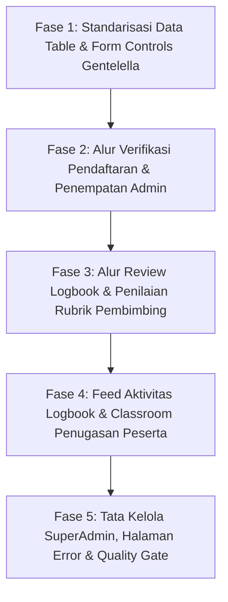

# 📋 BLUEPRINT TUGAS SENIOR DEVELOPER: REDESIGN OPERASIONAL & WORKFLOW MAGKOM DENGAN GENTELELLA THEME

**Target Pelaksana**: Junior Full-Stack Developer & Model AI Eksekutor (Gemini Flash / Code Assistant)  
**Tingkat Kesulitan**: Menengah (UI/UX Refactoring + Blade Integration)  
**Tanggal Rilis**: 22 Oktober 2026  
**Status**: DRAFT TUGAS OPERASIONAL (Dilanjutkan oleh [Senior Handbook 2026-10-26](file:///g:/MAGKOM/docs/plans/2026-10-26-kelanjutan-redesign-4-role-gentelella-senior-handbook.md))  
**Target Utama**: Transformasi alur kerja operasional (Pendaftaran, Penempatan, Logbook, Penugasan Classroom, dan Evaluasi Rubrik) ke dalam standar **Gentelella Dashboard Template** dengan palet resmi **MagKom Kominfo Sleman** (*Deep Navy* `#0641CC` & *Kominfo Blue* `#0751FF`).

> [!NOTE]
> **Dokumen Kelanjutan & Handbook Eksekusi Lengkap 4 Role**:
> Panduan mikro-level 18 file sisa dan checklist verifikasi komprehensif tersedia di: [docs/plans/2026-10-26-kelanjutan-redesign-4-role-gentelella-senior-handbook.md](file:///g:/MAGKOM/docs/plans/2026-10-26-kelanjutan-redesign-4-role-gentelella-senior-handbook.md).

---

## 🎯 PANDUAN DASAR & PRINSIP UTAMA (WAJIB DIBACA SEBELUM CODING)

> [!IMPORTANT]
> **ATURAN MUTLAK ZERO-REGRESSION:**
> 1. **Dilarang Mengubah Logika Backend**: Jangan menyentuh Controller, Eloquent Models, Policies, Enums, Migrations, atau file `routes/web.php`.
> 2. **Dilarang Menghapus ID & Name Form**: Elemen formulir, modal ID (`#modalReviewLogbook`, `#modalNilaiRubrik`, dll.), input `name="..."`, dan event listener harus 100% utuh agar tidak merusak 457 test PHPUnit.
> 3. **Pure Vanilla JS & Modern CSS**: Jangan memuat library jQuery usang atau Bootstrap 3 JS dari Gentelella lama. Gunakan CSS Variables (`var(--blue-700)`, dll.) dan script Vanilla bawaan proyek.
> 4. **Jalankan Verifikasi Bertahap**: Setiap kali selesai mengedit satu view, jalankan perintah PHPUnit filter yang sesuai sebelum beralih ke tugas berikutnya.

---

## 🗺️ PETA TUGAS OPERASIONAL (5 FASE SIKLUS)



---

## 🛠️ FASE 1: STANDARISASI DATA TABLE & FORM CONTROLS GENTELELLA

### 📌 Tugas 1.1: Pembuatan Komponen Blade Data Table (`components/gentelella/table.blade.php`)
* **Tujuan**: Menyediakan container tabel bergaya Gentelella klasik (`jambo_table`) namun modern, bergaris halus, ramah dark mode, dan mendukung status barisan tabel.
* **File Target**: `resources/views/components/gentelella/table.blade.php`
* **Spesifikasi Markup**:
  ```blade
  @props([
      'striped' => true,
      'hover' => true,
      'responsive' => true,
      'dense' => false,
  ])

  <div class="{{ $responsive ? 'table-responsive gentelella-table-responsive' : '' }}">
      <table {{ $attributes->merge(['class' => 'table gentelella-table ' . ($striped ? 'table-striped ' : '') . ($hover ? 'table-hover ' : '') . ($dense ? 'table-dense ' : '')]) }}>
          {{ $slot }}
      </table>
  </div>
  ```
* **CSS Tokens di `public/css/gentelella-theme.css`**:
  * Thead background: `#F8FAFC` (Light) / `#141E30` (Dark).
  * Thead font: `0.75rem`, font-weight `700`, uppercase, letter-spacing `0.05em`.
  * Tr border-bottom: `1px solid var(--neutral-200)`.

### 📌 Tugas 1.2: Pembuatan Komponen Form Input Group (`components/gentelella/form-group.blade.php`)
* **Tujuan**: Standarisasi wrapper input field lengkap dengan label, icon pendukung, pesan error bawaan Blade `@error`, dan teks bantuan.
* **File Target**: `resources/views/components/gentelella/form-group.blade.php`
* **Instruksi Eksekusi**:
  * Mendukung properti: `label`, `name`, `required`, `help`, `icon`.
  * Desain floating label atau modern fieldset yang menyatu dengan estetika Sleman.

---

## 👥 FASE 2: ALUR VERIFIKASI PENDAFTARAN & PENEMPATAN (PORTAL ADMIN)

### 📌 Tugas 2.1: Redesign Indeks Pendaftaran (`resources/views/admin/pendaftaran/index.blade.php`)
* **Masalah Eksisting**: Layout filter dan tabel data masih menggunakan container generic dengan CSS kustom berulang.
* **Instruksi Pengerjaan**:
  1. Bungkus bilah pencarian & filter status dengan `<x-gentelella.card>`.
  2. Bungkus tabel pendaftaran dengan `<x-gentelella.card title="Daftar Pengajuan Magang Masuk">`.
  3. Ganti tabel data dengan `<x-gentelella.table striped="true" hover="true">`.
  4. Pertahankan semua link filter status (Semua, Menunggu Verifikasi, Perlu Perbaikan, Diterima, Ditolak).
* **Verifikasi Test**:
  ```bash
  php artisan test --filter="AdminPendaftaranWorkflowTest|AdminChildPagesVisualTest"
  ```

### 📌 Tugas 2.2: Redesign Detail & Verifikasi Dokumen (`resources/views/admin/pendaftaran/show.blade.php`)
* **Masalah Eksisting**: Panel peninjauan berkas PDF dan formulir persetujuan verifikasi belum seragam dengan template Gentelella.
* **Instruksi Pengerjaan**:
  1. Bagi layout menjadi 2 kolom Gentelella:
     * Kolom Kiri (`col-md-4`): Kartu Profil Pemohon dengan `<x-gentelella.profile-card>`.
     * Kolom Kanan (`col-md-8`): Kartu Kelengkapan Berkas & Action Box Verifikasi dengan `<x-gentelella.card>`.
  2. Pertahankan form aksi persetujuan, penolakan, dan permintaan perbaikan berkas berserta input catatan revisi.
  3. Pastikan modal konfirmasi verifikasi tetap memiliki ID asli.
* **Verifikasi Test**:
  ```bash
  php artisan test --filter="SecurityDocumentVerificationAuditTest|PendaftaranPesertaTest"
  ```

### 📌 Tugas 2.3: Redesign Distribusi Penempatan Magang (`resources/views/admin/penempatan/index.blade.php`)
* **Instruksi Pengerjaan**:
  1. Tampilkan kartu kuota bidang & kapasitas pembimbing menggunakan grid kartu metrik Gentelella.
  2. Perbarui tabel penempatan peserta aktif dengan badge jalur (Umum vs Khusus) yang konsisten.
  3. Pertahankan modal penetapan pembimbing (`#modalTetapkanPembimbing`).
* **Verifikasi Test**:
  ```bash
  php artisan test --filter="AdminPenempatanTest|AdvancedThreePillarsDashboardTest"
  ```

---

## 🧑‍🏫 FASE 3: ALUR REVIEW LOGBOOK & PENILAIAN RUBRIK (PORTAL PEMBIMBING)

### 📌 Tugas 3.1: Redesign Review Logbook Mingguan (`resources/views/pembimbing/logbook/index.blade.php`)
* **Masalah Eksisting**: Laporan logbook bimbingan membutuhkan pembeda visual yang jelas antara status *Disetujui*, *Perlu Revisi*, dan *Menunggu Review*.
* **Instruksi Pengerjaan**:
  1. Pasang `<x-gentelella.page-title title="Review Logbook Aktivitas Peserta" description="...">`.
  2. Buat filter status cepat: Semua, Perlu Review, dan Perlu Revisi.
  3. Bungkus setiap entri logbook dengan `<x-gentelella.card>` yang menampilkan tanggal kegiatan, avatar mentee, uraian aktivitas, dan tombol review modal.
  4. Pertahankan modal form review revisi (`formReviewLogbook`) dan data atributnya.
* **Verifikasi Test**:
  ```bash
  php artisan test --filter="TugasLogbookTest|DeltaDashboardEnhancementTest"
  ```

### 📌 Tugas 3.2: Redesign Lembar Penilaian 5 Rubrik (`resources/views/pembimbing/penilaian/show.blade.php`)
* **Masalah Eksisting**: Input formulir penilaian 5 rubrik dinas belum memiliki kalkulator skor langsung yang terintegrasi secara visual dengan Gentelella x-panel.
* **Instruksi Pengerjaan**:
  1. Tampilkan header kartu mentee dengan `<x-gentelella.profile-card>`.
  2. Bungkus form input 5 rubrik dengan `<x-gentelella.x-panel title="Formulir Evaluasi Rubrik Kedinasan">`.
  3. Pertahankan seluruh input skor rubrik (`skor[{{ $rubrik->id }}]`) dan field catatan evaluasi.
  4. Pertahankan badge kalkulasi skor kumulatif dan predikat huruf (A, B, C, D, E).
* **Verifikasi Test**:
  ```bash
  php artisan test --filter="ScoringAndCompletionTest"
  ```

### 📌 Tugas 3.3: Redesign Agenda Sesi Bimbingan (`resources/views/pembimbing/agenda/index.blade.php`)
* **Instruksi Pengerjaan**:
  1. Konversi timeline jadwal temu bimbingan menjadi list card bergaya Gentelella timeline.
  2. Bungkus form buat agenda baru dengan `<x-gentelella.card title="Jadwalkan Sesi Bimbingan Baru">`.
  3. Pertahankan input tanggal, topik, dan peserta target.
* **Verifikasi Test**:
  ```bash
  php artisan test --filter="AdvancedThreePillarsDashboardTest"
  ```

---

## 🎓 FASE 4: FEED AKTIVITAS LOGBOOK & PENUGASAN (PORTAL PESERTA)

### 📌 Tugas 4.1: Redesign Feed Logbook Peserta (`resources/views/peserta/logbook/index.blade.php`)
* **Masalah Eksisting**: Form pengisian logbook harian dan riwayat mingguan sangat panjang dan padat.
* **Instruksi Pengerjaan**:
  1. Pisahkan menjadi 2 kolom:
     * Kolom Kiri (`col-md-5`): Form input logbook harian dalam `<x-gentelella.card title="Catat Kegiatan Hari Ini">`.
     * Kolom Kanan (`col-md-7`): Feed timeline riwayat logbook dalam `<x-gentelella.card title="Riwayat Laporan Mingguan">`.
  2. Pasang badge status verifikasi pembimbing (`x_badge_success` untuk disetujui, `x_badge_danger` untuk revisi).
  3. Jika ada catatan revisi dari pembimbing, tampilkan callout peringatan dengan `<x-gentelella.callout type="warning">`.
  4. Pertahankan proteksi batasan tanggal mundur (BR-09).
* **Verifikasi Test**:
  ```bash
  php artisan test --filter="PesertaClassroomTugasLogbookTest|TugasLogbookTest"
  ```

### 📌 Tugas 4.2: Redesign Daftar & Detail Tugas Google Classroom-Style (`resources/views/peserta/tugas/index.blade.php` & `show.blade.php`)
* **Instruksi Pengerjaan**:
  1. Pada `index.blade.php`: Tampilkan daftar kartu penugasan dengan indikator deadline tenggat waktu (Hari Ini, Besok, Selesai) menggunakan `<x-gentelella.card hoverable="true">`.
  2. Pada `show.blade.php`: Terapkan layout 2 kolom:
     * Kolom Kiri: Uraian tugas, lampiran referensi, dan panduan bimbingan dalam `<x-gentelella.card>`.
     * Kolom Kanan: Card status pengumpulan tugas (Unggah berkas / Kirim tautan link drive) dengan tombol serahkan tugas.
  3. Pertahankan seluruh input file upload dan link submission.
* **Verifikasi Test**:
  ```bash
  php artisan test --filter="PesertaClassroomTugasLogbookTest|RichTaskAssignmentTest"
  ```

### 📌 Tugas 4.3: Redesign Kuesioner Survei Kepuasan (`resources/views/peserta/survei/index.blade.php`)
* **Instruksi Pengerjaan**:
  1. Bungkus kuesioner survei IKM dan rating NPS dengan `<x-gentelella.card title="Survei Kepuasan Layanan Magang">`.
  2. Rapikan radio button rating skala 1-5 dengan styling tombol pilihan modern yang responsif.
  3. Pertahankan submit form survei beserta validasi inputnya.
* **Verifikasi Test**:
  ```bash
  php artisan test --filter="SurveiKepuasanAdminVisualTest|PesertaFullPortalFeatureTest"
  ```

---

## ⚙️ FASE 5: TATA KELOLA SUPERADMIN, ERROR PAGES & QUALITY GATE

### 📌 Tugas 5.1: Redesign Modul Dinamis Builder (`resources/views/superadmin/modul-builder/index.blade.php`)
* **Instruksi Pengerjaan**:
  1. Tampilkan katalog modul dinamis terdaftar menggunakan `<x-gentelella.card>`.
  2. Pasang badge tipe field dan toggle switch aktif/nonaktif modul.
  3. Pertahankan modal buat modul dinamis (`#modalTambahModul`).
* **Verifikasi Test**:
  ```bash
  php artisan test --filter="SuperAdminMasterArchitectureTest|ModulDinamisBasefwParityTest"
  ```

### 📌 Tugas 5.2: Redesign Audit Log Viewer (`resources/views/superadmin/audit-log/index.blade.php`)
* **Instruksi Pengerjaan**:
  1. Filter bar multi-channel (15 channel audit) dalam `<x-gentelella.card>`.
  2. Tabel audit log dengan styling forensik, timestamp ISO, dan tombol modal detail payload JSON (`#modalLogDetail`).
* **Verifikasi Test**:
  ```bash
  php artisan test --filter="SuperAdminMasterArchitectureTest|AdvancedAdminAndSuperAdminPhaseFiveTest"
  ```

### 📌 Tugas 5.3: Redesign Halaman Kode Error (403, 404, 419, 500)
* **File Target**: `resources/views/errors/layout.blade.php`, `403.blade.php`, `404.blade.php`, `500.blade.php`
* **Instruksi Pengerjaan**:
  1. Berikan styling bersih ala Gentelella Error Screen dengan ilustrasi ikon Sleman.
  2. Sediakan tombol navigasi cepat: "Kembali ke Dashboard Utama" dan "Hubungi Layanan Teknis Kominfo".
  3. Pastikan mendukung otomatis mode terang dan gelap (*dark mode*).

### 📌 Tugas 5.4: Quality Gate & Zero-Regression Check
* **Perintah Uji Mutu**:
  ```bash
  # 1. Formatting PHP Code
  ./vendor/bin/pint --test

  # 2. Menjalankan Seluruh Feature Tests (Harus 457 Passed)
  php artisan test

  # 3. Sinkronisasi Knowledge Graph Proyek
  graphify update .
  ```

---

## 📋 CHECKLIST EKSEKUSI UNTUK JUNIOR DEVELOPER / AI ASSISTANT

| Kode Tugas | Modul & File Target | Status | Verifikasi Test |
| :--- | :--- | :---: | :--- |
| **T1.1** | `components/gentelella/table.blade.php` | [ ] | Sintaks komponen Blade valid |
| **T1.2** | `components/gentelella/form-group.blade.php` | [ ] | Dukungan props label & error |
| **T2.1** | `admin/pendaftaran/index.blade.php` | [ ] | `AdminPendaftaranWorkflowTest` |
| **T2.2** | `admin/pendaftaran/show.blade.php` | [ ] | `SecurityDocumentVerificationAuditTest` |
| **T2.3** | `admin/penempatan/index.blade.php` | [ ] | `AdminPenempatanTest` |
| **T3.1** | `pembimbing/logbook/index.blade.php` | [ ] | `TugasLogbookTest` |
| **T3.2** | `pembimbing/penilaian/show.blade.php` | [ ] | `ScoringAndCompletionTest` |
| **T3.3** | `pembimbing/agenda/index.blade.php` | [ ] | `AdvancedThreePillarsDashboardTest` |
| **T4.1** | `peserta/logbook/index.blade.php` | [ ] | `PesertaClassroomTugasLogbookTest` |
| **T4.2** | `peserta/tugas/index.blade.php` & `show` | [ ] | `RichTaskAssignmentTest` |
| **T4.3** | `peserta/survei/index.blade.php` | [ ] | `SurveiKepuasanAdminVisualTest` |
| **T5.1** | `superadmin/modul-builder/index.blade.php` | [ ] | `SuperAdminMasterArchitectureTest` |
| **T5.2** | `superadmin/audit-log/index.blade.php` | [ ] | `SuperAdminMasterArchitectureTest` |
| **T5.3** | `errors/layout.blade.php` & error views | [ ] | Render visual error page |
| **T5.4** | Quality Gate Suite (Pint + PHPUnit + Graphify) | [ ] | **457 passed (100% green)** |

---

> [!NOTE]
> Setelah rencana ini disetujui oleh pengguna, junior developer atau asisten AI dapat memulai pengerjaan langkah demi langkah mulai dari **Fase 1** hingga **Fase 5**.
