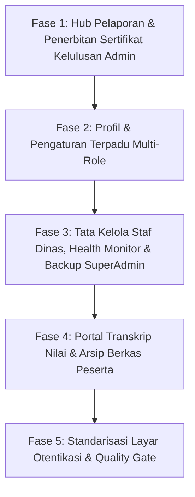

# 📋 BLUEPRINT TUGAS SENIOR DEVELOPER: REDESIGN HUB LAPORAN, PROFIL & PENGATURAN, MASTER STAF, DAN AUTH DENGAN GENTELELLA THEME

**Target Pelaksana**: Junior Full-Stack Developer & Model AI Eksekutor (Gemini 3.8 Flash / Code Assistant)  
**Tingkat Kesulitan**: Menengah (UI/UX Refactoring + Blade Integration + Zero Regression)  
**Tanggal Rilis**: 22 Oktober 2026  
**Status**: DRAFT TUGAS SIAP DIEKSEKUSI  
**Target Utama**: Transformasi modul pelaporan, sertifikasi kelulusan, profil & preferensi staf/peserta, manajemen master staf SuperAdmin, transkrip nilai, serta layar otentikasi (login/register/reset) ke dalam standar visual **Gentelella Dashboard Template** dengan palet resmi **MagKom Kominfo Sleman** (*Deep Navy* `#0641CC` & *Kominfo Blue* `#0751FF`).

---

## 🎯 PANDUAN DASAR & PRINSIP UTAMA (WAJIB DIBACA SEBELUM CODING)

> [!IMPORTANT]
> **5 ATURAN MUTLAK SENIOR DEVELOPER (ZERO REGRESSION GUARDRAILS):**
> 1. **Dilarang Mengubah Logika Backend**: JANGAN PERNAH menyentuh Controller, Eloquent Models, Policies, Enums, Migrations, Helper, atau file `routes/web.php`. Seluruh pekerjaan hanya menyentuh layer presentasi Blade (`.blade.php`).
> 2. **Dilarang Mengubah atau Menghapus DOM ID & Input Name**: Elemen formulir, modal ID (`#modalTambahStaf`, `#modalCetakSertifikat`, `#modalFilterLaporan`, dll.), input `name="..."`, dan event listener harus 100% utuh agar tidak merusak 457 test PHPUnit.
> 3. **Pertahankan String Branding Sensitif**:
>    - Layout Auth (`layouts/auth.blade.php` & `auth/*.blade.php`) wajib mempertahankan: `images/logo-sleman.png`, `MAGANG KOMINFO SLEMAN`, dan `Magang Kominfo Sleman`.
>    - Dilarang memunculkan string usang yang diuji di test suite: `KOMINFO PORTAL`, `KOMINFO MAGANG`, `KOMINFO MAGANG SLEMAN`.
> 4. **Gunakan Komponen Gentelella Resmi yang Sudah Tersedia**:
>    - `<x-gentelella.card>`
>    - `<x-gentelella.x-panel>`
>    - `<x-gentelella.tile-stat>`
>    - `<x-gentelella.table>`
>    - `<x-gentelella.badge>`
>    - `<x-gentelella.button>`
>    - `<x-gentelella.form-group>`
>    - `<x-gentelella.modal>`
> 5. **Jalankan Verifikasi Bertahap**: Setiap kali selesai mengedit satu view, jalankan perintah PHPUnit filter yang sesuai sebelum beralih ke tugas berikutnya.

---

## 🗺️ PETA TUGAS SPRINT (5 FASE SIKLUS)



---

## ⚖️ EVALUASI PENDEKATAN TEKNIS (ARCHITECTURAL OPTIONS)

| Kriteria Evaluasi | Opsi 1: Custom Scoped CSS Per Halaman (Status Quo) | Opsi 2: Standarisasi Berbasis Komponen Blade Gentelella (Rekomendasi) |
| :--- | :--- | :--- |
| **Konsistensi Desain** | Buruk — Banyak inline style dan token warna hex yang hardcoded berulang-ulang | Sangat Baik — Seluruh halaman mewarisi card, table, dan badge Gentelella yang seragam |
| **Performa & Maintainability** | Buruk — File blade berukuran raksasa (>40KB) karena inline style dan duplikasi markup | Sangat Baik — Struktur blade bersih, modular, dan mudah dipelihara oleh junior developer |
| **Resiko Regresi Testing** | Sedang — ID atau nama field rawan terlewat saat perbaikan manual | Minimal — Komponen Gentelella membungkus konten tanpa merusak struktur form / payload |
| **Dukungan Dark Mode** | Parsial — Sering terjadi glitch kontras atau teks tidak terbaca | Sempurna — Komponen Gentelella telah mendukung token CSS `[data-theme="dark"]` |

> **Rekomendasi Senior Dev**: **Pilih Opsi 2**. Gunakan komponen Blade Gentelella (`x-panel`, `card`, `table`, `tile-stat`, `badge`, `button`) untuk membungkus struktur data eksisting sambil menjaga 100% ID dan atribut form.

---

## 📑 DAFTAR FILE TARGET & PERUBAHAN

| File Target | Aksi | Ringkasan Perubahan |
| :--- | :--- | :--- |
| `resources/views/admin/laporan/index.blade.php` | Modify | Modernisasi Hub Laporan & Ekspor dengan `<x-gentelella.x-panel>`, tile-stat rekapitulasi, dan bilah filter rentang tanggal |
| `resources/views/admin/laporan/tahunan.blade.php` | Modify | Standarisasi kartu analitik tahunan, distribusi predikat, dan tombol ekspor resmi |
| `resources/views/admin/sertifikat/index.blade.php` | Modify | Refactor ke `<x-gentelella.table>`, kartu metrik sertifikasi, dan standarisasi tombol cetak |
| `resources/views/admin/profil/show.blade.php` | Modify | Bungkus biodata admin dengan `<x-gentelella.card>` dan `<x-gentelella.form-group>` |
| `resources/views/admin/pengaturan/index.blade.php` | Modify | Tab pengaturan preferensi tema, bahasa, dan keamanan dengan kartu Gentelella |
| `resources/views/pembimbing/profil/show.blade.php` | Modify | Kartu profil pembimbing lapangan, informasi NIP, instansi, dan form biodata |
| `resources/views/pembimbing/pengaturan/index.blade.php` | Modify | Formulir ganti kata sandi dan preferensi notifikasi pembimbing |
| `resources/views/superadmin/staf/index.blade.php` | Modify | Tabel staf dengan `<x-gentelella.table>`, status badge, modal tambah staf, dan reset password |
| `resources/views/superadmin/health/index.blade.php` | Modify | Telemetri kesehatan server (DB, Cache, Storage, Queue) dengan tile-stat Gentelella |
| `resources/views/superadmin/backup/index.blade.php` | Modify | Tabel riwayat backup database dan tombol trigger snapshot dengan x-panel Gentelella |
| `resources/views/superadmin/profil/show.blade.php` | Modify | Kartu biodata akun SuperAdmin dengan form-group Gentelella |
| `resources/views/superadmin/pengaturan/index.blade.php` | Modify | Tata letak konfigurasi kuota global, SLA watchdog, dan toggle fitur |
| `resources/views/peserta/nilai/show.blade.php` | Modify | Lembar transkrip nilai 5 rubrik peserta dengan tabel Gentelella dan banner predikat resmi |
| `resources/views/auth/login.blade.php` | Modify | Penyelarasan box login Gentelella card dengan input wrapper seragam dan tombol Google OAuth |
| `resources/views/auth/register.blade.php` | Modify | Standarisasi box register peserta mandiri dengan input terpadu |
| `resources/views/auth/forgot-password.blade.php` | Modify | Form lupa password berstandar Gentelella |
| `resources/views/auth/reset-password.blade.php` | Modify | Form setel ulang password dengan validasi visual token |

---

## 🛠️ FASE 1: HUB PELAPORAN & PENERBITAN SERTIFIKAT KELULUSAN ADMIN

### 📌 Tugas 1.1: Modernisasi Hub Laporan & Ekspor Data
* **Target File**: `resources/views/admin/laporan/index.blade.php`
* **Masalah Eksisting**: File blade berukuran besar (51KB) dengan inline style kartu metrik dan filter form custom tanpa wrapper standar Gentelella.
* **Instruksi Pengerjaan untuk Junior Dev / AI**:
  1. Pasang `<x-gentelella.tile-stat>` pada 4 kartu ringkasan di bagian atas:
     - Total Pendaftar (Ikon: `fa fa-users`, Warna: `blue`)
     - Peserta Diterima (Ikon: `fa fa-check-circle`, Warna: `green`)
     - Tingkat Kelulusan (Ikon: `fa fa-graduation-cap`, Warna: `purple`)
     - Rata-rata Nilai (Ikon: `fa fa-star`, Warna: `orange`)
  2. Bungkus bilah filter periode tanggal & bidang ke dalam `<x-gentelella.card title="Filter Rekapitulasi Laporan" icon="fa fa-filter">`.
  3. Bungkus tabel data rekapitulasi ke dalam `<x-gentelella.table :striped="true" :hover="true" class="jambo_table">`.
  4. **PANTANGAN MUTLAK**: Pertahankan action URL ekspor CSV/PDF, input `name="bulan"`, `name="tahun"`, `name="bidang_id"`, `name="tgl_mulai"`, `name="tgl_selesai"`, dan tab identifier.
* **Perintah Verifikasi**:
  ```bash
  php artisan test --filter="AdvancedAdminAndSuperAdminPhaseFiveTest|AdminReportHubTest"
  ```

---

### 📌 Tugas 1.2: Modernisasi Analitik Tahunan & Grafik Distribusi Nilai
* **Target File**: `resources/views/admin/laporan/tahunan.blade.php`
* **Masalah Eksisting**: Panel analitik tahunan memakai box styling custom yang kontrasnya tidak seragam di mode gelap.
* **Instruksi Pengerjaan**:
  1. Bungkus ringkasan tren tahunan dengan `<x-gentelella.x-panel title="Laporan Kinerja &amp; Analitik Tahunan Magang" subtitle="Statistik kumulatif pendaftar, rasio penerimaan, dan sebaran predikat kelulusan">`.
  2. Format container grafik batang/donat ke dalam grid card Gentelella (`col-md-6 col-sm-12`).
  3. Gunakan `<x-gentelella.badge>` untuk predikat nilai (A, B, C, D, E) pada tabel ringkasan distribusi nilai.
  4. Pertahankan tombol ekspor CSV analitik (`route('admin.laporan.tahunan.export')`).
* **Perintah Verifikasi**:
  ```bash
  php artisan test --filter="AdvancedAdminAndSuperAdminPhaseFiveTest"
  ```

---

### 📌 Tugas 1.3: Modernisasi Hub Penerbitan Sertifikat & Verifikasi
* **Target File**: `resources/views/admin/sertifikat/index.blade.php`
* **Masalah Eksisting**: Kartu metrik sertifikat dan tabel daftar alumni siap terbit masih menggunakan CSS class hardcoded `.cert-stat-card`.
* **Instruksi Pengerjaan**:
  1. Ganti kartu metrik atas dengan 3 `<x-gentelella.tile-stat>`:
     - Siap Diterbitkan (Warna: `blue`, Ikon: `fa fa-clock-o`)
     - Sudah Terbit Resmi (Warna: `green`, Ikon: `fa fa-certificate`)
     - Total Alumni (Warna: `purple`, Ikon: `fa fa-graduation-cap`)
  2. Bungkus tabel sertifikat dengan `<x-gentelella.x-panel title="Daftar Sertifikat Kelulusan Peserta" subtitle="Penerbitan nomor registrasi sertifikat digital berotentikasi QR-Code resmi">`.
  3. Gunakan `<x-gentelella.table :hover="true" :striped="false" class="jambo_table">` untuk data alumni.
  4. Tampilkan status nomor sertifikat dengan `<x-gentelella.badge variant="success">` jika sudah terbit, dan `<x-gentelella.badge variant="warning">` jika menunggu penetapan.
  5. **PANTANGAN MUTLAK**: Pertahankan form generate nomor sertifikat, link unduh PDF, dan verifikasi bahwa peserta belum final tidak boleh menerbitkan sertifikat.
* **Perintah Verifikasi**:
  ```bash
  php artisan test --filter="AdvancedThreePillarsDashboardTest"
  ```

---

## 👤 FASE 2: PROFIL & PENGATURAN TERPADU MULTI-ROLE (ADMIN, PEMBIMBING, SUPERADMIN)

### 📌 Tugas 2.1: Standarisasi Lembar Profil & Biodata Staf Dinas
* **Target Files**:
  - `resources/views/admin/profil/show.blade.php`
  - `resources/views/pembimbing/profil/show.blade.php`
  - `resources/views/superadmin/profil/show.blade.php`
* **Instruksi Pengerjaan**:
  1. Terapkan layout 2 kolom Gentelella:
     - Kolom Kiri (`col-md-4 col-sm-12`): `<x-gentelella.card title="Foto Profil &amp; Identitas" icon="fa fa-user">` berisi avatar besar, badge role dinas, NIP, email, dan status aktif.
     - Kolom Kanan (`col-md-8 col-sm-12`): `<x-gentelella.x-panel title="Perbarui Informasi Akun" subtitle="Pastikan data nama lengkap dan NIP sesuai SK kedinasan">` berisi formulir edit biodata.
  2. Bungkus field input (Nama Lengkap, NIP, Email, Nomor Telepon/WhatsApp) menggunakan form control seragam `class="form-control"`.
  3. Pertahankan: Input file foto profil (`name="foto"`), input nama, NIP, no_hp, CSRF token, dan route update profil masing-masing role.
* **Perintah Verifikasi**:
  ```bash
  php artisan test --filter="StaffProfileAndSettingsTest"
  ```

---

### 📌 Tugas 2.2: Standarisasi Pengaturan Akun, Keamanan & Preferensi Tema
* **Target Files**:
  - `resources/views/admin/pengaturan/index.blade.php`
  - `resources/views/pembimbing/pengaturan/index.blade.php`
  - `resources/views/superadmin/pengaturan/index.blade.php`
* **Instruksi Pengerjaan**:
  1. Kelompokkan pengaturan ke dalam kartu `<x-gentelella.card>` terpisah:
     - **Kartu Keamanan & Kata Sandi**: Form ubah password (Password Lama, Password Baru min. 8 karakter + simbol, Konfirmasi Password).
     - **Kartu Preferensi Tampilan & Bahasa**: Pilihan tema (Terang, Gelap, Ikuti Sistem) dan bahasa (Bahasa Indonesia / English).
  2. Pada form ubah password, beri petunjuk visual keamanan password (kombinasi huruf besar, kecil, angka, dan karakter khusus).
  3. **PANTANGAN MUTLAK**: Pertahankan name input `password_lama`, `password_baru`, `password_baru_confirmation`, serta form action update password.
* **Perintah Verifikasi**:
  ```bash
  php artisan test --filter="StaffProfileAndSettingsTest|LanguageLocalizationTest"
  ```

---

## 🛡️ FASE 3: TATA KELOLA STAF DINAS, TELEMETRI SISTEM & CADANGAN SUPERADMIN

### 📌 Tugas 3.1: Modernisasi Manajemen Staf Dinas
* **Target File**: `resources/views/superadmin/staf/index.blade.php`
* **Masalah Eksisting**: Manajemen staf (Admin & Pembimbing) memiliki filter dan modal tambah staf dengan styling terpisah.
* **Instruksi Pengerjaan**:
  1. Pasang `<x-gentelella.card title="Filter Staf Dinas" icon="fa fa-filter">` untuk pencarian nama/email dan filter role (Admin Verifikator, Pembimbing Lapangan).
  2. Bungkus tabel daftar akun dengan `<x-gentelella.x-panel title="Daftar Akun Pegawai &amp; Staf Pendamping" subtitle="Kelola kredensial, hak akses, dan status keaktifan akun">`.
  3. Gunakan `<x-gentelella.table :striped="true" class="jambo_table">` dengan badge role warna MagKom.
  4. Perbaiki modal tambah staf (`id="modalTambahStaf"`) dan modal reset password staf agar konsisten dengan `<x-gentelella.modal>`.
  5. Pertahankan: Input `name="nama"`, `name="email"`, `name="role"`, `name="nip"`, `name="bidang_id"`, checkbox status aktif, dan tombol reset password 1-klik.
* **Perintah Verifikasi**:
  ```bash
  php artisan test --filter="SuperAdminPortalVisualTest|AdvancedRoleEnhancementPhaseSixTest"
  ```

---

### 📌 Tugas 3.2: Modernisasi Pemantau Kesehatan Sistem (Health Monitor)
* **Target File**: `resources/views/superadmin/health/index.blade.php`
* **Instruksi Pengerjaan**:
  1. Pasang 4 tile metrik telemetri menggunakan `<x-gentelella.tile-stat>`:
     - Konektivitas Database (Ikon: `fa fa-database`, Status: Online)
     - Driver Cache (Ikon: `fa fa-bolt`, Status: Ready)
     - Sisa Kapasitas Penyimpanan (Ikon: `fa fa-hdd-o`, Disk Space)
     - Antrean Background Job (Ikon: `fa fa-tasks`, Queue Status)
  2. Pasang tombol diagnostik cepat sistem (`Sweep Cache`, `Purge Temp`, `Test Mailer`, `Health Check`) dalam action toolbar yang rapi.
  3. **PANTANGAN MUTLAK**: Pertahankan seluruh endpoint AJAX/POST aksi diagnostik sistem.
* **Perintah Verifikasi**:
  ```bash
  php artisan test --filter="SuperAdminMasterArchitectureTest|AdvancedThreePillarsDashboardTest"
  ```

---

### 📌 Tugas 3.3: Modernisasi Manajemen Cadangan Database (Backup Studio)
* **Target File**: `resources/views/superadmin/backup/index.blade.php`
* **Instruksi Pengerjaan**:
  1. Tampilkan kartu aksi cepat pembuatan cadangan database dengan `<x-gentelella.card title="Trigger Snapshot Database Manual" icon="fa fa-shield">`.
  2. Bungkus tabel arsip file backup (`.sql` / `.zip`) dengan `<x-gentelella.table class="jambo_table">`.
  3. Sediakan tombol unduh file cadangan (`btn btn-sm btn-primary`) dan informasi ukuran berkas serta tanggal snapshot yang mudah dibaca.
  4. Pertahankan: Form aksi create backup (`route('superadmin.backup.create')`) dan link download backup.
* **Perintah Verifikasi**:
  ```bash
  php artisan test --filter="AdvancedThreePillarsDashboardTest"
  ```

---

## 🎓 FASE 4: PORTAL TRANSKRIP NILAI & PREFERENSI PESERTA MAGANG

### 📌 Tugas 4.1: Modernisasi Lembar Transkrip Nilai 5 Rubrik Peserta
* **Target File**: `resources/views/peserta/nilai/show.blade.php`
* **Masalah Eksisting**: Banner nilai akhir dan tabel rubrik nilai evaluasi peserta masih menggunakan style inline kustom.
* **Instruksi Pengerjaan**:
  1. Buat banner nilai kelulusan resmi dengan aksen MagKom Blue:
     - Nilai Akhir Angka (Skala 0-100) dengan tipografi tegas (`font-weight: 800`).
     - Predikat Mutu Huruf (`A`, `B`, `C`, `D`, `E`) ber-badge tebal.
     - Status Kelulusan (*Lulus Memuaskan*, *Selesai Masa Magang*).
  2. Tampilkan rincian skor 5 rubrik penilaian resmi dalam `<x-gentelella.table :striped="true" class="jambo_table">`:
     - Kolom: No, Kriteria Penilaian, Deskripsi Rubrik, Bobot (%), Skor (0-100), Skor Terbobot.
  3. Sediakan tombol unduh lembar penilaian PDF (`route('peserta.nilai.unduh')`).
  4. Jika status nilai belum final, tampilkan empty state pemberitahuan bahwa proses penilaian oleh pembimbing lapangan sedang berlangsung.
* **Perintah Verifikasi**:
  ```bash
  php artisan test --filter="PesertaFullPortalFeatureTest|ScoringAndCompletionTest"
  ```

---

### 📌 Tugas 4.2: Modernisasi Profil & Pengaturan Preferensi Peserta
* **Target Files**:
  - `resources/views/peserta/profil/show.blade.php`
  - `resources/views/peserta/pengaturan/index.blade.php`
* **Instruksi Pengerjaan**:
  1. Standarisasi formulir data pribadi peserta (NIK, NIM, Asal Institusi/Universitas, Jurusan, Nomor Telepon, Alamat Domisili Sleman/DIY) dengan card berdesain rapi.
  2. Sediakan tab pembaruan kata sandi dan pengaturan preferensi tema gelap/terang.
  3. Pertahankan seluruh input field, validasi error Blade, dan tombol simpan profil.
* **Perintah Verifikasi**:
  ```bash
  php artisan test --filter="PesertaFullPortalFeatureTest|LanguageLocalizationTest"
  ```

---

## 🔐 FASE 5: STANDARISASI LAYAR OTENTIKASI & QUALITY GATE AKHIR

### 📌 Tugas 5.1: Harmonisasi Layar Login, Register & Reset Password
* **Target Files**:
  - `resources/views/auth/login.blade.php`
  - `resources/views/auth/register.blade.php`
  - `resources/views/auth/forgot-password.blade.php`
  - `resources/views/auth/reset-password.blade.php`
* **Instruksi Pengerjaan untuk Junior Dev / AI**:
  1. Pertahankan box auth terpusat namun terapkan sentuhan Gentelella:
     - Card container dengan border radius `16px`, bayangan lembut, dan aksen garis biru atas `#0641CC`.
     - Header form: Logo Sleman `{{ asset('images/logo-sleman.png') }}` dengan judul `MAGANG KOMINFO SLEMAN`.
  2. Standarisasi input wrapper: icon SVG di sisi kiri dengan padding yang proporsional, state fokus outline biru `#0641CC`.
  3. Pertahankan tombol Single Sign-On Google OAuth (`Login dengan Google` / `Daftar dengan Google`).
  4. Pertahankan captcha SVG dinamis (gambar captcha + tombol reload) dan input kode captcha 4 karakter.
  5. **PERINGATAN KERAS REGRESI TESTING**:
     - JANGAN MENGUBAH string teks: `images/logo-sleman.png`, `MAGANG KOMINFO SLEMAN`, `Magang Kominfo Sleman`, `Email`, `Kata Sandi`, `Login`, `Daftar`.
     - Pastikan string terlarang tidak pernah muncul: `KOMINFO PORTAL`, `KOMINFO MAGANG`, `KOMINFO MAGANG SLEMAN`.
* **Perintah Verifikasi**:
  ```bash
  php artisan test --filter="BrandingDesignSystemTest|SecurityRateLimitingAndBruteForceTest|SecurityDynamicCaptchaTest|ReleaseThreeSocialLoginTest"
  ```

---

### 📌 Tugas 5.2: Quality Gate Akhir (Pint, Suite 457 Passed & Graphify)
* **Instruksi Eksekusi**:
  1. Jalankan linter style PHP Pint:
     ```bash
     ./vendor/bin/pint --test
     ```
  2. Jalankan seluruh test suite tanpa terkecuali (wajib 457 passed):
     ```bash
     php artisan test
     ```
  3. Perbarui graf pengetahuan repositori:
     ```bash
     graphify update .
     ```

---

## 🧪 STRATEGI TESTING & MATRIX VERIFIKASI

```bash
# 1. Verifikasi Hub Laporan & Sertifikat Admin
php artisan test --filter="AdvancedAdminAndSuperAdminPhaseFiveTest|AdminReportHubTest|AdvancedThreePillarsDashboardTest"

# 2. Verifikasi Profil Staf, Pembimbing, dan Preferensi
php artisan test --filter="StaffProfileAndSettingsTest|LanguageLocalizationTest"

# 3. Verifikasi Manajemen Staf & Telemetri SuperAdmin
php artisan test --filter="SuperAdminPortalVisualTest|AdvancedRoleEnhancementPhaseSixTest|SuperAdminMasterArchitectureTest"

# 4. Verifikasi Portal Nilai & Profil Peserta
php artisan test --filter="PesertaFullPortalFeatureTest|ScoringAndCompletionTest"

# 5. Verifikasi Otentikasi & Branding Guard
php artisan test --filter="BrandingDesignSystemTest|SecurityRateLimitingAndBruteForceTest|SecurityDynamicCaptchaTest|ReleaseThreeSocialLoginTest"

# 6. Final Quality Gate (Full Test Suite)
php artisan test
```

---

## ⚠️ RISIKO & STRATEGI MITIGASI

1. **Risiko Bentrok CSS Komponen Form**:
   - *Mitigasi*: Gunakan selector CSS spesifik dan kelas utilitas Bootstrap/Gentelella bawaan (`form-control`, `input-group`). Jangan menimpa aturan reset universal.
2. **Risiko String Branding pada Halaman Auth**:
   - *Mitigasi*: Jangan mengubah satu huruf pun pada teks branding resmi yang dicek oleh `BrandingDesignSystemTest` (`MAGANG KOMINFO SLEMAN` dan `Magang Kominfo Sleman`).
3. **Risiko Aksesibilitas & Dark Mode**:
   - *Mitigasi*: Manfaatkan variabel CSS resmi (`var(--neutral-900)`, `var(--neutral-100)`, dll.) yang secara otomatis menyesuaikan warna teks dan background saat atribut `[data-theme="dark"]` aktif.

---

## ✅ KRITERIA SELESAI (DEFINITION OF DONE)

- [ ] Seluruh target view di Fase 1–5 telah dimodernisasi menggunakan komponen visual Gentelella (`card`, `x-panel`, `table`, `tile-stat`, `badge`, `button`).
- [ ] Seluruh form ID, input name, action URL, dan CSRF token tetap 100% utuh tanpa perubahan backend.
- [ ] Tampilan konsisten dalam mode terang (*Light Mode*) maupun mode gelap (*Dark Mode*).
- [ ] Linter `./vendor/bin/pint --test` keluar dengan status `passed` (0 error).
- [ ] Seluruh 457 tests pada `php artisan test` berstatus **PASS** (0 failures, 0 errors).
- [ ] Graf relasi kode `graphify update .` berhasil diperbarui.
