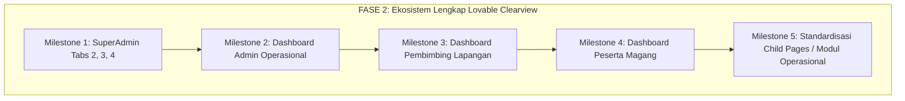
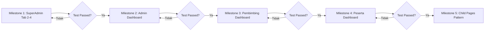

# Master Plan & Senior Developer Task Handbook (Fase 2): Ekosistem Lengkap Dashboard 4-Role & Child Pages Berbasis Visual Lovable Clearview x Gentelella

**Dokumen**: `docs/plans/2026-10-22-redesign-visual-lovable-clearview-fase-2.md`  
**Target Pembaca**: Junior Developer / AI Terjangkau (Gemini 3.8 Flash / GPT-4o-mini)  
**Tipe Dokumen**: Architectural PRD, Design System Specification, & Step-by-Step Task Delegation Handbook  
**Status**: DRAFT MENUNGGU PERSETUJUAN  
**Prioritas**: High / Visual Unification & Zero Regression Guarantee  

---

## 1. Executive Summary & Visi Fase 2

### 1.1 Pencapaian Fase 1
Pada Fase 1, fondasi arsitektur telah berhasil dibangun dan diuji tanpa merusak fungsionalitas sistem (**457 tests passed, 2,682 assertions**):
1. **Master Layout Shell**: Diperbarui dengan Sleman Deep Navy Gradient (`#06318C` &rarr; `#061E5B`), active menu *inverted rounded notch* (`::before` & `::after`), canvas *blueprint engineering grid* 24px halus, dan glassmorphic topbar dengan `⌘K` search bar.
2. **CSS Token Lovable Clearview**: Ditambahkan ke `public/css/superadmin-dashboard.css` (tokens `--cv-*`, asymmetric 2-column cockpit, atmospheric hero dengan SVG contour overlay, metric dock, hazard cards, dan segmented seat bars).
3. **SuperAdmin Cockpit & Tab 1 (Ringkasan)**: Tampilan utama dashboard SuperAdmin telah 100% selaras dengan visual Lovable Screenshot 1 & 2.

### 1.2 Ruang Lingkup Fase 2 (The Complete Ecosystem Expansion)
Fase 2 bertujuan untuk mengekspansi bahasa desain visual Lovable Clearview ke seluruh sisa ekosistem sistem MagKom yang belum terjamah:


1. **Milestone 1: Penuntasan Tab SuperAdmin**:
   - Tab 2: Seleksi & Kuota (`_tab-seleksi.blade.php`) &rarr; Antrean FIFO modern, segmented quota bar, waiting list & slot khusus isolation.
   - Tab 3: Pelaksanaan & Bimbingan (`_tab-bimbingan.blade.php`) &rarr; Metric dock bimbingan, hazard deadline tugas, matriks beban pembimbing dinamis.
   - Tab 4: Tata Kelola Sistem & Laporan (`_tab-sistem.blade.php`) &rarr; 4-card hub ekspor laporan resmi dinas 1-klik, threat radar 24 jam, health monitor.
2. **Milestone 2: Cockpit Redesign Dashboard Admin Operasional** (`resources/views/admin/dashboard.blade.php`):
   - Cockpit 2 kolom (Main 1fr + Sticky Aside 340px) untuk Admin Administrasi.
   - SLA verification hazard card, antrean verifikasi FIFO, dan status pagu kuota dinas.
3. **Milestone 3: Cockpit Redesign Dashboard Pembimbing** (`resources/views/pembimbing/dashboard.blade.php`):
   - Tab bar horizontal modern dengan pill badges, hero bimbingan personal, antrean reviu logbook, manajemen tugas, dan lembar penilaian akhir.
4. **Milestone 4: Cockpit Redesign Dashboard Peserta** (`resources/views/peserta/dashboard.blade.php`):
   - Journey stepper dinamis, visualisasi status berkas/magang, kartu kontak pembimbing lapangan, dan quick action pengisian logbook.
5. **Milestone 5: Standardisasi Universal Halaman Anak (Child Module Pages)**:
   - Pola modular mengadopsi `module-page.tsx` dari prototipe Lovable: Breadcrumb Eyebrow &rarr; KPI Stat Strip &rarr; Single-Row Workbench Toolbar (`⌘K` search + dropdown filters) &rarr; Compact Table dengan nomor baris `01`, `02`, inisial avatar, status chips, dan action drawer.

---

## 2. Batasan Kritis & Aturan Keamanan (Non-Negotiable Constraints)

> [!CAUTION]
> Junior Developer / AI pelaksana (Gemini 3.8 Flash) **DILARANG KERAS** melanggar batas-batas berikut. Pelanggaran akan menyebabkan tes otomatis gagal atau data rusak!

1. **ZERO BACKEND MUTATION**:
   - Dilarang menyentuh atau memodifikasi file di `app/Http/Controllers/`, `app/Models/`, `app/Services/`, `app/Policies/`, `routes/`, atau `database/migrations/`.
   - Seluruh data yang di-pass dari controller ke view (variabel blade) adalah *read-only contract* dan harus digunakan sebagaimana adanya.
2. **ZERO REGRESSION PADA 457 AUTOMATED TESTS**:
   - Seluruh 457 test cases di `tests/` wajib tetap **100% PASSED**.
   - Setiap kali menyelesaikan 1 task, wajib menjalankan:
     ```powershell
     php artisan test
     ```
3. **STRICT PRESERVATION OF DOM IDS & ASSERTION STRINGS**:
   PHPUnit dan browser test melakukan pemeriksaan terhadap string teks tertentu, nama form input, dan atribut ID. **String-string berikut WAJIB ADA di Blade**:
   - **SuperAdmin Tab 2**: `'Antrean Verifikasi Berkas Tertunda'`, `'Kepatuhan Pagu Kuota Dinas'`, `'Antrean Waiting List'`, `'Slot Khusus Kemitraan Sleman'`, `'Isolasi Publik: 100% Tersembunyi'`, `'Tinjau & Putuskan'`.
   - **SuperAdmin Tab 3**: `'Total Tugas Aktif'`, `'Logbook Pending Reviu'`, `'Penilaian Final Selesai'`, `'Staf Pembimbing Aktif'`, `'Tugas Terlambat (Overdue)'`, `'Mendekati Deadline (≤ 3 Hari)'`, `'Matriks Utilisasi Beban Pembimbing Lapangan'`, `'Kelola Penempatan Peserta'`, `'Monitoring Peserta'`.
   - **SuperAdmin Tab 4**: `'Hub Ekspor Instan Laporan Resmi Dinas'`, `'Laporan Pendaftaran'`, `'Laporan Penempatan'`, `'Realisasi Kuota'`, `'Rekapitulasi Nilai'`, `'Pusat Monitoring Keamanan Sistem & Threat Radar'`, `'Radar Anomali Login (24 Jam)'`, `'Higienitas Kredensial Staf'`, `'Unduh CSV Pendaftaran'`, `'Unduh CSV Penempatan'`, `'Unduh CSV Kuota'`, `'Unduh CSV Nilai'`.
   - **Admin Dashboard**: Form period `#selectBulan`, class `.adm-period-form`, route `admin.laporan.index`, string `'Dashboard Operasional Administrasi'`, `'Pilih Bulan:'`, `'Ekspor Laporan'`.
   - **Pembimbing Dashboard**: Container tab navigation, string `'Dashboard Pembimbing'`, `'Dashboard Operasional Pembimbing'`, badge tab counter.
   - **Peserta Dashboard**: Container hero, string `'Dashboard Peserta'`, info nama, NIM, status magang.
4. **NO INLINE JS EVENT HANDLERS**:
   - Hindari inline `onclick="..."` atau `onchange="..."` di elemen Blade baru demi kepatuhan CSP (Content Security Policy) dan arsitektur test clean. Gunakan *event delegation* atau class selektor.

---

## 3. Desain Arsitektur UI/UX Komponen Gentelella x Lovable Clearview

### 3.1 Hierarki Komponen Reusable
Kita mempertahankan kompatibilitas Gentelella Blade Components (`<x-gentelella.*>`) dan SuperAdmin components (`<x-sa.*>`) dengan membungkusnya menggunakan utility classes Lovable (`cv-*`):

```
+---------------------------------------------------------------------------------+
| Master Shell Layout (layouts/dashboard.blade.php)                               |
| Sleman Navy Gradient Sidebar (#06318C) | Topbar Glassmorphic (⌘K Search)        |
+---------------------------------------------------------------------------------+
| Canvas (.dashboard-main): Blueprint Engineering Grid 24px (--cv-grid-paper)    |
|                                                                                 |
|  +-------------------------------------------------------+ +------------------+ |
|  | Kolom Utama (minmax(0, 1fr))                          | | Sticky Aside     | |
|  |                                                       | | (340px)          | |
|  | 1. Hero Atmospheric (Deep Navy SVG Contour + Stamp)   | | 1. Perlu         | |
|  | 2. Metric Dock (4 Integrated Stat Tiles)              | |    Tindakan      | |
|  | 3. Statusline Ribbon (1 baris info horizontal)        | |    Hari Ini      | |
|  | 4. Hazard Stripe Card (Peringatan SLA & Chips)        | |    (Todo List)   | |
|  | 5. Nav Tabs (Ringkasan, Seleksi, Bimbingan, Sistem)    | |                  | |
|  | 6. Content Panels (<x-gentelella.x-panel>):           | | 2. Aksi Cepat    | |
|  |    - Table Workbench (Toolbar single-row + Search ⌘K) | |    (Quick Nav)   | |
|  |    - Segmented Quota Seat Bars (.cv-seg)              | |                  | |
|  |    - Timeline Feed with Circular Nodes                | |                  | |
|  +-------------------------------------------------------+ +------------------+ |
+---------------------------------------------------------------------------------+
```

### 3.2 Token Desain Spesifik Fase 2 (Ditambahkan ke CSS Global)
Token CSS yang dipakai di seluruh modul:
```css
/* Badge & Status Tokens */
--cv-badge-ok-bg: #ECFDF5;
--cv-badge-ok-text: #065F46;
--cv-badge-ok-border: #A7F3D0;

--cv-badge-warn-bg: #FFFBEB;
--cv-badge-warn-text: #92400E;
--cv-badge-warn-border: #FDE68A;

--cv-badge-bad-bg: #FEF2F2;
--cv-badge-bad-text: #991B1B;
--cv-badge-bad-border: #FECACA;

--cv-badge-info-bg: #EFF6FF;
--cv-badge-info-text: #1E40AF;
--cv-badge-info-border: #BFDBFE;

/* Table Tokens */
--cv-table-head-bg: #F8FAFC;
--cv-table-head-color: #475569;
--cv-table-row-hover: #F1F5F9;
--cv-table-border: #E2E8F0;
```

---

## 4. Matriks Perubahan File Lengkap

| No | Modul / Milestone | Target File Blade / CSS | Aksi | Ringkasan Pekerjaan |
| :-: | :--- | :--- | :---: | :--- |
| **1** | **SuperAdmin Tab 2** | [resources/views/superadmin/dashboard/partials/_tab-seleksi.blade.php](file:///g:/MAGKOM/resources/views/superadmin/dashboard/partials/_tab-seleksi.blade.php) | Modify | Refaktor antrean FIFO menjadi modern compact table, pagu kuota dinas & jurusan menjadi segmented seat bars, kartu waiting list & slot khusus kemitraan beraksen modern. |
| **2** | **SuperAdmin Tab 3** | [resources/views/superadmin/dashboard/partials/_tab-bimbingan.blade.php](file:///g:/MAGKOM/resources/views/superadmin/dashboard/partials/_tab-bimbingan.blade.php) | Modify | 4-Tile metric dock bimbingan, hazard strip tugas terlambat & deadline, progress meter utilisasi pembimbing lapangan. |
| **3** | **SuperAdmin Tab 4** | [resources/views/superadmin/dashboard/partials/_tab-sistem.blade.php](file:///g:/MAGKOM/resources/views/superadmin/dashboard/partials/_tab-sistem.blade.php) | Modify | Hub 4 kartu ekspor laporan resmi dinas 1-klik, panel threat radar keamanan login 24 jam & higienitas kredensial staf, health telemetry cards. |
| **4** | **Admin Dashboard** | [resources/views/admin/dashboard.blade.php](file:///g:/MAGKOM/resources/views/admin/dashboard.blade.php) | Modify | Transformasi layout menjadi 2-kolom cockpit (Main 1fr + Aside 340px), hero Sleman, statusline pendaftaran, hazard card antrean verifikasi, tabel verifikasi berkas modern. |
| **5** | **Pembimbing Dashboard** | [resources/views/pembimbing/dashboard.blade.php](file:///g:/MAGKOM/resources/views/pembimbing/dashboard.blade.php) | Modify | Modernisasi hero bimbingan, pill tab bar horizontal dengan counter, antrean reviu logbook cepat, tabel tugas bimbingan, kartu penilaian akhir. |
| **6** | **Peserta Dashboard** | [resources/views/peserta/dashboard.blade.php](file:///g:/MAGKOM/resources/views/peserta/dashboard.blade.php) | Modify | Sleman atmospheric hero peserta, stepper status magang interaktif, kartu pembimbing lapangan, quick action logbook & tugas. |
| **7** | **Design System CSS** | [public/css/superadmin-dashboard.css](file:///g:/MAGKOM/public/css/superadmin-dashboard.css) & [public/css/admin-cockpit-clearview.css](file:///g:/MAGKOM/public/css/admin-cockpit-clearview.css) | Modify | Injeksi styling seragam untuk segmented seat bars, modern data workbench toolbar, mini stats strip, dan badge pills. |

---

## 5. Senior Developer Task Handbook: Rincian Bertahap untuk Junior Developer

Handbook ini disusun secara berurutan (*step-by-step*). Selesaikan satu task secara tuntas, jalankan verifikasi PHPUnit, lalu lanjutkan ke task berikutnya.



---

### Milestone 1: Penuntasan Tab SuperAdmin (Tab 2, 3, 4)

#### Task 1.1: Refactor Tab 2 - Seleksi & Kuota (`_tab-seleksi.blade.php`)
- [ ] Buka [resources/views/superadmin/dashboard/partials/_tab-seleksi.blade.php](file:///g:/MAGKOM/resources/views/superadmin/dashboard/partials/_tab-seleksi.blade.php).
- [ ] **Bagian 1: Antrean Verifikasi Berkas Tertunda (FIFO)**:
  - Tetap gunakan `<x-sa.panel>` atau `<x-gentelella.x-panel>` dengan title: `"Antrean Verifikasi Berkas Tertunda (FIFO)"` dan link `"Buka Antrean Lengkap &rarr;"`.
  - Pada tabel pendaftar, terapkan styling Lovable:
    - Kolom 1 (Pendaftar & Institusi): Avatar lingkaran inisial 32px + Nama tebal (`sa-table-strong`) + nama institusi di baris kedua (`sa-table-sub`).
    - Kolom 2 (Jurusan & Bulan): Nama jurusan + Nama bulan & durasi.
    - Kolom 3 (Waktu Ajuan): Format tanggal rapi `14 Okt 2026, 09:30`.
    - Kolom 4 (Status): Status badge pill (`sa-badge--warning` untuk Diajukan, `sa-badge--info` untuk Perlu Perbaikan).
    - Kolom 5 (Aksi): Tombol biru ramping `<a href="..." class="btn-primary sa-btn-sm"><span>Tinjau & Putuskan</span></a>`.
- [ ] **Bagian 2: Utilisasi Kuota per Jurusan**:
  - Pertahankan box Kepatuhan Pagu Kuota Dinas (`Kepatuhan Pagu Kuota Dinas (BR-01)`).
  - Ganti meter bar lama dengan **Segmented Seat Bars** (`.cv-seg-group`):
    - Tampilkan kotak-kotak kursi per jurusan (kotak hijau untuk terisi, kotak abu-abu bergaris putus-putus untuk sisa kursi kosong).
    - Tampilkan rasio keterisian: `{{ $terisi }} / {{ $kapasitas }} Kursi`.
- [ ] **Bagian 3: Waiting List & Slot Khusus Kemitraan**:
  - Pertahankan teks `"Antrean Waiting List (BR-05)"` dengan angka `{{ $totalWaitingList }}` beraksen amber.
  - Pertahankan teks `"Slot Khusus Kemitraan Sleman"` dengan badge `"Isolasi Publik: 100% Tersembunyi (AC-01-5)"` dan tautan `"Atur Slot Khusus Kemitraan &rarr;"`.
- [ ] Jalankan verifikasi:
  ```powershell
  php artisan test --filter=SuperAdminUnifiedDashboardFeaturesTest
  ```

#### Task 1.2: Refactor Tab 3 - Pelaksanaan & Bimbingan (`_tab-bimbingan.blade.php`)
- [ ] Buka [resources/views/superadmin/dashboard/partials/_tab-bimbingan.blade.php](file:///g:/MAGKOM/resources/views/superadmin/dashboard/partials/_tab-bimbingan.blade.php).
- [ ] **Bagian 1: 4 Metrik Bimbingan**:
  - Buat grid 4 tile stat terpadu:
    1. `"Total Tugas Aktif"` &bull; Nilai `{{ number_format($totalTugasAktif) }}` &bull; Subteks `Sedang & belum dikerjakan`.
    2. `"Logbook Pending Reviu"` &bull; Nilai `{{ number_format($totalLogbookPending) }}` &bull; Subteks `Menunggu catatan pembimbing` (aksen oranye).
    3. `"Penilaian Final Selesai"` &bull; Nilai `{{ number_format($totalPenilaianSelesai) }}` &bull; Subteks `Lembar nilai siap diunduh` (aksen hijau).
    4. `"Staf Pembimbing Aktif"` &bull; Nilai `{{ number_format($totalPembimbing) }}` &bull; Subteks `Tersedia di Diskominfo`.
- [ ] **Bagian 2: Baris Kartu Pengawasan Kedisiplinan Tugas**:
  - Panel kiri: `"Tugas Terlambat (Overdue)"` dengan icon hazard alert circle, angka `{{ $totalTugasTerlambat }} Tugas`, dan hint teks `"Melewati deadline tanpa status selesai"` / `"Semua tugas berjalan tepat waktu"`.
  - Panel kanan: `"Mendekati Deadline (≤ 3 Hari)"` dengan icon clock, angka `{{ $totalTugasMendekatiDeadline }} Tugas`, dan hint `"Tenggat mendekati sesuai aturan BR-16"`.
- [ ] **Bagian 3: Matriks Utilisasi Beban Pembimbing Lapangan (BR-13)**:
  - Panel title: `"Matriks Utilisasi Beban Pembimbing Lapangan (BR-13)"`.
  - Subtitle: `"Batas maksimal beban mentee per pembimbing lapangan: ..."`
  - Tautan navigasi: `"Kelola Penempatan Peserta &rarr;"` dan `"Monitoring Peserta &rarr;"`.
  - List pembimbing dengan meter bar progress warna Sleman (merah jika overload >= maksBeban, biru jika normal).
- [ ] Jalankan verifikasi:
  ```powershell
  php artisan test --filter=SuperAdminUnifiedDashboardFeaturesTest
  ```

#### Task 1.3: Refactor Tab 4 - Tata Kelola Sistem & Laporan (`_tab-sistem.blade.php`)
- [ ] Buka [resources/views/superadmin/dashboard/partials/_tab-sistem.blade.php](file:///g:/MAGKOM/resources/views/superadmin/dashboard/partials/_tab-sistem.blade.php).
- [ ] **Bagian 1: Hub Ekspor Instan 4 Laporan Resmi Dinas (AC-17-1)**:
  - Panel header: `"Hub Ekspor Instan Laporan Resmi Dinas (AC-17-1)"` dengan link `"Buka Filter Laporan Lanjutan &rarr;"`.
  - Render 4 kartu ekspor bernomor badge `01`, `02`, `03`, `04` dalam grid 4 kolom:
    1. `"Laporan Pendaftaran"` &bull; Tombol: `"Unduh CSV Pendaftaran"` (`route('admin.laporan.pendaftaran')`).
    2. `"Laporan Penempatan"` &bull; Tombol: `"Unduh CSV Penempatan"` (`route('admin.laporan.penempatan')`).
    3. `"Realisasi Kuota"` &bull; Tombol: `"Unduh CSV Kuota"` (`route('admin.laporan.kuota')`).
    4. `"Rekapitulasi Nilai"` &bull; Tombol: `"Unduh CSV Nilai"` (`route('admin.laporan.nilai')`).
- [ ] **Bagian 2: Pusat Monitoring Keamanan Sistem & Threat Radar (PRD Bab 10)**:
  - Panel header: `"Pusat Monitoring Keamanan Sistem & Threat Radar (PRD Bab 10)"` dengan link `"Audit Lengkap &rarr;"`.
  - Kartu 1: `"Radar Anomali Login (24 Jam)"` &bull; `{{ $loginGagal24Jam ?? 0 }} Percobaan` &bull; Status Aman / Perlu Tinjauan.
  - Kartu 2: `"Higienitas Kredensial Staf (BR-15)"` &bull; `{{ $stafPendingGantiPassword ?? 0 }} Akun`.
  - Kartu 3: Status Imutabilitas Audit & Database Latency.
- [ ] Jalankan verifikasi:
  ```powershell
  php artisan test --filter=SuperAdminUnifiedDashboardFeaturesTest
  ```

---

### Milestone 2: Cockpit Redesign Dashboard Admin Operasional

#### Task 2.1: Refactor `resources/views/admin/dashboard.blade.php`
- [ ] Buka [resources/views/admin/dashboard.blade.php](file:///g:/MAGKOM/resources/views/admin/dashboard.blade.php).
- [ ] Pertahankan form periode pendaftaran di bagian atas:
  - Form selector: `<form method="GET" action="{{ route('admin.dashboard') }}" class="adm-period-form">`.
  - Label: `<label for="selectBulan">Pilih Bulan: ... <span class="sr-only">Bulan:</span></label>`.
  - Select: `<select name="bulan_id" id="selectBulan" onchange="this.form.submit()">`.
  - Tombol aksi: `<a href="{{ route('admin.laporan.index') }}">Ekspor Laporan</a>`.
- [ ] Susun struktur konten ke dalam **2-Column Cockpit Layout**:
  - **Kolom Utama (1fr)**:
    1. **Atmospheric Hero Banner**: Sapaan ramah Admin Operasional, status pendaftaran aktif, date eyebrow monospace.
    2. **Integrated Metric Dock**: 4 Stat Tile (Antrean Menunggu Verifikasi, Kuota Terisi, Total Diterima, Waiting List).
    3. **Hazard Stripe Alert**: Jika ada berkas melebihi SLA (> 3 hari), tampilkan hazard stripe card dengan nama pendaftar tertua dan tombol `Buka Antrean Verifikasi`.
    4. **Tabel Antrean Verifikasi Berkas (FIFO)**: Workbench table bergaris halus dengan inisial avatar, jurusan, waktu ajuan, dan aksi langsung verifikasi.
    5. **Segmented Quota Seat Bars**: Visualisasi kursi kuota bidang dinas (Aptika, IKP, Sekretariat, Statistik, dll.).
  - **Kolom Aside Kanan (340px)**:
    1. **Perlu Tindakan Operasional Hari Ini**: List item mendesak (berkas lewat SLA, kuota penuh, verifikasi pending).
    2. **Pintasan Aksi Operasional**: Tombol cepat Verifikasi Berkas, Atur Kuota Bulan Ini, Penempatan Peserta, Ekspor Data.
- [ ] Jalankan verifikasi:
  ```powershell
  php artisan test --filter=Admin
  ```

---

### Milestone 3: Cockpit Redesign Dashboard Pembimbing Lapangan

#### Task 3.1: Refactor `resources/views/pembimbing/dashboard.blade.php`
- [ ] Buka [resources/views/pembimbing/dashboard.blade.php](file:///g:/MAGKOM/resources/views/pembimbing/dashboard.blade.php).
- [ ] Perbarui Hero Card:
  - Nuansa biru Sleman atmosferik dengan identitas Pembimbing Lapangan, Bidang Dinas, dan rasio beban mentee aktif (misal: `7 / 10 Mentee Aktif`).
- [ ] Perbarui Tab Bar Navigation:
  - Gunakan class `.pembimbing-tab-bar` dengan pills modern:
    - Tab 1: `Ringkasan & Mentee` (dengan badge total mentee).
    - Tab 2: `Reviu Logbook` (dengan badge oranye logbook pending).
    - Tab 3: `Tugas & Progres` (dengan badge tugas aktif / terlambat).
    - Tab 4: `Penilaian & Rubrik` (dengan badge nilai siap diisi).
- [ ] Panel Konten Tab:
  - **Tab 1**: Tabel Peserta Bimbingan dengan avatar, institusi, jurusan, persentase progress magang, dan link detail profil peserta.
  - **Tab 2**: Feed Logbook Harian/Mingguan dengan tombol aksi cepat *Setujui & Beri Catatan*.
  - **Tab 3**: Monitoring Tugas: Kategori, tenggat waktu, progress slider, indikator keterlambatan.
  - **Tab 4**: Rekap Nilai: Form pengisian nilai berbasis rubrik dinas Diskominfo, kalkulasi predikat otomatis (A/B/C), dan unduh draft nilai.
- [ ] Jalankan verifikasi:
  ```powershell
  php artisan test --filter=Pembimbing
  ```

---

### Milestone 4: Cockpit Redesign Dashboard Peserta Magang

#### Task 4.1: Refactor `resources/views/peserta/dashboard.blade.php`
- [ ] Buka [resources/views/peserta/dashboard.blade.php](file:///g:/MAGKOM/resources/views/peserta/dashboard.blade.php).
- [ ] Perbarui **Hero Banner Peserta**:
  - Gradient Sleman atmosferik dengan nama lengkap peserta, NIM, universitas/sekolah, dan status tahap magang (misal: `Magang Aktif · Minggu Ke-4`).
- [ ] Implementasikan **Journey Stepper Visual** (Status Alur Magang):
  - 5 Tahap: `Pendaftaran` &rarr; `Verifikasi Berkas` &rarr; `Penempatan & Pembimbing` &rarr; `Pelaksanaan Magang` &rarr; `Evaluasi & Sertifikat`.
  - Tahap selesai bertanda checklist hijau, tahap aktif berkedip lembut (*subtle pulsing*), tahap mendatang berwarna abu-abu redup.
- [ ] Susun Cockpit 2-Kolom:
  - **Kolom Utama**:
    - Kartu Tugas Terkini (tenggat waktu, deskripsi, tombol kirim submission link/file).
    - Feed Logbook Terakhir (status persetujuan pembimbing & catatan reviu).
    - Pengumuman & Agenda Dinas.
  - **Kolom Aside Kanan (340px)**:
    - **Kartu Pembimbing Lapangan**: Foto/inisial pembimbing, nama, bidang dinas, tombol kontak/chat.
    - **Aksi Cepat Peserta**: Tombol utama `+ Isi Logbook Hari Ini`, `Kirim Tugas`, `Unduh Surat Penerimaan`.
- [ ] Jalankan verifikasi:
  ```powershell
  php artisan test --filter=Peserta
  ```

---

### Milestone 5: Standardisasi Universal Child Pages & Modul Operasional

#### Task 5.1: Pola Arsitektur `module-page` untuk Seluruh Halaman Anak
Mengadopsi arsitektur dari prototipe Lovable `src/components/superadmin/module-page.tsx`:
- [ ] Pastikan seluruh halaman anak (seperti `admin/pendaftaran/index.blade.php`, `admin/kuota/index.blade.php`, `superadmin/audit-log/index.blade.php`, dll.) memiliki 4 blok standar:
  1. **Module Heading**:
     - Monospace kicker: `<p class="cv-kicker">OPERASIONAL / PENDAFTARAN</p>`.
     - Page title: `<h1 class="cv-title">Verifikasi Berkas Pendaftaran</h1>`.
     - Subtitle context: `<p class="cv-subtitle">Pemeriksaan dokumen administrasi peserta magang Diskominfo Sleman.</p>`.
     - Heading actions: Tombol tambah atau unduh rekap.
  2. **Summary Strip (KPI Mini-Tiles)**:
     - 3–4 kotak stat ramping di atas tabel (Total data, Selesai/Aktif, Pending/Menunggu, Ditolak).
  3. **Data Workbench Toolbar**:
     - Satu baris terpadu: Kotak pencarian `Search ⌘K` + Dropdown filter status/periode + Tombol Reset.
  4. **Module Table & Pagination**:
     - Nomor urut padded `01`, `02`, avatar circle inisial, badge pills warna pastel lembut, action button ramping dengan icon Lucide/Feather, pagination bar bersih.

---

## 6. Modul Prompt Delegasi Siap Pakai untuk AI Terjangkau (Gemini 3.8 Flash / Junior Dev)

Bagian ini dirancang khusus agar Senior Developer dapat langsung menyalin (*copy-paste*) prompt per task ke model LLM murah (seperti Gemini 3.8 Flash) atau junior developer tanpa perlu menjelaskan konteks proyek dari nol.

---

### PROMPT DELEGASI 1: Refactor SuperAdmin Tab 2 (Seleksi & Kuota)

```text
Target Model: Gemini 3.8 Flash / Junior Developer
Konteks Proyek: Laravel 10 Blade di proyek MagKom Sleman.
File Target: resources/views/superadmin/dashboard/partials/_tab-seleksi.blade.php

Tugas:
Refaktor template Blade _tab-seleksi.blade.php agar memiliki tampilan visual modern yang bersih dan presisi mengadopsi gaya Lovable Clearview (Sleman Palette).

Instruksi Spesifik:
1. Pertahankan seluruh variabel Blade yang ada: $pendaftaranMenunggu, $kuotaList, $totalWaitingList, $slotKhusus, $kuotaMaksPagu, $totalKuotaUmum, $bulanAktif.
2. Pada Bagian 1 (Antrean Verifikasi Berkas Tertunda):
   - Gunakan komponen <x-sa.panel> atau <x-gentelella.x-panel> dengan title "Antrean Verifikasi Berkas Tertunda (FIFO)" dan linkText "Buka Antrean Lengkap &rarr;".
   - Tampilkan tabel dengan class "sa-table". Setiap baris pendaftar memuat avatar inisial 32px, nama tebal, nama institusi, jurusan, bulan ajuan, status badge ("Diajukan" atau "Perlu Perbaikan"), serta tombol aksi link "Tinjau & Putuskan" menuju route admin.pendaftaran.show.
3. Pada Bagian 2 (Utilisasi Kuota):
   - Pertahankan box "Kepatuhan Pagu Kuota Dinas (BR-01)" beserta nilai keterisian kursi ($totalKuotaUmum / $kuotaMaksPagu).
   - Render segmented seat bars (.cv-seg-group) untuk menampilkan kursi kuota jurusan.
4. Pada Bagian 3 (Waiting List & Slot Khusus):
   - Pertahankan kartu "Antrean Waiting List (BR-05)" dengan nilai $totalWaitingList.
   - Pertahankan kartu "Slot Khusus Kemitraan Sleman" dengan badge "Isolasi Publik: 100% Tersembunyi (AC-01-5)".

Batasan Kritis (WAJIB DIPATUHI):
- DILARANG mengubah Controller atau Model PHP.
- Teks assertion tes berikut TIDAK BOLEH DIHAPUS/DIUBAH:
  'Antrean Verifikasi Berkas Tertunda', 'Kepatuhan Pagu Kuota Dinas', 'Antrean Waiting List', 'Slot Khusus Kemitraan Sleman', 'Isolasi Publik: 100% Tersembunyi', 'Tinjau & Putuskan'.
- Outputkan hanya kode Blade yang lengkap dan siap timpa.
```

---

### PROMPT DELEGASI 2: Refactor SuperAdmin Tab 3 (Pelaksanaan & Bimbingan)

```text
Target Model: Gemini 3.8 Flash / Junior Developer
Konteks Proyek: Laravel 10 Blade di proyek MagKom Sleman.
File Target: resources/views/superadmin/dashboard/partials/_tab-bimbingan.blade.php

Tugas:
Refaktor template Blade _tab-bimbingan.blade.php agar mengadopsi estetika Lovable Clearview dengan layout grid modern, metric dock, dan hazard alert kedisiplinan tugas.

Instruksi Spesifik:
1. Pertahankan variabel Blade: $totalTugasAktif, $totalLogbookPending, $totalPenilaianSelesai, $totalPembimbing, $totalTugasTerlambat, $totalTugasMendekatiDeadline, $pembimbingList, $maksBeban.
2. Di bagian atas, buat 4 kartu metrik bimbingan:
   - "Total Tugas Aktif" (nilai: number_format($totalTugasAktif), hint: "Sedang & belum dikerjakan").
   - "Logbook Pending Reviu" (nilai: number_format($totalLogbookPending), hint: "Menunggu catatan pembimbing", warna amber).
   - "Penilaian Final Selesai" (nilai: number_format($totalPenilaianSelesai), hint: "Lembar nilai siap diunduh", warna hijau).
   - "Staf Pembimbing Aktif" (nilai: number_format($totalPembimbing), hint: "Tersedia di Diskominfo").
3. Di baris kedua, buat 2 kartu pengawasan kedisiplinan tugas:
   - Panel 1: "Tugas Terlambat (Overdue)" dengan jumlah $totalTugasTerlambat Tugas, icon alert-circle, dan teks status "Melewati deadline tanpa status selesai" atau "Semua tugas berjalan tepat waktu".
   - Panel 2: "Mendekati Deadline (≤ 3 Hari)" dengan jumlah $totalTugasMendekatiDeadline Tugas dan hint "Tenggat mendekati sesuai aturan BR-16".
4. Di bagian ketiga, buat panel "Matriks Utilisasi Beban Pembimbing Lapangan (BR-13)":
   - Tampilkan link navigasi "Kelola Penempatan Peserta &rarr;" dan "Monitoring Peserta &rarr;".
   - Tampilkan kartu staf pembimbing beserta meter bar mentee_aktif_count dan batas maksimal beban ($maksBeban).

Batasan Kritis:
- Teks assertion berikut HARUS ADA dan PERSIS:
  'Total Tugas Aktif', 'Logbook Pending Reviu', 'Penilaian Final Selesai', 'Staf Pembimbing Aktif', 'Tugas Terlambat (Overdue)', 'Mendekati Deadline (≤ 3 Hari)', 'Matriks Utilisasi Beban Pembimbing Lapangan', 'Kelola Penempatan Peserta', 'Monitoring Peserta'.
- Outputkan kode Blade yang valid dan lengkap.
```

---

### PROMPT DELEGASI 3: Refactor SuperAdmin Tab 4 (Tata Kelola Sistem & Laporan)

```text
Target Model: Gemini 3.8 Flash / Junior Developer
Konteks Proyek: Laravel 10 Blade di proyek MagKom Sleman.
File Target: resources/views/superadmin/dashboard/partials/_tab-sistem.blade.php

Tugas:
Refaktor template Blade _tab-sistem.blade.php agar mengadopsi tampilan Hub Ekspor Resmi Dinas 1-Klik dan Threat Radar Keamanan Lovable Clearview.

Instruksi Spesifik:
1. Pertahankan seluruh variabel Blade yang ada ($loginGagal24Jam, $stafPendingGantiPassword, $anomaliKuotaCount, $auditLogList, dll.).
2. Bagian 1: Hub Ekspor 4 Laporan Resmi Dinas (AC-17-1):
   - Panel header: "Hub Ekspor Instan Laporan Resmi Dinas (AC-17-1)" dengan linkText "Buka Filter Laporan Lanjutan &rarr;".
   - Render 4 kartu ekspor bernomor badge 01 sampai 04:
     1. "Laporan Pendaftaran" &bull; tombol link: "Unduh CSV Pendaftaran" (route: admin.laporan.pendaftaran).
     2. "Laporan Penempatan" &bull; tombol link: "Unduh CSV Penempatan" (route: admin.laporan.penempatan).
     3. "Realisasi Kuota" &bull; tombol link: "Unduh CSV Kuota" (route: admin.laporan.kuota).
     4. "Rekapitulasi Nilai" &bull; tombol link: "Unduh CSV Nilai" (route: admin.laporan.nilai).
3. Bagian 2: Pusat Monitoring Keamanan Sistem & Threat Radar (PRD Bab 10):
   - Panel header: "Pusat Monitoring Keamanan Sistem & Threat Radar (PRD Bab 10)" dengan linkText "Audit Lengkap &rarr;".
   - Kartu 1: "Radar Anomali Login (24 Jam)" memuat jumlah login gagal $loginGagal24Jam.
   - Kartu 2: "Higienitas Kredensial Staf (BR-15)" memuat jumlah staf pending ganti password $stafPendingGantiPassword.

Batasan Kritis:
- Teks assertion berikut HARUS ADA dan PERSIS:
  'Hub Ekspor Instan Laporan Resmi Dinas', 'Laporan Pendaftaran', 'Laporan Penempatan', 'Realisasi Kuota', 'Rekapitulasi Nilai', 'Pusat Monitoring Keamanan Sistem & Threat Radar', 'Radar Anomali Login (24 Jam)', 'Higienitas Kredensial Staf', 'Unduh CSV Pendaftaran', 'Unduh CSV Penempatan', 'Unduh CSV Kuota', 'Unduh CSV Nilai'.
```

---

### PROMPT DELEGASI 4: Cockpit Redesign Dashboard Admin Operasional

```text
Target Model: Gemini 3.8 Flash / Junior Developer
Konteks Proyek: Laravel 10 Blade di proyek MagKom Sleman.
File Target: resources/views/admin/dashboard.blade.php

Tugas:
Refaktor dashboard Admin Operasional agar mengadopsi 2-Column Cockpit Layout (Main Content 1fr + Sticky Aside 340px) dengan palet Sleman dan blueprint grid, persis seperti layout SuperAdmin Cockpit.

Instruksi Spesifik:
1. Pertahankan bagian @section('page_actions') yang memuat form pilih bulan:
   - Form method GET dengan class "adm-period-form".
   - Label: "Pilih Bulan: (Bulan Magang)" dengan id "selectBulan".
   - Tombol "Ekspor Laporan" menuju route admin.laporan.index.
2. Di dalam @section('content'), buat kontainer cockpit 2-kolom:
   - Kolom Utama:
     * Atmospheric Hero Banner Admin (judul: "Dashboard Operasional Administrasi", subtitle deskripsi, status pendaftaran).
     * 4-Tile Metric Dock (Menunggu Verifikasi, Kuota Terisi, Total Diterima, Waiting List).
     * Hazard Card SLA Verifikasi jika ada antrean menumpuk.
     * Tabel Antrean Verifikasi Berkas (FIFO) dengan avatar inisial, rincian berkas, dan tombol verifikasi cepat.
     * Segmented Seat Bars alokasi kuota bidang.
   - Kolom Aside (340px):
     * Panel "Perlu tindakan hari ini": daftar antrean berkas tertua, kuota menipis, atau verifikasi pending.
     * Panel "Aksi cepat": shortcut verifikasi pendaftaran, tambah kuota, penempatan, dan laporan.
3. Gunakan token CSS --cv-* atau include css/superadmin-dashboard.css.

Batasan Kritis:
- Dilarang menghapus ID selectBulan, form adm-period-form, dan teks string assertion tes admin.
- Dilarang memodifikasi Controller.
```

---

## 7. Rencana Pengujian, Verifikasi, & Kriteria Selesai (Definition of Done)

### 7.1 Strategi Pengujian Otomatis Bertingkat (TDD Verification)
Setiap milestone diuji dengan tahapan perintah PowerShell berikut:

```powershell
# 1. Uji Fitur SuperAdmin & Alignment Desain
php artisan test --filter="SuperAdminDashboardRedesignTest|SuperAdminUnifiedDashboardFeaturesTest|SuperAdminFigmaDesignAlignmentTest|GentelellaDashboardRevampTest"

# 2. Uji Dashboard Admin Operasional
php artisan test --filter="AdminDashboardTest|AdminVerifikasiBerkasTest"

# 3. Uji Dashboard Pembimbing
php artisan test --filter="PembimbingDashboardTest|PembimbingLogbookTest"

# 4. Uji Dashboard Peserta
php artisan test --filter="PesertaDashboardTest|PesertaProfileTest"

# 5. Full Regression Test (Wajib 457 Passed)
php artisan test

# 6. Linter Check
./vendor/bin/pint --test

# 7. Knowledge Graph Sync
graphify update .
```

### 7.2 Checklist Kriteria Selesai (Definition of Done)
- [ ] **Tab 2 SuperAdmin**: Antrean berkas tertunda terformat tabel compact Lovable, pagu kuota & kuota jurusan berwujud segmented seat bars, waiting list & slot khusus terisolasi rapi.
- [ ] **Tab 3 SuperAdmin**: 4 Metrik bimbingan terintegrasi dock, hazard card kedisiplinan tugas terlambat aktif, matriks beban pembimbing dinamis.
- [ ] **Tab 4 SuperAdmin**: 4 Kartu ekspor dinas 1-klik terpasang rapi dengan tombol download instan CSV, radar anomali login 24 jam & higienitas staf berfungsi visual.
- [ ] **Dashboard Admin**: Layout 2-kolom cockpit terpasang rapi, hero banner Sleman, statusline pendaftaran, antrean verifikasi FIFO, form `#selectBulan` utuh.
- [ ] **Dashboard Pembimbing**: Navigasi tab modern dengan pill counter badge, antrean reviu logbook, daftar tugas aktif, dan lembar nilai terintegrasi.
- [ ] **Dashboard Peserta**: Stepper journey status magang 5-tahap responsif, kartu kontak pembimbing lapangan, quick action logbook harian.
- [ ] **Child Pages**: Mengadopsi pola standar `module-heading`, `summary-strip`, dan `data-workbench` toolbar baris tunggal.
- [ ] **Zero Regression**: Seluruh 457 automated test cases tetap **100% PASSED** (`457 passed, 0 failed, 2,682 assertions`).
- [ ] **Zero Backend Changes**: Controller, Model, Service, dan Migration tidak mengalami perubahan sama sekali.
- [ ] **Code Cleanliness**: Linter `./vendor/bin/pint --test` berstatus PASSED.
