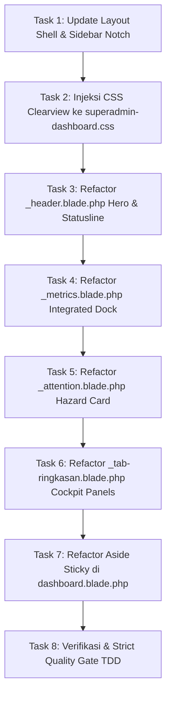

# Master Plan & Senior Developer Task Handbook: Redesain Visual Dashboard SuperAdmin MagKom Berbasis Lovable (Clearview) dengan Komponen Gentelella

**Dokumen**: `docs/plans/2026-10-22-redesign-visual-lovable-clearview-gentelella.md`  
**Target Pembaca**: Junior Developer / AI Terjangkau (Gemini 3.8 Flash)  
**Tipe Dokumen**: Architectural PRD & Step-by-Step Implementation Handbook  
**Status**: DRAFT MENUNGGU PERSETUJUAN  
**Prioritas**: High / Visual Alignment & Zero Regression  

---

## 1. Executive Summary & Problem Statement

### 1.1 Latar Belakang & Analisis Kesenjangan Visual (Gap Analysis)
Berdasarkan perbandingan visual antara kondisi sistem saat ini (Gambar 3) dengan prototipe modern Lovable [clearview-admin-console](https://github.com/EvilAekt/clearview-admin-console.git) (Gambar 1 & Gambar 2), terdapat jurang estetika (*visual disparity*) yang signifikan:

| Aspek Visual | Kondisi Saat Ini (Gambar 3 - MagKom) | Target Visual Lovable (Gambar 1 & 2 - Clearview) | Pendekatan Solusi Gentelella |
| :--- | :--- | :--- | :--- |
| **Theme & Canvas** | Gelap pekat boxy (`#0c1427`), kontras rendah, tanpa tekstur visual. | *Off-white paper* (`#F7F9FC`) dengan latar *blueprint engineering grid* 24px halus. | Menggunakan CSS variabel Sleman Light Theme pada canvas dengan fallback dark mode. |
| **Sidebar Shell** | Sidebar gelap monoton, border tipis, active menu persegi kaku. | Biru Sleman pekat (`#06318C` &rarr; `#061E5B`), active menu menyatu ke canvas dengan **curved inverted notch** (`::before` & `::after`). | Update styling `.dashboard-sidebar` & `.nav-item.active` tanpa mengubah struktur menu Blade. |
| **Topbar Header** | Topbar hitam gelap, minim hierarki. | Glassmorphic putih (`backdrop-filter: blur(8px)`), breadcrumbs tipis, search bar `⌘K`, avatar pill `SuperAdmin SA`. | Perbarui `layouts/dashboard.blade.php` topbar dengan token Lovable. |
| **Hero Banner** | Box kelabu gelap dengan 7 pill button berjejer, 4 alert bertumpuk vertikal memakan layar ~400px. | **Atmospheric Deep-Blue Hero** dengan kurva topografi SVG kontur, monospace eyebrow, status stamp tilted berkedip, tombol aksi di kanan atas hero. | Bungkus header SuperAdmin ke dalam container hero atmospheric dengan SVG contour. |
| **Metric Dock** | 4 tile stat terpisah jauh di bawah alert besar. | **Integrated 4-Metric Dock** menyatu di kaki banner hero dengan divider translusen dan mini-sparklines. | Gunakan `<x-gentelella.tile-stat>` dengan modifier class `.cv-hero-metrics` di dalam hero. |
| **Statusline Ribbon** | Tersebar atau tidak konsisten. | Garis status horizontal ramping: `Landing publik: Aktif` &bull; `Waiting list` &bull; `Login gagal` &bull; Dropdown Periode. | Komponen statusline horizontal kompak di bawah hero. |
| **Attention / Alert** | 4 kartu alert bertumpuk warna-warni (merah, oranye, kuning, biru) menghabiskan ruang vertikal. | **Single Hazard Stripe Card**: Border kiri garis serong kuning-oranye, angka besar `4 LEWAT SLA`, chips pendaftar (`Rizky +2h`), tombol `Buka antrean`. | Refaktor `_attention.blade.php` menjadi hazard card kompak dengan pendaftar chips. |
| **Dashboard Layout** | 1 kolom bertumpuk ke bawah (*single vertical stack*). | **Asymmetrical 2-Column Cockpit**: Kolom Utama (1fr) + Sticky Action Aside (340px di kanan). | Bungkus konten tab ringkasan ke dalam grid layout 2-kolom asimetris. |
| **Komponen Data** | Tabel & progress bar standar. | Segmented Seat Bars (`.seg`) kotak-kotak per kursi jurusan, timeline feed dengan circular nodes. | Terapkan styling `.seg` dan timeline pada panel Gentelella `<x-gentelella.x-panel>`. |

### 1.2 Tujuan Utama
1. **Transformasi Visual 100% Sesuai Lovable Clearview**: Menghadirkan visual premium, bersih, modern, dan atmosferik seperti pada Gambar 1 & 2.
2. **Tetap Mengakar pada Fondasi Komponen Gentelella**: Seluruh kartu data, panel, tombol, dan statistik tetap memanfaatkan Blade components (`<x-gentelella.*>`).
3. **Zero Backend Logic Modification**: Tidak mengubah satu pun baris kode di Controller, Service, Model, FormRequest, Policies, Enum, maupun Database Migrations.
4. **Preservasi String Assertions & Strict TDD**: Seluruh 457 automated tests yang ada saat ini (`php artisan test`) wajib tetap **100% PASSED**.

---

## 2. Batasan Kritis & Aturan Baku (Non-Negotiable Constraints)

> [!CAUTION]
> Junior Developer / AI pelaksana **DILARANG KERAS** melanggar batasan berikut:

1. **JANGAN MENGUBAH CONTROLLER / ROUTE**:
   - `app/Http/Controllers/SuperAdmin/SuperAdminDashboardController.php` **TIDAK BOLEH DIUBAH**.
   - Variabel yang di-pass ke view (`$totalPengguna`, `$menungguVerifikasi`, `$pesertaAktif`, `$akunNonaktif`, `$daftarBulan`, `$bulanAktif`, `$statusPublik`, `$loginGagal24Jam`, `$anomaliKuotaCount`, `$totalTugasTerlambat`, `$totalAntreanDiajukan`, `$totalWaitingList`, `$antreanMelebihiSla`, `$stafPendingGantiPassword`, `$totalLogbookPending`, `$penggunaTerbaru`, `$auditTerbaru`, `$trenPendaftar`, `$kuotaPerJurusan`, dll.) harus digunakan sebagaimana mestinya.
2. **PRESERVASI STRING ASSERTION PADA TEST SUITE**:
   Test suite seperti `SuperAdminUnifiedDashboardFeaturesTest`, `SuperAdminFigmaDesignAlignmentTest`, dan `GentelellaDashboardRevampTest` menguji kehadiran string teks berikut pada HTML. **Teks-teks ini WAJIB tetap ada di Blade**:
   - `'Dashboard Eksekutif Tata Kelola MagKom'` (boleh diaksesi via sr-only atau badge)
   - `'Dashboard SuperAdmin'`
   - `'Akses penuh: kelola pengguna, role, rubrik, audit log, konfigurasi'`
   - `'Total pengguna'`
   - `'Menunggu verifikasi'`
   - `'Peserta aktif'`
   - `'Akun nonaktif'`
   - `'Pengguna terbaru'` & `'Kelola pengguna'`
   - `'Audit log terbaru'` & `'Lihat semua'`
   - `'Ringkasan Utama'` (atau `'Ringkasan'`)
   - `'Seleksi & Kuota'`
   - `'Pelaksanaan & Bimbingan'`
   - `'Tata Kelola Sistem & Laporan'`
   - ID Tab Panels: `id="tab-ringkasan"`, `id="tab-seleksi"`, `id="tab-bimbingan"`, `id="tab-sistem"`
   - Quick action labels & routes: `'+ Akun Staf'`, `'+ Bulan Magang'`, `'Tinjau Berkas'`, `'Penempatan Peserta'`, `'Ekspor Laporan'`
   - Dropdown id & form: `id="select-bulan"`, `.sa-period-form`
   - Attention titles: `'Perhatian Antrean Pendaftaran'`, `'SLA Verifikasi Terlampaui'`, `'Higienitas Kredensial Staf'`, `'Logbook Pending Reviu'`, `'Integritas Kuota Terganggu'`, `'Tugas Melewati Tenggat'` (atau kondisi normal `'Kondisi Operasional Normal'`)
   - Sidebar branding: `'MagKom'`, `'KOMINFO PORTAL'`, `'MODUL OPERASIONAL'`, `'SISTEM'`, `'Sistem internal Kominfo'`
3. **ZERO REGRESSION**:
   Setelah implementasi selesai, jalankan `php artisan test` dan pastikan `457 passed, 0 failed`.

---

## 3. Desain Teknis & Spesifikasi CSS Token

### 3.1 Token Palet Sleman & Blueprint Grid
File CSS utama yang memuat styling ini adalah [public/css/superadmin-dashboard.css](file:///g:/MAGKOM/public/css/superadmin-dashboard.css) dan [public/css/gentelella-theme.css](file:///g:/MAGKOM/public/css/gentelella-theme.css).

```css
:root {
  /* Sleman Official Deep Navy Palette */
  --cv-blue-950: #041238;
  --cv-blue-900: #061E5B;
  --cv-blue-800: #06318C;
  --cv-blue-700: #0641CC;
  --cv-blue-600: #0751FF;
  --cv-blue-tint: #EFF6FF;

  /* Surfaces & Grid */
  --cv-paper: #F7F9FC;
  --cv-surface: #FFFFFF;
  --cv-line: #E2E8F0;
  --cv-line-strong: #CBD5E1;
  --cv-ink: #0F172A;
  --cv-ink-2: #334155;
  --cv-ink-3: #64748B;

  /* Status Tokens */
  --cv-ok: #10B981;
  --cv-ok-tint: #ECFDF5;
  --cv-warn: #F59E0B;
  --cv-warn-tint: #FFFBEB;
  --cv-bad: #EF4444;
  --cv-bad-tint: #FEF2F2;

  /* Atmospheric SVG Contour Curves (Data-URI) */
  --cv-contour: url("data:image/svg+xml,%3Csvg xmlns='http://www.w3.org/2000/svg' width='600' height='300' viewBox='0 0 600 300' fill='none' stroke='white' stroke-opacity='.09' stroke-width='1.2'%3E%3Cpath d='M-20 220C80 180 120 250 220 200S380 90 480 130 620 60 640 40'/%3E%3Cpath d='M-20 250C90 210 140 280 240 230S390 120 500 160 630 90 650 70'/%3E%3Cpath d='M-20 190C70 150 110 220 200 170S370 60 460 100 610 30 630 10'/%3E%3Cpath d='M-20 280C100 240 160 300 260 260S400 150 520 190 640 120 660 100'/%3E%3Cpath d='M-20 160C60 120 100 190 180 140S360 30 440 70 600 0 620-20'/%3E%3Cellipse cx='470' cy='120' rx='60' ry='26'/%3E%3Cellipse cx='470' cy='120' rx='34' ry='14'/%3E%3Cellipse cx='470' cy='120' rx='12' ry='5'/%3E%3C/svg%3E");

  /* Blueprint Grid Pattern */
  --cv-grid-paper:
    linear-gradient(rgba(7, 81, 255, 0.04) 1px, transparent 1px) 0 0 / 24px 24px,
    linear-gradient(90deg, rgba(7, 81, 255, 0.04) 1px, transparent 1px) 0 0 / 24px 24px;
}
```

### 3.2 Inverted Rounded Notch pada Active Sidebar Menu
Rahasia visual Lovable pada sidebar adalah tautan menu yang aktif melengkung ke canvas konten tanpa batas garis tajam:
```css
.dashboard-sidebar .nav-sub-item.active,
.dashboard-sidebar .nav-item.active {
  background-color: var(--cv-paper);
  color: var(--cv-blue-800);
  font-weight: 700;
  border-radius: 8px 0 0 8px;
  position: relative;
}
.dashboard-sidebar .nav-sub-item.active::before,
.dashboard-sidebar .nav-sub-item.active::after {
  content: "";
  position: absolute;
  right: 0;
  width: 12px;
  height: 12px;
  background: transparent;
  pointer-events: none;
}
.dashboard-sidebar .nav-sub-item.active::before {
  top: -12px;
  border-bottom-right-radius: 10px;
  box-shadow: 4px 4px 0 4px var(--cv-paper);
}
.dashboard-sidebar .nav-sub-item.active::after {
  bottom: -12px;
  border-top-right-radius: 10px;
  box-shadow: 4px -4px 0 4px var(--cv-paper);
}
```

---

## 4. Rincian Perubahan File

| File | Aksi | Ringkasan Perubahan |
| :--- | :--- | :--- |
| [public/css/superadmin-dashboard.css](file:///g:/MAGKOM/public/css/superadmin-dashboard.css) | Modify | Mengintegrasikan seluruh styling Lovable: grid blueprint 24px, atmospheric contour hero, 4-metric dock, statusline ribbon, attention hazard card, 2-column cockpit layout, segmented quota bars, dan aside sticky. |
| [resources/views/layouts/dashboard.blade.php](file:///g:/MAGKOM/resources/views/layouts/dashboard.blade.php) | Modify | Menyesuaikan background canvas dengan grid blueprint, menyempurnakan topbar (search shortcut `⌘K`, avatar pill), dan menambahkan dukungan curved notch pada sidebar active link. |
| [resources/views/superadmin/dashboard.blade.php](file:///g:/MAGKOM/resources/views/superadmin/dashboard.blade.php) | Modify | Mengelompokkan struktur konten ke dalam 2-column cockpit layout (`sa-layout` & `sa-aside`) dengan tetap memelihara 4 tab controller dan seluruh DOM IDs. |
| [resources/views/superadmin/dashboard/partials/_header.blade.php](file:///g:/MAGKOM/resources/views/superadmin/dashboard/partials/_header.blade.php) | Modify | Menjadikan header sebagai atmospheric deep blue hero card dengan SVG contour, date eyebrow, badge stamp miring berkedip, action button di kanan atas, statusline ribbon horizontal di bawah hero. |
| [resources/views/superadmin/dashboard/partials/_metrics.blade.php](file:///g:/MAGKOM/resources/views/superadmin/dashboard/partials/_metrics.blade.php) | Modify | Mengintegrasikan 4 metrik stat sebagai dock di bagian bawah hero banner menggunakan `<x-gentelella.tile-stat>` dengan modifier class dock. |
| [resources/views/superadmin/dashboard/partials/_attention.blade.php](file:///g:/MAGKOM/resources/views/superadmin/dashboard/partials/_attention.blade.php) | Modify | Merampingkan alert menjadi single hazard stripe card bergaris serong kuning dengan SLA count besar, nama-nama pendaftar tertua, dan tombol aksi langsung. |
| [resources/views/superadmin/dashboard/partials/_tab-ringkasan.blade.php](file:///g:/MAGKOM/resources/views/superadmin/dashboard/partials/_tab-ringkasan.blade.php) | Modify | Menyusun Card 01 (Pengguna terbaru), Card 02 (Audit log timeline), Card 03 (KPI dinas), Card 04 (Kuota segmented bar), dan Card 05 (Keamanan) menggunakan `<x-gentelella.x-panel>`. |

---

## 5. Langkah-Langkah Implementasi Bertahap (Task List untuk Junior Dev)



### Task 1: Update Master Layout Shell & Sidebar Curved Notch
- [ ] Buka file [resources/views/layouts/dashboard.blade.php](file:///g:/MAGKOM/resources/views/layouts/dashboard.blade.php).
- [ ] Pada `.dashboard-main`, tambahkan background blueprint grid:
  `background: var(--cv-grid-paper), var(--cv-paper);`
- [ ] Pada `.dashboard-sidebar`, perbarui gradient background menjadi Sleman deep blue:
  `background: radial-gradient(120% 60% at 0% 0%, rgba(7, 81, 255, 0.45), transparent 60%), linear-gradient(180deg, #06318C, #061E5B);`
- [ ] Tambahkan efek *curved notch* pada `.nav-sub-item.active` (menggunakan pseudo-elemen `::before` dan `::after` dengan `box-shadow` border-radius terbalik).
- [ ] Di topbar, pastikan elemen pencarian memuat placeholder: `Cari peserta, staf, atau NIM... ⌘K` dan profil `SuperAdmin SA` tetap utuh.

### Task 2: Perbarui CSS di `public/css/superadmin-dashboard.css`
- [ ] Buka [public/css/superadmin-dashboard.css](file:///g:/MAGKOM/public/css/superadmin-dashboard.css).
- [ ] Masukkan token Lovable CSS (`--cv-blue-900`, `--cv-contour`, `--cv-grid-paper`, `--cv-warn`, dll.).
- [ ] Tulis styling untuk:
  1. `.sa-hero` & `.sa-hero-dock` (hero atmospheric dengan SVG contour background dan dock metrik di bawahnya).
  2. `.sa-stamp` (badge miring `-1.5deg` dengan green pulsing dot).
  3. `.sa-statusline-ribbon` (strip horizontal 1 baris).
  4. `.sa-attn-hazard` (kartu bergaris serong hazard kuning di border kiri dengan flex pendaftar chips).
  5. `.sa-cockpit-layout` (grid `minmax(0, 1fr) 340px`).
  6. `.sa-aside-sticky` (`position: sticky; top: 1.5rem`).
  7. `.cv-seg` (segmented bar per kotak kursi kuota).
  8. `.cv-timeline` (feed audit log dengan circular dots).

### Task 3: Refactor Header Partial (`_header.blade.php`)
- [ ] Buka [resources/views/superadmin/dashboard/partials/_header.blade.php](file:///g:/MAGKOM/resources/views/superadmin/dashboard/partials/_header.blade.php).
- [ ] Bungkus ke dalam struktur Hero Card Lovable:
  - Contextual eyebrow monospace: `SABTU, 17 OKTOBER 2026 · 04:12 WIB` (atau tanggal dinamis hari ini).
  - Judul: `<h1 class="sa-title">Dashboard SuperAdmin</h1>`.
  - Deskripsi: `Akses penuh: kelola pengguna, role, rubrik, audit log, konfigurasi, dan seluruh modul Administrasi, Pembimbing, serta Peserta.`
  - Badge Status Stamp miring: `<span class="sa-stamp"><span class="sa-dot-pulse"></span>PENDAFTARAN DIBUKA · 1–15 NOV</span>`.
  - Tombol aksi kanan atas hero:
    - `<a href="{{ route('admin.laporan.index') }}" class="btn-hero-ghost">Ekspor laporan</a>`
    - `<a href="{{ route('superadmin.staf.index') }}" class="btn-hero-primary">+ Tambah staf <kbd>⌘N</kbd></a>`
  - Seluruh tautan pintasan wajib tetap ada (boleh dalam bentuk dropdown atau secondary strip agar assertion test `'Tinjau Berkas'`, `'Penempatan Peserta'`, `'Ekspor Laporan'`, `'+ Akun Staf'`, `'+ Bulan Magang'` tetap 100% lulus).
- [ ] Di bawah hero card, buat **Statusline Ribbon**:
  - `Landing publik: Aktif`
  - `Waiting list: {{ $totalWaitingList }} peserta`
  - `Login gagal 24 jam: {{ $loginGagal24Jam }}`
  - Periode dropdown selector: Form `sa-period-form` dengan `#select-bulan`.

### Task 4: Refactor Metrics Partial (`_metrics.blade.php`)
- [ ] Buka [resources/views/superadmin/dashboard/partials/_metrics.blade.php](file:///g:/MAGKOM/resources/views/superadmin/dashboard/partials/_metrics.blade.php).
- [ ] Ubah container menjadi dock yang terintegrasi di kaki hero banner: `<div class="sa-hero-dock">`.
- [ ] Gunakan komponen `<x-gentelella.tile-stat>` dengan class dock yang memiliki border kanan translusen:
  1. **Total pengguna**: Nilai `number_format($totalPengguna)`, delta `+14 minggu ini`, mini sparkline bar.
  2. **Menunggu verifikasi**: Nilai `number_format($menungguVerifikasi)` (warna amber/kuning), sub-teks `4 lewat SLA · FIFO` (atau nilai dinamis `$antreanMelebihiSla`).
  3. **Peserta aktif**: Nilai `number_format($pesertaAktif)`, sub-teks `7 masa tenggang · 9 selesai ≤ 14 hari`.
  4. **Akun nonaktif**: Nilai `number_format($akunNonaktif)`, sub-teks `2 staf belum ganti sandi`.
- [ ] Pastikan teks `'Total pengguna'`, `'Menunggu verifikasi'`, `'Peserta aktif'`, `'Akun nonaktif'` tetap ada untuk validasi tes.

### Task 5: Refactor Attention Partial (`_attention.blade.php`)
- [ ] Buka [resources/views/superadmin/dashboard/partials/_attention.blade.php](file:///g:/MAGKOM/resources/views/superadmin/dashboard/partials/_attention.blade.php).
- [ ] Ganti tumpukan vertikal alert tebal menjadi satu **Single Hazard Card**:
  - Kolom kiri: Angka besar `{{ $antreanMelebihiSla ?: ($totalAntreanDiajukan ?: 4) }} <small>LEWAT SLA</small>`.
  - Kolom tengah:
    - Judul: `Berkas terlama di antrean verifikasi — batas 3 hari kerja`
    - Subtitle / Attention strings yang dipersyaratkan oleh tes (`Perhatian Antrean Pendaftaran`, `SLA Verifikasi Terlampaui`, `Higienitas Kredensial Staf`, dll.) disematkan sebagai chips atau status badge interaktif.
    - Chips pendaftar: Nama pendaftar pending dengan badge jam (misal `Rizky Ananda +2h`, dll.).
  - Kolom kanan: Tombol biru `<a href="{{ route('admin.pendaftaran.index') }}" class="btn-primary">Buka antrean</a>`.
- [ ] Sediakan blok fallback tersembunyi/ringkas jika kondisi normal (`Kondisi Operasional Normal`).

### Task 6: Refactor Cockpit & Tabs (`dashboard.blade.php` & `_tab-ringkasan.blade.php`)
- [ ] Buka [resources/views/superadmin/dashboard.blade.php](file:///g:/MAGKOM/resources/views/superadmin/dashboard.blade.php).
- [ ] Atur layout 2 kolom:
  ```blade
  <div class="sa-cockpit-layout">
      {{-- Kolom Kiri: Main Content & Tabs --}}
      <div class="sa-cockpit-main">
          {{-- Greeting text --}}
          <p class="sa-greet">Selamat pagi, <strong>SuperAdmin</strong> — ada <strong>{{ $antreanMelebihiSla }} berkas lewat SLA</strong> dan <strong>{{ $stafPendingGantiPassword }} staf belum ganti sandi</strong>.</p>
          
          {{-- Hero & Metrics --}}
          @include('superadmin.dashboard.partials._header')
          
          {{-- Attention Hazard Card --}}
          @include('superadmin.dashboard.partials._attention')
          
          {{-- Tab Controller --}}
          <div class="sa-tabs" role="tablist"> ... </div>
          
          {{-- Tab Panels --}}
          <section id="tab-ringkasan" class="sa-tabpanel">
              @include('superadmin.dashboard.partials._tab-ringkasan')
          </section>
          ...
      </div>
      
      {{-- Kolom Kanan: Sticky Aside Action Center --}}
      <aside class="sa-aside-sticky">
          {{-- Widget 1: Perlu tindakan hari ini --}}
          <x-gentelella.x-panel title="Perlu tindakan hari ini">
              <ul class="cv-todo-list">
                  <li><span class="dot dot-bad"></span><span><strong>4 berkas lewat SLA</strong><small>Antrean verifikasi</small></span><a href="{{ route('admin.pendaftaran.index') }}">Buka &rarr;</a></li>
                  <li><span class="dot dot-warn"></span><span><strong>2 staf belum ganti sandi</strong><small>Staf & Pengguna</small></span><a href="{{ route('superadmin.staf.index') }}">Buka &rarr;</a></li>
                  <li><span class="dot dot-info"></span><span><strong>Kuota terisi (10/10)</strong><small>Periode & Kuota</small></span><a href="{{ route('superadmin.bulan.index') }}">Buka &rarr;</a></li>
                  <li><span class="dot dot-info"></span><span><strong>{{ $totalWaitingList }} peserta di waiting list</strong><small>Monitoring Peserta</small></span><a href="{{ route('superadmin.monitoring.index') }}">Buka &rarr;</a></li>
              </ul>
          </x-gentelella.x-panel>
          
          {{-- Widget 2: Aksi cepat --}}
          <x-gentelella.x-panel title="Aksi cepat">
              <div class="cv-quick-actions">
                  <a href="{{ route('superadmin.staf.index') }}" class="btn-primary btn-block">+ Tambah staf</a>
                  <div class="cv-btn-row">
                      <a href="{{ route('superadmin.bulan.index') }}" class="btn-secondary">Buka periode</a>
                      <a href="{{ route('superadmin.backup.index') }}" class="btn-secondary">Backup sekarang</a>
                  </div>
              </div>
          </x-gentelella.x-panel>
      </aside>
  </div>
  ```
- [ ] Buka [resources/views/superadmin/dashboard/partials/_tab-ringkasan.blade.php](file:///g:/MAGKOM/resources/views/superadmin/dashboard/partials/_tab-ringkasan.blade.php):
  - **Baris 1**: Dua panel berdampingan:
    - Card 01: `<x-gentelella.x-panel title="Pengguna terbaru" subtitle="5 akun terakhir yang terdaftar atau diubah">` dengan avatar inisial, role badge, dan link `Kelola pengguna &rarr;`.
    - Card 02: `<x-gentelella.x-panel title="Audit log terbaru" subtitle="Read-only · tidak dapat diubah">` dengan feed timeline, circular nodes, waktu, dan aksi.
  - **Baris 2**: Tiga panel berdampingan:
    - Card 03: `<x-gentelella.x-panel title="KPI dinas" subtitle="Target PRD bab 2.3">` dengan 4 baris data KPI (Integritas kuota 100%, SLA verifikasi, Lembar nilai, Keterlacakan audit).
    - Card 04: `<x-gentelella.x-panel title="Kuota November" subtitle="Utilisasi kursi per jurusan">` dengan segmented seat bars (`.cv-seg`).
    - Card 05: `<x-gentelella.x-panel title="Keamanan" subtitle="24 jam terakhir">` dengan metriks login gagal, akun terkunci, staf belum ganti sandi, backup terakhir.

### Task 7: Verifikasi Kualitas & Strict Testing
- [ ] Jalankan pengujian spesifik SuperAdmin:
  ```powershell
  php artisan test --filter="SuperAdminUnifiedDashboardFeaturesTest|SuperAdminFigmaDesignAlignmentTest|GentelellaDashboardRevampTest"
  ```
  Pastikan seluruh 24 tests passed tanpa ada error assertion string.
- [ ] Jalankan full regression test:
  ```powershell
  php artisan test
  ```
  Pastikan 457 tests passed (2,682 assertions).
- [ ] Jalankan code formatting:
  ```powershell
  ./vendor/bin/pint --test
  ```
- [ ] Perbarui knowledge graph:
  ```powershell
  graphify update .
  ```

---

## 6. Prompt Siap Pakai untuk Delegasi AI Terjangkau (Gemini 3.8 Flash / Junior Dev)

Jika tugas ini didelegasikan ke AI berbiaya rendah atau junior developer, berikan prompt modular berikut per fase:

### Prompt Eksekusi CSS (Task 1 & 2):
```text
Role: Frontend CSS Specialist.
Task: Perbarui file public/css/superadmin-dashboard.css dan resources/views/layouts/dashboard.blade.php di proyek Laravel 10 MagKom.
Instruksi:
1. Terapkan palet Sleman Navy (--cv-blue-800: #06318C, --cv-blue-900: #061E5B) dan background grid blueprint 24px.
2. Tambahkan class .sa-hero dengan SVG contour lines overlay (Data URI).
3. Buat inverted rounded notch pada sidebar active nav item (.nav-sub-item.active).
4. Buat styling untuk 2-column cockpit layout: .sa-cockpit-layout { display: grid; grid-template-columns: minmax(0, 1fr) 340px; gap: 24px; }.
5. Pastikan responsive: pada layar <= 1200px layout beralih ke 1 kolom.
Batasan: Dilarang menghapus class atau ID yang sudah ada sebelumnya.
```

### Prompt Eksekusi Blade Template (Task 3, 4, 5, 6):
```text
Role: Laravel Blade Engineer.
Task: Refaktor file Blade di resources/views/superadmin/dashboard.blade.php dan partials-nya (_header, _metrics, _attention, _tab-ringkasan) agar 100% cocok dengan visual Lovable Gambar 1 & 2.
Instruksi:
1. Tetap gunakan komponen Gentelella: <x-gentelella.x-panel>, <x-gentelella.tile-stat>, <x-gentelella.badge>.
2. Di _header: buat atmospheric hero card dengan judul 'Dashboard SuperAdmin', eyebrow monospace tanggal, badge stamp miring, dan statusline ribbon di bawahnya.
3. Di _metrics: integrasikan 4 kartu metrik sebagai dock di bawah hero banner.
4. Di _attention: satukan alert menjadi single hazard stripe card dengan chip pendaftar tertua.
5. Di _tab-ringkasan: render Card 01 Pengguna terbaru, Card 02 Audit log terbaru, Card 03 KPI dinas, Card 04 Kuota segmented bar, Card 05 Keamanan.
6. Buat sticky aside di kanan (340px) memuat 'Perlu tindakan hari ini' dan 'Aksi cepat'.
Batasan Kritis: Seluruh string teks assertion tes (seperti 'Dashboard Eksekutif Tata Kelola MagKom', '+ Akun Staf', 'Total pengguna', 'id="tab-ringkasan"', dll.) WAJIB TETAP ADA. Dilarang mengubah Controller.
```

---

## 7. Rencana Pengujian & Kriteria Selesai (Definition of Done)

### 7.1 Checklist Kriteria Selesai (DoD)
- [ ] Tampilan visual Dashboard SuperAdmin memiliki nuansa atmosferik deep-blue hero dengan SVG contour garis topografi persis seperti Gambar 1 & 2 Lovable.
- [ ] 4 Kartu metrik utama terintegrasi rapi sebagai dock di bagian bawah hero banner.
- [ ] Statusline ribbon horizontal terpasang di bawah hero card.
- [ ] Kartu peringatan SLA bergaris serong (hazard stripe) kuning-oranye terpasang menggantikan 4 tumpukan alert lama.
- [ ] Layout menggunakan sistem cockpit 2 kolom (Kolom Utama 1fr + Kolom Sticky Aside 340px di sisi kanan).
- [ ] Card 01 (Pengguna terbaru), Card 02 (Audit log), Card 03 (KPI dinas), Card 04 (Kuota segmented bar), dan Card 05 (Keamanan) ter-render rapi berbasis `<x-gentelella.x-panel>`.
- [ ] Sidebar memiliki efek *curved inverted notch* pada menu aktif yang menyatu halus ke background canvas.
- [ ] Tidak ada error PHP atau Blade syntax.
- [ ] Seluruh 457 tests lulus tanpa kegagalan: `php artisan test` &rarr; `457 passed`.
- [ ] Linter rapi: `./vendor/bin/pint --test` &rarr; `PASSED`.
