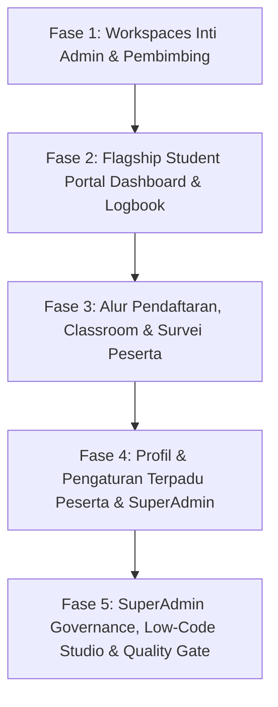

# 📋 SENIOR DEVELOPER HANDBOOK & MASTER PRD: REDESIGN WORKSPACES, PORTAL PESERTA, DAN TATA KELOLA SUPERADMIN DENGAN GENTELELLA THEME

**Penyusun**: Lead Senior Full-Stack Architect  
**Target Pelaksana**: Junior Developer & AI Coding Agent (Gemini 3.8 Flash / Claude Haiku / GPT-4o-mini)  
**Tingkat Kesulitan**: Lanjutan (*Advanced Blade Refactoring, Deep State Preservation, Zero Regression*)  
**Tanggal**: 22 Oktober 2026  
**Status**: 🚀 DRAFT MASTER PRD SIAP DIEKSEKUSI  
**Target Utama**: Mentransformasikan halaman-halaman kerja kompleks (*verification & placement workspaces*), seluruh portal peserta (*dashboard, logbook, classroom, registrasi*), serta modul tata kelola SuperAdmin (*audit log, dynamic module builder, monitoring*) ke dalam standar visual **Gentelella Theme** terintegrasi warna resmi **MagKom Sleman** (*Deep Navy* `#0641CC` & *Kominfo Blue* `#0751FF`).

---

## 🛑 ATURAN BESI & PANDUAN SENIOR DEVELOPER (ZERO REGRESSION GUARDRAILS)

> [!CAUTION]
> ### ⚠️ PANDUAN MUTLAK JUNIOR DEV / AI MODEL (BACA DULU SEBELUM SENTUH KODE):
> 1. **DILARANG MENYENTUH BACKEND**:
>    - JANGAN PERNAH menyentuh file di folder `app/Http/Controllers/`, `app/Models/`, `app/Enums/`, `database/migrations/`, atau `routes/web.php`.
>    - Seluruh tugas hanya memodifikasi layer tampilan Blade (`resources/views/**/*.blade.php`).
> 2. **DILARANG MENGHAPUS / MENGGANTI ID ELEMEN DOM, FORM ACTION, ATAU INPUT NAME**:
>    - Seluruh elemen JavaScript interaktif, modal Bootstrap/Gentelella, dan payload HTTP bergantung pada ID spesifik seperti `#formVerifikasi`, `#btnTerimaBerkas`, `#modalTolakBerkas`, `name="catatan_verifikasi"`, dll.
>    - Jika ada modal, pertahankan `id="..."`, `tabindex="-1"`, `role="dialog"`, dan atribut `data-toggle="modal"` atau `data-bs-toggle="modal"`.
> 3. **DILARANG MENGHAPUS BLADE DIRECTIVES**:
>    - Selalu pertahankan `@csrf`, `@method(...)`, `@error(...)`, `@if(...)`, `@foreach(...)`, `@push('scripts')`, dan `@push('styles')`.
> 4. **HINDARI INLINE STYLE HARDCODED WARNA**:
>    - Gunakan variabel CSS sistem MagKom: `var(--neutral-900)`, `var(--neutral-700)`, `var(--neutral-100)`, `var(--blue-700)` `#0641CC`, `var(--blue-600)` `#0751FF`.
>    - Seluruh komponen Gentelella sudah dioptimalkan untuk *Light Mode* dan *Dark Mode* (`[data-theme="dark"]`).
> 5. **VERIFIKASI TEST SETIAP KALI SELESAI SATU FILE**:
>    - Jalankan perintah PHPUnit filter yang tertera pada setiap tugas sebelum pindah ke file berikutnya.

---

## 🧰 BUKU SAKU KOMPONEN GENTELELLA (CHEAT SHEET UNTUK JUNIOR DEV & AI)

Gunakan komponen Blade resmi yang berada di `resources/views/components/gentelella/`:

### 1. Panel Konten Berbingkai (`<x-gentelella.x-panel>`)
Gunakan untuk membungkus tabel, daftar entri, atau formulir utama.
```html
<x-gentelella.x-panel 
    title="Judul Panel" 
    subtitle="Deskripsi singkat atau panduan operasional"
    :toolbox="true"
    :collapse="true"
    :close="false">
    {{-- Konten panel di sini --}}
</x-gentelella.x-panel>
```

### 2. Kartu Ringkas / Kotak Info (`<x-gentelella.card>`)
Gunakan untuk kartu profil, kartu ringkasan di sidebar kanan, atau panel filter.
```html
<x-gentelella.card 
    title="Filter & Pencarian" 
    icon="fa fa-filter" 
    variant="default">
    {{-- Form filter di sini --}}
</x-gentelella.card>
```

### 3. Kartu Statistik Angka (`<x-gentelella.tile-stat>`)
Gunakan untuk metrik KPI di bagian atas dashboard atau hub data.
```html
<x-gentelella.tile-stat 
    title="Total Tugas Aktif" 
    value="{{ $totalTugas }}" 
    icon="fa fa-tasks" 
    color="blue" 
    trend="12% dari minggu lalu" 
    trendIcon="fa fa-arrow-up" 
    trendColor="green" />
```

### 4. Tabel Responsif Gentelella (`<x-gentelella.table>`)
Gunakan untuk seluruh tabel data. Otomatis memiliki gaya baris gelap/terang khas Gentelella (`jambo_table`).
```html
<x-gentelella.table :striped="true" :hover="true" class="jambo_table">
    <thead>
        <tr class="headings">
            <th class="column-title">No</th>
            <th class="column-title">Nama</th>
            <th class="column-title no-link last"><span class="nobr">Aksi</span></th>
        </tr>
    </thead>
    <tbody>
        {{-- Data rows --}}
    </tbody>
</x-gentelella.table>
```

### 5. Lencana Status (`<x-gentelella.badge>`)
Gunakan untuk status penempatan, status verifikasi berkas, atau prioritas tugas.
```html
<x-gentelella.badge variant="success">Diterima</x-gentelella.badge>
<x-gentelella.badge variant="warning">Perlu Perbaikan</x-gentelella.badge>
<x-gentelella.badge variant="danger">Ditolak</x-gentelella.badge>
<x-gentelella.badge variant="primary">Aktif</x-gentelella.badge>
<x-gentelella.badge variant="secondary">Draft</x-gentelella.badge>
```

### 6. Tombol Resmi MagKom (`<x-gentelella.button>`)
```html
<x-gentelella.button type="submit" variant="primary" icon="fa fa-save">
    Simpan Perubahan
</x-gentelella.button>
```

### 7. Modal Pop-up Terstandar (`<x-gentelella.modal>`)
```html
<x-gentelella.modal id="modalTolakBerkas" title="Konfirmasi Penolakan Berkas" size="md">
    <form action="{{ route('admin.pendaftaran.tolak', $pendaftaran) }}" method="POST">
        @csrf
        {{-- Input alasan penolakan --}}
        <div class="modal-footer">
            <button type="button" class="btn btn-default" data-dismiss="modal">Batal</button>
            <button type="submit" class="btn btn-danger">Tolak Berkas</button>
        </div>
    </form>
</x-gentelella.modal>
```

---

## ⚖️ EVALUASI PENDEKATAN TEKNIS (ARCHITECTURAL OPTIONS)

| Kriteria Evaluasi | Opsi 1: Rewrite HTML Manual & Custom Scoped CSS | Opsi 2: Component-First Refactoring dengan Rigid DOM Preservation (Rekomendasi) |
| :--- | :--- | :--- |
| **Resiko Regresi Backend/Testing** | 🔴 **Sangat Tinggi** — AI atau Junior Dev sering menghapus atau mengganti form ID, action URL, dan CSRF token. | 🟢 **Sangat Rendah** — Membungkus kode HTML eksisting ke dalam komponen Gentelella tanpa mengubah nama input, event handler, atau struktur form. |
| **Ukuran & Kebersihan File** | 🔴 **Buruk** — File Blade membengkak hingga >60KB karena ribuan baris inline CSS berulang. | 🟢 **Sangat Baik** — File menjadi ringkas, modular, mudah dibaca, dan CSS terpusat pada `public/css/gentelella-theme.css`. |
| **Konsistensi UI Multi-Role** | 🔴 **Rendah** — Desain antar-role (Admin vs Peserta vs SuperAdmin) terasa terfragmentasi dan berbeda layout. | 🟢 **Sempurna** — Seluruh role menggunakan komponen card, table, dan modal yang identik dengan token warna resmi Sleman. |
| **Dukungan Dark Mode** | 🟡 **Parsial** — Warna background dan teks rawan tabrakan kontras saat berpindah tema. | 🟢 **100% Native** — Komponen Gentelella Blade sudah terhubung langsung dengan CSS variable tema terang/gelap. |

> 🏆 **Rekomendasi Senior Developer**: **Pilih Opsi 2**. Refactor secara terfokus per file dengan membungkus kontainer data ke komponen Blade Gentelella, mengganti tabel ke `<x-gentelella.table>`, merapikan modal, dan mempertahankan 100% atribut form dan event JavaScript.

---

## 📑 DAFTAR FILE TARGET & SPESIFIKASI PERUBAHAN

| No | File Target | Aksi | Ringkasan Modifikasi |
| :--- | :--- | :--- | :--- |
| 1 | `resources/views/admin/pendaftaran/show.blade.php` | Modify | Modernisasi *Verification Workspace* 1,297 baris: Card biodata peserta, panel dokumen berkas, modal verifikasi, dan status stepper Gentelella. |
| 2 | `resources/views/admin/penempatan/show.blade.php` | Modify | Standarisasi *Placement Workspace*: x-panel informasi alokasi pembimbing, ringkasan progres logbook, dan tombol aksi SK penerimaan. |
| 3 | `resources/views/pembimbing/tugas/create.blade.php` | Modify | Penyelarasan formulir pembuatan tugas ala Google Classroom: grid 2 kolom Gentelella, rubrik penilaian, batas pengumpulan, dan berkas lampiran. |
| 4 | `resources/views/pembimbing/tugas/edit.blade.php` | Modify | Standarisasi halaman sunting tugas dengan komponen form-group Gentelella. |
| 5 | `resources/views/peserta/dashboard.blade.php` | Modify | Transformasi dashboard peserta 1,388 baris: Hero banner MagKom, tile-stat countdown mingguan, ringkasan tugas aktif, dan x-panel logbook. |
| 6 | `resources/views/peserta/logbook/index.blade.php` | Modify | Revamp jurnal mingguan 1,741 baris: Banner penempatan, x-panel riwayat logbook, dan modal input logbook dengan conditional radio cuti/sakit. |
| 7 | `resources/views/peserta/pendaftaran/index.blade.php` | Modify | Standarisasi formulir registrasi & upload berkas pendaftaran dengan stepper tahapan Gentelella dan dropzone yang bersih. |
| 8 | `resources/views/peserta/pendaftaran/detail.blade.php` | Modify | Status tracker pengajuan magang, alert catatan revisi verifikator, dan kartu identitas pengajuan. |
| 9 | `resources/views/peserta/tugas/index.blade.php` | Modify | Katalog tugas bimbingan peserta: filter status tugas (Ditugaskan, Diserahkan, Dinilai) dengan card Gentelella. |
| 10 | `resources/views/peserta/tugas/show.blade.php` | Modify | Lembar serah terima tugas peserta: formulir upload berkas/URL repositori GitHub, rincian skor rubrik, dan riwayat feedback pembimbing. |
| 11 | `resources/views/peserta/survei/index.blade.php` | Modify | Lembar kuesioner survei kepuasan magang 4 dimensi evaluasi dengan x-panel Gentelella. |
| 12 | `resources/views/peserta/profil/show.blade.php` | Modify | Kartu profil biodata peserta (NIK, NIM, Universitas, Alamat) dengan `<x-gentelella.card>` 2 kolom. |
| 13 | `resources/views/peserta/pengaturan/index.blade.php` | Modify | Pengaturan ganti password dan preferensi notifikasi peserta. |
| 14 | `resources/views/superadmin/akun/index.blade.php` | Modify | Tata kelola akun kredensial SuperAdmin dan preferensi sistem. |
| 15 | `resources/views/superadmin/audit-log/index.blade.php` | Modify | Stream 15 kanal audit trail: layout sidebar kanal Gentelella, tabel log dengan level badge, dan modal detail payload JSON. |
| 16 | `resources/views/superadmin/monitoring/show.blade.php` | Modify | Detail telemetri bimbingan peserta baca-saja (*read-only trace*). |
| 17 | `resources/views/superadmin/modul-builder/index.blade.php` | Modify | Katalog modul kustom dinamis: tile-stat metrik modul dan tabel modul aktif. |
| 18 | `resources/views/superadmin/modul-builder/create.blade.php` | Modify | Formulir perancang skema tabel dan kolom modul low-code. |
| 19 | `resources/views/superadmin/modul-builder/edit.blade.php` | Modify | Halaman edit skema modul dinamis. |
| 20 | `resources/views/superadmin/modul-data/index.blade.php` | Modify | Grid data entri modul dinamis dengan `<x-gentelella.table>`. |

---

## 🚀 ROADMAP EKSEKUSI TAHAP DEMI TAHAP (5 FASE SIKLUS)



---

## 🛠️ FASE 1: WORKSPACES INTI ADMIN & PEMBIMBING (VERIFIKASI, PENEMPATAN & CLASSROOM STUDIO)

### 📌 Tugas 1.1: Modernisasi Verification Workspace Admin
* **Target File**: `resources/views/admin/pendaftaran/show.blade.php`
* **Kondisi Eksisting**: File masif (~1,297 baris) dengan CSS inline kustom berulang (~60KB) untuk tab berkas, dokumen previewer, dan action bar.
* **Instruksi Khusus untuk Junior Dev / AI**:
  1. Bungkus Header & Action Bar atas dengan breadcrumb Gentelella dan `<x-gentelella.badge>` status pendaftaran resmi.
  2. Susun tata letak 2 kolom:
     - **Kolom Kiri (`col-md-4 col-sm-12`)**:
       - Pasang `<x-gentelella.card title="Identitas Calon Peserta" icon="fa fa-user">` berisi avatar inisial, Nama Lengkap, Institusi/Universitas, Jurusan, Nomor HP/WhatsApp, dan Email.
       - Pasang card ringkasan periode magang (Tanggal Mulai, Tanggal Selesai, Pilihan Bidang).
     - **Kolom Kanan (`col-md-8 col-sm-12`)**:
       - Bungkus tab berkas (Surat Pengantar, Proposal, Transkrip, KTP/KTM) ke dalam `<x-gentelella.x-panel title="Pemeriksaan Berkas Persyaratan" subtitle="Periksa keaslian dokumen PDF dan berikan penilaian kelayakan">`.
       - Standarisasi formulir verifikasi status (Terima, Minta Perbaikan, Tolak).
  3. **PANTANGAN MUTLAK (JANGAN DIUBAH / DIHAPUS)**:
     - Form ID: `#formVerifikasi`, `#modalTolak`, `#modalPerbaikan`, `#modalTerima`.
     - Action route: `route('admin.pendaftaran.verifikasi', $pendaftaran)`.
     - Input names: `name="status"`, `name="catatan_admin"`, `name="bidang_id"`, `name="pembimbing_id"`.
     - PDF viewer iframe / modal previewer dokumen berkas.
* **Perintah Verifikasi PHPUnit**:
  ```bash
  php artisan test --filter="AdminPendaftaranVerificationTest|AdvancedAdminAndSuperAdminPhaseFiveTest"
  ```

---

### 📌 Tugas 1.2: Modernisasi Placement Workspace Admin
* **Target File**: `resources/views/admin/penempatan/show.blade.php`
* **Kondisi Eksisting**: File 646 baris dengan inline CSS untuk detail pembimbing, rekapitulasi progres magang, dan tombol unduh surat diterima.
* **Instruksi Khusus**:
  1. Gunakan `<x-gentelella.tile-stat>` untuk metrik progres peserta:
     - Kehadiran / Logbook Terisi (Warna: `green`, Ikon: `fa fa-book`)
     - Tugas Diselesaikan (Warna: `blue`, Ikon: `fa fa-check-square-o`)
     - Nilai Evaluasi Sementara (Warna: `orange`, Ikon: `fa fa-star`)
  2. Bungkus data alokasi pembimbing lapangan ke dalam `<x-gentelella.x-panel title="Alokasi Bimbingan &amp; Kedinasan" subtitle="Rincian pejabat pembimbing teknis dan surat penempatan resmi">`.
  3. Tampilkan tombol cetak/unduh Surat Keterangan Diterima PDF (`route('admin.penempatan.surat-diterima', $penempatan)`) dengan `<x-gentelella.button variant="primary" icon="fa fa-file-pdf-o">`.
  4. **PANTANGAN MUTLAK**: Pertahankan link download surat diterima, form ubah pembimbing, dan modal pembatalan penempatan jika ada.
* **Perintah Verifikasi PHPUnit**:
  ```bash
  php artisan test --filter="AdvancedThreePillarsDashboardTest|AdminPenempatanTest"
  ```

---

### 📌 Tugas 1.3: Standarisasi Classroom Assignment Creator Workspace
* **Target Files**:
  - `resources/views/pembimbing/tugas/create.blade.php`
  - `resources/views/pembimbing/tugas/edit.blade.php`
* **Kondisi Eksisting**: File 649 baris dengan layout Google Classroom bergaya custom.
* **Instruksi Khusus**:
  1. Pertahankan tata letak 2 kolom ala classroom namun gunakan kontainer Gentelella:
     - **Kolom Utama (`col-md-8 col-sm-12`)**: `<x-gentelella.x-panel title="Detail Tugas &amp; Instruksi" subtitle="Berikan instruksi yang jelas, rubrik penilaian, dan bahan acuan">` berisi input Judul Tugas, Deskripsi/Instruksi (Rich Editor), dan Attachment Upload.
     - **Kolom Sidebar (`col-md-4 col-sm-12`)**: `<x-gentelella.card title="Pengaturan Penugasan" icon="fa fa-sliders">` berisi Tanggal Tenggat Waktu (Deadline), Target Peserta (Semua atau Individu Tertentu), dan Bobot Nilai Rubrik.
  2. Standarisasi input styling menggunakan kelas `form-control` dan `form-group`.
  3. **PANTANGAN MUTLAK**:
     - Form action `route('pembimbing.tugas.store')` dan `route('pembimbing.tugas.update', $tugas)`.
     - Input names: `name="judul"`, `name="deskripsi"`, `name="tenggat_waktu"`, `name="peserta_ids[]"`, `name="lampiran[]"`, `name="bobot"`.
* **Perintah Verifikasi PHPUnit**:
  ```bash
  php artisan test --filter="PembimbingTugasTest|ClassroomAssignmentTest"
  ```

---

## 🎓 FASE 2: FLAGSHIP STUDENT PORTAL (DASHBOARD & JURNAL LOGBOOK PESERTA)

### 📌 Tugas 2.1: Modernisasi Flagship Dashboard Peserta
* **Target File**: `resources/views/peserta/dashboard.blade.php`
* **Kondisi Eksisting**: File masif 1,388 baris dengan hero banner custom, countdown timer, dan widget bimbingan aktif.
* **Instruksi Khusus untuk Junior Dev / AI**:
  1. **Hero Banner Modern Sleman**: Pertahankan background hero gradient `#0641CC` dengan logo Sleman, namun bungkus konten menggunakan tata kelola flexbox yang rapi dan konsisten.
  2. **Tile Stats Row**: Pasang 3 `<x-gentelella.tile-stat>` di bawah hero:
     - Sisa Hari Masa Magang (Warna: `blue`, Ikon: `fa fa-calendar`)
     - Logbook Terverifikasi (Warna: `green`, Ikon: `fa fa-check-circle`)
     - Tugas Bimbingan Selesai (Warna: `purple`, Ikon: `fa fa-graduation-cap`)
  3. **Kartu Bimbingan & Pembimbing**: Gunakan `<x-gentelella.x-panel title="Informasi Penempatan &amp; Pembimbing Lapangan" subtitle="Hubungi pembimbing teknis untuk konsultasi dan arahan tugas harian">`.
  4. **Widget Tugas Aktif**: Tampilkan daftar tugas yang mendekati deadline dalam format card Gentelella dengan badge prioritas.
  5. **PANTANGAN MUTLAK**: Pertahankan kondisi `@if($penempatan)` dan status pendaftaran peserta (`berkas_belum_lengkap`, `diajukan`, `waiting_list`, `diterima`). Jangan ubah teks sambutan dinamis nama peserta.
* **Perintah Verifikasi PHPUnit**:
  ```bash
  php artisan test --filter="PesertaFullPortalFeatureTest|PesertaDashboardTest"
  ```

---

### 📌 Tugas 2.2: Modernisasi Jurnal Mingguan & Modal Logbook Peserta
* **Target File**: `resources/views/peserta/logbook/index.blade.php`
* **Kondisi Eksisting**: File raksasa 1,741 baris dengan modal pengisian logbook custom, filter minggu, dan timeline kegiatan harian.
* **Instruksi Khusus**:
  1. Pasang banner ringkasan penempatan magang di bagian atas dengan `<x-gentelella.card variant="default">`.
  2. Bungkus bilah filter minggu (Minggu ke-1 s/d Minggu ke-12) dengan tab/pills berstandar Gentelella yang responsif.
  3. Tampilkan riwayat entri logbook dalam `<x-gentelella.x-panel title="Daftar Logbook &amp; Catatan Harian" subtitle="Catat kegiatan harian dan dapatkan verifikasi mingguan dari pembimbing">`.
  4. **Modal Pengisian Logbook (`id="modalLogbook"`)**:
     - Bungkus dengan `<x-gentelella.modal id="modalLogbook" title="Isi Logbook Kegiatan Harian" size="lg">`.
     - Pertahankan radio button kondisi kehadiran: Hadir Aktif, Sakit (unggah surat dokter), Izin Resmi.
     - Pertahankan input upload lampiran dokumentasi foto/kegiatan (`name="foto_kegiatan"` / `name="berkas_pendukung"`).
  5. **PANTANGAN MUTLAK**:
     - Modal ID `#modalLogbook` dan tombol pemicu `data-toggle="modal" data-target="#modalLogbook"`.
     - Form action `route('peserta.logbook.store')` dan input `name="minggu_ke"`, `name="tanggal"`, `name="kegiatan"`, `name="status_kehadiran"`.
* **Perintah Verifikasi PHPUnit**:
  ```bash
  php artisan test --filter="PesertaLogbookTest|PesertaFullPortalFeatureTest"
  ```

---

## 🎒 FASE 3: ALUR PENDAFTARAN, CLASSROOM & SURVEI PESERTA

### 📌 Tugas 3.1: Modernisasi Alur Pendaftaran Magang 4-Tahap
* **Target Files**:
  - `resources/views/peserta/pendaftaran/index.blade.php` (1,402 baris)
  - `resources/views/peserta/pendaftaran/detail.blade.php`
* **Instruksi Khusus**:
  1. Gunakan stepper visual khas Gentelella (`wizard_steps`) untuk 4 tahap pendaftaran:
     - Tahap 1: Pemilihan Periode & Bidang
     - Tahap 2: Pengisian Biodata Calon Peserta
     - Tahap 3: Unggah Berkas Persyaratan (KTP, KTM, Surat Pengantar, Proposal)
     - Tahap 4: Konfirmasi & Kirim Berkas
  2. Bungkus area dropzone upload berkas ke dalam kartu `<x-gentelella.card>` yang rapi dengan indikator ukuran file maksimal (PDF maks 2MB).
  3. Pada halaman `detail.blade.php`, tampilkan status verifikasi dengan `<x-gentelella.badge>` dan alert catatan admin jika berkas berstatus `perlu_perbaikan`.
  4. **PANTANGAN MUTLAK**:
     - Form ID pendaftaran, multi-part form `enctype="multipart/form-data"`.
     - Input names: `name="bidang_id"`, `name="periode_mulai"`, `name="periode_selesai"`, `name="surat_pengantar"`, `name="proposal"`, `name="transkrip"`, `name="cv"`.
* **Perintah Verifikasi PHPUnit**:
  ```bash
  php artisan test --filter="PesertaPendaftaranFlowTest|PesertaFullPortalFeatureTest"
  ```

---

### 📌 Tugas 3.2: Modernisasi Penugasan Classroom Peserta
* **Target Files**:
  - `resources/views/peserta/tugas/index.blade.php`
  - `resources/views/peserta/tugas/show.blade.php` (1,048 baris)
* **Instruksi Khusus**:
  1. Pada `tugas/index.blade.php`, tampilkan daftar tugas dalam grid card Gentelella (`col-md-6 col-sm-12`) dengan pill status: *Belum Dikerjakan*, *Menunggu Penilaian*, *Selesai*.
  2. Pada `tugas/show.blade.php` (Lembar Serah Terima):
     - **Kolom Kiri (`col-md-8 col-sm-12`)**: `<x-gentelella.x-panel title="{{ $tugas->judul }}" subtitle="Diterbitkan oleh {{ $tugas->pembimbing->nama }}">` berisi deskripsi lengkap tugas, berkas acuan dari pembimbing, dan rubrik penilaian.
     - **Kolom Kanan (`col-md-4 col-sm-12`)**: `<x-gentelella.card title="Pengumpulan Tugas Anda" icon="fa fa-upload">` berisi formulir penyerahan tugas (input URL repositori GitHub/Google Drive dan upload berkas ZIP/PDF).
  3. Tampilkan riwayat catatan revisi dan skor jika tugas sudah dinilai pembimbing.
  4. **PANTANGAN MUTLAK**:
     - Form action `route('peserta.tugas.kumpul', $tugas)`.
     - Input `name="tautan_repositori"`, `name="berkas_tugas"`, `name="catatan_peserta"`.
* **Perintah Verifikasi PHPUnit**:
  ```bash
  php artisan test --filter="PesertaTugasClassroomTest|PesertaFullPortalFeatureTest"
  ```

---

### 📌 Tugas 3.3: Modernisasi Kuesioner Survei Kepuasan Magang
* **Target File**: `resources/views/peserta/survei/index.blade.php`
* **Instruksi Khusus**:
  1. Bungkus instruksi pengisian survei evaluasi dengan `<x-gentelella.x-panel title="Kuesioner Evaluasi Kepuasan Magang" subtitle="Bantu Diskominfo Sleman meningkatkan mutu pelaksanaan magang berikutnya">`.
  2. Tampilkan instrumen pertanyaan 4 dimensi (Fasilitas, Bimbingan Lapangan, Kesesuaian Kompetensi, Pengalaman Umum) dalam radio scale 1-5 berdesain bersih.
  3. Sediakan textarea saran dan kritik dengan form-control seragam.
  4. **PANTANGAN MUTLAK**: Pertahankan form submit `route('peserta.survei.store')` dan nama radio button pertanyaan survei.
* **Perintah Verifikasi PHPUnit**:
  ```bash
  php artisan test --filter="PesertaFullPortalFeatureTest"
  ```

---

## 👤 FASE 4: PROFIL & PENGATURAN TERPADU PESERTA & SUPERADMIN

### 📌 Tugas 4.1: Standarisasi Lembar Profil Biodata Peserta
* **Target File**: `resources/views/peserta/profil/show.blade.php`
* **Instruksi Khusus**:
  1. Terapkan layout 2 kolom Gentelella:
     - **Kolom Kiri (`col-md-4 col-sm-12`)**: `<x-gentelella.card title="Foto & Identitas Mahasiswa" icon="fa fa-id-card">` berisi avatar profil peserta, NIM/NIS, nama kampus/sekolah, dan status magang.
     - **Kolom Kanan (`col-md-8 col-sm-12`)**: `<x-gentelella.x-panel title="Perbarui Biodata Peserta" subtitle="Pastikan data identitas sesuai KTP dan data akademik resmi">` berisi form NIK, Tempat/Tanggal Lahir, Jenis Kelamin, Jurusan, Alamat Domisili DIY, dan Nomor Kontak Darurat.
  2. **PANTANGAN MUTLAK**: Form action update profil `route('peserta.profil.update')`, input upload foto profil, dan validasi field NIK/NIM.
* **Perintah Verifikasi PHPUnit**:
  ```bash
  php artisan test --filter="PesertaFullPortalFeatureTest"
  ```

---

### 📌 Tugas 4.2: Standarisasi Pengaturan Akun Peserta & SuperAdmin
* **Target Files**:
  - `resources/views/peserta/pengaturan/index.blade.php`
  - `resources/views/superadmin/akun/index.blade.php`
* **Instruksi Khusus**:
  1. Susun pengaturan dalam 2 kartu Gentelella (`<x-gentelella.card>`):
     - **Kartu Keamanan Sandi**: Form ubah kata sandi (Password Lama, Password Baru min. 8 karakter, Konfirmasi Password Baru).
     - **Kartu Preferensi Visual & Bahasa**: Pilihan mode tampilan (Terang, Gelap, Mengikuti Tema Sistem) dan bahasa antarmuka.
  2. Pertahankan route ganti password dan atribut input password.
* **Perintah Verifikasi PHPUnit**:
  ```bash
  php artisan test --filter="StaffProfileAndSettingsTest|LanguageLocalizationTest"
  ```

---

## 🛡️ FASE 5: TATA KELOLA SUPERADMIN, LOW-CODE STUDIO & QUALITY GATE

### 📌 Tugas 5.1: Modernisasi Stream Jejak Audit Trail 15-Kanal
* **Target File**: `resources/views/superadmin/audit-log/index.blade.php`
* **Kondisi Eksisting**: File 615 baris bergaya Discord Stream dengan navigasi sidebar kanal custom.
* **Instruksi Khusus**:
  1. Susun layout 2 kolom:
     - **Sidebar Kanal (`col-md-3 col-sm-12`)**: `<x-gentelella.card title="Kanal Jejak Audit" icon="fa fa-list">` menampilkan 15 kanal aktivitas (Autentikasi, Kuota, Pendaftaran, Penempatan, Bimbingan, Nilai, dll.) dengan badge hitungan aktivitas terkini.
     - **Stream Log (`col-md-9 col-sm-12`)**: `<x-gentelella.x-panel title="Aktivitas Real-Time Kanal: {{ $activeChannelMeta['label'] }}" subtitle="Rekam jejak seluruh mutasi data dan aksi administratif">`.
  2. Tampilkan log aktivitas dalam `<x-gentelella.table :striped="true" class="jambo_table">`:
     - Kolom: Waktu, Aktor/Pengguna, Aksi/Peristiwa, IP Address, Level/Severity, Rincian Data.
  3. Modal Rincian Payload JSON: Format JSON modal berlatar belakang gelap dengan teks monospace yang mudah dibaca.
  4. Pertahankan tombol Ekspor CSV (`route('superadmin.audit-log.export')`) dan parameter filter kanal.
* **Perintah Verifikasi PHPUnit**:
  ```bash
  php artisan test --filter="SuperAdminPortalVisualTest|SuperAdminMasterArchitectureTest"
  ```

---

### 📌 Tugas 5.2: Modernisasi Detail Monitoring Telemetri Peserta
* **Target File**: `resources/views/superadmin/monitoring/show.blade.php`
* **Instruksi Khusus**:
  1. Standarisasi lembar trace monitoring bimbingan peserta aktif secara baca-saja (*read-only*).
  2. Gunakan `<x-gentelella.tile-stat>` untuk rekap skor penilaian dan persentase kehadiran logbook.
  3. Tampilkan riwayat timeline bimbingan menggunakan styling timeline Gentelella yang elegan.
  4. Pertahankan tombol cetak/pratinjau surat diterima PDF.
* **Perintah Verifikasi PHPUnit**:
  ```bash
  php artisan test --filter="SuperAdminPortalVisualTest|AdvancedThreePillarsDashboardTest"
  ```

---

### 📌 Tugas 5.3: Modernisasi Dynamic Module Studio (Low-Code CRUD Engine)
* **Target Files**:
  - `resources/views/superadmin/modul-builder/index.blade.php`
  - `resources/views/superadmin/modul-builder/create.blade.php`
  - `resources/views/superadmin/modul-builder/edit.blade.php`
  - `resources/views/superadmin/modul-data/index.blade.php`
* **Instruksi Khusus**:
  1. Pada `modul-builder/index.blade.php`: Ganti tile kustom dengan 3 `<x-gentelella.tile-stat>` (Total Modul Aktif, Total Record Data, Modul Publik).
  2. Pada formulir `create.blade.php` dan `edit.blade.php`: Bungkus form builder field dinamis ke dalam `<x-gentelella.x-panel title="Konfigurasi Skema Modul Dinamis" subtitle="Tentukan nama tabel, kolom data, tipe input, dan hak akses role">`.
  3. Pada `modul-data/index.blade.php`: Bungkus data grid modul yang digenerate secara dinamis menggunakan `<x-gentelella.table :striped="true" class="jambo_table">`.
  4. **PANTANGAN MUTLAK**: Pertahankan builder dynamic input row JavaScript, form POST generator, dan tombol ekspor CSV/Print modul.
* **Perintah Verifikasi PHPUnit**:
  ```bash
  php artisan test --filter="SuperAdminMasterArchitectureTest|DynamicCrudGeneratorTest"
  ```

---

### 📌 Tugas 5.4: Quality Gate Akhir (Pint, Full 457 Tests & Graphify)
* **Instruksi Eksekusi**:
  1. Jalankan linter Laravel Pint:
     ```bash
     ./vendor/bin/pint --test
     ```
  2. Jalankan seluruh test suite tanpa pengecualian (wajib 457 tests passed):
     ```bash
     php artisan test
     ```
  3. Perbarui knowledge graph repositori:
     ```bash
     graphify update .
     ```

---

## 🧪 STRATEGI TESTING & SUITE VERIFIKASI

```bash
# 1. Verifikasi Workspace Verifikasi & Penempatan Admin
php artisan test --filter="AdminPendaftaranVerificationTest|AdminPenempatanTest|AdvancedAdminAndSuperAdminPhaseFiveTest"

# 2. Verifikasi Classroom Workspace Pembimbing
php artisan test --filter="PembimbingTugasTest|ClassroomAssignmentTest"

# 3. Verifikasi Portal Peserta (Dashboard, Logbook, Pendaftaran, Tugas)
php artisan test --filter="PesertaFullPortalFeatureTest|PesertaDashboardTest|PesertaLogbookTest"

# 4. Verifikasi Profil Staf, Peserta & Pengaturan Akun
php artisan test --filter="StaffProfileAndSettingsTest|LanguageLocalizationTest"

# 5. Verifikasi SuperAdmin Audit Trail, Monitoring & Modul Dinamis
php artisan test --filter="SuperAdminPortalVisualTest|SuperAdminMasterArchitectureTest"

# 6. Final Quality Gate (Full Test Suite 457 Passed)
php artisan test
```

---

## ⚠️ ANALISIS RISIKO & STRATEGI MITIGASI

1. **Risiko Hilangnya Modal ID / Dropzone Upload Berkas**:
   - *Penyebab*: AI atau Junior Dev sering menyederhanakan markup dengan menghapus tag `<form>` atau atribut file upload `enctype="multipart/form-data"`.
   - *Mitigasi*: Cek kembali atribut form sebelum menyimpan file. Pastikan tag `<input type="file">` dan previewer tetap memiliki ID aslinya.
2. **Risiko Kerusakan Skrip Timeline Logbook Peserta**:
   - *Penyebab*: Modifikasi kontainer logbook dapat memutus selektor jQuery/Vanilla JS pemicu modal atau filter tab minggu.
   - *Mitigasi*: Pertahankan seluruh attribute `data-minggu="..."`, `class="logbook-item"`, dan form handler modal.
3. **Risiko Glitch Kontras pada Audit Trail Stream**:
   - *Penyebab*: Audit trail menampilkan JSON payload yang memerlukan latar belakang kontras tinggi.
   - *Mitigasi*: Gunakan kelas utilitas kode `bg-dark text-light p-3 rounded` dengan font monospace agar tetap terbaca sempurna di light maupun dark mode.

---

## ✅ KRITERIA SELESAI (DEFINITION OF DONE)

- [ ] Seluruh 20 file target di Fase 1–5 telah dimodernisasi menggunakan komponen resmi Gentelella (`x-panel`, `card`, `tile-stat`, `table`, `badge`, `button`, `modal`).
- [ ] Seluruh form ID, input name, route action, dan CSRF token 100% utuh tanpa menyentuh satu pun file Controller atau Route backend.
- [ ] Tampilan konsisten dalam mode terang (*Light Mode*) dan mode gelap (*Dark Mode*).
- [ ] Linter `./vendor/bin/pint --test` lulus dengan status hijau (0 error).
- [ ] Seluruh **457 tests** pada `php artisan test` berstatus **PASSED** (0 failures, 0 errors, 2,682 assertions).
- [ ] Graf dependensi `graphify update .` berhasil diperbarui.
